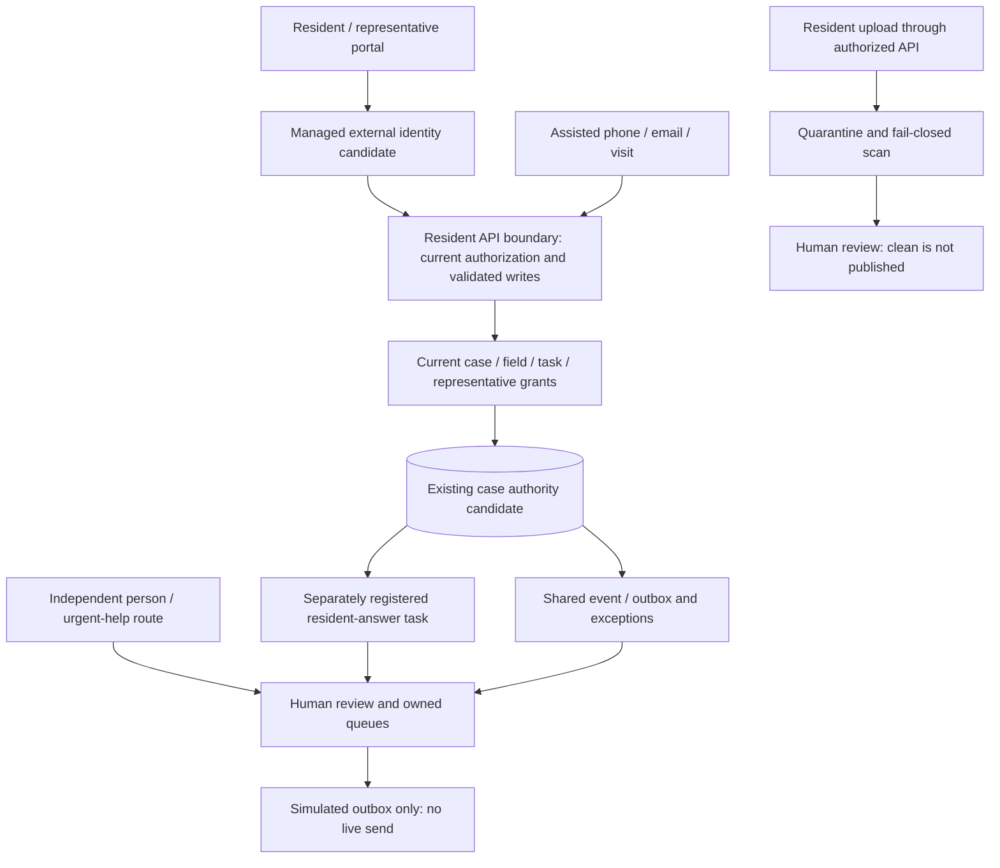
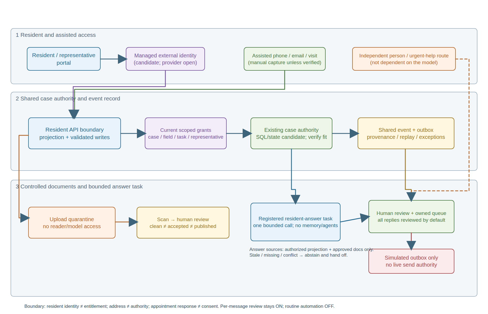

Integration notice (2026-10-23, #441): this is the single evolving working
proposal at its existing tracked location. The
[prior published working bytes](refinement-evidence/published-proposal-4017.md)
and [exact reconciled author source](refinement-evidence/author-proposal.md)
remain historical/custody evidence, not competing decisions. Only links,
input-inventory labelling and this notice differ from the recommended author
candidate, with its duplicate frontmatter-title H1 removed for repository
Markdown conventions; [source-to-integrated hashes](refinement-evidence/source-to-integrated.json)
identify actual bytes. No accepted ADR supersession or allocation occurs.

Author-era reported remote/validator/PID observations below are preserved as
source context, not current instructions or unfinished work: correction1 at
8ada8109 independently reproduced/fixed the scope/baseline defect and 14
historical navigation links, preserving bot d8b416a3. Its
[Review](../../../reviews/logs/2026-10-23/resident-portal-requirements-441-correction1-review.md)
does not cover this new candidate. The fresh PRD FAIL/seven cautions below
remain current. Independent native integrated-byte Review is separate from
formal requirements quality, registration and all human/live approvals.

**Recommended integration candidate after completed-PRD reconciliation.**
This new file refines the original ADR candidate without altering its bytes or
custody. Content reconciliation is complete against PRD v0.19.1 SHA-256
`7fb40549ba4975c2feb8d8a2a3de882e06677875c02e4a43c4b3a94ddf218343`.
This is still an unsigned review proposal, not an accepted requirements handoff.
Use this file as the **one** recommended architecture candidate; the PRD
package’s subsidiary ADR is a supporting input, not another canonical decision.

**UNREGISTERED PROPOSAL — `id: null` — status `proposed`.** Author-complete,
review-ready working candidate for PR #442 / issue #441, not an accepted,
registered, Govern-complete or production-final ADR. This refines the existing
proposal; it does not supersede any accepted ADR. Owner confirmation of Frame,
Decide and Option B is carried forward, not re-solicited and not converted into
company, Legal, DPO, operational, funding or deployment approval.

## Context and Problem Statement

How can an optional resident service reduce avoidable coordination work while
preserving a single case authority, explicit permissions, safe evidence and
accessible human service? The proposed answer is an independently staged portal
and workflow over the existing controlled API, with a distinct bounded
resident-answer task gated separately rather than a second platform or an
extension of staff chat.

## Context

> Source: [Canonical unsigned BRD v0.20.0](../../../../docs/brds/agentic-retrofit-programme-brd.md), optional resident amendment, FR-053–FR-062, AC-104–AC-126, OD-52–OD-55, dated 2026-10-23.
>
> Source: [Completed unsigned PRD v0.19.1](../../../../docs/prds/zava-forward-retrofit-programme-demonstrator.md), DD-009, FR-062–FR-071, AC-111–AC-140, NFR-018–NFR-021, PR442 stories/stages, dated 2026-10-23.
>
> Source: [Published unregistered proposal](refinement-evidence/published-proposal-4017.md) and its [archived ADR state](source-evidence/adr/state.json): confirmed Option B and rationale; no allocated ID.

The immutable baseline is the supplied document snapshot at published head
`4017b214bb021244b06264629953d84f29003c53`, not a checkout of current main or the
active issue worktree. [Original input-manifest identity (inventory retained externally)](refinement-evidence/original-input-manifest-identity.json) inventories all snapshot
bytes; [reconciliation inputs](refinement-evidence/adr/reconciliation-input-manifest.json) separately
pin the completed PRD package and historical ADR outputs. Inventory is not a
claim to have read every file. The
[original case study](../../../../docs/case_study_48_original.md) is historical
intent, not verified delivery, legal currentness or forecast. The dated resident
section in the [addendum](../../../../docs/case_study_48_addendum.md), the
[reference index](../../../../docs/reference/README.md) and owner-curated
[memory](../../../../docs/reference/memory.md) distinguish subsequent proposals,
source history and preferences. No historical source is rewritten.

Original source reviews and state record BRD Define BLOCKED / Govern
NOT_EVALUATED and PRD Validate BLOCKED / Finalize NOT_EVALUATED. These are
historical source-quality outcomes, not newly run checks and not erased by
this refinement. Importantly, BRD FR-044/AC-084 were prospectively reconciled
by owner direction in PR #442. That wording conflict is **not a current
unresolved drafting question**; actual routine-policy authority, evaluation
and activation remain unresolved under OD-53. Old contrary archived wording
stays dated history. Canonical BRD/PRD remain unsigned.

Coordinator readback at 22:40 on 2026-10-23 reports remote head
`d8b416a3f13e3e4a5b018f0853285ced972c1c8a`, differing from the pin only in
`.github/rubric/scores/latest.json` (22 additions / 21 deletions). This is
reported drift, not an independently fetched comparison. The immutable input
and supplied metadata are unchanged; this package does not bind later bytes.

## Completed PRD reconciliation and current independent quality

The completed PRD preserves the existing FR/AC/NFR/CON/GOAL/DD/OQ definitions
and adds twenty local stories, R0–R5 planning stages, six-journey validation
design, categorized verification and namespace-qualified full FR trace.
The [delta/disposition record](refinement-evidence/adr/reconciliation-report.md) distinguishes exact
unchanged definitions, compatible elaboration, stale subsidiary wording and
remaining contradictions. Structural matching is not approval or feasibility.

The **current independent PRD quality result**, not just historical source
history, is **FAIL / Validate BLOCKED / Finalize NOT_EVALUATED**. Review
`PRD-2026-AMA48-001-quality-20261023T225531005Z` reports 0 RISK, 7 CAUTION,
34 COVERED, with two HIGH, three MEDIUM and two LOW cautions. Its separate
core threshold blocks because **singular = 1 < 2**; feasible and conforming
also score 1. No authoring check or 71/71 link coverage overrides that result.
The seven findings remain:

| Finding | Current disposition in this architecture candidate |
| --- | --- |
| pr442-qual-005 HIGH — inherited PRD FR-044/FR-060 and AC-104–106 bundles | Still a Validate blocker; retain parent IDs. C1–C9 do not repair or atomically certify those independent obligations. Governed decomposition/atomic subchecks remain future scoped work. |
| pr442-qual-040 HIGH — unsigned BRD / no governed handoff | No signed upstream authority inferred; completed PRD is an unsigned review input only. |
| pr442-qual-006 MEDIUM — feasibility | Provider/identity fit, staffing, recovery, budget and delivery capacity remain unknown. Shared-authority design is a proposal, not proven fit. |
| pr442-qual-024 MEDIUM — GOAL-005 SMART | Six scripts and a future review-window description do not establish achievability or a committed deadline. No date or capacity promise is invented. |
| pr442-qual-041 MEDIUM — generic/resident NFR precedence | Authored correction 2026-10-25 using owner decisions: audience-based applicability preserves NFR-002; awaiting fresh independent review, not closed. See precedence correction below. |
| pr442-qual-009 LOW — AC-104–106 table shape | Inherited two-cell rows in a five-column PRD table remain; no whole-PRD conformance claim. |
| pr442-qual-039 LOW — PRD FR-059 goal trace | Definition GOAL-004 versus retained matrix also GOAL-002 remains exposed; resident trace comparison does not fix reciprocal fidelity. |

[Reviewer summary](refinement-evidence/prd/review/reviewer-result-summary.md) is the supplied
current independent result. The reviewer inspected requirements quality but
did not independently run Git/hash tooling, validators, application tests,
user studies, gates or approvals. Raw complete payloads were returned inline,
not persisted as raw files; the supplied summary retains the verdict/rollups/
findings. Hash checks in this lane bind the summary bytes, not reproduce the
review or turn it into a validated raw release contract. The PRD author’s
older change-gap language about no fresh review and its original future-review
tasks predate that completed result and are not controlling current status.

Publication recommendation is **review-ready unsigned proposal only**, subject
to the coordinator’s authorized native integration and review process. It is
not a Validate exit, accepted handoff, waiver, legal decision or production
release. No unrelated requirement debt is repaired in this ADR.

## Decision Drivers

1. Optional service without detriment: phone, email, letters, visits, assisted
   support, complaint access and human response continue without portal use.
2. Separate identity from authority: current verified person/case/field/task
   and representative grants are checked at every protected operation.
3. Safe documents: received, clean, reviewed, accepted and published are
   distinct; unsafe or unvalidated content never reaches readers or a model.
4. One case timeline: portal and assisted reports retain provenance,
   replay/ambiguity handling and accountable human ownership.
5. Grounded, bounded answers: current authorised evidence, source/as-of,
   abstention and human handoff; no resident persistent memory or agent loop.
6. Human decision boundaries: named review is current default; only an
   explicitly activated versioned routine policy could replace it for narrow
   messages. Consequential, sensitive, uncertain, safety, consent, contractual
   and financial messages always require named review.
7. Reversible delivery and support: portal/workflow first, task later; preserve
   independent staff work and model-independent human/urgent service.
8. Honest scale and value: 60,000 homes are stock, not accounts/concurrency;
   workload and staff-time sensitivities are judgement, not observed benefit.

### Architecturally significant requirements

All eight closed-enum ASR drivers were previously considered and remain in
frontmatter: security and compliance for identity, files, privacy and consent;
cost and performance for bounded service/model use; availability and scalability
for failure and load; maintainability and evolvability for reuse and replaceable
providers. Their evidence is the pinned BRD/PRD, not inferred production
readiness. All associated success criteria are proposed tests, not results.

### Scope, decision participants and non-goals

The Programme owner is the exercise decision-maker only. Proposed accountability
is Programme; Engagement owns communication; Housing owns case exceptions;
Digital owns technical support. Safety, Legal, DPO, Finance, procurement and
other competent authorities retain their domain decisions. Named appointees,
capacity, response SLAs and live delegations are not supplied by role names.

This record chooses a responsibility and trust-boundary composition. It does
not select a provider, model, managed-agent product, region, topology, retention
period, production capacity, account count, budget, launch date or staffing plan.
No live accounts/data, sending, procurement, paid inference, Azure change,
implementation, publication or merge is authorized. Provider chat, persistent
resident memory and delegated-agent loops remain excluded. It is not a broad
repair of inherited requirements or a new implementation loop.

## Considered Options

* **A — Portal and deterministic workflow first; no resident-answer task in
  the first slice.** Same safe identity, grants, documents and human service,
  with sourced deterministic status/process views.
* **B — Shared case authority with a distinct bounded resident-answer task,
  portal/workflow first and task separately gated.** Reuse the controlled API
  and existing SQL case/event authority as the candidate record; do not add
  competing case truth or extend employee chat.
* **C — Separate managed resident/agent platform, stores and integrations.**
  Independent release/isolation is possible but unverified, with another
  authority/projection, supplier and reconciliation boundary.

## Decision Outcome

Chosen option: **B**, for proposed synthetic exercise architecture only.
Owner rationale, verbatim:

> Reuse existing case authority to avoid duplicate platforms; deliver the portal/workflow first and independently gate the bounded resident-answer task.

| Driver | A — portal only | B — shared authority + gated task | C — separate platform |
| --- | --- | --- | --- |
| One case truth / less duplication | Strong; same authority | Strong if API isolation proves fit | More synchronization and divergent-state risk |
| Requested bounded answer task | Deferred | Included after independent gates | Possible but more platform surfaces |
| Security/privacy exposure | Lowest AI increment; portal still substantial | New resident/task boundary; scoped projection mandatory | Extra stores, integrations and supplier boundaries |
| Human service / inclusion | Required | Required and model-independent | Required; vendor features not evidence |
| Delivery reversibility | Simple fallback | Portal and task independently disableable | Separate release but integration/exit complexity |
| Cost and support | Lower initial complexity, manual workload remains | Shared platform, added review and recovery cost | Additional licensing/support/retention obligations |
| Evidence fit | Retained fallback | Owner-selected staged scope | No verified unmet need justifying duplication |

Option B does not require the model task to activate before useful portal
workflow. If the task fails its gates, retain A-like workflow without claiming
AI benefit. Revisit C only when evidence shows a required isolation, ownership
or capability boundary cannot be met by shared authority. Provider-neutral
managed external identity with a simple username/password-style experience is
the selected shape, not a custom password store or staff-tenant-only service.

### Consequences

* **Positive:** One case record reduces contradictory decisions and double
  entry; task-specific registration and evaluation make the AI increment
  inspectable; portal-only comparison helps isolate AI value; providers can
  be changed behind contracts rather than becoming the case authority.
* **Negative:** Public resident access increases abuse, account recovery and
  support burden. Shared authority concentrates authorization risk and can
  couple staff/resident capacity. Revocation across caches, files, exports,
  model context and dispatch needs proof, not UI hiding.
* **Negative:** Quarantine, review, publication, exception queues and outbox
  reconciliation add engineering and operating cost. Human review may erase
  illustrative savings; the low scenario is already net-negative. No
  exactly-once delivery or zero-cost reuse follows from a shared record.
* **Negative:** Managed identity adds provider dependency, enrolment/recovery
  friction, accessibility and exit obligations. Keeping assisted routes is
  essential but requires actual staffing and training, not merely a link.
* **Neutral:** Provider, operational targets, grant issuance, lawful basis,
  retention, model selection and service capacity remain explicit future
  decisions. Their absence does not prevent this honest working proposal,
  but blocks applicable release and benefit claims.

### Confirmation

Owner confirmation covers Frame, Decide, Option B and exercise-only rationale;
it is not acceptance or live authority. Confirmation of implementation would
require the tests and gates below against exact later bytes, independent
qualified review and explicit owner/control-owner acceptance. No requirement
criterion is marked passed by authoring this document.

## Architecture responsibilities and contracts

The following **C1–C9** are proposed logical contracts, not implemented endpoints,
new APIs, telemetry field names or approved physical schemas. Exact wire
formats, limits and storage migrations need later design review. Each contract
has one controlling boundary so a UI, model or channel cannot silently become
an alternative authority.

### C1 — Managed identity and session boundary

Managed external identity owns credentials, supported sign-in, verification,
lockout/session and recovery mechanisms. Digital must evidence provider terms,
residency, accessibility, abuse controls, support and costs under OD-54. The
portal can present simple username/password-style UX; it must not store custom
passwords, email passwords or require staff-directory membership. Server-side
identity validation precedes access; a browser-supplied identity or role is not
trusted. Tokens/passwords never enter case content or diagnostic captures.

Enrolment and assisted recovery establish a verified person using an approved
process; they do not establish case or works authority. Recovery, account
linking and household changes must revalidate separate grants. Shared-device
logout/session expiry must prevent subsequent users seeing cached case content.
Session/abuse/verification thresholds remain unapproved, not guessed defaults.
Identity outage blocks protected access safely while ordinary assisted/urgent
contact stays available without model success.

### C2 — Current entitlement and resident projection

The existing API is the only resident authorization and controlled-write
boundary. The browser receives only a resident-published projection: permitted
case summary/timeline, next action/owner/update, recorded-as-of/source version,
appointment response state and permitted published documents. No internal
notes, staff conversation/memory, unpublished drafts or another occupant’s
private material are present, including existence-revealing metadata.

Proposed grant records express verified person, permitted case/field/task,
explicit household/representative scope, evidence source, authorised issuer,
validity/review/expiry, change/revocation reason and version. Unknown, expired,
disputed or revoked authority denies access pending owned human clarification.
Address, relationship, tenancy reference or login alone grants no rights.
Interpreter-only and appointment-only authority do not broaden into document,
financial or works-consent powers. Several homes/occupants require explicit
individual scopes; there is no implied household-wide permission.

Recheck current grants on view, list, search, upload, file download, export,
model retrieval/turn and dispatch, even inside an existing session. Revocation
denies the next protected request; stale grants must not be served from a
long-lived session or cached projection. Revalidate before publishing a delayed
answer or releasing a file; discard/rebuild stale projections. Current checks
must cover queued work as well as interactive requests. Implementation must
show how caches/links are mediated or invalidated; no long-lived public link
can substitute for current authorization. Disclosure already legitimately
received cannot be remotely recalled; do not claim otherwise.

### C3 — Case event, write and reconciliation boundary

The API validates the requested operation and records the original resident or
assisted report as **attributed and unverified**, not accepted fact. Proposed
service-record content comprises event/source identity, scoped case reference,
channel, occurred/recorded times, actor/reporter, protected original account or
source link, purpose, delivery/receipt/review states, next action/owner/update
and correlation/replay reference. Unknown is explicit. These are protected
business records, not a diagnostic payload or an endorsed physical schema.

Use stable source identity and an idempotent effect boundary so retry/replay
links to the original rather than creating another case effect. A reused key
with conflicting content is an owned conflict, not a last-writer-wins merge.
Ambiguous household matching never reveals candidate households; it enters a
restricted Housing queue. Portal events are not retyped into staff records.
Where phone/email/letter/visit connectors are absent, authorised staff record
labelled manual/assisted capture with provenance. No connector is invented.

Durable intake/case effect and pending outbox state must be coherently recorded
or reconciled before reporting a receipt. The implementation must justify its
transaction/recovery mechanism; no specific new broker or database is chosen.
After a lost acknowledgement, query/reconcile the prior operation before safe
retry. A dispatched message, receiver receipt, review, accepted handoff and
completed action remain separate states. Sender/chase ownership persists until
the receiver explicitly accepts; failed/unowned/overdue work remains visible.

### C4 — Document lifecycle and publication

Authorize the current document request and current uploader scope before
intake. A safe intake receipt follows durable storage of the operation and
quarantined content; it reports pending scan/review, never verified/accepted.
Unsupported, oversize, interrupted or rejected attempts leave the request
outstanding with an accessible reason/retry/assisted route and no false receipt.
Type/size/rate limits and scanning capabilities need approved finite values;
none is silently selected here.

Quarantine is isolated from ordinary staff readers, residents and model context.
A trusted scanning component may inspect quarantined bytes under its own
minimal access. An unavailable, failed or uncertain scan remains quarantined.
Only a clean permitted file becomes reviewer-accessible. Clean, human review,
acceptance as evidence and resident publication are separate recorded actions;
publication requires authorised reviewer/role and a specific case/version/audience.
No scanner or model can accept a professional fact or publish a document.

Download/retrieval uses the current grant and publication/version state, not a
raw object URL. Superseded, internal-only, revoked and unrelated versions stay
inaccessible, including metadata, search and model inputs. Scan/publication
changes must invalidate dependent answers or recheck their sources before
release. Link/cache revocation and rights/deletion handling need tested designs;
no retention period or blanket irreversible-delete policy is inferred.

### C5 — Appointment responses, preferences and consent

An offered-slot response is an event for human scheduling. Confirmation still
requires scoped resident/representative authority, authorised staff and verified
contractor capacity under the existing scheduling rules. A proposed different
time or postponement cannot confirm a booking, instruct works, infer refusal,
add no-access counts or change sibling measures. Hold affected **non-urgent**
progression for its human owner/update; urgent hazard response is independent.

Safe contact, language, accessibility and channel preferences are explicit
case/contact records, not model-learned memory. Verify a changed route before
use, or pause for clarification and expose an owned next-update state. Do not
contact an unsafe old address/number as a recovery shortcut. Portal use,
login, upload, silence, a representative relationship and slot acceptance never
establish works consent, blanket data-processing consent or professional
approval. Works consent and any scoped representative decision must follow
the existing human-controlled evidence/authority process. A request for help,
complaint or human review is not conditional on having an account.

### C6 — Distinct bounded resident-answer task

This task requires its own FR-036 capability-registry entry and exact-version
release/evaluation, not use of staff FR-055–FR-059 or regulatory FR-060 authority.
ADR registry registration and **AI task registration are separate gates**.
An unregistered architecture proposal authorizes neither. Task input is the
minimal API-produced currently authorised projection plus approved resident
process/document sources and a purpose-limited question. Recheck access and
source versions for each turn and again before delayed output is displayed.
There is no unrestricted store search, model-side entitlement decision, raw
quarantine access, persistent resident preference memory or delegated-agent/tool
loop. One bounded model call is the proposed exercise shape; finite tokens,
timeout and call limits require versioned approval, with no unbounded retries.

Output is a structured proposal with material assertions grounded to source
version and as-of time, visible AI disclosure and actual disposition. Missing,
stale, conflicting or unauthorised evidence results in explicit unknown/
abstention and an owned human handoff; no fabricated status or advice. Source
text and user prompts are untrusted data, not policy, permissions or tools.
Checks must test injection, cross-case leakage, unsupported assertions and
misleading citations, not only fluent text. Prompt/model/source/evaluation
changes invalidate dependent release evidence until re-evaluated.

The task cannot grant rights, record works consent, diagnose, classify/release
hazards, set statutory clocks, accept technical evidence, commit money or
contracts, or autonomously confirm appointments. Controlled/sensitive requests
go to competent humans. Deterministic visible person/urgent-help routes and
possible-hazard referral operate independently of model success; the model
cannot suppress, delay or close them. Model failure leaves manual case work
and help available. Preserve only purpose-limited minimal service/handoff
records subject to distinct privacy decisions, not reusable resident memory.

### C7 — Review, bounded policy and dispatch

**Activation OFF.** Named per-message human review remains the current default
for every AI-drafted resident reply, including an in-portal display. No live
send path is authorized. The owner selected the prospective policy shape,
not its actual approval. FR-044/AC-084 are already reconciled in the pinned
canonical requirements; do not keep demanding that historical wording repair.

A future narrowly eligible acknowledgement, reminder or grounded status/process
reply may use policy disposition only when all checks match: authorised named
policy approver, task/content/channel/audience scope, expiry, exact evaluated
model/prompt/source/policy/release versions, current grants and safe contact,
current evidence, finite limits, monitoring, disable/recovery and separate
OD-53/RULE-028/RULE-020 release approval. Missing, expired, mismatched or disabled
policy means **no autonomous dispatch**; it is held for named review or an
owned exception, never silently downgraded into a send. A test-positive path is
only a labelled simulated outbox under a separately approved exercise policy.

Consequential, sensitive, uncertain, safety, consent, contractual, financial
and unmatched messages **always** retain named review before sending. A human
review does not override grants, unsafe contact, revoked publication or task
prohibitions. Changes while queued require revalidation. Store the actual
reviewer and accept/edit/reject reason, or the actual policy approver/version,
automated disposition and outcome where legitimately activated; never invent
per-message review. Both preserve source/model/configuration/prompt versions,
time and reconstructable disposition under BRD FR-044/AC-084. Kill switch
blocks the next dispatch; restart requires separate authorised review and
current evidence. Staff chat and regulatory assistant remain no-send.

### C8 — Human operations and escalation

Programme is proposed accountable for the whole service; Engagement for
communication policy and resident updates; Housing for exceptions, disputed
grants and case handling; Digital for technical support and controlled disable/
recovery; specialist authorities for their own decisions. Each intake,
document review, ambiguity, failed contact and handoff must have a staffed
accountable owner or escalation/chase owner, reason, urgency and next-update
state. Delivery alone cannot close a handoff. Actual appointments, service
hours, response thresholds and staffing remain OD-52/55 decisions, not invented
SLAs. Urgent statutory/emergency service is never held for routine policy/model
availability or internal exercise clocks.

Optionality applies to service, priority, consent, complaints and accessible
human response. Phone/email/letters/visits and assisted support follow the same
controlled case/decision routes without digital detriment. Human-help routes
must be visible before sign-in, during failures and within tasks; actual
contact details and staffing require owner confirmation, not fabrication.
Accessibility failures block the affected synthetic task and are not deferred
to live rollout. Direct resident research and qualified accessibility review
are still needed; role-agent walkthroughs are not resident validation.

### C9 — Privacy, audit, diagnostics and cost

OD-54 must evidence purpose, lawful basis/special-category conditions where
relevant, notices, DPO/Legal/DPIA decisions, provider terms/transfers, retention,
rights, recovery and incident responsibilities before real accounts/data.
This document asserts no legal currentness or compliance conclusion. Files,
case/source events and audit, and minimal conversation/handoff records require
separate owners, access, retention, deletion/restriction and export decisions.
Deleting a conversation cannot silently delete an authoritative case event;
protected history is not a blanket exemption from rights decisions.

Protected business audit supports reconstruction of grant changes, documents,
source versions, human/policy dispositions, handoff acceptance and event replay.
Diagnostic telemetry is separate, access-controlled and minimised. Apply the
loaded telemetry-foundations skill and applicable OpenTelemetry semantic
conventions, not new inline telemetry names. Deny credentials/tokens, raw
prompts/files, contact/address content and sensitive case identifiers in
diagnostics. Bound cardinality, redact before capture, propagate trace context
at service boundaries and retain failure visibility without resident content.
Resource/attribute vocabulary, sampling and retention need implementation
review; no backend, production instrument or achieved SLO is claimed here.
Any necessary new vocabulary must use the shared proposed-additions process.

Account for identity, storage, scanning, model, network, observability, review,
reconciliation, onboarding, support and failure recovery. Finite approved task
limits degrade to tested workflow-only service on exhaustion; no unbounded call
loop or free cloud fallback. Dated price/billing evidence is needed for money
claims. This authoring run makes no paid inference or cloud call.

## Architecture diagram and data flows

Primary closed-enum diagram format remains **mermaid**. Editable Excalidraw,
SVG and PNG are supplementary, copied byte-identically from the pin; no
ceremonial redraw. The 47-element diagram shows the **inactive baseline**:
all replies reviewed by default, routine automation OFF, simulated outbox.
Its label “Registered resident-answer task” is a future prerequisite, not
current capability. PNG provenance is same-model SVG/Chrome render, **not a
native Excalidraw export**. Future routine-policy activation is described by
C7, not falsely shown as an already active bypass.

[Editable Excalidraw](resident-service-boundary.excalidraw) ·
[Companion SVG](resident-service-boundary.svg)

**Accessible equivalent:** Resident/representative sign-in crosses managed
external identity and then the API’s current grant checks before any case,
field, task or document projection. Staff-assisted contact enters the same case
timeline, manually where connectors are absent. Authorised uploads are isolated
in quarantine; a clean scan permits review but not evidence acceptance or
publication. A later separately registered task receives only currently
permitted sources, proposes a grounded answer or abstains, and reaches human
review/owned queues. Current output ends in a simulated outbox, not live send.
Human/urgent help bypasses the model. Login is not entitlement; address is not
authority; appointment response is not consent. Disablement retains safe manual
service, not an unprotected-read bypass.

| Flow | Boundary / minimum information | Failure or manual path |
| --- | --- | --- |
| F1 Sign-in/recovery → API | Verified person/session, then distinct current C2 grants | Protected access denies; assisted verification/help; no inferred household rights |
| F2 API ↔ shared case authority | Permitted projection, current source/version/as-of and validated C3 event | Unknown/stale explicit; ambiguity restricted to Housing; no alternate case truth |
| F3 Upload → quarantine → scan/review/publication | Scoped requested file and durable receipt; C4 state/version separation | Unsafe/unvalidated remains isolated; outstanding/pending visible; safe retry/manual route |
| F4 Portal/assisted → timeline/outbox | Original source/provenance, occurred/recorded times, stable replay identity | Link replay, own conflict/lost ack, manual capture; receipt ≠ receiver acceptance |
| F5 API projection → task → review | Minimal permitted evidence and purpose-limited question; C6 citations/as-of | Abstain/owned handoff, deterministic help/referral; no model authority expansion |
| F6 Approved human/policy disposition → simulated outbox | C7 current policy/grant/contact/evidence checks and truthful audit | OFF/default review; no live send; next-dispatch kill switch; no staff/regulatory send |
| F7 Business records → assurance / diagnostics | Protected audit for facts/dispositions; separate minimised operational diagnostics | No raw resident content/credentials in diagnostics; distinct rights/retention decisions |

The diagram is logical, not a network/security deployment topology or an
infrastructure-derived drawing. It proves no network isolation or implemented
runtime. A later infrastructure-derived diagram would require the architecture-
diagrams skill and the same authoritative mermaid preference.

## Error, manual and recovery paths

| Condition | Required safe outcome | Proposed human owner / retained record |
| --- | --- | --- |
| Login/recovery unavailable or disputed | Deny protected access; accessible help; no password workaround or new entitlement | Digital technical support with Housing/Engagement proof process |
| Revoked/expired/disputed grant or stale projection | Deny next protected operation and delayed output; no existence leak | Housing grant clarification; protected actor/reason/time record |
| Scanner unavailable, unsafe file or interrupted intake | Quarantine; accurate outstanding/pending state; no false acceptance/receipt | Document reviewer / Digital recovery; original receipt/source retained |
| Duplicate, ambiguous or lost-ack event | Query/reconcile original, avoid duplicate effects, restricted exception | Housing queue; sender/chase owner until accepted handoff |
| Model timeout, unsupported or conflicting answer | Unknown/abstain, owned handoff and next update; manual workflow intact | Engagement/Housing; limited evidence/context, no persistent memory |
| Safety/distress or person request | Visible deterministic urgent/help referral independent of AI | Existing competent human route; no model clock/priority decision |
| Unsafe/changed contact, expired policy or exhausted limit | No autonomous output; named review/owned exception; verify safe route | Engagement policy/contact owner; actual disposition, not fabricated review |
| Portal/API outage or accessibility block | No fabricated completion; safe retry and phone/email/visit/assisted continuity | Programme service accountability; Digital incident/recovery and Housing chase |
| Restart after suspension | Reconcile events, grants, pending files, policy/source versions and owner acceptance | Digital with affected control owner; no automatic return to sending |

## Completed-PRD fixture and NFR precedence boundary

The completed PRD explicitly retains **proposed synthetic fixtures**, not
unselected ideas or approved live defaults: upload PDF/JPEG/PNG, one file per
request, maximum 10 MiB; pending scan at 60 seconds offers assisted follow-up,
never fail-open; bounded model shape one call, no delegated tool/agent loop,
15-second timeout; missing finite input/output budget, price/liability or
execution authority means no call. Ordinary handoff ages of one working day
to acknowledgement and two to next update are overdue-queue fixtures only;
urgent help/referral is independent. Acknowledging these fixture values does
not approve execution, choose a provider or establish staffing or a service SLA.
Actual finite token/rate/cost limits, real recovery/session/abuse settings,
retention and live service approvals remain open. C1/C4/C6/C8 statements that
limits need approval mean that approval is absent, **not** that the completed
PRD contains no proposed numerical configuration.

**Precedence correction (2026-10-25, owner decisions of 2026-10-24):** inherited
PRD NFR-002 core acceptance (warm list/detail p95 <=1s, controlled write <=2s,
dashboard <=3s, import preview <=10s; 5 MB/file and 100 MB total evidence) is
preserved unchanged for staff/core operations. The owner selected resident-specific
targets: ordinary permitted case/status/receipt API p95 <=2s with five synthetic
concurrent sessions for 30 minutes, and resident uploads <=10 MiB/file. The
PRD v0.21.0 [target applicability table](../../../../docs/prds/zava-forward-retrofit-programme-demonstrator.md#target-applicability-and-precedence-owner-decisions-2026-10-24)
assigns each request by authenticated audience and route class, never by shared
implementation. Architecture consequence: resident routes use resident-audience
authorisation, so a shared function or store cannot be used to relax a staff
target or to serve a resident through a staff route. A request that cannot be
assigned to exactly one rule is `unresolved` and cannot pass. MB and MiB are not
silently equated. Whether resident files count toward the 100 MB per-home evidence
total, and any promotion of a resident file into staff evidence, stay open
engineering/owner questions. This corrects the authored precedence text for
pr442-qual-041; it needs fresh independent review and is not an approval.

The completed PRD calls for freezing request mix/sample method and a 30-minute
window after separately recorded warm-up; report successful-completion p50/p95
alongside all attempted requests/errors/timeouts. Misleading/inadequate samples
are inconclusive or failed against agreed guardrails, never a latency pass.
Receipt timing is durable intake, not scan completion. Diagnostics use the
existing telemetry-foundations/OTel vocabulary and protected audit remains
separate; no new attribute or instrument is coined by this reconciliation.

## Completed PRD stage and story reconciliation

The two numbering schemes are **planning views, not competing release plans**.
This reconciles the old ADR S0–S7 slice keys to PRD R0–R5 / PR442-S01–S20;
no dates, estimates, new tracker issues or implementation are commissioned.

| Completed PRD stage / local stories | ADR responsibility / old planning slice | Reconciled dependency |
| --- | --- | --- |
| R0 / fixture-boundary freeze | C1–C9; old S0 and protocol-freeze portion of S4 | Exact unsigned bytes, grants/events/file states and expected negatives first; resolve overlapping NFR scope for any claimed acceptance. No execution on absent authority. |
| R1 / PR442-S01–S04 | C1/C2/C5/C8; old S1 plus assisted recovery in S3 | Managed synthetic identity and current grant/revocation/shared-device negatives; essential privacy/accessibility not postponed. |
| R2 / PR442-S05–S08 | C2/C3/C4; portal/document portion of old S2 | Own published case/document and safe requested upload; receipt/scan/review/acceptance/publication distinct. |
| R3 / PR442-S09–S14 | C3/C5/C8/C9; workflow part of old S2, S3 and portal-only comparator in S4 | Appointment intent, shared timeline/manual capture, accepted handoff and no-detriment service; freeze portal-only comparator before AI attribution. |
| R4 / PR442-S15–S18 | C2/C6/C7/C8/C9; old S5/S6 | Separate task registry/evaluation/release and finite limits; named review default, routine OFF; retain R3/human question route if task fails. |
| R5 / PR442-S19–S20 | C1–C9; result-review part of old S4/S7 | Collect all six journeys and 30 criteria, paired effort/adverse/load results only when authorised; no unrun privacy/accessibility check disguised as accepted. |

**Protocol timing clarification:** PR442-S19 is placed in R5 as a story, but
its words and PRD FR-071/AC-132 require protocol freeze before testing. Align
R0/S0 freeze and R3 baseline with that requirement; R5 collects/reviews results
and cannot retrospectively choose denominators after seeing AI performance.
The prior ADR slice table’s row order was not a license to start AI before
protocol freeze. This is compatible dependency clarification, not a new PRD
requirement or waiver. R4 remains conditional; if not authorised/passed, report
its criteria Not run/failed as appropriate rather than claiming complete
resident-increment acceptance from portal-only evidence. A negative AI
comparison is valid learning, not activation permission.

The six scripts retain their exact intended safe endpoints and assisted/
negative counterparts. Story keys remain package-local elaborations of
existing FR/AC IDs, not twenty additional products or backlog instructions.
PRD 71/71 qualified FR links are structural author trace; inherited PRD FR-059
matrix disagreement and bundled PRD FR-044/FR-060 obligations remain open.
[Reconciled map](refinement-evidence/adr/requirement-map-reconciled.md) provides all 30 criterion
comparisons and completed trace-parent supplements without changing BRD IDs.

## Workload, performance and value boundaries

Six proposed synthetic journeys are sign-in/recovery, own case/documents,
requested upload, appointment response, grounded question/human handoff and
assisted continuity. PRD NFR-021 proposes **five concurrent fictional sessions
(three residents on separate scopes and two staff), 30 minutes**, using the
continuing generated stock lineage. Ordinary permitted case/status/receipt API
p95 ≤2 seconds on resident routes is an owner-selected exercise target. Managed sign-in, scanning and
model durations are reported separately with all failures/timeouts and pending
states. No achieved test, approved SLO or production capacity follows.

The 60,000 homes and generated programme cases are data lineage/stock, not
unique residents, accounts or concurrency. Author-judgement low/base/high use
81/90/100 new cases per week and 4/8/12 weeks duration, giving **324/720/1200
WIP**, not measured queues. Formulas from the canonical BRD remain unchanged:

* W = A × D; B = W × (C × Tc + E × Te) / 60.
* G = B × U × V; H = W × U × R × Tr / 60; J = W × Q / 60.
* N = G − H − J − S; O = A × U × To / 60; F = N − O.
* I = W × U × To / 60 is one-off initial-cohort onboarding, disjoint from O.

Net weekly staff hours including ongoing onboarding are approximately
**−1.594 / 14.74 / 94.333**. Base routine baseline is 84 hours/week, with 360
calls and 288 separate email/document episodes; recording is already included,
not saved twice. Calls/follow-ups count once unless genuinely separate work.
Controlled/safety/consent workload is not deflected. These scenarios assume
later eligible routine authority; current all-message review requires measured
incremental review effort subtracted from F or reflected in R/Tr, without
changing denominators. Initial and new-intake onboarding cohorts are disjoint.
No uptake forecast, observed saving, cash, headcount reduction or ROI is claimed.

Under FR-071/OD-55 freeze comparable portal/workflow-only versus agent-assisted
protocols: case/contact/task denominators, open/completed and non-digital
cohorts, window, repeats, attribution, review/correction/transcription,
reconciliation, support/recovery and resident effort. Report adverse outcomes,
failed access, task success, guardrails, handoff response and uncertainty even
if the model adds no value. Whole-service cost and actual service capacity
remain unverified. Formula checks are not benefit validation.

## Risks and Mitigations

| Risk / stated threat | Proposed mitigation | Evidence still required |
| --- | --- | --- |
| Identity spoofing, account enumeration or assisted-recovery bypass | C1 managed lifecycle; accessible proof; no password store; C2 separate grants | Provider/security review, abuse/session/recovery and shared-device tests |
| Object/field/representative disclosure, stale grants or cached links | C2 default deny everywhere, next-request revocation, mediated files and delayed-output checks | AC-111–113, AC-126–128, AC-135 across allowed and denied paths |
| Malicious/unpublished document or prompt injection | C4 quarantine/scan/review/publication isolation; C6 data-not-instructions | AC-114/115, AC-123/135; reviewer and model cannot fetch quarantined content |
| False receipt, replay tampering, ambiguous merge or lost handoff | C3 stable identity and durable reconciliation; no latest-wins household merge | AC-118–120, AC-137/138 and conflicting-replay/lost-ack traces |
| Fabricated status, authority, consent or booking | C5/C6 cited facts, abstention, separate human control; deterministic help | AC-116/117, AC-121–123; adversarial and source-change evaluations |
| Out-of-policy/unsafe communication or false reviewer attribution | C7 OFF default, version checks, mandatory excluded-category review, truthful audit | AC-129–131; distinct policy/release/disable/restart evidence |
| Exclusion, inaccessible task or hidden human route | C8 optional assisted service and failure-visible help | AC-124/125/134; direct user work and qualified review still missing |
| Diagnostic leakage or rights/history conflation | C9 minimisation and separate purpose/access/retention classes | AC-135/136; DPO/Legal, provider and rights/retention decisions |
| Shared capacity failure or overstated benefit | Independent task limits, workflow fallback, explicit service/cost measurement | AC-132/133/139, OD-52/55; load and review-capacity evidence |

These are proposed threat-informed design controls, **not an independent
security assessment**, penetration test, privacy approval or implemented
mitigation. No exploitation investigation was commissioned in this authoring lane.

## Rollback / Exit Strategy

Disable the resident-answer task independently if evaluation, sources, privacy,
review capacity, limits or ownership fail; preserve portal/deterministic/human
routes only where their own access and recovery gates pass. Stop routine
dispatch at the next action, keep outstanding events and chase ownership, and
reconcile uncertain outcomes instead of replaying them as accepted facts.
If resident authorization/documents cannot be proven, disable affected resident
access without weakening permissions or delaying unrelated staff landing/auth.

Do not delete authoritative records as rollback. Retention/rights decisions
remain distinct; restore/recovery must preserve provenance, duplicate links,
revocations, publication state and pending work. Restart needs explicit current
version-matched evidence and authorised human review, not automatic re-enablement.
Provider exit/export and identity migration need later OD-54/55 appraisal.
Revisit Option A or C if scoped isolation or whole-service value cannot pass.

## Affected Components

* Optional resident/representative portal and managed identity/recovery.
* API resident projection, current person/case/field/task/representative grants.
* Existing case/event authority and controlled appointment/contact workflows.
* Document quarantine, scanning, review, publication and mediated retrieval.
* Distinct resident-answer task, evidence projection and versioned evaluations.
* Human queues, assisted capture, handoff acceptance and simulated outbox policy.
* Protected audit, separate diagnostics, service/cost and recovery measurement.

Existing ADRs [0001](../../../../docs/adrs/0001-azure-architecture.md),
[0002](../../../../docs/adrs/0002-pilot-readiness-architecture.md),
[0003](../../../../docs/adrs/0003-journey-derived-capabilities-runtime-fit.md),
[0004](../../../../docs/adrs/0004-per-user-agent-chat-and-memory.md),
[0005](../../../../docs/adrs/0005-regulatory-compliance-assistant.md) and
[0006](../../../../docs/adrs/0006-src-layout-and-cutover.md) remain unchanged.
In particular staff-only chat/memory and regulatory no-send are not widened.
Related frontmatter paths name native repository references, not new lineage
allocations; supersedes and superseded-by remain null.

## Pros and Cons of the Options

### A — Portal/workflow only

Good: smallest AI increment and clean comparator; deterministic/manual work
continues if model evaluation fails. Bad: does not exercise the requested
bounded resident-answer capability yet and human workload may dominate.
Neutral: identity, document safety, service ownership and accessibility are
still substantial work, not avoided by omitting the model.

### B — Shared authority and separately gated task

Good: avoids duplicate case truth and preserves staff controls while allowing
separate AI value measurement and disablement. Bad: shared-store isolation,
review burden, event reconciliation, public access and recovery require more
proof than A; reuse is not free and is a shared failure domain. Neutral:
provider/model choices remain replaceable and unselected; task activation
can fail without forcing a second platform or holding portal work hostage.

### C — Separate managed platform

Good: potentially independent release/scale and managed capabilities if verified.
Bad: duplicate projections, supplier and identity boundaries, connectors,
retention/export and support increase cost and divergence risk. Neutral: no
product capability, isolation requirement, licensing or operating evidence has
been supplied that outweighs B’s reuse; reopen only on evidence, not fashion.

## Requirement mapping and decision gates

[Reconciled requirement map](refinement-evidence/adr/requirement-map-reconciled.md) and [machine-readable exact trace](refinement-evidence/adr/requirement-map-reconciled.json)
cover each PRD AC-111–AC-140 individually, with verbatim completed-PRD criterion,
requirement, updated source line/hash, pinned BRD parent IDs, completed-PRD
trace parents and C1–C9 design obligations. All 30 resident criterion texts,
parents and Not-run statuses are unchanged from the pinned canonical PRD.
All execution statuses remain **Not run**. A mapping is not signed upstream
approval, implementation or test completion. ID namespaces are qualified:
PRD FR-061 is not BRD FR-061; do not join by the number alone.

[Reconciled integration handoff](refinement-evidence/adr/integration-handoff-reconciled.md) contains
role-specific approval gates, task slices, completed exact-byte reconciliation
dispositions, preserved current quality blockers and known integration limitations. It is an inert
review/planning preview, not a Govern handoff emission or commissioned new loop.

### Registration and honest formal-validation boundary

The native registry is `docs/adrs/0001–0006`; installed tooling expects
`docs/planning/adrs` and an existing allocator configuration. The published
history records failed allocation/no supported existing-registry bootstrap.
The owner explicitly chose **publish unregistered proposal, defer registration**.
“More final” means stronger authoring, not rescission of that disposition.
This run does not retry the allocator, guess the next ID, create a competing
registry or `.adr-config.yml`, or manually set `last_decision_id`.

The installed frontmatter validator requires an allocated four-digit ID, so
`id: null` intentionally cannot be a formally valid registered ADR. Its exact
current result is recorded in [reconciliation validation](refinement-evidence/adr/reconciliation-validation.json), not suppressed or
worked around with a fake ID. Content drafting is complete despite that
registration blocker; no Govern completion or formal finalfrontmatter claim
follows. A future supported native-registry bootstrap/import, authorized
allocation/path and human review are required to meet full registration
acceptance. No prior ADR is superseded by this refinement.

## More Information

[Reconciliation record](refinement-evidence/adr/reconciliation-report.md), [input hashes](refinement-evidence/adr/reconciliation-input-manifest.json),
[output hashes](refinement-evidence/adr/reconciliation-output-manifest.json) and
[validation](refinement-evidence/adr/reconciliation-validation.json) separate observed document checks
from unperformed acceptance/live gates. The completed sibling PRD is now read
and reconciled at the exact hash above; the original ADR candidate/README/
state/manifests retain their accurate earlier not-yet-read status as history.
No claim extends to a later PRD revision, remote head or integrated repository bytes.

Coordinator reports a Medium reproducibility defect from hosted Copilot review
at 22:38:50 on 2026-10-23 in tracked `validate-integration.py:273`: scope
assertion rejects committed tracking/generated-score paths before a focused
report; newly added canonical files need empty-BASE-aware comparisons, while
numbered ADR changes must still be rejected. This is reported evidence, not a
reproduced finding here. A native RPI integration fix after the existing heavy
gate completes is outside this authoring lane. No current focused-report
reproduction or inherited gate result is claimed. Gate PID 3616364 is left
undisturbed; no publication or merge was attempted.

Review reminder: revisit before any resident slice or task activation, material
identity/grant/model/policy/source change, or reported control failure; request
an owner-set periodic review cadence before live adoption, not an invented date.
Capstone readiness is a separate human/evidence question: see the bounded
[full-rubric challenge](refinement-evidence/adr/capstone-review-boundary.md); this package is not a
scored or approved final production architecture.
