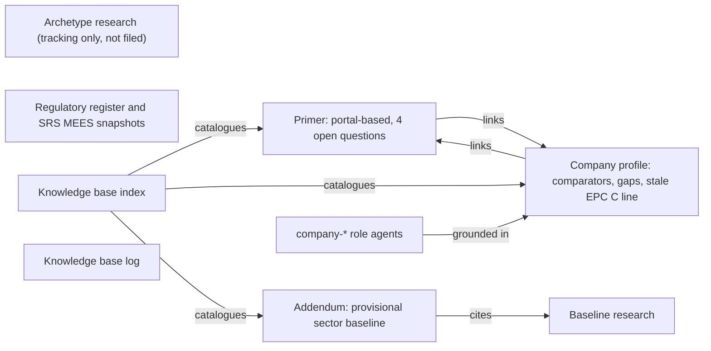
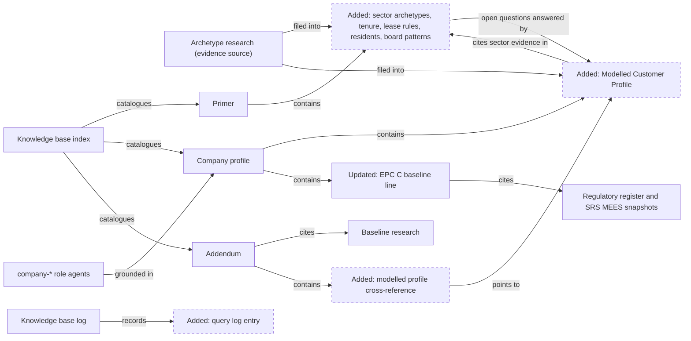
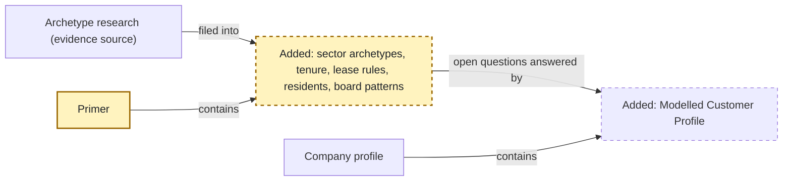
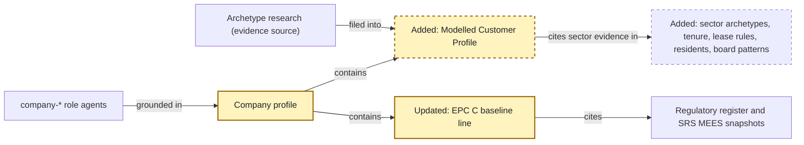
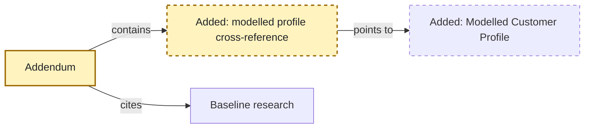
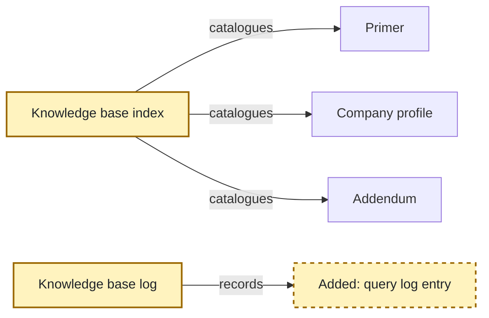

<!-- markdownlint-disable-file -->
# RPI Plan: Integrate the Proper North Homes sector archetype research into the knowledge base

## Task Metadata

* Task ID: RPI-2026-09-25-proper-north-homes-sector-archetype
* Task slug: proper-north-homes-sector-archetype
* Plan date: 2026-09-25

## Executive Summary

* Bottom line: This plan files the completed sector archetype research back into the project knowledge base. Sector-wide evidence (housing association archetypes, tenure statistics, shared ownership and leasehold retrofit rules, resident needs and board capital patterns) goes into the housing association primer. The modelled Proper North Homes profile (archetype, tenure mix, leaseholders, resident indicators and financial scale) goes into the company profile research, labelled throughout as modelled estimates. The addendum gains a short cross-reference, the stale EPC C line in the company profile is corrected, and the index and log record the change.
* Why this matters: The primer's four open questions currently have no answers, and the role agents have no modelled baseline for tenure, leasehold or vulnerability. After this change, research, role agents and proposals can use consistent, sourced estimates without mistaking them for company facts.
* Planning result: Complete and Ready for implementation. All material decisions (D1 to D4, DP1 to DP3) are settled. The standard critique returned Revise with four medium and one low finding, and all five were corrected in the plan.
* Confidence and uncertainty: High for the sector statistics and legal rules, medium for the archetype fit, and medium to low for the modelled counts, which come from comparator medians. Two narrow legal and grant checks remain open and are carried into the documents as open questions rather than resolved.

### What You May Not Know

* The research sits in `.copilot-tracking/`, which is untracked. The knowledge base documents must cite primary sources (GOV.UK, legislation.gov.uk, RSH, Housing Ombudsman) directly rather than link to the tracking file or its `W#` IDs.
* Two existing pages report different sector interest cover figures: 87% weighted average (2025 Global Accounts, in the baseline research) and 91% (2025 Sector Risk Profile, in the new research). They are probably on different bases. The plan flags the difference in the log and does not change the baseline research.
* A web summary gave housing association fuel poverty as 10.0%. The primary DESNZ figure is 11.6% (LILEE, 2024). Only 11.6% should appear in the documents, with the superseded figure noted.
* The Warm Homes: Social Housing Fund 30% non-social rule was verified only in the Greater Manchester Combined Authority copy of the guidance. The preserved right to buy provisions (Housing Act 1985 sections 171A to 171H) were not checked. Both remain open questions in the documents.
* The primer will cite several legal and guidance sources (Housing Act 1985 Schedule 6, the 2003 service charge consultation regulations, GOV.UK shared ownership guidance, the GMCA WH:SHF copy) that have no local snapshot in `docs/reference/regulatory/`. They are marked as such, with change likelihood, and a follow-up item records the snapshot ingest.
* You are on branch `docs/typesafe-open-decision-review`, which is unrelated to this task. Choose or create a branch before implementing.
* The `company-*` role agents are grounded in the company profile research. Consistent "modelled estimate" labels are the control that stops those agents presenting the new figures as company facts.

## Phase Checklist

### Before



### After



Before the change, the research exists only as a tracking artifact and the primer's open questions are unanswered. After the change, sector evidence lives in the primer, the modelled company profile lives in the company profile research and answers the primer's questions, the addendum points to that profile, the stale EPC C line cites the register, and the log records the filing.

<!-- rpi:phase id=P01 -->
### [x] P01: Add sector evidence to the housing association primer

Goals:
* The primer explains the sector patterns behind Proper North Homes (archetypes, tenure statistics, lease responsibility rules, resident needs and board capital patterns) from official sources, so readers no longer depend on the single consumer portal article.

Dependencies:
* None



Highlighted work: the primer and its new sector sections. The link to the Modelled Customer Profile is created here and resolves once P02 adds that section.

<!-- rpi:task id=P01-T01 -->
#### [x] P01-T01: Describe sector scale and housing association archetypes

Goals:
* A reader of the primer can see how concentrated the English sector is and which recurring archetypes exist, with the stock-transfer and merged-group patterns that matter in the North.

Requirements:
* FR-001, NFR-001, NFR-003, NFR-004
* The official size counts appear with their sources: 1,353 private registered providers, 8 owning more than 50,000 social units and 72 owning 10,001 to 50,000 (RSH stock and rents 2024 to 2025, Additional Table 1.19); 10 groups with at least 50,000 and 32 with at least 30,000 social units (RSH group-level SDR tool 2025).
* An archetype table covers the eight archetypes in research Q1 with typical characteristics, northern relevance and a source for each row.
* The text states that the archetypes are an analytical grouping, not a regulatory classification, and that a group can belong to more than one archetype.
* Stock-transfer history is stated with dates: 1,317,176 homes transferred in 306 transactions from 1988 to 2016 (UK Housing Review 2019 Table 68a, secondary compilation), no new transfers since 2015, and the LSVT segment dropped from RSH reporting in 2025 (VfM metrics 2025 paragraph 3.22).

Details:
* Today the primer's `## Sector Scale and Context` lists only three portal-sourced association sizes. Keep those rows and the ranking caveat. Add the official counts next to them rather than replacing the portal content.
* Add a focused section for archetypes after `## Sector Scale and Context`, for example `## Common Housing Association Archetypes`. The primer uses `##` sections and `| --- |` tables; follow that style.
* Do not name the individual comparator groups behind the W4 figures. The research deliberately reports unit counts only.
* Keep the primer about the sector. Proper North Homes' archetype selection belongs in P02-T01; the primer may link to it.

References:
* [docs/reference/research/sector/housing-association-primer.md](../../../docs/reference/research/sector/housing-association-primer.md): target file; `## Sector Scale and Context` is the insertion point
* [.copilot-tracking/research/2026-09-25/proper-north-homes-sector-archetype-research.md](../../research/2026-09-25/proper-north-homes-sector-archetype-research.md):
  * Q1 under `## Findings` holds the archetype table and counts
  * `### Evidence Log` holds URLs, versions and retrieval dates for W1, W4, W5, W6 and W7

Dependencies:
* None

<!-- rpi:task id=P01-T02 -->
#### [x] P01-T02: Extend tenure types and add lease responsibility rules for retrofit

Goals:
* The primer describes the full tenure picture, including supported housing, housing for older people and non-social leasehold, and explains who is responsible for retrofit in shared ownership and leasehold homes.

Requirements:
* FR-002, FR-003, NFR-001, NFR-002, NFR-003
* The England private registered provider mix appears with its source: 65.2% general needs social rent, 12.0% general needs affordable rent, 12.9% supported and older persons, 0.6% affordable rent supported, 9.3% shared ownership (RSH stock and rents 2024 to 2025, Table 1.1). Non-social leasehold is described as counted separately from social units, at about 95,900 homes and up 91% since 2015 (RSH 2025 PRP Stock Briefing Note).
* Each lease rule cites its source, provision and date and is classified: GOV.UK shared ownership repairs guidance (official guidance); Housing Act 1985 Schedule 6 paragraphs 16B and 16C (legislation); Service Charges (Consultation Requirements) (England) Regulations 2003 regulations 4 and 6 with the GBP 250 and GBP 100 thresholds (legislation); the SRS MEES 2026 government response on unresolved leasehold treatment (final policy, not a commenced duty); and the Warm Homes: Social Housing Fund Wave 3 non-social rule (funding condition).
* The section says that allocation of responsibility is internal interpretation subject to legal review, that individual leases vary, and that the 30% non-social rule was verified only in the GMCA copy of the scheme guidance.
* The preserved right to buy provisions (Housing Act 1985 sections 171A to 171H) are named as not yet checked.
* Each regulatory citation without a local snapshot (Housing Act 1985 Schedule 6, SI 2003/1987, GOV.UK shared ownership guidance, GMCA WH:SHF Wave 3 guidance) is marked "no local snapshot" with its official URL and retrieval date (2026-09-25), and carries a change likelihood (`High`, `Medium` or `Low`) as the repository instructions require. Suggested starting values, subject to implementer judgement: legislation `Low`, GOV.UK shared ownership guidance `Medium`, WH:SHF guidance `High` during the live scheme.

Details:
* Extend the existing `## Tenure Types` table or add rows below it for supported housing, housing for older people and non-social leasehold. Keep the source-description and verification-note columns. Place the England mix after the table.
* Add a focused section such as `## Retrofit Responsibility in Shared Ownership and Leasehold Homes` using the content of research Q4. Separate shared ownership from right to buy and preserved right to buy leasehold.
* Cite the local SRS MEES snapshot [docs/reference/regulatory/energy-efficiency/social-rented-sector-mees-government-response-2026.md](../../../docs/reference/regulatory/energy-efficiency/social-rented-sector-mees-government-response-2026.md) (converted 2026-09-19) for the leasehold point rather than a web copy.
* The primer already says "Lease terms determine the association's and the shared owner's repair and improvement responsibilities". Link that note to the new section rather than repeating it.
* Keep modelled counts of Proper North Homes lease interests out of the primer; they belong in P02-T01.

References:
* [docs/reference/research/sector/housing-association-primer.md](../../../docs/reference/research/sector/housing-association-primer.md): `## Tenure Types` is the insertion point
* [docs/reference/regulatory/README.md](../../../docs/reference/regulatory/README.md): current-use status for the SRS MEES government response
* [.copilot-tracking/research/2026-09-25/proper-north-homes-sector-archetype-research.md](../../research/2026-09-25/proper-north-homes-sector-archetype-research.md):
  * Q3 and Q4 under `## Findings`; W1, W2, W8 to W11 and W17 in `### Evidence Log`
  * The preserved right to buy and national DESNZ guidance rows under `## Risks and Open Questions`

Dependencies:
* None

<!-- rpi:task id=P01-T03 -->
#### [x] P01-T03: Add resident needs and board capital prioritisation patterns

Goals:
* The primer gives the national evidence on resident needs and vulnerability data, and the sector pattern for how boards balance safety, covenants, existing homes and new supply.

Requirements:
* FR-004, FR-005, NFR-001, NFR-002, NFR-003
* Resident prevalence rates appear with survey year and source: 61% of social renting households with a long-term illness or disability, 28% with a household reference person aged 65 or over, 50% in the lowest income quintile (EHS 2024 to 2025 demographics chapter); 63% receiving housing support (EHS 2023 to 2024 rented sectors); 11.6% housing association fuel poverty under LILEE for 2024 (DESNZ via UK Housing Review 2026 Table 39a). The text says these figures cover all social renters, including council tenants.
* The superseded 10.0% fuel poverty figure is named as the older LIHC measure and is not used as current.
* The data-completeness text states that no national benchmark exists for recorded vulnerability, cites the Housing Ombudsman May 2023 finding on information management, and links the Awaab's Law Phase 1 and Phase 2 guidance snapshots for recording expectations.
* The board prioritisation order is labelled a sector-informed hypothesis. It cites the RSH Sector Risk Profile 2025 (paragraphs 2.3 to 2.7, 3.3 and 5.4), the RSH VfM metrics 2025 capital split (existing homes up 15% to GBP 3.8 billion; new homes down 4% to GBP 11 billion), the northern regional medians used in research Q2 and Q6, and the SRS MEES 2026 government response for EPC C by 1 April 2030 and the GBP 10,000 spend exemption.
* The 91% EBITDA-MRI figure is described with its basis and source, next to a note that [UK Social Housing Baseline Research](../../../docs/reference/research/sector/uk-social-housing-baseline-research.md) reports 87% as a weighted 2025 Global Accounts average. The baseline research is not edited.
* Regulator, survey and Ombudsman publications cited from the web rather than a local snapshot are marked "no local snapshot" with URL and retrieval date. Where they inform a regulatory or funding claim, they carry a change likelihood.

Details:
* Add a section such as `## Residents and Vulnerability Data` using research Q5 national rates only. Modelled Proper North Homes household counts belong in P02-T01.
* Add a section such as `## How Boards Prioritise Capital` using research Q6. The primer's `## Funding Model` says borrowing and financial regulation are not covered; update that sentence to point to the new section and to the baseline research.
* Cite local snapshots for regulatory material where they exist: [docs/reference/regulatory/social-housing-regulation/awaabs-law-phase-1-guidance-2025.md](../../../docs/reference/regulatory/social-housing-regulation/awaabs-law-phase-1-guidance-2025.md), [docs/reference/regulatory/social-housing-regulation/awaabs-law-phase-2-guidance-2026.md](../../../docs/reference/regulatory/social-housing-regulation/awaabs-law-phase-2-guidance-2026.md) and the SRS MEES government response.
* The grant cap (GBP 7,500 average per home) and the MEES spend exemption (GBP 10,000 per property) measure different things. Say so where both appear.

References:
* [docs/reference/research/sector/housing-association-primer.md](../../../docs/reference/research/sector/housing-association-primer.md): `## Funding Model` and `## Implications for Proper North Homes`
* [docs/reference/research/sector/uk-social-housing-baseline-research.md](../../../docs/reference/research/sector/uk-social-housing-baseline-research.md): `## Grant and Financial Baselines` holds the 87% figure and the GBP 7,500 cap
* [.copilot-tracking/research/2026-09-25/proper-north-homes-sector-archetype-research.md](../../research/2026-09-25/proper-north-homes-sector-archetype-research.md):
  * Q5 and Q6 under `## Findings`; `#### Contradictions and Conflicts` for the fuel poverty correction

Dependencies:
* None

<!-- rpi:task id=P01-T04 -->
#### [x] P01-T04: Update primer sources, open questions, implications and limitations

Goals:
* The primer's evidence table, open questions and limitations reflect the new official sources, and each open question points to its modelled answer while staying open for company confirmation.

Requirements:
* FR-006, NFR-001, NFR-002, NFR-003
* `## Source and Evidence Status` lists every source added in P01-T01 to P01-T03 with classification, source date and retrieval date (2026-09-25 for web sources; the conversion date for local snapshots).
* `## Open Questions for Proper North Homes` keeps all four questions. Each has a short note linking to the Company Profile Research Modelled Customer Profile and saying exactly what is modelled and what is still unknown: the tenure mix is modelled; for lease terms, only sector rules and lease-interest counts are modelled, and the company's lease terms stay unknown until a lease review; for vulnerability, only prevalence is modelled, and the recorded vulnerable share and its completeness stay unknown; for the board, the prioritisation order is a sector-informed hypothesis, and the company's board policy is unknown. Each note says company details are not yet confirmed.
* `## Evidence Limitations` no longer describes the primer as relying only on the portal article. It names the remaining limits: modelled values come from medians, survey rates are national, the GMCA copy for the 30% rule, the unchecked preserved right to buy provisions, and unweighted regional shares in the RSH combined data tool.
* `## Implications for Proper North Homes` stays labelled as internal interpretation. Its tenure, vulnerability and capital bullets link to the new sections.
* Frontmatter `ms.date` is `2026-09-25`, and `description` reflects the wider scope.

Details:
* The primer's Purpose says it describes the sector, not Proper North Homes. Keep that sentence and the link pattern to company research.
* Modelled answers are not copied into the open questions. Link to `../company/company-profile-research.md#modelled-customer-profile`; P02-T01 fixes that heading, and P04-T03 confirms the anchor resolves.

References:
* [docs/reference/research/sector/housing-association-primer.md](../../../docs/reference/research/sector/housing-association-primer.md): `## Source and Evidence Status`, `## Open Questions for Proper North Homes`, `## Evidence Limitations`
* [.copilot-tracking/research/2026-09-25/proper-north-homes-sector-archetype-research.md](../../research/2026-09-25/proper-north-homes-sector-archetype-research.md):
  * `### Evidence Log` for source metadata

Dependencies:
* P01-T01, P01-T02, P01-T03

<!-- rpi:phase id=P02 -->
### [x] P02: Add the modelled customer profile to the company profile research

Goals:
* The company profile research records the modelled Proper North Homes profile, with the confirmed archetype, tenure mix and leaseholder treatment, so role agents and proposals share one labelled estimate set. The stale EPC C regulatory line is corrected.

Dependencies:
* P01 for sector sections that the profile cites



Highlighted work: the company profile, its new Modelled Customer Profile and the updated EPC C line.

<!-- rpi:task id=P02-T01 -->
#### [x] P02-T01: Add the Modelled Customer Profile section

Goals:
* The company profile research contains a labelled modelled profile of Proper North Homes: archetype and alternative, scale position, attributes, tenure mix, leaseholders, lease interests, resident indicators and board prioritisation hypothesis.

Requirements:
* FR-007, NFR-001, NFR-004
* The section opens by stating that every value is a modelled estimate derived from sector medians or aggregates, maps to the role-agent category `Sector-informed hypothesis`, and that company details are not yet confirmed.
* D1: the archetype is a merged northern regional group with majority stock-transfer heritage. The northern arm of a national group is recorded as the viable alternative, with its effect (more supported housing and shared ownership, larger group systems). The young-transfer, specialist and England-average options are recorded as rejected, with reasons.
* The scale position is stated: a top-ten English group by social units, larger than any real group with at least 85% of its stock in the North (largest about 40,191 units), explained as most plausibly a recent merger.
* D2 and D3: the tenure table matches research Q3, and leaseholders are shown as additional to the 60,000 social homes. Derived counts must reproduce from the stated shares (contract for the table):

```text
General needs social rent        about 74.0%   about 44,400
General needs affordable rent    about 12.6%   about 7,600 (7,560 unrounded)
Housing for older people         about 6.0%    about 3,600
Supported housing                about 2.5%    about 1,500
Shared ownership (LCHO)          about 4.9%    about 2,940
Total social stock               100%          60,000 (case-study fact)
Non-social leaseholders          additional    about 1,750, likely higher in flatted blocks
```

* The modelled attributes table from research Q2 is included with a basis for each row, including rent roll (about GBP 270 million a year), headline social housing cost (about GBP 290 million to 320 million), works to existing homes (about GBP 70 million to 83 million), development (about 720 to 1,020 homes a year), gearing, EBITDA-MRI, property value and homes below EPC C (about 15,000 to 15,600).
* Modelled resident indicators use about 57,060 rented households (60,000 minus 2,940 shared ownership homes) and match research Q5: about 34,800, 16,000, 28,500, 35,900 and 6,600.
* Lease interests needing review are stated as about 2,940 shared ownership and about 1,750 leasehold, with legal review required before any design or cost-recovery decision.
* The board prioritisation text for this archetype is labelled a sector-informed hypothesis. It notes the higher covenant headroom of northern medians, the low property values and legacy-standard harmonisation, and states that the company's board policy is not yet confirmed.

Details:
* Place the section after `## Comparable Organisations`, since it builds on the comparator logic. The heading must be exactly `## Modelled Customer Profile`, because P01-T04 and P03-T01 link to the `#modelled-customer-profile` anchor. Subsection headings are the implementer's choice.
* The existing `### Retrofit Volume Versus Quality` gives a Karbon-based 13,800-homes scenario. Keep it and cross-reference the new 15,000 to 15,600 range as a separate sector-based scenario; do not merge them.
* Link to the P01 primer sections for sector rules and rates rather than restating them.
* Do not describe the company's status beyond "company details not yet confirmed" (D4). Do not name the comparator groups behind W4.

References:
* [docs/reference/research/company/company-profile-research.md](../../../docs/reference/research/company/company-profile-research.md): target file
* [.github/agents/company-finance-capital-grants.agent.md](../../../.github/agents/company-finance-capital-grants.agent.md): example of the role-agent evidence labels the section must map to
* [.copilot-tracking/research/2026-09-25/proper-north-homes-sector-archetype-research.md](../../research/2026-09-25/proper-north-homes-sector-archetype-research.md):
  * Q2, Q3, Q5 and Q6 under `## Findings`; `## Recommendation and Alternatives`; D1 to D4 under `## Decisions and Feedback`

Dependencies:
* P01-T02 and P01-T03 for link targets

<!-- rpi:task id=P02-T02 -->
#### [x] P02-T02: Align comparators, company gaps, sources, limitations and date

Goals:
* The rest of the company profile research is consistent with the modelled profile: the gaps say which modelled values need company confirmation, and sources and limitations cover the new evidence.

Requirements:
* FR-009, NFR-001, NFR-002, NFR-003
* `## Comparable Organisations` notes that the comparators with recorded sizes (Karbon Homes 34,000, Onward Homes 35,000, Together Housing Group more than 38,000) are smaller than Proper North Homes' 60,000, that sizes for Thirteen Group and Home Group are not recorded, and links to the scale point in the modelled profile.
* `## Priority Company Gaps` items 1, 4, 6 and 7 each note that a modelled estimate exists and needs company confirmation. The gap list otherwise stays unchanged.
* `## Sources` gains a subsection such as `### Sector Statistics and Modelled Profile` listing the official statistics, legislation and guidance behind the profile.
* `## Evidence Limitations` states that the modelled profile uses medians and national survey rates, gives the alternative-archetype sensitivity, and says a lease-by-lease sample review under legal approval is needed.
* `## Purpose` records that the modelled profile was added on 25 September 2026. Frontmatter `ms.date` becomes `2026-09-25`.

Details:
* Keep the original 10 September 2026 research statements; add, do not rewrite, the date note.
* The source list uses the existing bullet-link style under `## Sources`.

References:
* [docs/reference/research/company/company-profile-research.md](../../../docs/reference/research/company/company-profile-research.md): `## Comparable Organisations`, `## Priority Company Gaps`, `## Sources`, `## Evidence Limitations`
* [.copilot-tracking/research/2026-09-25/proper-north-homes-sector-archetype-research.md](../../research/2026-09-25/proper-north-homes-sector-archetype-research.md):
  * `### Evidence Log` and `## Risks and Open Questions`

Dependencies:
* P02-T01

<!-- rpi:task id=P02-T03 -->
#### [x] P02-T03: Correct the EPC C line in the Regulatory Baseline

Goals:
* The company profile Regulatory Baseline states the current SRS MEES position accurately, as the regulatory register records it.

Requirements:
* FR-008, NFR-002, NFR-003
* The bullet that says EPC C "remains a policy objective or proposal" is replaced. The new text says: the 2026 government response is the final policy position, not by itself evidence of a commenced landlord duty; it requires EPC C on one reformed-EPC metric by 1 April 2030, with a second metric by 2039, and a GBP 10,000 per-property spend exemption lasting 10 years.
* It cites the local snapshot, relevant section, source publication and conversion date (2026-09-19), and the register's current-use status and review cadence (monthly until implementation).
* The sentence "Current Decent Homes, safety, and repair duties must not be described as future aspirations" is kept.
* The Regulatory Baseline note about rechecking after 10 September 2026 records that this line was rechecked on 25 September 2026 against the local snapshot.

Details:
* This is the only planned removal of existing wording in the company profile (DP2). Other baseline bullets stay unchanged.
* Do not claim the local copy is current; record that the official source was not rechecked online in this task, in line with the reference evidence rules.

References:
* [docs/reference/research/company/company-profile-research.md](../../../docs/reference/research/company/company-profile-research.md): `## Regulatory Baseline`
* [docs/reference/regulatory/energy-efficiency/social-rented-sector-mees-government-response-2026.md](../../../docs/reference/regulatory/energy-efficiency/social-rented-sector-mees-government-response-2026.md): Executive summary and the transition and spend exemption sections
* [docs/reference/regulatory/README.md](../../../docs/reference/regulatory/README.md): current-use status and monitoring cadence

Dependencies:
* None

<!-- rpi:phase id=P03 -->
### [x] P03: Cross-reference the modelled profile from the addendum

Goals:
* Readers of the problem specification can find the modelled customer profile and its limits without the addendum absorbing the estimates.

Dependencies:
* P02 for the link target



Highlighted work: the addendum and its new cross-reference.

<!-- rpi:task id=P03-T01 -->
#### [x] P03-T01: Add the addendum cross-reference

Goals:
* The addendum's `## Provisional Sector Baseline` points to the modelled customer profile, and its additions list records the reference.

Requirements:
* FR-010, NFR-001, NFR-003, NFR-005
* A short paragraph after the baseline research reference in `## Provisional Sector Baseline` links to the Company Profile Research Modelled Customer Profile. It says the profile covers archetype, tenure mix, leaseholders and resident indicators, that its values are modelled estimates, and that company details are not yet confirmed.
* `### Additions Since the Original` gains one bullet for the modelled customer profile reference and its limitations.
* No modelled figures are copied into the addendum. Other addendum sections are unchanged.
* Frontmatter `ms.date` becomes `2026-09-25`.

Details:
* The addendum links with `./reference/research/...` paths. Follow that pattern.
* [docs/case_study_48_original.md](../../../docs/case_study_48_original.md) stays unchanged.

References:
* [docs/case_study_48_addendum.md](../../../docs/case_study_48_addendum.md): `### Additions Since the Original` and `## Provisional Sector Baseline`

Dependencies:
* P02-T01

<!-- rpi:phase id=P04 -->
### [x] P04: Record the change in the knowledge base index and log, and check consistency

Goals:
* The knowledge base index and log reflect the filed answer, and the changed documents are consistent, correctly linked and correctly labelled.

Dependencies:
* P01, P02, P03



Highlighted work: the index catalogue and routing, and the new log entry.

<!-- rpi:task id=P04-T01 -->
#### [x] P04-T01: Update the knowledge base index

Goals:
* The index catalogue and routing describe the new content and dates.

Requirements:
* FR-011, NFR-003
* In `### Research Syntheses`, the primer summary mentions archetypes, lease responsibility rules, resident needs and board capital patterns (updated 2026-09-25). The company profile summary mentions the modelled customer profile and the updated date (2026-09-25).
* In `### Project Documents`, the addendum row date becomes 2026-09-25.
* `## Task Routing` gains one row routing estimates of Proper North Homes tenure, leasehold, resident or financial scale to the Company Profile Research Modelled Customer Profile, then the primer.
* The index frontmatter `ms.date` stays `2026-09-25`.

Details:
* Keep existing table formats. Do not add new catalogue rows; no files are added.

References:
* [docs/reference/README.md](../../../docs/reference/README.md): `## Task Routing` and `## Catalog`

Dependencies:
* P01, P02, P03

<!-- rpi:task id=P04-T02 -->
#### [x] P04-T02: Append the query log entry

Goals:
* The append-only log records that the research was filed back, with files touched, contradictions and open questions.

Requirements:
* FR-011, NFR-003
* One new entry is appended at the end with the heading `## [2026-09-25] query | File back the sector archetype research`. Earlier entries are not edited.
* It lists the files touched: the primer, company profile research, addendum and index.
* It records these contradictions and corrections: the 10.0% fuel poverty figure superseded by 11.6% (LILEE 2024); the 91% (Sector Risk Profile 2025) against 87% (baseline research, weighted 2025 Global Accounts) interest cover basis difference, left unreconciled in the baseline research; and the stale EPC C line corrected in the company profile.
* It records the open questions: the preserved right to buy provisions check, the national DESNZ WH:SHF Wave 3 guidance check against the GMCA copy, and the lease-by-lease sample review under legal approval.
* It states that web sources were retrieved on 2026-09-25 and that modelled values are estimates, not company facts.

Details:
* Follow the heading format in the log's `## Conventions`. The `query` type matches the index's "File Back a Durable Answer" rule.

References:
* [docs/reference/log.md](../../../docs/reference/log.md): conventions and existing entries
* [docs/reference/README.md](../../../docs/reference/README.md): `### File Back a Durable Answer`

Dependencies:
* P04-T01

<!-- rpi:task id=P04-T03 -->
#### [x] P04-T03: Check links, labels, figures and style across changed files

Goals:
* The changed documents have resolving relative links, consistent modelled-estimate labels, figures that match the research, and repository Markdown style, with results recorded in the changes record.

Requirements:
* NFR-001, NFR-002, NFR-003, NFR-004, NFR-005
* Every relative link and heading anchor added or changed in the five files resolves.
* No modelled Proper North Homes value in the changed text lacks a modelled-estimate label or an adjacent section-level label.
* Added text uses ASCII punctuation except where source names require otherwise, has no em dashes and no bolded-prefix list items, and uses `*` bullets.
* `git --no-pager diff --stat` and `git status --short` show changes within `docs/` and `.github/` only to the primer, company profile research, addendum, index and log. The original case study, baseline research, regulatory snapshots and agents are unchanged. This task's `.copilot-tracking/` artifacts are expected.
* Results are recorded in `.copilot-tracking/changes/2026-09-25/proper-north-homes-sector-archetype-changes.md`.

Details:
* The repository has no build, lint or test command. Review the Git diff and rendered Markdown. A temporary link-check script is acceptable; delete it afterwards and do not commit it.
* Compare each figure against research Q2, Q3 and Q5 and the P02-T01 table contract.

References:
* [.github/copilot-instructions.md](../../../.github/copilot-instructions.md): Markdown style and evidence conventions
* [.copilot-tracking/research/2026-09-25/proper-north-homes-sector-archetype-research.md](../../research/2026-09-25/proper-north-homes-sector-archetype-research.md):
  * Q2, Q3 and Q5 under `## Findings`

Dependencies:
* P04-T01, P04-T02

## User Decisions and Requirements

### Confirmed User Direction

* Integrate the research findings into [docs/reference/research/sector/housing-association-primer.md](../../../docs/reference/research/sector/housing-association-primer.md) and [docs/reference/research/company/company-profile-research.md](../../../docs/reference/research/company/company-profile-research.md) (research Next action).
* D1: Model Proper North Homes as a merged northern regional group with majority stock-transfer heritage, keeping the northern arm of a national group as the recorded viable alternative.
* D2: Use northern pooled comparators, not England averages, for the modelled tenure mix.
* D3: Treat about 1,750 right to buy leaseholders as additional to the 60,000 social homes.
* D4: Describe company-specific values as "company details not yet confirmed" and label every modelled value as an estimate. Treat the company as a standard customer case and do not otherwise describe its status.
* DP2 (2026-09-25): Update the stale EPC C line in the company profile Regulatory Baseline to the register position, final policy and not yet a commenced duty, with dates and citation.
* DP3 (2026-09-25): Add a short cross-reference in the Case Study 48 addendum pointing to the modelled profile.

### Planning Decisions and Feedback

| Group | Decision or feedback item | Status | Owner | Rationale or input needed | Evidence | Planning impact |
|-------|---------------------------|--------|-------|---------------------------|----------|-----------------|
| DP1 | Split content by placement rule: sector patterns and rules in the primer, the modelled Proper North Homes profile in the company profile research | confirmed | evidence | The knowledge base placement rules put sector research in `research/sector/` and research about Proper North Homes in `research/company/`. The primer states it describes the sector, not the company. Presented in the planning opening without objection | [docs/reference/README.md](../../../docs/reference/README.md) Placement Rules; primer `## Purpose` | P01, P02 |
| DP2 | Reconcile the stale EPC C line in the company profile Regulatory Baseline | confirmed | user | User chose to update the line to the register position with dates and citation | [docs/reference/regulatory/README.md](../../../docs/reference/regulatory/README.md) rows for the 2026 response | P02-T03 |
| DP3 | Whether to change the Case Study 48 addendum | confirmed | user | User chose a short cross-reference pointing to the modelled profile | Research `## Planning Readiness and Next Step`; addendum `## Provisional Sector Baseline` | P03-T01 |

## Planning Readiness and Next Step

| Field | Record |
|-------|--------|
| Planning execution and readiness | Complete; Ready. The critique (PCA-001, standard) returned Revise and all five findings are resolved by direct correction |
| Decision participation | user-owned (standalone `/rpi-plan` invocation, default); DP2 and DP3 answered by the user on 2026-09-25 |
| Blockers | none |
| Latest critique | [.copilot-tracking/reviews/plans/2026-09-25/proper-north-homes-sector-archetype-plan-critique.md](../../reviews/plans/2026-09-25/proper-north-homes-sector-archetype-plan-critique.md) with Revise, all findings disposed |
| Relevant research | [.copilot-tracking/research/2026-09-25/proper-north-homes-sector-archetype-research.md](../../research/2026-09-25/proper-north-homes-sector-archetype-research.md) |
| Plan | `.copilot-tracking/plans/2026-09-25/proper-north-homes-sector-archetype-plan.md` |
| Changes-record role | `.copilot-tracking/changes/2026-09-25/proper-north-homes-sector-archetype-changes.md` is implementation evidence |
| Continuation owner | user |
| Required gates or confirmations | Research gates D1 to D3 passed; planning decisions DP1 to DP3 settled; critique gate consumed and disposed; user chooses the working branch |
| Next action | Implementation complete (changes record `.copilot-tracking/changes/2026-09-25/proper-north-homes-sector-archetype-changes.md`); run `/rpi-review` |

## Goals

* File the research answers into the knowledge base so the primer's open questions have sourced, labelled answers.
* Give role agents and proposals one consistent modelled Proper North Homes profile that cannot be mistaken for company facts.
* Correct the stale EPC C claim and flag, not overwrite, other cross-page contradictions.

## Scope and Non-Goals

### In Scope

* Sector sections in the primer (archetypes, tenure, lease rules, residents, board patterns) and its sources, open questions and limitations
* A Modelled Customer Profile in the company profile research, with aligned comparators, gaps, sources, limitations, date and the corrected EPC C line
* A cross-reference in the addendum
* Index catalogue and routing updates and one `query` log entry

### Non-Goals

* Changing [docs/case_study_48_original.md](../../../docs/case_study_48_original.md), the baseline research, the source register, regulatory snapshots or the `company-*` agents
* Copying modelled figures into the addendum
* New web research, including the preserved right to buy and national DESNZ guidance checks, which stay as open questions
* Legal interpretation beyond labelling the lease allocation as internal interpretation subject to legal review
* Describing the company's status beyond "company details not yet confirmed"

## Functional Requirements

* FR-001: The primer describes sector concentration, stock-transfer history and the recurring housing association archetypes from official sources.
* FR-002: The primer's tenure coverage includes the England provider mix, supported housing, housing for older people and non-social leasehold.
* FR-003: The primer explains retrofit responsibility in shared ownership and leasehold homes, with statutory, guidance, policy and grant rules cited and the interpretation caveat stated.
* FR-004: The primer gives national resident-needs rates and the vulnerability data-completeness position.
* FR-005: The primer describes the sector pattern for board capital prioritisation as a sector-informed hypothesis with sector figures.
* FR-006: The primer's sources, open questions, implications and limitations reflect the new evidence, and each open question points to its modelled answer.
* FR-007: The company profile research contains a Modelled Customer Profile covering archetype, alternatives, scale, attributes, tenure mix, leaseholders, lease interests, resident indicators and board prioritisation.
* FR-008: The company profile Regulatory Baseline states the SRS MEES final policy position with citation.
* FR-009: The company profile comparators, gaps, sources, limitations, purpose note and date are consistent with the modelled profile.
* FR-010: The addendum cross-references the modelled profile without copying its figures.
* FR-011: The knowledge base index and log record the filed answer, contradictions and open questions.

## Non-Functional Requirements

* NFR-001: Evidence labelling
  * Objective threshold or evaluation condition: every modelled Proper North Homes value carries a modelled-estimate label or sits under a section-level label, maps to `Sector-informed hypothesis`, and no modelled value is stated as a company fact.
  * Operating condition or verification approach, if needed: review of each added table and paragraph in P04-T03.
* NFR-002: Regulatory and source citation
  * Objective threshold or evaluation condition: every material regulatory or statistical claim names its source, provision or table where relevant, source date and retrieval or conversion date, with its classification.
  * Operating condition or verification approach, if needed: review against the regulatory register and the research evidence log.
* NFR-003: Markdown and writing style
  * Objective threshold or evaluation condition: existing heading hierarchy and table styles are preserved; added text uses `*` bullets and ASCII punctuation, and has no em dashes or bolded-prefix list items; relative links and anchors resolve.
* NFR-004: Numeric fidelity
  * Objective threshold or evaluation condition: every figure matches the research, and derived counts reproduce from the stated shares within rounding marked "about".
* NFR-005: Change boundary
  * Objective threshold or evaluation condition: within `docs/` and `.github/`, only the primer, company profile research, addendum, index and log change. RPI tracking artifacts for this task under `.copilot-tracking/` (research, plan, critique and changes record) are expected and are not boundary violations.

## Risks and Open Questions

| Priority | Type | Risk, question, or planning item | Affected work | Impact | Smallest action or evidence needed | Owner |
|----------|------|----------------------------------|---------------|--------|------------------------------------|-------|
| H | risk | Modelled estimates are later quoted as company facts by role agents or proposals | P02-T01, P03-T01 | Misleading business case | Section-level and row-level labels; addendum carries no figures; P04-T03 label check | downstream |
| M | open question | Preserved right to buy provisions (Housing Act 1985 sections 171A to 171H) for transferred stock | P01-T02 | Accuracy of the five-year cap claim for transferred stock | Check legislation.gov.uk before external use; stays an open question in the primer | user |
| M | open question | National DESNZ WH:SHF Wave 3 wording on the 30% non-social cap | P01-T02 | Grant design | Compare the national guidance with the GMCA copy; stays an open question | user |
| M | risk | Interest cover figures differ between pages (91% and 87%) | P01-T03, P04-T02 | Readers may treat them as conflicting facts | State each basis and log the difference; leave the baseline research unchanged | planner |
| L | risk | Section anchors break if the fixed heading is renamed during implementation | P01-T04, P02-T01, P03-T01 | Broken links | Keep `## Modelled Customer Profile` exactly; P04-T03 link check | downstream |
| L | risk | Unweighted regional shares in the RSH combined data tool | P02-T01 | Small tenure-mix error | Note in the modelled-estimate limitation | downstream |
| L | open question | The current branch `docs/typesafe-open-decision-review` is unrelated to this task | P04-T03 | Harder review if changes mix with unrelated work | User chooses the branch before implementation; the plan does not switch branches or commit | user |

## Dependencies

* Completed research with D1 to D4 confirmed: the only evidence base for new content
* Local SRS MEES government response snapshot (converted 2026-09-19): citation for P01-T02, P01-T03 and P02-T03
* Knowledge base placement, file-back and log conventions: govern where content goes and how the change is recorded

## Sources

* [.copilot-tracking/research/2026-09-25/proper-north-homes-sector-archetype-research.md](../../research/2026-09-25/proper-north-homes-sector-archetype-research.md): findings Q1 to Q6, decisions D1 to D4, evidence log and open risks
* [docs/reference/README.md](../../../docs/reference/README.md): placement rules, file-back rule and index format
* [docs/reference/log.md](../../../docs/reference/log.md): log conventions
* [docs/reference/regulatory/README.md](../../../docs/reference/regulatory/README.md): current-use status of the SRS MEES snapshots
* [docs/reference/research/sector/uk-social-housing-baseline-research.md](../../../docs/reference/research/sector/uk-social-housing-baseline-research.md): overlapping figures (87% interest cover, 74% EPC C, GBP 7,500 cap)
* [docs/case_study_48_addendum.md](../../../docs/case_study_48_addendum.md) and [docs/case_study_48_original.md](../../../docs/case_study_48_original.md): problem framing and cross-reference location
* User answers on 2026-09-25: DP2 and DP3

## Critique Disposition

* Critique candidate identity: RPI-2026-09-25-proper-north-homes-sector-archetype, candidate revision 1, SHA256 `DEE2D2767753504118551374E998376083DE328C649E9EA7BFF5ACE5E0C8DE6F` of the saved plan before reservation metadata; later edits confined to this `## Critique Disposition` section are metadata, not candidate changes
* Critique depth and provenance: standard; default (no explicit deep request)
* Critique execution: Complete; verdict Revise; all findings disposed by direct planner correction (revision 2); no closure critique
* Initial attempt consumed: yes
* Recovery attempt consumed: no
* Attempt provenance: attempt `PCA-001`, kind `initial`, reserved 2026-09-25T18:33:38+02:00, output `.copilot-tracking/reviews/plans/2026-09-25/proper-north-homes-sector-archetype-plan-critique.md`, run in the same uninterrupted planner execution immediately after this reservation
* Recovery eligibility and consent: not applicable
* Locked candidate boundary: test ownership none (the repository has no test suite); file removals none; wording removals limited to the P02-T03 EPC C bullet and the primer `## Evidence Limitations` statement that the primer relies on one portal article; additions limited to the sections named in P01 to P04 and one log entry; canonical targets are the primer, company profile research, addendum, index and log; no generated targets; validation evidence is the P04-T03 review recorded in the changes record

| Critique run and finding | Disposition | Action owner | Exact resolving evidence | Decision route | Plan response or residual risk |
|--------------------------|-------------|--------------|--------------------------|----------------|--------------------------------|
| PCA-001 PC-001 [Medium] change boundary vs tracking artifacts | resolved | planning parent | NFR-005 and P04-T03 now treat this task's `.copilot-tracking/` artifacts as expected | direct correction | none |
| PCA-001 PC-002 [Medium] web-only regulatory citations | resolved | planning parent | P01-T02 and P01-T03 Requirements add "no local snapshot" marking and change likelihood; Follow-Up Items records snapshot ingest | direct correction | Web-only citations remain until the follow-up ingest; accepted |
| PCA-001 PC-003 [Medium] unsupported comparator size range | resolved | planning parent | P02-T02 limits the size statement to Karbon, Onward and Together and says the others are not recorded | direct correction | none |
| PCA-001 PC-004 [Medium] open-question notes overstate modelled answers | resolved | planning parent | P01-T04 requires each note to say what is modelled and what is still unknown | direct correction | none |
| PCA-001 PC-005 [Low] unrelated current branch | resolved | planning parent; user for the branch choice | Risks and Open Questions row names the branch and gives the choice to the user | direct correction | Branch choice is the user's and does not block implementation readiness |

## Artifact Self-Check

* [x] Executive Summary, What You May Not Know, and the Phase Checklist come first and are understandable without reading the supporting sections.
* [x] Confirmed direction, grouped decisions, readiness, goals, scope, requirements, risks, and dependencies are current and consistent with the Phase Checklist.
* [x] Planning decision participation and provenance are recorded; user-owned groups have persisted answers.
* [x] Functional and non-functional requirements are current, and every `FR-nnn` and `NFR-nnn` is cited by at least one task's Requirements.
* [x] Every `Pxx` has Goals, Dependencies, and a phase diagram that highlights its part of After. Every `Pxx-Txx` has Goals, Requirements, Details, References, and Dependencies.
* [x] Task Goals describe observable outcomes; examples are illustrative except the P02-T01 table contract.
* [x] Open decisions, risks, and questions live in their tables with the affected `Pxx-Txx` named.
* [x] Code, commands, and symbols use backticks. Existing files and folders are relative Markdown links.
* [x] Before reflects the pre-change baseline; After reflects the intended result. Diagrams reuse stable node IDs, and added work uses dashed borders and `Added:` or `Updated:` labels.
* [x] Every initialization object uses the prescribed string values for fontFamily and fontSize, and highlights set an explicit text color. Dual-theme rendering was not verified because no preview was run.
* [x] Risks and open questions have owners and next actions.
* [x] Critique depth, attempt provenance and dispositions are recorded; the terminal result was not retried and no closure critique ran.
* [x] Planning execution, readiness, continuation owner, gates, next action, and implementation paths are complete and consistent.
* [x] Follow-Up Items remain outside active plan completion and acceptance claims.
* Checked sections: all
* Missing or limited sections: none; dual-theme Mermaid rendering not previewed

## Follow-Up Items

* Snapshot the web-only regulatory sources cited in the primer (Housing Act 1985 Schedule 6 and sections 171A to 171H, SI 2003/1987, GOV.UK shared ownership repairs guidance, national DESNZ and GMCA WH:SHF Wave 3 guidance) into `docs/reference/regulatory/` and add register rows with change likelihood. This is outside immediate scope because this task files existing research and does not ingest new sources. Owner: user, through a later ingest task (from PC-002).

## Handoff

* Authoritative implementation handoff: Planning Readiness and Next Step
