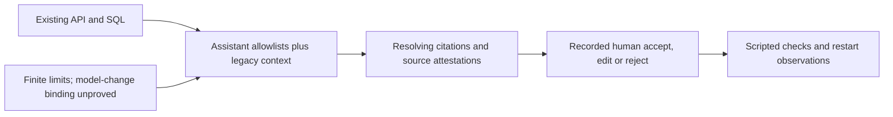
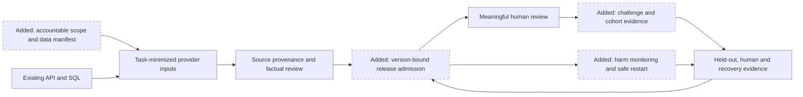
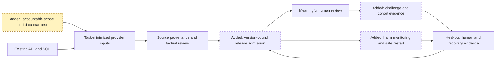
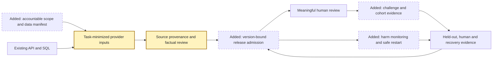
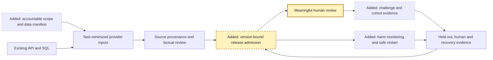
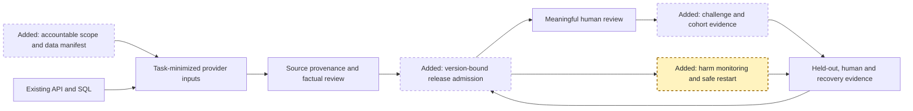
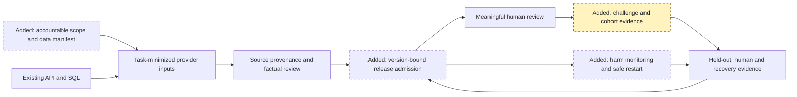
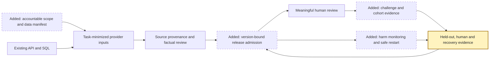

<!-- markdownlint-disable-file -->

## Task Metadata

* Task ID: RAI-REMEDIATION-20261015
* Task slug: rai-remediation
* Plan date: 2026-10-15
* Scope source: merge commit `a410ca6`; PRD v0.16.0, BRD v0.17.0, ADRs 0001 to 0003.
* Audit source: original commit `1cb398c7b90bec05a5700008a97d0cfac494144a` / PRD v0.14.0; owner accepted the bounded report on 2026-10-15.
* Plan: `.copilot-tracking/plans/2026-10-15/rai-remediation-plan.md`.

## Executive Summary

Implement consistent minimum-necessary inputs, trusted-source review, version-bound task
releases, owned harm monitoring, safe suspension/restart and accessible challenge/cohort
evaluation inside the current API/SQL runtime. These address eleven verified residuals
without adding services or transferring human authority.

Six phases/thirteen tasks separate offline engineering from specifically authorized
real-model, representative-human, recovery and qualified-release evidence. Detailed planning
is complete; independent standard critique controls the readiness recorded below.
Implementation has not started.
Confidence is high in source/task mapping, not in deployed effectiveness or future approvals.

### What You May Not Know

* Owner acceptance is of the bounded report for remediation planning, not legal/privacy
  sign-off or live release. Eleven PARTIAL and eleven NOT_ASSESSED checks remain open.
* Current RAI IDs are PRD `FR-051` to `FR-054`/`AC-069` to `AC-073`. Main retains journey/sensor
  `FR-048` to `FR-050`/`AC-062` to `AC-068`; the PRD records the draft-to-current mapping.
* Actual staff/tenant identities remain in privacy scope despite synthetic residents.
* Resolving citations, source hashes, SQL restarts and saved minutes do not prove factual
  truth, source authenticity, backup/erasure recovery or validated net benefit.
* Safe offline controls can begin while authority/cohorts/thresholds are unresolved;
  affected real-data/provider/human/live exercises cannot. No new material architecture
  choice needs a user walkthrough now.

## Phase Checklist

### Before



### After



The After view is proposed, not deployed architecture. Manual case and hazard routes
stay independent of every AI control in both states.

<!-- rpi:phase id=P01 -->
### [ ] P01: Establish accountability and processing boundaries

Goals:
* Give every AI path a bounded purpose, affected-person map, data manifest and accountable approval route.

Dependencies:
* None; synthetic scaffolding does not require operational approval.



Highlighted work: `O`.

<!-- rpi:task id=P01-T01 -->
#### [ ] P01-T01: Record task impact and authority

Goals:
* All registered and retained legacy tasks have explicit purpose, influence and authority boundaries.

Requirements:
* Plan `FR-001`; PRD `FR-036`/`FR-051`, `AC-069`, `OQ-017`/`OQ-019`; GOVERN-AUDIT-01 and MAP-02.
* Inventory five assistants plus legacy briefing, message, summary, priority, funding and document-reading paths; record intended/prohibited uses, residents/staff/providers affected, owner, residual risk and exercise/live scope.
* Unknown owner, legal applicability or approval stays Unknown and cannot authorize live use. Constructed fixture approval is never actual personal acceptance.

Details:
* Product/Digital prepare the registry/impact matrix; named task owners, Assurance, Safety and DPO/Legal personally validate their own authority. Do not assign actual company delegates or infer an EU category from housing.
* Preserve owner acceptance of the baseline report separately from qualified control acceptance. Legal provides dated authoritative UK and conditional EU intended-use/currentness review before affected operational reliance.
* Implement safe manifests/denial tests first; missing operational signatures gate activation, not offline scaffolding.

References:
* [docs/case_study_48_addendum.md](../../../docs/case_study_48_addendum.md): human authority and accepted baseline.
* [docs/prds/zava-forward-retrofit-programme-demonstrator.md](../../../docs/prds/zava-forward-retrofit-programme-demonstrator.md): registry, release and open-question contracts.
* [mvp/zavaforward_mvp/assistants.py](../../../mvp/zavaforward_mvp/assistants.py): existing five-capability registry.

Dependencies:
* None.

<!-- rpi:task id=P01-T02 -->
#### [ ] P01-T02: Define minimum-necessary processing and retention

Goals:
* Actual staff/tenant processing and future resident processing have separate owned decisions.

Requirements:
* Plan `FR-001`/`FR-002` and `NFR-004`; PRD `NFR-003`/`NFR-005`; MAP-02 and GOVERN-AUDIT-04.
* Map input, raw document bytes, prompts/output/citations, reviewer identity, audit, telemetry, tokens, provider processing and retained copies. Synthetic residents do not eliminate actual staff/tenant identities.
* Each task declares purpose/audience, permitted fields/types/lengths and prohibited content. DPO/Legal and record owners approve processor/region/transfer, retention/hold/erasure and representative-authority decisions before affected real processing.

Details:
* Digital traces current AI/projection/store/document interfaces; DPO/Legal resolve `DH-001`/002/006/007. UK app hosting does not prove UK inference residency.
* Use entirely constructed fixtures while approval is absent. Permission to store an upload does not approve sending it to AI; preserve manual upload/read/download while model processing is gated.
* Define explicit necessity/approval for intact content and sensitive fields; regex redaction is not sufficient proof.

References:
* [mvp/zavaforward_mvp/projection.py](../../../mvp/zavaforward_mvp/projection.py): current audience projection.
* [mvp/zavaforward_mvp/ai_tasks.py](../../../mvp/zavaforward_mvp/ai_tasks.py): legacy records/document path.
* [docs/adrs/0002-pilot-readiness-architecture.md](../../../docs/adrs/0002-pilot-readiness-architecture.md): data-handling approval items.

Dependencies:
* P01-T01 inventory; actual approval is required before real processing, not synthetic tests.

<!-- rpi:phase id=P02 -->
### [ ] P02: Minimize inputs and establish source assurance

Goals:
* Make legacy/assistant paths obey one purpose/audience boundary and separate citation resolution from trustworthy evidence.

Dependencies:
* P01 task/data manifest shapes.



Highlighted work: `D,S`.

<!-- rpi:task id=P02-T01 -->
#### [ ] P02-T01: Enforce minimization at every provider boundary

Goals:
* No entry point sends unrestricted case context, hidden fields or unapproved uploads.

Requirements:
* Plan `FR-002`, `NFR-001`/`NFR-004`; PRD `NFR-003`/`NFR-005`, `AC-053`/`AC-060`; T-RAI-001.
* Cover `Ai.run`/`_chat`, `Ai.evidence` and `Ai.look_at`, image/document bytes, all legacy tasks, reactive assistants and proactive scans. Requester permission does not prove task necessity.
* Provider spies assert exact field/content allowlists and zero hidden canaries per role/path, including nested/free-text/identifier/citation content. Unknown task/field, excessive input or unapproved raw content fails visibly without a provider call.
* Preserve permitted manual workflows and proposal-only outputs; document intentional prompt-content restrictions.

Details:
* Digital reuses `assistants.capture`, projection and the AI wrappers rather than duplicate serializers. Prefer bounded structured values to arbitrary contact/waiting/support text.
* For document reading, require the P01 raw-content approval and an authorized reviewed/redacted derivative or explicit scoped exception; otherwise retain storage/manual review and deny AI dispatch.
* Extend existing ai_tasks/assistant/document/role fixtures with payload spies, including output/citation/error paths; no live endpoint. A shared pure helper is allowed only when reuse needs it.

References:
* [mvp/zavaforward_mvp/assistants.py](../../../mvp/zavaforward_mvp/assistants.py): closed capture allowlists.
* [mvp/zavaforward_mvp/ai.py](../../../mvp/zavaforward_mvp/ai.py): all provider adapters.
* [mvp/zavaforward_mvp/ai_tasks.py](../../../mvp/zavaforward_mvp/ai_tasks.py): legacy wrappers.
* [mvp/zavaforward_mvp/store.py](../../../mvp/zavaforward_mvp/store.py): legacy/upload callers.
* [mvp/tests/test_ai_tasks.py](../../../mvp/tests/test_ai_tasks.py): legacy store parity.
* [mvp/tests/test_assistants.py](../../../mvp/tests/test_assistants.py): source-role matrix.

Dependencies:
* P01-T01/P01-T02 manifests; real-data approval is not required for synthetic implementation.

<!-- rpi:task id=P02-T02 -->
#### [ ] P02-T02: Bind provenance and factual review to citations

Goals:
* A resolving citation cannot silently become an authenticity or truth claim.

Requirements:
* Plan `FR-003`; PRD `AC-060`/`AC-070`, `NFR-009`; T-RAI-002 and MEASURE-01.
* Keep source identity/locator/content hash/version/origin and authorized verification distinct from citation resolution. A hash proves pinned bytes, not their truth/authenticity.
* Accept/edit atomically rechecks permission, source/proposal revision and verification. Altered, unattributed or unauthorized originals create owned visible review/holds, never automatic trust.
* Fixtures cover forged/altered documents, embedded instructions, plausible false claims with resolving citations and missing/conflicting sources. No seeded critical unsupported claim can satisfy a controlled gate.

Details:
* Task owners/Assurance define critical claims needing trusted originals and competent comparison. Digital binds attestations to actor/source/proposal revision and preserves current `source_verified` checks.
* Ingested instructions are inert evidence. Database lookups, filenames, signature-shaped strings or another AI verdict cannot establish semantic truth.
* Distinguish citation-resolved, source-verified and human-reviewed labels; manual/template fallback is not model success.

References:
* [mvp/zavaforward_mvp/ai_tasks.py](../../../mvp/zavaforward_mvp/ai_tasks.py): resolve/analyse and records.
* [mvp/zavaforward_mvp/assistants.py](../../../mvp/zavaforward_mvp/assistants.py): `validate_output`/`source_verified` review.
* [mvp/tests/test_assistants.py](../../../mvp/tests/test_assistants.py): source-change and review-CAS tests.

Dependencies:
* P02-T01 minimized inputs and P01 source authority.

<!-- rpi:phase id=P03 -->
### [ ] P03: Bind releases and meaningful review to versions

Goals:
* Prevent unapproved or stale models/proposals from being dispatched, published or relied upon.

Dependencies:
* P01 scope and P02 source/input contracts.



Highlighted work: `R,H`.

<!-- rpi:task id=P03-T01 -->
#### [ ] P03-T01: Implement durable release admission and invalidation

Goals:
* Reactive/proactive/legacy dispatch uses a matching approved release and current material dependencies.

Requirements:
* Plan `FR-004`, `NFR-001`/`NFR-002`; PRD `FR-051`/`AC-069`/`NFR-014`; GOVERN-AUDIT-02 and MN-3.2.
* SQL records task/purpose, provider/endpoint/deployment/actual serving-model version, prompt/policy/data/provenance/permission versions, evidence, authorized approver, residual-risk decision and expiry.
* Absent/expired/suspended/mismatched releases deny dispatch and reliance. Missing serving-version proof is not an approved alias; unexpected returned model versions quarantine results and suspend the release.
* Independent-worker tests cover each material mismatch, revocation/change races, retry/completion/review and restart. Zero unauthorized calls/actions after admission; restart/old image cannot replenish allowance or restore revoked approval.

Details:
* Digital extends additive SQL migration/claim/fence contracts and existing finite allowances; no new service, queue or assistant.
* Bind fresh authoritative deployment/version attestation, not just a configured alias hash. Verify actual inventory/returned-version contracts under authorized access; missing proof keeps real activation denied. Metadata access is not permission for paid inference.
* Routine permitted case edits stale only dependent proposals. Material purpose/model/prompt/policy/schema/provenance/permission changes invalidate release evidence; freeze the distinction with owner examples and tests.
* An accepted exercise build still needs `CON-009`/`AC-057` real-platform evidence plus a valid scoped exercise release. Workflow-only continuity never waives that build requirement.

References:
* [mvp/zavaforward_mvp/assistants.py](../../../mvp/zavaforward_mvp/assistants.py): disabled/claim/execute/complete/review.
* [mvp/zavaforward_mvp/ai.py](../../../mvp/zavaforward_mvp/ai.py): deployment/returned-model metadata.
* [mvp/zavaforward_mvp/sqlstore.py](../../../mvp/zavaforward_mvp/sqlstore.py): additive persistence.
* [mvp/zavaforward_mvp/mssqlstore.py](../../../mvp/zavaforward_mvp/mssqlstore.py): actual SQL boundary.
* [mvp/tests/test_assistants.py](../../../mvp/tests/test_assistants.py): independent connections/leases/migrations.

Dependencies:
* P01-T01/P01-T02 and P02-T01/P02-T02; actual attestation/approval before real dispatch.

<!-- rpi:task id=P03-T02 -->
#### [ ] P03-T02: Prove meaningful source-based oversight

Goals:
* Plausible wrong outputs cannot pass through superficial acceptance.

Requirements:
* Plan `FR-005`/`FR-007`; PRD `AC-070`, `FR-026`/`FR-027`, `NFR-009`; MEASURE-01 and MAP-04.
* Review binds current authorized actor, proposal/source/release versions, source comparison, correction/rejection and reason. Preserve existing reviewer independence and separate domain approvals.
* The human exercise detects and blocks every seeded critical wrong/stale/unsupported/incomplete proposal, including valid citations, with correct controls and total review effort retained.
* No default/bulk approval or competence claim from role-agent output. Offline gating does not prove human effectiveness.

Details:
* Digital wires legacy/assistant reviews, UI and report/export; Assurance/task owners design blinded constructed error injection.
* Test source/version races and unchanged consent, ranking, work release, claims/payment and hazard state. Attestation is not demonstrated competence.
* Explanations preserve field permission; P06-T01 supplies witnessed human evidence.

References:
* [mvp/zavaforward_mvp/ai_tasks.py](../../../mvp/zavaforward_mvp/ai_tasks.py): legacy review.
* [mvp/zavaforward_mvp/assistants.py](../../../mvp/zavaforward_mvp/assistants.py): current role/version review.
* [mvp/web/assistants.js](../../../mvp/web/assistants.js): review UI.
* [mvp/tests/test_role_matrix.py](../../../mvp/tests/test_role_matrix.py): cross-role coverage.

Dependencies:
* P02-T02 provenance and P03-T01 admission; witnessed competence is P06-T01.

<!-- rpi:phase id=P04 -->
### [ ] P04: Monitor harm and control suspension/restart

Goals:
* Detect harmful/unmeasured behavior and contain AI without disabling independent manual or safety work.

Dependencies:
* P03 version/review controls and P01 authority.



Highlighted work: `M`.

<!-- rpi:task id=P04-T01 -->
#### [ ] P04-T01: Add owned indicators and honest readiness

Goals:
* Bounded quality/harm/disparity/review-burden indicators are actionable, not green by default.

Requirements:
* Plan `FR-005`, `NFR-003`/`NFR-004`; PRD `NFR-014`; MN-4.1.
* Each task/serving release declares indicator, denominator, observation window, threshold, owner and response; include unsupported claims, critical misses, stale review attempts, challenges, cohort errors and review effort as applicable.
* Missing samples/approval/threshold/usage is insufficient, not zero/green. Seeded critical harm or approved threshold breach raises an owned incident and invokes P04-T02.
* Telemetry excludes raw prompts/source text, sensitive reasons, tokens and unnecessary identities; retain permitted restricted evidence separately.

Details:
* Product/Digital/Data define bounded counters through existing audit/report surfaces, not a new observability platform. Tests use constructed thresholds; live thresholds need named owners' approval.
* Reconcile windows/denominators and repeated events across restart; approval rates are not safety evidence. Disabled tasks still expose owned monitoring/manual-route status.
* Extend existing audit/report tests and current UI.

References:
* [mvp/zavaforward_mvp/ai_tasks.py](../../../mvp/zavaforward_mvp/ai_tasks.py): comparison/live-report records.
* [mvp/zavaforward_mvp/assistants.py](../../../mvp/zavaforward_mvp/assistants.py): durable events/usage.
* [mvp/zavaforward_mvp/server.py](../../../mvp/zavaforward_mvp/server.py): authorized reports/API.

Dependencies:
* P03-T01/P03-T02; operational thresholds before affected activation.

<!-- rpi:task id=P04-T02 -->
#### [ ] P04-T02: Implement incident suspension and controlled restart

Goals:
* Suspension persists across workers/restarts; late results never become actionable.

Requirements:
* Plan `FR-005`, `NFR-001`/`NFR-002`; PRD `FR-053`/`AC-072`; MN-4.3.
* Persist task/release suspension, incident owner, affected versions/proposals, containment, communication owner/audience and restart decision. Recheck suspension epoch on invoke/scan/claim/dispatch/complete and list/detail/review/export reliance.
* Independent SQL connection/race/restart tests cover queued/leased/ready proposals. In-flight provider calls may finish and stay charged/unknown; late results are quarantined. Do not promise remote cancellation or exactly-once billing.
* Corrective evidence plus distinct authorized human approval gates restart; stale/replayed/self-approved restart fails. Manual case, accessible challenge and hazard response stay available without AI.

Details:
* Digital reuses operator disable/manual paths and SQL transactions. Task owners, Safety/DPO as relevant and a named restart approver witness the drill.
* Preserve reconstructable history without current reliance; deny on the server, not only via buttons. Concurrent suspend/review and old-image restart must not restore approval.
* Communication is a constructed approved template/owned responsibility; no live contact or incident notice is sent automatically.

References:
* [mvp/zavaforward_mvp/assistants.py](../../../mvp/zavaforward_mvp/assistants.py): worker/dispatch/review lifecycle.
* [mvp/tests/test_assistants.py](../../../mvp/tests/test_assistants.py): shutdown, blocked provider and durability.
* [mvp/tests/test_workflows.py](../../../mvp/tests/test_workflows.py): independent manual/hazard path.
* [docs/adrs/0002-pilot-readiness-architecture.md](../../../docs/adrs/0002-pilot-readiness-architecture.md): incident boundary.

Dependencies:
* P03-T01 and P04-T01; restart authority is not inferred from operator identity.

<!-- rpi:phase id=P05 -->
### [ ] P05: Make challenge and fairness evidence usable

Goals:
* Preserve redress and reveal exclusion/deprioritization/review burden hidden by averages or missing data.

Dependencies:
* P02 permission and P03/P04 lifecycle controls.



Highlighted work: `C`.

<!-- rpi:task id=P05-T01 -->
#### [ ] P05-T01: Wire accessible challenge and correction

Goals:
* Affected people have a permitted explanation, human owner and non-digital route without losing unrelated rights.

Requirements:
* Plan `FR-006`, `NFR-001`/`NFR-004`; PRD `FR-052`/`AC-071`/`FR-043`; MEASURE-03 and MAP-04.
* Link a supplied constructed challenge to source/policy/proposal/human-decision versions, next update, owner and resolution. Exercise digital and staff-recorded non-digital routes.
* Correction stales exactly dependent proposals/reviews, not unrelated approvals; no inferred consent/refusal, sanction, complaint closure or hazard-clock change. Preserve representative/open-remedy `AC-063`/`AC-064`.
* Verify permission-safe plain explanation, keyboard flow and equivalent non-digital record; representative participation remains P06-T01 evidence.

Details:
* Housing/Resident Engagement/record owners define service handling; Digital extends existing case/API/workflow records, not a resident chatbot or wider authority.
* Preserve main's journey/IoT IDs and RAI mapping. Generic `FR-052` does not silently settle nomination-specific BRD `FR-037`/`OD-41`/`OD-42`.
* Extend existing workflow/role/isolated browser fixtures; nothing is sent, booked or inferred from a challenge.

References:
* [mvp/zavaforward_mvp/store.py](../../../mvp/zavaforward_mvp/store.py): case/record interface.
* [mvp/zavaforward_mvp/server.py](../../../mvp/zavaforward_mvp/server.py): permission-enforced API.
* [mvp/tests/test_workflows.py](../../../mvp/tests/test_workflows.py): resident/manual boundaries.
* [mvp/tests/test_ui_support.py](../../../mvp/tests/test_ui_support.py): UI support checks.
* [docs/adrs/0003-journey-derived-capabilities-runtime-fit.md](../../../docs/adrs/0003-journey-derived-capabilities-runtime-fit.md): authority/remedy constraints.

Dependencies:
* P02-T01/P02-T02, P03-T01 and P04-T02.

<!-- rpi:task id=P05-T02 -->
#### [ ] P05-T02: Evaluate cohorts and missing-data impacts

Goals:
* Unjustified exclusion/deprioritization and review burden are visible with denominators and uncertainty.

Requirements:
* Plan `FR-006`/`FR-007`, `NFR-003`; PRD `FR-054`/`AC-073`/`FR-012`/`NFR-012`; MAP-01 and MEASURE-03.
* Pair constructed cohorts differing in source/sensor completeness, accessibility/contact needs and provider-versus-resident appointment history, holding relevant facts constant. Missing/declined sensors never lower service/priority; no inferred vulnerability/refusal.
* Retain cohort definitions, eligible/tested/abstained/failed counts, sufficiency, errors/exclusions, review burden, uncertainty and human disposition. Detect every seeded unjustified exclusion/deprioritization defect; never average a failing subgroup away.
* Unapproved thresholds or insufficient samples block activation. Protected-characteristic analysis needs lawful approval; generated cohorts do not establish population fairness.

Details:
* Data/Performance/Asset prepare expected outcomes independently of models; ranking owner signs policy/hash/order and missing-data rationale. Extend ai_eval/ranking tests with transparent non-AI comparison.
* ADR 0003 retains IoT Hub as future ingestion. Use labelled synthetic sufficiency here; do not provision devices, invent hazard/dew-point thresholds or bypass sensor R1 to R3/`OD-43`.
* Include geography/archetype when approved/relevant. Disparity creates human review; AI cannot infer protected traits or ratify policy.

References:
* [mvp/zavaforward_mvp/ranking.py](../../../mvp/zavaforward_mvp/ranking.py): deterministic versioned ranking.
* [mvp/zavaforward_mvp/ai_eval.py](../../../mvp/zavaforward_mvp/ai_eval.py): baseline comparison harness.
* [mvp/tests/test_ranking_policy.py](../../../mvp/tests/test_ranking_policy.py): policy/hash/snapshot tests.
* [mvp/tests/test_ai_eval.py](../../../mvp/tests/test_ai_eval.py): harness regression.
* [docs/reference/research/iot-sensor-analytics-research-plan.md](../../../docs/reference/research/iot-sensor-analytics-research-plan.md): unresolved method evidence.

Dependencies:
* P01 lawful-field gate, P02 minimization, P03 release and P05-T01 challenge; operational cohorts/thresholds require owner approval.

<!-- rpi:phase id=P06 -->
### [ ] P06: Collect real evidence and close supported findings

Goals:
* Separate code regressions from actual-model, reviewer, benefit, recovery and qualified-release evidence.

Dependencies:
* P01 to P05 controls and relevant explicit human authorization for P06 exercises.



Highlighted work: `E`.

<!-- rpi:task id=P06-T01 -->
#### [ ] P06-T01: Evaluate held-out quality, oversight and net benefit

Goals:
* Measured task accuracy, meaningful review and all-role effort replace narrow proposal-feasibility claims.

Requirements:
* Plan `FR-007`, `NFR-003`/`NFR-004`; PRD `NFR-009`, `AC-057`/`AC-070`/`AC-073`, `CON-009`; MEASURE-02/MEASURE-04, MAP-04 and T-RAI-005.
* Freeze task/model/prompt/policy/source versions, separate held-out split, independent expected outcomes, critical errors, cohorts, sufficient samples and approved thresholds before evaluation. Held-out answers never enter prompts/tuning.
* Cover all five assistant capabilities and each retained legacy family, correct/wrong controls, ambiguity/abstention/source integrity. Measure critical errors/misses, factual support and usable coverage. Calibration applies only to meaningful scored predictions; otherwise explicitly not applicable.
* Competent human participants detect every seeded critical defect. Compare complete preparation/checking/correction/re-review/coordination/resident/support effort and cost against manual/template and parser/rules comparators; retain negative/inconclusive outcomes.
* Dry runs remain NOT_EVALUATED for real-model/human effectiveness. Actual calls require distinct finite call/token/budget/expiry authorization, approved payloads/provider attestation and participant/privacy consent; this plan authorizes none.

Details:
* Assurance/Data own independent labels/analysis; task owners/Resident Engagement recruit accessible frontline/resident/reviewer participation with consent and non-digital routes. Role agents are not human substitutes.
* Extend ai_eval rather than add an evaluation framework. Evidence records hashes/seed/split/denominators/usage/unknown liability/reviewer protocol and pass/fail/insufficient, not published private prompts.
* Approved manifests supply exercise thresholds and fail closed when absent; do not invent universal quality/fairness percentages. Unavailable budget/participants leaves the respective evidence insufficient.

References:
* [mvp/zavaforward_mvp/ai_eval.py](../../../mvp/zavaforward_mvp/ai_eval.py): current scripted-only harness.
* [mvp/evals/ai_priority_golden.json](../../../mvp/evals/ai_priority_golden.json): golden fixtures, not held-out proof.
* [mvp/tests/test_ai_eval.py](../../../mvp/tests/test_ai_eval.py): offline regression.
* [docs/prds/zava-forward-retrofit-programme-demonstrator.md](../../../docs/prds/zava-forward-retrofit-programme-demonstrator.md): quality/value/exercise contract.

Dependencies:
* P01 to P05; D2/D3 approvals before the respective real-service/human exercise.

<!-- rpi:task id=P06-T02 -->
#### [ ] P06-T02: Witness restore and erasure reconciliation

Goals:
* Actual backup restore/reconciliation proves more than a persisted-database restart.

Requirements:
* Plan `FR-008`, `NFR-002`/`NFR-004`; PRD `NFR-005`/`NFR-006`/`NFR-011`; MN-2.3 and GOVERN-AUDIT-04.
* On authorized disposable infrastructure, restore an actual backup plus document/audit state; verify permitted history/current authority and reapply erasure/tombstones/holds, reconciling versions/counts. Seed/reset/restart alone cannot pass.
* No resurrected revoked release/identity permission, suspended proposal, erased content or spent allowance. Independent owners witness expected/actual results and residual failure.
* DPO/record owners approve retention/hold/audit conflicts and provider-copy treatment; local deletion is not provider erasure. No pilot/live database is targeted.

Details:
* Digital/Operations extend existing store/assistant durability tests for restored control epochs, then run a separately authorized witnessed backup/document reconciliation drill.
* Follow README fixed disposable local SQL restrictions. SQLite/SQL-shape emulation stays a lower evidence tier; Azure recovery needs separate owner authorization and bounded runbook.
* Publish hashes/status/counts, not credentials/private records. Missing authority leaves the drill BLOCKED without erasing completed offline tests.

References:
* [mvp/tests/test_mssqlstore.py](../../../mvp/tests/test_mssqlstore.py): store parity/recovery tests.
* [mvp/tests/test_assistants.py](../../../mvp/tests/test_assistants.py): durability/actual SQL classes.
* [mvp/README.md](../../../mvp/README.md): disposable SQL restrictions.
* [docs/adrs/0002-pilot-readiness-architecture.md](../../../docs/adrs/0002-pilot-readiness-architecture.md): retention/recovery boundaries.

Dependencies:
* P01 retention/authority and P03/P04 persisted state; explicit infrastructure/erasure authorization for the drill.

<!-- rpi:task id=P06-T03 -->
#### [ ] P06-T03: Publish version-bound closure and qualified acceptance

Goals:
* Only changed-code, executed and appropriate human evidence closes findings.

Requirements:
* Plan `FR-008`, `NFR-003`; all eleven residuals and eleven unassessed checks below.
* Per finding record commit/task/release/evidence/owner and implemented/source-tested, observed, proposed, insufficient or independently accepted status. Code-only PASS cannot close human/legal gates.
* Preserve original baseline findings and dated owner acceptance. After implementation generate a fresh current-source assessment with complete inline verifier records and repaired report contracts, not a replay of the recovery.
* Qualified task/ranking/incident/DPO/Legal/operational owners decide conditional exercise/live activation. Until evidence/approval is complete, live use remains BLOCKED and affected dispatch disabled.

Details:
* Primary implementer updates existing addendum/PRD/ADRs, index/append-only log and implementation changes record; fresh full-PRD quality/owner acceptance still applies to v0.16.0.
* Use `rpi-review` for implementation acceptance and the RAI workflow for fresh bounded assessment. Qualified Legal resolves current UK and conditional EU scope.
* Owner retains PR merge/publication decisions. Retain incomplete/negative results and exact authority for accepted residual risk; never auto-sign or rewrite historical logs.

References:
* [.copilot-tracking/rai-reviews/2026-10-14/rai-report-ama-20261014.md](../../rai-reviews/2026-10-14/rai-report-ama-20261014.md): baseline findings/scoped owner acceptance.
* [docs/reference/README.md](../../../docs/reference/README.md): durable discovery.
* [docs/reference/log.md](../../../docs/reference/log.md): append-only history.
* [docs/case_study_48_addendum.md](../../../docs/case_study_48_addendum.md): executive release position.

Dependencies:
* P06-T01/P06-T02 and earlier engineering evidence; qualified legal/human/operational gates before corresponding closure or activation.

## User Decisions and Requirements

### Confirmed User Direction

* Assess RAI from the case study/addendum/PRD/ADRs and update documentation.
* Repair the failed handoff; recovered audit remains baseline evidence.
* Resolve merge conflicts and plan RAI remediations; do not implement now.
* Latest instruction: "accept the RAI report and fix merge changes". Recorded as owner
  acceptance of the report, not qualified legal/privacy review or live release.
* Preserve consent, professional/financial decisions, independent safety response, source
  permissions, default-off bounded assistants and mandatory real-platform build evidence.

### Planning Decisions and Feedback

Participation is `user-owned`, standalone. Explicit direction and existing constraints
resolve scope. No new material architecture/authority choice is made here; the following
human decisions are gated work outputs, not fabricated inputs.

| Group | Decision | Status | Owner | Evidence / rationale | Affected work |
| --- | --- | --- | --- | --- | --- |
| D1 | Reuse API/SQL and five assistants | Constraint applied | Digital | ADR 0002/0003; no governance service | P01 to P05 |
| D2 | Name release/source/monitoring/incident/restart delegates | Human gate pending | Owner, task owners, Assurance, Safety | `OQ-017` and baseline residuals | P01-T01/P03/P04/P06-T03; offline scaffolding allowed, real activation denied |
| D3 | Approve processing/cohorts/thresholds/participants/finite budget | Human gate pending | DPO/Legal, record/ranking/task owners, Finance | `OQ-018`/`OQ-019`; `DH-001`/002/006/007; actual staff data | P01-T02/P05-T02/P06; real processing/exercises wait |
| D4 | IoT Hub remains future ingestion; device/method build outside scope | Upstream direction retained | Owner/sensor research owners | ADR 0003 decision 6; `OD-43`/R1 to R3 | P05-T02 constructed completeness only |
| D5 | Report accepted; findings/operational gates stay open | Confirmed 2026-10-15 | Project owner | Explicit instruction and report annotation | No closure, PRD approval or live-use claim |

## Planning Readiness and Next Step

| Field | Record |
| --- | --- |
| Execution / readiness | Complete / Ready for bounded offline implementation; independent standard critique Complete/Pass; downstream human/real-service gates remain |
| Participation | user-owned, standalone; existing direction resolves present scope |
| Planning blockers | None for safe offline engineering; downstream approval/evidence gates remain |
| Latest critique | [.copilot-tracking/reviews/plans/2026-10-15/rai-remediation-plan-critique.md](../../reviews/plans/2026-10-15/rai-remediation-plan-critique.md): Complete / Pass, no actionable findings |
| Changes-record role | Implementation owns `.copilot-tracking/changes/2026-10-15/rai-remediation-changes.md` |
| Continuation owner | User; no automatic rpi-implement invocation |
| Next action | Owner-authorized PR publication/merge, then read-only Functional Planner issue-coverage review; implementation is a separate stage |

## Goals

* Close engineering gaps with demonstrated invariants, not new prose alone.
* Preserve human/resident authority and manual continuity under failure/suspension.
* Make insufficient quality/fairness/oversight/benefit/recovery evidence blocking and visible.
* Separate owner report acceptance, qualified control acceptance and operational release.

## Scope and Non-Goals

### In Scope

* Existing assistant and retained legacy input/dispatch/output/review/export surfaces.
* Additive SQL/version/incident records, current UI, owned indicators and offline tests.
* Explicitly authorized evaluation/participation/retention/restore/legal-release evidence.
* Implementation changes record and updates to existing addendum/PRD/ADRs/index/append-only log.

### Non-Goals

* Implementation, deployment, paid calls or real-person research in this planning turn.
* New governance service/assistant/event bus, resident contact, booking, claim/payment or ranking authority.
* IoT provisioning or sensor/hazard thresholds; preserve upstream direction.
* Legal classifications, invented delegates, substituted professionals or closure by report acceptance.

> [!CAUTION]
> **Disclaimer:** This agent is an assistive tool only. It does not provide legal, regulatory, or compliance advice and does not replace Responsible AI review boards, ethics committees, legal counsel, compliance teams, or other qualified human reviewers. The output consists of suggested actions and considerations to support a user's own internal review and decision‑making. All RAI assessments, risk classification screenings, security models, and mitigation recommendations generated by this tool must be independently reviewed and validated by appropriate legal and compliance reviewers before use. Outputs from this tool do not constitute legal approval, compliance certification, or regulatory sign‑off.

## Functional Requirements

These are plan-local IDs; PRD/BRD qualifiers distinguish source-document identifiers.

* `FR-001`: Owned purpose/data/authority records separate exercise and live processing.
* `FR-002`: Every provider input is task/audience-minimized, including legacy/document paths.
* `FR-003`: Provenance/factual comparison and citation resolution are distinct version-bound checks.
* `FR-004`: Approved current release/model/dependencies gate dispatch/completion/review/reliance.
* `FR-005`: Meaningful review, owned monitoring, incident containment and controlled restart preserve authority.
* `FR-006`: Accessible correction and denominator-aware cohorts preserve rights and resident choice.
* `FR-007`: Held-out actual-model and independent human/full-effort evidence support acceptance.
* `FR-008`: Witnessed restore/erasure and fresh current-source assessment close supported findings only.

## Non-Functional Requirements

* `NFR-001`: Zero unauthorized calls/domain writes in seeded admission/race/permission tests; every seeded critical error/exclusion detected and blocked per PRD `AC-070`/`AC-073`.
* `NFR-002`: Authority/suspension/history/spent allowance survive connections/restart/authorized restore; no stale resurrection or lost denial record.
* `NFR-003`: Results declare version, denominator, comparator and pass/fail/insufficient basis; unknown samples/usage/thresholds never become zero/green; negative results remain.
* `NFR-004`: No secrets/private content in published evidence or telemetry; actual processing/external exercises require specific human authorization.

### Verified Residual Coverage

| Finding | Severity / verdict | Tasks | Closure evidence |
| --- | --- | --- | --- |
| T-RAI-001 | MEDIUM / CONFIRMED | P01-T02/P02-T01 | Exact payload/role/upload tests and approved necessity |
| T-RAI-002 | MEDIUM / CONFIRMED | P02-T02/P03-T02/P06-T01 | Trusted-original/altered-source/plausible-false-claim proof |
| MEASURE-01 | MEDIUM / DOWNGRADED | P02-T02/P03-T02/P06-T01 | Held-out factual support and observed critical detection |
| GOVERN-AUDIT-02 | MEDIUM / DOWNGRADED | P03-T01 | Actual serving-model attestation and approval denial |
| MN-3.2 | MEDIUM / DOWNGRADED | P03-T01/P06-T03 | Material invalidation/renewed evidence/authorized release |
| MAP-02 | MEDIUM / DOWNGRADED | P01-T01/P01-T02/P06-T03 | Actual staff-data/purpose/processor authority |
| MN-4.1 | MEDIUM / DOWNGRADED | P04-T01 | Owned windows/thresholds and breach test |
| MN-4.3 | MEDIUM / DOWNGRADED | P04-T02 | Witnessed suspend/communication/distinct restart |
| GOVERN-AUDIT-01 | LOW / DOWNGRADED | P01-T01/P06-T03 | Named accountability/personal delegation acceptance |
| MAP-01 | LOW / DOWNGRADED | P05-T02/P06-T03 | Approved ranking/hash/missing-data impact |
| MAP-04 | LOW / DOWNGRADED | P03-T02/P05-T01/P06-T01 | Representative participation/competence/net benefit |

### Unassessed Evidence Coverage

Eleven checks remain unassessed, not eleven additional proven incidents.

| Check | Required evidence / owner | Tasks |
| --- | --- | --- |
| GOVERN-AUDIT-04 | DPO/Legal/record-owner privacy/retention/processor authority | P01-T02/P06-T02 |
| GOVERN-AUDIT-05 | Task/system owners distinguish exercise/operational acceptance | P01-T01/P06-T03 |
| MAP-05 | Qualified dated UK and conditional EU currentness/intended use | P01-T01/P06-T03 |
| MEASURE-02 | Serving-model held-out quality and applicable calibration | P06-T01 |
| MEASURE-03 | Lawful representative fairness/accessibility/challenge | P05-T01/P05-T02/P06-T01 |
| MEASURE-04 | All-role effort/incremental benefit with Finance validation | P06-T01 |
| MN-2.3 | Witnessed backup/erasure/retained-history integrity | P06-T02 |
| T-RAI-005 | Operational/model-integrity assurance beyond source/feasibility | P03-T01/P06-T01/P06-T02 |
| EU-COND-01 | Legal territorial/currentness determination, not hosting inference | P01-T01/P06-T03 |
| EU-COND-02 | Legal actor roles and actual influence/use analysis | P01-T01/P06-T03 |
| EU-COND-04 | Qualified operational assurance if EU applicability established | P06-T01/P06-T02/P06-T03 |

## Risks and Open Questions

| Priority | Item | Affected work | Smallest clearing evidence | Owner |
| --- | --- | --- | --- | --- |
| High | Actual approvers/incident/restart owners unnamed | P01-T01/P03/P04/P06-T03 | Personal role/authority/expiry acceptance; fixtures cannot substitute | Owner/qualified control owners |
| High | Alias may change serving model | P03-T01 | Fresh authoritative version contract plus mismatch tests | Digital/model owner |
| High | Staff-data/retention/provider terms unresolved | P01-T02/P02-T01/P06 | Approved purpose/fields/location/terms/erasure | DPO/Legal/record owners |
| High | Quality/cohort/sample thresholds unknown | P05-T02/P06-T01 | Approved manifest, independent expected outcomes and sufficient samples | Task/Asset/Data/Assurance |
| High | Restore resurrects erasure/authority/allowance | P06-T02 | Backup/tombstone/control-epoch drill with independent witness | Operations/DPO/release owners |
| Medium | Strict admission intentionally denies unapproved AI | P02/P03 | Visible denial/manual continuity; scoped exercise release before build acceptance | Product/Digital/owner |
| Medium | Participants/model budget unavailable | P06-T01 | Specific consent/recruitment/finite budget; otherwise insufficient | Engagement/Assurance/owner |
| Medium | Generic challenge does not settle nomination-specific BRD choices | P05-T01/P06-T03 | `FR-037`/`OD-41`/`OD-42` disposition without scope inflation | Product/Housing/Legal |
| Medium | Current shared identity is not isolated worker estate | Plan-wide | Retain ADR trade-off and explicit server controls | Digital/Assurance |

Stricter inputs/release checks may reduce draft coverage and add review effort. Keep
explicit unknown/manual routes and measure full effort. Lawful fairness-field restrictions
may leave cohorts insufficient; do not infer protected data through proxies.

## Dependencies

* P01 manifests precede controls; real approval gates activation, not synthetic scaffolding.
* P02 -> P03 -> P04; P05 consumes permissions/invalidation; P06 measures completed controls.
* Legal/privacy/participant/budget/recovery authorization is required at the respective exercise.
* Existing SQL migration/fences/allowances/projections/manual paths remain canonical.
* Report acceptance never waives independent PRD quality/owner or operational review.

### Test Ownership and Change Budget

* Digital owns regressions; Assurance/Data/task owners own semantic labels; qualified humans witness effectiveness/legal/recovery evidence.
* Canonical targets: existing ai/ai_tasks/assistants/projection/store/SQL adapters/server/UI/ranking/ai_eval, tests/fixtures and related docs; no parallel implementation.
* Removals/renames: none. New test files: zero. Maximum new unittest methods: 40 across existing suites, using matrix cases/store mixins. Replan before exceeding this budget.
* Maximum source additions: one small shared pure-control module only if reuse requires it; one constructed release-manifest fixture and one independently labelled synthetic held-out fixture. No new services/dependencies/tooling assumed.
* Generated targets: implementation-owned changes record and redacted JSON evidence beneath its evidence folder, never authoritative live-release/private payloads. Planning creates no changes record.
* Regression proof preserves permissions/consent/hazard/manual/ranking/SQL lifecycle; scripted providers cannot replace real-model/human semantic evidence.

### Validation Evidence to Collect During Implementation

* P02/P03: payload spies and ai_tasks/assistants/documents/role suites; P04: lifecycle/ledger/workflow; P05: ranking/eval/workflow/UI; P06: actual SQL and authorized model/human/restore evidence.
* From mvp on Windows, combine applicable selectors in one runner, for example:

```powershell
$env:PYTHONPATH = '.;tests'
python -m unittest test_ai_tasks test_assistants test_documents test_role_matrix test_ai_eval test_ranking_policy test_workflows test_mssqlstore -q
```

* Isolate mocked providers and remove inherited real endpoints for offline tests. Escalate to existing full discovery only after broad store/permission changes or targeted failures; record conditional skips.
* Actual SQL uses only README-authorized fixed disposable local databases, never pilot/Azure SQL:

```powershell
$env:PYTHONPATH = '.;tests'
$env:ZF_TEST_MSSQL = '1'
python -m unittest test_assistants.MssqlContractTests test_assistants.MssqlReviewTests test_assistants.MssqlDurabilityTests test_assistants.MssqlApiTests test_assistants.MssqlLedgerTests -q
```

* Use existing isolated browser fixtures and `node --check web\assistants.js` for UI changes. Restart is not backup proof. Separately authorized P06 evidence records serving version/budget/full human effort.
* This turn validates documentation, IDs, coverage, links, canonical hash and patch hygiene only. No application tests/model calls/drills are claimed run.

## Sources

* [docs/case_study_48_original.md](../../../docs/case_study_48_original.md): preserved case facts.
* [docs/case_study_48_addendum.md](../../../docs/case_study_48_addendum.md): current boundaries and owner acceptance.
* [docs/brds/agentic-retrofit-programme-brd.md](../../../docs/brds/agentic-retrofit-programme-brd.md): v0.17.0 business/journey authority.
* [docs/prds/zava-forward-retrofit-programme-demonstrator.md](../../../docs/prds/zava-forward-retrofit-programme-demonstrator.md): v0.16.0 identifiers/contracts/gates.
* [docs/adrs/0001-azure-architecture.md](../../../docs/adrs/0001-azure-architecture.md): proposed future estate, not current isolation.
* [docs/adrs/0002-pilot-readiness-architecture.md](../../../docs/adrs/0002-pilot-readiness-architecture.md): current runtime.
* [docs/adrs/0003-journey-derived-capabilities-runtime-fit.md](../../../docs/adrs/0003-journey-derived-capabilities-runtime-fit.md): retained journey/IoT direction.
* [.copilot-tracking/rai-reviews/2026-10-14/rai-report-ama-20261014.md](../../rai-reviews/2026-10-14/rai-report-ama-20261014.md): accepted bounded baseline.
* [mvp/README.md](../../../mvp/README.md): existing commands/evidence limits.

## Critique Disposition

* Depth/provenance: standard, default; deep not requested.
* Execution: Complete / Pass; initial attempt consumed: yes. Recovery consumed: no.
* Infrastructure retry reservations: zero; new task, no earlier critique pointer.
* Canonical helper: `C:\Users\juanserv\AppData\Roaming\Code\agentPlugins\file-c-3A-Users-juanserv-copilot-installed-plugins-hve-core-hve-core\1a0deae6ef6\.github\skills\rpi\rpi-plan\scripts\Get-PlanAssessmentHash.ps1`.
* Projection version: `rpi-plan-assessment-v1`.
* Immutable emitted projection: [.copilot-tracking/reviews/plans/2026-10-15/rai-remediation-plan-assessment-initial.json](../../reviews/plans/2026-10-15/rai-remediation-plan-assessment-initial.json).
* Candidate assessed-content SHA-256: `c91b3d1da1cadd63a2207a871dca9f38eeb9eaefd2bc972cf8d653c1a8c6e5dc`. Projection bytes independently SHA-256 checked; admission still requires critic recomputation.
* Revision-bound closure: not applicable before initial critique.

### Initial Attempt Reservation

* Task: RAI-REMEDIATION-20261015.
* Attempt ID: rai-remediation-initial-20261015-01.
* Kind: initial; depth: standard (default); boundary: complete saved assessed-content projection.
* Candidate hash: `c91b3d1da1cadd63a2207a871dca9f38eeb9eaefd2bc972cf8d653c1a8c6e5dc`.
* Output: `.copilot-tracking/reviews/plans/2026-10-15/rai-remediation-plan-critique.md`; verified unoccupied before reservation.
* Invocation outcome: pending immediate activation; assessment availability: pending; verdict: unavailable until actual evidence.
* Current-run provenance: this uninterrupted planner execution saves/reads back this reservation then immediately activates one functions.task independent rpi-plan-critique worker for this attempt. No saved-attempt replay is authorized.
* Authorization: required initial independent critique of the user-requested remediation plan; no recovery, infrastructure retry or implementation authorization.
* Prior results/reservations: none for this new stable task; parent todo records planning completion and critique in progress.

### Initial Attempt Reconciliation

* Host agent: `6d29c1a0-8f18-4ad0-bd67-96d7d1345541`; completion notification and returned result establish this invocation completed.
* Assessment execution/availability: Complete; verdict: Pass; depth: standard; actionable PC findings: none, all severity counts zero.
* Covered candidate: `c91b3d1da1cadd63a2207a871dca9f38eeb9eaefd2bc972cf8d653c1a8c6e5dc`, projection `rpi-plan-assessment-v1`.
* Result: [.copilot-tracking/reviews/plans/2026-10-15/rai-remediation-plan-critique.md](../../reviews/plans/2026-10-15/rai-remediation-plan-critique.md).
* Disposition: no planner correction or user decision required; explicit downstream gates/residual uncertainty retained. No closure/recovery/retry reservation is needed.
* Delivered hash must match the covered candidate before publication; only excluded readiness/disposition/handoff bookkeeping changes after critique.

## Artifact Self-Check

* Candidate: six phases/thirteen tasks, stable markers, Before/After/highlighted diagrams,
  source-qualified IDs, bounded test ownership and separate real-exercise gates.
* Preflight passed: 62 initial plan links, all 22 open checks, six phases/thirteen tasks and eight canonical diagrams. Final hash equality is checked before publication.
* Frontmatter precedes the markdownlint-disable comment to honor repository metadata rules.

## Follow-Up Items

* None

## Handoff

Independent standard critique is Complete/Pass for the delivered assessed-content candidate.
The plan is ready for bounded offline engineering via `/rpi-implement`, using
`.copilot-tracking/changes/2026-10-15/rai-remediation-changes.md` as the implementation-owned record.
Do not dispatch paid calls, process new real data, run human/restore exercises or activate live
use until the task-specific gates clear. No implementation was performed in this request.

The owner subsequently directed: once done, merge with main, then make the Functional Planner
review GitHub issues for missing RAI execution coverage. This authorizes PR #72 publication/
merge after checks and a separate read-only backlog review; it does not change the assessed
engineering, safety or evidence boundary or authorize issue creation.
