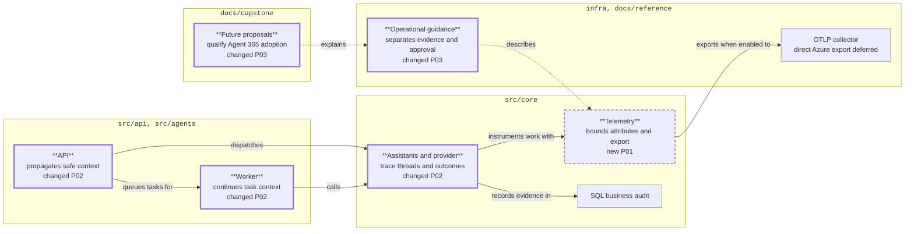

<!-- markdownlint-disable-file -->
---
description: Implementation plan for correlated agent telemetry and the capstone roadmap
ms.date: 2026-11-16
---

# RPI Plan: Agent observability implementation

## Task Metadata

* Task ID and slug: `agent-observability-implementation`
* Plan date: 2026-11-16, from owner context
* Session state: [.copilot-tracking/rpi-sessions/2026-11-16/agent-observability/agent-observability-implementation-state.json](../../rpi-sessions/2026-11-16/agent-observability/agent-observability-implementation-state.json)
* Branch: `feat/agent-observability`, child of `docs/agent-observability-agent365` / PR 1823

## Executive Summary

Add opt-in, content-free OpenTelemetry tracing and measurements to the existing
Python agent runtime. Correlate API, task dispatch, provider threads, SQL
transactions and worker result post-back without changing their authority,
retry, timeout, financial or consent decisions. Retain the protected SQL audit
as the business evidence store. Add Agent 365 to the existing capstone's future
proposals, explicitly conditional rather than deployed.

The source-informed plan and its single standard critique are complete, with
six Medium refinements resolved below. Implementation is ready. Tests and live acceptance
remain separate; no claim of deployed instrumentation follows from this work.

### What You May Not Know

* This is full-tier work because packages and a telemetry privacy boundary change.
  Publication requires the complete local gate and a verified external receipt.
* System PATH lacks PowerShell, LibreOffice, actionlint, ShellCheck and Trivy.
  Task-local Python 3.12.15/pip is restored at
  `/var/tmp/ama-otel-FdLcBv/testenv/bin`; Node 26.13.0, Docker and Azure CLI exist.
  Resolve remaining tools only in task-owned locations; no global installs.
* Existing deck source is a native 55-slide PPTX manifest, not an HTML deck.
  Preserve its architecture, protected financial slides, links and timing.

## Phase Checklist

### After

Key: arrows point from a part to what it uses; dotted arrows describe documentation;
the dashed border marks new code and thick borders mark changes.
The API and worker continue using existing domain services (P02), now with the
shared opt-in telemetry layer (P01). SQL remains authoritative; guidance and
the future roadmap distinguish instrumentation from operating acceptance (P03).
This adds observability connections without replacing existing domain paths,
so no Before view is needed. Mermaid light/dark rendering is not yet checked.

<!-- rpi:phase id=P01 -->
### [x] P01: Establish the shared telemetry and packaging contract

Goals:
* Make export explicit, privacy-safe, bounded and available in deployed images.

Dependencies:
* None.

Changes in the map: adds Telemetry.

<!-- rpi:task id=P01-T01 -->
#### [x] P01-T01: Add opt-in shared telemetry and package it consistently

Goals:
* A configured process exports standards-based spans/metrics through one pipeline;
  an unconfigured process exports nothing.

Requirements:
* FR-001, FR-002, FR-003; NFR-001, NFR-002.
* PRD-2026-AMA48-001 NFR-004/011/019 and Observability and SLO Measurement Method
  ([docs/prds/zava-forward-retrofit-programme-demonstrator.md](../../../docs/prds/zava-forward-retrofit-programme-demonstrator.md)).
* ADR 0001 worker identity boundary
  ([docs/adrs/0001-azure-architecture.md](../../../docs/adrs/0001-azure-architecture.md))
  and ADR 0006 dependency direction
  ([docs/adrs/0006-src-layout-and-cutover.md](../../../docs/adrs/0006-src-layout-and-cutover.md)).

Details:
* Core requires the pinned OTel API; optional telemetry/dev extras supply SDK and
  OTLP/HTTP exporter only. Runtime image locks include what their
  installed wheels need; regenerate with pip-tools while preserving existing pins.
* Use OTel 1.45.2, verified against PyPI metadata on 2026-11-16.
  Direct Azure export is deferred by explicit owner decision after SDK inspection.
* Select `ZF_OTEL_EXPORTER=none|otlp`, default `none`. Require an
  explicit valid destination when enabled; reject conflicting initialization
  rather than creating duplicate providers. No auto-instrumentation or content capture.
* Provide service/version/environment resource fields from approved bounded
  configuration, not host/process/user detectors or arbitrary resource attributes.
* Use parent-based sampling, default 100%, bounded batches/timeouts and graceful
  shutdown. Explain that reduced head sampling cannot guarantee all error traces.
* Allowlist attributes; omit bodies, prompts, completions, arguments/results,
  SQL statements, URLs/query strings, IPs, users and raw case IDs. Never record
  exception messages/stacks. No offline exporter disk persistence.
* W3C carriers contain validated `traceparent` only; no baggage or tracestate.
* Test ownership: new core telemetry tests, at most 12 focused test methods.
  Removals: none. Tests assert exported shapes and real SDK context, not constants.
* Required test cases: default-off/no export, invalid/missing destinations and
  credential-safe configuration errors, conflicting initialization, resource
  minimization, sampling, serialized span/metric/carrier canaries, bounded metric
  dimensions and W3C propagation without baggage/tracestate.
* Batch queue 512 spans, batch size 128, delay 5 seconds and export timeout
  5 seconds; flush/shutdown allowance 5 seconds per provider, never unbounded.
  Periodic metrics every 60 seconds with a 5-second timeout. Finite documented
  semantic histogram buckets; no per-request identifiers in metrics.
* Enabled-invalid configuration fails at startup; runtime export is asynchronous
  and failure does not alter task outcomes or hold provider slots. Report exporter
  failures through the guarded logging path without endpoint/credential values.
* Credentials come from existing approved environment/secret injection, never
  source or command output. No automatic new identity permission.
* Resolver command: `pip-compile --generate-hashes --no-emit-index-url
  --no-emit-trusted-host --output-file=requirements.txt requirements.in` in each
  affected project, reusing existing locks. Install the resulting requirements
  in an isolated environment, run `pip check`, and let the full gate rebuild
  affected images. Preserve unrelated pins; explain any required transitive delta.

References:
* [src/core/pyproject.toml](../../../src/core/pyproject.toml)
* [src/api/Dockerfile](../../../src/api/Dockerfile)
* [src/agents/Dockerfile](../../../src/agents/Dockerfile)
* Reused research F3/F5/F6.

Dependencies:
* None.

<!-- rpi:phase id=P02 -->
### [x] P02: Correlate actual agent execution without changing decisions

Goals:
* Follow both current in-process and queued agent paths across HTTP, threads,
  provider requests, database transactions and result post-back.

Dependencies:
* P01.

Changes in the map: changes API, Worker, and Assistants and provider.

<!-- rpi:task id=P02-T01 -->
#### [x] P02-T01: Propagate spans through the existing execution paths

Goals:
* Synthetic successful, failed and timed-out work has the correct causal graph
  and protected audit joins.

Requirements:
* FR-001, FR-002, FR-003; NFR-001, NFR-002.
* PRD-2026-AMA48-001 NFR-004/011/017/019
  ([docs/prds/zava-forward-retrofit-programme-demonstrator.md](../../../docs/prds/zava-forward-retrofit-programme-demonstrator.md)).
* BRD-2026-AMA48-001 NFR-004/012/014
  ([docs/brds/agentic-retrofit-programme-brd.md](../../../docs/brds/agentic-retrofit-programme-brd.md)).

Details:
* Add server/client/producer/consumer/internal kinds at actual boundaries.
  Preserve thread context with `contextvars.copy_context`, including late returns.
* Keep old task/result JSON readable by making trace context optional and inert.
  Capture task context in existing JSON bodies, never a schema migration.
* Correlate using OTel's random trace/span IDs only. Put those IDs in the
  existing protected JSON event body and optional task-context field, with no
  SQL schema change. Existing audit access/retention/immutability applies.
  Do not export case/task/source/meter identifiers or hashes of them.
* Provider outcomes include failures and validated token counts without payloads.
  Durations use seconds; metrics have bounded operation/outcome dimensions,
  never task/root/case identifiers. Histograms supply counts/denominators.
* Instrument agent-related SQL transactions, not raw query text or parameters.
  HTTP names/methods/statuses must not disclose dynamic paths, accounts or headers.
* Add opt-in startup/shutdown to API/worker; keep health/standby behavior and
  configuration failures explicit. No network occurs in tests.
* Focused tests: extend agents dispatch/runtime tests (at most 5 methods);
  add API HTTP trace integration tests (at most 3 methods); use existing core
  assistant tests plus at most 2 causal-graph regressions. Removals: none.
* Explicit regressions cover a late provider thread after timeout, unchanged slot
  ownership, no cross-request context leakage and a worker→postback causal graph.
  Place in the existing agents proposal/dispatch suites and core telemetry suite.
* Use current GenAI conventions: application-controlled proposal entrypoints use
  `invoke_workflow`, not a claim that an LLM controls tools. Name and record the
  current inference/entrypoint metrics from the official convention source.

References:
* [src/core/src/zava_forward/core/assistants.py](../../../src/core/src/zava_forward/core/assistants.py)
* [src/core/src/zava_forward/core/ai.py](../../../src/core/src/zava_forward/core/ai.py)
* [src/agents/src/zava_forward/agents/dispatch.py](../../../src/agents/src/zava_forward/agents/dispatch.py)
* [src/agents/src/zava_forward/agents/runtime.py](../../../src/agents/src/zava_forward/agents/runtime.py)
* [src/api/src/zava_forward/api/server.py](../../../src/api/src/zava_forward/api/server.py)

Dependencies:
* P01-T01.

<!-- rpi:task id=P02-T02 -->
#### [x] P02-T02: Preserve diagnostic redaction while retaining trace correlation

Goals:
* Content-free structured console logs join to active traces without accepting
  caller-supplied extras or exception content.

Requirements:
* FR-002, FR-003; NFR-001, NFR-002.
* PRD-2026-AMA48-001 NFR-019 and Observability and SLO Measurement Method
  ([docs/prds/zava-forward-retrofit-programme-demonstrator.md](../../../docs/prds/zava-forward-retrofit-programme-demonstrator.md)).

Details:
* Compute trace/span identifiers from active trusted SDK context, not `extra`.
  Retain all existing redaction behavior and legacy default console formatting.
* Enabled telemetry uses structured timestamp/severity/body/attributes/resource
  fields and optional valid trace/span IDs. Preserve operational meter markers.
* Extend existing diagnostic tests with at most 3 methods covering actual output,
  malicious extras, secrets/PII, exception payloads and active/inactive spans.
  Removals: none.

References:
* [src/core/src/zava_forward/core/diagnostic_logging.py](../../../src/core/src/zava_forward/core/diagnostic_logging.py)
* [src/core/tests/test_diagnostic_logging.py](../../../src/core/tests/test_diagnostic_logging.py)

Dependencies:
* P01-T01.

<!-- rpi:phase id=P03 -->
### [x] P03: Publish truthful operational and presentation guidance

Goals:
* Operators know how to prove coverage; executives see Agent 365's conditional value.

Dependencies:
* Runtime documentation depends on P02; deck source can proceed after P01 contracts.

Changes in the map: changes Operational guidance and Future proposals.

<!-- rpi:task id=P03-T01 -->
#### [x] P03-T01: Update operating guidance and lasting knowledge

Goals:
* Explain enablement, privacy, propagation, queries, rollback, sampling and
  remaining activation/evidence gaps without declaring the full PRD delivered.

Requirements:
* FR-004; NFR-001, NFR-002.
* PRD-2026-AMA48-001 NFR-004/007/011/014/017/019
  ([docs/prds/zava-forward-retrofit-programme-demonstrator.md](../../../docs/prds/zava-forward-retrofit-programme-demonstrator.md)).

Details:
* Update component READMEs and monitoring runbook with exact selected settings,
  dependency extras, success/failure/timeout synthetic receipt procedure and
  safe trace-to-audit joins. Clearly retain missing live harm monitors, invoice
  reconciliation, named owners, retention/network approvals and real Azure proof.
* Promote durable research into an existing relevant synthesis or a focused
  observability page only if none fits, and update the knowledge index/log.
  Preserve the completed research and unsigned requirement status.
* Explain operational traceability versus business reconstruction and meaningful
  explanations; no thought-process capture or new UI.
* Documentation checks only; no new tests for prose.
* Include a source/synthetic/live-gap evidence matrix and invocation denominator
  definitions: started attempts, failures, retries, incomplete/cancelled attempts
  and bounded windows. Do not equate invocation duration with full business
  scenario completion or claim approved p95/error-budget attainment.
* All synthetic validation procedures are offline/no-spend. A future real model,
  Azure or tenant receipt requires separate owner/data/spend authorization.

References:
* [infra/monitoring-runbooks.md](../../../infra/monitoring-runbooks.md)
* [docs/reference/README.md](../../../docs/reference/README.md)
* Reused research F1-F6.

Dependencies:
* P02-T01, P02-T02.

<!-- rpi:task id=P03-T02 -->
#### [x] P03-T02: Add the Agent 365 future proposal to the existing capstone

Goals:
* Future-roadmap slides/notes/Q&A describe optional enterprise inventory,
  identity/lifecycle and Defender/Purview oversight with adoption gates.

Requirements:
* FR-004; NFR-001.
* Owner's capstone selection and future-only direction; no new product authority.

Details:
* Keep the current native 55-slide source architecture, financial arithmetic,
  order, jump actions, original timing and approved visual direction.
* Update roadmap source, notes and question/answer source where appropriate;
  no new slide is needed. State current OTel implementation versus planned/live
  acceptance precisely; avoid unverified delivery claims while runtime evolves.
* Preserve the distinct Microsoft OpenTelemetry Distro/SDK/service roles,
  current deprecated observability SDK warning, privacy/tenant/license/ingestion
  prerequisites and continued SQL/domain authority.
* Explicitly explain the mandatory-content/identity schema conflict and the
  unresolved supported-redacted-payload/feature-parity question in notes/Q&A;
  neither raw export nor working metadata-only Agent 365 adoption is assumed.
* Do not generalize optional resident metering joins into universal coverage.
* Rebuild PPTX, Linux preview PDF, notes/Q&A and compact verification receipt.
  Inspect changed slides and neighbours; report native PowerPoint/direct
  accessibility checks as unperformed when unavailable.
* Use existing capstone tests; add no tests unless a changed content invariant
  requires one. Generated targets are the existing deck, pitch and receipt,
  not manually edited files. Retain all original review evidence.

References:
* [docs/capstone/source/README.md](../../../docs/capstone/source/README.md)
* [docs/capstone/source/slides.json](../../../docs/capstone/source/slides.json)
* [docs/capstone/source/roadmap-recommendations.md](../../../docs/capstone/source/roadmap-recommendations.md)

Dependencies:
* P01-T01 for drafting; P02-T01 and P02-T02 for final source claims, rebuild,
  preview and delivery receipt.

<!-- rpi:phase id=P04 -->
### [ ] P04: Validate, independently assess and publish the exact candidate

Goals:
* Deliver a reproducible candidate only with the repository's required evidence.

Dependencies:
* P01, P02, P03.

Changes in the map: verifies all changed parts; adds no runtime connection.

<!-- rpi:task id=P04-T01 -->
#### [ ] P04-T01: Complete targeted checks, independent review and full gate

Goals:
* Tests reject privacy/context/behavior regressions, and exact-head evidence
  distinguishes verified work from blocked publication or operational acceptance.

Requirements:
* FR-005; NFR-001, NFR-002, NFR-003.
* Repository full-tier policy in [src/README.md](../../../src/README.md).

Details:
* Run focused core/agent/API tests together per owning runner, then Ruff/mypy
  and capstone checks. Extend broader coverage only for actual failures or full gate.
* Resolve original Review RV-001 by making fresh API/agents development
  installations include the pinned telemetry SDK/exporter; verify in separate environments,
  not only the aggregate core-dev environment. Runtime locks are unchanged.
* Complete one post-implementation Review and independent exact-head assessment.
  Preserve adverse findings and bounded correction history.
* Commit implementation and original dated RPI evidence; fetch main and run
  the complete local gate with a short new external directory. Verify its
  external receipt immediately before publication.
* Missing SQL/browser/scanner/tool prerequisites block publication; no cloud
  fallback, skipped-check success, source-path import hack or protection change.
* Push the child branch and open a PR targeting the research parent, explicitly
  declaring dependency on PR 1823. Observe exact-head hosted CI and leave merge
  to the owner. Use references, not issue-closing keywords, for unmet criteria.
* Tool installation is confined to task-owned external locations. Python 3.12.15
  has now been restored without uv or global changes.
* Prerequisite route: task-local official PowerShell release archive and the
  repository actionlint installer; official ShellCheck/Trivy binaries in a
  task-owned `bin`. Verify versions/checksums. Use a task-owned LibreOffice
  container for the native preview if local binaries/fonts are absent; no
  privileged mode, shared service changes or global installation.
* Put the real Python 3.12 and restored tools on PATH only for validation
  commands. Use the canonical gate's own SQL/browser provisioning and verify
  Node/Docker/Azure CLI first. No wrapper may fabricate a prerequisite.
* If these routes fail, retain implemented/locally tested source, record named
  blockers and do not publish the runtime candidate. No rebasing is needed:
  direct ancestry verification confirmed parent/head 723d502687ee148c7cbd869cad2ec3036e71a8a2.

References:
* [src/README.md](../../../src/README.md)
* [tools/rpi-checks.py](../../../tools/rpi-checks.py)

Dependencies:
* P03-T01, P03-T02.

## User Decisions and Requirements

### Confirmed User Direction

* Add Agent 365 as a future proposal, add the OTel layer and apply the assessment.
* Presentation: capstone executive deck, confirmed through the question tool.
* Handle it end to end; automatic progression through Review.
* No live deployment, tenant onboarding, new explanation UI or model spending.
* Owner authorized merging current `origin/main` into the implementation child
  after committing owned work; no rebase, force-push or parent-PR merge.

### Planning Decisions and Feedback

| Group | Decision or feedback item | Status | Owner | Rationale and evidence | Impact |
|---|---|---|---|---|---|
| D1 | OTLP first; direct Azure exporter deferred; Agent 365 future-only | Confirmed | Owner | Backend decision after installed Azure SDK privacy finding | Azure connection requires separately validated collector/backend integration |
| D2 | Explicit opt-in exporter, no automatic content capture | Selected | Agent | PRD NFR-019 and F3/F6 | Default behavior unchanged |
| D3 | Native PPTX update, not deck conversion | Selected | Agent | Capstone source guide | Rebuild and inspect actual delivery |
| D4 | Isolate risky runtime work from research PR | Selected | Agent | Repository branch policy | Child branch preserves unmerged research |
| D5 | Direct OTel SDK/manual spans rather than distro auto-setup | Selected | Agent | Supported vendor-neutral path; explicit allowlisted emitters/resources avoid accidental capture and duplicate pipelines | No assertion that distro is mandatory or unsuitable; reconsider if future needs justify it |

## Planning Readiness and Next Step

* Complete / Ready: standard critique Complete/Revise, all six refinements
  resolved. Owner selected OTLP first and deferred direct Azure export after
  inspection found implicit metadata/secondary traffic. No exporter initialized.
* Decision participation: agent-owned, user-selected end-to-end mode.
* Next action: commit owned work, perform owner-authorized main integration
  and complete Review. This is a new base advance,
  not the rejected critique claim about child/research-parent ancestry.

## Functional Requirements

* FR-001: Real SDK spans preserve causal context across current API/task/thread/
  provider/SQL/result boundaries, including optional backward-compatible carriers.
* FR-002: Only bounded, content-free approved attributes and trusted context enter
  telemetry. Protected business-audit joins stay separate from diagnostic content.
* FR-003: One explicitly enabled exporter pipeline emits duration/token metrics
  with bounded dimensions and trace-correlated redacted structured logs.
* FR-004: Operational guidance and rebuilt capstone proposals distinguish
  implemented source, validated synthetic behavior, future options and live gates.
* FR-005: Verified exact-head evidence and a reviewable PR meet full-tier policy
  without silently bypassing unavailable prerequisites.

## Non-Functional Requirements

* NFR-001: Zero prompt/output/reading/contact/address/credential/SQL-statement/
  exception-body canaries in serialized span, metric, log or carrier exports.
  No task/user/root identifiers in metric dimensions; no baggage/tracestate.
* NFR-002: Existing admissions, authority, bounds, retries, timeout/slot ownership,
  quarantine, consumption and manual paths retain their existing test outcomes.
  Default configuration emits no telemetry; invalid enabled config fails explicitly.
* NFR-003: Full local receipt must bind clean exact commit/base/tools/inputs.
  A partial, skipped or unobserved check never satisfies publication.

## Risks and Open Questions

| Priority | Risk | Affected work | Owner and clearing evidence |
|---|---|---|---|
| High | Package and privacy changes require full gate tools not all present | P04-T01 | Agent: isolated tool restoration; otherwise block publication |
| High | Current origin/main advanced beyond this stack's base | P04-T01 | Agent: owner authorized committing owned work then merging main into the child without rewriting history |
| High | Late provider threads outlive timed-out parents | P02-T01 | Agent: real SDK parent/timeout tests and retained slot tests |
| High | Export resource defaults or exception events could disclose content | P01-T01, P02-T02 | Agent: explicit resource, allowlisted attributes, exception capture off and serialized canaries |
| Medium | Azure integration and tenant/network acceptance unproved | P03-T01 | Operator: direct exporter deferred; approve and verify future collector/backend route |
| Medium | Head sampling below 1 cannot retain all failures | P01-T01, P03-T01 | Operator: default 1; document approved collector tail-sampling as future alternative |
| Low | PRD/BRD remain unsigned; ADR 0001 remains proposed; ADR 0006 status is in its body | P01-T01, P02-T01 | Owner: separate requirements/architecture approval, never inferred from tests |
| Medium | Native PowerPoint/browser accessibility acceptance unavailable locally | P03-T02 | Owner: retain draft qualification and exact missing checks |

## Dependencies

* Python 3.12, pip and pinned packages; restored only in task-owned locations.
* PowerShell/native builder and Linux preview prerequisites; isolate restoration.
* Full-gate tools, local SQL/browser prerequisites and external exact-head receipt.

## Goals

* Make synthetic success, failure and timeout runs reconstructable across boundaries.
* Keep sensitive content out of spans, logs, metrics and propagation carriers.
* Explain Agent 365's conditional enterprise value without claiming adoption.

## Scope and Non-Goals

* In scope: shared instrumentation, both existing proposal execution paths,
  provider transport, safe HTTP/SQL spans, propagation, logs, metrics, packaging,
  tests, operational guidance and the existing capstone roadmap.
* Out of scope: live tenant/deployment changes, external exports during tests,
  automatic harm-based suspension, new operational thresholds, billing
  reconciliation, raw prompt/output collection or fabricated model reasoning.
* Deferred: orchestrator/importer/IoT job tracing, resident adapter inventory,
  complete business-scenario histograms and accepted SLOs. Existing protected
  consumption/cost attribution remains unchanged; no diagnostic cost dimension.

## Sources

* [.copilot-tracking/research/2026-11-16/agent-observability-agent365-research.md](../../research/2026-11-16/agent-observability-agent365-research.md): reused F1-F6, C1-C19 and W1-W11.
* [docs/prds/zava-forward-retrofit-programme-demonstrator.md](../../../docs/prds/zava-forward-retrofit-programme-demonstrator.md): PRD-2026-AMA48-001 v0.21.0, unsigned/in-review; NFR-004/011/014/017/019 and proposed observability method.
* [docs/brds/agentic-retrofit-programme-brd.md](../../../docs/brds/agentic-retrofit-programme-brd.md): BRD-2026-AMA48-001 v0.21.0, unsigned draft.
* [docs/adrs/0001-azure-architecture.md](../../../docs/adrs/0001-azure-architecture.md): proposed runtime and worker identity boundary.
* [docs/adrs/0006-src-layout-and-cutover.md](../../../docs/adrs/0006-src-layout-and-cutover.md): package ownership and dependency direction.
* [src/README.md](../../../src/README.md): full local gate and external exact-head receipt.
* [docs/capstone/source/README.md](../../../docs/capstone/source/README.md): native source/build/delivery contract.
* Quick business-source search: observability, monitoring, telemetry and relevant
  NFRs in `docs/adrs`, `docs/brds`, `docs/prds`; ADR 0002 adds the current
  context/audit/telemetry boundary, with wider topology still proposed:
  [docs/adrs/0002-pilot-readiness-architecture.md](../../../docs/adrs/0002-pilot-readiness-architecture.md).
  Historical Proper Warm PRD is not a current successor; use the Zava PRD.
* OpenTelemetry semantic conventions and W3C Trace Context as linked by the
  telemetry-foundations skill. GenAI convention pages moved to the dedicated
  OpenTelemetry GenAI repository; verify applicable current names before emitters.
* Package metadata queried 2026-11-16:
  <https://pypi.org/pypi/opentelemetry-sdk/1.45.2/json> and
  <https://pypi.org/pypi/azure-monitor-opentelemetry-exporter/1.0.0b59/json>.
  Exporter declares `opentelemetry-api~=1.45.1` and `opentelemetry-sdk~=1.45.1`,
  compatible with selected 1.45.2. Metadata is not a successful resolver/install.
* Current conventions retrieved after discovering moved pages:
  <https://github.com/open-telemetry/semantic-conventions-genai/blob/main/docs/gen-ai/gen-ai-agent-spans.md>
  and the adjacent metrics/token documents, retrieved 2026-11-16.
  Their development status is not a stability or Agent 365 acceptance guarantee.

## Critique Disposition

* Setting: standard, first-task default.
* Status: Complete / Revise; all six planner-owned findings are resolved below.
* Path: `.copilot-tracking/reviews/plans/2026-11-16/agent-observability-implementation-plan-critique.md`.

| Finding | Disposition | Owner | Resolving evidence | Route |
|---|---|---|---|---|
| PC-001 | Resolved | Agent | P01/P02 explicit configuration, sampling, privacy, carrier and timeout test cases | Direct correction |
| PC-002 | Resolved | Agent | Non-goals and P03-T01 evidence/denominator matrix | Direct correction |
| PC-003 | Resolved | Agent | Refreshed tool summary, D5, dated metadata sources and ADR status inspection | Direct correction |
| PC-004 | Resolved | Agent | Numeric export bounds, resolver/image validation, P03 final dependencies and isolated tool route | Direct correction |
| PC-005 | Resolved | Agent | Random trace/span IDs only; business identifiers remain in protected JSON audit | Direct correction |
| PC-006 | Resolved | Agent | Explicit startup/export/secret behavior and Agent 365 schema conflict in proposal | Direct correction |

## Artifact Self-Check

* [x] Confirmed scope, ownership, business sources and source-status caveats are recorded.
* [x] Tasks have goals, requirements, context, dependencies and stable markers.
* [x] Test owners, maximum additions, no removals and generated targets are explicit.
* [x] Privacy, backward compatibility, disabled behavior and publication gates are checkable.
* [x] Executive summary matches the current plan; Mermaid preview remains unperformed.
* [x] Standard critique is complete and all blocking findings are resolved.

## Follow-Up Items

* Existing diagram provenance failures: both generators and four architecture
  assertions fail on exact pre-change HEAD 723d5026 as well as this worktree.
  Draft deck receipt preserves Partial. Refreshing unrelated baseline
  evidence is not selected; Review must consider this limit without treating
  native rendering or the runtime full gate as proof that diagram checks pass.

## Handoff

* Automatic parent continues after planning gates; no additional routine approval.
