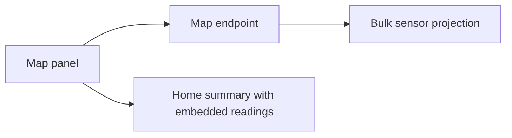
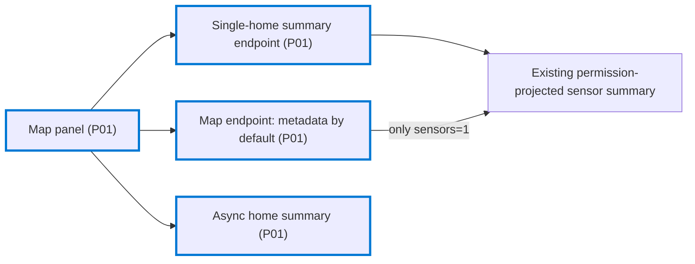

<!-- markdownlint-disable-file -->
---
title: Lazy map sensors implementation plan
ms.date: 2026-11-23
---

# RPI Plan: lazy-map-sensors

## Task Metadata

Task ID: `lazy-map-sensors`. Date: 2026-11-23.

## Executive Summary

Default map draws will not read sensor SQL. Selecting a home will load its
latest summary through the existing permission projection. The owner chose
to retain the stale/offline checkbox as an explicit bulk-read exception.

Task ID: `lazy-map-sensors`. Planning participation: agent-owned, automatic.
Readiness: research C1-C4 covers the change; standard critique passed.

## What You May Not Know

The existing overlay reads up to 100 homes on every point draw. The filter
cannot work across homes without an opted-in bulk read.

## Phase Checklist

### Before

### After

<!-- rpi:phase id=P01 -->
### [x] P01: Deferred map sensor reads

Goals: Map responsiveness no longer depends on unselected homes' sensor reads;
selected values remain authorized and cannot be overwritten by stale responses.

Dependencies: Completed research; owner-confirmed opt-in filter behavior.

Changes in the map: Map panel, map endpoint, single-home endpoint, async card.

<!-- rpi:task id=P01-T01 -->
#### [x] P01-T01: Separate map metadata from sensor reads

Goals: Ordinary map requests perform zero sensor queries.

Requirements: `FR-001`, `FR-002`, `NFR-001`.

Details: In [src/api/src/zava_forward/api/server.py](../../../src/api/src/zava_forward/api/server.py),
require explicit `sensors=1` before passing `map_sensors` to the map provider;
otherwise attach fixed `not-loaded` states without database work. Add a
single-case `sensor-summary` read reusing `map_sensors` unchanged. Preserve
role and consent restrictions, bounded IDs and the existing case route access.
No authorization, schema, deployment or SQL change.

References: Research C1-C3; owner request is the direct business source.
The existing draft PRD is context, not a newly approved performance threshold.

Dependencies: None.

<!-- rpi:task id=P01-T02 -->
#### [x] P01-T02: Load selected-home values and opt-in filter

Goals: Selecting a marker loads only that home's summary. Switching homes,
closing the card, route changes and redraws cannot display another home's data.

Requirements: `FR-001`, `FR-002`, `FR-003`, `NFR-001`, `NFR-002`.

Details: In [src/api/src/zava_forward/api/web/app.js](../../../src/api/src/zava_forward/api/web/app.js),
show a polite loading state, fetch the single-home summary on explicit
selection, cancel obsolete requests and guard results by request generation.
Redraws retaining the same selected home must not trigger extra detail reads.
Checkbox changes redraw the map with the bulk flag only when checked. Sensor
errors remain explicit, with retry guidance; ordinary map/list links still work.
Reuse gauges, badges, keyboard activation and the existing card layout.
An opted-in bulk refresh must update a retained selected card and cancel any
older single-home request, so the card agrees with its stale/offline marker.

References: Research C4 and W1; confirmed owner opt-in choice.

Dependencies: `P01-T01`.

<!-- rpi:task id=P01-T03 -->
#### [x] P01-T03: Prove request boundaries and document behavior

Goals: Regression tests fail for eager reads, unrelated-home reads and stale
card updates, and preserve the existing sensor projection.

Requirements: `FR-001` through `FR-003`, `NFR-001`, `NFR-002`.

Details: Extend [src/api/tests/test_map_sensors.py](../../../src/api/tests/test_map_sensors.py)
for default zero provider calls, single-home scope and opt-in compatibility.
Update [src/api/tests/test_map_fullscreen.py](../../../src/api/tests/test_map_fullscreen.py)
where its no-case-request assertion conflicts with intentional lazy reads.
Add at most one focused test module for executed JS interaction cases,
including delayed reads, filter toggling, errors, route cleanup and keyboard
selection. Preserve existing tests; remove none. Maximum 12 new test methods.
Use synthetic fixtures only. Canonical targets are source and tests; no generated
browser-check recipe changes. Update [src/api/README.md](../../../src/api/README.md).

Run affected map tests, accessibility/content baselines, API ruff/mypy and
format checks where applicable, plus the focused browser test. No full local
gate: this is a bounded read scheduling/performance fix, with unchanged SQL,
deployment, dependencies and authorization controls. Hosted CI and independent
exact-head review remain publication requirements, not inferred successes.

References: API guide, research C1-C4; repository focused-tier rules.

Dependencies: `P01-T01`, `P01-T02`.

## User Decisions and Requirements

* Owner requests sensor readings only when a home is selected.
* Owner retains stale/offline filtering as an explicit opted-in bulk exception.
* Unrelated modified PDF stays untouched and out of commits.
* `FR-001`: default maps, including redraw/pan, make no sensor SQL reads.
* `FR-002`: explicit sensor filter requests retain bounded bulk summaries.
* `FR-003`: selected-home values, states and error messages load asynchronously.
* `NFR-001`: unchanged role, consent and scope projection; no history returned.
* `NFR-002`: stale requests cannot update another home, closed or disposed card.

## Planning Decisions and Feedback

No unresolved material decisions. Use a single-home summary rather than full
history to avoid extra data transfer and duplicated state classification.

## Planning Readiness

Ready. Standard critique completed with Pass and no findings. Next:
automatic implementation. No material decision remains unresolved.

## Scope and Risks

No visual redesign, private data, infrastructure or live deployment. A browser
abort does not guarantee a server-side read stops, so generation guards remain
required. Repeated explicit selection may refresh values; redraw alone must not.

## Sources

Research: `.copilot-tracking/research/2026-11-23/lazy-map-sensors-research.md`.
Business source: owner request and filter answer on 2026-11-23. Original case
study and unsigned addendum/PRD remain context; this fix changes no business
authority, autonomy, safety decision or resident consent.

## Critique Disposition

Standard, first-task default. Complete / Pass, no findings. Record:
`.copilot-tracking/reviews/plans/2026-11-23/lazy-map-sensors-plan-critique.md`.

## Follow-Up Items

None selected outside the active plan.
