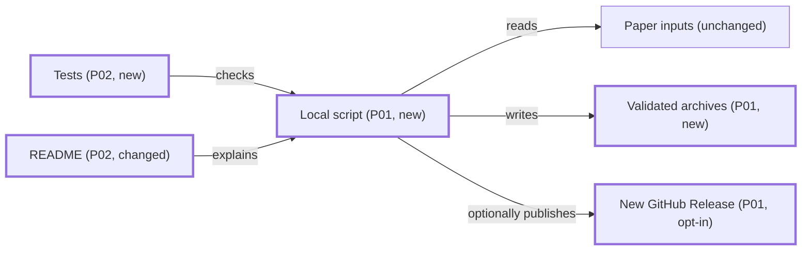

# RPI Plan: arXiv release package

## Task Metadata

Task `arxiv-release-package`; automatic, agent-owned decisions. Plan path:
`.copilot-tracking/plans/2026-11-25/arxiv-release-package-plan.md`.

## Executive Summary

Add a local paper-packaging script, focused tests and instructions. The script
preserves the paper bytes, validates an extracted archive with PDFLaTeX, and
optionally uploads both archive formats and checksums to a new GitHub Release.
No release or arXiv submission will run during implementation.

### What You May Not Know

Publishing may expose the paper before its human clearance conditions are met.
The explicit publication command must therefore remain separate from packaging.
Actual release execution takes the repository's full publication tier; this
implementation will provide targeted evidence, not claim that gate has run.

## Phase Checklist

### Before

The paper has manual packaging instructions but no local release script.

### After

<!-- rpi:phase id=P01 -->
### [x] P01: Produce verifiable archives and explicit publication

Goals: deliver a local-only command whose archives contain only compilation inputs.

Dependencies: completed research.

Changes in the map: script, archives, opt-in GitHub Release.

<!-- rpi:task id=P01-T01 -->
#### [x] P01-T01: Implement packaging and publication

Goals: package the current paper and publish only on an explicit request.

Requirements: `FR-001` through `FR-004`, `NFR-001` through `NFR-003`.

Details:
* Canonical target: paper-local `anc/package_arxiv.py`.
* Reuse the existing comment stripper; follow literal root-relative TeX,
  graphics and listing dependencies, rejecting escapes, symlinks, invalid
  names, missing inputs and cycles. Do not copy entire directories.
* Preserve source bytes and paths in deterministic ZIP/tar.gz archives.
  Compile the extracted ZIP with shell escape disabled. Keep the local
  preview outside the submission archives.
* Require a new output directory. Publication additionally requires a clean,
  tracked snapshot, valid new tag, and authenticated GitHub CLI. Compare every
  input with its HEAD blob before and after compilation, checking the same SHA.
  Create a tag
  at the exact source SHA, upload to a draft, then publish. Never overwrite
  or delete an existing tag/release; report failures and recovery scope.

References: research C1-C2, W1-W3; user request is the business authority.
Existing BRD/PRD/ADRs govern the demonstrator, not this publication utility.

Dependencies: none beyond research.

<!-- rpi:phase id=P02 -->
### [x] P02: Test the contract and document local use

Goals: demonstrate archive completeness and publication safeguards.

Dependencies: P01.

Changes in the map: tests and README.

<!-- rpi:task id=P02-T01 -->
#### [x] P02-T01: Add focused regressions and usage guidance

Goals: owner can package locally and choose when to publish.

Requirements: `FR-001` through `FR-004`, `NFR-001` through `NFR-003`.

Details:
* Test ownership: new paper-local `anc/test_package_arxiv.py`, maximum twelve
  test methods, no removals. Fixtures test traversal, comments, listings,
  invalid/missing/escaping inputs, deterministic archive bytes and exclusions,
  build failures, dirty source refusal, exact SHA binding, and release failures.
* Mock GitHub calls; never create a test release. Build actual current paper
  archives locally and verify both formats' members, hashes and source bytes.
* Targeted checks: new unittest module, Ruff check/format, isolated mypy for
  new code, `git diff --check`, real extracted-paper PDFLaTeX build.
* Update the existing paper README with prerequisites, package-only and
  publication examples, exclusions, scope and failed-draft recovery.
* Generated outputs stay external; no committed PDF or workflow changes.

References: paper README arXiv preparation; research W1-W3.

Dependencies: P01-T01.

## User Decisions and Requirements

### Confirmed User Direction

* Create a script for the attached TeX and images in arXiv submission format.
* Publish packages as a repository release when the local script is requested
  to do so. Do not add a GitHub Action.
* End-to-end automatic work authorized in the working-mode form.
* Use the original document-review branch. After a detected concurrent edit,
  the owner selected freeze-current for final snapshot validation.

### Planning Decisions and Feedback

| Group | Decision or feedback item | Status | Owner | Basis |
| --- | --- | --- | --- | --- |
| D2 | Packaging is default; publication is explicit | Resolved | Agent | No actual release requested |
| D3 | Use original docs/presentation-author-voice branch | Resolved | User | Explicit 2026-11-25 correction; switched back |
| D5 | Do not push this branch without owner permission | Resolved | Owner policy | Repository-scoped memory |

## Planning Readiness and Next Step

Implementation completed with targeted checks passing. Standard critique's
PC-001 is resolved. No unresolved material choice requires a question.
Parent continues to Review; actual publication remains outside this run.

## Goals

Archive only compilation inputs and make local release delivery reproducible.

## Scope and Non-Goals

Script, focused tests, existing paper README and workflow evidence only.
No manuscript edits, arXiv service interaction, scientific review, clearance
assertion, dependency changes or GitHub Actions.

## Functional Requirements

* `FR-001`: ZIP and tar.gz expand directly to main.tex and its reachable inputs.
* `FR-002`: Build an extracted archive locally without shell escape; fail if it
  cannot compile or has unresolved references/citations.
* `FR-003`: An explicit publication option creates a new exact-SHA release with
  both archives and their SHA-256 checksums; no implicit network mutation.
* `FR-004`: Exclude build outputs and unrelated evidence; preserve source bytes.

## Non-Functional Requirements

* `NFR-001`: Python standard library only; local PDFLaTeX and GitHub CLI tools.
* `NFR-002`: Errors are visible and nonzero; no overwrite, silent fallback or
  automatic destructive recovery.
* `NFR-003`: Deterministic archives; documented scope and human approval boundary.

## Risks and Open Questions

| Risk | Task | Disposition |
| --- | --- | --- |
| TeX is programmable; static dependency parsing is not general | P01-T01 | Restrict literal commands; extracted build catches missing dependencies |
| Concurrent edits can invalidate source binding | P01-T01 | Snapshot hashes and clean exact-SHA checks before publication |
| Upload failure leaves tag/draft | P01-T01 | Explicit failure and manual recovery; never delete automatically |
| Publication gates not run here | P02-T01 | No actual release, commit, push or approval claim |

## Dependencies

Installed Python, PDFLaTeX with the paper's packages; Git and authenticated
GitHub CLI only for optional publication.

## Sources

* [.copilot-tracking/research/2026-11-25/arxiv-release-package-research.md](../../research/2026-11-25/arxiv-release-package-research.md)
* [docs/capstone/thought-leadership/everything-but-the-software/README.md](../../../docs/capstone/thought-leadership/everything-but-the-software/README.md)

## Critique Disposition

Standard, first-task default; execution Complete, original verdict Revise.
PC-001 (Medium) accepted and resolved by the HEAD-blob and post-build
recheck requirement in P01-T01. Regression ownership remains P02-T01.
No blocking findings remain; planning is Ready. Original output:
`.copilot-tracking/reviews/plans/2026-11-25/arxiv-release-package-plan-critique.md`.

## Artifact Self-Check

Requirements map to both tasks. No removed tests, generated source targets,
new package dependencies or changes to approval authority.

## Follow-Up Items

* None.

## Handoff

After critique, Implement owns
`.copilot-tracking/changes/2026-11-25/arxiv-release-package-changes.md`.
