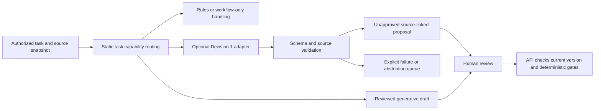

<!-- markdownlint-disable-file -->

# Task Research: system-one-decision-models

| Field | Value |
| --- | --- |
| Date | 2026-10-10 |
| Researcher / agent | RPI Agent / rpi-research |
| Status | Complete |
| Artifact path | .copilot-tracking/research/2026-10-10/system-one-decision-models-research.md |

## Research Brief

* What to research: Revisit System One typed decision models, including Microsoft Decision 1 in Foundry, across every Proper Warm workflow and process stage.
* Why it matters: Determine whether a previously speculative option is now a credible bounded design candidate.
* Audience or intended use: Project owner and later architecture/requirements planning.
* Scope: Existing IDEA-001 research, nine retrofit workflows, architecture/model routing, supplied announcement and official model/deployment evidence.
* Non-goals: Production deployment, model calls with resident data, requirements approval, application changes or editing project design during Research.
* Criteria: Primary-source grounding; distinguish schema validity from decision correctness; preserve deterministic controls, professional authority and resident choice; evaluate operational availability, comparative value and exit conditions.
* Requested outputs: Evidence-backed stage-by-stage assessment and conditional design recommendation.
* Output mode: convergence.

## Research Parameters

| Field | Value |
| --- | --- |
| Research questions | What changed; where does the model fit; what must remain deterministic/human; what evidence gates inclusion? |
| Codebase scope | docs/ideas, docs/brds, docs/prds, docs/adrs, relevant model integration contracts |
| External scope | Supplied Microsoft announcement; official Foundry, Microsoft Research and model-card documentation |
| Initial internal candidate areas | IDEA-001, original/addendum, BRD workflow portfolio, PRD AI contracts, ADR 0001 and 0002 |
| Initial external candidate areas | commandline.microsoft.com, learn.microsoft.com, microsoft.com, official model repository |
| Research posture | balanced |
| Posture provenance | Default: named model and bounded retrofit process, with adjacent deployment uncertainty |
| Explicit limits / deadline | None |
| Posture-specific completion basis | Covered workflows and sufficiently supported material claims |
| Edits allowed during research? | No; research evidence and required workflow tracking only |
| Resolved evidence root | .copilot-tracking/research/ |
| Known constraints / excluded sources | No private support material; no production claims from synthetic records; no regulatory rule activation |

## Extension Registry and Provenance

| Kind | Candidate | Match and provenance | Scoped authority or output contract | Selected / skipped reason |
| --- | --- | --- | --- | --- |
| Instruction | Repository/global instructions supplied in context | All research inputs | Source hierarchy, branch/PR delivery, preserve original and memory | Selected; research phase restricts writes to evidence/tracking |
| Skill | rpi-research | Explicit research request | Three ordered evidence waves and research-only handoff | Selected |
| Skill | rai-standards / privacy-standards | AI decisions involving residents | Relevant evaluation/privacy context | Not activated: assess established project controls, not a new compliance assessment |
| Specialist | hve-core-all:rpi-researcher | Registered general research specialist | Independent evidence lane only | Skipped: tightly coupled model-to-process trace handled inline |

## User Participation and Research Decisions

| Checkpoint | Questions or no-interaction rationale | Answers / unanswered | Resulting decision or selected further research |
| --- | --- | --- | --- |
| Intake | Explicit research task and supplied announcement establish sufficient scope | No question necessary | Research all nine workflows and supporting process stages; recommend only |
| Direction change | Official model limitations narrow safe uses, without changing the caller's research scope | No question necessary | Retain semantic support only; no autonomous housing decisions or person profiling |
| Convergence | Evidence supports a conditional design candidate, not deployment or operational approval | No question necessary | Prepare planning handoff; remain in manual Research |

## Scope and Success Criteria

* Existing System One conclusions are rechecked, not assumed current.
* All nine workflow families and upstream/downstream process steps receive a fit verdict.
* External claims carry retrieval dates; internal evidence carries path and line.
* Alternatives, risks, deployment gaps and later design-change boundaries remain explicit.

## Task Research Requests

* Explicit request: Revisit System One at every process step now that a model is in Foundry; include it in project design if justified.
* Research interpretation: Produce a conditional inclusion recommendation and concrete design handoff, not unapproved design edits.

## Direction Controls

| Control type | Direction or boundary | Source / checkpoint | Effect |
| --- | --- | --- | --- |
| add | Microsoft Decision 1 announcement is the starting external source | User intake | Revalidate prior IDEA-001 findings |
| narrow | Research task | User's latest request | Do not advance to Plan or Implement |
| exclude | No inferred consent, model-controlled legal/safety gates or company facts | Repository baseline | Apply to every workflow |

## Research Questions

| # | Sub-question | Type | Priority | Status |
| --- | --- | --- | --- | --- |
| Q1 | What is Decision 1, and what is actually available in Foundry? | depth | H | answered; target deployment unverified |
| Q2 | Which tasks across every retrofit workflow suit typed decisions? | depth | H | answered as conditional task fit |
| Q3 | What runtime contract preserves safety, rights and auditability? | depth | H | answered as proposed adapter contract |
| Q4 | Which alternatives and evaluation gates justify inclusion or rejection? | depth | H | answered; local results pending |

## Prior Knowledge Gate

* Reviewed intake: original specification, addendum introduction, knowledge-base index and owner memory.
* Existing artifacts verified: IDEA-001 and its System One synthesis (C1-C2), BRD lifecycle/workflow portfolio (C7, C11-C12), PRD task/evaluation/orchestration contracts (C3, C8-C10, C13), ADR 0001 model tiers and identity boundary (C4), ADR 0002 ranking and evaluation separation (C5).
* Reused findings: closed outputs do not guarantee correctness; financial/date/permission controls remain deterministic; approvals and resident choice remain human; workflow-only is a valid outcome.
* Stale scope: the earlier five-agent mapping is incomplete for the current nine-workflow product. Its Jev/Kev-specific context limits, calibration, SDK response fields and hosting assumptions must not be copied to Decision 1.
* New evidence: managed Foundry Decision 1 is a concrete integration candidate. This does not validate the earlier IDEA-001, supply company data or establish local quality.

## Research Cycle Log

### Cycle 1

* Active controls: nine-workflow coverage; research-only; unchanged human and deterministic authority.
* Posture: balanced; complete Wider, Deeper and Contrarian before synthesis.

#### Wave 1: Wider

* Plan: verify the earlier System One proposal; inventory workflows and existing model boundaries; retrieve the supplied announcement.
* Inline investigation: tightly coupled scope, no delegated worker.
* Reflection: The earlier idea is now supported by an official Foundry catalog and deployment guide (W1-W3). The model is a decision scorer, not a general agent or text generator. Existing deterministic/human boundaries remain relevant; the official catalog explicitly excludes sole consequential housing decisions. Prior research covered five agents; the current design requires nine workflows, and ADR 0002 prohibits model feedback into authoritative ranking.

#### Wave 2: Deeper

* Plan: inspect official deployment/model documentation, input/output contract and process-stage fit.
* Parent priority: Verify the provider-specific endpoint and response shape, text-only limitation, lack of generated citations/rationales, data-zone availability and every current workflow step.
* Inline evidence: W3 documents `/providers/microsoft/v1/systemone`, a deployment-name request field, an `answers` object and typed numerical outputs. C7-C10 provide the 15-step lifecycle, nine workflows and comparison/authority gates. W2 confirms text-only operation and no explanations; W4 distinguishes inference location from resource location.
* Reflection: A third, optional decision-scoring capability is compatible with the bounded service, but needs a separate adapter and application-owned evidence/rationale envelope. It cannot replace generative drafting, observe installation photos, set authoritative ranking or satisfy gates. Default model use at every step would be wasteful and contrary to the deterministic baseline.

#### Wave 3: Contrarian

* Plan: challenge availability, legal/safety fit, schema-vs-correctness, comparative cost and learning/feedback risks.
* Parent priority: Challenge vendor speed/calibration extrapolation; profiling and consequential housing restrictions; indirect ranking feedback; missed hazards from negative classifications; model-as-judge independence; deployment and pricing claims.
* Inline evidence: W2-W3 explicitly warn about consequential housing decisions, fairness, wording sensitivity and imperfect safety screening. W4-W5 do not establish UK-only inference. W7 documents inference RBAC distinct from deployment permissions. A targeted search for independent housing evidence did not produce an accepted independent workload evaluation.
* Reflection: Accept availability as a documented offering, but reject claims of proven housing accuracy, UK residency, independent assurance or guaranteed programme acceleration. Search-generated claims that EU data zones include the UK, or that all deployment types are supported, are not accepted; W3-W4 control. Generic score-based queue prioritisation conflicts with C5/C13 and is not adopted.

#### Parent Synthesis and Disposition

| Material / claim | Evidence IDs | Parent disposition | Evidence-based rationale | Primary-artifact treatment |
| --- | --- | --- | --- | --- |
| Decision 1 is now a concrete Foundry candidate | W1-W3 | accepted | Official catalog and model-specific API/deployment guide agree | Conditional inclusion recommendation |
| Use the model in every process step | C7-C13, W2-W3 | rejected | Every step needs assessment, not an inference call; many are arithmetic, authority or physical work | Fifteen-step matrix with explicit exclusions |
| Add optional typed semantic scoring beneath existing bounded task service | C3-C4, C9-C10, W3 | accepted as proposal | Compatible component boundary; adapter handles provider-specific contract | Design handoff |
| Replace deterministic ranking with model scores or model-derived features | C5, C13 | rejected | Direct or indirect feedback would defeat authoritative ranking separation | No ranking-write path |
| Use model output as independent safety, compliance or quality approval | C6, C10-C13, W2-W3 | rejected | Numerical scores have no authoritative explanation and can miss harm | Additional flags only, human review |
| Assume claimed speed, calibration and price prove local value | C9, W1, W3, W6 | rejected | Vendor evidence is not paired housing-workflow evidence; Azure rate not confirmed | Local comparative evaluation gate |
| Activate a deployment or process resident data now | C3-C6, W3-W5, W7 | deferred | Quota, residency, terms, RBAC/private endpoint and lawful processing remain unverified | Later deployment/privacy gates |

#### Cycle Re-entry Evaluation

* Another complete three-wave cycle needed: No for the scoped research recommendation.
* Stop basis: all nine workflows and all 15 lifecycle steps are mapped; primary sources settle intended uses, contract and limitations. Remaining gaps require target-subscription verification, approved labels or owner decisions, not more general web research.
* Revised brief required: None.
* Readiness effect: Ready to plan a conditional demonstrator capability and canonical documentation amendment; not ready for live deployment, production use or a performance claim.

## Evidence Log

### Codebase Evidence

| ID | Claim / finding | Location | Tool | Confidence | Notes |
| --- | --- | --- | --- | --- | --- |
| C1 | IDEA-001 is proposed, not validated; compares Jev/Kev with deterministic and generative alternatives | docs/ideas/typesafe-system-one-agent-fit.md:9-21, docs/ideas/idea-register.md:32 | view | High | Prior evidence dated 2026-09-24; revalidate model-specific facts |
| C2 | Existing System One controls reserve dates, arithmetic, permissions, consent and approvals to code/people | docs/ideas/typesafe-system-one-agent-fit.md:114-137 | view | High | Still compatible with current official model limits |
| C3 | Bounded task service returns proposals; API is the only controlled write path | docs/prds/proper-warm-retrofit-programme-demonstrator.md:136-155 | view | High | Errors must be explicit; workflow-only remains available |
| C4 | ADR 0001 currently proposes two generative model tiers in Foundry | docs/adrs/0001-azure-architecture.md:40-60 | view | High | Decision API is not a drop-in Chat Completions replacement |
| C5 | ADR 0002 makes authoritative ranking deterministic, with AI recommendations separate and no feedback | docs/adrs/0002-pilot-readiness-architecture.md:205-264 | view | High | Do not let inferred features change ranking indirectly |
| C6 | Source checks do not approve legal interpretation or activate operational rules | docs/reference/regulatory/README.md:34-55 | view | High | No new legal claim or rule activation in this research |
| C7 | Retrofit lifecycle contains 15 explicit steps, plus an independent safety path | docs/brds/agentic-retrofit-programme-brd.md:1005-1032 | view | High | Cover every step, not just five original agents |
| C8 | Current PRD covers nine workflow families | docs/prds/proper-warm-retrofit-programme-demonstrator.md:397-417 | view | High | Required full-MVP coverage, not an implemented/approved production claim |
| C9 | AI selection requires paired workflow-only tests, task-specific thresholds and zero undetected critical-control failures | docs/prds/proper-warm-retrofit-programme-demonstrator.md:566-594 | view | High | No local Decision 1 evaluation exists in supplied evidence |
| C10 | Workflow chooses eligible tasks; API rechecks accepted proposals; model self-check is not independent verification | docs/prds/proper-warm-retrofit-programme-demonstrator.md:596-625 | view | High | Keep model below orchestration/authorization |
| C11 | Human triage is first; service intake is not consent; provider instructions and financial acts remain authorized human actions | docs/brds/agentic-retrofit-programme-brd.md:1108-1214 | view | High | Decision support must not displace first triage |
| C12 | Finance, case orchestration and portfolio workflows preserve separate approvals and paired incremental-value evidence | docs/brds/agentic-retrofit-programme-brd.md:1233-1253 | view | High | Supplier invoices are not grant claims or cash receipts |
| C13 | Owner direction requires deterministic ranking and human approval of every action; AI recommendations cannot change a ranking, queue or case | docs/prds/proper-warm-retrofit-programme-demonstrator.md:314-329 | view | High | Apply the tighter current boundary over earlier automation examples |

### External Evidence

| ID | Claim / finding | Source | URL | Retrieved | Version/date | Confidence |
| --- | --- | --- | --- | --- | --- | --- |
| W1 | Announces Foundry availability, closed-option probabilities and vendor latency/price claims | Microsoft Command Line announcement | https://commandline.microsoft.com/microsoft-decision-1-model-foundry/ | 2026-10-10 | Retrieved live; publication date not confirmed | High for announcement; unverified for housing performance |
| W2 | Text-only; no rationale; not sole decision-maker in consequential housing decisions; no profiling/tracking individuals | Foundry model catalog | https://ai.azure.com/catalog/models/Microsoft-Decision-1 | 2026-10-10 | Live catalog | High for stated intended-use limits |
| W3 | Official Decision API, Noul/Choice/Score, model version 1, GlobalStandard and selected DataZoneStandard deployments | Microsoft Learn deployment guide | https://learn.microsoft.com/en-us/azure/foundry/foundry-models/how-to/use-foundry-models-microsoft-decision | 2026-10-10 | ms.date 2026-10-07; updated 2026-10-09 | High for documented contract, not target deployment |
| W4 | Global inference is not local; data-zone inference stays within the specified zone; not every model supports every deployment type | Microsoft Learn deployment types | https://learn.microsoft.com/en-us/azure/foundry/foundry-models/concepts/deployment-types | 2026-10-10 | ms.date 2026-08-06; updated 2026-08-12 | High for general deployment semantics |
| W5 | General regional availability reference distinguishes storage and inference; target Decision 1 regions not established by the retrieved portion | Microsoft Learn region availability | https://learn.microsoft.com/en-us/azure/foundry/foundry-models/concepts/models-sold-directly-by-azure-region-availability | 2026-10-10 | ms.date 2026-09-03; updated 2026-09-04 | High for general distinctions; insufficient for exact Decision 1 region |
| W6 | Public pricing page retrieval did not expose a model-specific rate | Azure Microsoft model pricing | https://azure.microsoft.com/en-us/pricing/details/ai-foundry-models/microsoft/ | 2026-10-10 | Live page | Insufficient to confirm Foundry subscription price |
| W7 | Keyless inference requires suitable resource-scoped RBAC; deployment permission is a different concern | Microsoft Learn Entra configuration | https://learn.microsoft.com/en-us/azure/foundry/foundry-models/how-to/configure-entra-id | 2026-10-10 | ms.date/updated 2026-08-31 | High for general RBAC; exact Decision API role still needs verification |

* Source discovery only: the Foundry Community Hub announcement URL returned its title but no substantive body, so it adds no corroboration: https://techcommunity.microsoft.com/blog/azure-ai-foundry-blog/introducing-microsoft-decision-1-in-microsoft-foundry-for-decision-and-classific/4562742 (retrieved 2026-10-10).
* Search summaries were used to locate official documentation, not accepted as API, benchmark, residency or price evidence. No independent Proper Warm/UK retrofit evaluation was established by the reviewed sources.

### Contradictions / Conflicts

* The old TypeSafe example accesses `response.choices` and a separate `confidence`. W3 documents an `answers` object and probabilities; it does not establish that the same SDK/fields are supported. Resolution: separate adapter, fixture-based conformance tests; do not assert drop-in SDK compatibility (C1, W3).
* W1 advertises robustness and calibrated probabilities. W3 warns that wording/order affects results and calibration is strongest on familiar tasks; `score` is a probability-weighted index, not an absolute calibrated severity. Resolution: retain vendor claims as such and measure local calibration/perturbation sensitivity.
* The BRD quality workflow mentions photos (C8). Decision 1 is text-only (W2). Resolution: it may check documentary text or reviewed observations, not inspect pixels or certify physical installation. Upstream OCR/vision is a separate error-producing capability and is not implicitly added.
* ADR 0001's two deployments are generative (C4); Decision 1 uses a separate provider path (W3). Resolution: optional third capability, not a renamed `standard` model.
* Older raise-only/routing examples suggest automated handling (C1-C2). Current owner direction requires a person to approve every action and preserves first human triage (C11, C13). Resolution: initial integration is recommendation/shadow-only; no autonomous routing, hold changes or other controlled writes.
* W4 describes geography-based processing differently from the region-specific shorthand in W5. Neither establishes a regional Decision 1 SKU; W3 lists only GlobalStandard and selected DataZoneStandard. Resolution: no UK-only inference claim and no unsupported Standard/Batch/provisioned deployment assumption.

## Findings Mapped to Questions and Evidence

| Question | Finding | Evidence IDs | Confidence | Decision or readiness implication |
| --- | --- | --- | --- | --- |
| Q1 | Foundry documents version 1, typed decisions and a dedicated Microsoft Decision API | W1-W3 | High for documented offering | Concrete candidate, not verified provisioned resource |
| Q2 | Strongest fit is bounded semantic classification of text, evidence mismatch and guardrail screening, not whole agents | C7-C13, W2-W3 | Medium for task suitability; unmeasured quality | Select tasks, not blanket model use |
| Q3 | Preserve API ownership; add provider adapter and source-linked proposal envelope; default uncertain/failed calls to visible human/workflow-only handling | C3-C5, C10-C13, W3, W7 | High for compatibility; runtime untested | No model-controlled gates, consent or ranking |
| Q4 | Conditional inclusion is justified by availability; production/value selection needs task-level comparative evidence and deployment/privacy gates | C9, C12-C13, W1-W7 | High for need to evaluate; effectiveness unknown | Ready for scoped planning only |

## Key Discoveries

* The model supplies semantic judgments, not new decision rights. Foundry availability reduces the need for a separate hosted vendor or self-managed GPU, but does not remove privacy, transfer, contract or service-assurance work (C1, C3-C6, W1-W4).
* A typed label can still be wrong, biased or confidently unsupported. A well-formed answer cannot satisfy a technical, funding, safety, consent or payment gate (C2-C3, C11-C13, W2-W3).
* Decision 1 does not emit rationale or citations. The application must attach known input evidence and an honest explanation of the question/label, not invent a model reasoning trace (C3, C10, W2-W3).
* Every process step was considered. Several deserve no decision-model call at all; narrow assists in other steps remain optional and reversible (C7-C13).

### All Nine Workflow Families

All entries below are internal design-fit hypotheses, not measured model results or company facts. "Strong" describes task shape, not operational safety or accuracy. Initial use is shadow/recommendation-only under C13.

| Workflow | Decision 1 fit and bounded use | Deterministic, generative or human responsibility | Proposed value evidence |
| --- | --- | --- | --- |
| 1. Stock data, safety triage and fair prioritisation | Partial: classify record conflicts, select from pre-extracted candidate fields, flag missing evidence or hazard language in supplied notes | Identity/tenure resolution, eligibility and policy ranking remain controlled; AI-derived features cannot feed authoritative ranking until separately verified and authorized as source corrections | Verified conflicts found before survey; cohort preparation/review minutes; no priority harm |
| 2. Technical assessment and design readiness | Partial: document-type classification, checklist text support and conflict flags against an approved design/template | Site survey, risk assessment, PAS 2035 judgment, design and sign-off belong to competent people; do not infer unseen observations | First-pass pack completeness; unsupported pre-fill rate; returned assessments; net review effort |
| 3. Resident service, access, choice and redress | Strong task fit: suggest message intent, complaint/possible pause or withdrawal flags, explicit requested adjustments; several labels may coexist | Human urgent triage comes first; no consent/refusal inference, persuasion or latent vulnerability profile; language generation/translation is separate and reviewed | Multi-intent recall; missed pause/complaint flags; triage/review time; additional reviewer load |
| 4. Procurement, committed capacity and work release | Partial: classify delay reasons and proposed work-order/evidence inconsistencies from text | Capacity ledgers, scheduling solver, confirmed availability, commitments, instructions and variations remain code/people | Delay taxonomy accuracy; controlled-data reconciliation; abortive visits; net work-order review time |
| 5. Hazard awareness and damp-and-mould response | Restricted: additional raise-only possible-signal checks on text already routed to existing human service | Existing service controls awareness, clocks, urgency, response and closure; low model probability cannot suppress review, defer response, downgrade or release holds | Critical signal recall, awareness-to-referral and false-flag workload; no dependency on model uptime |
| 6. Quality acceptance, defects and resident handover | Strong for documentary checks: supported/contradicted/insufficient evidence labels, possible defect text and draft-handover guardrails | Cannot inspect photos; independent physical inspection, positive checklist, quality acceptance and defect grading/closure remain competent human work | Seeded-defect recall including unflagged packs; false flags; evidence review minutes; rework |
| 7. Budget, provider invoice, grant claim and cash reconciliation | Strong for semantic exceptions: evidence-to-line/scope match proposals, document classification and claim-support checks | Arithmetic, duplicate IDs, tax, limits and eligibility stay in rules; Finance/Legal interpret contracts, approve/pay/certify/submit; invoice, grant claim and cash states remain separate | Unsupported lines caught; invoice/claim review effort; reviewer corrections; first-pass acceptance |
| 8. Programme handoffs and case orchestration | Partial: suggest exception category or next bounded task from engine-provided permitted candidates; classify free-text delay notes | State graph, permissions, timers, ownership rules, retries and escalation remain deterministic; assigned owner/accepted handoff is not supplied by a label | Suggestion correction rate; net coordination minutes; handoff acceptance; no state mutation |
| 9. Portfolio investment, performance and scale decisions | Partial: screen narratives for source support and forecasts represented as facts; categorize validated aggregate delay explanations | Statistical forecasts, denominators, economics, cohort/scale and investment decisions stay in code/Finance/Board; no allocation decisions about residents | Unsupported report claims; review effort; attribution quality; avoid false causal "hours saved" |

Workflow coverage is C8; financial/orchestration/portfolio distinctions are C12; ranking/approval restrictions are C5/C13. Text scoring capabilities/limits are W2-W3.

### Every Lifecycle Step

The exact 15-step baseline is C7. These rows describe a research recommendation, not new requirements.

| Step | Bounded decision-model possibility | Boundary / verdict |
| --- | --- | --- |
| 1. Candidate identified and matched | Document/archetype classification; flag ambiguous textual identity matches | Partial; identifiers and merges stay deterministic/data-owner controlled |
| 2. Prioritisation with maintenance/funding/capacity screens | Identify conflicts or unsupported explanations in an advisory pack | Partial; no model scores or inferred labels change ranking, eligibility or queue membership |
| 3. Safety/data readiness and survey access | Supplemental missing-evidence or explicit contact-request flags | Restricted; first human safety triage, approved facts, clocks and access decisions do not wait for model |
| 4. Assessment completed/accepted | Support/contradiction/insufficient-evidence checks against professional template | Partial; neither performs nor accepts the assessment |
| 5. Options/pathway/disruption discussed | Screen prepared text for implied consent, unsupported savings claims or absent required explanation | Useful screening; generative drafting and accessible conversation remain separate/human |
| 6. Property-specific design approved | Flag document/version conflicts | Limited; cannot judge technical suitability or approve design |
| 7. Resident decision recorded | Suggest possible pause, refusal-to-specific-measure or withdrawal language for human confirmation | Restricted; no model establishes affirmative consent, global refusal or a measure decision record |
| 8. Investment/funding/capacity confirmed | Evidence-to-claim/commitment mismatch flags | Partial; formulas and accountable approvals confirm money, award and capacity |
| 9. Work released/scheduled | Screen proposed work order for textual inconsistency with supplied authorized scope | Partial; deterministic gates, solver and authorized instruction control release |
| 10. Installation hold points completed | Classify installer notes or possible variation/defect language | Limited; physical observation and competent hold-point acceptance cannot be automated by this text model |
| 11. Completion/quality evidence accepted | Per-excerpt evidence support and contradiction flags | Useful documentary assist; not photo/physical inspection, compliance or acceptance |
| 12. Accessible resident handover completed | Screen draft for required topics, unsupported promises and complaint-route omissions | Useful screening; cannot prove accessibility, understanding, receipt or acceptance |
| 13. Payment/grant evidence reconciled | Semantic scope/evidence mismatch and claim-support review | Useful assist; deterministic totals/duplicate checks and Finance approvals remain mandatory |
| 14. In-use outcomes monitored | Classify resident aftercare messages; flag contradiction between report and narrative | Partial; sensors/statistics stay numeric; normal readings or low probabilities cannot override reports |
| 15. Property closed/reopened | Suggest incomplete-evidence, recurrence or remediation-review flags | Restricted; no autonomous closure, hold release or reopening; authorized human action remains |

### Supporting Process and Project Delivery

| Process | Revisited possibility | Decision |
| --- | --- | --- |
| Phase 0 constraint discovery | Classify historical delay notes against owner-defined causes with unknown/multiple-cause handling | Early shadow candidate; validate against blinded human labels and preserve unknowns, not fabricated company baselines |
| Workbook import and data preparation | Suggest document/field mappings for irregular text | Keep hash/row validation, IDs, arithmetic, quarantine and source-owner confirmation deterministic; model cannot auto-correct authoritative records |
| Evidence retrieval | Relevance/support classification of already retrieved, access-checked snippets | Conditional later candidate; ordinary indexes/filters first, no inaccessible records or model-fabricated citation |
| Regulatory change monitoring | Suggest change type and potentially affected requirements from verified old/new text | Human legal/compliance/professional interpretation and activation; model never decides that a duty changed or is satisfied (C6) |
| Model/task routing | Select between permitted semantic checks or generative drafting candidates | Static task-to-capability routing first; optional dynamic classifier only if mixed workload evidence justifies extra calls |
| Agent-output guardrails | Screen generated text for unsupported statements, implied approval/consent or missing approved topics | Supplemental flag; not sole permission, safety filter or independent assurance |
| Development/AI evaluation | Cheap rubric pre-screen of outputs with known reference evidence | Human-adjudicated gold set remains the reference; do not allow a model judge to award compliance or acceptance |
| Pilot and scale monitoring | Monitor calibration, drift, false flags, reviewer capacity, overrides and net value | Deterministic metrics and named human release/disable decisions; no self-updating policy or threshold |

### Documented API Shape and Proposed Application Contract

W3 documents a POST to `<foundry-resource-endpoint>/providers/microsoft/v1/systemone`. The request `model` is the deployment name, not necessarily the catalog model name. The response has `answers` keyed by supplied question IDs, underlying model identity and usage. Do not assume the TypeSafe SDK's `choices`/`nouls` objects or confidence fields from C1.

This illustrative constructed-input request follows W3. It does not provision a deployment, set operational thresholds or implement triage:

```json
{
  "model": "proper-warm-decision",
  "state": {
    "source_id": "exercise-message-001",
    "source_version": "1",
    "message": "Please move the visit to next week. I also want to complain about the last missed visit."
  },
  "questions": {
    "primary_intent": {
      "type": "choice",
      "instructions": "Classify the explicit primary request in message. Do not infer consent, refusal or personal characteristics.",
      "criteria": {
        "appointment_change": "Explicit request to change a visit",
        "information_request": "Request for information only",
        "complaint": "Dissatisfaction requiring complaint review",
        "cannot_tell": "Insufficient evidence or none of these labels"
      }
    },
    "complaint_mentioned": {
      "type": "noul",
      "instructions": "Does message explicitly express a complaint or dissatisfaction requiring human review?",
      "criteria": {
        "true": "Explicit complaint or dissatisfaction",
        "false": "No complaint or dissatisfaction expressed"
      }
    }
  }
}
```

An independent complaint question prevents primary-intent selection from hiding the second intent. Missing context still means human review; a low complaint probability is not evidence that no complaint exists (C11/C13, W3).

Proposed runtime contract:

1. The deterministic engine selects an already authorized bounded task and creates a versioned, source-linked snapshot. Known hazards go to their existing service before any call. The task definition chooses `rules`, `decision-scoring`, `generative-drafting` or `human-review`; it does not ask a model whether it has permission.
2. Reuse the existing bounded task service and least-privilege identity. Add a provider-specific adapter rather than another autonomous agent, workflow engine or direct database writer. Use Entra credentials, keeping local authentication disabled; prove the necessary inference role, scope, private DNS/endpoint and network policy in the target resource (C3-C4, W3/W7).
3. Pass only minimum necessary, permitted text/JSON and fixed owner-approved questions/options. Names/contact details are not needed for message classification; removal of identifiers alone does not anonymize health/disability content. No individual profiling, tracking or latent vulnerability inference (W2).
4. Validate all expected question IDs, answer types, allowed option keys, finite numerical bounds, probability vectors and any provider-documented normalization contract. Contract tests must use actual captured synthetic responses; the exact full raw field schema remains to be verified. Do not normalize malformed outputs into success or invent missing answers.
5. Use locally evaluated probability/margin/abstention rules per task, not a universal `0.9` cutoff or borrowed TypeSafe confidence formula. A Score is an expected ordinal index, not a calibrated hazard grade. Owner thresholds are explicit and versioned; failure/ambiguity goes to a named human/workflow-only path.
6. Construct a common proposal envelope in application code: task/case/evidence versions; question/criteria hashes; provider, deployment and returned model/version; raw validated scores; abstention/failure state; selected suggestion; permitted evidence IDs; reviewer status. Bind each evidence-check question to a known snippet/pair. References prove what was supplied, not that the label is true. Use templates such as "possible mismatch flagged for review"; do not fabricate a rationale, quote or causal explanation.
7. A person accepts, edits or rejects the proposal. The API rechecks identity, current source/case version and deterministic gates. Model labels cannot commit state, assign an authoritative priority, release a hold, establish consent, contact a resident, issue work, accept quality, pay, submit or close. Human acceptance of a suggestion creates a task/draft only, not a required approval (C10/C13).
8. Log explicit failures (timeout, 401/403, 429, invalid schema, absent answer, stale input), bounded retries and owner queue. The optional model path can fail while mandatory human service continues. Never return an empty "all clear", silently choose another provider or bypass a gate.
9. Keep content-bearing audit under approved role/retention controls, separate from privacy-safe operational telemetry. Pin model/configuration as far as the provider supports; detect unavailable/changed versions and disable until regression passes. No automatic training or policy updates from reviewer outcomes.



### Comparison and Acceptance Evidence

Begin with constructed, non-identifying evidence. Human labels must be adjudicated before model evaluation; a synthetic label or LLM judge is not operational truth. Separate tuning, calibration and held-out sets; group by case/building/document family to avoid near-duplicate leakage across splits. Later company-data testing is separately privacy/owner-gated.

| Dimension | Required evidence | Why it changes the decision |
| --- | --- | --- |
| Paired alternatives | Same task, cases and allowed sources for workflow/checklist, Decision 1 and existing small/capable generative candidates; retain human comparison | Isolates incremental model value, not only general digital improvement |
| Critical errors | Per-task hazard, complaint, pause/withdrawal and unsupported finance/safety claim recall; zero undetected critical-control failures in agreed tests | A single seeded critical miss blocks that AI task; zero sample misses is not proof of zero population risk |
| Calibration and abstention | Brier/calibration measures, reliability plots, precision/recall and coverage at owner-approved error/reviewer-capacity budgets | Vendor calibration cannot set housing thresholds; report actual low-confidence review burden |
| Robustness | Rephrasing, reordered options, regional language, negation, mixed intents, ambiguous evidence, stale records, prompt-injection text and unknown/no-match cases | Closed options can force confident mistakes; do not suppress secondary complaints or safety signals |
| Extraction/evidence provenance | Known reference IDs/spans; selected candidate actually exists; source freshness; no fabricated rationale; upstream OCR errors tracked separately | Decision 1 cannot generate grounded explanations or see photos |
| Fairness/privacy | Approved necessary case attributes only; differential false negatives and review delays by lawful relevant slices; no latent person profile | High average accuracy can conceal unequal service |
| Authority/failure invariants | Ranking byte-identical; no queue/state change from AI; no consent/approval action; mandatory service continues with model disabled or failing | Tests the real boundary, not just well-formed JSON |
| Reviewer behaviour | Blinded/independent adjudication including unflagged cases; edits/rejections, review-floor and automation-bias checks | A fast permissive model judge can hide mistakes or encourage rubber-stamping |
| Operational economics | End-to-end p50/p95 latency, retry/throttle/refusal rate, reviewer minutes, infrastructure/assurance costs and cost per correctly handled task | Cheap tokens need not reduce whole-life cost or the binding delivery constraint |

Numerical quality thresholds/sample size remain owner-defined under C9. Pre-register critical categories and budgets rather than choosing them after observing results. Per-task results must remain separate; an aggregate score cannot offset a missed withdrawal or hazard.

W1 advertises USD 0.042 per million input tokens and free output. W6 did not substantiate a Foundry-specific regional/subscription price, so this is an announcement rate, not a quote. Illustrative arithmetic only: 60,000 homes x 20 scoring requests x 1,000 input tokens = 1.2 billion input tokens, or USD 50.40 at that advertised rate. Actual scope/volume is unknown; question/context tokens, repeated reads, retries, generation, document processing, networking, observability, evaluation and review cost must be included. It is not a programme budget or benefit estimate.

## Alternatives and Decision State

### Selected Recommendation

* Approach: Include Microsoft Decision 1 in the next design revision as an **optional decision-scoring capability within the existing bounded AI task service**, alongside deterministic workflow and the existing generative tiers. Treat it as a concrete demonstrator evaluation candidate, not the production default or a new end-to-end agent.
* First evaluation tasks: historical delay-note categorisation, documentary evidence-support/mismatch checks, and draft resident-communication guardrails. Inbound resident-intent/complaint/pause flags are a high-value next candidate but stay shadow-only behind first human safety triage. Start here rather than home ranking or automatic hazard/consent decisions.
* Rationale: Foundry removes the prior separate-provider/self-managed-GPU prerequisite for this candidate (W1-W3), while its dedicated contract fits bounded text judgments. Reusing C3/C4 avoids expanding the architecture; C5/C13 prevent authority drift.
* Confidence: High that the candidate merits conditional design inclusion; medium on task fit; no claimed local performance or value. Confidence increases only with target deployment verification and paired human-labelled results.
* Inclusion status: Recommended for later planning, not yet reflected in ADR/BRD/PRD or approved for operation.

### Alternative: Deterministic Workflow and Human Review Only

* Best for structured data, mandatory controls and low-volume tasks where a classifier adds no value.
* Retain as the baseline and failure path, not a rejected architecture. If Decision 1 does not reduce net effort at the required error budget, remove that task's model path (C3, C9-C13).

### Alternative: Existing Generative Models With Structured Output

* Retain for drafting, summarisation, translation and explanation. Evaluate them on comparable classification cases as well; larger does not automatically mean better.
* Not selected as the sole semantic decision capability because W1-W3 establish a purpose-built alternative worth testing. Decision 1 is not a replacement for generative work (C4, W2-W3).

### Alternative: Hosted Jev or Self-Hosted Kev

* Preserve as contingency/research options from C1, not as current-performance claims. They require separate API/vendor governance or GPU operations and current licensing/model-card verification.
* Not the first new integration: the provisional architecture already uses Foundry, and W1-W3 now provide a managed candidate. Revisit if approved processing location, quality or whole-life economics favour another option.

### Alternative: Blanket Model-Controlled Workflow or AI-Ranked Queue

* Rejected. A decision scorer cannot own human/professional approvals, first hazard triage or the deterministic state graph. Model-derived stock features must not indirectly change authoritative ranking either (C5, C10-C13, W2-W3).

### Concrete Design Handoff for a Later Phase

No files below were edited during this Research task. Do not reference internal tracking artifacts from canonical documentation; carry the findings and public citations into the canonical synthesis instead.

| Target | Proposed focused change | Preserved boundary |
| --- | --- | --- |
| docs/ideas/typesafe-system-one-agent-fit.md | Add dated Decision 1 offering/API/limitations comparison and update five-agent scope to nine workflows/15 steps | Preserve dated Jev/Kev history; IDEA-001 remains proposed pending owners |
| docs/ideas/idea-register.md | Add Decision 1 to IDEA-001/001c evaluation scope and record conditional status | No "Validated" without named owner evidence |
| docs/case_study_48_addendum.md | Describe rules + optional semantic decision scoring + generative drafting + human approvals | Original case study unchanged; no forecast becomes an outcome |
| docs/prds/proper-warm-retrofit-programme-demonstrator.md | Extend model selection/orchestration with capability routing, no-rationale adapter envelope and task-level tests | FR-025 to FR-028, PR-006 to PR-008, NFR-010 remain controlling |
| docs/adrs/0001-azure-architecture.md | Propose optional third `decision` deployment/capability with separate provider endpoint, verified identity/network and SKU gates | Do not claim deployment or reuse unverified generative deployment assumptions |
| docs/adrs/0002-pilot-readiness-architecture.md | Add explicit no direct/indirect decision-score feedback to authoritative ranking and source-supported comparison | Deterministic snapshot and no queue/case mutation remain intact |
| docs/reference/README.md and docs/reference/log.md | Update canonical index and append dated findings when the synthesis is materially updated | No rewriting earlier log entries or owner memory |

An implementation plan should reuse the existing adapter/evaluation boundaries after inspecting the build baseline. Do not preselect a new package, deploy Azure resources or add a service during this research handoff.

## Open Questions, Risks, and Residual Uncertainty

* No blocker to completing this research or planning a conditional demonstrator candidate.
* Deployment blocker: confirm target-subscription model version, deployment SKU/region, capacity/quota, private endpoint/DNS, required inference RBAC, Entra audience, actual response schema and error behaviour. This research made no deployment or inference call.
* Residency/privacy blocker for real data: Foundry presence and a `uksouth` resource do not prove UK inference. GlobalStandard can process outside the UK; a data zone is not UK residency. Confirm applicable processing/retention/abuse-monitoring terms, contracts, transfer position, lawful basis and DPIA with accountable owners before any resident data.
* Evaluation blocker for task activation: human-approved question taxonomy, labels, sample design, task-specific thresholds, reviewer capacity and comparison results do not yet exist for Decision 1.
* Exact context/token/question/option limits, rate-card price, version pinning/retirement behaviour and any fine-tuning support were not established by the accepted sources. Do not borrow Kev's 8,192-token limit, TypeSafe's option limits, generic Foundry batch/provisioned support or search claims.
* Physical quality and accessibility remain outside text-only checks. Adding OCR, speech transcription or vision creates independent privacy/quality dependencies, not automatic Decision 1 capabilities.
* Official benchmark figures are vendor-reported. No accepted independent housing evaluation was found; do not assert that none could exist.

## Current Decisions

| Decision | Status | Owner / source | Rationale | Evidence IDs | Implications |
| --- | --- | --- | --- | --- | --- |
| Remain research-only; no canonical design edits | confirmed | User's latest research request | Manual phase boundary | C1-C13 | Planning handoff only |
| Optional Decision 1 capability merits design inclusion | proposed | Research synthesis | Concrete Foundry offering and bounded task fit | W1-W3, C3-C4 | Later documentation amendment and evaluation |
| Deterministic ranking and human authority are unchanged | confirmed existing boundary | Owner direction in PRD/ADR | Prevent direct/indirect model control | C5, C13 | No autonomous route/state/approval |
| Do not activate model tasks until local gates pass | proposed | Evaluation/authority baseline | Vendor claims do not prove task value | C9-C13, W2-W7 | Constructed-data comparison first |

## Unresolved Decisions

| Decision | Smallest evidence needed | Owner | Impact | Blocker status |
| --- | --- | --- | --- | --- |
| Which tasks enter the demonstrator comparison first? | Confirm task owners, taxonomy and labelled exercise scenarios | Product, Programme, Digital, relevant control owners | Evaluation scope | Important; proposed shortlist above |
| Which deployment is actually usable? | Target model listing/quota/network/RBAC and synthetic contract probe | Digital/platform owner | Serving integration | Blocks deployment, not planning |
| May any real data be processed? | Approved data-class purpose, terms, DPIA and transfer position | DPO, Legal, security and data owners | Resident-data use | Blocks real-data use |
| Does the candidate outperform simpler alternatives? | Paired held-out quality, review-effort and cost results | Product, Safety, Assurance and Finance | Per-task retain/remove decision | Blocks task activation/value claim |

## Potential Next Research

| Priority | Research item | Expected value | Trigger | Selected? | Related evidence |
| --- | --- | --- | --- | --- | --- |
| H | Target-subscription serving/residency and synthetic contract check | Resolve concrete deployment assumptions | Authorized platform work before integration | Deferred to later scoped work | W3-W7, C4 |
| H | Human-labelled task comparison and calibration | Decide whether each task is useful/safe enough | Taxonomy, owners and protocol approved | Deferred | C9-C13, W2-W3 |
| M | Verify current Jev/Kev if Foundry fails a material gate | Preserve viable hosting alternatives | Required residency, quality or cost not met | Conditional, not selected now | C1, W3-W4 |

## Planning Readiness

* Status: Ready for a conditional demonstrator/design plan only.
* Decision state: propose an optional scoring capability; keep task activation and production separate.
* Evidence basis: W1-W3 establish the offering/contract/limits; C3-C5 and C7-C13 establish compatibility and restrictions; W4-W7 establish verification needs.
* Preconditions met: complete three-wave cycle, nine workflows and 15 lifecycle steps assessed, alternatives challenged, source support and authority boundaries explicit.
* Blockers: none to scoped planning. Deployment, real-data use and performance assertions remain blocked by the missing evidence above.
* Next action: user may explicitly invoke `/rpi-plan`; this research does not start it.

## Research Disposition

Executed; complete. Research readiness does not constitute architecture, compliance, owner or release approval.

## Sources

* W1 - Microsoft Decision 1 announcement - https://commandline.microsoft.com/microsoft-decision-1-model-foundry/ (retrieved 2026-10-10; live publication date not confirmed).
* W2 - Foundry model catalog/intended uses - https://ai.azure.com/catalog/models/Microsoft-Decision-1 (retrieved 2026-10-10; live entry).
* W3 - Deploy and use Microsoft Decision 1 - https://learn.microsoft.com/en-us/azure/foundry/foundry-models/how-to/use-foundry-models-microsoft-decision (retrieved 2026-10-10; updated 2026-10-09).
* W4 - Foundry deployment types - https://learn.microsoft.com/en-us/azure/foundry/foundry-models/concepts/deployment-types (retrieved 2026-10-10; updated 2026-08-12).
* W5 - Foundry regional availability - https://learn.microsoft.com/en-us/azure/foundry/foundry-models/concepts/models-sold-directly-by-azure-region-availability (retrieved 2026-10-10; updated 2026-09-04; retrieved excerpt does not settle exact Decision 1 regions).
* W6 - Azure Microsoft model pricing - https://azure.microsoft.com/en-us/pricing/details/ai-foundry-models/microsoft/ (retrieved 2026-10-10; rate not exposed).
* W7 - Foundry Entra authentication - https://learn.microsoft.com/en-us/azure/foundry/foundry-models/how-to/configure-entra-id (retrieved 2026-10-10; updated 2026-08-31; general guidance).

## Artifact Self-Check

* All four questions have supported answers with deployment/evaluation uncertainty separated.
* Wider, Deeper and Contrarian ran in order, inline; no worker execution is implied.
* All nine current workflows and all 15 lifecycle steps are covered, plus discovery/import/retrieval/change monitoring/routing/evaluation/scale.
* Material external claims map to dated W IDs; internal boundaries map to path/line C IDs. Example request follows W3; it is not a tested integration.
* No company baselines, approved thresholds, observed savings, legal interpretations or deployment success were invented.
* Canonical source/design, immutable regulatory snapshots, original specification and owner memory are unchanged.

## Closeout Record

| Field | Record |
| --- | --- |
| Research execution status | Complete |
| Completed waves | Cycle 1: Wider, Deeper, Contrarian |
| Lane evidence or inline fallback | Inline; tightly coupled workflow/model trace did not justify delegation |
| Research disposition | executed |
| Planning Readiness | Ready for conditional planning; C3-C5, C7-C13, W1-W7 |
| Blockers | None for research/planning; deployment, resident-data processing and activation gates remain |
| Continuation owner and state | User; manual RPI Agent remains in Research, waiting for explicit phase advancement |

## Advisory Next Step

| Field | Record |
| --- | --- |
| Research disposition | executed |
| Planning Readiness | Ready for conditional design/evaluation planning only |
| Output mode and planning support | convergence; yes, bounded by unresolved activation gates |
| Acting owner | User / manual RPI Agent |
| Required gates or confirmations | Explicit Plan advancement pending; deployment/privacy/evaluation approvals pending; no implementation approval supplied |
| Continuation result | Advisory `/rpi-plan`; no phase transition performed |
| Primary evidence file | .copilot-tracking/research/2026-10-10/system-one-decision-models-research.md |
| Notes for planning or re-entry | Use the concrete design handoff and per-task comparison gates; do not convert suggested scoring into live authority |

* Completion basis: primary sources and project boundaries cover the research decision; additional public search cannot replace subscription evidence or approved task evaluation.

## Continuation

RPI Agent remains in manual Research. Later planning requires explicit user advancement.
