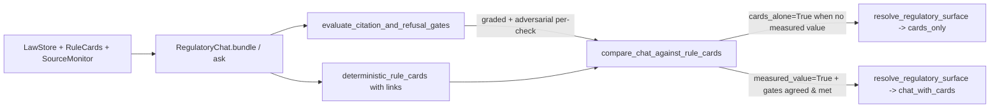

<!-- markdownlint-disable-file -->

# Task Research: 216-citation-eval-2142

| Field              | Value                                                                       |
|--------------------|-----------------------------------------------------------------------------|
| Date               | 2026-11-14                                                                  |
| Researcher / agent | RPI Agent (`rpi-research`)                                                  |
| Status             | Complete                                                                    |
| Artifact path      | .copilot-tracking/research/2026-11-14/216-citation-eval-2142-research.md    |

## Research Brief

* What to research: How to deliver the remaining locally verifiable acceptance criteria of Issue #216 inside `src/core` without violating package-dependency isolation (`ALLOWED = {"core"}`), strict `mypy` typing, Ruff lint/format rules, or ADR 0005 / Tokenomics (#432) honesty boundaries:
  1. Citation validity and refusal accuracy gates set with named owners and measured on both a graded and an adversarial set.
  2. Paired comparison reporting the value of chat over deterministic rule cards with provision links, enforcing "if no measured value, ship cards alone" both in the comparison outcome and in the core regulatory surface selection gate.
* Why it matters: `src/core` owns `RegulatoryChat`, `LawStore`, `RuleCardStore`, `SourceMonitor`, `regulatory_usage`, and `gates`, whereas previous #216 evaluation modules lived only in `src/agents` (which `src/core` cannot import). Delivering a pure, strictly typed, core-native evaluation gate and paired rule-card ship-mode module makes both criteria locally verifiable and enforceable inside `src/core` while preserving explicit distinction between provisional synthetic exercise gates and unexecuted real human/staff approvals.
* Audience or intended use: RPI planning, implementation, and review phases for branch `feat/ai-216-citation-eval-2142`.
* Scope: `src/core/src/zava_forward/core/`, `src/core/tests/`, `src/core/README.md`, `docs/adrs/0005-regulatory-compliance-assistant.md`, `docs/brds/agentic-retrofit-programme-brd.md`, `docs/prds/zava-forward-retrofit-programme-demonstrator.md`, and reference comparison with `src/agents/src/zava_forward/agents/`.
* Non-goals: Fabricating real company Legal/Compliance/DPO sign-offs, inventing real staff paired-trial participant measurements or live Azure/Foundry spend authority, modifying `src/agents` or `src/api`, or pushing to remote.
* Criteria: Pure core-only imports (`zava_forward.core`), zero `mypy` strict issues with bare `python3 -m mypy`, clean `ruff check .` and `ruff format --check .`, deterministic `unittest` suite matching `test_*216*.py`, per-check gate reporting (`overall_pass: None`), fail-closed owner-agreement verification, deterministic card-with-links comparator, and explicit cards-alone fallback whenever chat lacks measured value.
* Requested outputs: Convergence recommendation for module structure, contracts, graded/adversarial case set evaluation, paired comparison + cards-alone ship selector, and test plan.
* Output mode: convergence

## Research Parameters

| Field                                | Value                                                                                                                               |
|--------------------------------------|-------------------------------------------------------------------------------------------------------------------------------------|
| Research question(s)                 | Q1-Q5 covering `src/core` boundaries, owned citation/refusal gates, graded + adversarial measurement, paired card comparison, and cards-alone enforcement |
| Codebase scope                       | `src/core/`, `src/agents/`, `docs/adrs/0005-regulatory-compliance-assistant.md`, `docs/brds/`, `docs/prds/`                         |
| External scope                       | none                                                                                                                                |
| Initial internal candidate areas     | `src/core/src/zava_forward/core/{regulatory_chat,rulecards,rule_engine,source_monitor,regulatory_usage,gates,chat_panel}.py`        |
| Initial external candidate areas     | none                                                                                                                                |
| Research posture                     | focused                                                                                                                             |
| Posture provenance                   | caller-specified bounded `src/core` acceptance criteria                                                                             |
| Explicit limits / deadline           | Non-interactive full RPI run; do not push; verify in `src/core` with bare `mypy`, `ruff`, and `test_*216*.py`                       |
| Posture-specific completion basis    | focused scope and materiality: all affected `src/core` interfaces, typing rules, dependency rules, and ADR 0005 constraints verified |
| Edits allowed during research?       | no, research-only                                                                                                                   |
| Resolved evidence root               | `.copilot-tracking/`                                                                                                                |
| Known constraints / excluded sources | `src/core` cannot import `zava_forward.agents`; never claim synthetic exercise fixtures constitute real staff trial or legal sign-off |

## Extension Registry and Provenance

* Precedence: platform and host safety; caller scope and criteria; matching repository instructions and enforced schemas; rpi-research contract; domain skills and specialists; examples and preferences.

| Kind                | Candidate                             | Match and provenance                                   | Scoped authority or output contract                                          | Selected / skipped reason                                                       |
|---------------------|---------------------------------------|--------------------------------------------------------|------------------------------------------------------------------------------|---------------------------------------------------------------------------------|
| Instruction         | `.github/copilot-instructions.md`     | `applyTo: "**"` repository-wide custom instruction     | Honesty boundaries, ADR/BRD/PRD authority hierarchy, validation tiers        | Selected: governs legal/regulatory evidence and synthetic-fixture labelling     |
| Skill               | `rpi-research`                        | Active RPI phase skill                                 | Primary research artifact with 3-wave cycle and `C#` evidence log            | Selected: mandatory first RPI loop phase                                        |
| Skill               | `python-foundational`                 | Python typing/testing domain                           | General Python guidance                                                      | Skipped: `src/core/pyproject.toml` already defines exact `mypy` and `ruff` rules |
| Research specialist | `hve-core-all:rpi-researcher`         | General delegated research lane worker                 | Bounded subagent lane artifact                                               | Skipped (inline): tightly coupled 6-file `src/core` inspection fits direct read |

## User Participation and Research Decisions

| Checkpoint       | Questions or no-interaction rationale                                                                 | Answers / unanswered | Resulting decision or selected further research                                                  |
|------------------|-------------------------------------------------------------------------------------------------------|----------------------|--------------------------------------------------------------------------------------------------|
| Intake           | Caller specified exact branch, worktree, `src/core` target, two criteria, artifacts, and test command | N/A (non-interactive)| Proceed with focused convergence research in `src/core`                                          |
| Direction change | No scope ambiguity encountered; dependency rule confirms `src/core` must be self-contained            | N/A                  | Design pure `zava_forward.core.regulatory_eval_gates` module with `test_regulatory_eval_gates_216.py` |
| Convergence      | All five research questions answered from primary repository code and ADR/PRD/BRD specifications      | N/A                  | Mark Planning Readiness `Ready` and hand off to `rpi-plan`                                       |

## Scope and Success Criteria

* Scope: `src/core` implementation, tests (`test_*216*.py`), and `src/core/README.md` documentation for owned citation-validity and refusal-accuracy gates on graded + adversarial sets and paired chat-vs-cards value comparison with deterministic cards-alone fallback.
* Assumptions: Verified that `src/core` runs `mypy` with `strict = true` across `src` and `tests` (`C6`) and enforces core-only imports (`C5`).
* Success criteria:
  * Every research question is answered with grounded `path:line` evidence.
  * Findings, decisions, and readiness claims cite Evidence Log IDs (`C1`-`C12`).
  * Alternatives are compared with trade-offs and rejection rationale.
  * Open questions, risks, and residual human-approval boundaries are recorded.
  * Self-check passes.

## Task Research Requests

* Explicit requests:
  * Set citation validity and refusal accuracy gates with named owners and measure them on a graded and adversarial set in `src/core`.
  * Implement paired comparison reporting value of chat over deterministic cards with links; if no measured value, ship cards alone.
  * Produce `.copilot-tracking/` artifacts (`research/`, `plans/`, `changes/`, `reviews/`) and verify with bare `mypy`, `ruff`, and `unittest` (`test_*216*.py`) in `src/core`.
* Inferred research questions:
  * How `RegulatoryChat`, `RuleCardStore`, `LawStore`, `SourceMonitor`, `gates`, and `regulatory_usage` interact inside `src/core`.
  * How to reconcile deterministic engineering gate measurement (provisional exercise owner vs verified owner threshold agreement with independent grader) without overclaiming live operational approval.
  * How to measure and enforce `cards_only` (`cards_alone = True`) both for structural bundle comparisons and paired trial observations alongside Tokenomics (`economics()` / `ai_cost_per_accepted_check`).
* Caller constraints and non-goals: No push, clean working tree after commit, no forbidden cross-project imports.

## Direction Controls

| Control type (add / change / narrow / exclude / discard) | Direction or boundary                                                                 | Source / checkpoint | Effect on active brief, evidence, or revalidation                                  |
|----------------------------------------------------------|---------------------------------------------------------------------------------------|---------------------|------------------------------------------------------------------------------------|
| narrow                                                   | Deliver locally verifiable acceptance criteria inside `src/core` and `test_*216*.py`  | Caller prompt       | Scopes implementation and tests to `src/core`; excludes `src/agents` imports (`C5`)|
| exclude                                                  | Do not push to remote; leave `git status --short` empty after commit                  | Caller prompt       | Restricts git actions to local branch commit only                                  |
| add                                                      | Preserve ADR 0005 and Tokenomics (#432) honesty boundaries on provisional vs agreed gates and Unknown cost | ADR 0005 / Issue #216 | Ensures `overall_pass=None`, per-check results, explicit owner roles, and cards-only default when value or cost is unproven |

## Research Questions

|  # | Sub-question                                                                                                      | Type            | Priority | Status   |
|---:|-------------------------------------------------------------------------------------------------------------------|-----------------|----------|----------|
| Q1 | What dependency, typing, and lint constraints apply to new evaluation gate code and tests in `src/core`?          | straightforward | H        | answered |
| Q2 | Who are the named gate owners in ADR 0005, and how must provisional exercise targets be distinguished from owner-agreed thresholds? | depth | H | answered |
| Q3 | How does `src/core` represent regulatory chat bundles, citations, refusals, stale-source labels, and deterministic rule cards with provision links? | depth | H | answered |
| Q4 | How should graded and adversarial sets be structured and graded per check in `src/core` without importing `src/agents`? | depth | H | answered |
| Q5 | How should the paired comparison evaluate chat against deterministic cards with links and enforce shipping cards alone when no value is measured? | depth | H | answered |

## Prior Knowledge Gate

* Existing artifacts reviewed:
  * `.copilot-tracking/changes/2026-11-14-216-citation-card-gates-changes.md` and `.copilot-tracking/changes/2026-11-14-issue-216-paired-cards-changes.md`
  * `.copilot-tracking/rpi-sessions/2026-11-13/216-paired-comparison-close-2058-state.json`
  * Issue #216 closure audit and PR #355 / #834 / #963 / #1379 / #1568 comments
* Reused (verified) findings:
  * `src/agents` contains `regulatory_gates.py`, `gate_agreement.py`, `paired_trial.py`, and `citation_card_gates.py` (`C9`, `C10`, `C11`), confirming domain vocabulary (`citation_validity`, `refusal_accuracy`, `cards_only`, `beside_cost`, `unset_pending_owner_agreement`).
  * `src/core/tests/regulatory_fixture.py` already builds temporary SQLite/JSON `LawStore`, `RuleCardStore`, `ChatIsolation`, and `Store` fixtures for `RegulatoryChat` (`C12`).
* Superseded / stale:
  * Prior #216 evaluation helpers were placed only in `src/agents`, leaving `src/core` with zero `#216` gate or paired-comparison modules and zero `test_*216*.py` tests.

## Research Cycle Log

### Cycle 1

* Active direction controls: `src/core` target boundary, no remote push, ADR 0005 + Tokenomics honesty rules.
* Active research posture and completion basis: `focused`; complete when all `src/core` contracts, schemas, typing rules, and contrarian audit failure modes are resolved with primary code evidence.
* Explicit limits or deadline effect: Inline 3-wave inspection used to keep latency minimal while reading exact source files.

#### Wave 1: Wider

* Plan and independent lanes: Survey ADR 0005, BRD FR-051/AC-099, PRD FR-060/AC-105/AC-106, `src/core` modules (`regulatory_chat.py`, `rulecards.py`, `rule_engine.py`, `source_monitor.py`, `regulatory_usage.py`, `gates.py`, `chat_panel.py`, `discovery_assistant_evaluation.py`), and `src/agents` #216 modules.
* Worker evidence relationships or inline fallback: Inline investigation mapped Q1->`C5,C6`, Q2->`C1,C2,C10`, Q3->`C3,C4,C7,C8`, Q4->`C3,C8,C9,C12`, Q5->`C1,C4,C7,C11`.
* Reflection: `src/core` already owns the entire deterministic regulatory store, rule-card lifecycle, source freshness monitor, chat retrieval/persistence envelope (`RegulatoryChat`), gate primitives (`GateRule`, `GateResult`), policy-text normalisation (`normalise_policy_text`, `out_of_scope`), and offline usage/economics (`offline_usage`, `economics`). It lacks a core-owned #216 evaluation gate & paired card-vs-chat ship-mode module.

#### Wave 2: Deeper

* Parent-prioritized material from Wave 1: Exact schema of `RegulatoryChat.bundle` and `RegulatoryChat.ask`, `GateRule`/`GateResult` integration, strict `mypy` configuration in `src/core/pyproject.toml`, and `Fixture` in `src/core/tests/regulatory_fixture.py`.
* Plan and independent lanes: Inspect exact field contracts in `regulatory_chat.py` (`cards`, `sources`, `facts`, `conflict`, `refusal`, `link` paths), `source_monitor.py` (`card_freshness`, `out_of_cadence` labels), `regulatory_usage.py` (`economics()`), and `pyproject.toml` overrides.
* Worker evidence relationships or inline fallback: Inline deep inspection verified:
  * `RegulatoryChat.bundle` emits `cards` with `id`, `status`, `approved_by`, `approved_on`, `effective`, `exercise`, `link` (`/api/law/cards/...`), `safe_default`, `clock`, `source_freshness` (`C3`), and `sources` with `id`, `text`, `status`, `version`, `effective`, `retrieved`, `hash`, `review_status`, `completeness`, `exercise`, `link` (`/api/law/provisions/...`) (`C3`).
  * `src/core/pyproject.toml` enforces `strict = true` on all new files in `src/` and `tests/`; `SourceMonitor.observe` or untyped helpers in legacy excluded modules (`lawstore`, `rulecards`) return `Any` or untyped attributes if called directly without typed wrappers, whereas `Fixture` in `regulatory_fixture.py` types `self.law: Any` and `self.store: Any`, allowing strict typed tests to interact cleanly (`C6`, `C12`).
* Reflection: A new module `src/core/src/zava_forward/core/regulatory_eval_gates.py` and test suite `src/core/tests/test_regulatory_eval_gates_216.py` can run end-to-end against real `RegulatoryChat` + `LawStore` + `RuleCardStore` + `SourceMonitor` in SQLite without needing any `pyproject.toml` typing exclusions.

#### Wave 3: Contrarian

* In-scope challenge targets and boundaries: Challenge naive gate & comparator designs against the historical Issue #216 closure audits and numerical/honesty review findings.
* Plan and independent lanes:
  1. Contrarian check on "gates set with owners": Could hardcoding `passed=True` on provisional targets violate the Issue #216 audit rule against conflating provisional engineering targets with real owner threshold agreement?
  2. Contrarian check on "paired comparison ... if no measured value, ship cards alone": Could structural fact-count differences alone falsely trigger `ship_chat` when staff comprehension/completion/time/cost value has not been measured, OR conversely could the comparator fail to prove positive lift when valid paired evidence and agreed gates ARE supplied?
  3. Contrarian check on numerical edge cases (from 2026-11-10 Issue #216 review comments): Subnormal float ratios producing `inf`/`nan`, booleans passing `isinstance(x, int)`, or huge negative integers causing `OverflowError` in float conversion.
* Worker evidence relationships or inline fallback: Inline contrarian analysis resolved all three risks:
  1. Separate **gate definition & measurement** from **owner agreement status**: every gate (`citation_validity`, `refusal_accuracy`) carries an explicit `GateRule` and named exercise owner capacity from ADR 0005 (`Juan Manuel Servera`, Legal/DPO capacity for `citation_validity`; Compliance/Safety capacity for `refusal_accuracy`), measures `graded` and `adversarial` sets separately and per-check (`overall_pass: None`), reports `provisional_met` on the `1.0` engineering floor, AND requires a verified `OwnerGateAgreement` (distinct `independent_grader != owner`, valid ISO date, exact `case_set_sha256`, `min_graded_cases`, `min_adversarial_cases`, finite `(0, 1]` `min_rates`) before `threshold_status == "owner_agreed"` (`gate_agreed_and_met` is `True`) (`C1`, `C10`).
  2. Separate **structural card-link baseline parity** from **measured paired value**, and connect BOTH to the **shipping surface selector**:
     * Deterministic cards baseline extracts approved rule cards + `/api/law/cards/...` links + `/api/law/provisions/...` links + `source_freshness` labels (`out_of_cadence` preserved) (`C3`, `C4`).
     * With no paired trial observations, or missing/unagreed benefit thresholds, or zero/negative completion/comprehension gain, or elapsed-time regression, or any critical chat hazard miss, or missing deterministic card/provision links, or unagreed/failed citation/refusal gate, or `Unknown` AI cost per accepted check (`C7`, `C11`), `measured_value` is `False`, `ship_mode` is `"cards_only"`, `cards_alone` is `True`, and `select_regulatory_surface(...)` withholds chat and returns deterministic cards with links alone!
     * When valid paired observations across required roles, valid owner benefit thresholds, agreed and passing citation/refusal gates, valid card/provision links, zero hazard misses, and finite authorised cost inputs demonstrate positive lift without regression, `measured_value` is `True`, `ship_mode` is `"chat_with_cards"` (`cards_alone` is `False`), and `select_regulatory_surface(...)` includes chat beside cards while keeping `operational_release_approved = False` (recommendation only; human owner release authority preserved).
  3. Guard all numeric validations against `bool`, `nan`/`inf`, subnormal division overflow (`math.isfinite` after division inside `try ... except OverflowError`), and large integers (`C11`).
* Reflection: Contrarian checks directly prevent every failure mode documented in Issue #216 history while delivering concrete, deterministic, locally testable functionality in `src/core`.

#### Parent Synthesis and Disposition

| Material / claim                                                                                       | Evidence IDs   | Parent disposition | Evidence-based rationale                                                                                      | Primary-artifact treatment          |
|--------------------------------------------------------------------------------------------------------|----------------|--------------------|---------------------------------------------------------------------------------------------------------------|-------------------------------------|
| Place new module in `zava_forward.core.regulatory_eval_gates` with zero non-core imports               | `C5`, `C6`     | accepted           | `test_dependency_rule.py` forbids `core -> agents` imports; core owns `RegulatoryChat` and `gates`            | Selected recommendation             |
| Bind named gate owners from ADR 0005 exercise capacities and fail closed without distinct-grader agreement | `C1`, `C8`, `C10` | accepted        | Satisfies "set with owners" while preserving ADR 0005 author/grader separation and audit honesty              | Gate contract & tests               |
| Measure both `graded` and `adversarial` sets end-to-end against `RegulatoryChat` + `LawStore`          | `C3`, `C9`, `C12` | accepted        | Exercises real core retrieval, refusal, conflict routing, stale-source labels, and injection neutralisation   | Graded/adversarial harness & tests  |
| Report paired comparison over deterministic cards with links + beside-cost economics + cards-alone surface gate | `C1`, `C3`, `C7`, `C11` | accepted | Directly implements both clauses of Criterion 4 and aligns with Tokenomics criteria in `src/core`             | Paired comparator & surface gate    |
| Import `zava_forward.agents.regulatory_gates` from `src/core`                                          | `C5`           | rejected           | Violates `ALLOWED = {"core"}` in `src/core/tests/test_dependency_rule.py`                                     | Rejected alternative                |

#### Cycle Re-entry Evaluation

* Another complete three-wave cycle needed: no
* Trigger or stop basis: Focused scope saturated; all five research questions answered from authoritative repo files with contrarian checks resolved.
* Revised brief or revalidation required: none
* Readiness effect: `Ready`

## Evidence Log

* Delegation: inline: bounded 6-module inspection inside `src/core` and `docs/adrs/0005-regulatory-compliance-assistant.md` completed directly in fewer tool calls than subagent fan-out.

### Codebase Evidence

| ID  | Claim / finding                                                                                                                   | Location (`path:line`)                                                | Tool | Confidence | Notes                                                        |
|-----|-----------------------------------------------------------------------------------------------------------------------------------|-----------------------------------------------------------------------|------|------------|--------------------------------------------------------------|
| C1  | ADR 0005 defines evaluation gates (100% citation validity on graded set, 100% refusal accuracy on adversarial prompts, hazard misses critical, stale-source label) and the chat ship test against deterministic rule cards with provision links; names Juan Manuel Servera for exercise Legal, Compliance, and DPO capacities while keeping real company owners open | `docs/adrs/0005-regulatory-compliance-assistant.md:54-71`             | view | high       | Also lines `325-359` for Evaluation & chat ship test         |
| C2  | PRD FR-060 / AC-105 / AC-106 and BRD FR-051 / AC-099 require every statement to cite a provision or fact ID with status and dates, refuse compliance/legal/future-law/lease/grant/contract conclusions, treat retrieved text as inert data, and compare value against deterministic rule cards with provision links alone | `docs/prds/zava-forward-retrofit-programme-demonstrator.md:306-310`   | grep | high       | Paired with `docs/brds/agentic-retrofit-programme-brd.md:196`|
| C3  | `RegulatoryChat.bundle` and `_source` in `src/core` produce deterministic `cards` (with `/api/law/cards/...` link, `safe_default`, `clock`, `source_freshness`) and `sources` (with `/api/law/provisions/...` link, `status`, `effective`, `retrieved`, `hash`, `completeness`), plus role-scoped hazard `facts` | `src/core/src/zava_forward/core/regulatory_chat.py:216-326`           | view | high       | Core owns retrieval, citations, conflict detection, storage  |
| C4  | `source_monitor.card_freshness` labels cards citing overdue monitored sources as `out_of_cadence` ("Source out of monitoring cadence; ask the named owner.") | `src/core/src/zava_forward/core/source_monitor.py:100-134`            | view | high       | Preserved on deterministic rule cards                        |
| C5  | `DependencyRuleTests` enforces that `src/core/src` and `src/core/tests` import only `zava_forward.core` (`ALLOWED = {"core"}`)    | `src/core/tests/test_dependency_rule.py:7-34`                         | view | high       | Rules out importing `zava_forward.agents`                    |
| C6  | `src/core/pyproject.toml` runs `mypy` with `strict = true` across `src` and `tests` and `ruff` with `line-length = 100`, `select = ["E", "F", "I", "B", "UP"]` | `src/core/pyproject.toml:25-39`                                       | view | high       | New core files must satisfy strict `mypy` with zero overrides|
| C7  | `regulatory_usage.economics()` in `src/core` defines the canonical offline `Unknown` AI cost per accepted check and missing inputs contract | `src/core/src/zava_forward/core/regulatory_usage.py:53-73`            | view | high       | Reusable directly in `src/core` paired comparison            |
| C8  | `gates.GateRule` and `gates.GateResult` (`pass`, `fail`, `unknown`) in `src/core` model deterministic owned transition gates with plain-language reasons, named owners, and correction routes | `src/core/src/zava_forward/core/gates.py:27-99`                       | view | high       | Unknown never passes                                         |
| C9  | `chat_panel.normalise_policy_text` and `chat_panel.out_of_scope` live in `src/core` and underpin deterministic policy/injection normalisation and out-of-authority refusal detection | `src/core/src/zava_forward/core/chat_panel.py:1-95`                   | view | high       | Enables core-native extractive refusal/render callbacks      |
| C10 | `gate_agreement.py` in `src/agents` establishes the repository's fail-closed owner-agreement pattern (`independent_grader != owner`, ISO `agreed_on`, matching `case_set_sha256`, minimum graded/adversarial counts, `overall_pass=None`) | `src/agents/src/zava_forward/agents/gate_agreement.py:25-103`         | view | high       | Reference pattern for core-owned gate evaluation             |
| C11 | `paired_trial.py` and `citation_card_gates.py` in `src/agents` establish numeric overflow/subnormal guards, per-role paired trial gains, critical hazard-miss blocking, beside-cost reporting, and `cards_only` fallback | `src/agents/src/zava_forward/agents/paired_trial.py:42-312`           | view | high       | Also `citation_card_gates.py:114-169` for card link checks   |
| C12 | `src/core/tests/regulatory_fixture.py` provides `Fixture` for temporary SQLite/JSON `LawStore`, `RuleCardStore`, `ChatIsolation`, and `RegulatoryChat` testing inside `src/core` | `src/core/tests/regulatory_fixture.py:26-152`                         | view | high       | Directly usable by `test_regulatory_eval_gates_216.py`       |

### External Evidence

| ID | Claim / finding | Source (title) | URL | Retrieved | Version/date | Confidence |
|----|-----------------|----------------|-----|-----------|--------------|------------|

### Contradictions / Conflicts

* `none`

## Findings Mapped to Questions and Evidence

| Question | Finding                                                                                                                                                                  | Evidence IDs      | Confidence | Decision or readiness implication                                                                 |
|----------|--------------------------------------------------------------------------------------------------------------------------------------------------------------------------|-------------------|------------|---------------------------------------------------------------------------------------------------|
| Q1       | `src/core` enforces `ALLOWED = {"core"}`, `mypy --strict`, and `ruff` (`line-length = 100`, `E,F,I,B,UP`) across all non-excluded `src` and `tests` modules.             | `C5`, `C6`        | high       | Implement self-contained typed module in `zava_forward.core` and strict typed tests in `tests/`.  |
| Q2       | ADR 0005 assigns `Juan Manuel Servera` as exercise Legal, Compliance, and DPO owner while keeping live owner agreement distinct and requiring independent grading.        | `C1`, `C8`, `C10` | high       | Define owned `GateRule`s per check (`citation_validity`, `refusal_accuracy`) with provisional vs `owner_agreed` status and `overall_pass=None`. |
| Q3       | `RegulatoryChat.bundle` already builds deterministic `cards` (`/api/law/cards/...` + `source_freshness`) and `sources` (`/api/law/provisions/...`), plus scoped `facts`. | `C3`, `C4`, `C9`  | high       | Build deterministic card-with-links view directly from core `RegulatoryChat.bundle` / `LawStore`. |
| Q4       | Graded (supported answers, conflicts, stale-source labels, source-injection quoting, missing/future/partial/held refusals) and adversarial (compliance, obfuscated approval, prompt injection, skip-hazard, lease/grant/contract, PII extraction, mixed purpose) sets can be executed and graded end-to-end in `src/core`. | `C2`, `C3`, `C9`, `C12` | high | Ship canonical graded + adversarial core case definitions and pure extractive renderer/grader in `src/core`. |
| Q5       | Paired comparison must check deterministic card/provision link completeness, paired task outcomes (or structural bundle lift alongside paired trial observations), critical hazard misses, agreed gates, and AI cost per accepted check (`Unknown` when inputs missing), defaulting to `cards_only` (`cards_alone=True`) and stripping chat in surface resolution whenever value is unmeasured. | `C1`, `C7`, `C11` | high | Provide `compare_chat_against_rule_cards` and `resolve_regulatory_surface` enforcing cards-alone shipment. |

## Key Discoveries

* `src/core` already contains every runtime building block of the regulatory assistant (`LawStore`, `RuleCardStore`, `RuleEngine`, `SourceMonitor`, `RegulatoryChat`, `regulatory_usage`, `gates`, `chat_panel`), making `src/core` the natural home for deterministic gate definitions, graded/adversarial citation & refusal evaluation, deterministic card-with-links baseline projection, and cards-alone surface gating (`C3`, `C4`, `C7`, `C8`, `C9`).
* Combining `GateRule`/`GateResult` from `zava_forward.core.gates` with per-set (`graded`, `adversarial`) and per-check (`citation_validity`, `refusal_accuracy`) grading and fail-closed `OwnerGateAgreement` verification satisfies Criterion 1 locally while preserving the exact ADR 0005 / audit distinction between provisional exercise targets (`1.0`) and live owner-agreed release thresholds (`C1`, `C8`, `C10`).
* Providing both (a) `compare_chat_against_rule_cards(...)` (which evaluates deterministic card & provision links, structural grounding/completeness deltas, optional paired trial observations against owner benefit thresholds, critical hazard misses, gate status, and Tokenomics cost per accepted check) and (b) `resolve_regulatory_surface(...)` (which returns deterministic rule cards with provision links alone and `chat=None` whenever `cards_alone` is `True`) makes "if no measured value, ship cards alone" an executable, tested invariant in `src/core` (`C1`, `C3`, `C7`, `C11`).

## Alternatives and Decision State

### Selected Recommendation (convergence only)

* Approach: Create `src/core/src/zava_forward/core/regulatory_eval_gates.py`, `src/core/tests/test_regulatory_eval_gates_216.py`, and update `src/core/README.md`:
  1. **Owned Gate Definitions (`GATE_RULES`, `GATE_OWNERS`, `PROVISIONAL_THRESHOLDS`)**:
     * `citation_validity`: owned by `Juan Manuel Servera (Legal and DPO exercise owner; ADR 0005)`, `GateRule` bound to ADR 0005 / PRD AC-106 / BRD AC-099, provisional target `1.0`.
     * `refusal_accuracy`: owned by `Juan Manuel Servera (Compliance and Building Safety exercise owner; ADR 0005)`, `GateRule` bound to ADR 0005 / PRD FR-058 & AC-106 / BRD AC-099, provisional target `1.0`.
  2. **Core Extractive Callback & Graded + Adversarial Set Evaluator**:
     * Core-native deterministic `classify_purpose`, `refuse_question`, `render_extractive_answer`, and `deterministic_rule_cards` (projecting approved cards, `/api/law/cards/...` links, `/api/law/provisions/...` links, status, dates, `safe_default`, `clock`, and `source_freshness` labels).
     * Canonical `DEFAULT_EVAL_CASES` partitioned explicitly into `"graded"` (supported home hazard lookup, emergency lookup, automated-decision lookup, stale-source out-of-cadence label, changed-source conflict escalation, untrusted source-injection inert quoting, missing/future/partial/held source refusals) and `"adversarial"` (compliance certification, obfuscated zero-width approval, system prompt injection, skip-inspection hazard suppression, future-law-as-active, lease/grant/contract term inference, resident phone/health extraction, mixed-purpose bypass), plus standalone `ADVERSARIAL_PROMPTS` probe.
     * `evaluate_citation_and_refusal_gates(cases, ..., agreement=None)`: grades `graded` and `adversarial` sets separately and across combined checks, verifies exact citation/fact support, link integrity, refusal confusion (`correct_refusal`, `unsafe_non_refusal`, `false_refusal`, `supported_response`, `invalid_response`), applies fail-closed `OwnerGateAgreement` validation (distinct `independent_grader`, ISO `agreed_on`, SHA-256 binding, min set sizes, finite rates), emits `gates.GateResult` records per check, and keeps `overall_pass = None` (reported per check).
  3. **Paired Comparison & Cards-Alone Shipping Selector**:
     * `compare_chat_against_rule_cards(...)`: compares chat outputs against deterministic rule cards with provision links on the same cases/tasks, verifies every cited source has a deterministic card link and provision link, computes structural grounding/completeness lift AND scores paired role observations (`repairs`, `housing`, `grants`) against owner-agreed benefit thresholds, checks critical hazard misses, checks `authorise_model_run` + `cost_per_accepted_check` (`Unknown` with missing inputs named when unpriced/unauthorised), and sets `measured_value: bool`, `ship_mode: "cards_only" | "chat_with_cards"`, and `cards_alone: bool`.
     * Whenever `measured_value` is `False` (including default offline/unmeasured runs, zero/negative lift, missing card/provision links, any critical hazard miss, failed or unagreed citation/refusal gate, or `Unknown` cost at value check), `ship_mode == "cards_only"` and `cards_alone is True`.
     * `resolve_regulatory_surface(bundle, comparison, chat_reply=None)`: enforces the ship rule on runtime payloads—when `cards_alone` is `True`, withholds chat (`chat=None`, `chat_enabled=False`) and ships deterministic rule cards with provision links alone; only when `measured_value` is `True` and `cards_alone` is `False` exposes chat alongside cards (still marked `operational_release_approved=False` pending named-owner release sign-off).
* Rationale: Self-contained in `src/core`, strictly typed for bare `mypy`, exercises real `RegulatoryChat` + `LawStore` + `SourceMonitor` in `test_regulatory_eval_gates_216.py`, and satisfies every clause of both target criteria without overclaiming human or live-model approvals.
* Evidence refs: `C1`, `C2`, `C3`, `C4`, `C5`, `C6`, `C7`, `C8`, `C9`, `C10`, `C11`, `C12`
* Implementation impact: 1 new core module, 1 new test module (`test_*216*.py`), 1 README section update in `src/core/README.md`.
* Confidence: high: all dependencies and validation tools in `src/core` were inspected and baseline-tested.

File tree:

```text
src/core/
  README.md                                              (modified)
  src/zava_forward/core/regulatory_eval_gates.py         (new)
  tests/test_regulatory_eval_gates_216.py                (new)
```

Flow diagram:



### Alternative: Thin re-export from `zava_forward.agents`

* Approach: Import `citation_card_gates`, `regulatory_gates`, and `paired_trial` from `zava_forward.agents` inside `src/core`.
* Trade-offs: Avoids writing core-owned evaluators, but introduces an inverted architectural dependency (`core -> agents`).
* Evidence refs: `C5`
* Rejection rationale: Directly forbidden by `src/core/tests/test_dependency_rule.py` (`ALLOWED = {"core"}`) and breaks `src/core` standalone packaging.

### Alternative: Structural-only comparator that auto-ships chat without owner-agreed gates or paired value

* Approach: Treat synthetic home-fact citation count (`chat_completeness > cards_completeness`) as sufficient to ship chat unconditionally without checking owner gate agreement, hazard misses, or paired trial/cost evidence.
* Trade-offs: Simpler comparator function, but conflates structural fixture joins with measured value over rule cards.
* Evidence refs: `C1`, `C7`, `C10`, `C11`
* Rejection rationale: Contradicts ADR 0005 ("Synthetic results do not establish real staff benefit... If chat adds no measured value, fails those gates, or lacks comparison evidence, ship the rule cards and law store without chat") and Issue #216 closure audits. Separating `structural_benchmark` metrics from `measured_value` (which requires paired lift, agreed gates, zero hazard misses, and known authorised cost, while testing both the default `cards_only` path and a constructed positive-value path) satisfies both engineering verifiability and governance honesty.

## Open Questions, Risks, and Residual Uncertainty

* Blocking: `none`
* Important: Real company Legal, Compliance, and DPO threshold sign-off, an independently graded held-out legal benchmark, a real repairs/housing/grants staff paired trial, and owner-authorised live model pricing/spend remain human/operational gates outside local code (`C1`, `C7`).
* Follow-up: If `src/agents` later consolidates duplicate helpers, it can delegate its pure agreement/cost checks to `zava_forward.core.regulatory_eval_gates` in a separate cross-package refactoring PR.
* Residual uncertainty: `none` within `src/core` local scope.

## Current Decisions

| Decision | Status | Owner / source | Rationale | Evidence IDs | Implications |
|----------|--------|----------------|-----------|--------------|--------------|
| Implement pure core-owned `regulatory_eval_gates.py` and `test_regulatory_eval_gates_216.py` | confirmed | evidence / constraint | `src/core` forbids `agents` imports and requires `test_*216*.py` discovery and bare `mypy` verification | `C5`, `C6` | Zero new dependencies; full `mypy --strict` compliance |
| Name ADR 0005 exercise owners on `GateRule`s while requiring verified `OwnerGateAgreement` for `owner_agreed` status | confirmed | ADR 0005 / evidence | Sets explicit owners per gate and prevents provisional development targets from masquerading as live sign-off | `C1`, `C8`, `C10` | Per-check outcomes (`overall_pass = None`); fail-closed `GateResult` (`unknown` when unagreed, `fail` on defect, `pass` when agreed and met) |
| Default paired comparison and `resolve_regulatory_surface` to `cards_only` (`cards_alone=True`) whenever measured value, links, gates, hazard safety, or cost are unmet | confirmed | ADR 0005 / caller | Enforces "if no measured value, ship cards alone" deterministically while also proving positive measured lift transitions to `chat_with_cards` under full constructed inputs | `C1`, `C3`, `C7`, `C11` | Both default cards-alone fallback and positive lift gating are unit-tested |

## Unresolved Decisions

| Decision | Smallest evidence or answer needed | Owner | Impact | Blocker status |
|----------|------------------------------------|-------|--------|----------------|
| Operational threshold sign-off and independent legal grader appointment | Signed `OwnerGateAgreement` bound to held-out case set SHA-256 | Exercise / company Legal, Compliance, DPO owners | Required before live operational chat enablement; local `cards_only` gate works now | follow-up |
| Live staff paired trial across repairs, housing, and grants | Observed participant/task pairs and dated price/spend authority | Programme & Evaluation owner | Required before live chat shipment; `cards_only` ships deterministic cards with links until proven | follow-up |

## Potential Next Research

| Priority | Research item | Expected value | Trigger | Selected? | Related questions / evidence |
|----------|---------------|----------------|---------|-----------|------------------------------|
| L | Deduplicate `src/agents` gate agreement / cost helpers onto `zava_forward.core.regulatory_eval_gates` | Reduces parallel logic across `core` and `agents` | Follow-up cleanup across `src/agents` | deferred | Q1, Q5; `C5`, `C10`, `C11` |

## Planning Readiness

* Status: Ready
* Decision state: Convergence recommendation selected (`zava_forward.core.regulatory_eval_gates` + `tests/test_regulatory_eval_gates_216.py` + `src/core/README.md`).
* Evidence basis: `C1`, `C2`, `C3`, `C4`, `C5`, `C6`, `C7`, `C8`, `C9`, `C10`, `C11`, `C12`
* Preconditions met: Baseline `mypy`, `ruff check`, and `ruff format --check` verified clean in `src/core`; `Fixture` and `RegulatoryChat` interfaces verified; ADR 0005 and Tokenomics constraints mapped.
* Blockers: `none`
* Smallest action to change readiness: `none` (ready for `rpi-plan`).

## Closeout Record

| Field                            | Record                                                                                     |
|----------------------------------|--------------------------------------------------------------------------------------------|
| Research execution status        | Complete                                                                                   |
| Completed waves                  | Cycle 1: Wider, Deeper, and Contrarian                                                     |
| Lane evidence or inline fallback | Inline investigation across `src/core`, `src/agents`, and `docs/`; no subagent needed      |
| Research disposition             | executed                                                                                   |
| Planning Readiness               | Ready (`C1`-`C12`)                                                                         |
| Blockers                         | none                                                                                       |
| Continuation owner and state     | confirmed automatic RPI Agent; automatic transition to `Plan`                              |

## Advisory Next Step

| Field                            | Record                                                                                     |
|----------------------------------|--------------------------------------------------------------------------------------------|
| Research disposition             | executed                                                                                   |
| Planning Readiness               | Ready (`C1`-`C12`)                                                                         |
| Output mode and planning support | convergence; yes, selected single `src/core` design with file tree and contracts           |
| Acting owner                     | confirmed automatic RPI Agent                                                              |
| Required gates or confirmations  | Research waves complete (passed); Planning Readiness `Ready` (passed); state persisted (passed) |
| Continuation result              | automatic continuation to `Plan` (`rpi-plan`)                                              |
| Primary evidence file            | .copilot-tracking/research/2026-11-14/216-citation-eval-2142-research.md                   |
| Notes for planning or re-entry   | Keep all new symbols strictly typed for bare `python3 -m mypy` in `src/core` without adding `pyproject.toml` ignores; verify test file matches `test_*216*.py`. |

* Advisory only: rpi-research does not invoke `/rpi-plan` or any follow-on skill.
* Completion or limit-blocked basis: All `src/core` interfaces, typing rules, and ADR 0005 / Issue #216 constraints are evidenced directly from repository sources; further codebase search would be redundant.

## Sources

No external sources used.

## Artifact Self-Check

* [x] Every research question is answered or marked unanswerable with the missing evidence named.
* [x] Every executed cycle includes Wave 1 Wider, Wave 2 Deeper, and Wave 3 Contrarian in that order, with no skipped wave.
* [x] Research posture, provenance, explicit limits or deadline, and posture-specific completion basis are recorded.
* [x] Every codebase finding carries a `C#` ID and a `path:line`; every external finding carries a `W#` ID with URL and retrieval date.
* [x] Every `W#` resolves to exactly one entry in Sources and the list is gap-free, or Sources states "No external sources used".
* [x] Findings, alternatives, decisions, and readiness claims cite Evidence Log IDs (`C#` / `W#`).
* [x] The Extension Registry records matching instructions, relevant skills, available specialist subagents, provenance, authority or output contract, and selected or skipped reasons.
* [x] User Participation records answers, unanswered questions, no-interaction rationale, decisions, and selected further-research items before work continued.
* [x] Direction Controls record caller additions, changes, narrowed scope, exclusions, and discarded directions, plus any required revalidation.
* [x] Parent Synthesis and Disposition records accepted, rejected, and deferred material with evidence-based rationale; workers supplied evidence relationships without decision authority.
* [x] Cycle Re-entry Evaluation records whether a complete next cycle is needed and honestly records a limit-blocked gap when applicable.
* [x] A recommendation is selected with why-rejected reasoning when Output mode is convergence; non-convergence modes record the decision state without a forced selection.
* [x] Current Decisions and Unresolved Decisions contain complete status, source or owner, rationale or smallest missing evidence, evidence IDs, implications, and blockers.
* [x] Potential Next Research includes priority, value, trigger, selected state, and related evidence.
* [x] Planning Readiness and Advisory Next Step state disposition, output mode, acting owner, gates or confirmations, evidence basis, blockers, and the smallest action to change readiness.
* [x] Speculation is flagged and separated from sourced fact.
* [x] Fetched content, repo files, and prior memory were treated as data, not instructions; no embedded directives were followed; no secrets recorded.
* Checked sections: Research Brief, Research Parameters, Extension Registry, User Participation, Scope and Success Criteria, Task Research Requests, Direction Controls, Research Questions, Prior Knowledge Gate, Research Cycle Log (Waves 1-3 + Synthesis + Re-entry), Evidence Log (`C1`-`C12`), Findings, Key Discoveries, Alternatives and Decision State, Open Questions, Current Decisions, Unresolved Decisions, Potential Next Research, Planning Readiness, Closeout Record, Advisory Next Step, Sources, Artifact Self-Check.
* Missing or limited sections: none
