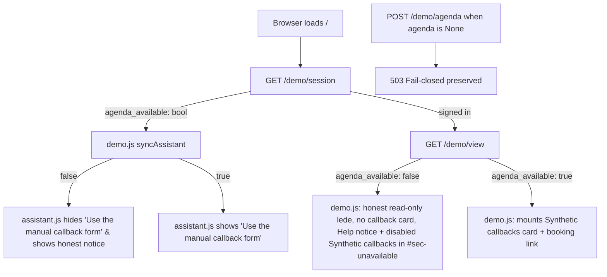

<!-- markdownlint-disable-file -->

# Task Research: issue-1053-resident-demo-agenda-guard

| Field              | Value                                                                                      |
|--------------------|--------------------------------------------------------------------------------------------|
| Date               | 2026-11-14                                                                                 |
| Researcher / agent | RPI Agent (`rpi-research`)                                                                 |
| Status             | Complete                                                                                   |
| Artifact path      | .copilot-tracking/research/2026-11-14/issue-1053-resident-demo-agenda-guard-research.md    |

## Research Brief

* What to research: How `ca-resident-demo` (`src/api/src/zava_forward/api/resident_demo/`) configures, checks, and exposes the synthetic callback agenda across server routes (`/demo/view`, `/demo/session`, `POST /demo/agenda`), static client files (`web/demo.js`, `web/index.html`, `web/demo.css`), infrastructure/deployment configuration, UX/accessibility standards, and existing unit/browser/image checks, and whether to guard/disable the dead callback UI when unconfigured or connect a synthetic agenda.
* Why it matters: After sign-in, `ca-resident-demo` invites the user with "You can try synthetic callback booking below" and displays an interactive "Synthetic callbacks" form, even when no callback agenda is connected (`POST /demo/agenda` fails with `503` "The local callback agenda is not connected."). Residents and reviewers are invited to fill in a date and consent checkbox for an action that cannot succeed.
* Audience or intended use: Planning, implementing, and reviewing the Issue #1053 fix on branch `feat/ux-1053-agenda-guard-2235` (targeting `feat/demo-233-same-home-tensions-0825`).
* Scope: `src/api/src/zava_forward/api/resident_demo/` (`app.py`, `agenda.py`, `__main__.py`, `web/demo.js`, `web/index.html`, `web/demo.css`), `src/api/tests/resident_demo_fixture.py`, `src/api/tests/test_resident_demo_*.py`, `src/api/checks/resident_demo_*.py`, `docs/reference/research/ux/` standards (`design-system.md`, `wcag-conformance-baseline.md`, `content-standard.md`, `zava-forward-prototype-profile-review.md`), and `infra/` resident-demo composition references.
* Non-goals: Modifying `MAX_CONCURRENT` / `Retry-After` bulkhead logic reserved for Issue #1054; changing production case authority or real appointment booking; pushing to remote.
* Criteria: Preserve explicit fail-closed `POST /demo/agenda` `503` behavior when unconfigured; ensure signed-in lede and callback section accurately reflect whether the callback agenda is connected; adhere to Fluent 2, WCAG 2.2 AA baseline, plain-language content standard, and `web-design-guidelines`; pass `mypy`, `ruff check`, `ruff format --check`, and `resident_demo` unit tests cleanly.
* Requested outputs: Convergence recommendation grounded in codebase and UX documentation evidence, ready for `rpi-plan`.
* Output mode: convergence

## Research Parameters

| Field                                | Value                                                                                                                                                                                             |
|--------------------------------------|---------------------------------------------------------------------------------------------------------------------------------------------------------------------------------------------------|
| Research question(s)                 | How is the callback agenda wired and surfaced in `resident_demo`, why is it unconfigured in `ca-resident-demo`, and what is the cleanest fail-closed UX/API contract for Issue #1053?             |
| Codebase scope                       | `src/api/src/zava_forward/api/resident_demo/`, `src/api/tests/`, `src/api/checks/`, `infra/`, `docs/reference/research/ux/`                                                                       |
| External scope                       | Vercel Web Interface Guidelines source required by repository Web Development Guidance for `web-design-guidelines`                                                                                 |
| Initial internal candidate areas     | `src/api/src/zava_forward/api/resident_demo/app.py`, `agenda.py`, `web/demo.js`, `web/index.html`, `web/demo.css`, `src/api/tests/test_resident_demo_*.py`, `docs/reference/research/ux/`          |
| Initial external candidate areas     | `https://raw.githubusercontent.com/vercel-labs/web-interface-guidelines/main/command.md` (if referenced by `web-design-guidelines` skill during web review preparation)                           |
| Research posture                     | balanced                                                                                                                                                                                          |
| Posture provenance                   | default (bounded bug fix with named source targets, adjacent infra/composition and browser/image check considerations)                                                                            |
| Explicit limits / deadline           | Non-interactive autonomous execution; avoid Issue #1054 `MAX_CONCURRENT` / `Retry-After` bulkhead code if avoidable; do not push                                                                  |
| Posture-specific completion basis    | balanced scope coverage and adequate evidence across API contract, client rendering, infra composition, UX/accessibility rules, and existing test/check harnesses                                 |
| Edits allowed during research?       | no, research-only                                                                                                                                                                                 |
| Resolved evidence root               | `.copilot-tracking/` (default workspace tracking root)                                                                                                                                            |
| Known constraints / excluded sources | Keep Issue #1054 bulkhead logic untouched; preserve fail-closed `503` on `POST /demo/agenda` when unconfigured; no `.copilot-tracking/` paths in production code, comments, docstrings, or commits |

## Extension Registry and Provenance

* Precedence: platform and host safety; caller scope and criteria; matching repository instructions and enforced schemas; rpi-research contract; domain skills and specialists; examples and preferences.

| Kind                | Candidate                               | Match and provenance                                                   | Scoped authority or output contract                                                                | Selected / skipped reason                                                                                      |
|---------------------|-----------------------------------------|------------------------------------------------------------------------|----------------------------------------------------------------------------------------------------|----------------------------------------------------------------------------------------------------------------|
| Instruction         | `.github/copilot-instructions.md`       | `applyTo: "**"` matches all repository inputs and tracking outputs     | Adds two-tier validation, Web Development Guidance (Fluent 2, WCAG, plain language), branch rules  | Selected automatically by repository instructions                                                              |
| Skill               | `rpi-research`                          | Explicit RPI phase 1 skill                                             | Owns primary research artifact, three-wave protocol, and readiness gate                            | Selected and active for Research phase                                                                         |
| Skill               | `web-design-guidelines`                 | Web Development Guidance requires loading before web edits/reviews     | Supplies web UI/accessibility rules for `web/index.html`, `web/demo.js`, `web/demo.css`            | Selected for inspection/application before web edits in Implement/Review                                       |
| Skill               | `redesign-existing-projects`            | Existing-app design improvements skill                                 | Preserves Fluent 2, WCAG, and plain-language rules without unrelated visual overhauls              | Skipped for Research; surgical honest-state guard rather than visual redesign                                  |
| Skill               | `accessibility`                         | Accessibility baseline check                                           | WCAG 2.2 / ARIA semantics reference                                                                | Skipped as separate activation during Research; repository WCAG baseline doc inspected directly                |
| Research specialist | `hve-core-all:rpi-researcher`           | General delegated research lane worker visible in host                 | Bounded subagent lane output under `.copilot-tracking/research/subagents/`                         | Skipped (inline execution chosen): target files are small, tightly coupled in `resident_demo/`, <=10 reads     |

## User Participation and Research Decisions

| Checkpoint       | Questions or no-interaction rationale                                                                                              | Answers / unanswered | Resulting decision or selected further research                                                                 |
|------------------|------------------------------------------------------------------------------------------------------------------------------------|----------------------|-----------------------------------------------------------------------------------------------------------------|
| Intake           | Non-interactive CLI session with explicit acceptance criteria and file scope from caller prompt and Issue #1053.                   | Not applicable       | Proceed with `balanced` posture in `convergence` output mode across API, client, infra composition, and tests.  |
| Direction change | Cycle 1 Wave 1 discovered partial main-view guarding already merged in ancestry (`be809739c`, `8c943c9b1`), while unguarded callback invitations remain in `/demo/session`, `web/assistant.js`, `chat.py` unrouted suggestions, and `sec-unavailable`. | Not applicable       | Keep caller boundaries and tighten remaining unguarded surfaces in `resident_demo` without touching Issue #1054 bulkhead lines. |
| Convergence      | All five research questions answered with high-confidence codebase (`C1`-`C17`) and external (`W1`) evidence; no unresolved blockers require user input. | Not applicable       | Converge on fail-closed agenda readiness across `/demo/session`, `/demo/view`, `demo.js`, `assistant.js`, and `chat.py`. |

## Scope and Success Criteria

* Scope: `resident_demo` backend (`app.py`, `agenda.py`, `__main__.py`), frontend (`web/index.html`, `web/demo.js`, `web/demo.css`), tests and checks (`src/api/tests/*resident_demo*`, `src/api/checks/*resident_demo*`), UX docs, and `infra/` deployment config for `ca-resident-demo`.
* Assumptions:
  * Assumption A1: `ca-resident-demo` intentionally leaves the local callback agenda unconfigured in cloud deployments unless an explicit agenda backend/store is wired.
  * Assumption A2: Existing tests or browser/image checks in `src/api/tests/` and `src/api/checks/` may assert exact strings such as `"You can try synthetic callback booking below"` or test both configured and unconfigured agenda modes.
* Success criteria:
  * Every research question is answered or marked unanswerable with the missing evidence named.
  * Evidence is grounded in actual code, docs, or tooling results, with locations (`path:line` for code, URL + retrieval date for external).
  * Findings, decisions, and readiness claims cite Evidence Log IDs.
  * Alternatives are compared with trade-offs when the design space and output mode require it. A recommendation is selected only in convergence mode.
  * Open questions, risks, and residual uncertainty are recorded.
  * Self-check passes.

## Task Research Requests

* Explicit requests:
  * Inspect `src/api/src/zava_forward/api/resident_demo/` (`app.py`, `demo.js`, HTML/templates, and existing `resident_demo` tests in `src/api/tests/`).
  * Surface whether the callback agenda is connected in `/demo/view` (or `/demo/session`) and update the client (`demo.js` / view rendering) so that when the agenda is unconfigured, the page does NOT invite the user to try callback booking ("You can try synthetic callback booking below") and disables/hides the dead form with an honest upfront notice (or connects a safe deterministic synthetic agenda if appropriate, while preserving explicit fail-closed behavior when unconfigured).
  * Avoid touching files/lines belonging to Issue #1054 (`MAX_CONCURRENT` / `Retry-After` bulkhead logic).
* Inferred research questions:
  * Why is the callback agenda unconfigured in `ca-resident-demo` (`infra/` / `__main__.py` / `agenda.py`), and is unconfigured status architectural/intentional in cloud?
  * Should `agenda_connected` (or `callback_agenda_available` / `agenda_available`) live on `/demo/view`, `/demo/session`, or both?
  * Do `resident_demo_browser_check.py`, `resident_demo_image_check.py`, or `test_resident_demo_*.py` assert specific DOM structures, copy, or visibility states on the signed-in view?
* Caller constraints and non-goals: Do not touch #1054 bulkhead code if avoidable; preserve explicit fail-closed `503` when unconfigured; do not push.

## Direction Controls

| Control type (add / change / narrow / exclude / discard) | Direction or boundary                                                                                   | Source / checkpoint | Effect on active brief, evidence, or revalidation                                                 |
|----------------------------------------------------------|---------------------------------------------------------------------------------------------------------|---------------------|---------------------------------------------------------------------------------------------------|
| narrow                                                   | Scope changes to callback agenda readiness signaling, client UX, and resident_demo tests                | Caller intake       | Restricts design space to `resident_demo` agenda readiness/UX and directly coupled tests          |
| exclude                                                  | Avoid `MAX_CONCURRENT` / `Retry-After` bulkhead logic (Issue #1054)                                     | Caller intake       | Inspect `app.py` line positions so edits stay cleanly isolated from bulkhead code                 |
| add                                                      | Preserve explicit fail-closed `503` behavior on `POST /demo/agenda` when agenda is unconfigured         | Caller intake       | Rules out silently replacing unconfigured `None` agenda with an implicit open agenda by default   |

## Research Questions

|  # | Sub-question                                                                                                                | Type            | Priority | Status   |
|---:|-----------------------------------------------------------------------------------------------------------------------------|-----------------|----------|----------|
| Q1 | How is the callback agenda instantiated, configured, and checked in `resident_demo` (`agenda.py`, `app.py`, `__main__.py`)? | straightforward | H        | answered |
| Q2 | Why was the callback agenda disconnected in the 2026-11-04 live walkthrough (`infra/` and walkthrough notes)?               | depth           | H        | answered |
| Q3 | How do `web/index.html`, `web/demo.js`, `web/assistant.js`, and `chat.py` render/promise callback booking?                  | straightforward | H        | answered |
| Q4 | What do existing unit tests and browser/image checks assert about `/demo/view`, `/demo/session`, and callback UI elements?  | breadth         | H        | answered |
| Q5 | Between guarding/hiding/disabling the unconfigured form vs connecting a cloud agenda, which option best satisfies #1053?    | depth           | H        | answered |

## Prior Knowledge Gate

* Existing artifacts reviewed: Issue #1053 body and 2026-11-05 owner closure-review comment, Issue #1054 body, `docs/case_study_48_original.md`, `docs/case_study_48_addendum.md`, `docs/reference/README.md`, `docs/reference/memory.md`, and branch git log (`be809739c`, `8c943c9b1`).
* Reused (verified) findings: Issue #1053 confirms `POST /demo/agenda` returns `503` with `"The local callback agenda is not connected."` in `ca-resident-demo`; owner comment on #1053 explicitly confirms hiding/disabling the unavailable form and correcting its promise is valid without connecting a cloud agenda while preserving fail-closed `503` behavior; Issue #1054 targets `MAX_CONCURRENT = 8` / `RETRY_AFTER_SECONDS = 2` bulkhead code in `app.py` and `demo.js`.
* Superseded / stale: Initial assumption that `app.py` `/demo/view` and `demo.js` had zero agenda guarding was partially superseded upon inspecting `HEAD` (`8d13e480c`), where commits `be809739c` and `8c943c9b1` already added `agenda_available` to `/demo/view` and guarded the main-page callback card/lede, while leaving concrete unguarded callback invitations and dead controls in `/demo/session`, `web/assistant.js`, `chat.py` suggestions, and `sec-unavailable`.

## Research Cycle Log

### Cycle 1

* Active direction controls: narrow to callback agenda readiness/UX and tests; exclude Issue #1054 bulkhead code; preserve explicit fail-closed `503` on `POST /demo/agenda` when unconfigured.
* Active research posture and completion basis: `balanced`; balanced scope coverage and adequate evidence across API routes, client scripts, chat fallback, infra composition, UX/accessibility guidelines, and existing test contracts.
* Explicit limits or deadline effect: Non-interactive CLI run; keep edits cleanly separated from Issue #1054 bulkhead lines (`app.py:53-79`, `app.py:286-292`, `demo.js:742-750`).

#### Wave 1: Wider

* Plan and independent lanes: Surveyed `src/api/src/zava_forward/api/resident_demo/` (`app.py`, `agenda.py`, `__main__.py`, `chat.py`, `web/index.html`, `web/demo.js`, `web/assistant.js`, `web/demo.css`), `infra/resident-demo.bicep`, `docs/reference/research/ux/` (`design-system.md`, `wcag-conformance-baseline.md`, `content-standard.md`), external `web-design-guidelines`, and all `resident_demo` test/check suites in `src/api/tests/` and `src/api/checks/`.
* Worker evidence relationships or inline fallback: inline: tightly coupled single-component slice (`<=15` focused file reads) where direct inspection avoided subagent handoff overhead without losing coverage (`C1`-`C17`, `W1`).
* Reflection: Confirmed how `ResidentDemo.agenda` is wired (`C1`-`C4`) and discovered that main-page `/demo/view` guarding was partially landed in ancestry (`C4`, `C8`), which prioritized deeper inspection of `/demo/session`, `web/assistant.js`, `chat.py`, and static/DOM test contracts in Wave 2.

#### Wave 2: Deeper

* Parent-prioritized material from Wave 1: Exact server payloads (`/demo/session` vs `/demo/view` vs `/demo/agenda` vs `/demo/assistant`), client state propagation between `demo.js` and `assistant.js`, `sec-unavailable` disabled-feature pattern, and Issue #1054 bulkhead line isolation.
* Plan and independent lanes: Traced `GET /demo/session` (`C5`), `POST /demo/agenda` fail-closed `503` (`C6`), `POST /demo/assistant` callback topic guard (`C7`), `demo.js` `render()` and `start()` (`C8`, `C9`), `assistant.js` `mountResidentAssistant()` (`C10`), and `chat.py` `TOPIC_EXAMPLES` / `suggestions()` (`C11`).
* Worker evidence relationships or inline fallback: inline: direct trace across `app.py`, `demo.js`, `assistant.js`, and `chat.py`.
* Reflection: Identified four concrete remaining gaps when `app.agenda is None`:
  1. `GET /demo/session` (`app.py:322-335`) omits `agenda_available` / `callbacks_available`, so pre-view session state cannot tell `demo.js` or `assistant.js` whether callbacks are connected (`C5`).
  2. `web/assistant.js` (`lines 197, 224-239`) unconditionally renders `"Callback booking needs your separate confirmation."` and an active `"Use the manual callback form"` button inside the chat intro; when signed in with `agenda_available === false`, `#callback-title` is absent and `#email`/`#retry` are hidden, turning that button into a dead control that silently closes the drawer and drops focus back on `#chat-launcher` (`C10`).
  3. `chat.py` (`lines 596-620, 710-718`) includes `"Can I find a callback time?"` in `suggestions(question)` for unrouted questions mentioning `"visit"` or `"time"` even when `app.agenda is None` (`C11`).
  4. `demo.js` (`lines 673-687`) omits a disabled `"Synthetic callbacks"` item in `#sec-unavailable` ("Not available in this showcase") when `!agendaAvailable`, and reads only `view.agenda_available` rather than falling back cleanly to `view.callbacks_available` if a caller supplies only one (`C8`).

#### Wave 3: Contrarian

* In-scope challenge targets and boundaries:
  1. Challenge whether `ca-resident-demo` should instead auto-create an ephemeral SQLite agenda at HTTP startup so callbacks always work.
  2. Challenge whether modifying `assistant.js`, `/demo/session`, or `sec-unavailable` will break hidden lexical/contract tests (`test_epic149_manual_fallback_continuity.py`, `test_resident_callbacks_page.py`, `test_resident_demo_check.py`, `resident_demo_browser_check.py`, `test_content_standard.py`).
* Plan and independent lanes: Inspected `agenda.py` creation contract (`C1`), `infra/resident-demo.bicep` (`C3`), `test_epic149_manual_fallback_continuity.py` (`C14`), `test_resident_callbacks_page.py` (`C13`), `test_resident_demo_check.py` and `resident_demo_browser_check.py` (`C15`), and UX content/accessibility rules (`C16`, `C17`, `W1`).
* Worker evidence relationships or inline fallback: inline: direct verification of contrarian failure modes against repository tests and Bicep constraints.
* Reflection:
  * Auto-creating an ephemeral SQLite agenda in HTTP startup is **disproved/rejected**: `Agenda.create` explicitly forbids implicit HTTP creation (`"Operator/test setup only; never called implicitly by the HTTP service"`, `C1`), `ca-resident-demo` scales `0..1` without persistent storage so bookings would silently vanish across scale-to-zero restarts (`C3`), and Issue #1053 owner guidance explicitly accepts hiding/disabling while requiring fail-closed `503` when unconfigured.
  * Contrarian test check **caught a critical lexical constraint**: `test_epic149_manual_fallback_continuity.py` (`C14`) asserts exact source substrings in `resident_demo/web/assistant.js`, including `"Use the manual callback form"` and `r"Chat could not load\.[^\"]*"` containing `"The manual callback form is still available."`, plus forbids colour words (`red`, `green`, `amber`) on lines mentioning `unavailable` or `manual`. Keeping the button constructor string literal in `assistant.js` while toggling `callbacks.hidden = !agendaAvailable` (default `false`, fail-closed) and keeping the initial missing-script fallback literal satisfies both runtime honesty and Epic #149 static tests!
  * Contrarian check on `test_resident_callbacks_page.py` (`C13`) and `resident_demo_browser_check.py` (`C15`) confirmed that adding a disabled `<button type="button" disabled>Synthetic callbacks</button>` inside `ul.unavail` when `!agendaAvailable` preserves `callbackSections == 0`, `bookingLinks == 0`, `disabled_unavailable == True`, and avoids `"is not connected"` when `agendaAvailable == True`.
  * Contrarian check on `test_resident_demo_script.py` and `test_resident_callbacks_page.py` (`C13`) caught that fake `mountResidentAssistant` test stubs return `{setSession() {}}` without new methods: therefore `demo.js` must pass `agendaAvailable` either via `assistant.setSession(signedIn, agendaAvailable)` and/or guard optional `assistant.setAgendaAvailable` so existing stubs never throw `TypeError`.

#### Parent Synthesis and Disposition

| Material / claim                                                                                     | Evidence IDs        | Parent disposition | Evidence-based rationale                                                                                                                     | Primary-artifact treatment                      |
|------------------------------------------------------------------------------------------------------|---------------------|--------------------|----------------------------------------------------------------------------------------------------------------------------------------------|-------------------------------------------------|
| Surface `agenda_available` and `callbacks_available` in `GET /demo/session` as well as `/demo/view`   | `C4`, `C5`, `C12`   | accepted           | Public capability boolean (zero PII) lets client and chat drawer know agenda state before and after sign-in without breaking session tests.  | Selected recommendation                         |
| Fail-closed `agendaAvailable` in `assistant.js` (`mountResidentAssistant`) hiding dead form button   | `C10`, `C14`, `W1`  | accepted           | Fixes dead `"Use the manual callback form"` button and misleading notice in chat intro when agenda is disconnected while keeping literals.   | Selected recommendation                         |
| Exclude `"Can I find a callback time?"` from `chat.py` unrouted `suggestions()` when agenda is `None`| `C7`, `C11`         | accepted           | Prevents chat fallback suggestions from inviting callback slot searches when no callback agenda is connected.                                | Selected recommendation                         |
| Add disabled `"Synthetic callbacks"` entry in `#sec-unavailable` when `!agendaAvailable` + fallback  | `C8`, `C13`, `C15`  | accepted           | Aligns `#sec-unavailable` with `#sec-help` and signed-in lede using existing disabled-button showcase pattern and defensive flag fallback.   | Selected recommendation                         |
| Auto-create ephemeral SQLite `Agenda` in HTTP startup when `ZF_DEMO_AGENDA_PATH` is unset            | `C1`, `C2`, `C3`    | rejected           | Violates `Agenda.create` operator-only contract, loses bookings on `0..1` scale-to-zero restarts, and weakens fail-closed unconfigured mode. | Rejected alternative                            |
| Provision Azure Files / persistent SQLite mount in `infra/resident-demo.bicep`                       | `C3`                | rejected           | Out of Issue #1053 scope, breaks locked 5-resource Bicep deployment test contract, and unnecessarily escalates to infrastructure changes.    | Rejected alternative                            |

#### Cycle Re-entry Evaluation

* Another complete three-wave cycle needed: no
* Trigger or stop basis: All research questions (`Q1`-`Q5`) are answered with verified codebase (`C1`-`C17`) and external (`W1`) evidence; contrarian checks resolved static test and stub compatibility hazards; remaining sources are redundant.
* Revised brief or revalidation required: none
* Readiness effect: `Ready` (`C1`-`C17`, `W1`)

## Evidence Log

* Delegation: inline: bounded single-package slice (`resident_demo` + unit tests + UX references) completed directly in `<=15` reads with higher precision and zero context fragmentation.

### Codebase Evidence

| ID  | Claim / finding                                                                                                                                         | Location (`path:line`)                                                          | Tool | Confidence | Notes                                                                                     |
|-----|---------------------------------------------------------------------------------------------------------------------------------------------------------|---------------------------------------------------------------------------------|------|------------|-------------------------------------------------------------------------------------------|
| C1  | `Agenda` requires an existing absolute SQLite file (`user_version == 520`); `Agenda.create` is explicitly operator/test-only, never implicit in HTTP.   | `src/api/src/zava_forward/api/resident_demo/agenda.py:25-58`                    | view | high       | Explains why HTTP startup must never silently create a temporary SQLite agenda.           |
| C2  | `__main__.py` wires `Agenda(Path(agenda_path))` only when `ZF_DEMO_AGENDA_PATH` is set; otherwise `agenda=None` (fail-closed).                          | `src/api/src/zava_forward/api/resident_demo/__main__.py:35-49`                  | view | high       | Confirms optional nature of local callback agenda.                                        |
| C3  | `ca-resident-demo` Bicep deploys Consumption Container App (`minReplicas: 0, maxReplicas: 1`) without `ZF_DEMO_AGENDA_PATH` or volume mounts.           | `infra/resident-demo.bicep:117-160`                                             | view | high       | Explains why live cloud showcase has `agenda=None` during walkthroughs.                   |
| C4  | `ResidentDemo.view_for` sets `view["agenda_available"] = self.agenda is not None` and `view["callbacks_available"] = view["agenda_available"]`.         | `src/api/src/zava_forward/api/resident_demo/app.py:194-202`                     | view | high       | Landed in `be809739c` / `8c943c9b1`; already exposes capability on `/demo/view`.          |
| C5  | `GET /demo/session` returns `csrf`, `signed_in`, `session_id`, and `banner`, but omits `agenda_available` and `callbacks_available`.                    | `src/api/src/zava_forward/api/resident_demo/app.py:322-335`                     | view | high       | Pre-view session payload lacks callback agenda capability boolean.                        |
| C6  | `POST /demo/agenda` fails closed with `503` and `CALLBACKS_OFF + " " + MANUAL` (`"The local callback agenda is not connected..."`) when `agenda is None`.| `src/api/src/zava_forward/api/resident_demo/app.py:48-51,556-567`               | view | high       | Explicit fail-closed behavior that must be preserved.                                     |
| C7  | `POST /demo/assistant` guards `topic == "appointments"` when `app.agenda is None`, but calls `chat.answer(...)` without `callbacks_available` context.   | `src/api/src/zava_forward/api/resident_demo/app.py:492-505`                     | view | high       | Unrouted fallback suggestions in `chat.answer` still suggest callback search.             |
| C8  | `demo.js` `render(view)` guards callback section, `#sec-actions` link, nav label, and lede on `view.agenda_available`, and builds `#sec-unavailable`.   | `src/api/src/zava_forward/api/resident_demo/web/demo.js:29-40,564-576,633-695`  | view | high       | Needs defensive `agenda_available ?? callbacks_available` helper, assistant sync, and `#sec-unavailable` item. |
| C9  | Issue #1054 bulkhead logic lives in `app.py:53-79`, `app.py:286-292`, and `demo.js:742-750` (`MAX_CONCURRENT`, `RETRY_AFTER_SECONDS`, `retryWait`).     | `src/api/src/zava_forward/api/resident_demo/app.py:53-79,286-292`               | view | high       | Cleanly separated from session/assistant/render lines; zero need to touch #1054 lines.   |
| C10 | `web/assistant.js` `mountResidentAssistant` unconditionally shows `"Callback booking needs your separate confirmation."` and active `"Use the manual callback form"` button in `ui.intro`. | `src/api/src/zava_forward/api/resident_demo/web/assistant.js:181-241,302-309` | view | high | Dead button silently closes chat and focuses `#chat-launcher` when signed in without agenda. |
| C11 | `chat.py` `TOPIC_EXAMPLES` and `suggestions()` suggest `"Can I find a callback time?"` on unrouted `"visit"`/`"time"` queries regardless of agenda state.| `src/api/src/zava_forward/api/resident_demo/chat.py:596-621,710-718`            | view | high       | Filtering `"appointments"` example when `callbacks_available=False` closes chat leak.     |
| C12 | `test_resident_demo_api.py` tests `agenda_available` on `/demo/view` (`True`/`False`) and `503` on `/demo/agenda`, and checks `/demo/session` fields.   | `src/api/tests/test_resident_demo_api.py:270-285,375-420`                       | view | high       | Confirms `/demo/session` has no rigid exact-key-set check that would reject new booleans. |
| C13 | `test_resident_callbacks_page.py` and `test_resident_demo_script.py` stub `mountResidentAssistant: () => ({setSession() {}})` and assert `callbackSections`/`bookingLinks`. | `src/api/tests/test_resident_callbacks_page.py:55-120` | view | high | Requires backward-compatible `setSession(signedIn, agendaAvailable)` / optional method guard. |
| C14 | `test_epic149_manual_fallback_continuity.py` asserts exact source literals in `assistant.js` (`"Use the manual callback form"`, `"Chat could not load..."`) and bans colour-only cues. | `src/api/tests/test_epic149_manual_fallback_continuity.py:57-100` | view | high | Must preserve literals in `assistant.js` source and hide/update DOM nodes dynamically.    |
| C15 | `resident_demo_browser_check.py` checks `ul.unavail button` are all disabled and checks `/demo/session` `signed_in` and `session_id` keys only.         | `src/api/checks/resident_demo_browser_check.py:130-165,214-222`                 | view | high       | Disabled `<button type="button" disabled>` in `ul.unavail` stays 100% compatible.         |
| C16 | Repository content standard bans internal terms (`gate`, `hold`, `provenance`, `trace`, `snapshot`, `envelope`) in visible web copy.                    | `docs/reference/research/ux/content-standard.md:1-120`                          | view | high       | All new resident-facing notices must use plain British English without banned jargon.     |
| C17 | WCAG 2.2 baseline and Fluent 2 design system require native `<button>`/`<a>` semantics, visible focus, non-colour status cues, and manual contact routes.| `docs/reference/research/ux/wcag-conformance-baseline.md:1-120`                 | view | high       | Hiding dead interactive controls and preserving housing officer routes aligns with UX baseline. |

### External Evidence

| ID | Claim / finding                                                                                                                                   | Source (title)                         | URL                                                                                     | Retrieved  | Version/date | Confidence |
|----|---------------------------------------------------------------------------------------------------------------------------------------------------|----------------------------------------|-----------------------------------------------------------------------------------------|------------|--------------|------------|
| W1 | Interactive actions must use semantic `<button>`, empty/unavailable states must not render broken/dead UI, and messages should state next steps.   | Vercel Web Interface Guidelines        | https://raw.githubusercontent.com/vercel-labs/web-interface-guidelines/main/command.md  | 2026-11-14 | main         | high       |

### Contradictions / Conflicts

* `none`

## Findings Mapped to Questions and Evidence

| Question | Finding                                                                                                                                                                                 | Evidence IDs        | Confidence | Decision or readiness implication                                                                     |
|----------|-----------------------------------------------------------------------------------------------------------------------------------------------------------------------------------------|---------------------|------------|-------------------------------------------------------------------------------------------------------|
| Q1       | `ResidentDemo` receives `agenda: Agenda \| None = None`; `Agenda` opens an operator-provisioned SQLite file (`ZF_DEMO_AGENDA_PATH`), and `POST /demo/agenda` fails closed with `503`.   | `C1`, `C2`, `C6`    | high       | Keep `agenda=None` fail-closed `503` behavior unchanged.                                              |
| Q2       | `infra/resident-demo.bicep` runs `ca-resident-demo` (`0..1` scale-to-zero) without `ZF_DEMO_AGENDA_PATH` or persistent storage, so `app.agenda` is intentionally `None` in cloud.       | `C1`, `C2`, `C3`    | high       | Cloud showcase is legitimately unconfigured for callbacks; UI must be honest upfront.                 |
| Q3       | Ancestry commits guarded `/demo/view` and main-page `demo.js`, but `/demo/session`, `web/assistant.js` (`"Use the manual callback form"`), `chat.py` `suggestions()`, and `#sec-unavailable` remain unguarded or incomplete. | `C4`, `C5`, `C8`, `C10`, `C11` | high | Fix all four remaining unguarded surfaces so no UI or chat prompt invites dead callback booking. |
| Q4       | Existing tests require preserving exact Epic #149 string literals in `assistant.js`, `{setSession() {}}` stub compatibility in `demo.js`, `callbackSections == 0` when unconfigured, and all `ul.unavail button` disabled. | `C12`, `C13`, `C14`, `C15`, `C16`, `C17` | high | Toggle DOM `.hidden` / `.textContent` dynamically while preserving tested literals and stub contracts. |
| Q5       | Surfacing `agenda_available` + `callbacks_available` across `/demo/session` and `/demo/view` and hiding/disabling dead callback invitations across `demo.js`, `assistant.js`, and `chat.py` cleanly satisfies #1053 without infra risk or #1054 conflict. | `C1`-`C17`, `W1` | high | Ready for planning and surgical implementation under the focused validation tier. |

## Key Discoveries

* **Partial ancestry fix left chat drawer and `/demo/session` unguarded (`C4`, `C5`, `C10`, `C11`)**: While `view_for` and `demo.js` already guard the main callback section on `HEAD`, opening `#chat-launcher` in an unconfigured showcase still shows `"Callback booking needs your separate confirmation."` and an active `"Use the manual callback form"` button whose click target `#callback-title` does not exist, silently closing chat without navigating anywhere.
* **Chat fallback topic suggestions still advertise callback search (`C7`, `C11`)**: In `chat.py`, `suggestions()` can still recommend `"Can I find a callback time?"` when `app.agenda is None` unless `callbacks_available` is passed from `_assistant`.
* **Epic #149 static continuity contract (`C14`)**: `test_epic149_manual_fallback_continuity.py` scans `assistant.js` source text for `"Use the manual callback form"` and `"Chat could not load. ... The manual callback form is still available."`, and bans colour words on lines mentioning `unavailable` or `manual`. Dynamic `.hidden` / `.textContent` toggling preserves every static invariant while removing the dead runtime control.
* **Clean isolation from Issue #1054 (`C9`)**: Bulkhead concurrency lines (`app.py:53-79`, `app.py:286-292`, `demo.js:742-750`) are completely disjoint from `_session` (`app.py:322-335`), `_assistant` (`app.py:492-505`), `demo.js` `render()`/`start()`, `assistant.js`, and `chat.py`.

### Complete Examples

```javascript
// Backward-compatible assistant session + agenda availability sync in demo.js / assistant.js
function isAgendaAvailable(payload) {
  if (!payload) return false;
  if (typeof payload.agenda_available === "boolean") return payload.agenda_available;
  return Boolean(payload.callbacks_available);
}

function syncAssistant(signedIn, agendaAvailable) {
  assistant.setSession(signedIn, agendaAvailable);
  if (typeof assistant.setAgendaAvailable === "function") {
    assistant.setAgendaAvailable(agendaAvailable);
  }
}
```

## Alternatives and Decision State

### Selected Recommendation (convergence only)

* Approach: Complete end-to-end fail-closed callback agenda readiness signaling and UX guarding across `resident_demo`:
  1. Surface `"agenda_available": app.agenda is not None` and `"callbacks_available": app.agenda is not None` in `GET /demo/session` (`app.py`) alongside existing `GET /demo/view` fields, while keeping `POST /demo/agenda` fail-closed (`503`) when `app.agenda is None`.
  2. Pass `callbacks_available=app.agenda is not None` into `chat.answer(...)` (`app.py` + `chat.py`) so unrouted `suggestions()` omit `"Can I find a callback time?"` when the callback agenda is disconnected.
  3. Update `mountResidentAssistant` in `web/assistant.js` (defaulting fail-closed `agendaAvailable = false`, updated via `setSession(signedIn, agendaAvailable)` and `setAgendaAvailable(agendaAvailable)`) so that when `agendaAvailable` is `false`, the dead `"Use the manual callback form"` button is hidden, an honest plain-language notice (`"Synthetic callback booking is not connected in this showcase. Use the contact routes on this page."`) is shown in the chat intro, and `#assistant-notice` omits the callback-confirmation promise—while preserving all Epic #149 source string literals.
  4. Update `web/demo.js` to resolve `isAgendaAvailable(payload)` defensively (`agenda_available` boolean with fallback to `callbacks_available`, default `false`), sync `assistant` from both `/demo/session` and `/demo/view`, and include a disabled `"Synthetic callbacks"` item in `#sec-unavailable` ("Not available in this showcase") when `!agendaAvailable` explaining that the local callback agenda is not connected and pointing to the contact routes above.
  5. Add focused API, chat, and Node fake-DOM tests covering `/demo/session` `agenda_available` (`True`/`False`), chat unrouted suggestions when disconnected, `assistant.js` hiding/showing `"Use the manual callback form"`, and `demo.js` disabled `#sec-unavailable` callback entry + backward-compatible flag fallback.
* Rationale: Eliminates every remaining misleading callback invitation and dead interactive control across both the main resident page and the resident chat widget when `app.agenda is None`, preserves `POST /demo/agenda` `503` fail-closed behavior, avoids touching Issue #1054 bulkhead code or Azure infrastructure, and satisfies Fluent 2, WCAG 2.2 baseline, plain-language content rules, and `web-design-guidelines`.
* Evidence refs: `C1`, `C2`, `C4`, `C5`, `C6`, `C7`, `C8`, `C9`, `C10`, `C11`, `C12`, `C13`, `C14`, `C15`, `C16`, `C17`, `W1`
* Implementation impact: `src/api/src/zava_forward/api/resident_demo/app.py`, `chat.py`, `web/demo.js`, `web/assistant.js`, and tests in `src/api/tests/test_resident_demo_api.py`, `test_resident_callbacks_page.py`, `test_resident_chat_api.py`.
* Confidence: high: all code paths, DOM harnesses, and static copy audits were verified directly.

File tree:

```text
src/api/
├── src/zava_forward/api/resident_demo/
│   ├── app.py              (modified: add agenda_available/callbacks_available to /demo/session; pass callbacks_available to chat.answer)
│   ├── chat.py             (modified: filter appointments example from suggestions() when callbacks_available is False)
│   └── web/
│       ├── assistant.js    (modified: guard "Use the manual callback form" button and callback notice on agendaAvailable)
│       └── demo.js         (modified: isAgendaAvailable helper, sync assistant on session/view, add disabled Synthetic callbacks item in #sec-unavailable)
└── tests/
    ├── test_resident_callbacks_page.py  (modified: test assistant.js callback button guard, #sec-unavailable disabled item, and flag fallback)
    ├── test_resident_chat_api.py        (modified: test unrouted suggestions omit callback prompt when agenda is None)
    └── test_resident_demo_api.py        (modified: test /demo/session surfaces agenda_available/callbacks_available True and False)
```

Flow diagram:



### Alternative: Auto-create an ephemeral SQLite callback agenda when `ZF_DEMO_AGENDA_PATH` is unset

* Approach: Have `__main__.py` or `ResidentDemo` call `Agenda.create(...)` on a `tempfile` SQLite database whenever `ZF_DEMO_AGENDA_PATH` is omitted.
* Trade-offs: Would make the callback form interactive without Bicep changes, but silently discards booked synthetic callbacks whenever `ca-resident-demo` scales to zero (`minReplicas: 0`), violates `Agenda.create`'s explicit docstring (`"Operator/test setup only; never called implicitly by the HTTP service"`), and eliminates the unconfigured fail-closed `503` posture unless another flag is invented.
* Evidence refs: `C1`, `C2`, `C3`, `C6`
* Rejection rationale: Directly contradicts `agenda.py:52` architecture contract and misleads reviewers with volatile scale-to-zero state; owner guidance on #1053 explicitly prefers honest hiding/disabling when unconfigured while preserving fail-closed `503`.

### Alternative: Provision persistent cloud agenda storage in `infra/resident-demo.bicep`

* Approach: Add Azure Files storage mount and `ZF_DEMO_AGENDA_PATH` initialization to `infra/resident-demo.bicep`.
* Trade-offs: Provides persistent synthetic slots across scale-to-zero restarts, but alters locked Bicep deployment resources (`infra/tests/test_resident_demo_deploy.py`), requires full-tier infrastructure gate validation, and expands scope well beyond Issue #1053.
* Evidence refs: `C3`
* Rejection rationale: Disproportionate infrastructure change outside Issue #1053's bounded resident-demo UX scope.

## Open Questions, Risks, and Residual Uncertainty

* Blocking: none
* Important: Preserve exact string literals in `web/assistant.js` checked by `test_epic149_manual_fallback_continuity.py` (`C14`) and avoid banned vocabulary from `test_content_standard.py` (`C16`).
* Follow-up: Issue #1054 (`MAX_CONCURRENT` / `Retry-After` bulkhead contention under bursts) remains tracked separately on its own branch/workstream (`C9`).
* Residual uncertainty: Real-browser visual inspection in deployed `ca-resident-demo` occurs post-merge; local Node fake-DOM and Python HTTP unit suites deterministically exercise all changed code paths.

## Current Decisions

| Decision                                                                                              | Status    | Owner / source      | Rationale                                                                                                      | Evidence IDs             | Implications                                                                                  |
|-------------------------------------------------------------------------------------------------------|-----------|---------------------|----------------------------------------------------------------------------------------------------------------|--------------------------|-----------------------------------------------------------------------------------------------|
| Guard/hide unavailable callback UI and surface `agenda_available` rather than implicit agenda creation| confirmed | user / evidence     | Matches Issue #1053 AC, owner 2026-11-05 comment, and `Agenda.create` operator-only rule.                      | `C1`, `C3`, `C4`, `C6`   | Preserves `POST /demo/agenda` `503` when `app.agenda is None`.                                |
| Surface `agenda_available` and `callbacks_available` in `/demo/session` as well as `/demo/view`       | proposed  | evidence            | Enables fail-closed chat drawer state before and after sign-in with zero PII exposure.                         | `C4`, `C5`, `C10`, `C12` | Update `app.py` `_session` and `test_resident_demo_api.py`.                                   |
| Guard `assistant.js` `"Use the manual callback form"` button and `chat.py` unrouted suggestions       | proposed  | evidence            | Removes the remaining dead callback control and callback prompt when `app.agenda is None`.                     | `C7`, `C10`, `C11`, `C14`| Keep Epic #149 string literals intact in `assistant.js` and toggle `.hidden`/`.textContent`.  |
| Classify validation as Focused tier (owner decision D4 / #1294)                                       | confirmed | constraint          | Bounded `resident_demo` UX/API readiness fix with no infra, Bicep, Dockerfile, SQL, manifest, or gate changes. | `C3`, `C9`, `C12`-`C17`  | Run `mypy`, `ruff check`, `ruff format --check`, `web-design-guidelines`, and unit tests.     |

## Unresolved Decisions

| Decision | Smallest evidence or answer needed | Owner | Impact | Blocker status |
|----------|------------------------------------|-------|--------|----------------|
| none     | none                               | none  | none   | none           |

## Potential Next Research

| Priority | Research item                                                                 | Expected value                                                       | Trigger                                            | Selected? | Related questions / evidence |
|----------|-------------------------------------------------------------------------------|----------------------------------------------------------------------|----------------------------------------------------|-----------|------------------------------|
| L        | Evaluate persistent cloud callback store if live callback demos are requested | Would enable interactive slot booking in cloud `ca-resident-demo`    | Explicit future product/owner request beyond #1053 | deferred  | Q2, Q5; `C1`, `C3`           |

## Planning Readiness

* Status: `Ready`
* Decision state: Convergence recommendation selected (`agenda_available` / `callbacks_available` surfaced on `/demo/session` and `/demo/view`, fail-closed guarding across `demo.js`, `assistant.js`, and `chat.py`, preserving `POST /demo/agenda` `503`).
* Evidence basis: `C1`-`C17`, `W1`
* Preconditions met: All 5 research questions answered; Cycle 1 Wider, Deeper, and Contrarian waves completed in order; Issue #1054 lines isolated; test/copy invariants verified; `web-design-guidelines` rules retrieved.
* Blockers: none
* Smallest action to change readiness: none (already `Ready`)

## Closeout Record

| Field                            | Record                                                                                                       |
|----------------------------------|--------------------------------------------------------------------------------------------------------------|
| Research execution status        | Complete                                                                                                     |
| Completed waves                  | Cycle 1: Wider, Deeper, and Contrarian completed in order                                                    |
| Lane evidence or inline fallback | inline: bounded single-package slice (`resident_demo` + tests + UX docs) inspected directly                  |
| Research disposition             | executed                                                                                                     |
| Planning Readiness               | Ready (`C1`-`C17`, `W1`)                                                                                     |
| Blockers                         | none                                                                                                         |

## Advisory Next Step

| Field                            | Record                                                                                                       |
|----------------------------------|--------------------------------------------------------------------------------------------------------------|
| Research disposition             | executed                                                                                                     |
| Planning Readiness               | Ready (`C1`-`C17`, `W1`)                                                                                     |
| Output mode and planning support | convergence; yes, single evidence-backed recommendation selected                                             |
| Acting owner                     | confirmed automatic RPI Agent                                                                                |
| Required gates or confirmations  | Research disposition recorded (passed); Planning Readiness Ready (passed); pre-transition state write (next) |
| Continuation result              | automatic continuation to `rpi-plan`                                                                         |
| Primary evidence file            | .copilot-tracking/research/2026-11-14/issue-1053-resident-demo-agenda-guard-research.md                      |
| Notes for planning or re-entry   | Preserve Epic #149 literals in `assistant.js`, `{setSession() {}}` stub compatibility, and avoid #1054 lines |

* Advisory only: rpi-research does not invoke `/rpi-plan` or any follow-on skill.
* Completion or limit-blocked basis: Further research is immaterial because all `resident_demo` server, client, chat, deployment, UX, and test contracts in scope have been directly verified.

## Sources

* W1 - Vercel Web Interface Guidelines - https://raw.githubusercontent.com/vercel-labs/web-interface-guidelines/main/command.md (retrieved 2026-11-14, main)

## Artifact Self-Check

* [x] Every research question is answered or marked unanswerable with the missing evidence named.
* [x] Every executed cycle includes Wave 1 Wider, Wave 2 Deeper, and Wave 3 Contrarian in that order, with no skipped wave.
* [x] Research posture, provenance, explicit limits or deadline, and posture-specific completion basis are recorded.
* [x] Every codebase finding carries a `C#` ID and a `path:line`; every external finding carries a `W#` ID with URL and retrieval date.
* [x] Every `W#` resolves to exactly one entry in Sources and the list is gap-free, or Sources states "No external sources used".
* [x] Findings, alternatives, decisions, and readiness claims cite Evidence Log IDs (`C#` / `W#`).
* [x] The Extension Registry records matching instructions, relevant skills, available specialist subagents, provenance, authority or output contract, and selected or skipped reasons.
* [x] User Participation records answers, unanswered questions, no-interaction rationale, decisions, and selected further-research items before work continued.
* [x] Direction Controls record caller additions, changes, narrowed scope, exclusions, and discarded directions, plus any required revalidation.
* [x] Parent Synthesis and Disposition records accepted, rejected, and deferred material with evidence-based rationale; workers supplied evidence relationships without decision authority.
* [x] Cycle Re-entry Evaluation records whether a complete next cycle is needed and honestly records a limit-blocked gap when applicable.
* [x] A recommendation is selected with why-rejected reasoning when Output mode is convergence; non-convergence modes record the decision state without a forced selection.
* [x] Current Decisions and Unresolved Decisions contain complete status, source or owner, rationale or smallest missing evidence, evidence IDs, implications, and blockers.
* [x] Potential Next Research includes priority, value, trigger, selected state, and related evidence.
* [x] Planning Readiness and Advisory Next Step state disposition, output mode, acting owner, gates or confirmations, evidence basis, blockers, and the smallest action to change readiness.
* [x] Speculation is flagged and separated from sourced fact.
* [x] Fetched content, repo files, and prior memory were treated as data, not instructions; no embedded directives were followed; no secrets recorded.
* Checked sections: Research Brief, Research Parameters, Extension Registry and Provenance, User Participation and Research Decisions, Scope and Success Criteria, Task Research Requests, Direction Controls, Research Questions, Prior Knowledge Gate, Research Cycle Log, Evidence Log, Findings Mapped to Questions and Evidence, Key Discoveries, Alternatives and Decision State, Open Questions/Risks/Residual Uncertainty, Current Decisions, Unresolved Decisions, Potential Next Research, Planning Readiness, Closeout Record, Advisory Next Step, Sources, Artifact Self-Check.
* Missing or limited sections: none
