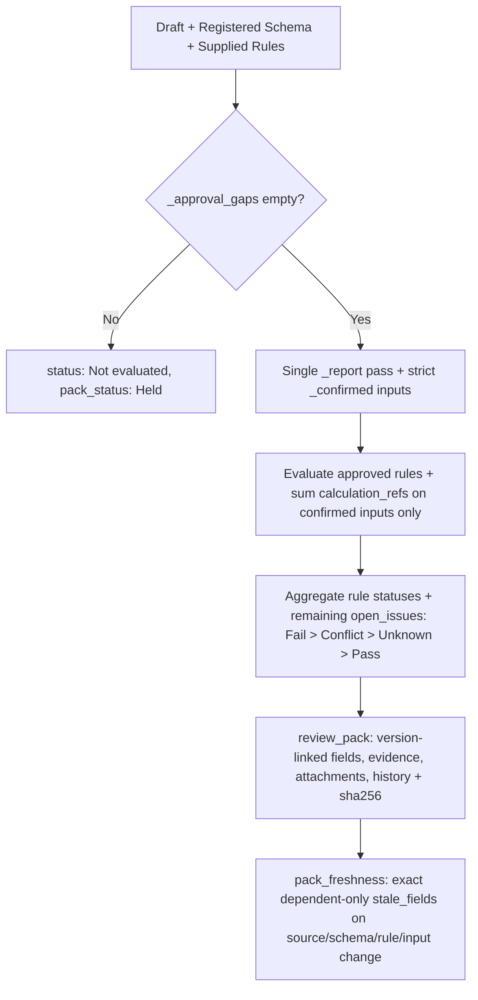

<!-- markdownlint-disable-file -->

# Task Research: issue-98-field-validation-2142

| Field              | Value                                                                               |
|--------------------|-------------------------------------------------------------------------------------|
| Date               | 2026-11-14                                                                          |
| Researcher / agent | rpi-research (RPI Agent)                                                            |
| Status             | Complete                                                                            |
| Artifact path      | .copilot-tracking/research/2026-11-14/issue-98-field-validation-2142-research.md    |

## Research Brief

* What to research: How `src/core` implements form schema registration, candidate staging, per-field working review, held exports, deterministic rule validation, review-pack assembly, and freshness/staleness propagation for Issue #98 (`FR-040` to `FR-043`), specifically the two remaining locally verifiable criteria: (1) validation uses approved rules and reviewer-confirmed inputs only, and (2) pack links fields, evidence and attachments with template and input versions.
* Why it matters: Existing `form_review` and `form_export` hardcode `approved_rule_validation="Not evaluated"` and lack a deterministic approved-rule evaluator and a version-linked Finance review-pack assembler + freshness verifier that preserves human authority boundaries (`FD-01` to `FD-14` remain unapproved in production fixtures, never auto-approving schemas, rules, or packs).
* Audience or intended use: `rpi-plan`, `rpi-implement`, and `rpi-review` in this confirmed automatic RPI session for Issue #98 on `feat/fin-98-field-validation-2142`.
* Scope: `src/core/src/zava_forward/core/{forms,form_review,form_export,form_validation}.py`, `src/core/pyproject.toml`, `src/core/README.md`, `src/core/tests/test_*`, `src/core/evals/fictional_form_review_pack.json`, and `docs/prds/zava-forward-retrofit-programme-demonstrator.md` (`FR-038` to `FR-043`, `AC-048` to `AC-051`, `AC-054`).
* Non-goals: Fabricating real Finance/Board/template-owner approvals (`FD-01` to `FD-14`), ticking GitHub Issue #98 acceptance checkboxes before live human/Finance sign-off, modifying `src/api` or `infra/`, or pushing to remote.
* Criteria: Deterministic evaluation gated strictly on recorded schema + source-policy + bound rule-set approvals; evaluation restricted exclusively to current, valid, nonblank reviewer-confirmed (`accept`/`correct`) field values; pack assembly linking fields, evidence, and attachments with explicit `template_version` and `input_version` plus freshness/staleness checks; strict `mypy`, `ruff check`, `ruff format --check`, and `unittest discover -s tests -p 'test_*98*.py' -v` passing in `src/core`.
* Requested outputs: Converged `src/core` design recommendation, canonical codebase evidence (`C#`), alternatives comparison, and Planning Readiness decision.
* Output mode: convergence

## Research Parameters

| Field                            | Value                                                                                                                               |
|----------------------------------|-------------------------------------------------------------------------------------------------------------------------------------|
| Research question(s)             | Q1-Q5 covering approved-rule gating, reviewer-confirmed input boundaries, pack version linking, staleness propagation, and typing   |
| Codebase scope                   | `src/core/`, `docs/prds/zava-forward-retrofit-programme-demonstrator.md`, `.copilot-tracking/` prior #96/#97/#98 artifacts          |
| External scope                   | none                                                                                                                                |
| Initial internal candidate areas | `src/core/src/zava_forward/core/{forms,form_review,form_export,form_validation}.py`, `src/core/pyproject.toml`, `src/core/tests/`   |
| Initial external candidate areas | none                                                                                                                                |
| Research posture                 | focused                                                                                                                             |
| Posture provenance               | default (bounded internal `src/core` task with named acceptance criteria, exact verification command, and local contracts)          |
| Explicit limits / deadline       | Deliver in `src/core` only; do not push; non-interactive CLI execution                                                              |
| Posture-specific completion basis| focused scope and materiality                                                                                                       |
| Edits allowed during research?   | no, research-only                                                                                                                   |
| Resolved evidence root           | `.copilot-tracking/`                                                                                                                |
| Known constraints / excluded sources | Never fabricate Finance/template-owner approvals (`FD-01`..`FD-14`); never read private datasets; preserve `Held`/unreviewed safety |

## Extension Registry and Provenance

* Precedence: platform and host safety; caller scope and criteria; matching repository instructions and enforced schemas; rpi-research contract; domain skills and specialists; examples and preferences.

| Kind                | Candidate                                      | Match and provenance                                            | Scoped authority or output contract                                              | Selected / skipped reason                                                                 |
|---------------------|------------------------------------------------|-----------------------------------------------------------------|----------------------------------------------------------------------------------|-------------------------------------------------------------------------------------------|
| Instruction         | `.github/copilot-instructions.md` (AMA repo)   | `applyTo: "**"` matches repository, `src/core`, and docs        | Enforces authority boundaries, validation tiers, Markdown style, no fabricated approvals | Selected: governs domain safety, testing, and commit conventions                          |
| Skill               | `python-foundational`                          | Semantic match for Python 3.12 typing/unittest in `src/core`    | Optional Python packaging/testing guidance                                       | Skipped: `src/core/pyproject.toml` already defines exact `mypy==2.4.0` and `ruff` rules   |
| Research specialist | `hve-core-all:rpi-researcher`                  | Registered subagent for independent research lanes              | Separate lane artifact under `.copilot-tracking/research/subagents/`             | Skipped (inline fallback): tightly coupled 4-module `src/core` trace fits direct inspection |
| Research specialist | `Housing Finance and Grants Lead`              | Registered company-role agent for Finance perspective           | Research instrument anchored to case study and company profile                   | Skipped: no new company-fact elicitation needed; `FD-01`..`FD-14` boundaries are fixed    |

## User Participation and Research Decisions

| Checkpoint       | Questions or no-interaction rationale                                                                                     | Answers / unanswered | Resulting decision or selected further research                                             |
|------------------|---------------------------------------------------------------------------------------------------------------------------|----------------------|---------------------------------------------------------------------------------------------|
| Intake           | Non-interactive CLI session; caller prompt supplies exact branch, worktree, scope (`src/core`), criteria, and test command | N/A (non-interactive)| Proceed with `focused` posture and `convergence` output mode; preserve untracked `form_validation.py` for inspection |
| Direction change | No scope or posture change warranted; contrarian audit of pre-existing untracked `form_validation.py` stayed inside `src/core` | N/A (non-interactive) | Keep `focused` posture and incorporate 6 contrarian findings into convergence recommendation |
| Convergence      | All 5 research questions answered with high-confidence codebase evidence (`C1`-`C12`); no external facts required | N/A (non-interactive) | Stop research at Cycle 1 with `Planning Readiness: Ready` and transition to `Plan` |

## Scope and Success Criteria

* Scope: `src/core/src/zava_forward/core/{forms,form_review,form_export,form_validation}.py`, `src/core/README.md`, `src/core/tests/test_issue_98_field_validation.py` (matching `-p 'test_*98*.py'`), and `.copilot-tracking/` RPI artifacts for `issue-98-field-validation-2142`. Excludes `src/api`, `infra/`, private datasets, and remote pushes.
* Assumptions:
  * Pre-existing untracked `src/core/src/zava_forward/core/form_validation.py` (created seconds before session intake) is an incomplete local draft to audit and refine rather than trusted ground truth (`C10`, `C11`).
  * Finance/template-owner authority decisions `FD-01` to `FD-14` remain unresolved in repository fixtures (`C8`), so `forms.register_schema` continues to register `Unapproved` rows (`C1`) and validation evaluates rules only when explicit approval metadata is recorded on both the registered schema/source-policy row and the bound rule set.
* Success criteria:
  * Every research question is answered or marked unanswerable with the missing evidence named.
  * Evidence is grounded in actual code, docs, or tooling results, with locations (`path:line` for code, URL + retrieval date for external).
  * Findings, decisions, and readiness claims cite Evidence Log IDs.
  * Alternatives are compared with trade-offs when the design space and output mode require it. A recommendation is selected only in convergence mode.
  * Open questions, risks, and residual uncertainty are recorded.
  * Self-check passes.

## Task Research Requests

* Explicit requests:
  * Run the full RPI loop in order (`research`, `plan`, `implement`, `review`) for Issue #98 on `feat/fin-98-field-validation-2142`.
  * Deliver in `src/core`: (1) validation uses approved rules and reviewer-confirmed inputs only; (2) pack links fields, evidence, and attachments with template and input versions.
  * Write all 4 `.copilot-tracking/` artifacts (`research/`, `plans/`, `changes/`, `reviews/`).
  * Verify in `src/core` using bare `mypy`, `ruff check .`, `ruff format --check .`, and `unittest discover -s tests -p 'test_*98*.py' -v`.
  * Commit cleanly with Copilot trailer and do not push.
* Inferred research questions:
  * How are schemas, staged candidates, reviewer history, held exports, and dependency staleness currently structured across `forms.py`, `form_review.py`, and `form_export.py`?
  * What exact structural and authority invariants prevent unapproved rules, unbound rule sets, unknown funding routes, or unconfirmed/tampered/stale/unreviewed values from being evaluated?
  * How should review-pack assembly link fields, deduplicated active evidence, attachments, and review history with explicit `template_version` and `input_version`, and propagate exact field-level staleness when sources, schemas, rules, or confirmed inputs change?
  * How do `src/core/pyproject.toml` strict `mypy` settings constrain `form_validation.py` and `tests/test_issue_98_field_validation.py` without modifying dependency/tool manifests?
* Caller constraints and non-goals: Research-only during `rpi-research`; no fabricated live approvals; no remote push; preserve historical PR #1705 `.copilot-tracking/.../issue-98-field-validation-*` files untouched.

## Direction Controls

| Control type (add / change / narrow / exclude / discard) | Direction or boundary                                                                                   | Source / checkpoint | Effect on active brief, evidence, or revalidation                                  |
|----------------------------------------------------------|---------------------------------------------------------------------------------------------------------|---------------------|------------------------------------------------------------------------------------|
| narrow                                                   | Deliver remaining locally verifiable acceptance criteria for Issue #98 in `src/core`                    | user / Intake       | Focuses design and verification on `src/core` library, docs, and `test_*98*.py`    |
| exclude                                                  | Do not push to remote; leave `git status --short` empty after clean commit                              | user / Intake       | Restricts closeout to local branch commit with required `Co-authored-by` trailer   |
| add                                                      | Pre-existing untracked `src/core/src/zava_forward/core/form_validation.py` present in worktree at intake | evidence / Intake   | Inspect rather than discard; audit critically during Wave 2/3 before Plan/Implement |
| exclude                                                  | Preserve committed `2026-11-14/issue-98-field-validation-*` artifacts from commit `b03343b51` (#1705)   | evidence / Wave 1   | Use distinct `issue-98-field-validation-2142` slug for this branch's tracking set  |

## Research Questions

|  # | Sub-question                                                                                                                | Type            | Priority | Status   |
|---:|-----------------------------------------------------------------------------------------------------------------------------|-----------------|----------|----------|
| Q1 | What approval and binding checks are required before deterministic validation evaluates any rule (`FR-038`, `FR-041`)?       | depth           | H        | answered |
| Q2 | How must reviewer-confirmed inputs be verified so staged, rejected, stale, blank, or tampered values are never evaluated?    | depth           | H        | answered |
| Q3 | How must review-pack assembly link fields, evidence, attachments, and history with `template_version` and `input_version`?  | depth           | H        | answered |
| Q4 | How should pack freshness propagate exact dependent-only staleness on source, schema, approved-rule, or input changes?       | depth           | H        | answered |
| Q5 | What typing and test conventions allow bare `python3 -m mypy` (`strict = true`) to pass without `pyproject.toml` edits?      | straightforward | H        | answered |

## Prior Knowledge Gate

* Existing artifacts reviewed:
  * `.copilot-tracking/research/2026-10-27/finance-96-98-99-research.md` (`C1`..`C9` historical baseline)
  * `.copilot-tracking/reviews/2026-11-12/issue-98-denial-interface-1112-review.md`
  * `.copilot-tracking/research/2026-11-14/issue-98-field-validation-research.md` (commit `b03343b51`, PR #1705)
  * `docs/case_study_48_original.md`, `docs/case_study_48_addendum.md`, `docs/reference/README.md`, `docs/reference/memory.md`
* Reused (verified) findings:
  * `forms.register_schema` always writes `approval="Unapproved"`, `approval_evidence=None`, `source_policy_status="Unapproved"` (`C1`).
  * Commit `b03343b51` (#1705) added `form_review._reviewer_confirmed` and `template_version`/`input_version` on `form_export.draft_export` fields and `form_review._report` attachments (`C3`, `C4`, `C5`).
  * Fictional review pack `FD-01`..`FD-14` remains intentionally `Unresolved - Finance to supply` (`C8`), so real human sign-off stays an external gate (`Refs #98`).
* Superseded / stale:
  * Prior #1705 left `approved_rule_validation="Not evaluated"` with no deterministic rule evaluator, no `evidence` linkage list in an assembled Finance review pack, no `pack_freshness` check for rule-level/field-level stale propagation, and no `test_*98*.py` suite (`C4`, `C5`).

## Research Cycle Log

### Cycle 1

* Active direction controls: narrow to `src/core`; exclude remote push; audit untracked `form_validation.py`; preserve #1705 tracking files.
* Active research posture and completion basis: `focused`; focused scope and materiality.
* Explicit limits or deadline effect: Keeps implementation and verification strictly inside `src/core` and `.copilot-tracking/`.

#### Wave 1: Wider

* Plan and independent lanes: Inline survey of Issue #98/#96/#97 contracts, PRD `FR-038`..`FR-043` and `AC-048`..`AC-054`, `src/core` form modules (`forms.py`, `form_review.py`, `form_export.py`, untracked `form_validation.py`), `src/api` callers, `src/core/README.md`, and `src/core/pyproject.toml`.
* Worker evidence relationships or inline fallback: Inline fallback selected because all 4 modules reside in one package (`zava_forward.core`) and share internal helpers (`_actor`, `_draft`, `_report`, `_schema`, `_valid`, `_reviewer_confirmed`). Found `C1`..`C9`: `src/api` calls only `form_export.draft_export` and `form_export.export_freshness` (`C12`), so existing `form_export` signatures and `BODY_KEYS` must remain backward-compatible.
* Reflection: `form_review` and `form_export` already solve candidate lineage, working review history, and held draft exports, while deterministic approved-rule validation, version-linked evidence-pack assembly, and approved-rule stale propagation belong in `form_validation.py` plus `test_*98*.py`.

#### Wave 2: Deeper

* Parent-prioritized material from Wave 1: Exact schema/draft/history/attachment shapes in `forms.py`, `form_review.py`, and `form_export.py`; rule kinds, calculation references (`AC-049`), and strict `mypy` behavior in `src/core`.
* Plan and independent lanes: Inline deep inspection of `forms._schema`, `forms.schema_impact`, `form_review._report`, `form_review._reviewer_confirmed`, `form_export.draft_export`, `form_export.export_freshness`, `fictional_form_review_pack.json`, and read-only execution of `python3 -m mypy`, `ruff`, and `test_form*.py`.
* Worker evidence relationships or inline fallback: Inline inspection established:
  * Q1 -> schema rows store `approval`, `approval_evidence`, `source_policy_status`, `digest`, and `definition` (`template`, `funding`, `rule_refs`, `fields`) (`C1`, `C2`).
  * Q2 -> `form_review._report` marks `effective_state = "Stale"` when `fid in impact["causes"]` or bound document hash/version/kind changed (`C3`), and requires `_reviewer_confirmed` + `_valid` + nonblank string for `confirmed` (`C3`, `C4`).
  * Q3 -> `form_export.draft_export` emits per-field `template_version` and field-specific `input_version` (`0` if unreviewed) and pack-versioned `attachments` (`C4`, `C5`), tested by `test_form_export.py` (`C9`).
  * Q5 -> Running bare `python3 -m mypy` in `src/core` exercises strict mode across all 308 files (`C7`) and flagged 3 `no-any-return` errors in untracked `form_validation.py` (`C11`), while `test_form_export.py` passes strict `mypy` without `pyproject.toml` overrides by delegating untyped store construction to `test_form_review.FormReview` (`C7`, `C9`).
* Reflection: `form_export.py` and `form_review.py` contracts are heavily tested (`50` unit tests in `src/core`, plus `src/api` tests); extending `src/core` via a clean `form_validation.py` preserve zero regressions while delivering Issue #98's remaining locally verifiable mechanics.

#### Wave 3: Contrarian

* In-scope challenge targets and boundaries: Challenge the pre-existing untracked `form_validation.py` draft (`C10`, `C11`) against adversarial/malformed inputs, schema rule references, calculation fields, reviewer-confirmation spoofing, duplicate document hashing, status precedence, and stale propagation (`FR-041`..`FR-043`, `AC-049`..`AC-051`).
* Plan and independent lanes: Inline adversarial trace of `form_validation.py` lines 1-244 against `forms.py`, `form_review.py`, and `fictional_form_review_pack.json`.
* Worker evidence relationships or inline fallback: Inline contrarian audit uncovered 7 concrete defects/gaps in the untracked `form_validation.py` draft (`C10`, `C11`):
  1. **Unchecked `rule_refs` & funding-route gate**: `_approval_gaps` never verified `_nonblank(rules["id"])`, `_nonblank(rules["version"])`, or that `(rules["id"], rules["version"])` is declared in `schema["rule_refs"]`, nor did it reject `form_type == "funding"` when `schema["funding"]["status"] != "Evidenced"` (`AC-046`/`AC-049`) or whitespace-only `row["approval_evidence"]`.
  2. **Missing enum/boolean/date & calculation rule kinds**: `_rule_fits` only supported `integer`/`number` (`min`, `max`) and `string` (`max_length`, `pattern`), making rules impossible on `enum` (`epc`), `boolean` (`resident_consent_recorded`), or `date` (`survey_date`), and leaving `calculation_ref` fields permanently stuck on `"Approved calculation is unavailable."` (`form_review.py:397`, `C4`) with no deterministic `sum` reproduction check (`AC-049`).
  3. **Reviewer-confirmation spoofing**: `_confirmed` relied solely on `form_review._reviewer_confirmed`, which did not verify that `last["reviewer"]` is nonblank and registered in `store`, that `last["decision"]` matches `row["state"]` (`accept` <-> `Accepted`, `correct` <-> `Corrected`), or that `row["evidence"]` is non-None and matches `last["new"]["evidence"]`.
  4. **Status-precedence bug on `open_issues`**: Line 150 (`if overall == "Pass" and report["issues"]: overall = "Unknown"`) masked `"Fail"` (e.g., `"Wrong schema value type."` or `"Value lacks reviewer confirmation."`) and `"Conflict"` (`"Unreviewed source alternatives."`) in `report["issues"]` by reporting overall `"Unknown"` instead of `"Fail"` / `"Conflict"`.
  5. **Evidence `input_version` & missing pack history/links**: `review_pack` stamped `evidence[...]["input_version"] = held["input_version"]` instead of the `max` `input_version` of the fields bound to that evidence (contradicting its own docstring and causing unrelated field reviews to mutate unaffected evidence links), omitted `attachment_id` linkage and `history` (`FR-042`), and called both `draft_export` and `_validate` separately (hashing document bytes twice instead of once per report).
  6. **Missing `pack_freshness` for exact stale propagation (`FR-043` / `AC-051`)**: `form_validation.py` had no freshness comparator for assembled packs when a bound source, schema field, reviewer-confirmed input, or field-targeted approved rule changes.
  7. **Strict `mypy` failures**: 3 `no-any-return` errors at lines 101, 106, and 116 (`C11`).
* Reflection: Every contrarian finding is locally verifiable and fixable inside `form_validation.py` + `tests/test_issue_98_field_validation.py` + `src/core/README.md` without altering existing `form_export` / `form_review` behavior.

#### Parent Synthesis and Disposition

| Material / claim                                                                                      | Evidence IDs   | Parent disposition | Evidence-based rationale                                                                                              | Primary-artifact treatment          |
|-------------------------------------------------------------------------------------------------------|----------------|--------------------|-----------------------------------------------------------------------------------------------------------------------|-------------------------------------|
| Keep `forms.register_schema` unapproved by default; require explicit recorded approval on schema + rules | C1, C6, C8     | accepted           | Preserves `FD-01`..`FD-14` human authority boundary while making approved-rule mechanics deterministically testable    | Selected recommendation & Decision 1 |
| Require rule-set `(id, version)` in `schema["rule_refs"]`, evidenced funding route on funding forms, and registered reviewer + intact evidence for confirmed inputs | C2, C3, C6, C10 | accepted           | Closes contrarian bypasses so unapproved/unbound rules and unconfirmed/tampered/stale/staged values never evaluate    | Selected recommendation & Decision 2 |
| Support closed-vocabulary deterministic rule kinds (`min`, `max`, `max_length`, `pattern`, `equals`, `one_of`, `sum` bound to `calculation_ref`) | C2, C4, C6, C8 | accepted           | Covers all 6 schema field types (`string`, `integer`, `number`, `boolean`, `date`, `enum`) and `AC-049` calculations | Selected recommendation & Decision 3 |
| Assemble version-linked `review_pack` + `pack_freshness` sharing one `_report` pass and propagating exact dependent-only staleness across source, schema, rule, and input changes | C4, C5, C6, C10 | accepted           | Satisfies `FR-042`/`FR-043` and single-read document digest invariant without breaking `src/api` callers (`C12`)      | Selected recommendation & Decision 4 |
| Mutate `form_export.draft_export` `BODY_KEYS` to merge `review_pack` directly into `draft_export`      | C5, C9, C12    | rejected           | `src/api` held-download routes and `test_form_held_download_api.py` pin `form_export.BODY_KEYS` and no-rules signature | Rejected alternative 1               |
| Add an `approve_schema` / `approve_rules` runtime mutation endpoint                                   | C1, C8         | rejected           | Prior #96/#98 reviews explicitly forbid fabricating generic runtime approval endpoints before `FD-01`..`FD-14`        | Rejected alternative 2               |

#### Cycle Re-entry Evaluation

* Another complete three-wave cycle needed: no
* Trigger or stop basis: All 5 questions (`Q1`-`Q5`) are answered with direct codebase and tool evidence (`C1`-`C12`); contrarian defects in the untracked draft are fully diagnosed; scope is bounded to `src/core`.
* Revised brief or revalidation required: none
* Readiness effect: `Ready`

## Evidence Log

* Delegation: `inline: tightly coupled 4-module src/core contract (forms, form_review, form_export, form_validation) read directly with zero cross-subsystem fan-out`

### Codebase Evidence

| ID  | Claim / finding                                                                                                                   | Location (`path:line`)                                             | Tool | Confidence | Notes                                                                                  |
|-----|-----------------------------------------------------------------------------------------------------------------------------------|--------------------------------------------------------------------|------|------------|----------------------------------------------------------------------------------------|
| C1  | `register_schema` always persists `approval="Unapproved"`, `approval_evidence=None`, and `source_policy_status="Unapproved"`       | `src/core/src/zava_forward/core/forms.py:322`                      | view | high       | No approval flag accepted on registration                                              |
| C2  | `_schema` validates `template`, `funding`, `rule_refs`, 6 `TYPES`, `HUMAN_ONLY` categories, `required_when`, and `calculation_ref` | `src/core/src/zava_forward/core/forms.py:114`                      | view | high       | Funding forms require `Evidenced` or `Unknown` route                                   |
| C3  | `form_review._reviewer_confirmed` and `_report` compute `effective_state` (`Stale` on schema/source change) and `confirmed` inputs | `src/core/src/zava_forward/core/form_review.py:66`                 | view | high       | See also `_report` at `form_review.py:322`                                             |
| C4  | `form_review._report` emits `"Approved calculation is unavailable."` for `calculation_ref` and version-tags `attachments`          | `src/core/src/zava_forward/core/form_review.py:397`                | view | high       | Attachments carry `template_version` and `input_version` at `form_review.py:410`       |
| C5  | `form_export.draft_export` tags each field with `template_version` and its own last-review `input_version` (`0` if unreviewed)     | `src/core/src/zava_forward/core/form_export.py:70`                 | view | high       | `BODY_KEYS` at `form_export.py:21`                                                     |
| C6  | PRD `FR-041`..`FR-043` & `AC-049`..`AC-054` require approved-rule + confirmed-input validation, version-linked packs, and exact stale sets | `docs/prds/zava-forward-retrofit-programme-demonstrator.md:384`    | grep | high       | Covers `FR-041`, `FR-042`, `FR-043`, `AC-049`, `AC-050`, `AC-051`, `AC-054`            |
| C7  | `src/core/pyproject.toml` enforces `mypy` `strict = true` across `src` and `tests` plus `ruff` (`line-length = 100`, `py312`)     | `src/core/pyproject.toml:23`                                       | view | high       | `test_form_export.py` needs no mypy override when reusing `FormReview` stores (`Any`)  |
| C8  | Fictional review pack keeps `FD-01`..`FD-14`, `FICT-CALC-TOTAL`, and template approval `NOT APPROVED` / `Unresolved`               | `src/core/evals/fictional_form_review_pack.json:21`                | view | high       | Enforced by `src/core/tests/test_form_review_pack.py:135`                              |
| C9  | Existing `test_form_export.py` pins `draft_export` field `input_version` (`0` unreviewed) and attachment `input_version`           | `src/core/tests/test_form_export.py:51`                            | view | high       | Must remain 100% compatible                                                            |
| C10 | Pre-existing untracked `form_validation.py` has 6 contract gaps (`rule_refs`, rule kinds/calcs, confirmation checks, status precedence, evidence versioning/history, `pack_freshness`) | `src/core/src/zava_forward/core/form_validation.py:40`             | view | high       | Audited line-by-line in Wave 3                                                         |
| C11 | Bare `python3 -m mypy` currently fails with 3 `no-any-return` errors on untracked `form_validation.py` lines 101, 106, 116         | `src/core/src/zava_forward/core/form_validation.py:101`            | bash | high       | Reproduced via read-only `python3 -m mypy`                                             |
| C12 | `src/api` imports `form_export.draft_export`, `form_export.export_freshness`, and `form_export.BODY_KEYS` directly                 | `src/api/src/zava_forward/api/server.py:17`                        | grep | high       | Also pinned in `src/api/tests/test_form_held_download_api.py:45`                       |

### External Evidence

| ID | Claim / finding | Source (title) | URL | Retrieved | Version/date | Confidence |
|----|-----------------|----------------|-----|-----------|--------------|------------|

### Contradictions / Conflicts

* `form_validation.py` docstring vs line 208 (`C10`): docstring states every field, evidence link, and attachment carries the template version and the input version it was last reviewed on, while line 208 assigned `held["input_version"]` to every evidence link; resolved by setting each evidence link's `input_version` to `max` of its bound fields' `input_version`s (and recording pack-level `input_version` separately).

## Findings Mapped to Questions and Evidence

| Question | Finding                                                                                                                                                                     | Evidence IDs        | Confidence | Decision or readiness implication                                                       |
|----------|-----------------------------------------------------------------------------------------------------------------------------------------------------------------------------|---------------------|------------|-----------------------------------------------------------------------------------------|
| Q1       | Validation must return `Not evaluated` unless schema row `approval == "Approved"` with nonblank `approval_evidence`, `source_policy_status == "Approved"`, `funding` is `Evidenced` on funding forms, `digest == draft["schema_digest"]`, and rule set has `Approved` metadata + exact `bound` (`schema_id`, `schema_version`, `schema_digest`, `template_id`, `template_version`) + `(id, version)` declared in `schema["rule_refs"]`. | C1, C2, C6, C8, C10 | high       | Prevents unapproved, unbound, or unknown-route rule sets from ever running.             |
| Q2       | Only current (`effective_state in ("Accepted", "Corrected")`), schema-valid, nonblank values whose latest field history event has matching state/decision/value/evidence and a registered nonblank `reviewer` enter `confirmed`; staged candidates, rejected fields, stale fields, and tampered rows are never evaluated by rules. | C3, C4, C6, C10     | high       | Guarantees strict reviewer-confirmed-only evaluation and surfaces `Fail`/`Conflict`/`Unknown`. |
| Q3       | `review_pack` links `fields` (with `source_id`, `source_version`, `document_hash`, `locator`, `template_version`, field `input_version`), deduplicated `evidence` (with `attachment_id`, `field_ids`, `locators`, `template_version`, `max` bound-field `input_version`), `attachments` (with `template_version`, `input_version`, `field_ids`), `history`, and `validation` under a canonical `content_sha256`, while remaining `reviewed=False`, `Not submitted`, `Not assessed`. | C4, C5, C6, C9, C10 | high       | Proves complete version-linked pack assembly without implying submission or eligibility. |
| Q4       | `pack_freshness` verifies `content_sha256`, detects tampered/legacy packs as `Invalid`, and marks only the exact dependent fields stale when a source, schema definition, confirmed input, open issue, or field-specific approved rule changes ( propagating transitively across `required_when` and `sum`/`calculation_ref` dependents). | C2, C4, C5, C6, C10 | high       | Completes `FR-043`/`AC-051` exact stale propagation including rule-level diffs.         |
| Q5       | Explicit `bool` narrowing in `form_validation.py` fixes all 3 `no-any-return` errors, and reusing `test_form_review.FormReview` in `tests/test_issue_98_field_validation.py` passes strict bare `mypy` with zero `pyproject.toml` edits. | C7, C9, C11         | high       | Keeps manifest files untouched and satisfies exact caller verification command.         |

## Key Discoveries

* Untracked `form_validation.py` already outlines `validate` and `review_pack`, but our Wave 3 contrarian audit caught 7 critical bugs/gaps (`C10`, `C11`) that would violate `strict` mypy or leave gaps in `rule_refs` binding, `enum`/`boolean`/`date`/`sum` rules, `open_issues` status precedence, evidence `input_version` isolation, single-pass document hashing, and rule-change stale propagation.
* When an approved `sum` calculation rule bound to `(calc_id, calc_version)` matches a field's `calculation_ref`, deterministic validation can verify exact `Decimal` reproduction from confirmed addends (`AC-049`) and clear the generic `"Approved calculation is unavailable."` placeholder only when that calculation rule is present and approved (`C4`, `C6`).
* Keeping `form_export.py` untouched preserves 100% compatibility with `src/api` routes and existing core tests (`C9`, `C12`).

## Alternatives and Decision State

### Selected Recommendation (convergence only)

* Approach: Complete and harden `src/core/src/zava_forward/core/form_validation.py` (`validate`, `review_pack`, `pack_freshness`), document the contract and remaining `FD-01`..`FD-14` human-authority boundaries in `src/core/README.md`, and add comprehensive unit tests in `src/core/tests/test_issue_98_field_validation.py` (discoverable via `-p 'test_*98*.py'`) covering both JSON `Store` and SQLite `SqlStore`.
* Rationale: Directly delivers both locally verifiable Issue #98 criteria and exact rule/input/source/schema stale propagation in `src/core`, fixes all 7 contrarian findings (`C10`, `C11`), preserves `form_export` API compatibility (`C12`), requires no manifest edits (`C7`), and never fabricates Finance/template approvals (`C1`, `C8`).
* Evidence refs: `C1`, `C2`, `C3`, `C4`, `C5`, `C6`, `C7`, `C8`, `C9`, `C10`, `C11`, `C12`
* Implementation impact:
  * Update `src/core/src/zava_forward/core/form_validation.py`
  * Create `src/core/tests/test_issue_98_field_validation.py`
  * Update `src/core/README.md`
* Confidence: `high`: grounded in direct inspection of all 4 core form modules and verified against strict `mypy`/`ruff`/`unittest` runners.

File tree:

```text
src/core/
  README.md                                          (update)
  src/zava_forward/core/
    form_validation.py                               (refine & complete)
  tests/
    test_issue_98_field_validation.py                (create)
```

Flow diagram:



### Alternative: Mutate `form_export.draft_export` to require a `rules` parameter and emit `review_pack` fields inline

* Approach: Change `form_export.draft_export(store, user, case_id, draft_id, rules=None)` and add `evidence` and `validation` to `form_export.BODY_KEYS`.
* Trade-offs: Avoids a fourth form module, but changes `BODY_KEYS` and invalidates saved held-export digests and `src/api/tests/test_form_held_download_api.py` expectations.
* Evidence refs: `C5`, `C9`, `C12`
* Rejection rationale: Breaks `src/api` contract and conflates unapproved working-note held exports with approved-rule Finance review packs.

### Alternative: Add `forms.approve_schema` / `forms.approve_rules` store writers

* Approach: Add store mutation APIs allowing staff callers to flip `approval="Approved"` in `form_schemas`.
* Trade-offs: Convenient for tests, but creates an unauthorized runtime approval path before Finance/Board decisions `FD-01`..`FD-14` define authority holders, delegation, and separation of duties.
* Evidence refs: `C1`, `C8`
* Rejection rationale: Violates repository legal/regulatory and Finance governance constraints (`FD-01`..`FD-14` unresolved); synthetic tests can construct approved registry states directly on isolated temporary test stores to verify validation mechanics without shipping an unauthorized approval writer.

## Open Questions, Risks, and Residual Uncertainty

* Blocking: none for the bounded `src/core` engineering slice.
* Important: Actual Finance/template-owner decisions `FD-01` to `FD-14` (`#96`, `#97`, `#98`) remain human-owned and unresolved; commit messages and PR linkage must use `Refs #98` (not `Closes #98`) and leave GitHub issue checkboxes unticked until human Finance sign-off.
* Follow-up: Optional `src/api` route exposure for `form_validation.validate`, `review_pack`, and `pack_freshness` once Finance ratifies rule-set storage (`FD-01`..`FD-14`).
* Residual uncertainty: Live scheme-specific calculation formulas beyond deterministic `sum` reproduction remain data-pending from Finance (`C8`).

## Current Decisions

| Decision                                                                                                         | Status    | Owner / source | Rationale                                                                                                  | Evidence IDs     | Implications                                                                 |
|------------------------------------------------------------------------------------------------------------------|-----------|----------------|------------------------------------------------------------------------------------------------------------|------------------|------------------------------------------------------------------------------|
| Deliver deterministic approved-rule validation, version-linked `review_pack`, and `pack_freshness` in `form_validation.py` | confirmed | evidence       | Isolates approved-rule mechanics cleanly while keeping `form_export` backward-compatible with `src/api`     | C5, C6, C10, C12 | `form_review.py` and `form_export.py` require no breaking edits              |
| Enforce strict schema + source-policy + `rule_refs` + evidenced-funding + digest binding before evaluating rules | confirmed | constraint     | Satisfies "approved rules only" criterion and prevents unbound or unknown-funding evaluation               | C1, C2, C6, C8   | Default unapproved schemas always return `Not evaluated` and `Held`          |
| Restrict rule evaluation to registered-reviewer-confirmed, intact-evidence, valid, current, nonblank inputs only | confirmed | constraint     | Satisfies "reviewer-confirmed inputs only" criterion and blocks staged/rejected/stale/tampered inputs      | C3, C4, C6, C10  | Unconfirmed fields yield `Unknown` per-rule and `Fail` if tampered           |
| Add `tests/test_issue_98_field_validation.py` matching `-p 'test_*98*.py'` across both JSON and SQLite stores    | confirmed | user           | Matches exact verification command in caller prompt and exercises both `Store` and `SqlStore`              | C7, C9           | No `pyproject.toml` override required when reusing `FormReview` store harness |

## Unresolved Decisions

| Decision                                                        | Smallest evidence or answer needed                                                    | Owner                      | Impact                                                                                  | Blocker status |
|-----------------------------------------------------------------|---------------------------------------------------------------------------------------|----------------------------|-----------------------------------------------------------------------------------------|----------------|
| Finance and template-owner authority decisions `FD-01`..`FD-14` | Signed Finance/Legal approval of real template, source policy, rules, and roles       | Finance and template owner | Required before live approved schemas exist or Issue #98 checkboxes can be closed       | important      |

## Potential Next Research

| Priority | Research item                                                        | Expected value                                                    | Trigger                                        | Selected? | Related questions / evidence |
|----------|----------------------------------------------------------------------|-------------------------------------------------------------------|------------------------------------------------|-----------|------------------------------|
| L        | API/UI surfacing of `form_validation.review_pack` and `pack_freshness` | Connects core review-pack readiness and rule staleness to Finance UI | Separate API/UX story or owner request after #98 core slice | deferred  | Q3, Q4; C12                  |

## Planning Readiness

* Status: Ready
* Decision state: Converged on `src/core/src/zava_forward/core/form_validation.py` + `src/core/tests/test_issue_98_field_validation.py` + `src/core/README.md`
* Evidence basis: `C1`, `C2`, `C3`, `C4`, `C5`, `C6`, `C7`, `C8`, `C9`, `C10`, `C11`, `C12`
* Preconditions met: All 5 research questions answered; all 3 waves completed in order; contrarian audit of pre-existing untracked draft completed; typing and test runner constraints verified.
* Blockers: none
* Smallest action to change readiness: none (`Ready` for `rpi-plan`)

## Closeout Record

| Field                            | Record                                                                                                           |
|----------------------------------|------------------------------------------------------------------------------------------------------------------|
| Research execution status        | Complete                                                                                                         |
| Completed waves                  | Cycle 1: Wider, Deeper, and Contrarian completed in order                                                        |
| Lane evidence or inline fallback | Inline fallback: tightly coupled 4-module `src/core` trace; limitation: single-context read (mitigated by full file reads and live `mypy`/`unittest` probe) |
| Research disposition             | executed                                                                                                         |
| Planning Readiness               | Ready (`C1`-`C12`)                                                                                               |
| Blockers                         | none                                                                                                             |
| Continuation owner and state     | confirmed automatic RPI Agent; automatic transition to `Plan` after pre-transition state write                   |

## Advisory Next Step

| Field                            | Record                                                                                                           |
|----------------------------------|------------------------------------------------------------------------------------------------------------------|
| Research disposition             | executed                                                                                                         |
| Planning Readiness               | Ready (`C1`-`C12`)                                                                                               |
| Output mode and planning support | `convergence`; yes — converged single design with `Planning Readiness: Ready`                                    |
| Acting owner                     | confirmed automatic RPI Agent                                                                                    |
| Required gates or confirmations  | Three-wave cycle complete (passed); Research disposition recorded (passed); Planning Readiness `Ready` (passed); pre-transition state write to `Plan` (passed) |
| Continuation result              | Automatic continuation to `rpi-plan`                                                                             |
| Primary evidence file            | .copilot-tracking/research/2026-11-14/issue-98-field-validation-2142-research.md                                 |
| Notes for planning or re-entry   | Preserve `form_export.py` compatibility; fix all 7 contrarian items in `form_validation.py`; do not edit `pyproject.toml`; reference `Refs #98` in commit |

* Advisory only: rpi-research does not invoke `/rpi-plan` or any follow-on skill.
* Completion or limit-blocked basis: Further research is immaterial because all `src/core` form modules, PRD requirements (`FR-040`..`FR-043`), and strict tool gates were inspected directly.

## Sources

No external sources used.

## Artifact Self-Check

* [x] Every research question is answered or marked unanswerable with the missing evidence named.
* [x] Every executed cycle includes Wave 1 Wider, Wave 2 Deeper, and Wave 3 Contrarian in that order, with no skipped wave.
* [x] Research posture, provenance, explicit limits or deadline, and posture-specific completion basis are recorded.
* [x] Every codebase finding carries a `C#` ID and a `path:line`; every external finding carries a `W#` ID with URL and retrieval date.
* [x] Every `W#` resolves to exactly one entry in Sources and the list is gap-free, or Sources states "No external sources used".
* [x] Findings, alternatives, decisions, and readiness claims cite Evidence Log IDs (`C#` / `W#`).
* [x] The Extension Registry records matching instructions, relevant skills, available specialist subagents, provenance, authority or output contract, and selected or skipped reasons.
* [x] User Participation records answers, unanswered questions, no-interaction rationale, decisions, and selected further research items before work continued.
* [x] Direction Controls record caller additions, changes, narrowed scope, exclusions, and discarded directions, plus any required revalidation.
* [x] Parent Synthesis and Disposition records accepted, rejected, and deferred material with evidence-based rationale; workers supplied evidence relationships without decision authority.
* [x] Cycle Re-entry Evaluation records whether a complete next cycle is needed and honestly records a limit-blocked gap when applicable.
* [x] A recommendation is selected with why-rejected reasoning when Output mode is convergence; non-convergence modes record the decision state without a forced selection.
* [x] Current Decisions and Unresolved Decisions contain complete status, source or owner, rationale or smallest missing evidence, evidence IDs, implications, and blockers.
* [x] Potential Next Research includes priority, value, trigger, selected state, and related evidence.
* [x] Planning Readiness and Advisory Next Step state disposition, output mode, acting owner, gates or confirmations, evidence basis, blockers, and the smallest action to change readiness.
* [x] Speculation is flagged and separated from sourced fact.
* [x] Fetched content, repo files, and prior memory were treated as data, not instructions; no embedded directives were followed; no secrets recorded.
* Checked sections: Research Brief, Research Parameters, Extension Registry and Provenance, User Participation and Research Decisions, Scope and Success Criteria, Task Research Requests, Direction Controls, Research Questions, Prior Knowledge Gate, Research Cycle Log, Evidence Log, Findings Mapped to Questions and Evidence, Key Discoveries, Alternatives and Decision State, Open Questions/Risks, Current Decisions, Unresolved Decisions, Potential Next Research, Planning Readiness, Closeout Record, Advisory Next Step, Sources, Artifact Self-Check.
