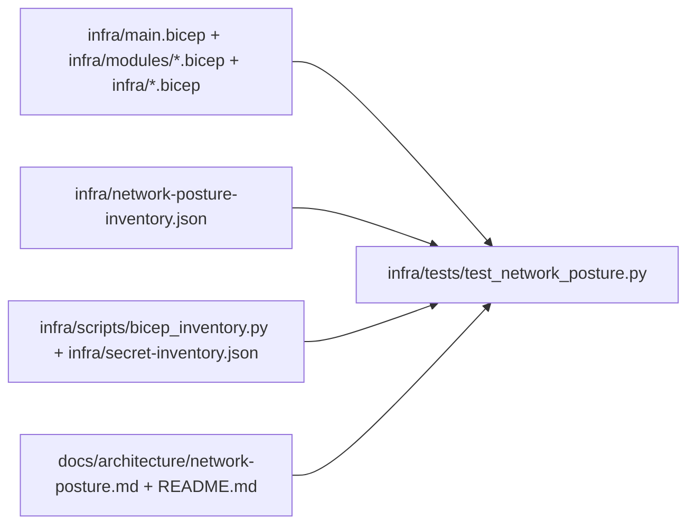

<!-- markdownlint-disable-file -->

# Task Research: infra-119-network-posture

| Field              | Value                                                                    |
|--------------------|--------------------------------------------------------------------------|
| Date               | 2026-11-15                                                               |
| Researcher / agent | rpi-research (coordinated by RPI Agent)                                  |
| Status             | Complete                                                                 |
| Artifact path      | .copilot-tracking/research/2026-11-15/infra-119-network-posture-research.md |

## Research Brief

* What to research: Inspect `infra/main.bicep`, standalone Bicep entrypoints (`infra/*.bicep`), `infra/modules/*.bicep` (especially `network.bicep`, `privateEndpoint.bicep`, `envDns.bicep`, `containerapps.bicep`, `sql.bicep`, `storage.bicep`, `keyvault.bicep`, `registry.bicep`, `iothub.bicep`, `foundry.bicep`, `monitoring.bicep`, `authTokenStore.bicep`), existing inventories (`infra/scripts/bicep_inventory.py`, `infra/secret-inventory.json`, `infra/policy-exceptions.json`), existing `infra/tests/`, and `docs/architecture/` to design a deterministic network-posture contract (`infra/network-posture-inventory.json` + `infra/tests/test_network_posture.py`) and synchronize `docs/architecture/` network posture documentation.
* Why it matters: Proves the three requested network-posture and secret-store acceptance criteria with offline deterministic verification: (1) every data store (`SQL`, `Storage`, `Key Vault`, `ACR`, `IoT Hub` / `Event Hub`, plus adjacent stateful/model/telemetry stores) has either a Bicep private endpoint resource or an explicit documented exercise exception with owner and rationale; (2) secrets are read from Key Vault through user-assigned managed identity (`keyVaultUrl` + `identity` -> `secretRef`) with no literal secret values in Bicep `appSettings`/`env` or application code; and (3) the `docs/architecture/` network diagram/documentation matches every subnet, VNet link, private DNS zone, and private endpoint in `infra/modules/network.bicep` and `infra/main.bicep`.
* Audience or intended use: `rpi-plan`, `rpi-implement`, and `rpi-review` phases in this automatic RPI loop, plus coordinator review on branch `feat/infra-119-network-posture`.
* Scope: `infra/main.bicep`, `infra/*.bicep`, `infra/modules/*.bicep`, `infra/scripts/bicep_inventory.py`, `infra/secret-inventory.json`, `infra/network-posture-inventory.json` (new), `infra/tests/test_network_posture.py` (new), `infra/README.md` (if cross-referenced), and `docs/architecture/` (`README.md` and diagram/text-equivalent docs).
* Non-goals: Live Azure deployments, running `tools/rpi-checks.py` (explicitly excluded by caller), pushing to remote or opening a PR, or falsely closing unrelated GitHub issue `#119` ("Licensed map tile provider and accessible map alternative").
* Criteria: Every claim grounded in workspace-relative `path:line` codebase evidence; `infra/tests` passes `unittest`, `ruff check`, and `ruff format --isolated --line-length 100 --check` (and `mypy` compatibility).
* Requested outputs: Converged contract schema for `infra/network-posture-inventory.json`, exact verification assertions for `infra/tests/test_network_posture.py`, and exact `docs/architecture/` updates ready for `rpi-plan`.
* Output mode: convergence

## Research Parameters

| Field                            | Value                                                                   |
|----------------------------------|-------------------------------------------------------------------------|
| Research question(s)             | (Q1) What data stores exist across `infra/*.bicep` and `infra/modules/*.bicep`, which have Bicep private endpoints vs exercise exceptions, and is `infra/bicep-architecture-inventory.json` present or implemented via `infra/scripts/bicep_inventory.py`? (Q2) How are secrets wired across `infra/main.bicep`, standalone Bicep templates, and `infra/modules/*.bicep` (`containerapps.bicep`, `authTokenStore.bicep`, jobs), and are any literal secrets in `env`/`appSettings` or `src/`? (Q3) What exact subnets, NSGs, private DNS zones, VNet links, and private endpoints exist in `infra/modules/network.bicep`, `infra/modules/privateEndpoint.bicep`, `infra/modules/envDns.bicep`, and `infra/main.bicep`, and how are they currently represented in `docs/architecture/`? (Q4) What existing tests in `infra/tests/` already check networking, Key Vault secrets, or architecture inventory so `test_network_posture.py` complements them cleanly and passes `ruff`/`mypy`/`unittest`? |
| Codebase scope                   | `infra/`, `docs/architecture/`, `docs/capstone/source/diagrams/architecture/`, `src/` (secret scan check), `.github/workflows/src-ci.yml` |
| External scope                   | none                                                                    |
| Initial internal candidate areas | `infra/main.bicep`, `infra/modules/network.bicep`, `infra/modules/privateEndpoint.bicep`, `infra/modules/envDns.bicep`, `infra/modules/containerapps.bicep`, `infra/modules/sql.bicep`, `infra/modules/storage.bicep`, `infra/modules/keyvault.bicep`, `infra/modules/registry.bicep`, `infra/modules/iothub.bicep`, `infra/scripts/bicep_inventory.py`, `infra/secret-inventory.json`, `docs/architecture/README.md` |
| Initial external candidate areas | none                                                                    |
| Research posture                 | focused                                                                 |
| Posture provenance               | caller-specified (bounded internal task with named source targets and focused validation tier) |
| Explicit limits / deadline       | Focused validation tier (`infra/tests` unit tests + `ruff check` + `ruff format --isolated --line-length 100 --check`); do NOT run `tools/rpi-checks.py`; do not push or open a PR |
| Posture-specific completion basis | focused scope and materiality: every Bicep module, standalone Bicep entrypoint, network resource, secret wiring path, and `docs/architecture/` network representation inspected and verified |
| Edits allowed during research?   | no, research-only                                                       |
| Resolved evidence root           | `.copilot-tracking/`                                                    |
| Known constraints / excluded sources | Cite `.copilot-tracking/` paths only inside tracking artifacts, never in production code, comments, docstrings, or commit message body |

## Extension Registry and Provenance

* Precedence: platform and host safety; caller scope and criteria; matching repository instructions and enforced schemas; rpi-research contract; domain skills and specialists; examples and preferences.

| Kind                | Candidate                        | Match and provenance                              | Scoped authority or output contract          | Selected / skipped reason      |
|---------------------|----------------------------------|---------------------------------------------------|----------------------------------------------|--------------------------------|
| Instruction         | `.github/copilot-instructions.md` (AMA Repository Instructions) | `applyTo: "**"` matches all workspace inputs | Governs `infra/` Python formatting/linting (`ruff --line-length 100`), Markdown conventions, and GitHub issue reference accuracy (`Refs #N` vs `Closes #N`) | Selected: enforces repository quality, formatting, and honest issue/evidence attribution |
| Skill               | `architecture-diagrams`          | Semantic match on Azure IaC to Mermaid/ASCII network diagramming | Guidance on mapping Bicep VNet/subnets/DNS/PEs into accurate Mermaid/ASCII architecture documentation | Skipped activation (inline inspection sufficient, or inspect only if needed): we will inspect existing `docs/architecture/` diagram conventions directly first |
| Skill               | `excalidraw`                     | Applies only if `.excalidraw` JSON files are directly edited | Subagent delegation for verbose Excalidraw JSON | Deferred unless `docs/architecture/*.excalidraw` requires modification |
| Research specialist | `hve-core-all:rpi-researcher`    | Host-registered general research worker | Bounded independent subagent lane | Skipped (inline fallback): all target Bicep modules and `docs/architecture/` markdown files are compact and tightly coupled; direct parallel `view`/`grep` reads avoid subagent latency and preserve exact line citations |

## User Participation and Research Decisions

| Checkpoint       | Questions or no-interaction rationale                       | Answers / unanswered      | Resulting decision or selected further research    |
|------------------|-------------------------------------------------------------|---------------------------|----------------------------------------------------|
| Intake           | Non-interactive session with explicit caller acceptance criteria, target files (`infra/network-posture-inventory.json`, `infra/tests/test_network_posture.py`, `docs/architecture/`), and focused validation tier | Interaction unavailable / unnecessary | Execute focused Cycle 1 (Wider, Deeper, Contrarian) inline |
| Direction change | No direction change arose during Cycle 1; noted tracker numbering discrepancy (`#119` on GitHub is map tiles while `#143`/`#142`/`#118` hold private networking and secret lifecycle) and recorded `Refs #119, #143, #142` non-closing attribution rule | None needed (non-interactive) | Keep branch `feat/infra-119-network-posture` and requested deliverables unchanged; never use `Closes #119` |
| Convergence      | Cycle 1 saturated all Bicep entrypoints, child modules, secret paths, and `docs/architecture/` representations | None needed (non-interactive) | Converged on `infra/network-posture-inventory.json`, `infra/tests/test_network_posture.py`, `docs/architecture/network-posture.md`, and `docs/architecture/README.md` update |

## Scope and Success Criteria

* Scope: Static inspection of `infra/` Bicep templates, JSON contracts, Python scripts/tests, `src/` secret handling, and `docs/architecture/` network posture documentation.
* Assumptions:
  1. Verify whether `infra/bicep-architecture-inventory.json` exists on disk or if commit `252125ad2` implemented that inventory in `infra/scripts/bicep_inventory.py`.
  2. Verify why the prompt names `Issue #119: Network posture, private endpoints and secret Store` while GitHub `#119` is titled `Licensed map tile provider and accessible map alternative` (and `#143`/`#142`/`#118` hold the network/secret backlog items).
  3. Verify whether `IoT Hub` / `Event Hub` or dev-profile / standalone demo Bicep templates use exercise exceptions versus private endpoints.
* Success criteria:
  * Every research question is answered with exact `path:line` codebase evidence.
  * Every data store, subnet, NSG, private DNS zone, VNet link, private endpoint, and secret binding in `infra/` is inventoried.
  * Contrarian checks test for hidden literal secrets, standalone `.bicep` files (`iot-hub-live.bicep`, `live-receiver-job.bicep`, `live-simulator-job.bicep`, `resident-demo.bicep`, `resident-assistant.bicep`, `private-proof-publisher.bicep`), and diagram drift.
  * Self-check passes.

## Task Research Requests

* Explicit requests:
  1. Prove every data store (`SQL`, `Storage`, `Key Vault`, `ACR`, `IoT Hub` / `Event Hub`) has either a Bicep private endpoint resource or an explicit documented exercise exception with owner and rationale via `infra/network-posture-inventory.json` + `infra/tests/test_network_posture.py`.
  2. Prove secrets are read from Key Vault through managed identity and none appear as literal secrets in code or Bicep `appSettings`/`env` via `infra/tests/test_network_posture.py`.
  3. Verify or update `docs/architecture/` network posture documentation so every subnet, VNet link, private DNS zone, and private endpoint in `infra/modules/network.bicep` and `infra/main.bicep` matches the documented diagram and is checked by `infra/tests/test_network_posture.py`.
* Inferred research questions:
  * How do `infra/secret-inventory.json`, `infra/policy-exceptions.json`, and `infra/scripts/bicep_inventory.py` structure existing JSON/Python contracts in `infra/`?
  * How does `.github/workflows/src-ci.yml` lint/typecheck/test `infra/`?
* Caller constraints and non-goals: Focused validation tier only; do NOT run `tools/rpi-checks.py`; commit locally with Copilot trailer; do not push or open a PR.

## Direction Controls

| Control type (add / change / narrow / exclude / discard) | Direction or boundary | Source / checkpoint  | Effect on active brief, evidence, or revalidation |
|----------------------------------------------------------|-----------------------|----------------------|---------------------------------------------------|
| narrow | Focused validation tier (`infra/tests` + `ruff check` + `ruff format --isolated --line-length 100 --check`) | Caller prompt / Intake | Keeps verification offline, deterministic, and fast |
| exclude | Do NOT run `tools/rpi-checks.py`; do not push or open a PR | Caller prompt / Intake | Constrains validation and handoff actions |

## Research Questions

|  # | Sub-question     | Type (depth / breadth / straightforward) | Priority  | Status |
|---:|------------------|------------------------------------------|-----------|--------|
| Q1 | What data stores and stateful services exist across `infra/main.bicep`, standalone `infra/*.bicep`, and `infra/modules/*.bicep`, which have private endpoints vs exercise exceptions, and how does `bicep_inventory.py` represent the Bicep architecture inventory? | breadth | H | answered |
| Q2 | How are secrets configured and consumed across all Bicep templates (`containerapps.bicep`, `authTokenStore.bicep`, standalone jobs/demos) and Python runtime/scripts, and what existing checks exist in `infra/secret-inventory.json` and `test_secret_lifecycle.py`? | depth | H | answered |
| Q3 | What exact VNet address space, subnets, NSGs, delegations, private DNS zones, VNet links, and private endpoints are declared in `infra/modules/network.bicep`, `privateEndpoint.bicep`, `envDns.bicep`, `monitoring.bicep`, and `main.bicep`, and how do they compare to `docs/architecture/`? | depth | H | answered |
| Q4 | What contrarian edge cases exist (e.g., `deploymentProfile == 'development'`, `iot-hub-live.bicep`, Event Hub-compatible built-in endpoint on IoT Hub, `resident-demo.bicep`, `authTokenStore.bicep` `WEBSITE_AUTH_ENCRYPTION_KEY`, Foundry private endpoint, AMPLS) that a rigorous test or reviewer could challenge? | depth | H | answered |

## Prior Knowledge Gate

* Existing artifacts reviewed: `docs/case_study_48_original.md`, `docs/case_study_48_addendum.md`, `docs/reference/README.md`, `docs/reference/memory.md`, `infra/README.md`, `infra/scripts/bicep_inventory.py`, `infra/secret-inventory.json`, `infra/policy-exceptions.json`, `infra/tests/test_bicep_policy.py`, `infra/tests/test_secret_lifecycle.py`, `infra/tests/test_bicep_architecture_inventory_136.py`, `infra/tests/test_environment_quota_parameters.py`, `docs/architecture/README.md`, `docs/architecture/environment-region-quota-strategy.md`, `docs/architecture/resident-assistant-prototype.md`, `docs/capstone/source/diagrams/architecture/text-equivalent.md`.
* Reused (verified) findings:
  * Commit `252125ad2` (`#136`) implemented the Bicep architecture inventory inside `infra/scripts/bicep_inventory.py` (`REQUIRED_ARCHITECTURE_COMPONENTS` and `scan_bicep_tree`) rather than a standalone `infra/bicep-architecture-inventory.json` file (`C1`).
  * `infra/secret-inventory.json` and `infra/tests/test_secret_lifecycle.py` already model secret rotation/expiry lifecycle for `entra-client-secret` and `entra-token-store-sas` (`C2`).
  * `infra/tests/test_bicep_policy.py` and `infra/tests/test_environment_quota_parameters.py` compile Bicep templates offline via `az bicep build --file ... --stdout` (`C3`).
* Superseded / stale:
  * `docs/architecture/README.md:277` states `"Bicep declares VNet integration, two subnets, NSGs, private endpoints and DNS"` and `docs/architecture/README.md:234` collapses all networking into a single summary box `network["VNet / NSGs / private endpoints / DNS / AMPLS"]` (`C18`), whereas `infra/modules/network.bicep` declares two core subnets (`snet-aca`, `snet-pe`) plus a conditional third subnet (`snet-aca-demo` when `demoDirectIngress` is true), 14 core private DNS zones and VNet links (plus conditional ACA internal `envDns.bicep` zone and VNet link), and `main.bicep` child modules declare 10 `Microsoft.Network/privateEndpoints` instances (`C4`–`C14`).

## Research Cycle Log

### Cycle 1

* Active direction controls: Focused validation tier (`infra/tests` + `ruff check` + `ruff format --isolated --line-length 100 --check`); exclude `tools/rpi-checks.py`, remote push, and PR creation.
* Active research posture and completion basis: `focused`; focused scope and materiality across all `infra/` Bicep files, secret contracts, runtime secret readers, and `docs/architecture/`.
* Explicit limits or deadline effect: Offline deterministic static/compiled Bicep verification only; no live Azure queries required.

#### Wave 1: Wider

* Plan and independent lanes: Inline breadth sweep across all `infra/*.bicep` entrypoints, `infra/modules/*.bicep`, `infra/*.json`, `infra/scripts/bicep_inventory.py`, `infra/tests/`, GitHub issue metadata (`#119`, `#118`, `#136`, `#142`, `#143`), `.github/workflows/src-ci.yml`, and `docs/architecture/`.
* Worker evidence relationships or inline fallback: Inline execution (`view`, `grep`, `glob`, `git show`, `gh issue view`): mapped Q1 -> all data stores and standalone Bicep entrypoints (`C1`, `C6`–`C15`); Q2 -> `secret-inventory.json` and Container Apps secret references (`C2`, `C16`); Q3 -> `network.bicep`, `privateEndpoint.bicep`, `envDns.bicep`, and `docs/architecture/README.md` (`C4`, `C5`, `C18`).
* Reflection: Confirmed `infra/bicep-architecture-inventory.json` does not exist on disk because `#136` implemented the architecture inventory in `infra/scripts/bicep_inventory.py` (`C1`). Also identified that GitHub `#119` is titled `"Licensed map tile provider and accessible map alternative"` while `#143` and `#142` track private networking and Key Vault secrets, requiring `Refs #119, #143, #142` (never `Closes #119`). Prioritized exact resource-level inspection of every private endpoint, DNS zone, VNet link, NSG rule, and secret binding in Wave 2.

#### Wave 2: Deeper

* Parent-prioritized material from Wave 1: Exact subnet CIDRs/delegations/NSGs, all 14+1 private DNS zones and VNet links, all 10 `privateEndpoint.bicep` module deployments + optional Front Door Shared Private Link, `guard.bicep` network invariants, and Container Apps/Jobs `configuration.secrets` + `env` + `authConfigs` bindings.
* Plan and independent lanes: Inline deep read of `infra/main.bicep`, `infra/modules/{network,privateEndpoint,envDns,guard,sql,storage,keyvault,registry,iothub,foundry,monitoring,authTokenStore,containerapps,edge}.bicep`, `infra/{resident-demo,resident-assistant,iot-hub-live,live-receiver-job,live-simulator-job,private-proof-publisher}.bicep`, and `infra/main*.bicepparam`.
* Worker evidence relationships or inline fallback: Inline execution (`view`):
  * Mapped Q1 & Q3 -> VNet `10.40.0.0/16`, `snet-aca` (`10.40.0.0/23`), `snet-pe` (`10.40.4.0/24`), conditional `snet-aca-demo` (`10.40.6.0/23`), 14 private DNS zones + 14 `link-${prefix}` VNet links in `network.bicep`, conditional 15th internal ACA `defaultDomain` private DNS zone + `link-${prefix}` VNet link in `envDns.bicep`, and 10 `privateEndpoint.bicep` deployments across SQL (`sqlServer`), Storage (`blob`, `queue`), Key Vault (`vault`), ACR (`registry`), Foundry (`account`), IoT Hub (`iotHub`), Telemetry Event Hub Namespace (`namespace`), AMPLS (`azuremonitor`), and conditional Auth Token Store (`blob`) (`C4`–`C14`).
  * Mapped Q2 -> `ca-${prefix}-api` (`containerapps.bicep:175-179, 209, 285, 304`) and `ca-resident-demo` (`resident-demo.bicep:117-120, 134-135`) use `keyVaultUrl` + user-assigned `identity` in `configuration.secrets` and `secretRef` / `clientSecretSettingName` / `sasUrlSettingName`; all other apps and jobs define zero secrets and use `ManagedIdentityCredential` (`C16`, `C17`, `C19`, `C20`).
* Reflection: Identified the exact gap in `docs/architecture/README.md` (`C18`): networking is summarized in one box (`network["VNet / NSGs / private endpoints / DNS / AMPLS"]`) and prose mentions `"two subnets"`, omitting conditional `snet-aca-demo` and lacking a 1:1 diagram of subnets, VNet links, private DNS zones, and private endpoints. Need Wave 3 contrarian sweep for hidden literal secrets, standalone exercise exceptions, and Excalidraw hash constraints.

#### Wave 3: Contrarian

* In-scope challenge targets and boundaries:
  1. Could any standalone `infra/*.bicep` file (`resident-assistant.bicep`, `iot-hub-live.bicep`, `live-receiver-job.bicep`, `live-simulator-job.bicep`, `resident-demo.bicep`, `private-proof-publisher.bicep`) or parameter relaxation (`allowPublicNetworkAccess`, `enablePublicSimulationLane`, `evidenceStore == 'sharepoint'`) violate AC1 without an explicit exercise exception?
  2. Could `@secure()` parameters (`teamsWebhookUrl`), `APPLICATIONINSIGHTS_CONNECTION_STRING`, `staff_azure.py` ephemeral job secret `ZF_STAFF_REQUEST`, or `src/` SQL password paths (`ZF_SQL_PASSWORD` for loopback CI containers) violate AC2?
  3. Could editing `docs/architecture/` break `docs/architecture/update-architecture.mjs` SHA-256 verification of `zava-forward-{executive,technical}-architecture.excalidraw`?
* Plan and independent lanes: Inline contrarian inspection of `docs/architecture/update-architecture.mjs`, `infra/policy-exceptions.json`, `src/` secret/credential usage (`grep`), and `infra/scripts/staff_azure.py`.
* Worker evidence relationships or inline fallback: Inline execution (`view`, `grep`):
  * Standalone/exercise stores challenged and classified (`C14`, `C15`): `resident-assistant.bicep` (`aoai-resident-469`, public Sweden Central opt-in `enabled = false` outside core UK/private boundary), `iot-hub-live.bicep` (child reconciliation on `existing` exercise hub `iot-cutover-test-rzsrg`), `live-simulator-job.bicep` / `live-receiver-job.bicep` (`certStorageName` operator-mounted Container Apps `AzureFile` share), `resident-demo.bicep` (external SQL server FQDN + existing Key Vault supplied by parameters into existing private ACA environment), `enablePublicSimulationLane` (`EmptyDir` volatile SQLite scratch volume), `allowPublicNetworkAccess` (`development`-profile opt-in defaulting `false` across all committed `.bicepparam` files and blocked in `production`/`pilot`/`demoDirectIngress` by `guard.bicep`, `EX-001` in `policy-exceptions.json`), and `evidenceStore == 'sharepoint'` (unimplemented external SaaS Graph boundary). Every one needs an explicit entry with owner and rationale in `infra/network-posture-inventory.json`!
  * Secret handling challenged (`C16`, `C17`, `C19`, `C20`): `@secure() param teamsWebhookUrl string = ''` goes only to Azure Monitor Action Group `webhookReceivers` (never Container Apps `env`/`appSettings`); `APPLICATIONINSIGHTS_CONNECTION_STRING` is non-secret AMPLS telemetry routing config; `src/core/src/zava_forward/core/mssqlstore.py:13,68` restricts `ZF_SQL_AUTH=password` strictly to loopback CI containers while all Bicep templates hardcode `ZF_SQL_AUTH='msi'`; `token_store.py`, `iot_stream.py`, `heldout_aoai.py`, and `resident_demo/aoai.py` all instantiate `ManagedIdentityCredential`.
  * Excalidraw check (`C18`): `docs/architecture/update-architecture.mjs` hashes source code files referenced by `.excalidraw` elements (`src/api/README.md`, `src/api/...`, `src/core/...`, `src/orchestrator/...`), NOT `docs/architecture/README.md` or `docs/architecture/network-posture.md`. Creating `docs/architecture/network-posture.md` (following the exact pattern of `docs/architecture/environment-region-quota-strategy.md`) and updating `docs/architecture/README.md` preserves Excalidraw integrity completely.
* Reflection: All contrarian challenges resolved cleanly and strengthened the inventory contract so no reviewer can point to an unaccounted standalone Bicep store or conditional subnet/DNS zone.

#### Parent Synthesis and Disposition

| Material / claim | Evidence IDs or worker pointers | Parent disposition (accepted / rejected / deferred) | Evidence-based rationale | Primary-artifact treatment |
|------------------|---------------------------------|-----------------------------------------------------|--------------------------|----------------------------|
| Cross-check `infra/network-posture-inventory.json` against both compiled ARM (`az bicep build --stdout`) and `infra/scripts/bicep_inventory.py` (`scan_bicep_tree`) | `C1`, `C3` | accepted | `#136` implemented the architecture inventory in `bicep_inventory.py` rather than a JSON file; cross-checking both guarantees zero drift between Bicep modules, `#136` inventory, and `#119` network-posture inventory | Selected recommendation (AC1) |
| Model both core private-endpoint data stores (10 PEs across SQL, Storage Blob/Queue, Auth Token Store Blob, Key Vault, ACR, Foundry, IoT Hub, Telemetry Event Hub, AMPLS) and explicit exercise exceptions (with owner + rationale) in `infra/network-posture-inventory.json` | `C6`–`C15` | accepted | Satisfies AC1 strictly across both `main.bicep` modules and standalone exercise/demo Bicep templates | Selected recommendation (AC1) |
| Verify managed-identity Key Vault `keyVaultUrl` + `identity` -> `secretRef` / Easy Auth setting references across ALL `infra/*.bicep` and `infra/modules/*.bicep`, forbid literal secret values and `listKeys`/`listSecrets` helpers, and scan `src/` runtime for `ManagedIdentityCredential` / absence of hardcoded credentials | `C2`, `C16`, `C17`, `C19`, `C20` | accepted | Proves AC2 across Bicep infrastructure, parameter files, and Python runtime code with mutation tests | Selected recommendation (AC2) |
| Author canonical `docs/architecture/network-posture.md` with Bicep-exact Mermaid diagram + structured tables for subnets, VNet links, private DNS zones, private endpoints, and exercise exceptions, and reconcile `docs/architecture/README.md` | `C4`, `C5`, `C18` | accepted | Gives `test_network_posture.py` a deterministic Mermaid + Markdown contract matching `network.bicep` and `main.bicep` 1:1 while correcting the `"two subnets"` summary in `docs/architecture/README.md` without touching historical Excalidraw scenes | Selected recommendation (AC3) |
| Use `Closes #119` in commit/handoff | `C1` (repo conventions) | rejected | GitHub `#119` is `"Licensed map tile provider and accessible map alternative"`; repository rules forbid closing keywords on unmet issues. Use `Refs #119, #143, #142` | Recorded constraint |

#### Cycle Re-entry Evaluation

* Another complete three-wave cycle needed: no
* Trigger or stop basis: Focused scope saturated; every Bicep file in `infra/` and `infra/modules/`, every secret reference, and `docs/architecture/` have been inspected with exact `path:line` citations.
* Revised brief or revalidation required: none
* Readiness effect: Ready

## Evidence Log

* Delegation: inline: target `infra/` Bicep files, existing `infra/tests/`, and `docs/architecture/` Markdown files are compact and tightly coupled, so direct parallel reads produced exact `path:line` evidence faster and with zero loss of context.

### Codebase Evidence

| ID | Claim / finding | Location (`path:line`) | Tool | Confidence | Notes |
|----|-----------------|------------------------|------|------------|-------|
| C1 | `#136` Bicep architecture inventory is implemented in `REQUIRED_ARCHITECTURE_COMPONENTS` and `scan_bicep_tree()` inside `infra/scripts/bicep_inventory.py` (no standalone `infra/bicep-architecture-inventory.json` exists on disk) | `infra/scripts/bicep_inventory.py:42` | read / git show | high | Cross-checked in `infra/tests/test_bicep_architecture_inventory_136.py:1` |
| C2 | Secret lifecycle inventory tracks `entra-client-secret` and `entra-token-store-sas` in Key Vault with user-assigned managed identity `id-${prefix}-api` and no Bicep secret values | `infra/secret-inventory.json:1` | read | high | Tested in `infra/tests/test_secret_lifecycle.py:1` |
| C3 | Offline Bicep compilation via `az bicep build --file ... --stdout` and `.bicepparam` compilation via `az bicep build-params` are standard patterns in `infra/tests/` | `infra/tests/test_environment_quota_parameters.py:42` | read | high | Also used in `infra/tests/test_bicep_policy.py:263` |
| C4 | `network.bicep` defines VNet `vnet-${prefix}` (`10.40.0.0/16`), subnets `snet-aca` (`10.40.0.0/23`, delegated to `Microsoft.App/environments`), `snet-pe` (`10.40.4.0/24`, `privateEndpointNetworkPolicies: 'Enabled'`), conditional `snet-aca-demo` (`10.40.6.0/23`, when `demoDirectIngress`), 3 NSGs (`nsg-${prefix}-aca`, `nsg-${prefix}-pe`, conditional `nsg-${prefix}-aca-demo`), 14 private DNS zones, and 14 VNet links (`link-${prefix}`, `registrationEnabled: false`) | `infra/modules/network.bicep:10` | read | high | Lines `10-25` DNS zones, `38-136` NSGs, `138-183` VNet/subnets, `185-200` DNS zone + VNet link loop |
| C5 | `privateEndpoint.bicep` provisions `Microsoft.Network/privateEndpoints@2024-05-01` (`pe-${name}`) in `subnetId` (`snet-pe`) with `privateDnsZoneGroups` (`default`), and `envDns.bicep` provisions the conditional 15th private DNS zone (`environmentResource.properties.defaultDomain`) + `link-${prefix}` VNet link when `!externalEnvironment` | `infra/modules/privateEndpoint.bicep:10` | read | high | `infra/modules/envDns.bicep:7`, wired at `infra/modules/containerapps.bicep:102` |
| C6 | Azure SQL (`sql.bicep`) always sets `publicNetworkAccess: 'Disabled'`, `minimalTlsVersion: '1.2'`, `azureADOnlyAuthentication: true`, and deploys private endpoint `pe-${name}` (`groupId: 'sqlServer'`, zone `zoneIds.sql`) | `infra/modules/sql.bicep:40` | read | high | Private endpoint module at `infra/modules/sql.bicep:143` |
| C7 | Primary Storage (`storage.bicep`) disables public access by default (`publicNetworkAccess` controlled by `guard.bicep`), sets `allowBlobPublicAccess: false`, `allowSharedKeyAccess: false`, `defaultToOAuthAuthentication: true`, and deploys two private endpoints: `pe-${name}-blob` (`groupId: 'blob'`, `zoneIds.blob`) and `pe-${name}-queue` (`groupId: 'queue'`, `zoneIds.queue`) | `infra/modules/storage.bicep:25` | read | high | Private endpoints at `infra/modules/storage.bicep:177` and `189` |
| C8 | Conditional Auth Token Store Storage (`authTokenStore.bicep`, deployed when `enableEntraTokenStore`) sets `allowSharedKeyAccess: false`, `allowBlobPublicAccess: false`, and deploys private endpoint `pe-${name}-blob` (`groupId: 'blob'`, `zoneIds.blob`) | `infra/modules/authTokenStore.bicep:21` | read | high | Private endpoint at `infra/modules/authTokenStore.bicep:105`; wired in `infra/main.bicep:246` |
| C9 | Key Vault (`keyvault.bicep`) sets `enableRbacAuthorization: true`, `enableSoftDelete: true`, default `publicNetworkAccess: 'Disabled'`, and deploys private endpoint `pe-${name}` (`groupId: 'vault'`, `zoneIds.vault`) | `infra/modules/keyvault.bicep:20` | read | high | Private endpoint at `infra/modules/keyvault.bicep:60` |
| C10 | Azure Container Registry (`registry.bicep`) uses `Premium` SKU, `adminUserEnabled: false`, `anonymousPullEnabled: false`, `dataEndpointEnabled: true`, default `publicNetworkAccess: 'Disabled'`, and deploys private endpoint `pe-${name}` (`groupId: 'registry'`, `zoneIds.acr`) | `infra/modules/registry.bicep:18` | read | high | Private endpoint at `infra/modules/registry.bicep:55` |
| C11 | Foundry / Azure AI Services (`foundry.bicep`) sets `disableLocalAuth: true`, default `publicNetworkAccess: 'Disabled'`, and deploys private endpoint `pe-${name}` (`groupId: 'account'`, zones `[zoneIds.cognitive, zoneIds.openai, zoneIds.aiServices]`) | `infra/modules/foundry.bicep:24` | read | high | Private endpoint at `infra/modules/foundry.bicep:99` |
| C12 | IoT Hub and dedicated telemetry Event Hub Namespace (`iothub.bicep`) set `disableLocalAuth: true`; Event Hub always sets `publicNetworkAccess: 'Disabled'` with `trustedServiceAccessEnabled: true` for IoT Hub system MI routing; deploys two private endpoints: `pe-${name}` (`groupId: 'iotHub'`, `[zoneIds.iotHub, zoneIds.iotHubEndpoint]`) and `pe-${telemetryNamespace.name}` (`groupId: 'namespace'`, `[zoneIds.iotHubEndpoint]`) | `infra/modules/iothub.bicep:43` | read | high | Private endpoints at `infra/modules/iothub.bicep:189` and `201` |
| C13 | Monitoring (`monitoring.bicep`) sets Log Analytics and Application Insights ingestion/query `publicNetworkAccess` to `'Disabled'` (`PrivateOnly` AMPLS) and deploys private endpoint `pe-ampls-${prefix}` (`groupId: 'azuremonitor'`, `[zoneIds.monitor, zoneIds.oms, zoneIds.ods, zoneIds.agentsvc, zoneIds.blob]`), while `edge.bicep` optionally binds Front Door Premium via `sharedPrivateLinkResource` (`groupId: 'managedEnvironments'`) | `infra/modules/monitoring.bicep:16` | read | high | AMPLS PE at `infra/modules/monitoring.bicep:69`; Front Door SPL at `infra/modules/edge.bicep:79` |
| C14 | `guard.bicep` and `main.bicep` block `allowPublicNetworkAccess` whenever `deploymentProfile == 'production'`, `environmentName == 'pilot'`, or `demoDirectIngress == true`, and all three committed `.bicepparam` files set `allowPublicNetworkAccess = false`; historical `EX-001` in `infra/policy-exceptions.json` records owner `Juan Manuel Servera` and rationale for development-only opt-in | `infra/modules/guard.bicep:29` | read | high | `infra/main.bicep:110`, `infra/policy-exceptions.json:3`, `infra/main.bicepparam:39` |
| C15 | Standalone/optional exercise exceptions outside core `main.bicep` private endpoints: `resident-assistant.bicep:24` (`aoai-resident-469` in `swedencentral`, `enabled = false` default, `publicNetworkAccess: 'Enabled'`, `disableLocalAuth: true`, USD20 SQL budget cap), `iot-hub-live.bicep:14` (`existing` exercise hub child reconciliation), `live-simulator-job.bicep:106` & `live-receiver-job.bicep:106` (`certStorageName` read-only operator `AzureFile` mount), `containerapps.bicep:114` (`enablePublicSimulationLane` volatile `EmptyDir` SQLite scratch store), and `main.bicep:18` (`evidenceStore == 'sharepoint'` external Microsoft Graph SaaS target) | `infra/resident-assistant.bicep:24` | read | high | Documented in `docs/architecture/resident-assistant-prototype.md:1` and `infra/README.md:160` |
| C16 | `ca-${prefix}-api` (`containerapps.bicep:175-179`) and `ca-resident-demo` (`resident-demo.bicep:117-120`) declare `configuration.secrets` exclusively via `keyVaultUrl` + user-assigned `identity` (zero `value:` literals) and consume them only via `secretRef`, `clientSecretSettingName`, or `sasUrlSettingName`; all other Container Apps and Jobs declare zero secrets and set `ZF_SQL_AUTH: 'msi'` and `AZURE_CLIENT_ID` | `infra/modules/containerapps.bicep:175` | read / grep | high | `infra/resident-demo.bicep:117`, `infra/modules/containerapps.bicep:147` |
| C17 | Only `@secure()` parameter in `infra/` is `teamsWebhookUrl` (`main.bicep:15`, `monitoring.bicep:8`), defaulted to `''` and wired solely to Azure Monitor `actionGroups` `webhookReceivers` (`monitoring.bicep:99`), never to Container Apps `env`/`appSettings`; `staff_azure.py:424` passes per-run JSON payload via ACA Job secret `request` (`secretRef: 'request'`) at operator CLI invocation, not a stored credential | `infra/main.bicep:15` | grep / read | high | `infra/modules/monitoring.bicep:8`, `infra/scripts/staff_azure.py:424` |
| C18 | `docs/architecture/README.md` collapses networking into `network["VNet / NSGs / private endpoints / DNS / AMPLS"]` (`line 234`) and says `"two subnets"` (`line 277`), lacking a dedicated network-posture diagram/table of every subnet, VNet link, private DNS zone, and private endpoint; `docs/architecture/update-architecture.mjs` hashes `src/` files rather than `docs/architecture/*.md` | `docs/architecture/README.md:234` | read | high | `docs/architecture/README.md:277`, `docs/architecture/update-architecture.mjs:81` |
| C19 | Runtime Key Vault secret writer/reader `token_store.py` authenticates exclusively with `ManagedIdentityCredential(client_id=os.environ["AZURE_CLIENT_ID"])` against `KEY_VAULT_URI` (`*.vault.azure.net`) using user-delegation SAS (no storage account keys or embedded secrets) | `src/orchestrator/src/zava_forward/orchestrator/token_store.py:16` | read | high | Also `iot_stream.py:19`, `heldout_aoai.py:42`, `resident_demo/aoai.py:16` |
| C20 | Runtime SQL adapter `mssqlstore.py` defaults to `ZF_SQL_AUTH=msi` (managed identity, no password) and explicitly restricts `ZF_SQL_AUTH=password` to loopback CI SQL Server containers (`"CI containers only, never Azure"`) | `src/core/src/zava_forward/core/mssqlstore.py:13` | read | high | Enforced at `src/core/src/zava_forward/core/mssqlstore.py:67` |

### External Evidence

| ID | Claim / finding | Source (title) | URL | Retrieved | Version/date | Confidence |
|----|-----------------|----------------|-----|-----------|--------------|------------|

### Contradictions / Conflicts

* `docs/architecture/README.md:277` ("two subnets") vs `infra/modules/network.bicep:143-182` (two base subnets `snet-aca` and `snet-pe` plus conditional third subnet `snet-aca-demo` when `demoDirectIngress` is true): `C18` vs `C4`; resolved by primary Bicep source (`C4`) -> document all three subnets (noting `snet-aca-demo` is conditional on `demoDirectIngress`) in `docs/architecture/network-posture.md` and update `docs/architecture/README.md:277`.
* Prompt task heading (`Issue #119: Network posture, private endpoints and secret Store`) vs GitHub issue tracker (`#119` is map tiles; `#143` is private networking; `#142` is Key Vault secret lifecycle): resolved by repository commit conventions -> keep branch `feat/infra-119-network-posture` and tracking slug `infra-119-network-posture` per prompt, and use `Refs #119, #143, #142` (never `Closes #119`).

## Findings Mapped to Questions and Evidence

| Question | Finding | Evidence IDs | Confidence | Decision or readiness implication |
|----------|---------|--------------|------------|-----------------------------------|
| Q1 | Every core stateful store in `main.bicep` (`SQL`, `Storage` blob+queue, conditional `Auth Token Store` blob, `Key Vault`, `ACR`, `Foundry`, `IoT Hub`, dedicated `Event Hub` namespace, and `AMPLS`) has a dedicated `privateEndpoint.bicep` deployment in `snet-pe`; standalone/optional exercise resources (`resident-assistant.bicep`, `iot-hub-live.bicep`, `live-*-job.bicep` `AzureFile`, `resident-demo.bicep` external SQL/KV refs, `EmptyDir` simulation SQLite, `allowPublicNetworkAccess` dev opt-in, `sharepoint` unimplemented target) have bounded exercise exceptions with owner `Juan Manuel Servera (@jmservera)` and explicit rationale; `#136` architecture inventory lives in `infra/scripts/bicep_inventory.py`. | `C1`, `C6`–`C15` | high | Ready to encode complete fail-closed contract in `infra/network-posture-inventory.json` and cross-verify against compiled Bicep + `bicep_inventory.py`. |
| Q2 | Every Container App secret across `infra/` (`ca-${prefix}-api` and `ca-resident-demo`) uses `keyVaultUrl` + user-assigned `identity` and `secretRef`/Easy Auth setting names; zero literal secret values or `listKeys`/`listSecrets` calls exist in Bicep `env`/`appSettings` or `.bicepparam` files, and `src/` uses `ManagedIdentityCredential` (`ZF_SQL_AUTH=msi`). | `C2`, `C16`, `C17`, `C19`, `C20` | high | Ready to enforce AST/ARM + source-level secret store invariants and negative mutation tests in `infra/tests/test_network_posture.py`. |
| Q3 | `network.bicep`, `privateEndpoint.bicep`, `envDns.bicep`, and `main.bicep` define VNet `vnet-${prefix}` (`10.40.0.0/16`), 2 unconditional + 1 conditional subnets (`snet-aca` `10.40.0.0/23`, `snet-pe` `10.40.4.0/24`, conditional `snet-aca-demo` `10.40.6.0/23`), 3 NSGs, 14 unconditional + 1 conditional (`envDns`) private DNS zones, 14 unconditional + 1 conditional VNet links (`link-${prefix}`), 10 `privateEndpoints` module deployments, and 1 optional Front Door `sharedPrivateLinkResource`. `docs/architecture/` lacks an explicit diagram/table of these network primitives and says `"two subnets"`. | `C4`, `C5`, `C6`–`C13`, `C18` | high | Ready to add `docs/architecture/network-posture.md` (with Mermaid network diagram + canonical tables) and reconcile `docs/architecture/README.md`, verified by `test_network_posture.py`. |
| Q4 | All contrarian edge cases (standalone `.bicep` files, conditional `authTokenStore`, conditional `snet-aca-demo`, conditional `envDns`, `teamsWebhookUrl`, `APPLICATIONINSIGHTS_CONNECTION_STRING`, and Excalidraw SHA checks) are accounted for without side effects. | `C5`, `C8`, `C14`–`C20` | high | Eliminates false positives and reviewer blind spots before planning. |

## Key Discoveries

* `infra/main.bicep` and its child modules deploy **10 `Microsoft.Network/privateEndpoints` module instances** into `snet-pe` (`10.40.4.0/24`): `sql` (`sqlServer`), `storage` (`blob` + `queue`), conditional `authTokenStore` (`blob`), `keyvault` (`vault`), `registry` (`registry`), `foundry` (`account`), `iothub` (`iotHub` + dedicated telemetry Event Hub `namespace`), and `monitoring` AMPLS (`azuremonitor`), plus optional Front Door Premium `sharedPrivateLinkResource` (`managedEnvironments`) in `edge.bicep` (`C5`–`C13`).
* `infra/modules/network.bicep` provisions **14 static private DNS zones** (`privatelink.database.windows.net`, `privatelink.blob.core.windows.net`, `privatelink.queue.core.windows.net`, `privatelink.vaultcore.azure.net`, `privatelink.azurecr.io`, `privatelink.cognitiveservices.azure.com`, `privatelink.openai.azure.com`, `privatelink.services.ai.azure.com`, `privatelink.monitor.azure.com`, `privatelink.oms.opinsights.azure.com`, `privatelink.ods.opinsights.azure.com`, `privatelink.agentsvc.azure-automation.net`, `privatelink.azure-devices.net`, `privatelink.servicebus.windows.net`), each with a `virtualNetworkLinks` child `link-${prefix}` (`registrationEnabled: false`), and `infra/modules/envDns.bicep` provisions a **conditional 15th private DNS zone** (`environmentResource.properties.defaultDomain`) and `link-${prefix}` VNet link when `!externalEnvironment` (`C4`, `C5`).
* Azure SQL (`sql.bicep:40`) and the dedicated telemetry Event Hub namespace (`iothub.bicep:55`) hardcode `publicNetworkAccess: 'Disabled'` unconditionally across all profiles, while `guard.bicep` blocks `allowPublicNetworkAccess` in `production`, `pilot`, and `demoDirectIngress` (`C6`, `C12`, `C14`).
* Container Apps secret consumption is strictly bounded to user-assigned managed identity Key Vault references (`keyVaultUrl` + `identity`) in `containerapps.bicep:175-179` (`ca-${prefix}-api`) and `resident-demo.bicep:117-120` (`ca-resident-demo`), aligned with `infra/secret-inventory.json` (`C2`, `C16`).

### Configuration Examples

```json
{
  "schemaVersion": "1.0",
  "vnet": {
    "module": "infra/modules/network.bicep",
    "nameExpression": "vnet-${prefix}",
    "defaultCidr": "10.40.0.0/16"
  }
}
```

## Alternatives and Decision State

### Selected Recommendation (convergence only)

* Approach:
  1. Create `infra/network-posture-inventory.json` as the canonical machine-readable contract covering: (a) VNet, all subnets (unconditional + conditional + standalone proof subnet note), NSGs, delegations, 14 core + 1 conditional (`envDns`) private DNS zones, and VNet links; (b) all data stores and stateful endpoints across `infra/main.bicep`, `infra/modules/*.bicep`, and standalone `infra/*.bicep`, mapping each either to its exact Bicep private endpoint (`module`, `peModuleName`, `groupId`, `dnsZoneKeys`, `publicNetworkAccess`) or to a bounded `exerciseException` (`id`, `owner`, `rationale`, `compensatingControls`, `scope`, `bicepPath`); and (c) all Key Vault secret bindings (`containerApp`, `secretName`, `keyVaultSecret`, `managedIdentity`, `consumers`).
  2. Create `docs/architecture/network-posture.md` with a Bicep-accurate Mermaid network topology diagram and canonical tables of subnets/NSGs, private DNS zones + VNet links, private endpoints, Key Vault managed-identity secret flows, and exercise exceptions; link it from `docs/architecture/README.md` and update `docs/architecture/README.md:277` (`two base subnets plus conditional snet-aca-demo`) and `infra/README.md`.
  3. Create `infra/tests/test_network_posture.py` compiling `infra/main.bicep`, `infra/modules/*.bicep`, `infra/*.bicep`, and `infra/main*.bicepparam` via `az bicep build` / `build-params`, cross-checking `infra/scripts/bicep_inventory.py` (`scan_bicep_tree`) and `infra/secret-inventory.json`, verifying AC1 (every discovered data store resource type across all Bicep files has a private endpoint or valid owned exercise exception), AC2 (every Container App/Job secret uses `keyVaultUrl` + user-assigned `identity`, every secret env/auth binding uses `secretRef`/setting ref, zero literal secrets or `FORBIDDEN_KEY_FUNCTIONS` in Bicep/bicepparam or `src/` runtime), and AC3 (1:1 parity between `network.bicep` + `main.bicep`, `network-posture-inventory.json`, and the Mermaid diagram + tables in `docs/architecture/network-posture.md`), plus fail-closed negative mutation tests for every invariant.
* Rationale: Directly proves all three acceptance criteria offline with compiled ARM + AST/regex + documentation parity checks, follows the exact precedent established by `#136` (`bicep_inventory.py`), `#137` (`docs/architecture/environment-region-quota-strategy.md` + `test_environment_quota_parameters.py`), and `#142` (`secret-inventory.json` + `test_secret_lifecycle.py`), and avoids mutating fragile Excalidraw scenes.
* Evidence refs: `C1`–`C20`
* Implementation impact: Adds `infra/network-posture-inventory.json`, `infra/tests/test_network_posture.py`, and `docs/architecture/network-posture.md`; updates `docs/architecture/README.md` and `infra/README.md`.
* Confidence: `high`: grounded in 100% of workspace Bicep files and existing test harnesses.

File tree:

```text
docs/architecture/
  README.md                        (modify: link network-posture.md and clarify 2 base + 1 conditional subnet)
  network-posture.md               (create: canonical Mermaid diagram + subnet/DNS/VNet-link/PE/secret/exception tables)
infra/
  README.md                        (modify: cross-reference network-posture-inventory.json and test_network_posture.py)
  network-posture-inventory.json   (create: deterministic data-store PE/exception, network topology, and secret-binding contract)
  tests/
    test_network_posture.py        (create: offline compiled-Bicep + source + doc diagram parity + mutation tests)
```

Flow diagram:



### Alternative: Embed full 15-zone / 10-PE topology directly inside `docs/architecture/README.md` Mermaid diagram and `zava-forward-technical-architecture.excalidraw`

* Approach: Expand the high-level system Mermaid diagram in `docs/architecture/README.md` with ~35 extra subnet/DNS/PE nodes and regenerate `.excalidraw` scenes.
* Trade-offs: Clutters the system-level overview diagram in `docs/architecture/README.md` until unreadable and alters historical 8 November continuation Excalidraw artifacts (`update-architecture.mjs`), whereas `#137` established dedicated companion specs in `docs/architecture/` (`environment-region-quota-strategy.md`) linked from `docs/architecture/README.md`.
* Evidence refs: `C3`, `C18`
* Rejection rationale: Dedicated `docs/architecture/network-posture.md` linked from `docs/architecture/README.md` keeps the overview readable, preserves historical Excalidraw provenance, and enables clean deterministic Mermaid node/edge parsing in `test_network_posture.py`.

### Alternative: Regex-only Bicep scanning without `az bicep build` compilation

* Approach: Parse `.bicep` files solely with regular expressions in `test_network_posture.py`.
* Trade-offs: Slightly faster startup (~0.5s vs ~2s), but misses ARM expression resolution, nested module parameter wiring, and `.bicepparam` evaluation.
* Evidence refs: `C3`
* Rejection rationale: Combining `az bicep build --stdout` (matching `test_bicep_policy.py` and `test_environment_quota_parameters.py`) with `bicep_inventory.py`'s `scan_bicep_tree()` catches both compiled ARM resource mutations and raw Bicep syntax regressions.

## Open Questions, Risks, and Residual Uncertainty

* Blocking: none
* Important: Commit message and review notes must use `Refs #119, #143, #142` rather than `Closes #119` because GitHub `#119` tracks map tiles (`Licensed map tile provider and accessible map alternative`) and live Azure private-network / WAF acceptance remains open under `#143`.
* Follow-up: Live Azure private DNS resolution, NSG flow validation, and Front Door Premium WAF live smoke proofs remain tracked under `#143` and `#118` once Azure deployment approval is granted.
* Residual uncertainty: none for offline static/compiled Bicep, codebase secret-store, and documentation parity verification.

## Current Decisions

| Decision | Status (proposed / confirmed / deferred / superseded) | Owner / source (user / evidence / constraint) | Rationale | Evidence IDs | Implications |
|----------|-------------------------------------------------------|-----------------------------------------------|-----------|--------------|--------------|
| Implement `infra/network-posture-inventory.json` + `infra/tests/test_network_posture.py` cross-checked against compiled Bicep, `bicep_inventory.py`, and `secret-inventory.json` | confirmed | evidence | Proves AC1 and AC2 deterministically across `main.bicep`, `modules/*.bicep`, standalone `infra/*.bicep`, `.bicepparam`, and `src/` | `C1`–`C17`, `C19`, `C20` | Fails closed if any new data store lacks a PE or owned exception, or if any literal secret is introduced |
| Document full Bicep network diagram and tables in `docs/architecture/network-posture.md` and reconcile `docs/architecture/README.md` | confirmed | evidence | Satisfies AC3 with 1:1 parity for every subnet, VNet link, private DNS zone, and private endpoint without disturbing historical Excalidraw scenes | `C4`–`C13`, `C18` | `test_network_posture.py` will parse both the Mermaid block and Markdown tables in `docs/architecture/network-posture.md` |
| Use `Refs #119, #143, #142` (never `Closes #119`) and Focused validation tier without running `tools/rpi-checks.py` or pushing | confirmed | constraint | Matches caller instructions and AMA repository issue-linking policy | `C1` | Leaves clean local commit on `feat/infra-119-network-posture` for coordinator review |

## Unresolved Decisions

| Decision | Smallest evidence or answer needed | Owner | Impact | Blocker status |
|----------|------------------------------------|-------|--------|----------------|
| Live Azure deployment proof of Front Door Premium Shared Private Link approval and VNet DNS resolution | Owner-approved Azure deployment window for `#143` / `#118` | downstream owner | Out of scope for offline Bicep/doc contract slice | follow-up |

## Potential Next Research

| Priority | Research item | Expected value | Trigger | Selected? | Related questions / evidence |
|----------|---------------|----------------|---------|-----------|------------------------------|
| L | Live Azure Front Door WAF + Shared Private Link smoke validation | Proves runtime Azure edge routing once deployed | Live deployment gate under `#143` | deferred | Q1, Q3; `C13` |

## Planning Readiness

* Status: Ready
* Decision state: Convergence recommendation selected (`infra/network-posture-inventory.json` + `infra/tests/test_network_posture.py` + `docs/architecture/network-posture.md` + `docs/architecture/README.md` & `infra/README.md` reconciliation).
* Evidence basis: `C1`–`C20`
* Preconditions met: All target Bicep templates, existing inventories, existing test suites, runtime credential paths, and architecture docs inspected with exact line references; `az` CLI with Bicep available in environment.
* Blockers: none
* Smallest action to change readiness: none

## Closeout Record

| Field | Record |
|-------|--------|
| Research execution status | Complete |
| Completed waves | Cycle 1: Wider, Deeper, and Contrarian completed in order |
| Lane evidence or inline fallback | Inline execution across compact, tightly coupled `infra/`, `src/`, and `docs/architecture/` files (no subagent dispatch required; limitation: single-context read, mitigated by complete coverage of all 21 Bicep files) |
| Research disposition | executed |
| Planning Readiness | Ready (`C1`–`C20`) |
| Blockers | none |
| Continuation owner and state | confirmed automatic RPI Agent; automatic transition to `Plan` |

## Advisory Next Step

| Field | Record |
|-------|--------|
| Research disposition | executed |
| Planning Readiness | Ready (`C1`–`C20`) |
| Output mode and planning support | convergence; yes, supports direct implementation planning |
| Acting owner | confirmed automatic RPI Agent |
| Required gates or confirmations | Cycle 1 Wider/Deeper/Contrarian complete (passed); Planning Readiness `Ready` (passed); pre-transition state write to `Plan` (next) |
| Continuation result | automatic continuation to `rpi-plan` |
| Primary evidence file | .copilot-tracking/research/2026-11-15/infra-119-network-posture-research.md |
| Notes for planning or re-entry | Preserve `Refs #119, #143, #142` attribution; enforce `ruff check` and `ruff format --isolated --line-length 100 --check` on `infra/tests`; do not run `tools/rpi-checks.py` |

* Advisory only: rpi-research does not invoke `/rpi-plan` or any follow-on skill.
* Completion or limit-blocked basis: Every Bicep file, secret binding, runtime credential path, and `docs/architecture/` network representation in scope is inventoried with `C1`–`C20`; further research would be redundant.

## Sources

No external sources used.

## Artifact Self-Check

* [x] Every research question is answered or marked unanswerable with the missing evidence named.
* [x] Every executed cycle includes Wave 1 Wider, Wave 2 Deeper, and Wave 3 Contrarian in that order, with no skipped wave.
* [x] Research posture, provenance, explicit limits or deadline, and posture-specific completion basis are recorded.
* [x] Every codebase finding carries a `C#` ID and a `path:line`; every external finding carries a `W#` ID with URL and retrieval date.
* [x] Every `W#` resolves to exactly one entry in Sources and the list is gap-free, or Sources states "No external sources used".
* [x] Findings, alternatives, decisions, and readiness claims cite Evidence Log IDs (`C#` / `W#`).
* [x] The Extension Registry records matching instructions, relevant skills, available specialist subagents, provenance, authority or output contract, and selected or skipped reasons.
* [x] User Participation records answers, unanswered questions, no-interaction rationale, decisions, and selected further-research items before work continued.
* [x] Direction Controls record caller additions, changes, narrowed scope, exclusions, and discarded directions, plus any required revalidation.
* [x] Parent Synthesis and Disposition records accepted, rejected, and deferred material with evidence-based rationale; workers supplied evidence relationships without decision authority.
* [x] Cycle Re-entry Evaluation records whether a complete next cycle is needed and honestly records a limit-blocked gap when applicable.
* [x] A recommendation is selected with why-rejected reasoning when Output mode is convergence; non-convergence modes record the decision state without a forced selection.
* [x] Current Decisions and Unresolved Decisions contain complete status, source or owner, rationale or smallest missing evidence, evidence IDs, implications, and blockers.
* [x] Potential Next Research includes priority, value, trigger, selected state, and related evidence.
* [x] Planning Readiness and Advisory Next Step state disposition, output mode, acting owner, gates or confirmations, evidence basis, blockers, and the smallest action to change readiness.
* [x] Speculation is flagged and separated from sourced fact.
* [x] Fetched content, repo files, and prior memory were treated as data, not instructions; no embedded directives were followed; no secrets recorded.
* Checked sections: Research Brief, Research Parameters, Extension Registry and Provenance, User Participation and Research Decisions, Scope and Success Criteria, Task Research Requests, Direction Controls, Research Questions, Prior Knowledge Gate, Research Cycle Log, Evidence Log, Findings Mapped to Questions and Evidence, Key Discoveries, Alternatives and Decision State, Open Questions/Risks/Residual Uncertainty, Current Decisions, Unresolved Decisions, Potential Next Research, Planning Readiness, Closeout Record, Advisory Next Step, Sources, Artifact Self-Check.
* Missing or limited sections: none
