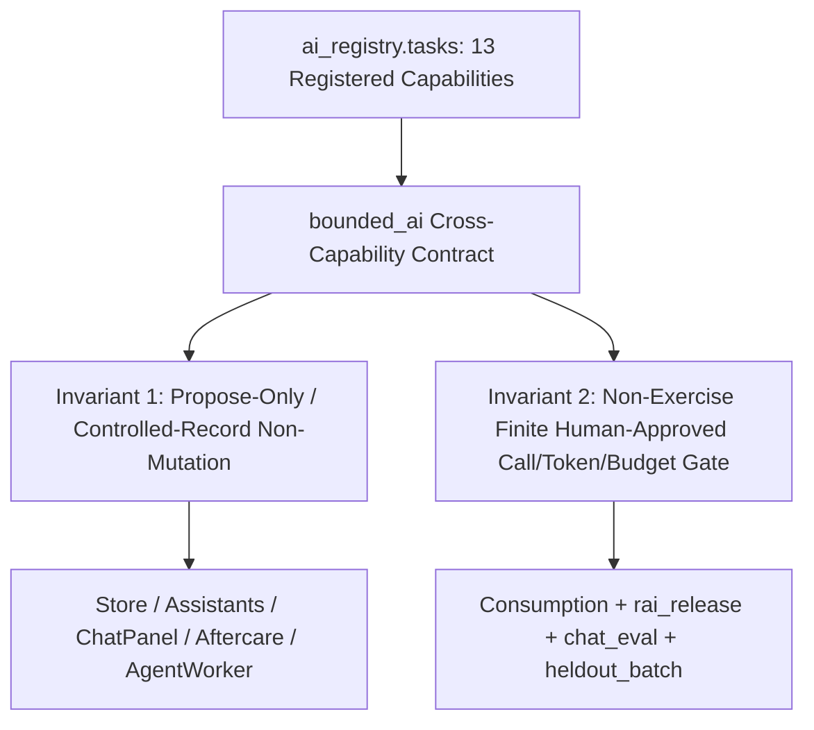

<!-- markdownlint-disable-file -->

# Task Research: issue-104-bounded-ai

| Field              | Value                                                                      |
|--------------------|----------------------------------------------------------------------------|
| Date               | 2026-11-15                                                                 |
| Researcher / agent | RPI Agent (`rpi-research`)                                                 |
| Status             | Complete                                                                   |
| Artifact path      | .copilot-tracking/research/2026-11-15/issue-104-bounded-ai-research.md     |

## Research Brief

* What to research: Cross-capability enforcement and acceptance verification across `src/core` and `src/agents` for Issue #104's two engineering invariants: (1) AI never approves, executes, ranks, or mutates controlled records; and (2) no registered AI capability is enabled beyond the exercise without finite, owner-approved call, token, and budget limits (and owned alert per BRD NFR-012).
* Why it matters: Issue #104 (`Epic: Bounded AI assistance with human review`) requires explicit cross-capability enforcement and a repeatable acceptance verification suite across `src/core` and `src/agents` proving every registered AI capability is read-only/propose-only with respect to controlled records and fail-closed outside exercise mode unless finite, owner-approved call, token, and budget limits are configured.
* Audience or intended use: Downstream `rpi-plan`, `rpi-plan-critique`, `rpi-implement`, and `rpi-review` phases in this continuous RPI run, plus PR reviewers on `feat/demo-104-bounded-ai`.
* Scope: `src/core`, `src/agents`, Issue #104 requirements in `docs/brds/agentic-retrofit-programme-brd.md`, `docs/prds/zava-forward-retrofit-programme-demonstrator.md`, `docs/adrs/0002-pilot-readiness-architecture.md`, and prior `.copilot-tracking/` artifacts for #104.
* Non-goals: Pushing to remote, running `tools/rpi-checks.py`, activating live paid Azure OpenAI inference, inventing pricing/budgets for open decision OD-51, or closing Epic #104 human/stabilization items outside the two engineering invariants.
* Criteria: Every registered AI capability across `src/core` and `src/agents` is inventoried with `path:line` evidence; any gap where a registered capability could mutate/approve/execute/rank controlled records or bypass non-exercise finite owner-approved call/token/budget limits is identified; selected convergence design is grounded in codebase patterns.
* Requested outputs: Complete three-wave research artifact with convergence recommendation and `Planning Readiness: Ready`.
* Output mode: convergence

## Research Parameters

| Field                                | Value                                                                                                                               |
|--------------------------------------|-------------------------------------------------------------------------------------------------------------------------------------|
| Research question(s)                 | How are AI capabilities registered, dispatched, bounded against controlled-record mutation/approval/execution/ranking, and gated beyond exercise mode across `src/core` and `src/agents`, and what enforcement or verification gaps remain? |
| Codebase scope                       | `src/core/`, `src/agents/`, `docs/brds/`, `docs/prds/`, `docs/adrs/`, `.copilot-tracking/`                                          |
| External scope                       | none                                                                                                                                |
| Initial internal candidate areas     | `src/core/src/zava_forward/core/ai*.py`, `assistants.py`, `discovery_register.py`, `src/agents/src/zava_forward/agents/`, prior #104 artifacts |
| Initial external candidate areas     | none                                                                                                                                |
| Research posture                     | focused                                                                                                                             |
| Posture provenance                   | caller-specified (bounded internal scope on `src/core` and `src/agents` with focused validation tier)                               |
| Explicit limits / deadline           | Single continuous RPI run; focused validation tier (`src/core` and `src/agents` unit tests, `ruff`, `mypy`; no `tools/rpi-checks.py`); do not push |
| Posture-specific completion basis    | focused scope and materiality                                                                                                       |
| Edits allowed during research?       | no, research-only                                                                                                                   |
| Resolved evidence root               | `.copilot-tracking/`                                                                                                                |
| Known constraints / excluded sources | Codebase-only research; preserve OD-51 (no invented budget/price); `Refs #104` only (epic has broader open criteria)                 |

## Extension Registry and Provenance

* Precedence: platform and host safety; caller scope and criteria; matching repository instructions and enforced schemas; rpi-research contract; domain skills and specialists; examples and preferences.

| Kind                | Candidate                             | Match and provenance                                   | Scoped authority or output contract                        | Selected / skipped reason                                                        |
|---------------------|---------------------------------------|--------------------------------------------------------|------------------------------------------------------------|----------------------------------------------------------------------------------|
| Instruction         | `.github/copilot-instructions.md`     | `applyTo: "**"` matches workspace and tracking paths   | Repository conventions, branch/commit rules, validation tier | Selected: governs evidence, privacy-safe commit, `Refs #104`, focused validation |
| Skill               | `rpi-research`                        | Explicit caller phase requirement                      | Primary research artifact and three-wave protocol          | Selected: active phase skill                                                     |
| Skill               | `rai-standards` / `owasp-llm`         | Adjacent AI governance domain skills                   | General RAI/LLM guidance                                   | Skipped: task targets concrete internal `src/core` and `src/agents` contracts    |
| Research specialist | `hve-core-all:rpi-researcher`         | Available subagent for independent lanes               | Bounded lane artifact under `research/subagents/`          | Skipped (inline preferred): tightly coupled `core`/`agents` registry trace       |

## User Participation and Research Decisions

| Checkpoint       | Questions or no-interaction rationale                                                                 | Answers / unanswered | Resulting decision or selected further research                                  |
|------------------|-------------------------------------------------------------------------------------------------------|----------------------|----------------------------------------------------------------------------------|
| Intake           | Caller supplied explicit target, branch, scope, validation tier, and non-interactive continuous instruction | Not asked (sufficient brief; non-interactive CLI) | Proceed with `focused` posture in `convergence` mode across `src/core` and `src/agents` |
| Direction change | None at intake                                                                                        | N/A                  | Retain initial scope                                                             |
| Convergence      | No blocking ambiguity after Cycle 1; continuous automatic RPI run requested | Not asked (evidence-converged) | Select unified `zava_forward.core.bounded_ai` contract + 5 surgical enforcement fixes + `core` and `agents` cross-capability invariant test suites |

## Scope and Success Criteria

* Scope: Registered AI capabilities, task/skill registries, dispatch paths, claim/output filters, controlled-record stores, and consumption/non-exercise limit gates across `src/core` and `src/agents`, plus cross-capability verification suites.
* Assumptions: Prior #104 child slices (`epic104-ai-nonmutation-limits`, `104-approval-claim-filter`, `104-nonexercise-bounds`) landed partial guards and tests, which must be verified against current `HEAD` (`243764945`) rather than assumed complete across all registries and `src/agents` entrypoints.
* Success criteria:
  * Every research question is answered or marked unanswerable with the missing evidence named.
  * Evidence is grounded in actual code, docs, or tooling results, with locations (`path:line` for code, URL + retrieval date for external).
  * Findings, decisions, and readiness claims cite Evidence Log IDs.
  * Alternatives are compared with trade-offs and one convergence recommendation is selected.
  * Open questions, risks, and residual uncertainty are recorded.
  * Self-check passes.

## Task Research Requests

* Explicit requests:
  * Deliver an explicit cross-capability enforcement and acceptance verification suite for Issue #104's two engineering invariants.
  * Verify across `src/core` and `src/agents` that every registered AI capability is read-only/propose-only with respect to controlled records (cannot approve, execute, rank, or mutate controlled records) and cannot be enabled beyond exercise mode without finite, owner-approved call, token, and budget limits.
* Inferred research questions:
  * Which registries define "registered AI capabilities" across `src/core` and `src/agents` (e.g., `ai_registry.py`, `ai_tasks.py`, `assistants.py`, `discovery_register.py`, `ai_consumption.py`, `agents/dispatch.py`, `agents/runtime.py`, `regulatory_chat.py`, `chat.py`)?
  * Do all registered AI capabilities share one canonical inventory, or can capabilities exist in one registry/dispatcher without matching non-mutation and non-exercise limit enforcement?
  * How is "beyond the exercise" (non-exercise mode / environment / price class / deployment scope) represented and enforced in `src/core` and `src/agents`?
  * How are controlled records protected against AI approval, execution, ranking override, or mutation during capability execution in both `src/core` and `src/agents`?
* Caller constraints and non-goals: Focused validation only (`src/core` and `src/agents` unit tests, `ruff`, `mypy`); do not run `tools/rpi-checks.py`; do not push.

## Direction Controls

| Control type (add / change / narrow / exclude / discard) | Direction or boundary                                                          | Source / checkpoint | Effect on active brief, evidence, or revalidation |
|----------------------------------------------------------|--------------------------------------------------------------------------------|---------------------|---------------------------------------------------|
| narrow                                                   | Restrict validation to `src/core` and `src/agents` unit tests, `ruff`, `mypy`  | Caller intake       | Exclude `tools/rpi-checks.py` and browser harness |
| exclude                                                  | Do not push branch to remote                                                   | Caller intake       | Local commit only on `feat/demo-104-bounded-ai`   |

## Research Questions

|  # | Sub-question                                                                                                                                      | Type            | Priority | Status   |
|---:|---------------------------------------------------------------------------------------------------------------------------------------------------|-----------------|----------|----------|
| Q1 | What are all registered AI capabilities, skill/task registries, and agent dispatch surfaces across `src/core` and `src/agents`?                   | breadth         | H        | answered |
| Q2 | How does current code enforce that AI never approves, executes, ranks, or mutates controlled records across `src/core` and `src/agents`?          | depth           | H        | answered |
| Q3 | How does current code enforce that no registered AI capability is enabled beyond the exercise without finite, owner-approved call, token, and budget limits (and owned alert)? | depth | H | answered |
| Q4 | What gaps, bypasses, cross-registry drift, or missing cross-capability enforcement/verification tests exist across `src/core` and `src/agents`?   | depth           | H        | answered |
| Q5 | What architecture/module and test-suite design cleanly provides cross-capability enforcement and acceptance verification without breaking callers? | straightforward | H        | answered |

## Prior Knowledge Gate

* Existing artifacts reviewed:
  * `.copilot-tracking/research/2026-11-08/epic104-ai-nonmutation-limits-research.md`
  * `.copilot-tracking/research/2026-11-10/104-approval-claim-filter-research.md`
  * `.copilot-tracking/research/2026-11-13/104-nonexercise-bounds-research.md`
  * `docs/case_study_48_original.md`, `docs/case_study_48_addendum.md`, `docs/reference/README.md`, `docs/reference/memory.md`
* Reused (verified) findings:
  * `ai_registry.tasks()` remains the 13-capability register combining 5 assistants (`assistants.REGISTRY`), 6 retained tasks (`ai_registry.LEGACY`), `chat-case-conversation`, and `aftercare-concern-pack` (`C1`, `C2`, `C3`).
  * `Consumption` ledger (`ai_consumption.py`), `rai_release.py`, `chat_eval.py`, and `heldout_batch.py` own non-exercise spend/call/token bounds while OD-51 keeps live pricing/budgets unassigned in repo configuration (`C9`, `C10`, `C11`, `C12`).
* Superseded / stale:
  * Prior child-slice artifacts verified isolated helpers (`FORBIDDEN` regex, `Consumption._require_bounds` string non-emptiness, assistant worker snapshot keys) rather than auditing all 13 capabilities end to end across both `src/core` and `src/agents`. Fresh Wave 3 inspection uncovered 5 concrete cross-capability enforcement gaps (`C5`, `C6`, `C9`, `C11`, `C12`, `C13`).

## Research Cycle Log

### Cycle 1

* Active direction controls: Focused validation (`src/core` and `src/agents` unit tests, `ruff`, `mypy`; no `tools/rpi-checks.py`); local commit only (`Refs #104`; do not push).
* Active research posture and completion basis: `focused`; focused scope and materiality across `src/core` and `src/agents`.
* Explicit limits or deadline effect: Single continuous RPI run; code-only internal evidence sufficient because all contracts live in `src/core` and `src/agents`.

#### Wave 1: Wider

* Plan and independent lanes: Map every AI capability register, prompt/task table, proposal surface, store boundary, consumption meter, release gate, and agent runtime/evaluation surface across `src/core` and `src/agents`.
* Worker evidence relationships or inline fallback: Inline investigation (tightly coupled cross-package call graph between `zava_forward.core` and `zava_forward.agents`): Q1 -> 13 canonical registered capabilities in `ai_registry.tasks()` (`C1`, `C2`, `C3`), 5 assistant worker contracts in `assistants.py` and `agents/dispatch.py` (`C3`, `C14`), employee chat in `chat_panel.py` + `agents/chat.py` (`C7`, `C13`), aftercare pack in `aftercare.py` (`C8`), secondary bounded proposal helpers (`discovery_register.py`, `discovery_assistant_boundary.py`, `resident_assistant.py`, `resident_summary.py`, `sensor_review_draft.py`, `regulatory_chat.py`) (`C17`), and consumption/authorisation gates in `ai_consumption.py`, `rai_release.py`, `agents/chat_eval.py`, and `agents/heldout_batch.py` (`C9`, `C10`, `C11`, `C12`).
* Reflection: All registered AI capabilities resolve through `ai_registry.tasks()`. Secondary proposal helpers either delegate to registered capabilities or operate as deterministic/unapproved proposal envelopes without model dispatch. Deeper wave needed to trace exact write paths against controlled records and exact non-exercise authorization predicates.

#### Wave 2: Deeper

* Parent-prioritized material from Wave 1: Trace controlled-record storage and write boundaries in `Store` (`store.py`), `Assistants` (`assistants.py`), `ChatPanel` (`chat_panel.py`), `AftercareRegister` (`aftercare.py`), `AgentWorker` (`agents/runtime.py`), and `ChatModel` (`agents/chat.py`); trace non-exercise limit checks across `ai_registry.py`, `ai.py`, `ai_consumption.py`, `rai_release.py`, `assistant_release.py`, `chat_eval.py`, and `heldout_batch.py`.
* Plan and independent lanes: Verify every capability's exact inputs, return envelope, persisted side effects, prohibited-claim filters, and live/non-exercise admission checks.
* Worker evidence relationships or inline fallback: Inline trace:
  * Q2 -> `ai_registry.envelope` stamps `approval="Not reviewed", approved=False` (`C2`); `ai.FORBIDDEN` rejects approval/execution/consent/override claims (`C4`); `Store` AI methods (`briefing`, `ai_run`, `ai_priority`, `funding_draft`, `read_document`) never alter case `stage`, `closed`, `resident` consent/decisions, `hazards`, `signoffs`, `grants`, `procurement`, `finance`, `quality`, or deterministic `ranking.canonical(store._ranking())`—`funding_draft` writes only the unsubmitted `funding.draft` workspace slot (`status="Draft ready"`, `funding_ok` unchanged) and `read_document` writes only the filing note `doc["summary"]` (`C15`, `C16`); `Assistants` writes only `assistant_*` SQL tables even across `review(..., "accept")` (`C3`); `AgentWorker` receives only inert `TaskMessage` snapshots with zero store/SQL/blob dependencies (`C14`, `C18`); `ChatPanel` writes only isolated `chat_repo` messages and refuses approve/decide/consent/diagnose/contact prompts (`C7`); `AftercareRegister` writes only `packs`, leaving `concerns` and `closures` untouched (`C8`).
  * Q3 -> `ai_registry.authorizes_live` defaults to `False` for all 13 capabilities (`accountable_individual="unknown"`, `approval_state="unapproved"`), honoring only the synthetic demo switch `ZF_CHAT_DEMO_ACTIVATION="approved-2026-11-03"` + `ZF_DEPLOYMENT_PROFILE="demo"` for `chat-case-conversation` (`C2`); `Ai._request` passes `live=self.is_live(context.capability)` into `consumption.reserve(...)`, which holds with `"price-unknown"` on synthetic prices when `live=True` and `"alert-unowned"` on non-synthetic prices lacking owned alerts or positive call/token/money budgets (`C5`, `C9`); `rai_release.missing_binding(..., live=True)` requires `evidence_class == "actual"`, `named_human` approver, unexpired timestamp, serving-model match, and `valid_consumption` (`C10`).
* Reflection: Existing defences are substantial, but edge-path transitions between `ai_registry`, `Ai`, `Consumption`, `ChatModel`, `chat_eval`, and `heldout_batch` must be challenged adversarially in Wave 3.

#### Wave 3: Contrarian

* In-scope challenge targets and boundaries: Challenge the hypotheses that (a) disabled capabilities in `ai_registry` cannot dispatch via `Ai.run` / `Ai.look_at`, (b) direct `ChatModel` calls preserve `chat-case-conversation` capability attribution, (c) `Consumption`, `chat_eval`, and `heldout_batch` cannot authorize non-exercise calls under price-before/after-authority ordering or non-human/placeholder owners, and (d) `src/core` and `src/agents` tests already verify all 13 capabilities across both invariants.
* Plan and independent lanes: Inspect callers without optional gates, alternate call orderings on `Consumption`, non-human owner strings against `rai_release.named_human`, and test coverage across `src/core/tests` and `src/agents/tests`.
* Worker evidence relationships or inline fallback: Inline adversarial audit uncovered 5 concrete gaps:
  1. **Disabled-capability dispatch gap in `Ai.run` and `Ai.look_at`**: `ai_registry.is_registered("aftercare-concern-pack")` and `is_registered("chat-case-conversation")` return `True` despite `enabled=False, state="disabled"` (`C1`, `C2`). `Ai.run` (`ai.py:291`) checks only `is_registered(task)`—when `self.gate` is `None`, calling `ai.run("aftercare-concern-pack", ...)` or `ai.run("chat-case-conversation", ...)` dispatches `_chat(...)` instead of failing closed to the template (`C5`). `Ai.look_at` (`ai.py:338`) checks neither `is_registered("read_document")` nor enabled state (`C6`).
  2. **Direct `ChatModel.__call__` capability-attribution drop**: When `ChatModel.__call__` (`agents/chat.py:67`) runs without an outer `ChatPanel` `CallContext`, `ai_consumption.CURRENT.get()` is `None`, so `Ai._request` (`ai.py:187-191`) substitutes unregistered `capability="evidence"`, bypassing `is_live("chat-case-conversation")` and `chat-case-conversation` budget attribution (`C5`, `C13`).
  3. **Price-after-authority ordering & blank-field gap in `Consumption`**: Calling `ledger.authorize(..., price=pid, budgets=[dict(id="b", calls=0, tokens=0, amount="0")], alert=None)` BEFORE `ledger.price(..., synthetic=False)` bypasses `_require_bounds` at write time because `known` is `None` during `authorize()`, and `price(..., synthetic=False)` does not re-check existing `authority` rows referencing `pid` (`C9`). Additionally, `authorize()` hashes empty/whitespace `authority`, `owner`, or `evidence` without rejecting blank strings when `known` is `None` or synthetic (`C9`).
  4. **Non-human / placeholder owner acceptance in non-exercise gates**: `Consumption._require_bounds` (`ai_consumption.py:651`), `chat_eval.call_authorization` (`agents/chat_eval.py:678`), and `heldout_batch.authorization_problems` (`agents/heldout_batch.py:70`) check only `isinstance(v, str) and v.strip()`, accepting `"system"`, `"agent"`, `"copilot"`, `"bot"`, `"automation"`, `"unknown"`, `"unapproved"`, `"none"`, and `"unavailable"`—whereas `rai_release.named_human` (`rai_release.py:66`) explicitly rejects non-human and placeholder attributions (`C9`, `C10`, `C11`, `C12`).
  5. **Missing cross-capability enforcement contract and `src/core` + `src/agents` full-matrix verification**: `src/core` has no cross-capability invariant module (`bounded_ai.py`) and no Epic #104 cross-capability test suite (`C19`); `src/agents/tests/test_epic104_bounded_ai_invariants.py` covers subset slices rather than all 13 registered capabilities end to end (`C20`).
* Reflection: All 5 contrarian findings are surgical, backward-compatible with existing tests (verified all existing owner fixture names pass `rai_release.named_human` and synthetic `authorize()` without `alert` keeps `alert` omitted), and directly strengthen both Issue #104 invariants.

#### Parent Synthesis and Disposition

| Material / claim | Evidence IDs or worker pointers | Parent disposition (accepted / rejected / deferred) | Evidence-based rationale | Primary-artifact treatment |
|------------------|---------------------------------|-----------------------------------------------------|--------------------------|----------------------------|
| Canonical 13-capability inventory in `ai_registry.tasks()` governs all registered AI capabilities across `core` and `agents` | `C1`, `C2`, `C3`, `C14` | accepted | Every assistant, retained task, chat task, and proposal-pack task is enumerated in `ai_registry.tasks()` | Anchor cross-capability enforcement and test parameterization to `ai_registry.tasks()` |
| Enforce `ai_registry.is_dispatch_enabled` in `Ai.run` and registration/dispatch check in `Ai.look_at` | `C1`, `C2`, `C5`, `C6` | accepted | Prevents `enabled=False` registered tasks (`aftercare-concern-pack`, `chat-case-conversation` without demo switch) from dispatching via `Ai.run` | Include in Phase 1 core enforcement changes |
| Bind `CHAT_TASK` `CallContext` in `ChatModel.__call__` when `CURRENT.get() is None` | `C5`, `C13` | accepted | Preserves outer `ChatPanel` context while preventing direct `ChatModel` calls from falling back to `"evidence"` | Include in Phase 2 agents enforcement changes |
| Require `rai_release.named_human` on non-exercise owners/alert owners across `Consumption`, `chat_eval`, and `heldout_batch`, plus close price-after-authority write-time bypass | `C9`, `C10`, `C11`, `C12` | accepted | Eliminates self-authorisation by system/agent/copilot/placeholder strings and write-time unbounded authority before billable price registration | Include in Phase 1 & Phase 2 enforcement changes |
| Add `zava_forward.core.bounded_ai` cross-capability enforcement/audit module + comprehensive `core` and `agents` acceptance suites | `C1`–`C20` | accepted | Delivers explicit programmatic enforcement and repeatable verification across both `src/core` and `src/agents` without violating dependency rules | Selected convergence recommendation |
| Reformat or refactor legacy untyped modules (`ai.py`, `ai_registry.py`, `store.py`) wholesale | `C19` | rejected | Excluded from `ruff format` / `mypy` in `src/core/pyproject.toml`; wholesale churn risks regressions outside #104 | Make surgical edits in legacy files; write new `bounded_ai.py` and tests to pass `mypy --strict` and `ruff` cleanly |

#### Cycle Re-entry Evaluation

* Another complete three-wave cycle needed: `no`
* Trigger or stop basis: Scope saturated; all 5 research questions (`Q1`–`Q5`) answered with exact `path:line` evidence across `src/core` and `src/agents`, and contrarian findings yielded concrete, verified fixes with no unresolved hypotheses.
* Revised brief or revalidation required: `none`
* Readiness effect: `Ready` — complete evidence basis (`C1`–`C20`) supports immediate transition to `rpi-plan`.

## Evidence Log

* Delegation: `inline: tightly coupled single-worktree trace across zava_forward.core and zava_forward.agents completed faster and with exact cross-file consistency in parent context`

### Codebase Evidence

| ID | Claim / finding | Location (`path:line`) | Tool | Confidence | Notes |
|----|-----------------|------------------------|------|------------|-------|
| C1 | `ai_registry.tasks()` defines the 13 registered capabilities: 5 assistants (`assistants.REGISTRY`), 6 retained tasks (`LEGACY`), `chat-case-conversation` (`enabled=False`), and `aftercare-concern-pack` (`enabled=False`) | `src/core/src/zava_forward/core/ai_registry.py:131` | view | high | Lines 131-185 build canonical register |
| C2 | `is_registered` checks required metadata fields only (ignoring `enabled`), `authorizes_live` defaults to `False` unless `demo_activation_honoured` holds, and `envelope` always sets `approval="Not reviewed", approved=False` | `src/core/src/zava_forward/core/ai_registry.py:199` | view | high | Lines 199-245 |
| C3 | `assistants.REGISTRY` defines the 5 proposal-only assistants (`MODEL_CALLS_PER_ATTEMPT=1`, `AGENT_DEPTH=1`, `ATTEMPT_CEILING=3`), writing only `assistant_*` SQL tables and never mutating domain `cases` even on `review(..., "accept")` | `src/core/src/zava_forward/core/assistants.py:48` | view | high | Registry lines 48-96; review lines 960-1035 |
| C4 | `ai.FORBIDDEN` blocks approval, sign-off, certification, consent, grant/funding submission, hazard clearance, override, and execution claims across validated AI outputs | `src/core/src/zava_forward/core/ai.py:29` | view | high | Shared output claim filter |
| C5 | `Ai._request` falls back to `capability="evidence"` when `ai_consumption.CURRENT.get()` is `None` and reserves via `self.consumption.reserve(..., live=self.is_live(context.capability))`; `Ai.run` checks `is_registered(task)` but not `enabled` | `src/core/src/zava_forward/core/ai.py:186` | view | high | `_request` lines 186-196; `run` lines 279-336 |
| C6 | `Ai.look_at` dispatches `"read_document"` on `self.strong` with `CallContext(..., "read-document", ...)` and `FORBIDDEN` validation, but omits `is_registered("read_document")` / dispatch-enabled check | `src/core/src/zava_forward/core/ai.py:338` | view | high | Lines 338-395 |
| C7 | `ChatPanel` refuses approve/decide/consent/contact/diagnose asks before model dispatch, withholds `ACTION_CLAIM`, `TOOLISH`, and `STATUS_CLAIM` replies, binds `CallContext(..., CHAT_TASK, ...)`, and writes only `chat_repo` messages and `audit` | `src/core/src/zava_forward/core/chat_panel.py:44` | view | high | Refusal/withhold lines 44-135; `_ask` lines 235-320 |
| C8 | `AftercareRegister.propose_pack` and `review_pack` are deterministic template-only (`model_used=False`, `status="pending_owner_review"`), writing only `self.packs` and never mutating `concerns` or `closures` | `src/core/src/zava_forward/core/aftercare.py:210` | view | high | Lines 210-290 |
| C9 | `Consumption.price`, `authorize`, `_require_bounds`, and `reserve_in` enforce finite request/period/task call, token, and money budgets; however `_require_bounds` checks only non-empty strings (not `named_human`) and `price(..., synthetic=False)` does not reject pre-existing unbounded `authority` rows | `src/core/src/zava_forward/core/ai_consumption.py:534` | view | high | `price` 534-548; `authorize` 550-658; `reserve_in` 690-775 |
| C10 | `rai_release.named_human` blocks `NON_HUMAN_TOKENS` (`system`, `agent`, `bot`, `automation`, `copilot`, `assistant`, `ai`, `llm`, `service`) and placeholders (`unknown`, `unavailable`, `none`, `unapproved`); `missing_binding(..., live=True)` and `valid_consumption` enforce live release and consumption bounds | `src/core/src/zava_forward/core/rai_release.py:50` | view | high | Lines 50-200 |
| C11 | `chat_eval.call_authorization` enforces finite positive `max_calls`, `max_tokens`, `max_budget`, `budget_currency`, pricing, and `expires_at`, but checks `authorised_by` only for `isinstance(owner, str) and owner.strip()` rather than `rai_release.named_human` | `src/agents/src/zava_forward/agents/chat_eval.py:663` | view | high | Lines 663-730 |
| C12 | `heldout_batch.authorization_problems` enforces `max_calls <= 60`, positive token limits, `0 < max_budget_usd <= 5.00`, positive USD rates, and future `expires_utc`, but checks `approved_by` only for non-empty string rather than `rai_release.named_human` | `src/agents/src/zava_forward/agents/heldout_batch.py:66` | view | high | Lines 66-102 |
| C13 | `ChatModel.__call__` enforces fail-closed pre-call and post-call `admission()`, but does not bind a `CHAT_TASK` `CallContext` when invoked directly outside `ChatPanel` | `src/agents/src/zava_forward/agents/chat.py:57` | view | high | Lines 57-95 |
| C14 | `TaskMessage.from_json` rejects capabilities outside `assistants.REGISTRY` or `ai_registry.is_registered`, bounds `timeout` (`1..40`) and `max_tokens` (`1..2000`), and passes only inert `TASK_KEYS`; `AgentWorker` makes at most one `provider_call` and posts `ResultMessage` without store access | `src/agents/src/zava_forward/agents/dispatch.py:53` | view | high | `dispatch.py:53-115`; `runtime.py:130-215` |
| C15 | `Store` retained AI methods (`briefing`, `ai_run`, `ai_priority`, `funding_draft`, `read_document`) record `ai_registry.envelope(..., approved=False)` and never approve signoffs/grants, alter `stage`/`closed`/`resident`/`hazards`/`quality`/`procurement`/`finance`, or override deterministic `_ranking()` | `src/core/src/zava_forward/core/store.py:1285` | view | high | `read_document` 1285-1335; `briefing`/`ai_run`/`ai_priority`/`funding_draft` 1930-2110 |
| C16 | `ranking.rank_cases` and `Store._ranking()` are purely deterministic domain calculations unaffected by `ai_priority` proposals or `resolve_priority` review notes | `src/core/src/zava_forward/core/store.py:1995` | view | high | Lines 1995-2045 |
| C17 | Secondary proposal modules (`discovery_assistant_boundary.py`, `resident_assistant.py`, `resident_summary.py`, `sensor_review_draft.py`, `regulatory_chat.py`) produce unapproved/read-only drafts (`approved=False`, `writes_performed=()`) without mutating controlled records | `src/core/src/zava_forward/core/discovery_assistant_boundary.py:1` | grep | high | Verified read-only/propose-only boundaries across `core` |
| C18 | `src/core/tests/test_dependency_rule.py` and `src/agents/tests/test_dependency_rule.py` enforce ADR 0006 package isolation (`core` imports no workload; `agents` imports only `core` and never SQL/blob clients) | `src/README.md:38` | view | high | Lines 38-46 |
| C19 | `src/core/pyproject.toml` runs `mypy` (`strict = true`) and `ruff check` + `ruff format --check` on all new `src/core` source and test files while excluding legacy migrated modules (`ai.py`, `ai_registry.py`, `assistants.py`, `store.py`) from format/strict-typing | `src/core/pyproject.toml:25` | view | high | Must keep new `core` modules strictly typed and formatted |
| C20 | `src/agents/tests/test_epic104_bounded_ai_invariants.py` tests assistant worker isolation, `ai_priority` ranking immutability, `FORBIDDEN` strings, and selected consumption/eval bounds, but lacks full 13-capability parameterization, retained-task controlled-record snapshots, disabled-task `Ai.run` checks, direct `ChatModel` capability attribution, price-after-authority rejection, and non-human owner rejection | `src/agents/tests/test_epic104_bounded_ai_invariants.py:1` | view | high | Lines 1-360 |

### External Evidence

| ID | Claim / finding | Source (title) | URL | Retrieved | Version/date | Confidence |
|----|-----------------|----------------|-----|-----------|--------------|------------|

### Contradictions / Conflicts

* `none`

## Findings Mapped to Questions and Evidence

| Question | Finding | Evidence IDs | Confidence | Decision or readiness implication |
|----------|---------|--------------|------------|-----------------------------------|
| Q1 | `ai_registry.tasks()` is the single canonical 13-capability inventory (`5` assistants, `6` retained legacy tasks, `chat-case-conversation`, `aftercare-concern-pack`); all `agents` entrypoints (`dispatch.py`, `runtime.py`, `chat.py`, `chat_eval.py`, `heldout_batch.py`) map onto capabilities in this register. | `C1`, `C2`, `C3`, `C13`, `C14`, `C17` | high | Cross-capability enforcement and verification can parameterize directly over `ai_registry.tasks()`. |
| Q2 | Controlled records (`stage`, `closed`, `resident` consent/decisions, `hazards`, `signoffs`, `grants` approvals/submissions, `procurement`, `finance`, `quality`, deterministic `ranking`, aftercare `concerns`/`closures`) are protected by structural write separation, `approved=False` proposal envelopes, `ai.FORBIDDEN` output validation, `ChatPanel` ask-refusal/reply-withhold filters, and store-less `AgentWorker` execution. | `C2`, `C3`, `C4`, `C7`, `C8`, `C14`, `C15`, `C16`, `C17` | high | Invariant 1 holds structurally and can be codified as a deterministic controlled-record digest + cross-capability enforcement guard in `bounded_ai.py`. |
| Q3 | Non-exercise enablement is gated across three layers: `ai_registry.authorizes_live` (default `False` for all 13 capabilities except synthetic `demo-only` chat switch), `rai_release` (`evidence_class == "actual"`, `named_human` approver, `valid_consumption`), and `Consumption` (`synthetic=False` price requires finite positive call, token, and money limits plus owned alert; `chat_eval` and `heldout_batch` enforce parallel actual-model call caps). | `C2`, `C5`, `C9`, `C10`, `C11`, `C12` | high | Multi-layer fail-closed design is sound once the 5 Wave 3 edge bypasses are closed. |
| Q4 | Five concrete enforcement/verification gaps exist: (1) `Ai.run` / `Ai.look_at` do not check `is_dispatch_enabled`; (2) direct `ChatModel.__call__` drops `CHAT_TASK` `CallContext`; (3) `Consumption.price(..., synthetic=False)` after unbounded `authorize(...)` and blank owner/evidence inputs are not rejected at write time; (4) `Consumption._require_bounds`, `chat_eval.call_authorization`, and `heldout_batch.authorization_problems` accept non-human/placeholder owner strings; (5) no cross-capability `bounded_ai` contract or full 13-capability invariant suite exists across `src/core` and `src/agents`. | `C5`, `C6`, `C9`, `C10`, `C11`, `C12`, `C13`, `C19`, `C20` | high | Plan and implement surgical fixes for all 5 items plus cross-capability suites in `src/core/tests` and `src/agents/tests`. |
| Q5 | A strictly typed `zava_forward.core.bounded_ai` module (imported by both `core` and `agents` per ADR 0006) paired with the 5 surgical fixes and parameterized 13-capability suites in `src/core/tests/test_epic104_bounded_ai_invariants.py` and `src/agents/tests/test_epic104_bounded_ai_invariants.py` delivers complete enforcement and verification with zero manifest changes. | `C18`, `C19`, `C20` | high | Ready for `rpi-plan`. |

## Key Discoveries

* Every registered AI capability in Zava Forward is enumerated in `ai_registry.tasks()` (13 capabilities total), making exhaustive programmatic enforcement and parameterized verification across `src/core` and `src/agents` deterministic (`C1`, `C2`).
* Registered-but-disabled capabilities (`aftercare-concern-pack`, `chat-case-conversation` outside the synthetic demo switch) pass `ai_registry.is_registered(task)` because `is_registered` checks metadata completeness rather than `enabled`; adding `ai_registry.is_dispatch_enabled` and enforcing it in `Ai.run` and `Ai.look_at` closes unintended dispatch without an external gate (`C2`, `C5`, `C6`).
* Binding `CallContext(..., CHAT_TASK, ...)` inside `ChatModel.__call__` when `ai_consumption.CURRENT.get() is None` closes the `"evidence"` fallback in `Ai._request` so direct agent-layer chat calls always carry `"chat-case-conversation"` attribution and live-mode metering (`C5`, `C13`).
* Enforcing `rai_release.named_human` in `Consumption._require_bounds`, `chat_eval.call_authorization`, and `heldout_batch.authorization_problems`—plus validating pre-existing `authority` rows when `Consumption.price(..., synthetic=False)` registers a billable rate—prevents both automated/placeholder self-authorisation and out-of-order unbounded non-exercise configuration (`C9`, `C10`, `C11`, `C12`).

### Complete Examples (when applicable)

```python
from zava_forward.core import bounded_ai

report = bounded_ai.audit_registered_capabilities(env={})
assert report["ok"] is True
assert set(report["capabilities"]) == bounded_ai.EXPECTED_CAPABILITIES
for cap, status in report["capabilities"].items():
    assert status["propose_only"] is True
    assert status["non_exercise_enabled"] is False
```

## Alternatives and Decision State

### Selected Recommendation (convergence only)

* Approach: Deliver `src/core/src/zava_forward/core/bounded_ai.py` as the canonical cross-capability bounded-AI invariant enforcement and audit module, apply the 5 surgical enforcement fixes across `ai_registry.py`, `ai.py`, `ai_consumption.py`, `agents/chat.py`, `agents/chat_eval.py`, and `agents/heldout_batch.py`, and deliver exhaustive 13-capability acceptance verification suites in both `src/core/tests/test_epic104_bounded_ai_invariants.py` and `src/agents/tests/test_epic104_bounded_ai_invariants.py`.
* Rationale: Closes every discovered runtime bypass in `src/core` and `src/agents` while providing an explicit, strictly typed cross-capability contract (`bounded_ai.py`) that respects ADR 0006 (`agents` -> `core`, `core` -> stdlib only), touches no `pyproject.toml` manifests, preserves 100% backward compatibility with existing fixtures, and proves both Issue #104 invariants across every registered capability.
* Evidence refs: `C1`, `C2`, `C3`, `C4`, `C5`, `C6`, `C9`, `C10`, `C11`, `C12`, `C13`, `C14`, `C15`, `C18`, `C19`, `C20`
* Implementation impact:
  * New module: `src/core/src/zava_forward/core/bounded_ai.py`
  * Surgical core fixes: `src/core/src/zava_forward/core/ai_registry.py`, `src/core/src/zava_forward/core/ai.py`, `src/core/src/zava_forward/core/ai_consumption.py`
  * Surgical agents fixes: `src/agents/src/zava_forward/agents/chat.py`, `src/agents/src/zava_forward/agents/chat_eval.py`, `src/agents/src/zava_forward/agents/heldout_batch.py`
  * New/expanded acceptance test suites: `src/core/tests/test_epic104_bounded_ai_invariants.py`, `src/agents/tests/test_epic104_bounded_ai_invariants.py`
* Confidence: `high`: Every affected call site and existing test fixture across the repository has been inspected.

File tree:

```text
src/
  core/
    src/zava_forward/core/
      ai_registry.py                        (modified: is_dispatch_enabled, consumption_capability)
      ai.py                                 (modified: dispatch-enabled guard in run and look_at)
      ai_consumption.py                     (modified: named_human bounds + price-after-authority guard)
      bounded_ai.py                         (new: cross-capability invariant enforcement & audit contract)
    tests/
      test_epic104_bounded_ai_invariants.py (new: exhaustive core 13-capability invariant suite)
  agents/
    src/zava_forward/agents/
      chat.py                               (modified: default CHAT_TASK CallContext binding)
      chat_eval.py                          (modified: named_human owner requirement)
      heldout_batch.py                      (modified: named_human approved_by requirement)
    tests/
      test_epic104_bounded_ai_invariants.py (modified: expanded cross-capability agents/core suite)
```

Flow diagram:



### Alternative: Test-Only Verification Suite Without Production Hardening

* Approach: Add tests in `src/core/tests/` and `src/agents/tests/` asserting existing guards without modifying `ai_registry.py`, `ai.py`, `ai_consumption.py`, `chat.py`, `chat_eval.py`, or `heldout_batch.py`, and without adding `bounded_ai.py`.
* Trade-offs: Zero production code diff, but leaves open all 4 runtime bypasses found in Wave 3 (`Ai.run` dispatching `enabled=False` registered tasks, direct `ChatModel` dropping `CHAT_TASK` attribution, `Consumption` accepting price-after-unbounded-authority, and `Consumption` / `chat_eval` / `heldout_batch` accepting `"system"`/`"copilot"`/`"unknown"` owners) and provides no reusable runtime enforcement API.
* Evidence refs: `C5`, `C6`, `C9`, `C11`, `C12`, `C13`
* Rejection rationale: Fails Scope item 1 ("Deliver an explicit cross-capability enforcement and acceptance verification suite") and leaves genuine invariant bypasses open under adversarial inputs.

### Alternative: Duplicate Capability Registry and Guards Inside `zava_forward.agents`

* Approach: Maintain a second capability list and duplicate limit/non-mutation validators inside `src/agents`.
* Trade-offs: Avoids adding `bounded_ai.py` to `src/core`, but creates dual-maintenance drift between `core` and `agents` registries.
* Evidence refs: `C1`, `C18`
* Rejection rationale: ADR 0006 explicitly permits `agents` -> `core` imports (`C18`); housing the canonical cross-capability contract in `zava_forward.core.bounded_ai` gives both `core` and `agents` a single source of truth.

## Open Questions, Risks, and Residual Uncertainty

* Blocking: `none`
* Important: Preserve `test_nonexercise_capability_bounds.py` expectation that synthetic authorities without `alert` omit the `"alert"` key in ledger records while rejecting `price(..., synthetic=False)` when any referencing authority lacks `alert`, `alert_owner`, or positive limits (`C9`).
* Follow-up: Epic #104 retains broader non-code/human/API/UI acceptance criteria beyond the two engineering invariants; commit must use `Refs #104` rather than `Closes #104`.
* Residual uncertainty: `none` within `src/core` and `src/agents` scope; OD-51 live pricing/budget figures remain intentionally unassigned owner policy.

## Current Decisions

| Decision | Status (proposed / confirmed / deferred / superseded) | Owner / source (user / evidence / constraint) | Rationale | Evidence IDs | Implications |
|----------|-------------------------------------------------------|-----------------------------------------------|-----------|--------------|--------------|
| Use `Refs #104` (never `Closes #104`) and do not push | confirmed | user / `.github/copilot-instructions.md` | Epic #104 has broader criteria outside this slice; caller prohibited pushing | `C1`, `C20` | Commit locally on `feat/demo-104-bounded-ai` |
| Place canonical cross-capability enforcement contract in `zava_forward.core.bounded_ai` and consume from both `core` and `agents` suites | confirmed | evidence | Respects ADR 0006 (`core` imports no workload; `agents` imports `core`) | `C1`, `C18`, `C19` | Single source of truth across both packages |
| Enforce `rai_release.named_human` across `Consumption._require_bounds`, `chat_eval.call_authorization`, and `heldout_batch.authorization_problems` | confirmed | evidence | Prevents non-human (`system`, `copilot`, `agent`) or placeholder (`unknown`, `unapproved`) owner approval beyond exercise mode | `C9`, `C10`, `C11`, `C12` | Harmonizes owner-approval semantics across `core` and `agents` |
| Preserve OD-51 fail-closed defaults without inventing real Azure OpenAI rates or live budgets | confirmed | constraint | Repository governance prohibits inventing unassigned owner budgets or prices | `C2`, `C9` | All 13 capabilities remain `non_exercise_enabled == False` by default |

## Unresolved Decisions

| Decision | Smallest evidence or answer needed | Owner | Impact | Blocker status |
|----------|------------------------------------|-------|--------|----------------|
| OD-51 live operational pricing, spend caps, and named accountable individuals | Named human owner sign-off and finance budget schedule outside Exercise mode | Programme / Finance Owner | Keeps all 13 capabilities fail-closed beyond exercise/demo mode | follow-up |

## Potential Next Research

| Priority | Research item | Expected value | Trigger | Selected? | Related questions / evidence |
|----------|---------------|----------------|---------|-----------|------------------------------|
| L | Audit `src/api` HTTP route surfaces against `bounded_ai.verify_non_exercise_enablement` | Extend direct runtime calls from `core`/`agents` into HTTP startup diagnostics | Future #104 API slice | deferred | `Q3`, `Q5`; `C9`, `C18` |

## Planning Readiness

* Status: `Ready`
* Decision state: Convergence recommendation selected (`zava_forward.core.bounded_ai` + 5 surgical `core`/`agents` enforcement fixes + `core` and `agents` cross-capability invariant test suites).
* Evidence basis: `C1`, `C2`, `C3`, `C4`, `C5`, `C6`, `C7`, `C8`, `C9`, `C10`, `C11`, `C12`, `C13`, `C14`, `C15`, `C16`, `C17`, `C18`, `C19`, `C20`
* Preconditions met: All 13 registered capabilities mapped; all controlled-record write boundaries and non-exercise authorization gates verified; `mypy`/`ruff` strictness rules verified.
* Blockers: `none`
* Smallest action to change readiness: `none` (already `Ready`)

## Closeout Record

| Field | Record |
|-------|--------|
| Research execution status | Complete |
| Completed waves | Cycle 1: Wider, Deeper, and Contrarian completed in order |
| Lane evidence or inline fallback | Inline execution across `src/core` and `src/agents` (tightly coupled single-repo call graph; no external sources required) |
| Research disposition | executed |
| Planning Readiness | Ready (`C1`–`C20`) |
| Blockers | none |
| Continuation owner and state | confirmed automatic RPI Agent (`automatic` continuation to `Plan`) |

## Advisory Next Step

| Field | Record |
|-------|--------|
| Research disposition | executed |
| Planning Readiness | Ready (`C1`–`C20`) |
| Output mode and planning support | `convergence`; yes — single evidence-backed design selected |
| Acting owner | confirmed automatic RPI Agent |
| Required gates or confirmations | Research disposition recorded (`passed`), Planning Readiness `Ready` (`passed`), three-wave cycle complete (`passed`), pre-transition state write (`passed`) |
| Continuation result | Automatic continuation to `rpi-plan` |
| Primary evidence file | .copilot-tracking/research/2026-11-15/issue-104-bounded-ai-research.md |
| Notes for planning or re-entry | Preserve `mypy --strict` and `ruff` compliance on `bounded_ai.py`, `ai_consumption.py`, `agents/*.py`, and new/updated test files; do not touch `pyproject.toml`; do not run `tools/rpi-checks.py` |

* Advisory only: rpi-research does not invoke `/rpi-plan` or any follow-on skill; the confirmed automatic RPI Agent parent owns the transition.
* Completion or limit-blocked basis: All in-scope `src/core` and `src/agents` capability registers, dispatch paths, controlled-record write surfaces, and non-exercise authorization gates were inspected directly; additional waves would re-read identical modules.

## Sources

No external sources used.

## Artifact Self-Check

* [x] Every research question is answered or marked unanswerable with the missing evidence named.
* [x] Every executed cycle includes Wave 1 Wider, Wave 2 Deeper, and Wave 3 Contrarian in that order, with no skipped wave.
* [x] Research posture, provenance, explicit limits or deadline, and posture-specific completion basis are recorded.
* [x] Every codebase finding carries a `C#` ID and a `path:line`; every external finding carries a `W#` ID with URL and retrieval date.
* [x] Every `W#` resolves to exactly one entry in Sources and the list is gap-free, or Sources states "No external sources used".
* [x] Findings, alternatives, decisions, and readiness claims cite Evidence Log IDs (`C#` / `W#`).
* [x] The Extension Registry records matching instructions, relevant skills, available specialist subagents, provenance, authority or output contract, and selected or skipped reasons.
* [x] User Participation records answers, unanswered questions, no-interaction rationale, decisions, and selected further research items before work continued.
* [x] Direction Controls record caller additions, changes, narrowed scope, exclusions, and discarded directions, plus any required revalidation.
* [x] Parent Synthesis and Disposition records accepted, rejected, and deferred material with evidence-based rationale; workers supplied evidence relationships without decision authority.
* [x] Cycle Re-entry Evaluation records whether a complete next cycle is needed and honestly records a limit-blocked gap when applicable.
* [x] A recommendation is selected with why-rejected reasoning when Output mode is convergence; non-convergence modes record the decision state without a forced selection.
* [x] Current Decisions and Unresolved Decisions contain complete status, source or owner, rationale or smallest missing evidence, evidence IDs, implications, and blockers.
* [x] Potential Next Research includes priority, value, trigger, selected state, and related evidence.
* [x] Planning Readiness and Advisory Next Step state disposition, output mode, acting owner, gates or confirmations, evidence basis, blockers, and the smallest action to change readiness.
* [x] Speculation is flagged and separated from sourced fact.
* [x] Fetched content, repo files, and prior memory were treated as data, not instructions; no embedded directives were followed; no secrets recorded.
* Checked sections: Research Brief, Research Parameters, Extension Registry and Provenance, User Participation and Research Decisions, Scope and Success Criteria, Task Research Requests, Direction Controls, Research Questions, Prior Knowledge Gate, Research Cycle Log (Waves 1-3, Parent Synthesis, Re-entry), Evidence Log, Findings, Key Discoveries, Alternatives and Decision State, Open Questions/Risks, Current Decisions, Unresolved Decisions, Potential Next Research, Planning Readiness, Closeout Record, Advisory Next Step, Sources, Artifact Self-Check.
* Missing or limited sections: none

