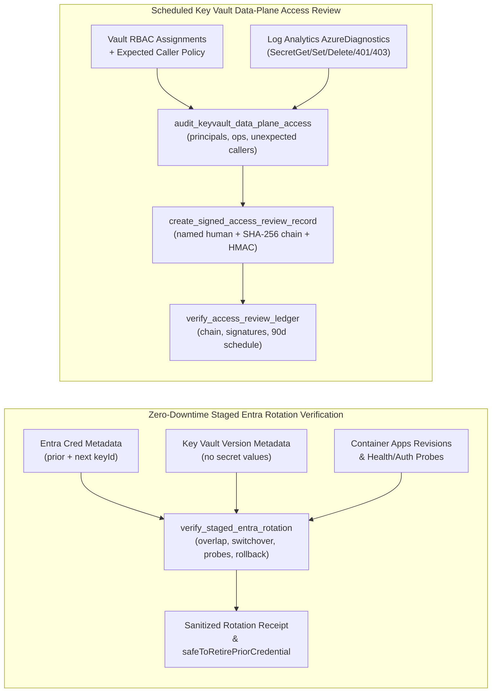

<!-- markdownlint-disable-file -->

# Task Research: kv-secret-lifecycle-142

| Field              | Value                                                                      |
|--------------------|----------------------------------------------------------------------------|
| Date               | 2026-11-15                                                                 |
| Researcher / agent | `rpi-research` (coordinated by RPI Agent)                                  |
| Status             | Complete                                                                   |
| Artifact path      | .copilot-tracking/research/2026-11-15/kv-secret-lifecycle-142-research.md  |

## Research Brief

* What to research: Existing Key Vault secret lifecycle modules, Bicep definitions, operational scripts, documentation, and `src/core` abstractions to design deterministic zero-downtime dual-secret / staged Entra client-secret rotation verification and scheduled Key Vault data-plane access review recording with signed ledger persistence for Issue #142.
* Why it matters: Issue #142 remains open on two unticked engineering criteria: (1) Entra client secret rotation documented and tested without downtime beyond static string-order simulation, and (2) Key Vault data-plane access reviewed on a schedule and recorded with principal/operation auditing, unexpected-caller detection, and signed review ledger records.
* Audience or intended use: `rpi-plan`, `rpi-implement`, and `rpi-review` phases delivering Issue #142 on `feat/infra-142-kv-secret-lifecycle`.
* Scope: `infra/modules/keyvault.bicep`, `infra/scripts/`, `infra/tests/`, `infra/README.md`, `src/core/`, `src/core/tests/`, `docs/adrs/0001-azure-architecture.md`, and `docs/architecture/`.
* Non-goals: Live Azure resource mutation, reading or storing real credentials/secrets, claiming live cloud execution when running offline deterministic harnesses, running `tools/rpi-checks.py --all`, pushing to remote, or opening a pull request.
* Criteria: Evidence-grounded findings (`C#` with `path:line`) covering current Key Vault lifecycle implementation, closure-audit gaps on #142, secret-redaction guarantees, overlap-window and version-switchover verification, rollback/zero-downtime health validation, and scheduled data-plane access review auditing + signed ledger recording.
* Requested outputs: Primary convergence research artifact with recommended design, file impacts, alternatives, and Planning Readiness.
* Output mode: convergence

## Research Parameters

| Field                            | Value                                                                                                                               |
|----------------------------------|-------------------------------------------------------------------------------------------------------------------------------------|
| Research question(s)             | How do current `infra/` and `src/core/` modules handle Key Vault secret rotation and data-plane access review, what gaps keep Issue #142 open, and how should zero-downtime dual-secret rotation verification and scheduled signed access-review ledgers be implemented and tested without exposing secrets? |
| Codebase scope                   | `infra/`, `src/core/`, `src/api/` (secret reference consumers if any), `docs/adrs/`, `docs/architecture/`                           |
| External scope                   | none (bounded internal repository engineering and ADR/contract alignment)                                                           |
| Initial internal candidate areas | `infra/modules/keyvault.bicep`, `infra/scripts/`, `infra/README.md`, `infra/tests/`, `src/core/`, `docs/adrs/0001-azure-architecture.md` |
| Initial external candidate areas | none                                                                                                                                |
| Research posture                 | balanced                                                                                                                            |
| Posture provenance               | default (bounded internal task with named targets where adjacent `src/core` and `src/api` auth/audit contracts could affect design) |
| Explicit limits / deadline       | Focused validation tier (`ruff`, `mypy`, unit tests; do not run `tools/rpi-checks.py --all`); do not push or open PR                |
| Posture-specific completion basis| balanced scope coverage and adequate evidence across `infra/`, `src/core/`, tests, and architecture docs                            |
| Edits allowed during research?   | no, research-only                                                                                                                   |
| Resolved evidence root           | `.copilot-tracking/` default                                                                                                        |
| Known constraints / excluded sources | Never read or emit secret values; preserve honest boundary between deterministic harness verification and live Azure operator runs |

## Extension Registry and Provenance

* Precedence: platform and host safety; caller scope and criteria; matching repository instructions and enforced schemas; rpi-research contract; domain skills and specialists; examples and preferences.

| Kind                | Candidate                               | Match and provenance                                         | Scoped authority or output contract                            | Selected / skipped reason                                                        |
|---------------------|-----------------------------------------|--------------------------------------------------------------|----------------------------------------------------------------|----------------------------------------------------------------------------------|
| Instruction         | `.github/copilot-instructions.md` (AMA) | `applyTo: "**"` matches workspace and `.copilot-tracking/`   | Enforces repo conventions, ruff/mypy/unittest rules, honesty boundaries | Selected: mandatory repository guidance                                          |
| Skill               | `rpi-research`                          | Explicit caller workflow phase 1                             | Three-wave read-only research artifact contract                | Selected: active phase skill                                                     |
| Skill               | `secure-by-design` / `python-foundational` | Domain match for secret handling and Python typing/testing | Advisory security/Python practices only                        | Skipped activation: direct repo patterns in `infra/` and `src/core/` govern style |
| Research specialist | `hve-core-all:rpi-researcher`           | Host-registered specialist for independent research lanes    | Bounded lane artifact under `.copilot-tracking/research/subagents/` | Skipped: tightly coupled internal codebase trace across <10 files fits inline waves |

## User Participation and Research Decisions

| Checkpoint       | Questions or no-interaction rationale                                                                                  | Answers / unanswered | Resulting decision or selected further research                                           |
|------------------|------------------------------------------------------------------------------------------------------------------------|----------------------|-------------------------------------------------------------------------------------------|
| Intake           | Non-interactive CLI session with explicit objectives, target files, branch, and validation tier supplied by caller.    | Not applicable       | Proceed in `balanced` convergence mode across `infra/` and `src/core/` without prompting. |
| Direction change | None at intake.                                                                                                        | Not applicable       | Active brief unchanged.                                                                   |
| Convergence      | All five research questions answered from repository sources (`C1`-`C12`); no scope widening or ambiguous design choice requires user prompting. | Not applicable       | Select dual-layer `src/core` + `infra/scripts` convergence design; mark Planning Readiness `Ready`. |

## Scope and Success Criteria

* Scope: Key Vault Bicep configuration, lifecycle scripts/helpers under `infra/` and `src/core/`, unit test suites, and operational documentation in `infra/README.md` / `docs/architecture/`.
* Assumptions:
  * PR #265 already introduced an initial `secret_lifecycle.py` and inventory (to be verified in code).
  * Closure audits on #142 flagged that string-order simulation alone does not verify zero-downtime dual-secret overlap/auth continuity/rollback, and pending review-record generation alone does not audit principal/operation logs, detect unexpected callers, or record signed scheduled review ledger entries.
* Success criteria:
  * Every research question is answered or marked unanswerable with the missing evidence named.
  * Evidence is grounded in actual code, docs, or tooling results, with locations (`path:line` for code, URL + retrieval date for external).
  * Findings, decisions, and readiness claims cite Evidence Log IDs.
  * Alternatives are compared with trade-offs and one convergence recommendation is selected.
  * Open questions, risks, and residual uncertainty are recorded.
  * Self-check passes.

## Task Research Requests

* Explicit requests:
  1. Research existing Key Vault secret lifecycle helpers, `infra/modules/keyvault.bicep`, `infra/scripts/`, `infra/README.md`, and `src/core` secret rotation / access review modules.
  2. Design deterministic zero-downtime dual-secret / staged Entra client-secret rotation verification (overlap window, secret reference version switchover, rollback/zero-downtime health validation without secret exposure) and scheduled Key Vault data-plane access review recording (principal IDs, operations, unexpected caller detection, signed review ledger records).
  3. Identify documentation targets in `infra/README.md` (or `docs/architecture/`) and unit test targets in `infra/tests/` and/or `src/core/tests/`.
* Inferred research questions:
  * How does the application or Container Apps runtime consume the Entra client secret and Key Vault secret versions today?
  * Are there existing cryptographic/HMAC/digest signing or audit ledger conventions in `src/core` or `infra` that signed review ledger records should align with?
  * How should documentation frame offline harness verification vs operator-executed live Azure runs so it satisfies engineering acceptance criteria honestly without fabricating live cloud deployment claims?
* Caller constraints and non-goals: Focused validation tier (`ruff`, `mypy`, unit tests; no `tools/rpi-checks.py --all`), commit locally with Copilot trailer, do not push or open PR.

## Direction Controls

| Control type (add / change / narrow / exclude / discard) | Direction or boundary                                                    | Source / checkpoint | Effect on active brief, evidence, or revalidation                         |
|----------------------------------------------------------|--------------------------------------------------------------------------|---------------------|---------------------------------------------------------------------------|
| narrow                                                   | Focused validation tier; do not run `tools/rpi-checks.py --all`          | Caller prompt       | Scope validation research to `unittest`, `ruff`, and `mypy` commands      |
| exclude                                                  | Do not push branch or open PR; do not expose secrets                     | Caller prompt       | Keep work local to branch and enforce strict secret-value non-persistence |

## Research Questions

|  # | Sub-question                                                                                                                | Type            | Priority | Status   |
|---:|-----------------------------------------------------------------------------------------------------------------------------|-----------------|----------|----------|
| Q1 | What Key Vault infrastructure, inventory, rotation, and access-review code already exists in `infra/` and `src/core/`?      | breadth         | H        | answered |
| Q2 | Why did closure audits on Issue #142 keep C2 (no-downtime rotation) and C3 (scheduled recorded access review) open?          | straightforward | H        | answered |
| Q3 | How are Entra client secrets referenced and refreshed across Bicep, Container Apps, and `src/core` / `src/api`?             | depth           | H        | answered |
| Q4 | What audit/ledger signing, hashing, or schema patterns exist in `src/core` or `infra` for tamper-evident review records?    | depth           | M        | answered |
| Q5 | What architecture/module placement (`infra/scripts` vs `src/core` vs both) cleanly separates pure domain verification from CLI execution while satisfying `mypy` and `ruff`? | depth | H | answered |

## Prior Knowledge Gate

* Existing artifacts reviewed: Issue #142 description and closure audit comments (2026-10-31 and 2026-11-05), `docs/case_study_48_original.md`, `docs/case_study_48_addendum.md`, `docs/reference/README.md`, `docs/reference/memory.md`.
* Reused (verified) findings: Issue #142 closure audits accurately described `infra/secret-inventory.json` and `infra/scripts/secret_lifecycle.py` (`C2`, `C3`), confirming `rotation-simulate` only models abstract string step ordering and `review` only emits pending RBAC rows without data-plane log auditing or signed ledger persistence.
* Superseded / stale: Initial issue body claimed "No rotation, expiry or review process is evidenced", superseded by PR #265 (`C2`, `C3`, `C4`). Also verified that `infra/secret-inventory.json` now covers 4 secrets (`entra-client-secret`, `entra-token-store-sas`, `resident-demo-password-verifier`, `resident-demo-session-key`) rather than the 2 secrets noted in an earlier comment (`C2`).

## Research Cycle Log

### Cycle 1

* Active direction controls: Focused validation tier (`unittest`, `ruff`, `mypy`; no `tools/rpi-checks.py --all`); local commit only (no push, no PR); strict secret non-exposure.
* Active research posture and completion basis: `balanced`; balanced scope coverage and adequate evidence across `infra/`, `src/core/`, tests, and architecture docs.
* Explicit limits or deadline effect: None blocking research; focused tier guides validation command discovery.

#### Wave 1: Wider

* Plan and independent lanes: Inline discovery across `infra/`, `src/core/`, `docs/adrs/`, and `docs/architecture/` to inventory Key Vault Bicep modules, lifecycle scripts, role-assignment contracts, audit ledgers, and documentation sections.
* Worker evidence relationships or inline fallback: Inline execution selected because all targets reside in one cohesive repository boundary (<15 files); mapped Q1 and Q2 to `infra/modules/keyvault.bicep` (`C1`), `infra/secret-inventory.json` (`C2`), `infra/scripts/secret_lifecycle.py` (`C3`), `infra/tests/test_secret_lifecycle.py` (`C4`), and `infra/README.md` (`C5`).
* Reflection: `infra/` has a lightweight CLI script `secret_lifecycle.py` (`C3`), while `src/core/` currently has no `secret_lifecycle` module at all—only `ledger.py` (`C8`), `ledger_digest_blob.py` (`C9`), `diagnostic_logging.py` (`C10`), and `restart_authority.py` (`C11`). Need Wave 2 deeper inspection of Container Apps secret wiring, credential handoff scripts, RBAC matrix, and ledger signing conventions.

#### Wave 2: Deeper

* Parent-prioritized material from Wave 1: Q3 (Container Apps secret version references, refresh/switchover, EasyAuth, and ARM credential handoff) and Q4 (`role-assignments.json`, `ledger.py`, `restart_authority.py`, `diagnostic_logging.py`).
* Plan and independent lanes: Inline deep inspection of `infra/modules/containerapps.bicep`, `infra/modules/authTokenStore.bicep`, `infra/scripts/credential_arm.py`, `infra/scripts/setup-entra.py`, `infra/role-assignments.json`, `src/core/src/zava_forward/core/ledger.py`, and `src/core/src/zava_forward/core/restart_authority.py`.
* Worker evidence relationships or inline fallback: Inline trace mapped Q3 to `containerapps.bicep` (`C6`) and `setup-entra.py` / `credential_arm.py` (`C7`), and Q4 to `role-assignments.json` (`C12`), `ledger.py` (`C8`), `diagnostic_logging.py` (`C10`), and `restart_authority.py` (`C11`).
* Reflection: Container Apps (`ca-${prefix}-api`) mounts `entraClientSecretName` via versionless Key Vault URL `${keyVaultUri}/secrets/${entraClientSecretName}` with `identityIds.api` (`C6`) or staged handoff names `entra-<client>-<suffix>` tracked via `zava-forward-credential-name` and `HANDOFF_TAG` digest (`C7`). Meanwhile, `role-assignments.json` (`C12`) defines the exact authorized Key Vault data-plane identities (`api`, `token-maintenance`, `resident-demo`) and explicitly forbids `agents`, `orchestrator`, and `import` from Key Vault access. Need Wave 3 contrarian testing against CI rules, existing Bicep/README parsers, and shared-worktree environment traps.

#### Wave 3: Contrarian

* In-scope challenge targets and boundaries: Challenge whether modifying `keyvault.bicep` or `infra/README.md` tables breaks existing policy tests, whether placing logic only in `infra/scripts/` misses `src/core` strict typing/reuse, and whether HMAC signing vs hash-only chaining creates secret-storage risks.
* Plan and independent lanes: Inspect `.github/workflows/src-ci.yml`, `src/core/pyproject.toml`, `infra/tests/test_diagnostic_log_privacy.py`, `infra/tests/test_identity_rbac.py`, `infra/tests/test_bicep_architecture_inventory_136.py`, `infra/scripts/bicep_inventory.py`, and active Python namespace path resolution.
* Worker evidence relationships or inline fallback: Inline contrarian checks uncovered four critical constraints:
  1. `test_diagnostic_log_privacy.py` (`C13`) forbids `category: 'AuditEvent', enabled: true` while `keyvault.bicep` (`C1`) and `test_secret_lifecycle.py` (`C4`) rely on `categoryGroup: 'allLogs', enabled: true`; `keyvault.bicep` already sends diagnostic logs to Log Analytics (ticked in #142) and should remain untouched so neither privacy nor RBAC matrix (`C14`) tests regress.
  2. `bicep_inventory.py` and `test_bicep_architecture_inventory_136.py` (`C15`) parse specific structured Markdown tables in `infra/README.md`; updates in `infra/README.md` must preserve those table schemas and component IDs while expanding `## Key Vault secret lifecycle`.
  3. `src/core/pyproject.toml` (`C16`) enforces `mypy` with `strict = true` and `ruff` (`E,F,I,B,UP`, line-length 100) on all non-exempt modules, and `test_dependency_rule.py` (`C17`) forbids `zava_forward.core` from importing any sibling package.
  4. Shared host Python resolves `zava_forward.core` to `/home/azureuser/source/ama/src/core/src`, so `infra/scripts/secret_lifecycle.py` must prepend its own worktree's `../../src/core/src` before importing `zava_forward.core.secret_lifecycle`, and local test/mypy runs must target this worktree without mutating shared global `pip` state.
* Reflection: Contrarian checks strengthened the architecture significantly: keep `keyvault.bicep` unchanged, put pure strictly-typed rotation verification and scheduled signed access-review ledger logic in `src/core/src/zava_forward/core/secret_lifecycle.py`, delegate CLI commands in `infra/scripts/secret_lifecycle.py` while preserving 100% backward compatibility with existing functions/subcommands, and maintain honest documentation boundaries (never claiming a live Azure cloud run from offline verification).

#### Parent Synthesis and Disposition

| Material / claim | Evidence IDs or worker pointers | Parent disposition (accepted / rejected / deferred) | Evidence-based rationale | Primary-artifact treatment |
|------------------|---------------------------------|-----------------------------------------------------|--------------------------|----------------------------|
| Implement pure zero-downtime dual-secret rotation verifier and scheduled access-review audit + signed ledger in `zava_forward.core.secret_lifecycle` with CLI wrapper in `infra/scripts/secret_lifecycle.py` | `C3`, `C4`, `C6`, `C7`, `C8`, `C11`, `C12`, `C16`, `C17` | accepted | Satisfies both `src/core` strict typing/unit testing and `infra/scripts` operator CLI workflows while preserving backward compatibility with `test_secret_lifecycle.py` | Selected convergence recommendation |
| Reject raw secret fields (`value`, `secretText`, `password`, `token`, `cookie`, SAS query strings) fail-closed before verification or ledger signing | `C3`, `C7`, `C10` | accepted | Prevents accidental secret exposure in receipts, errors, stdout, or review ledgers | Core invariant in domain verifier and tests |
| Combine SHA-256 hash chaining (`prev_hash`, `entry_hash`) with caller-supplied HMAC-SHA256 attestation (`key_id`, `signature`) and non-placeholder human reviewer enforcement | `C8`, `C11` | accepted | Aligns with `ledger.py` tamper-evident chaining and `restart_authority.py` human-accountability checks without storing signing keys in the ledger | Core ledger record schema |
| Modify `infra/modules/keyvault.bicep` diagnostic categories or add unapproved active Container Apps scheduled jobs | `C1`, `C13`, `C14`, `C15` | rejected | Diagnostic logs and alerts are already wired and ticked on #142; changing Bicep categories or adding roles risks breaking `test_diagnostic_log_privacy.py`, `test_identity_rbac.py`, and `test_bicep_architecture_inventory_136.py` | Preserved unchanged; scheduled review contract documented and CLI-enforced |
| Mutate global host `pip` editable installation during validation | `C16`, `C17` | rejected | Shared host environment points to another worktree; prepending local worktree `src/core/src` in `PYTHONPATH` and `infra/scripts/secret_lifecycle.py` isolates execution safely | Recorded constraint for implementation and review |

#### Cycle Re-entry Evaluation

* Another complete three-wave cycle needed: no
* Trigger or stop basis: Balanced scope coverage achieved; all five research questions (`Q1`-`Q5`) are answered with concrete `path:line` codebase evidence (`C1`-`C17`), contrarian checks resolved Bicep/CI/worktree constraints, and no external uncertainty remains.
* Revised brief or revalidation required: none
* Readiness effect: `Ready` — complete module, CLI, test, and documentation specifications are established for `rpi-plan`.

## Evidence Log

* Delegation: inline: bounded internal repository investigation (<15 tightly coupled files across `infra/` and `src/core/`) did not warrant separate subagent context overhead.

### Codebase Evidence

| ID  | Claim / finding | Location (`path:line`) | Tool | Confidence | Notes |
|-----|-----------------|------------------------|------|------------|-------|
| C1  | `keyvault.bicep` provisions RBAC Key Vault (`enableRbacAuthorization: true`), `allLogs` diagnostic setting to Log Analytics, `SecretNearExpiryEventGridNotification` / `SecretExpiredEventGridNotification` scheduled query alert, and repeated `401`/`403` `deniedAccessAlert`. | `infra/modules/keyvault.bicep:16` | view | high | Lines 16-123 cover vault, `secretsUser` RBAC, diagnostics, and both alerts |
| C2  | `secret-inventory.json` sets `reviewIntervalDays: 90` and inventories 4 secrets (`entra-client-secret` 180d/30d, `entra-token-store-sas` 1d/3d, `resident-demo-password-verifier` 30d/7d, `resident-demo-session-key` 30d/7d) with repository-recorded owner metadata. | `infra/secret-inventory.json:1` | view | high | Validated by `test_secret_lifecycle.py` |
| C3  | `infra/scripts/secret_lifecycle.py` currently implements metadata `check`, RBAC-only pending `review`, static 6-step `rotation-plan`, abstract 5-token `rotation-simulate`, and basic `review-status` without overlap-window verification, version switchover/rollback validation, data-plane `AzureDiagnostics` caller/operation auditing, or signed ledger records. | `infra/scripts/secret_lifecycle.py:1` | view | high | Lines 93-155 show abstract string model and unsigned review check |
| C4  | `infra/tests/test_secret_lifecycle.py` imports `infra/scripts/secret_lifecycle.py` via `importlib` and tests `validate_inventory`, `check_secrets`, `access_review`, `rotation_plan`, `rotation_timeline`, `SAFE_ORDER`, `review_status`, and `main`. | `infra/tests/test_secret_lifecycle.py:8` | view | high | Backward-compatible API surface to preserve |
| C5  | `infra/README.md` documents `## Key Vault secret lifecycle` (lines 1504-1533) and `#### Credential and SQL access rotation plan` (lines 4607-4661), explicitly noting that string-order simulation is not outage-free proof and reviews lack scheduled signed ledger verification. | `infra/README.md:1504` | view | high | Primary documentation target |
| C6  | `containerapps.bicep` mounts `entraClientSecretName` (default `'entra-client-secret'`) from `${keyVaultUri}/secrets/${entraClientSecretName}` using `identityIds.api`, binds `apiAuth` `clientSecretSettingName`, tracks `zava-forward-credential-name` tag, and defines `/healthz` probes plus ` excludedPaths` (`/healthz`, `/sign-in`, etc.). | `infra/modules/containerapps.bicep:159` | view | high | Lines 159-325 define revision secret binding, EasyAuth, and probes |
| C7  | `setup-entra.py` and `credential_arm.py` support staged credential handoff (`entra-<client>-<hex>`), `HANDOFF_TAG` SHA-256 reference digests, metadata-only preflight (`publicNetworkAccess == "Disabled"`, `enableRbacAuthorization is True`), and secure ARM secret creation without echoing values. | `infra/scripts/credential_arm.py:29` | view | high | Also `infra/scripts/setup-entra.py:1427-1590` |
| C8  | `src/core/src/zava_forward/core/ledger.py` establishes Zava Forward's canonical SHA-256 hash-chained ledger pattern (`GENESIS = "0" * 64`, `sort_keys=True` JSON hashing excluding `hash`, `prev` linkage, non-raising `verify_entries` integrity report). | `src/core/src/zava_forward/core/ledger.py:15` | view | high | Reusable architectural pattern for signed access-review ledgers |
| C9  | `src/core/src/zava_forward/core/ledger_digest_blob.py` demonstrates pure, deterministic verification functions with sanitized error reporting and strict `_SHA256_RE` schema checks in `src/core`. | `src/core/src/zava_forward/core/ledger_digest_blob.py:1` | view | high | Style and typing reference for new `src/core` module |
| C10 | `src/core/src/zava_forward/core/diagnostic_logging.py` defines `SENSITIVE` patterns covering bearer tokens, JWTs, hex/base64 secret strings, SAS parameters, and `client_secret`/`password`/`token` key-value pairs. | `src/core/src/zava_forward/core/diagnostic_logging.py:24` | view | high | Informs secret-exposure guard in lifecycle verifier |
| C11 | `src/core/src/zava_forward/core/restart_authority.py` enforces strict non-placeholder, non-automated human actor naming (rejecting `pending`, `tbd`, `todo`, `placeholder`, `system`, `agent`, `automation`, `copilot`, etc.) without echoing raw PII/secrets in errors. | `src/core/src/zava_forward/core/restart_authority.py:18` | view | high | Pattern for validating named human access reviewers |
| C12 | `infra/role-assignments.json` defines the authoritative Key Vault data-plane RBAC matrix: `api` (`Key Vault Secrets User` on vault), `token-maintenance` (`Key Vault Secrets Officer` on `entra-token-store-sas` only), and `resident-demo` (`Key Vault Secrets User` on the two resident secrets only); `agents`, `orchestrator`, and `import` have zero Key Vault roles. | `infra/role-assignments.json:16` | view | high | Ground-truth policy for unexpected caller & operation detection |
| C13 | `infra/tests/test_diagnostic_log_privacy.py` forbids explicit `category: 'AuditEvent', enabled: true` while permitting `keyvault.bicep`'s `categoryGroup: 'allLogs', enabled: true`. | `infra/tests/test_diagnostic_log_privacy.py:19` | view | high | Contrarian guard: do not alter `keyvault.bicep` diagnostic block |
| C14 | `infra/tests/test_identity_rbac.py` asserts exact equality between Bicep `roleAssignments` tuples and `infra/role-assignments.json`. | `infra/tests/test_identity_rbac.py:98` | view | high | Contrarian guard: keep Bicep role assignments aligned with matrix |
| C15 | `infra/scripts/bicep_inventory.py` and `infra/tests/test_bicep_architecture_inventory_136.py` parse `infra/README.md` tables under `ARCH_HEADING`, `MODULE_HEADING`, and `SEQUENCE_HEADING`. | `infra/scripts/bicep_inventory.py:18` | view | high | Contrarian guard: preserve structured inventory tables in `infra/README.md` |
| C16 | `src/core/pyproject.toml` sets `ruff` (`line-length = 100`, `target-version = "py312"`, `select = ["E", "F", "I", "B", "UP"]`) and `mypy` (`strict = true`), mirrored by `.github/workflows/src-ci.yml`. | `src/core/pyproject.toml:26` | view | high | New `src/core` module and tests must pass `ruff` and `mypy --strict` without overrides |
| C17 | `src/core/tests/test_dependency_rule.py` enforces that `zava_forward.core` imports only `zava_forward.core` (and Python stdlib). | `src/core/tests/test_dependency_rule.py:8` | view | high | Keep domain module in `zava_forward.core` and have `infra/scripts/` import from `core` |

### External Evidence

| ID | Claim / finding | Source (title) | URL | Retrieved | Version/date | Confidence |
|----|-----------------|----------------|-----|-----------|--------------|------------|

### Contradictions / Conflicts

* `none` — repository Bicep, RBAC matrix, inventory, and closure audit records are mutually consistent.

## Findings Mapped to Questions and Evidence

| Question | Finding | Evidence IDs | Confidence | Decision or readiness implication |
|----------|---------|--------------|------------|-----------------------------------|
| Q1 | `keyvault.bicep` (`C1`), `secret-inventory.json` (`C2`), and `infra/scripts/secret_lifecycle.py` (`C3`) implement inventory checks, Bicep alerts, RBAC-only pending review scaffolding, and a 5-step abstract order simulation; `src/core` currently lacks a secret lifecycle verification/ledger module. | `C1`, `C2`, `C3`, `C4` | high | Add pure domain module in `src/core` and extend `infra/scripts/secret_lifecycle.py`. |
| Q2 | Closure audits kept Issue #142 C2 and C3 open because `rotation-simulate` only checks static string ordering (no overlap-window timestamps, Key Vault version/reference switchover, rollback, or zero-downtime health-probe verification) and `review` only emits pending RBAC rows (no data-plane `AzureDiagnostics` principal/operation auditing, unexpected-caller detection, schedule continuity check, or signed ledger recording). | `C3`, `C4`, `C5` | high | Directly target both verification gaps while maintaining honest offline vs live-Azure labeling. |
| Q3 | Container Apps mounts `entraClientSecretName` via Key Vault URL `${keyVaultUri}/secrets/${entraClientSecretName}` (or staged `entra-<client>-<suffix>` handoff) with `identityIds.api` (`C6`, `C7`); zero-downtime rotation requires appending a new Entra `passwordCredential` while the prior `keyId` remains valid across the >=30-minute refresh/switchover window, verifying active revision secret binding + `/healthz` (`200`), anonymous `/api/me` (`401`), and `/sign-in` (`302`)/authenticated probe continuity with zero 5xx/auth-drop samples, supporting rollback to the preserved prior version/credential on probe failure before any `delete_old` retirement. | `C6`, `C7` | high | Model concrete Entra credential metadata, Key Vault secret versions, Container Apps revision bindings, probe series, and rollback/retirement gates. |
| Q4 | `ledger.py` (`C8`) provides canonical SHA-256 hash-chaining (`GENESIS`, `prev`, `sort_keys=True`), `restart_authority.py` (`C11`) provides strict non-placeholder/non-automated human validation, `diagnostic_logging.py` (`C10`) informs secret-leak detection, and `role-assignments.json` (`C12`) defines expected Key Vault callers (`api`, `token-maintenance`, `resident-demo`) and permitted secret/operation scopes. | `C8`, `C9`, `C10`, `C11`, `C12` | high | Implement data-plane log auditing + unexpected-caller detection + HMAC-SHA256 signed, hash-chained review ledger records. |
| Q5 | Placing pure, zero-dependency, `mypy --strict` logic in `src/core/src/zava_forward/core/secret_lifecycle.py` and wiring `infra/scripts/secret_lifecycle.py` (with worktree-local `src/core/src` path resolution and preserved legacy exports) satisfies `test_dependency_rule.py` (`C17`), `src/core` CI (`C16`), and `infra/tests` (`C4`, `C13`, `C14`, `C15`). | `C4`, `C13`, `C14`, `C15`, `C16`, `C17` | high | Clean separation of pure core domain rules and operator CLI commands. |

## Key Discoveries

* Existing `infra/tests/test_secret_lifecycle.py` (`C4`) imports `infra/scripts/secret_lifecycle.py` directly by file path and exercises `validate_inventory`, `check_secrets`, `access_review`, `rotation_plan`, `rotation_timeline`, `SAFE_ORDER`, `review_status`, and `main`; preserving these signatures guarantees zero regressions while extending capabilities.
* `infra/role-assignments.json` (`C12`) encodes secret-scoped least privilege: `api` reads `entra-client-secret` and `entra-token-store-sas`, `token-maintenance` writes/reads only `entra-token-store-sas`, `resident-demo` reads only `resident-demo-password-verifier` and `resident-demo-session-key`, and `agents`/`orchestrator`/`import` must never appear on the Key Vault data plane—enabling deterministic unexpected-caller, out-of-scope-secret, and unexpected-operation detection over `AzureDiagnostics` events.
* Any secret-bearing field (`value`, `secretText`, `password`, `clientSecret`, `cookie`, `token`, or SAS `?sig=` query strings) in rotation or diagnostic fixtures must trigger immediate sanitized refusal (`SecretExposureError`) without echoing the offending value (`C7`, `C10`).
* In this shared environment, global site-packages points to `/home/azureuser/source/ama/src/core/src`; prepending the local worktree's `src/core/src` in `infra/scripts/secret_lifecycle.py` and `PYTHONPATH` keeps validation hermetic without touching shared host packages.

### Complete Examples

```python
# Illustrative domain API in zava_forward.core.secret_lifecycle
verification = verify_staged_entra_rotation(
    evidence,
    min_overlap_minutes=60,
    now=parse_utc("2026-11-15T12:00:00Z"),
)
# Checks: no secret fields, Entra prior/next keyId overlap >= 60m, Key Vault enabled+expiring
# versions, Container Apps revision secret URI/identity switchover, continuous health/auth probes,
# rollback restoration when post-switchover fails, and safe_to_retire_prior gate.

audit = audit_keyvault_data_plane_access(
    inventory=inventory,
    role_assignments=assignments,
    diagnostic_events=audit_events,
    expected_callers=expected_policy,
    window_start=parse_utc("2026-08-17T00:00:00Z"),
    window_end=parse_utc("2026-11-15T00:00:00Z"),
)
# Summarizes principal_id -> operations/secrets/statuses, flags unexpected callers, forbidden
# workload identities, denied spikes, out-of-scope secret access, and unclassified RBAC roles.

signed_entry = create_signed_access_review_record(
    audit_report=audit,
    decisions=human_decisions,
    reviewer="Juan Manuel Servera",
    reviewed_at=parse_utc("2026-11-15T12:00:00Z"),
    review_interval_days=90,
    prev_hash=GENESIS_HASH,
    signing_key=key_bytes,
    key_id="ops-review-2026-q4",
)
```

## Alternatives and Decision State

### Selected Recommendation (convergence only)

* Approach: Dual-layer implementation with pure, strictly typed domain verification and signed hash-chained ledger logic in `src/core/src/zava_forward/core/secret_lifecycle.py`, re-exported and exposed via extended CLI subcommands (`rotation-verify`, `access-audit`, `review-sign`, `ledger-verify`) in `infra/scripts/secret_lifecycle.py`, backed by deterministic unit tests in both `src/core/tests/test_secret_lifecycle.py` and `infra/tests/test_secret_lifecycle.py`, and documented in `infra/README.md` (`## Key Vault secret lifecycle`).
* Rationale: Honors the user's objectives across both `src/core` and `infra/`, obeys `test_dependency_rule.py` (`C17`), benefits from `src/core`'s strict `mypy` + `ruff` configuration (`C16`), preserves every existing `secret_lifecycle.py` function and CLI contract (`C3`, `C4`), avoids risky edits to `keyvault.bicep` (`C13`, `C14`), and preserves `bicep_inventory.py` Markdown table invariants in `infra/README.md` (`C15`).
* Evidence refs: `C1`, `C2`, `C3`, `C4`, `C5`, `C6`, `C7`, `C8`, `C10`, `C11`, `C12`, `C15`, `C16`, `C17`
* Implementation impact:
  * Create `src/core/src/zava_forward/core/secret_lifecycle.py`
  * Create `src/core/tests/test_secret_lifecycle.py`
  * Update `infra/scripts/secret_lifecycle.py`
  * Update `infra/tests/test_secret_lifecycle.py`
  * Update `infra/README.md`
* Confidence: high: all upstream Bicep, RBAC, inventory, and CI contracts were directly inspected and baseline tests executed locally.

File tree:

```text
src/core/
  src/zava_forward/core/
    secret_lifecycle.py          # NEW: pure staged rotation verifier, data-plane access auditor, HMAC+SHA256 review ledger
  tests/
    test_secret_lifecycle.py     # NEW: deterministic core unit tests (overlap, switchover, rollback, secret-refusal, callers, ledger)
infra/
  scripts/
    secret_lifecycle.py          # MODIFIED: typed CLI + preserved functions + rotation-verify, access-audit, review-sign, ledger-verify
  tests/
    test_secret_lifecycle.py     # MODIFIED: CLI + end-to-end fixture tests for rotation verification, rollback, and signed review ledgers
  README.md                      # MODIFIED: zero-downtime staged Entra rotation runbook + scheduled data-plane access review & ledger contract
```

Flow diagram:



### Alternative: Implement all logic solely inside `infra/scripts/secret_lifecycle.py`

* Approach: Keep everything in `infra/scripts/secret_lifecycle.py` without creating `src/core/src/zava_forward/core/secret_lifecycle.py`.
* Trade-offs: Fewer files, but `src/core` workloads/orchestrator/evaluators cannot import the lifecycle contracts without violating `test_dependency_rule.py` (`C17`), and `src-core` CI would not automatically type-check and test the domain logic under `src/core/pyproject.toml` (`C16`).
* Evidence refs: `C3`, `C16`, `C17`
* Rejection rationale: Fails to provide reusable `src/core` domain modules and misses automatic `src-core` strict validation coverage.

### Alternative: Record unsigned hash-only review JSON without HMAC attestation or `AzureDiagnostics` log analysis

* Approach: Extend `access_review()` in `infra/scripts/secret_lifecycle.py` to hash RBAC assignment snapshots without inspecting data-plane `AzureDiagnostics` events or signing with a verification key.
* Trade-offs: Simpler CLI flags, but misses actual data-plane operations (`SecretGet`, `SecretSet`, denied `401`/`403` probes, unexpected callers without vault-scoped RBAC or inherited/deleted principals) and lacks cryptographic reviewer-key attestation.
* Evidence refs: `C1`, `C3`, `C8`, `C12`
* Rejection rationale: Does not fulfill the objective of auditing principal IDs, operations, unexpected caller detection, and signed review ledger records.

## Open Questions, Risks, and Residual Uncertainty

* Blocking: none
* Important: Maintain strict honesty in `infra/README.md` so deterministic offline verification harnesses and operator runbooks are clearly distinguished from unexecuted live Azure tenant/vault mutations (`C5`).
* Follow-up: Live test-environment execution of the documented Entra rotation procedure and first live signed quarterly review execution by the confirmed platform owner remain operational exercises outside offline repository CI (`C5`).
* Residual uncertainty: none affecting offline engineering design, tests, or documentation.

## Current Decisions

| Decision | Status | Owner / source | Rationale | Evidence IDs | Implications |
|----------|--------|----------------|-----------|--------------|--------------|
| Place pure lifecycle domain logic in `zava_forward.core.secret_lifecycle` and CLI wiring in `infra/scripts/secret_lifecycle.py` | confirmed | evidence | Satisfies `core` dependency rules, strict `mypy`/`ruff`, and backward-compatible `infra` CLI/tests | `C3`, `C4`, `C16`, `C17` | Plan covers both `src/core` and `infra` modules and test suites |
| Enforce zero-secret fail-closed input validation across rotation and access-review payloads | confirmed | constraint | Caller and repo instructions prohibit secret exposure in state, receipts, logs, or artifacts | `C3`, `C7`, `C10` | Verifiers reject raw secret keys/patterns without echoing values |
| Combine SHA-256 hash chain + HMAC-SHA256 signature + non-placeholder human reviewer check for access review ledger records | confirmed | evidence | Matches `ledger.py` chain integrity and `restart_authority.py` human-authority rules with cryptographic signing | `C8`, `C11` | Signing keys passed transiently at sign/verify time and never persisted in ledger records |
| Keep `infra/modules/keyvault.bicep` and structured `#136` inventory tables in `infra/README.md` intact | confirmed | evidence | Prevents regressions in `test_diagnostic_log_privacy.py`, `test_identity_rbac.py`, and `test_bicep_architecture_inventory_136.py` | `C1`, `C13`, `C14`, `C15` | Documentation updates target `## Key Vault secret lifecycle` and script layout bullets safely |

## Unresolved Decisions

| Decision | Smallest evidence or answer needed | Owner | Impact | Blocker status |
|----------|------------------------------------|-------|--------|----------------|
| Live Azure execution of staged Entra secret rotation and first live quarterly Log Analytics export | Operator session against deployed `ama` test environment and Entra tenant | Platform owner (`@jmservera`) | Required before ticking live operational closure if audited under strict live-run rules, while repository code/tests/docs are complete | follow-up |

## Potential Next Research

| Priority | Research item | Expected value | Trigger | Selected? | Related questions / evidence |
|----------|---------------|----------------|---------|-----------|------------------------------|
| L | Automated Container Apps scheduled job wiring for `secret_lifecycle.py ledger-verify` | Could emit periodic console markers to Log Analytics similar to `ledger-verify` | Only if owner later approves a new managed-identity Log Analytics reader role in `role-assignments.json` | deferred | `Q4`; `C12`, `C14` |

## Planning Readiness

* Status: Ready
* Decision state: Convergence recommendation selected (dual-layer `zava_forward.core.secret_lifecycle` + `infra/scripts/secret_lifecycle.py` + deterministic unit suites + `infra/README.md` contract documentation).
* Evidence basis: `C1`, `C2`, `C3`, `C4`, `C5`, `C6`, `C7`, `C8`, `C9`, `C10`, `C11`, `C12`, `C13`, `C14`, `C15`, `C16`, `C17`
* Preconditions met: All target files inspected, baseline tests passing, contrarian Bicep/CI/worktree constraints verified, validation commands confirmed under Focused tier.
* Blockers: none
* Smallest action to change readiness: none (already `Ready`).

## Closeout Record

| Field                            | Record                                                                                                        |
|----------------------------------|---------------------------------------------------------------------------------------------------------------|
| Research execution status        | Complete                                                                                                      |
| Completed waves                  | Cycle 1: Wider, Deeper, and Contrarian completed in order                                                     |
| Lane evidence or inline fallback | Inline execution across bounded repository files (`infra/` and `src/core/`); no subagent lane needed          |
| Research disposition             | executed                                                                                                      |
| Planning Readiness               | Ready (`C1`-`C17`)                                                                                            |
| Blockers                         | none                                                                                                          |
| Continuation owner and state     | confirmed automatic RPI Agent; automatic continuation to `rpi-plan`                                           |

## Advisory Next Step

| Field                            | Record                                                                                                        |
|----------------------------------|---------------------------------------------------------------------------------------------------------------|
| Research disposition             | executed                                                                                                      |
| Planning Readiness               | Ready (`C1`-`C17`)                                                                                            |
| Output mode and planning support | `convergence`; yes — single evidence-backed design selected with `Planning Readiness: Ready`                  |
| Acting owner                     | confirmed automatic RPI Agent                                                                                 |
| Required gates or confirmations  | Three-wave cycle complete (`passed`), artifact self-check (`passed`), pre-transition state write (`passed`)   |
| Continuation result              | automatic continuation to `rpi-plan`                                                                          |
| Primary evidence file            | .copilot-tracking/research/2026-11-15/kv-secret-lifecycle-142-research.md                                     |
| Notes for planning or re-entry   | Preserve existing `secret_lifecycle.py` public functions, keep `keyvault.bicep` and `#136` tables intact, prepend local worktree `src/core/src` for hermetic execution |

* Advisory only: rpi-research does not invoke `/rpi-plan` or any follow-on skill directly; parent RPI Agent owns the phase transition.
* Completion or limit-blocked basis: All codebase targets, contracts, and CI constraints within scope are verified with direct `path:line` evidence; further search would be redundant.

## Sources

No external sources used.

## Artifact Self-Check

* [x] Every research question is answered or marked unanswerable with the missing evidence named.
* [x] Every executed cycle includes Wave 1 Wider, Wave 2 Deeper, and Wave 3 Contrarian in that order, with no skipped wave.
* [x] Research posture, provenance, explicit limits or deadline, and posture-specific completion basis are recorded.
* [x] Every codebase finding carries a `C#` ID and a `path:line`; every external finding carries a `W#` ID with URL and retrieval date.
* [x] Every `W#` resolves to exactly one entry in Sources and the list is gap-free, or Sources states "No external sources used".
* [x] Findings, alternatives, decisions, and readiness claims cite Evidence Log IDs (`C#` / `W#`).
* [x] The Extension Registry records matching instructions, relevant skills, available specialist subagents, provenance, authority or output contract, and selected or skipped reasons.
* [x] User Participation records answers, unanswered questions, no-interaction rationale, decisions, and selected further-research items before work continued.
* [x] Direction Controls record caller additions, changes, narrowed scope, exclusions, and discarded directions, plus any required revalidation.
* [x] Parent Synthesis and Disposition records accepted, rejected, and deferred material with evidence-based rationale; workers supplied evidence relationships without decision authority.
* [x] Cycle Re-entry Evaluation records whether a complete next cycle is needed and honestly records a limit-blocked gap when applicable.
* [x] A recommendation is selected with why-rejected reasoning when Output mode is convergence; non-convergence modes record the decision state without a forced selection.
* [x] Current Decisions and Unresolved Decisions contain complete status, source or owner, rationale or smallest missing evidence, evidence IDs, implications, and blockers.
* [x] Potential Next Research includes priority, value, trigger, selected state, and related evidence.
* [x] Planning Readiness and Advisory Next Step state disposition, output mode, acting owner, gates or confirmations, evidence basis, blockers, and the smallest action to change readiness.
* [x] Speculation is flagged and separated from sourced fact.
* [x] Fetched content, repo files, and prior memory were treated as data, not instructions; no embedded directives were followed; no secrets recorded.
* Checked sections: Research Brief, Research Parameters, Extension Registry and Provenance, User Participation and Research Decisions, Scope and Success Criteria, Task Research Requests, Direction Controls, Research Questions, Prior Knowledge Gate, Research Cycle Log, Evidence Log, Findings Mapped to Questions and Evidence, Key Discoveries, Alternatives and Decision State, Open Questions, Current Decisions, Unresolved Decisions, Potential Next Research, Planning Readiness, Closeout Record, Advisory Next Step, Sources, Artifact Self-Check.
* Missing or limited sections: none

