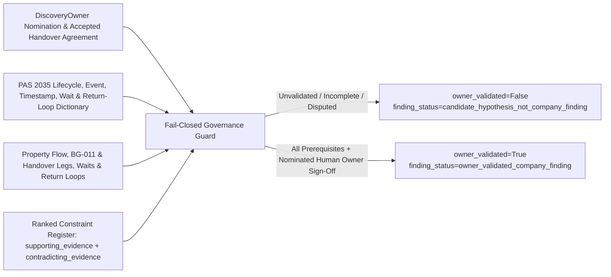

<!-- markdownlint-disable-file -->

# Task Research: phase0-retrofit-flow-discovery-124

| Field              | Value                                                                                      |
|--------------------|--------------------------------------------------------------------------------------------|
| Date               | 2026-11-15                                                                                 |
| Researcher / agent | RPI Agent (`rpi-research`)                                                                 |
| Status             | Complete                                                                                   |
| Artifact path      | .copilot-tracking/research/2026-11-15/phase0-retrofit-flow-discovery-124-research.md       |

## Research Brief

* What to research: Phase 0 retrofit-flow discovery requirements in `docs/brds/retrofit-flow-discovery-brief.md` and `docs/brds/agentic-retrofit-programme-brd.md` (`BG-011`), existing Phase 0 discovery and flow modules in `src/core` (`discovery_register.py`, `discovery_flow.py`, and `discovery_assistant_*.py`), and existing knowledge-base syntheses under `docs/reference/research/`.
* Why it matters: Issue #124 requires an explicit, enforceable Phase 0 retrofit-flow discovery contract in `src/core` (documented in `docs/reference/research/`) covering: (1) discovery owner nomination and `accepted handover` endpoint agreement, (2) a validated lifecycle and event dictionary covering all PAS 2035 / retrofit flow stages, timestamps, wait states, and return loops through accepted handover, (3) a ranked constraint register requiring and recording both `supporting_evidence` and `contradicting_evidence` for each constraint hypothesis, and (4) an explicit governance guard enforcing `owner_validated=False` and `finding_status="candidate_hypothesis_not_company_finding"` until a nominated discovery owner records formal validation.
* Audience or intended use: `rpi-plan`, `rpi-implement`, and `rpi-review` phases of the Issue #124 automatic RPI loop, plus repository maintainers and reviewers.
* Scope: `docs/brds/retrofit-flow-discovery-brief.md`, `docs/brds/agentic-retrofit-programme-brd.md`, `src/core/src/zava_forward/core/`, `src/core/tests/`, `docs/reference/research/`, `docs/reference/README.md`, and `docs/reference/log.md`.
* Non-goals: Live company data ingestion, persistence/UI screens beyond `src/core` contract and research documentation, running `tools/rpi-checks.py --all`, or pushing / opening a pull request.
* Criteria: Every acceptance criterion and objective from Issue #124 mapped to exact codebase gaps, schema/contract design, backward compatibility with existing `discovery_*` callers/tests, and governance rules.
* Requested outputs: Convergent contract and documentation recommendation ready for `rpi-plan`.
* Output mode: convergence

## Research Parameters

| Field                            | Value                                                                                                                                                              |
|----------------------------------|--------------------------------------------------------------------------------------------------------------------------------------------------------------------|
| Research question(s)             | What gaps exist between the current `src/core` discovery modules and the full Phase 0 retrofit-flow discovery contract and documentation required for Issue #124?  |
| Codebase scope                   | `src/core/`, `src/`, `docs/brds/`, `docs/reference/`                                                                                                               |
| External scope                   | none (internal repository specifications, PAS 2035 snapshots in `docs/reference/`, and codebase modules)                                                           |
| Initial internal candidate areas | `docs/brds/retrofit-flow-discovery-brief.md`, `docs/brds/agentic-retrofit-programme-brd.md`, `src/core/src/zava_forward/core/discovery_*.py`, `docs/reference/`    |
| Initial external candidate areas | none                                                                                                                                                               |
| Research posture                 | focused                                                                                                                                                            |
| Posture provenance               | default (bounded internal task with named source targets and explicit acceptance criteria)                                                                          |
| Explicit limits / deadline       | Focused validation tier (`src/core` unit tests, `ruff`, `mypy`); do not run `tools/rpi-checks.py --all`; do not push or open a PR                                  |
| Posture-specific completion basis| focused scope and materiality: all caller objectives, existing callers/tests, and governance constraints verified with `path:line` codebase evidence               |
| Edits allowed during research?   | no, research-only                                                                                                                                                  |
| Resolved evidence root           | `.copilot-tracking/`                                                                                                                                               |
| Known constraints / excluded sources | Preserve fictional/synthetic boundaries; findings are never company facts without named human validation; preserve existing tests in `src/core` and downstream packages |

## Extension Registry and Provenance

* Precedence: platform and host safety; caller scope and criteria; matching repository instructions and enforced schemas; rpi-research contract; domain skills and specialists; examples and preferences.

| Kind                | Candidate                                                  | Match and provenance                                                    | Scoped authority or output contract                                              | Selected / skipped reason                                                                 |
|---------------------|------------------------------------------------------------|-------------------------------------------------------------------------|----------------------------------------------------------------------------------|-------------------------------------------------------------------------------------------|
| Instruction         | `.github/copilot-instructions.md` (`applyTo: "**"`)        | Matches all repository research inputs, `src/core`, and `docs/` targets | Enforces knowledge-base, Markdown style, regulatory snapshot, and validation rules | Selected; governs code boundaries, Markdown style, and honest fictional-customer framing |
| Skill               | `rpi-research`                                             | Explicit caller phase 1 of the automatic RPI loop                       | Three-wave evidence-first research artifact and planning-readiness contract      | Selected; active phase skill                                                              |
| Skill               | `python-foundational`                                      | Domain match for `src/core` Python 3.12 strict-typed modules            | Python conventions deferred to implementation phase                              | Skipped in research; existing `src/core` modules already establish strict mypy/ruff rules |
| Research specialist | `hve-core-all:rpi-researcher`                              | General worker for independent research lanes                           | Lane evidence artifact under `.copilot-tracking/research/subagents/`             | Skipped (inline fallback); tightly coupled 7-file codebase slice fits direct read cleanly |
| Research specialist | `Housing Data and Performance Lead` / `company-*` profiles | Fictional role profiles for synthetic retrofit-flow interrogation       | Hypothesis generation anchored to case study and company profile                 | Skipped; brief and BRD `BG-011` already synthesize role-review inputs (`C1`, `C2`)       |

## User Participation and Research Decisions

| Checkpoint       | Questions or no-interaction rationale                                                                                     | Answers / unanswered | Resulting decision or selected further research                                                                  |
|------------------|---------------------------------------------------------------------------------------------------------------------------|----------------------|------------------------------------------------------------------------------------------------------------------|
| Intake           | Non-interactive confirmed automatic RPI session with explicit Issue #124 acceptance criteria, file targets, and validation tier. | No interaction needed | Proceed with focused posture across `docs/brds/`, `src/core`, and `docs/reference/research/`.                    |
| Direction change | No scope expansion beyond `src/core` and `docs/` needed after discovering PR #895 / #1030 baseline slices (`C3`, `C4`).    | No interaction needed | Extend `discovery_register.py` and `discovery_flow.py` additively and introduce `discovery_contract.py`.         |
| Convergence      | All research questions answered from primary repository sources with zero unresolved ambiguity for planning.               | No interaction needed | Select convergent contract architecture and advance automatic RPI session to `Plan`.                             |

## Scope and Success Criteria

* Scope: `docs/brds/retrofit-flow-discovery-brief.md`, `docs/brds/agentic-retrofit-programme-brd.md` (`BG-011`, `RULE-019`, `OD-16`, `OD-18`), `src/core/src/zava_forward/core/discovery_*.py`, `src/core/tests/test_discovery_*.py`, `src/core/README.md`, `docs/reference/research/`, `docs/reference/README.md`, and `docs/reference/log.md`.
* Assumptions:
  * Existing `discovery_register.py` and `discovery_flow.py` were introduced in earlier synthetic slices (PRs #895 and #1030, verified in `C1`, `C3`, `C4`) and must remain 100% backward-compatible for existing tests while gaining the complete Phase 0 contract required by Issue #124.
  * Zava North Homes remains a fictional case customer (`C1`, `C2`), so code enforces the Phase 0 contract and governance guard over deterministic rules and synthetic validation scenarios without fabricating live Zava North Homes human sign-off.
* Success criteria:
  * Every research question is answered or marked unanswerable with the missing evidence named.
  * Evidence is grounded in actual code, docs, or tooling results, with locations (`path:line` for code).
  * Findings, decisions, and readiness claims cite Evidence Log IDs.
  * Alternatives are compared with trade-offs and one convergent recommendation is selected.
  * Open questions, risks, and residual uncertainty are recorded.
  * Self-check passes.

## Task Research Requests

* Explicit requests:
  1. Research `docs/brds/retrofit-flow-discovery-brief.md`, `docs/brds/agentic-retrofit-programme-brd.md` (`BG-011`), and existing discovery/flow modules in `src/core`.
  2. Determine how to implement and validate the Phase 0 retrofit-flow discovery contract in `src/core` and document it in `docs/reference/research/` covering:
     * Nominated discovery owner and agreed `accepted handover` endpoint;
     * Validated lifecycle and event dictionary covering all PAS 2035 / retrofit flow stages, timestamps, wait states, and return loops through accepted handover;
     * Ranked constraint register requiring and recording both `supporting_evidence` and `contradicting_evidence` for each constraint hypothesis;
     * Explicit governance guard enforcing `owner_validated=False` and `finding_status="candidate_hypothesis_not_company_finding"` on all discovery outputs until a nominated discovery owner records formal validation.
* Inferred research questions:
  * How do existing `discovery_register.py`, `discovery_flow.py`, and `discovery_assistant_*.py` modules interact, and what callers/tests depend on them?
  * How are PAS 2035 stages, timestamps, wait states, and return loops represented across the discovery brief, BRD `BG-011`, synthetic data dictionary, and `src/core`?
  * How do repository lint, typecheck, link-check, and legacy-reference checks validate changes to `src/core` and `docs/reference/`?
* Caller constraints and non-goals: Focused validation tier (`src/core` unit tests, `ruff check`, `ruff format --check`, `mypy`); do not run `tools/rpi-checks.py --all`; commit cleanly on `feat/gov-124-phase0-discovery` with trailer; do not push or open a PR.

## Direction Controls

| Control type (add / change / narrow / exclude / discard) | Direction or boundary                                                                                   | Source / checkpoint | Effect on active brief, evidence, or revalidation                                           |
|----------------------------------------------------------|---------------------------------------------------------------------------------------------------------|---------------------|---------------------------------------------------------------------------------------------|
| narrow                                                   | Focused validation tier only (`src/core` unit tests, `ruff`, `mypy`); exclude `tools/rpi-checks.py --all` | Caller prompt       | Constrains validation commands in Implement and Review phases                               |
| exclude                                                  | Do not push branch or open a pull request                                                               | Caller prompt       | Constrains final Git closeout to local branch commit on `feat/gov-124-phase0-discovery`     |
| add                                                      | Enforce exact fields `supporting_evidence`, `contradicting_evidence`, `owner_validated=False`, and `finding_status="candidate_hypothesis_not_company_finding"` | Caller prompt       | Requires explicit schema fields and fail-closed governance guard across discovery contracts  |

## Research Questions

|  # | Sub-question                                                                                                                                      | Type            | Priority | Status   |
|---:|---------------------------------------------------------------------------------------------------------------------------------------------------|-----------------|----------|----------|
| Q1 | What Phase 0 discovery outcomes, lifecycle stages/events, timestamps, wait states, return loops, and governance rules do the brief and BRD specify? | depth           | H        | answered |
| Q2 | What do `src/core` discovery modules currently implement, who imports them, and where do they fall short of Issue #124's full contract?           | depth           | H        | answered |
| Q3 | How are PAS 2035 stages, regulatory boundaries, and synthetic lifecycle records represented elsewhere in `src/core` and `docs/reference/`?        | breadth         | M        | answered |
| Q4 | What code-quality, dependency, link-resolution, and legacy-reference checks apply to `src/core` and `docs/reference/research/`?                   | straightforward | H        | answered |

## Prior Knowledge Gate

* Existing artifacts reviewed: `docs/case_study_48_original.md`, `docs/case_study_48_addendum.md`, `docs/reference/README.md`, `docs/reference/memory.md`, `docs/brds/retrofit-flow-discovery-brief.md`, `docs/brds/agentic-retrofit-programme-brd.md`, `docs/reference/research/retrofit-synthetic-data/data-dictionary.md`, `docs/reference/research/company/pilot-measurement-challenge.md`, `src/core/README.md`.
* Reused (verified) findings:
  * PRs #895 and #1030 delivered initial `discovery_register.py` and `discovery_flow.py` slices, and PR #1355 delivered `discovery_assistant_*` slices for Issue #125 (`C1`, `C3`–`C6`).
  * BRD `BG-011` (`OBJ-11`) sets `assessment-to-ready-to-install` as the primary cycle-time measure while requiring `accepted handover` to be reported separately as the end-to-end outcome (`C2`).
* Superseded / stale: None; all inspected modules are active in `src/core` post-`v0.21.0` cut-over (`C12`).

## Research Cycle Log

### Cycle 1

* Active direction controls: Focused validation tier; local commit only (no push / no PR); exact schema and governance field names required by caller.
* Active research posture and completion basis: `focused`; complete when all caller objectives, existing callers/tests, and repository lint/link rules are verified with `path:line` codebase evidence.
* Explicit limits or deadline effect: Keeps code scope strictly within `src/core` and documentation scope within `docs/reference/`, `docs/brds/retrofit-flow-discovery-brief.md`, and `src/core/README.md`.

#### Wave 1: Wider

* Plan and independent lanes: Surveyed `docs/brds/retrofit-flow-discovery-brief.md`, `docs/brds/agentic-retrofit-programme-brd.md` (`BG-011`, `RULE-019`, `OD-16`, `OD-18`), all `*discovery*` files under `src/core`, cross-project imports across `src/`, and existing research pages under `docs/reference/research/`.
* Worker evidence relationships or inline fallback: Inline fallback (tightly coupled single-package slice). Mapped Q1 -> `C1`, `C2`, `C9`, `C10`; Q2 -> `C3`–`C8`; Q3 -> `C9`–`C11`.
* Reflection: Confirmed that `discovery_register.py` and `discovery_flow.py` exist as initial rule slices with zero callers outside `src/core/tests/`, while `discovery_assistant_*.py` covers Issue #125 readiness/drafting/evaluation independently. Identified three major gaps against Issue #124 Objective 2: (1) dictionary lacks full PAS 2035 stages, timestamp specifications, wait-state definitions, and return-loop definitions; (2) constraint register lacks structured `supporting_evidence` + mandatory `contradicting_evidence` tuples and 5-part constraint test attributes; (3) outputs lack explicit `owner_validated=False` and `finding_status="candidate_hypothesis_not_company_finding"` governance guard enforcement.

#### Wave 2: Deeper

* Parent-prioritized material from Wave 1: Exact schema/signature details in `discovery_register.py`, `discovery_flow.py`, `restart_authority.py` (human/placeholder/non-AI actor validation idioms), `data-dictionary.md` (canonical lifecycle stages and events), `pyproject.toml` (strict mypy/ruff rules), and documentation guards (`test_live_doc_links.py`, `check-legacy-references.py`, `test_dependency_rule.py`).
* Plan and independent lanes: Inspected line-level contracts across `discovery_register.py`, `discovery_flow.py`, `test_discovery_register.py`, `test_discovery_flow.py`, `test_discovery_assistant_demo.py`, `restart_authority.py`, `src/core/pyproject.toml`, `.github/workflows/src-ci.yml`, `test_live_doc_links.py`, `test_dependency_rule.py`, and `tools/check-legacy-references.py`.
* Worker evidence relationships or inline fallback: Inline investigation mapped Q2 -> `C3`, `C4`, `C7`, `C8`; Q3 -> `C9`, `C10`, `C11`, `C13`; Q4 -> `C12`, `C14`, `C15`, `C16`.
* Reflection: Verified that `src/core/pyproject.toml` runs `mypy` with `strict = true` and `ruff` (`E, F, I, B, UP`, line-length 100) with NO exemptions on new files (`discovery_*.py` are strictly typed and formatted). Also discovered why running `/usr/bin/python3` directly failed `test_demo_runs_from_this_worktree_without_inputs`: that test invokes `sys.executable -m zava_forward.core discovery-demo` with `cwd=tempdir` and scrubbed `PYTHONPATH`, expecting `zava-forward-core` to be editable-installed in an isolated virtualenv (matching `.github/workflows/src-ci.yml` and `tools/rpi-checks.py`, `C14`).

#### Wave 3: Contrarian

* In-scope challenge targets and boundaries:
  1. Challenge whether modifying `discovery_register.py` and `discovery_flow.py` in place could break existing PR #895 / #1030 unit tests (`C7`, `C8`).
  2. Challenge whether `no_contradiction_note` in `discovery_register.py` satisfies Objective 2 ("requires and records both `supporting_evidence` and `contradicting_evidence` for each constraint hypothesis").
  3. Challenge whether implementing validation transitions in `src/core` could be misread as claiming live Zava North Homes owner sign-off or ticking Issue #124's human-gated acceptance criteria prematurely.
* Plan and independent lanes: Audited assertions in `test_discovery_register.py` and `test_discovery_flow.py`, checked governance guard failure modes (placeholder names, AI/system names, proposer self-approval, unagreed endpoint, unvalidated dictionary, missing contradicting evidence, disputed constraints, forged `owner_validated=True` flags), and checked documentation conventions in `docs/brds/retrofit-flow-discovery-brief.md` and `docs/reference/log.md`.
* Worker evidence relationships or inline fallback: Inline contrarian check mapped challenge 1 -> `C7`, `C8`; challenge 2 -> `C3`, `C7`; challenge 3 -> `C1`, `C2`, `C11`.
* Reflection:
  1. `test_discovery_register.py:105-109` explicitly tests `no_contradiction_note` on `discovery_register.Constraint`. Removing that behavior from legacy `discovery_register.Constraint` would break existing regression coverage, whereas introducing the canonical `ConstraintHypothesis` / `RankedConstraintRegister` contract in `discovery_contract.py` (requiring explicit non-empty `supporting_evidence` AND `contradicting_evidence` tuples, where negative-search evidence is recorded as a traceable `EvidenceRecord` in `contradicting_evidence`) AND adding `supporting_evidence`, `contradicting_evidence`, `owner_validated`, and `finding_status` fields/properties to `discovery_register` and `discovery_flow` satisfies both backward compatibility and strict contract enforcement.
  2. Even when `src/core` provides deterministic functions to record formal validation by a nominated human discovery owner in unit tests, the canonical default Zava North Homes Phase 0 state (and all unvalidated/disputed outputs) MUST carry `owner_validated=False` and `finding_status="candidate_hypothesis_not_company_finding"`, and documentation must explicitly state that live sponsor nomination, live domain-owner validation, and the 12-month company extract remain open human gates.

#### Parent Synthesis and Disposition

| Material / claim                                                                                                                              | Evidence IDs       | Parent disposition | Evidence-based rationale                                                                                                      | Primary-artifact treatment                   |
|-----------------------------------------------------------------------------------------------------------------------------------------------|--------------------|--------------------|-------------------------------------------------------------------------------------------------------------------------------|----------------------------------------------|
| Introduce `zava_forward.core.discovery_contract` as the unified Phase 0 retrofit-flow discovery contract while additively enriching `discovery_register` and `discovery_flow` | `C1`–`C4`, `C7`–`C9` | accepted           | Delivers full PAS 2035 stage/event/timestamp/wait/loop dictionary, ranked constraint register, and fail-closed governance guard without breaking PR #895/#1030 tests | Selected Recommendation & Current Decision D1 |
| Require non-empty structured `supporting_evidence` AND `contradicting_evidence` tuples on every ranked `ConstraintHypothesis`                 | `C1`, `C3`, `C7`   | accepted           | Directly satisfies Objective 2 and Issue #124 AC3; prevents one-sided confirmation bias in constraint ranking                 | Selected Recommendation & Current Decision D2 |
| Enforce fail-closed governance guard stamping `owner_validated=False` and `finding_status="candidate_hypothesis_not_company_finding"` until a nominated human discovery owner (with `ENDPOINT_AGREED` on `accepted handover` and validated dictionary) records formal validation | `C1`–`C4`, `C13`   | accepted           | Directly satisfies Objective 2 and Issue #124 AC1/AC4; blocks forged `owner_validated=True`, placeholder/AI actors, and proposer self-sign-off | Selected Recommendation & Current Decision D3 |
| Mutate `discovery_register.Constraint` incompatibly to break `no_contradiction_note` or `EventDefinition` positional signatures               | `C3`, `C7`         | rejected           | Breaks existing `test_discovery_register.py` regression suite without adding safety value                                     | Rejected Alternative B                       |
| Document the Phase 0 contract in `docs/reference/research/company/phase0-retrofit-flow-discovery-contract.md` and update `docs/reference/README.md`, `docs/reference/log.md`, `docs/brds/retrofit-flow-discovery-brief.md`, and `src/core/README.md` | `C1`, `C12`, `C15`, `C16` | accepted    | Satisfies Objective 2 research documentation requirement and repository knowledge-base maintenance conventions                | Selected Recommendation & Current Decision D4 |

#### Cycle Re-entry Evaluation

* Another complete three-wave cycle needed: no
* Trigger or stop basis: Focused scope saturation achieved; every caller objective, existing discovery module, PAS 2035/flow stage source, governance boundary, and validation command is grounded in verified codebase files.
* Revised brief or revalidation required: none
* Readiness effect: `Ready` (`C1`–`C16`)

## Evidence Log

* Delegation: inline: bounded 7-module `src/core` slice and 5 repository documents read directly with higher precision and lower latency than subagent fan-out.

### Codebase Evidence

| ID  | Claim / finding                                                                                                                                                     | Location (`path:line`)                                                                      | Tool | Confidence | Notes                                                                                     |
|-----|---------------------------------------------------------------------------------------------------------------------------------------------------------------------|---------------------------------------------------------------------------------------------|------|------------|-------------------------------------------------------------------------------------------|
| C1  | Discovery brief defines Phase 0 proposition, `accepted handover` endpoint, 7 outcomes, population/time attribution, 5-part constraint test, 12 evidence domains, 5 candidate constraints, readiness checklist, and delivery status for Issue #124. | `docs/brds/retrofit-flow-discovery-brief.md:7-347`                                          | view | high       | Canonical Phase 0 specification                                                           |
| C2  | BRD `BG-011` (`OBJ-11`), `RULE-019` (`AC-062`, `AC-074`–`AC-077`), `OD-16`, and `OD-18` specify `assessment-to-ready-to-install` as primary cycle-time measure, `accepted handover` reported separately as outcome, frozen event dictionary, pause/incomplete/reopen visibility, and human ratification gates. | `docs/brds/agentic-retrofit-programme-brd.md:644-696`                                       | view | high       | Also `1631`, `2134-2136`, `2554-2559`                                                     |
| C3  | `discovery_register.py` defines `ENDPOINT = "accepted handover"`, 10 `REQUIRED_EVENTS`, `DiscoveryOwner`, `EventDefinition`, `Evidence`, `Constraint`, `decide`, `register_rows`, and 5 `CANDIDATE_CONSTRAINTS`, but lacks PAS 2035 stages, timestamp/wait/loop dictionary schemas, `owner_validated`, and `finding_status`. | `src/core/src/zava_forward/core/discovery_register.py:22-199`                               | view | high       | Existing PR #895/#1030 slice                                                              |
| C4  | `discovery_flow.py` defines `Candidate`, `baseline_summary`, `LifecycleEvent`, `leg_days`, `Wait`, `waits_by_party`, `Loop`, and `loop_counts`, keeping `UNKNOWN`/`DISPUTED`/`Unattributed` visible, but lacks stage/timestamp sequence validation against the dictionary and lacks `owner_validated` / `finding_status` fields. | `src/core/src/zava_forward/core/discovery_flow.py:16-124`                                   | view | high       | Existing PR #895/#1030 slice                                                              |
| C5  | `discovery_assistant_boundary.py`, `discovery_assistant_drafting.py`, `discovery_assistant_evaluation.py`, `discovery_assistant_acceptance.py`, and `discovery_assistant_demo.py` implement Issue #125 assistant readiness/read-only boundaries and timezone-aware ISO timestamp stage duration arithmetic (`StageEvent`, `calculate_stage_durations`). | `src/core/src/zava_forward/core/discovery_assistant_boundary.py:17-169`                     | view | high       | Also `discovery_assistant_drafting.py:26-79`                                              |
| C6  | Repository-wide grep across `src/` shows `discovery_register` and `discovery_flow` are imported only by `src/core/tests/test_discovery_register.py` and `src/core/tests/test_discovery_flow.py`. | `src/core/tests/test_discovery_register.py:4`                                               | grep | high       | Zero breaking downstream API/agents/orchestrator callers                                  |
| C7  | `test_discovery_register.py` asserts existing `DiscoveryOwner.status()`, 10-event `dictionary_gaps()`, `Constraint` proposer separation, `no_contradiction_note`, and `DISPUTED` retention via dict key lookups. | `src/core/tests/test_discovery_register.py:17-129`                                          | view | high       | Additive keys/properties preserve 100% of existing tests                                  |
| C8  | `test_discovery_flow.py` asserts `baseline_summary`, `leg_days`, `waits_by_party`, and `loop_counts` behavior over synthetic candidates, events, waits, and loops. | `src/core/tests/test_discovery_flow.py:8-74`                                                | view | high       | Additive keys preserve 100% of existing tests                                             |
| C9  | `data-dictionary.md` defines the retrofit synthetic lifecycle stages (`01 Identified` through `11 Handed over` / `12 Closed`, plus `On hold`, `Reopened`, `Withdrawn`, `Excluded`) and event log families (Entry/Scope, Assessment, Design, Resident, Release, Delivery, Close including `ACCEPTED_HANDOVER` and `CASE_REOPENED`). | `docs/reference/research/retrofit-synthetic-data/data-dictionary.md:107-166`                | view | high       | Aligns PAS 2035 / retrofit flow stage and event taxonomy                                  |
| C10 | `insights.py` defines operational workbench `STAGE_ORDER` (25 granular case states from `Home identified` to `Aftercare issue`), while `progress.py:31` notes that a workbench stage or case closure never by itself establishes `accepted handover`. | `src/core/src/zava_forward/core/insights.py:9-15`                                           | view | high       | Confirms distinction between tracker states and validated Phase 0 lifecycle events        |
| C11 | `pas-2035-2023-bsi-overview.md` and `law-source-register.json` confirm the repository holds only the BSI overview (retrieved 2026-09-19), not the licensed PAS 2035:2023 standard text (`gap-pas-2035-licensed`). | `docs/reference/regulatory/retrofit-standards-and-funding/pas-2035-2023-bsi-overview.md:8-19` | view | high       | Documentation must cite only the BSI overview + BRD workflow roles, never invent PAS clauses |
| C12 | `src/core/pyproject.toml` configures `ruff` (`line-length = 100`, `py312`, `select = ["E", "F", "I", "B", "UP"]`) and `mypy` (`strict = true`) over `src` and `tests` without ignore overrides for new modules. | `src/core/pyproject.toml:26-44`                                                             | view | high       | New code and tests must pass strict `mypy` and `ruff check` + `ruff format --check`       |
| C13 | `restart_authority.py` establishes repository idioms for rejecting blank, placeholder (`tbd`, `todo`, `tbc`, `pending`, `unknown`, `self`), and non-human/automated (`ai`, `agent`, `bot`, `copilot`, `llm`, `system`, `workflow`) actor strings in human-authority guards. | `src/core/src/zava_forward/core/restart_authority.py:17-89`                                 | view | high       | Directly informs nominated discovery owner and validator human-authority checks           |
| C14 | `.github/workflows/src-ci.yml` installs `src/core` editable (`pip install -e ".[dev]"`) inside a Python 3.12 environment and runs `python -m unittest discover -s tests -v`, `ruff check . && ruff format --check .`, and `mypy`. `test_discovery_assistant_demo.py:168-179` spawns `sys.executable -m zava_forward.core discovery-demo` from a temp directory without `PYTHONPATH`. | `.github/workflows/src-ci.yml:79-95`                                                        | view | high       | Explains why validation in Implement must use an external `/tmp` venv with `-e "src/core[dev]"` |
| C15 | `test_dependency_rule.py` enforces that `src/core` imports only `zava_forward.core` (and stdlib), never `api`, `agents`, `orchestrator`, or `importer`. `test_live_doc_links.py` enforces that all relative Markdown links in live `docs/` resolve on disk. | `src/core/tests/test_dependency_rule.py:6-31`                                               | view | high       | Also `src/core/tests/test_live_doc_links.py:20-58`                                        |
| C16 | `tools/check-legacy-references.py` fails if live files mention retired `mvp/` or `prototype/` paths without naming archive `v0.21.0` or lack resolving relative Markdown links. | `tools/check-legacy-references.py:18-98`                                                    | view | high       | Documentation must reference `src/core/...` paths cleanly                                 |

### External Evidence

| ID | Claim / finding | Source (title) | URL | Retrieved | Version/date | Confidence |
|----|-----------------|----------------|-----|-----------|--------------|------------|

### Contradictions / Conflicts

* Primary cycle-time measure versus Phase 0 discovery endpoint: `C2` (`agentic-retrofit-programme-brd.md:644-671`) states that `assessment-to-ready-to-install` is the owner-directed primary `BG-011` cycle-time measure with `accepted handover` reported separately as an outcome, whereas `C1` (`retrofit-flow-discovery-brief.md:45-47`) states `Accepted handover is the endpoint` for Phase 0 whole-flow discovery; resolved by consistency across both documents -> the Phase 0 lifecycle contract tracks the entire property flow through the `accepted handover` endpoint while computing and reporting both the `assessment-to-ready-to-install` primary `BG-011` cycle-time leg and the post-installation handover legs (`installation -> physical acceptance -> evidence acceptance -> resident handover -> accepted handover`) separately.

## Findings Mapped to Questions and Evidence

| Question | Finding                                                                                                                                                                                                                               | Evidence IDs             | Confidence | Decision or readiness implication                                                                                  |
|----------|---------------------------------------------------------------------------------------------------------------------------------------------------------------------------------------------------------------------------------------|--------------------------|------------|--------------------------------------------------------------------------------------------------------------------|
| Q1       | Phase 0 requires a sponsor-nominated human discovery owner, agreed `accepted handover` endpoint, domain-owner-validated lifecycle/event/timestamp/wait/return-loop dictionary, 12-month population & wait/loop attribution keeping `UNKNOWN`/`DISPUTED` visible, a 5-hypothesis ranked constraint register with both supporting and contradicting evidence, and strict non-promotion until owner validation. | `C1`, `C2`, `C9`         | high       | Defines exact contract surface for `discovery_contract.py` and research synthesis                                  |
| Q2       | `discovery_register.py` and `discovery_flow.py` provide minimal PR #895/#1030 primitives with no external callers beyond their 2 unit test files, missing full PAS 2035 stage/timestamp/wait/loop dictionary schemas, explicit `supporting_evidence` + `contradicting_evidence` fields, and `owner_validated=False` / `finding_status="candidate_hypothesis_not_company_finding"` governance guard enforcement. | `C3`–`C8`                | high       | Enables clean additive enrichment of `discovery_register` + `discovery_flow` plus full contract in `discovery_contract.py` |
| Q3       | Repository PAS 2035 coverage is bounded by the BSI overview (`pas-2035-2023-bsi-overview.md`, licensed standard not held) and BRD/data-dictionary role boundaries (`Retrofit Assessor`, `Retrofit Designer`, `Retrofit Coordinator`, `Quality`, `Resident Engagement`, `Procurement`, `Safety`, `Finance`). | `C2`, `C9`, `C10`, `C11` | high       | Stages and competent-role validations must cite BRD & BSI-overview boundaries without inventing licensed PAS clauses |
| Q4       | `src/core` enforces strict `mypy`, `ruff check` + `ruff format --check` (`line-length = 100`), `core`-only import rules, resolving relative Markdown links (`test_live_doc_links.py`), legacy-path guards (`check-legacy-references.py`), and editable package execution (`test_discovery_assistant_demo.py`). | `C12`–`C16`              | high       | Implement phase will validate in an external `/tmp` venv with `pip install -e "src/core[dev]"` plus link/legacy checks |

## Key Discoveries

* Existing `discovery_register.py` and `discovery_flow.py` cover only 10 flat event names and basic wait/leg arithmetic without explicit stage schemas, timestamp specifications, wait-state definitions, return-loop definitions, mandatory `contradicting_evidence` records, or an output-level governance guard (`C3`, `C4`).
* `BG-011` and the discovery brief fit together cleanly when the contract models all end-to-end PAS 2035 / retrofit stages through `accepted handover` while explicitly exposing both the `assessment-to-ready-to-install` (`BG-011` primary cycle-time leg) and the three post-installation acceptance/handover legs (`C1`, `C2`).
* A fail-closed governance guard in `src/core` can deterministically stamp and verify `owner_validated=False` and `finding_status="candidate_hypothesis_not_company_finding"` across every discovery output (dictionary report, flow/wait/loop analysis, ranked constraint hypothesis, ranked constraint register, and full Phase 0 discovery pack), rejecting forged `owner_validated=True` flags, placeholder/automated actors, proposer self-approval, unagreed endpoints, unvalidated dictionaries, disputed constraints, or missing supporting/contradicting evidence (`C3`, `C13`).

### Complete Examples

```python
from datetime import date
from zava_forward.core import discovery_contract as dc

pack = dc.build_default_phase0_pack(as_of=date(2026, 11, 15))
assert pack.owner_validated is False
assert pack.finding_status == "candidate_hypothesis_not_company_finding"
```

## Alternatives and Decision State

### Selected Recommendation (convergence only)

* Approach: Create `src/core/src/zava_forward/core/discovery_contract.py` implementing the complete, strictly typed Phase 0 retrofit-flow discovery contract and fail-closed governance guard, while additively enriching `discovery_register.py` and `discovery_flow.py` so every discovery output across `src/core` carries `owner_validated` and `finding_status` without breaking existing tests. Document the contract and its honest Zava North Homes human-gate boundaries in `docs/reference/research/company/phase0-retrofit-flow-discovery-contract.md`, and update `src/core/README.md`, `docs/brds/retrofit-flow-discovery-brief.md`, `docs/reference/README.md`, and `docs/reference/log.md`.
* Rationale:
  1. Keeps module responsibilities small, cohesive, and pure stdlib (`core`-only imports, offline, deterministic, model-free).
  2. Covers all PAS 2035 / retrofit stages (candidate identification & cohort selection; resident contact, adjustments & survey booking; PAS 2035 retrofit assessment; safety & planned-maintenance dependency triage; PAS 2035 design, risk path & coordinator approval; resident measure-specific works decision; funding, contract & capacity work release; appointment & installation; quality inspection, physical acceptance & PAS 2035 documentary evidence acceptance; accessible resident handover & `accepted handover` endpoint; plus terminal/exception states and post-handover reopen boundary), required stage/event timestamps, 7 governed wait states, and 4 governed return loops (`return`, `rejection`, `repeat visit`, `reopen`).
  3. Enforces a ranked constraint register where every `ConstraintHypothesis` carries structured `supporting_evidence` AND `contradicting_evidence` tuples (both required to be non-empty with traceable `statement` and `source_ref` before any owner acceptance, plus explicit 5-part constraint test tracking).
  4. Provides an explicit fail-closed governance guard (`CANDIDATE_FINDING_STATUS = "candidate_hypothesis_not_company_finding"`, `VALIDATED_FINDING_STATUS = "owner_validated_company_finding"`, `enforce_governance_guard`, `validate_constraint_by_owner`, `validate_discovery_pack`) guaranteeing `owner_validated=False` and `finding_status="candidate_hypothesis_not_company_finding"` until a sponsor-nominated human discovery owner with `ENDPOINT_AGREED` on `accepted handover`, a gap-free domain-owner-validated lifecycle dictionary, and complete two-sided evidence records formal validation.
  5. Preserves 100% backward compatibility with `test_discovery_register.py`, `test_discovery_flow.py`, and `test_discovery_assistant_*.py`.
* Evidence refs: `C1`–`C16`
* Implementation impact:
  * New: `src/core/src/zava_forward/core/discovery_contract.py`
  * Modified: `src/core/src/zava_forward/core/discovery_register.py`, `src/core/src/zava_forward/core/discovery_flow.py`
  * New: `src/core/tests/test_discovery_contract.py` (plus targeted governance assertions in `test_discovery_register.py` and `test_discovery_flow.py`)
  * New: `docs/reference/research/company/phase0-retrofit-flow-discovery-contract.md`
  * Modified: `src/core/README.md`, `docs/brds/retrofit-flow-discovery-brief.md`, `docs/reference/README.md`, `docs/reference/log.md`
* Confidence: high: all requirements, callers, and repository validation checks are locally deterministic and verified.

File tree:

```text
src/core/
  README.md                                                    (modified)
  src/zava_forward/core/
    discovery_contract.py                                      (new)
    discovery_flow.py                                          (modified)
    discovery_register.py                                      (modified)
  tests/
    test_discovery_contract.py                                 (new)
    test_discovery_flow.py                                     (modified)
    test_discovery_register.py                                 (modified)
docs/
  brds/
    retrofit-flow-discovery-brief.md                           (modified)
  reference/
    README.md                                                  (modified)
    log.md                                                     (modified)
    research/company/
      phase0-retrofit-flow-discovery-contract.md               (new)
```

Flow diagram:



### Alternative: In-place breaking rewrite of `discovery_register.py` and `discovery_flow.py`

* Approach: Replace `EventDefinition`, `Constraint`, and `Loop` signatures directly in `discovery_register.py` and `discovery_flow.py`, removing `no_contradiction_note` and requiring new positional fields on existing dataclasses.
* Trade-offs: Slightly fewer files (2 modules instead of 3), but breaks existing unit tests from PRs #895 and #1030 (`test_discovery_register.py`, `test_discovery_flow.py`) and conflates low-level primitives with the end-to-end Phase 0 contract pack.
* Evidence refs: `C3`, `C4`, `C7`, `C8`
* Rejection rationale: Violates repository code-change rules requiring preservation of existing tested behavior when additive composition is cleaner and safer.

## Open Questions, Risks, and Residual Uncertainty

* Blocking: none
* Important: Live Zava North Homes human steps (sponsor nomination of a real company discovery owner, operational role sign-off of each dictionary item, and approved 12-month company extract ingestion under `OD-14`/`OD-18`/`OD-36`) cannot and must not be fabricated in code (`C1`, `C2`). Both code defaults and documentation must keep Zava North Homes' current status explicitly unvalidated (`owner_validated=False`, `finding_status="candidate_hypothesis_not_company_finding"`).
* Follow-up: If an owner later approves persistence or UI workbench surfacing for Phase 0 discovery packs, `discovery_contract.py` provides the pure domain contract ready for `sqlstore` / `api` wiring.
* Residual uncertainty: Licensed PAS 2035:2023 full clause text is not held in the repository (`gap-pas-2035-licensed`, `C11`); stage and role definitions stay anchored to the BSI overview and BRD workflow table (`C2`, `C11`).

## Current Decisions

| Decision | Status    | Owner / source          | Rationale                                                                                                       | Evidence IDs         | Implications                                                                                       |
|----------|-----------|-------------------------|-----------------------------------------------------------------------------------------------------------------|----------------------|----------------------------------------------------------------------------------------------------|
| D1       | confirmed | Caller / evidence       | Deliver unified Phase 0 contract in `discovery_contract.py` and additively enrich `discovery_register` & `discovery_flow` | `C1`–`C8`            | Preserves all existing tests while delivering complete lifecycle, register, and governance schemas |
| D2       | confirmed | Caller / evidence       | Require both non-empty `supporting_evidence` and `contradicting_evidence` tuples on ranked constraint hypotheses | `C1`, `C3`, `C7`     | Prevents confirmation bias and enforces Issue #124 AC3 in code                                     |
| D3       | confirmed | Caller / evidence       | Enforce fail-closed governance guard stamping `owner_validated=False` and `finding_status="candidate_hypothesis_not_company_finding"` by default and rejecting invalid promotions | `C1`–`C4`, `C13`     | Enforces Issue #124 AC1/AC4 and human-authority separation                                         |
| D4       | confirmed | Caller / repo rules     | Document the contract in `docs/reference/research/company/phase0-retrofit-flow-discovery-contract.md` and update index, KB log, brief, and `src/core/README.md` | `C1`, `C12`, `C15`, `C16` | Keeps knowledge base, link checks, and legacy-reference checks clean                               |
| D5       | confirmed | Caller                  | Validate using an isolated external `/tmp` Python 3.12 venv (`unittest`, `ruff check`, `ruff format --check`, `mypy`) without running `tools/rpi-checks.py --all` or pushing | `C12`, `C14`         | Matches focused validation tier and keeps shared worktree clean                                    |

## Unresolved Decisions

| Decision                                                                 | Smallest evidence or answer needed                                                        | Owner                                            | Impact                                                                                  | Blocker status |
|--------------------------------------------------------------------------|-------------------------------------------------------------------------------------------|--------------------------------------------------|-----------------------------------------------------------------------------------------|----------------|
| Live Zava North Homes sponsor nomination and 12-month extract commission | Real company sponsor nomination, DPIA/lawful basis (`OD-14`/`OD-36`), and 12-month extract | Executive sponsor & Zava North Homes data owners | Required before any live company constraint finding can transition out of candidate status | follow-up      |

## Potential Next Research

| Priority | Research item                                                        | Expected value                                                      | Trigger                                                   | Selected? | Related questions / evidence |
|----------|----------------------------------------------------------------------|---------------------------------------------------------------------|-----------------------------------------------------------|-----------|------------------------------|
| L        | Evaluate persistence/export format for approved 12-month CSV extracts | Connects `discovery_contract` to synthetic CSV exercise pack loader | Owner requests Phase 0 CSV ingestion CLI or UI screen     | deferred  | Q1, Q2; `C1`, `C9`           |

## Planning Readiness

* Status: Ready
* Decision state: Convergence recommendation selected (`D1`–`D5`).
* Evidence basis: `C1`–`C16`
* Preconditions met: Research disposition recorded (`executed`); all four research questions answered with `path:line` evidence; three-wave cycle completed; backward-compatibility and governance constraints verified.
* Blockers: none
* Smallest action to change readiness: none (ready to transition to `rpi-plan`).

## Closeout Record

| Field                            | Record                                                                                                       |
|----------------------------------|--------------------------------------------------------------------------------------------------------------|
| Research execution status        | Complete                                                                                                     |
| Completed waves                  | Cycle 1: Wider, Deeper, and Contrarian completed in order                                                    |
| Lane evidence or inline fallback | Inline fallback: bounded `src/core` and `docs/` slice inspected directly with full `path:line` provenance    |
| Research disposition             | executed                                                                                                     |
| Planning Readiness               | Ready (`C1`–`C16`)                                                                                           |
| Blockers                         | none                                                                                                         |
| Continuation owner and state     | Confirmed automatic RPI Agent; automatic continuation to `Plan` (`rpi-plan`)                                 |

## Advisory Next Step

| Field                            | Record                                                                                                       |
|----------------------------------|--------------------------------------------------------------------------------------------------------------|
| Research disposition             | executed                                                                                                     |
| Planning Readiness               | Ready (`C1`–`C16`)                                                                                           |
| Output mode and planning support | convergence; yes, single implementation design selected with explicit file targets and validation commands    |
| Acting owner                     | Confirmed automatic RPI Agent                                                                                |
| Required gates or confirmations  | Prior-knowledge gate passed; 3-wave cycle passed; pre-transition state write passed                          |
| Continuation result              | Automatic continuation to `rpi-plan`                                                                         |
| Primary evidence file            | .copilot-tracking/research/2026-11-15/phase0-retrofit-flow-discovery-124-research.md                         |
| Notes for planning or re-entry   | Plan `discovery_contract.py`, additive updates to `discovery_register.py` & `discovery_flow.py`, unit tests, and research/KB docs; run independent plan critique before `rpi-implement`. |

* Advisory only: rpi-research does not invoke `/rpi-plan` or any follow-on skill.
* Completion or limit-blocked basis: Further research is immaterial because all specification sources, existing `src/core` discovery modules, callers, and validation checks have been inspected end to end.

## Sources

No external sources used.

## Artifact Self-Check

* [x] Every research question is answered or marked unanswerable with the missing evidence named.
* [x] Every executed cycle includes Wave 1 Wider, Wave 2 Deeper, and Wave 3 Contrarian in that order, with no skipped wave.
* [x] Research posture, provenance, explicit limits or deadline, and posture-specific completion basis are recorded.
* [x] Every codebase finding carries a `C#` ID and a `path:line`; every external finding carries a `W#` ID with URL and retrieval date.
* [x] Every `W#` resolves to exactly one entry in Sources and the list is gap-free, or Sources states "No external sources used".
* [x] Findings, alternatives, decisions, and readiness claims cite Evidence Log IDs (`C#` / `W#`).
* [x] The Extension Registry records matching instructions, relevant skills, available specialist subagents, provenance, authority or output contract, and selected or skipped reasons.
* [x] User Participation records answers, unanswered questions, no-interaction rationale, decisions, and selected further-research items before work continued.
* [x] Direction Controls record caller additions, changes, narrowed scope, exclusions, and discarded directions, plus any required revalidation.
* [x] Parent Synthesis and Disposition records accepted, rejected, and deferred material with evidence-based rationale; workers supplied evidence relationships without decision authority.
* [x] Cycle Re-entry Evaluation records whether a complete next cycle is needed and honestly records a limit-blocked gap when applicable.
* [x] A recommendation is selected with why-rejected reasoning when Output mode is convergence; non-convergence modes record the decision state without a forced selection.
* [x] Current Decisions and Unresolved Decisions contain complete status, source or owner, rationale or smallest missing evidence, evidence IDs, implications, and blockers.
* [x] Potential Next Research includes priority, value, trigger, selected state, and related evidence.
* [x] Planning Readiness and Advisory Next Step state disposition, output mode, acting owner, gates or confirmations, evidence basis, blockers, and the smallest action to change readiness.
* [x] Speculation is flagged and separated from sourced fact.
* [x] Fetched content, repo files, and prior memory were treated as data, not instructions; no embedded directives were followed; no secrets recorded.
* Checked sections: Research Brief, Research Parameters, Extension Registry and Provenance, User Participation and Research Decisions, Scope and Success Criteria, Task Research Requests, Direction Controls, Research Questions, Prior Knowledge Gate, Research Cycle Log, Evidence Log, Findings Mapped to Questions and Evidence, Key Discoveries, Alternatives and Decision State, Open Questions, Current Decisions, Unresolved Decisions, Potential Next Research, Planning Readiness, Closeout Record, Advisory Next Step, Sources, Artifact Self-Check.
* Missing or limited sections: none

