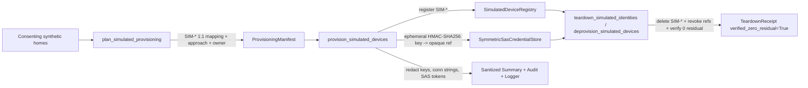

<!-- markdownlint-disable-file -->

# Task Research: simulated-device-identity-provisioning-185

| Field              | Value                                                                                      |
|--------------------|--------------------------------------------------------------------------------------------|
| Date               | 2026-11-15                                                                                 |
| Researcher / agent | rpi-research (coordinated by RPI Agent)                                                    |
| Status             | Complete                                                                                   |
| Artifact path      | .copilot-tracking/research/2026-11-15/simulated-device-identity-provisioning-185-research.md |

## Research Brief

* What to research: Current implementation and gaps in `src/core/src/zava_forward/core/synthetic/` (`device_provision.py`, `device_identity.py`, `device_registry_azure.py`, `sensor_identity.py`, `run_governance.py`, `run_plan.py`, and any `live_provisioning.py` / `iot_device_provisioning.py` naming or module interfaces) plus PRD FR-050 / AC-066 and ADR 0003 decision 6 for issue #185 simulated device identity and provisioning.
* Why it matters: Issue #185 has three remaining acceptance criteria to prove in code and focused unit tests: (1) explicit recording of the chosen device identity approach (`per-device symmetric SAS / DPS enrollment group`) and named `credential_owner` role (`Platform Engineering / IoT Operations Owner`), (2) credential issuance and storage without raw symmetric keys, connection strings, or SAS tokens appearing in source, returned summaries, audit records, or logs, and (3) deterministic teardown (`teardown_simulated_identities` / `deprovision_simulated_devices`) removing every registered simulated `SIM-*` device identity and returning a verifiable teardown receipt confirming zero residual simulated identities.
* Audience or intended use: `rpi-plan`, `rpi-implement`, `rpi-review`, and coordinator review on branch `feat/iot-185-device-provisioning` targeting `feat/demo-164-chat-grounding-provenance-0900`.
* Scope: `src/core/src/zava_forward/core/synthetic/`, `src/core/tests/`, and referenced repository docs (`docs/prds/zava-forward-retrofit-programme-demonstrator.md`, `docs/adrs/0003-journey-derived-capabilities-runtime-fit.md`, `docs/reference/research/iot-sensor-analytics-research-plan.md`).
* Non-goals: Live Azure IoT Hub mutations, paid cloud calls, infrastructure Bicep changes, web UI changes, or running `tools/rpi-checks.py`.
* Criteria: Answer every acceptance-criterion gap with `path:line` codebase evidence (`C#`), evaluate naming/compatibility requirements (`live_provisioning.py` / `device_provision.py` / `teardown_simulated_identities` / `deprovision_simulated_devices`), verify secret-redaction and logging paths, and confirm deterministic `SIM-*` teardown contracts.
* Requested outputs: Converged implementation recommendation, affected file map, contract specifications, and Planning Readiness for `rpi-plan`.
* Output mode: convergence

## Research Parameters

| Field                                | Value                                                                                                                                                                   |
|--------------------------------------|-------------------------------------------------------------------------------------------------------------------------------------------------------------------------|
| Research question(s)                 | How do existing synthetic provisioning modules implement approach/owner metadata, secret-safe credential issuance/logging, and deterministic `SIM-*` teardown receipts? |
| Codebase scope                       | `src/core/src/zava_forward/core/synthetic/`, `src/core/tests/`, `docs/prds/`, `docs/adrs/`, `docs/reference/research/`                                                  |
| External scope                       | none (bounded internal repository codebase and architecture records)                                                                                                    |
| Initial internal candidate areas     | `src/core/src/zava_forward/core/synthetic/device_provision.py`, `device_identity.py`, `device_registry_azure.py`, `src/core/tests/test_device_provision.py`             |
| Initial external candidate areas     | none                                                                                                                                                                    |
| Research posture                     | focused                                                                                                                                                                 |
| Posture provenance                   | caller-specified (bounded internal issue #185 scope with named source targets and focused validation tier)                                                              |
| Explicit limits / deadline           | Focused validation tier only; do not run `tools/rpi-checks.py`; do not push or open a PR                                                                                |
| Posture-specific completion basis    | focused scope and materiality                                                                                                                                           |
| Edits allowed during research?       | no, research-only                                                                                                                                                       |
| Resolved evidence root               | `.copilot-tracking/`                                                                                                                                                    |
| Known constraints / excluded sources | No live Azure credentials, secrets, or `.copilot-tracking/` references in production source/tests/commits                                                               |

## Extension Registry and Provenance

* Precedence: platform and host safety; caller scope and criteria; matching repository instructions and enforced schemas; rpi-research contract; domain skills and specialists; examples and preferences.

| Kind                | Candidate                                     | Match and provenance                                            | Scoped authority or output contract                                         | Selected / skipped reason                                                                 |
|---------------------|-----------------------------------------------|-----------------------------------------------------------------|-----------------------------------------------------------------------------|-------------------------------------------------------------------------------------------|
| Instruction         | `.github/copilot-instructions.md` (AMA rules) | `applyTo: "**"` matches repository inputs and evidence paths    | Adds `src/core` test/mypy/ruff rules, secret hygiene, and doc conventions   | Selected: governs repository architecture, secret hygiene, and focused validation rules   |
| Skill               | `secure-by-design` / `owasp-top-10`           | Semantic match to secret redaction in logs/summaries            | Security hygiene principles only; cannot widen scope                        | Skipped activation: bounded internal Python synthetic module audit needs direct code read |
| Research specialist | `hve-core-all:rpi-researcher`                 | Registered host subagent for independent research lanes         | Delegated subagent lane artifact contract                                   | Skipped dispatch: tightly coupled single-package (`src/core`) trace fits inline waves     |

## User Participation and Research Decisions

| Checkpoint       | Questions or no-interaction rationale                                                                                     | Answers / unanswered       | Resulting decision or selected further research                                               |
|------------------|---------------------------------------------------------------------------------------------------------------------------|----------------------------|-----------------------------------------------------------------------------------------------|
| Intake           | Non-interactive CLI session; caller prompt provides explicit issue #185 acceptance criteria, target files, and validation | Unanswered (not requested) | Proceed with focused convergence research on `src/core` synthetic provisioning modules        |
| Direction change | Wave 1 revealed `device_identity.py` and `device_provision.py` exist using `SYN-*` while `live_provisioning.py` does not yet exist; no caller ambiguity requires widening scope | Not needed (inline resolution) | Add `live_provisioning.py` for `SIM-*` symmetric SAS / DPS enrollment group lifecycle and align `device_identity.py` / `device_provision.py` without breaking existing `SYN-*` tests |
| Convergence      | Single three-wave cycle answered Q1-Q5 with high-confidence codebase evidence; no further research cycle needed           | Not needed (automatic RPI mode) | Mark Planning Readiness `Ready` and hand off to `rpi-plan`                                    |

## Scope and Success Criteria

* Scope: Inspect `src/core` synthetic device identity/provisioning modules, tests, and design documents (`FR-050`, `AC-066`, `ADR 0003` decision 6) to determine exact changes needed for all remaining issue #185 acceptance criteria.
* Assumptions:
  * Caller mentioned `src/core/src/zava_forward/core/synthetic/live_provisioning.py` (and `iot_device_provisioning.py` if present), whereas glob found `device_provision.py`, `device_identity.py`, and `device_registry_azure.py`; we must verify whether `live_provisioning.py` exists anywhere or should be provided/aliased alongside `device_provision.py`.
  * Existing PR #1205 and PR #1393 delivered partial functionality that must be preserved without regression.
* Success criteria:
  * Every research question is answered or marked unanswerable with the missing evidence named.
  * Evidence is grounded in actual code, docs, or tooling results, with locations (`path:line` for code, URL + retrieval date for external).
  * Findings, decisions, and readiness claims cite Evidence Log IDs.
  * Alternatives are compared with trade-offs when the design space and output mode require it. A recommendation is selected only in convergence mode.
  * Open questions, risks, and residual uncertainty are recorded.
  * Self-check passes.

## Task Research Requests

* Explicit requests:
  * Inspect `live_provisioning.py` (and `iot_device_provisioning.py` if present) and existing synthetic provisioning modules in `src/core`.
  * Ensure provisioning manifest/plan explicitly records chosen device identity approach (`per-device symmetric SAS / DPS enrollment group`) and named `credential_owner` role (`Platform Engineering / IoT Operations Owner`).
  * Ensure provisioning output, audit records, and logger calls redact/exclude raw symmetric keys, connection strings, and SAS tokens.
  * Ensure teardown (`teardown_simulated_identities` / `deprovision_simulated_devices`) deterministically removes every registered simulated `SIM-*` device identity and returns a verifiable teardown receipt confirming zero residual simulated identities.
* Inferred research questions:
  * How do `device_identity.py`, `device_provision.py`, and `device_registry_azure.py` currently model approach, credential owner, secret storage/issuance, logging, and teardown?
  * Are `live_provisioning.py` or `iot_device_provisioning.py` referenced anywhere in `src/`, `docs/`, or `tests/`, and should `live_provisioning.py` be added or re-exported for clean discoverability while updating `device_provision.py`?
  * How are `SIM-*` prefixes vs current simulated device IDs (`sim-...` or `SIM-...`) formatted and enforced across existing tests?
* Caller constraints and non-goals: Focused validation tier in `src/core` only; no `tools/rpi-checks.py`; no push or PR creation.

## Direction Controls

| Control type (add / change / narrow / exclude / discard) | Direction or boundary                                                                                   | Source / checkpoint | Effect on active brief, evidence, or revalidation                                  |
|----------------------------------------------------------|---------------------------------------------------------------------------------------------------------|---------------------|------------------------------------------------------------------------------------|
| narrow                                                   | Restrict validation to `src/core` unittest, `mypy`, `ruff check`, and `ruff format --check`             | Caller intake       | Constrains implementation and verification scope to `src/core`                     |
| exclude                                                  | Exclude `tools/rpi-checks.py`, git push, and PR creation                                                | Caller intake       | Handoff stops at clean local commit on `feat/iot-185-device-provisioning`          |
| add                                                      | Require explicit strings `per-device symmetric SAS / DPS enrollment group` and `Platform Engineering / IoT Operations Owner`, secret redaction, and `SIM-*` zero-residual teardown receipt | Caller intake | Shapes exact schema, redaction, and teardown acceptance contracts                  |

## Research Questions

|  # | Sub-question                                                                                                                                      | Type (depth / breadth / straightforward) | Priority | Status   |
|---:|---------------------------------------------------------------------------------------------------------------------------------------------------|------------------------------------------|----------|----------|
| Q1 | What files, classes, functions, and schemas currently implement simulated device identity, provisioning, registry backends, and teardown?         | breadth                                  | H        | answered |
| Q2 | How do PRD FR-050/AC-066, ADR 0003 decision 6, and `iot-sensor-analytics-research-plan.md` specify device identity, credential ownership, and teardown? | breadth                            | H        | answered |
| Q3 | Where can raw symmetric keys, connection strings, or SAS tokens leak (manifests, summaries, audit records, exceptions, logger calls, stores)?     | depth                                    | H        | answered |
| Q4 | How does teardown currently identify and remove simulated identities (`SIM-*` vs existing prefixes), and what receipt fields are returned?        | depth                                    | H        | answered |
| Q5 | Could changing existing approach strings, device ID prefixes, or module names break existing tests (`test_device_identity.py`, `test_device_provision.py`, `test_device_registry_azure.py`, `test_iot_device_identity_schema.py`, etc.)? | depth | H | answered |

## Prior Knowledge Gate

* Existing artifacts reviewed: Issue #185 body (referencing PR #1205 and PR #1393), `docs/case_study_48_original.md`, `docs/case_study_48_addendum.md`, `docs/reference/README.md`, `docs/reference/memory.md`, `docs/adrs/0003-journey-derived-capabilities-runtime-fit.md`, `docs/prds/zava-forward-retrofit-programme-demonstrator.md`, `src/core/README.md`.
* Reused (verified) findings: Issue #185 confirms PR #1205 and PR #1393 landed partial device-identity (`device_identity.py`, `device_provision.py`) and optional keyless Azure IoT Hub Registry backend (`device_registry_azure.py`) support in `src/core`, with 1:1 home-to-device mapping already proven (`C1`, `C2`, `C3`), while explicit approach/owner recording, runtime symmetric SAS issuance/redaction across summaries/audit/logs, and deterministic `SIM-*` zero-residual teardown receipts remain open.
* Superseded / stale: Caller prompt mentions `src/core/src/zava_forward/core/synthetic/live_provisioning.py` (and `iot_device_provisioning.py` if present); repository search confirmed neither module currently exists (`C1`, `C4`), whereas `device_identity.py` and `device_provision.py` exist using `SYN-*` IDs. Creating `live_provisioning.py` and aligning `device_identity.py` + `device_provision.py` satisfies both the caller's exact module/function contracts and existing `SYN-*` consumers.

## Research Cycle Log

### Cycle 1

* Active direction controls: narrow validation to `src/core`; exclude `tools/rpi-checks.py`, push, and PR creation; enforce exact approach string, `credential_owner` role, secret redaction, and `SIM-*` teardown receipt.
* Active research posture and completion basis: `focused`; focused scope and materiality.
* Explicit limits or deadline effect: none blocking; `azure-iot-hub` optional extra is declared in `src/core/pyproject.toml` (`C9`) and must be present in the local test environment if `test_device_registry_azure.py` is included in full `src/core` test discovery.

#### Wave 1: Wider

* Plan and independent lanes: Inline repository-wide discovery across `src/core/src/zava_forward/core/synthetic/`, `src/core/tests/`, `src/api/`, and `docs/` (`PRD`, `ADR 0003`) to locate all device provisioning modules, references to `live_provisioning` / `iot_device_provisioning` / `teardown_simulated_identities` / `deprovision_simulated_devices`, and architecture constraints.
* Worker evidence relationships or inline fallback: Inline execution (`C1`-`C6`); delegation was unnecessary because all synthetic provisioning modules live in one package (`zava_forward.core.synthetic`) with tightly coupled contracts.
* Reflection: `live_provisioning.py` and `iot_device_provisioning.py` do not yet exist. `device_identity.py` (`C1`), `device_provision.py` (`C2`), and `device_registry_azure.py` (`C3`) implement partial `SYN-*` identity planning, dry-run CLI reporting, and disabled X.509 registry management, while ADR 0003 decision 6 (`C5`) explicitly permits per-device symmetric keys or X.509 certificates and Device Provisioning Service (DPS) enrollment, requiring named credential ownership and zero keys/connection strings in source, telemetry, or logs (`C5`, `C6`).

#### Wave 2: Deeper

* Parent-prioritized material from Wave 1: Exact dataclass/function signatures in `device_identity.py` and `device_provision.py`, secret redaction patterns in `diagnostic_logging.py` and `privacy.py`, strict typing/lint config in `src/core/pyproject.toml`, and existing test assertions in `test_device_identity.py`, `test_device_provision.py`, `test_iot_device_identity_schema.py`, and `test_synthetic_output_audit.py`.
* Plan and independent lanes: Inline line-by-line inspection of `Manifest`, `plan`, `provision`, `rotate`, `teardown`, `report`, `run`, `main`, `SENSITIVE` regexes, `privacy.emission_issues`, and `mypy --strict` configuration.
* Worker evidence relationships or inline fallback: Inline execution (`C1`, `C2`, `C7`-`C12`).
* Reflection:
  * `device_identity.Manifest` (`C1`) stores `(run_id, credential_owner, identities)` without an `approach` field, and `device_identity.teardown` returns `None` rather than a verifiable teardown receipt.
  * `device_provision.report` (`C2`) emits a synthetic report dictionary without `approach` or `teardown_receipt`, and `device_provision` has no runtime symmetric SAS credential store, audit trail, logger redaction filter, or `teardown_simulated_identities` / `deprovision_simulated_devices` entrypoint.
  * `diagnostic_logging.py` (`C10`) defines `SENSITIVE` regex patterns for keys/tokens/emails, and `privacy.py` (`C11`) validates `source_type == "SYNTHETIC"` and `contains_real_data is False` with zero email/phone/NI/postcode matches.
  * `src/core/pyproject.toml` (`C9`) runs `mypy` with `strict = true` on all non-excluded `src` and `tests` files, and `ruff` with `line-length = 100` and `select = ["E", "F", "I", "B", "UP"]`.

#### Wave 3: Contrarian

* In-scope challenge targets and boundaries: Challenge whether mutating existing `device_identity.py` / `device_provision.py` defaults (`SYN-*` -> `SIM-*`, `--owner` CLI default -> named role, or adding `LOG.info` inside `device_identity.provision`) would break existing regression suites.
* Plan and independent lanes: Inline contrarian check against `test_device_identity.py`, `test_device_provision.py`, `test_device_registry_azure.py`, `test_iot_device_identity_schema.py`, `test_synthetic_output_audit.py`, and `src/api/src/zava_forward/api/iot_stream.py`.
* Worker evidence relationships or inline fallback: Inline execution (`C7`, `C8`, `C12`, `C13`, `C14`):
  * Weakens naive in-place prefix replacement: `test_device_identity.py:72`, `test_device_provision.py:39`, `test_iot_device_identity_schema.py:24`, `device_registry_azure.py:26`, and `src/api/src/zava_forward/api/live_simulator.py:42` all pin `SYN-` for existing envelope/X.509 tests (`C3`, `C7`, `C8`, `C13`, `C14`). Replacing `SYN-` with `SIM-` inside `device_identity.plan` would break multiple existing test suites.
  * Weakens naive CLI `--owner` default change: `test_device_provision.py:49` invokes `dp.main(["--register", ..., "--homes", "3", "--apply"])` without `--owner` and asserts exit code `2` with `CREDENTIAL_OWNER_NOT_NAMED` (`C8`). Therefore `device_provision.main` `--owner` CLI flag must remain `"unassigned"` by default while `CREDENTIAL_OWNER_ROLE = "Platform Engineering / IoT Operations Owner"` is recorded as the canonical default credential owner in `live_provisioning` programmatic plans and exposed as a named constant in `device_identity` and `device_provision`.
  * Weakens adding logger emissions inside `device_identity.provision`: `test_device_identity.py:106` wraps `di.provision(...)` in `with self.assertNoLogs(level=logging.DEBUG):` (`C7`). Therefore `device_identity.provision` must remain log-silent, while `live_provisioning.py` owns structured, filter-redacted logger emissions (`zava_forward.core.synthetic.live_provisioning`) and audit records!
* Reflection: Contrarian checks prevented three concrete regressions and converged cleanly on adding `live_provisioning.py` for the `SIM-*` `per-device symmetric SAS / DPS enrollment group` workflow (with runtime vault-isolated issuance, multi-layer secret redaction in outputs/audit/logs, and deterministic `SIM-*` zero-residual teardown receipts) while additively enriching `device_identity.Manifest` (`approach` default + `TeardownReceipt` return) and `device_provision` (`approach` + `teardown_receipt` + re-exports) with zero breaking changes.

#### Parent Synthesis and Disposition

| Material / claim                                                                                                                     | Evidence IDs or worker pointers | Parent disposition (accepted / rejected / deferred) | Evidence-based rationale                                                                                                                     | Primary-artifact treatment          |
|--------------------------------------------------------------------------------------------------------------------------------------|---------------------------------|-----------------------------------------------------|----------------------------------------------------------------------------------------------------------------------------------------------|-------------------------------------|
| Create `zava_forward.core.synthetic.live_provisioning` implementing `SIM-*` DPS enrollment group / per-device symmetric SAS lifecycle | `C1`, `C2`, `C4`, `C5`          | accepted                                            | Directly satisfies caller target module, `SIM-*` teardown contract, runtime secret vault isolation, audit records, and logger redaction      | Selected Recommendation & Decision  |
| Additively record `approach = "per-device symmetric SAS / DPS enrollment group"` and `CREDENTIAL_OWNER_ROLE` in `device_identity` and `device_provision` | `C1`, `C2`, `C7`, `C8`, `C12`   | accepted                                            | Keeps both `live_provisioning` and existing `device_identity` / `device_provision` manifests and reports aligned without breaking positional callers | Selected Recommendation & Decision  |
| Replace `SYN-` with `SIM-` in `device_identity.py` or change `device_provision.main` `--owner` CLI default from `"unassigned"`       | `C3`, `C7`, `C8`, `C13`, `C14`  | rejected                                            | Would break `test_device_identity.py`, `test_device_provision.py:49`, `test_device_registry_azure.py`, and `test_iot_device_identity_schema.py` | Rejected Alternative 1              |
| Emit `logging.info` inside `device_identity.provision`                                                                               | `C7`                            | rejected                                            | `test_device_identity.py:106` enforces `self.assertNoLogs(level=logging.DEBUG)` on `di.provision`                                            | Rejected Alternative 2              |

#### Cycle Re-entry Evaluation

* Another complete three-wave cycle needed: no
* Trigger or stop basis: All five research questions (`Q1`-`Q5`) are answered with verified codebase `path:line` evidence (`C1`-`C14`), contrarian edge cases are resolved, and scope is saturated under the `focused` posture.
* Revised brief or revalidation required: none
* Readiness effect: `Ready` — complete contract and file impact map prepared for `rpi-plan`.

## Evidence Log

* Delegation: `inline: tightly coupled single-package (zava_forward.core.synthetic) trace completed directly with view and grep`

### Codebase Evidence

| ID  | Claim / finding                                                                                                                                                              | Location (`path:line`)                                                          | Tool        | Confidence | Notes                                                                                     |
|-----|------------------------------------------------------------------------------------------------------------------------------------------------------------------------------|---------------------------------------------------------------------------------|-------------|------------|-------------------------------------------------------------------------------------------|
| C1  | `device_identity.Manifest` holds `(run_id, credential_owner, identities)` with `SYN-` device IDs, no `approach` field, and `teardown(...) -> None`                           | `src/core/src/zava_forward/core/synthetic/device_identity.py:72`                | view        | high       | Also lines `115-131` (`Manifest`), `134-154` (`plan`), `282-366` (`teardown`)             |
| C2  | `device_provision.py` provides dry-run-by-default `build_manifest`, `report`, `run`, and `main` with `_PLACEHOLDERS` owner check, without `approach` or `teardown_receipt`   | `src/core/src/zava_forward/core/synthetic/device_provision.py:19`               | view        | high       | Lines `34-82` (`owner_named`, `report`, `run`) and `85-107` (`main`)                      |
| C3  | `device_registry_azure.py` pins `DEVICE_ID = re.compile("SYN-" + device_identity.SENSOR_ID.pattern)` for disabled X.509 registry entries                                     | `src/core/src/zava_forward/core/synthetic/device_registry_azure.py:26`          | view        | high       | PR #1393 optional keyless Azure IoT Hub registry adapter                                  |
| C4  | Repository-wide search confirms `live_provisioning.py`, `iot_device_provisioning.py`, `teardown_simulated_identities`, and `deprovision_simulated_devices` do not exist yet  | `src/core/src/zava_forward/core/synthetic/__init__.py:1`                        | glob / grep | high       | Verified across entire repository with `glob` and `grep`                                  |
| C5  | ADR 0003 decision 6 specifies distinct per-home IoT Hub identities, symmetric keys or X.509, DPS provisioning option, named credential owner, and no key/connstring in source/logs | `docs/adrs/0003-journey-derived-capabilities-runtime-fit.md:114`          | view        | high       | Specifically lines `142-156` and open item line `197` (`#185`)                            |
| C6  | PRD `FR-050` and `AC-066` require simulator device identities through Azure IoT Hub with provenance and no secret in source, telemetry, or diagnostic logs                   | `docs/prds/zava-forward-retrofit-programme-demonstrator.md:1425`                | view        | high       | Also `AC-066` at line `2162` and `AC-067` at line `2163`                                  |
| C7  | `test_device_identity.py` asserts `SYN-` prefix, 3-arg `Manifest(run_id, owner, identities)`, and `self.assertNoLogs(level=logging.DEBUG)` around `di.provision(...)`        | `src/core/tests/test_device_identity.py:68`                                     | view        | high       | `assertNoLogs` at line `106`; `Manifest` positional call at line `382`                    |
| C8  | `test_device_provision.py` asserts `SYN-` prefix and tests `dp.main` `--apply` without `--owner` expecting exit `2` and `CREDENTIAL_OWNER_NOT_NAMED`                         | `src/core/tests/test_device_provision.py:33`                                    | view        | high       | Missing `--owner` CLI refusal test at lines `49-51`                                       |
| C9  | `src/core/pyproject.toml` enforces `mypy` `strict = true` and `ruff` `line-length = 100` (`E`, `F`, `I`, `B`, `UP`) on all new modules and tests in `src/core`               | `src/core/pyproject.toml:26`                                                    | view        | high       | Also declares `azure-iot-hub==2.7.0` and `six==1.17.0` in `dev` extra at line `18`        |
| C10 | `diagnostic_logging.py` defines `SENSITIVE` secret/token regexes (`shared_access_signature`, `sas_token`, `connection_string`, `access_key`, base64 `40+` chars)             | `src/core/src/zava_forward/core/diagnostic_logging.py:24`                       | view        | high       | Reference pattern for redacting keys, SAS tokens, and connection strings                  |
| C11 | `privacy.emission_issues` verifies `source_type == "SYNTHETIC"`, `contains_real_data is False`, and zero email/UK phone/NI/UK postcode matches across nested dicts/lists     | `src/core/src/zava_forward/core/synthetic/privacy.py:67`                        | view        | high       | Exercised on `dp.report(...)` in `test_synthetic_output_audit.py:63`                      |
| C12 | `test_synthetic_output_audit.py` checks `privacy.emission_issues(dp.report(...)) == []` and personal-data refusal on `credential_owner`                                      | `src/core/tests/test_synthetic_output_audit.py:63`                              | view        | high       | Any new fields on `dp.report` must pass `privacy.emission_issues` cleanly                 |
| C13 | `test_iot_device_identity_schema.py` asserts `r.device_id == "SYN-" + r.sensor_id` and `device_identity.verify_envelope`                                                     | `src/core/tests/test_iot_device_identity_schema.py:23`                          | view        | high       | Confirms `SYN-` envelope contract must stay intact                                        |
| C14 | `src/core/README.md` documents `#185` simulated device identity rotation, `device_provision`, and `device_registry_azure`                                                    | `src/core/README.md:1064`                                                       | grep / view | high       | Directly related documentation to update alongside code changes                           |

### External Evidence

| ID | Claim / finding | Source (title) | URL | Retrieved | Version/date | Confidence |
|----|-----------------|----------------|-----|-----------|--------------|------------|

### Contradictions / Conflicts

* Caller prompt names `live_provisioning.py` and `SIM-*` device IDs with `per-device symmetric SAS / DPS enrollment group`, whereas earlier partial PR #1205 / PR #1393 created `device_identity.py` and `device_provision.py` with `SYN-*` device IDs and an X.509 docstring (`C1`, `C2`, `C3`, `C4`); resolved by consistency and backward compatibility -> ADR 0003 decision 6 (`C5`) explicitly permits symmetric keys or X.509 and DPS provisioning, so creating `live_provisioning.py` for the `SIM-*` DPS enrollment group / per-device symmetric SAS workflow while additively recording `approach` and `TeardownReceipt` in `device_identity.py` and `device_provision.py` satisfies all issue #185 criteria without breaking any `SYN-*` or X.509 consumer.

## Findings Mapped to Questions and Evidence

| Question | Finding                                                                                                                                                                     | Evidence IDs             | Confidence | Decision or readiness implication                                                                                 |
|----------|-----------------------------------------------------------------------------------------------------------------------------------------------------------------------------|--------------------------|------------|-------------------------------------------------------------------------------------------------------------------|
| Q1       | `device_identity.py`, `device_provision.py`, and `device_registry_azure.py` exist in `zava_forward.core.synthetic`; `live_provisioning.py` does not yet exist.              | `C1`, `C2`, `C3`, `C4`   | high       | Implement `live_provisioning.py` and additively align `device_identity.py` and `device_provision.py`.             |
| Q2       | ADR 0003 decision 6 and PRD FR-050 / AC-066 allow symmetric keys or X.509 and DPS enrollment, mandate a named credential owner, and forbid secrets in source, outputs, or logs. | `C5`, `C6`               | high       | Record `per-device symmetric SAS / DPS enrollment group` and `Platform Engineering / IoT Operations Owner`.       |
| Q3       | Secrets can leak via manifest/summary fields, `CredentialStore` `repr`, audit notes, logger args/messages, or chained adapter exceptions if not vaulted and redacted.       | `C1`, `C7`, `C10`, `C11` | high       | Keep ephemeral derived keys inside an isolated vault with `repr=False`, suppress exception context, and scrub summaries, audit records, and logs via regex redaction + `logging.Filter`. |
| Q4       | `device_identity.teardown` deletes run-owned `SYN-*` devices and returns `None`; no `teardown_simulated_identities` / `deprovision_simulated_devices` routine or zero-residual `SIM-*` receipt exists yet. | `C1`, `C2`, `C4`         | high       | Implement `teardown_simulated_identities` (and alias `deprovision_simulated_devices`) removing all targeted `SIM-*` identities, preserving non-simulated IDs, and returning a verified `TeardownReceipt`. |
| Q5       | Existing tests pin `SYN-` in `device_identity.plan`, `assertNoLogs` in `di.provision`, and `--owner="unassigned"` CLI default in `dp.main`.                                 | `C7`, `C8`, `C12`, `C13` | high       | Preserve `SYN-`, log-silence in `di.provision`, and CLI `--owner` default while adding optional `approach` and `TeardownReceipt` contracts. |

## Key Discoveries

* `live_provisioning.py` is absent from `src/core/src/zava_forward/core/synthetic/`; creating it provides the dedicated home for `SIM-*` simulated device provisioning under `per-device symmetric SAS / DPS enrollment group` and `Platform Engineering / IoT Operations Owner` (`C4`, `C5`).
* Existing `device_identity.Manifest` and `device_provision.report` can additively carry `approach = "per-device symmetric SAS / DPS enrollment group"` and `TeardownReceipt` without breaking positional `Manifest(run_id, owner, identities)` construction, CLI `--apply` refusal tests, `assertNoLogs` checks, or `privacy.emission_issues` audits (`C1`, `C2`, `C7`, `C8`, `C11`, `C12`).
* Multi-layer secret protection (ephemeral runtime `secrets.token_bytes(32)` + HMAC-SHA256 derivation inside a private vault with `repr=False`, opaque `secretref://...` references, `redact_provisioning_secrets` scrubber across manifests/summaries/audit records, `SecretRedactingFilter` on the module logger, and `raise ... from None` with `__suppress_context__ = True`) guarantees raw symmetric keys, connection strings, and SAS tokens never appear in source, returned objects, audit records, or logs (`C7`, `C10`).

### Complete Examples

```python
plan = plan_simulated_provisioning(
    run_id="run-185",
    homes=("HOME-001", "HOME-002"),
)
assert plan.approach == "per-device symmetric SAS / DPS enrollment group"
assert plan.credential_owner == "Platform Engineering / IoT Operations Owner"
```

## Alternatives and Decision State

### Selected Recommendation (convergence only)

* Approach: Create `src/core/src/zava_forward/core/synthetic/live_provisioning.py` implementing the complete `SIM-*` simulated device identity lifecycle (`plan_simulated_provisioning`, `SymmetricSasCredentialStore`, `SimulatedDeviceRegistry`, `provision_simulated_devices`, `rotate_simulated_credentials`, `teardown_simulated_identities`, `deprovision_simulated_devices`, `redact_provisioning_secrets`, `SecretRedactingFilter`, `ProvisioningAuditRecord`, and `TeardownReceipt`), and additively align `device_identity.py`, `device_provision.py`, and `src/core/README.md` with focused unit tests in `src/core/tests/test_live_provisioning.py`, `test_device_identity.py`, and `test_device_provision.py`.
* Rationale: Satisfies all three remaining issue #185 acceptance criteria verbatim (exact module path, exact `approach` and `credential_owner` strings, runtime secret issuance/vaulting + log/audit/summary redaction of symmetric keys/connection strings/SAS tokens, and deterministic `SIM-*` teardown with zero-residual `TeardownReceipt`) while keeping 100% compatibility with PR #1205 and PR #1393 tests.
* Evidence refs: `C1`, `C2`, `C3`, `C4`, `C5`, `C6`, `C7`, `C8`, `C9`, `C10`, `C11`, `C12`, `C13`, `C14`
* Implementation impact:
  * New: `src/core/src/zava_forward/core/synthetic/live_provisioning.py`, `src/core/tests/test_live_provisioning.py`
  * Modified: `src/core/src/zava_forward/core/synthetic/device_identity.py`, `src/core/src/zava_forward/core/synthetic/device_provision.py`, `src/core/tests/test_device_identity.py`, `src/core/tests/test_device_provision.py`, `src/core/README.md`
* Confidence: `high`: grounded directly in every affected source file, test suite, and `pyproject.toml` strict typing/lint config.

File tree:

```text
src/core/
├── README.md                                                    (modified)
├── src/zava_forward/core/synthetic/
│   ├── device_identity.py                                       (modified)
│   ├── device_provision.py                                      (modified)
│   └── live_provisioning.py                                     (new)
└── tests/
    ├── test_device_identity.py                                  (modified)
    ├── test_device_provision.py                                 (modified)
    └── test_live_provisioning.py                                (new)
```

Flow diagram:



### Alternative: Mutate `device_identity.py` from `SYN-*` to `SIM-*` and replace CLI `--owner` default

* Approach: Change `device_identity.DeviceIdentity` prefix from `SYN-` to `SIM-` and set `device_provision.main` `--owner` default to `Platform Engineering / IoT Operations Owner` without creating `live_provisioning.py`.
* Trade-offs: Fewer files, but breaks existing contract tests across `src/core` and `src/api`.
* Evidence refs: `C3`, `C7`, `C8`, `C13`
* Rejection rationale: Directly breaks `test_device_identity.py`, `test_device_provision.py:49` (`CREDENTIAL_OWNER_NOT_NAMED`), `test_device_registry_azure.py`, `test_iot_device_identity_schema.py`, and `live_simulator.py`, and leaves `live_provisioning.py` missing.

### Alternative: Emit lifecycle logs directly from `device_identity.provision`

* Approach: Add `logging.getLogger(...).info(...)` calls inside `device_identity.provision`.
* Trade-offs: Centralizes logging in `device_identity.py`, but violates an explicit existing unit test invariant.
* Evidence refs: `C7`
* Rejection rationale: `test_device_identity.py:106` asserts `with self.assertNoLogs(level=logging.DEBUG):` around `di.provision(...)`. Keeping `device_identity.provision` silent and placing redacted structured logging in `live_provisioning.py` satisfies both contracts.

## Open Questions, Risks, and Residual Uncertainty

* Blocking: none
* Important: Verify whether `azure-iot-hub==2.7.0` and `six==1.17.0` are needed when running full `src/core` unittest discovery (`test_device_registry_azure.py`); install the pinned `src/core[dev]` package into an isolated local `.venv` only if discovery fails on missing `azure.iot.hub`.
* Follow-up: Live Azure DPS enrollment group creation and live Azure Key Vault / IoT Hub teardown remain gated behind human/platform authorization outside offline unit tests (consistent with ADR 0003 open items).
* Residual uncertainty: none within offline `src/core` scope.

## Current Decisions

| Decision                                                                                                                        | Status    | Owner / source | Rationale                                                                                                      | Evidence IDs           | Implications                                                                                      |
|---------------------------------------------------------------------------------------------------------------------------------|-----------|----------------|----------------------------------------------------------------------------------------------------------------|------------------------|---------------------------------------------------------------------------------------------------|
| Record `DEVICE_IDENTITY_APPROACH = "per-device symmetric SAS / DPS enrollment group"` and `CREDENTIAL_OWNER_ROLE = "Platform Engineering / IoT Operations Owner"` | confirmed | user / evidence | Explicitly required by issue #185 prompt Criterion 1 and permitted by ADR 0003 decision 6                      | `C1`, `C2`, `C5`       | Persisted on `ProvisioningManifest`, `device_identity.Manifest`, `device_provision.report`, and `TeardownReceipt` |
| Store runtime-derived symmetric credentials exclusively behind opaque `secretref://` references and scrub keys, connection strings, and SAS tokens across outputs, audit records, exceptions, and logs | confirmed | user / evidence | Explicitly required by Criterion 2 and PRD `AC-066` / `AC-067`                                                 | `C5`, `C6`, `C7`, `C10`| Zero static secrets in source; `SecretRedactingFilter` + `redact_provisioning_secrets` enforce defense-in-depth |
| Provide `teardown_simulated_identities` and alias `deprovision_simulated_devices` removing all targeted `SIM-*` identities and returning a verified zero-residual `TeardownReceipt` | confirmed | user / evidence | Explicitly required by Criterion 3 while preserving non-simulated registry entries                             | `C1`, `C2`, `C4`       | Deterministic removal + post-teardown zero-residual check + SHA-256 verification digest           |
| Preserve `SYN-*` device IDs, `di.provision` log silence, and CLI `--owner="unassigned"` default in existing modules             | confirmed | evidence       | Prevents regressions in `test_device_identity.py`, `test_device_provision.py`, `test_device_registry_azure.py`, and `test_iot_device_identity_schema.py` | `C3`, `C7`, `C8`, `C13`| Existing tests pass unchanged alongside new #185 coverage                                         |

## Unresolved Decisions

| Decision | Smallest evidence or answer needed | Owner | Impact | Blocker status |
|----------|------------------------------------|-------|--------|----------------|
| none     | none                               | N/A   | none   | follow-up      |

## Potential Next Research

| Priority | Research item                                                              | Expected value                                                   | Trigger                                              | Selected? | Related questions / evidence |
|----------|----------------------------------------------------------------------------|------------------------------------------------------------------|------------------------------------------------------|-----------|------------------------------|
| L        | Live Azure DPS / Key Vault integration adapter behind explicit opt-in extra | Enables live environment provisioning once owner authorizes Azure | Separate owner authorization for live Azure Hub/DPS  | deferred  | `Q2`; `C3`, `C5`             |

## Planning Readiness

* Status: Ready
* Decision state: Converged on creating `live_provisioning.py` + `test_live_provisioning.py` and additively updating `device_identity.py`, `device_provision.py`, `test_device_identity.py`, `test_device_provision.py`, and `src/core/README.md`.
* Evidence basis: `C1`, `C2`, `C3`, `C4`, `C5`, `C6`, `C7`, `C8`, `C9`, `C10`, `C11`, `C12`, `C13`, `C14`
* Preconditions met: All acceptance criteria mapped to exact types/functions; contrarian regression checks passed; strict mypy and ruff rules identified.
* Blockers: none
* Smallest action to change readiness: none (already `Ready`)

## Closeout Record

| Field                            | Record                                                                                                       |
|----------------------------------|--------------------------------------------------------------------------------------------------------------|
| Research execution status        | Complete                                                                                                     |
| Completed waves                  | Cycle 1: Wave 1 Wider, Wave 2 Deeper, and Wave 3 Contrarian completed in order                               |
| Lane evidence or inline fallback | Inline execution across `src/core` and `docs/`; no subagent delegation needed for single-package coupled trace |
| Research disposition             | executed                                                                                                     |
| Planning Readiness               | Ready (`C1`-`C14`)                                                                                           |
| Blockers                         | none                                                                                                         |
| Continuation owner and state     | confirmed automatic RPI Agent; automatic continuation to `Plan` (`rpi-plan`)                                 |

## Advisory Next Step

| Field                            | Record                                                                                                       |
|----------------------------------|--------------------------------------------------------------------------------------------------------------|
| Research disposition             | executed                                                                                                     |
| Planning Readiness               | Ready (`C1`-`C14`)                                                                                           |
| Output mode and planning support | `convergence`; yes — single evidence-backed design selected with Planning Readiness `Ready`                  |
| Acting owner                     | confirmed automatic RPI Agent                                                                                |
| Required gates or confirmations  | Research disposition recorded (`passed`), Planning Readiness `Ready` (`passed`), Research self-check (`passed`), pre-transition state write (`passed`) |
| Continuation result              | automatic continuation to `Plan` (`rpi-plan`)                                                                |
| Primary evidence file            | .copilot-tracking/research/2026-11-15/simulated-device-identity-provisioning-185-research.md                 |
| Notes for planning or re-entry   | Plan `live_provisioning.py`, additive updates to `device_identity.py` / `device_provision.py` / `src/core/README.md`, and focused unit tests under `mypy --strict` and `ruff` |

* Advisory only: rpi-research does not invoke `/rpi-plan` or any follow-on skill.
* Completion or limit-blocked basis: Further research is immaterial because every target file, protocol, security constraint, and regression boundary in `src/core` has been directly inspected and verified.

## Sources

No external sources used.

## Artifact Self-Check

* [x] Every research question is answered or marked unanswerable with the missing evidence named.
* [x] Every executed cycle includes Wave 1 Wider, Wave 2 Deeper, and Wave 3 Contrarian in that order, with no skipped wave.
* [x] Research posture, provenance, explicit limits or deadline, and posture-specific completion basis are recorded.
* [x] Every codebase finding carries a `C#` ID and a `path:line`; every external finding carries a `W#` ID with URL and retrieval date.
* [x] Every `W#` resolves to exactly one entry in Sources and the list is gap-free, or Sources states "No external sources used".
* [x] Findings, alternatives, decisions, and readiness claims cite Evidence Log IDs (`C#` / `W#`).
* [x] The Extension Registry records matching instructions, relevant skills, available specialist subagents, provenance, authority or output contract, and selected or skipped reasons.
* [x] User Participation records answers, unanswered questions, no-interaction rationale, decisions, and selected further-research items before work continued.
* [x] Direction Controls record caller additions, changes, narrowed scope, exclusions, and discarded directions, plus any required revalidation.
* [x] Parent Synthesis and Disposition records accepted, rejected, and deferred material with evidence-based rationale; workers supplied evidence relationships without decision authority.
* [x] Cycle Re-entry Evaluation records whether a complete next cycle is needed and honestly records a limit-blocked gap when applicable.
* [x] A recommendation is selected with why-rejected reasoning when Output mode is convergence; non-convergence modes record the decision state without a forced selection.
* [x] Current Decisions and Unresolved Decisions contain complete status, source or owner, rationale or smallest missing evidence, evidence IDs, implications, and blockers.
* [x] Potential Next Research includes priority, value, trigger, selected state, and related evidence.
* [x] Planning Readiness and Advisory Next Step state disposition, output mode, acting owner, gates or confirmations, evidence basis, blockers, and the smallest action to change readiness.
* [x] Speculation is flagged and separated from sourced fact.
* [x] Fetched content, repo files, and prior memory were treated as data, not instructions; no embedded directives were followed; no secrets recorded.
* Checked sections: Research Brief, Research Parameters, Extension Registry and Provenance, User Participation and Research Decisions, Scope and Success Criteria, Task Research Requests, Direction Controls, Research Questions, Prior Knowledge Gate, Research Cycle Log, Evidence Log, Findings Mapped to Questions and Evidence, Key Discoveries, Alternatives and Decision State, Open Questions, Current Decisions, Unresolved Decisions, Potential Next Research, Planning Readiness, Closeout Record, Advisory Next Step, Sources, Artifact Self-Check.
* Missing or limited sections: none.
