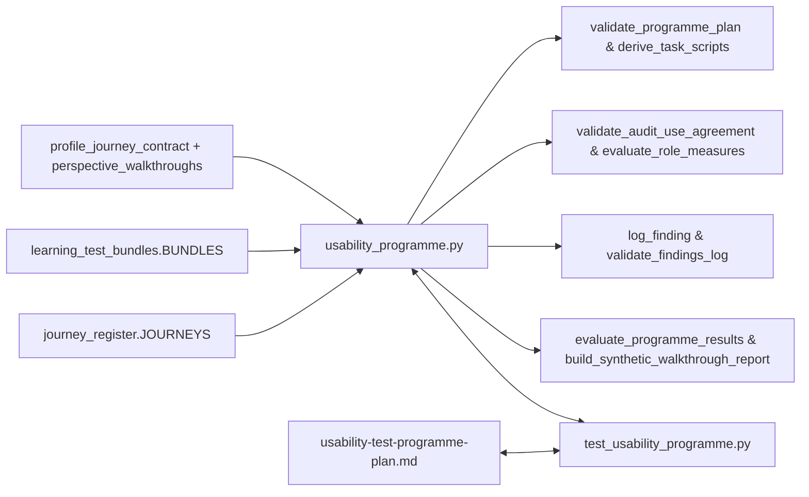

<!-- markdownlint-disable-file -->

# Task Research: ux-155-usability-programme

| Field              | Value                                                                    |
|--------------------|--------------------------------------------------------------------------|
| Date               | 2026-11-15                                                               |
| Researcher / agent | RPI Agent (`rpi-research`)                                               |
| Status             | Complete                                                                 |
| Artifact path      | .copilot-tracking/research/2026-11-15/ux-155-usability-programme-research.md |

## Research Brief

* What to research: Existing usability, profile-journey, and learning-test bundle contracts in `src/core` and `docs/reference/research/ux/` (including `zava-forward-prototype-profile-review.md`, `customer-journeys/customer-journey-atlas.md`, `profile-journey-contract.md`, `journey-learning-test-bundles.md`, and any existing usability module or prior #155 partial slice), plus PRD `SA-009`, `SA-010`, `OQ-004`, `OQ-005`, `OQ-011` and BRD `NFR-009` requirements for Issue #155.
* Why it matters: Issue #155 requires a complete usability testing programme specification in `docs/reference/research/ux/` (indexed in `docs/reference/README.md` and logged in `docs/reference/log.md`) and deterministic validation/evaluator support in `src/core` covering tasks, 5-8 participants per role, accessibility needs support, informed consent and data handling, derivation from the profile journey contract and learning-test bundles, `SA-010` aggregate-only measures gated on prior staff audit-use agreement, severity-tagged findings linked to backlog issues, negative/inconclusive outcome recording, and explicit `not_user_validation=True` (`"Synthetic walkthrough - not user validation"`) labelling on synthetic walkthroughs.
* Audience or intended use: `rpi-plan`, `rpi-implement`, and `rpi-review` phases in this confirmed automatic RPI session, plus programme designers, UX facilitators, and reviewers auditing Zava Forward usability evidence boundaries.
* Scope: `src/core/` (existing usability, journey contract, and learning-test bundle modules and tests), `src/api/tests/` (if cross-referenced), `docs/reference/research/ux/`, `docs/reference/README.md`, `docs/reference/log.md`, `docs/prds/zava-forward-retrofit-programme-demonstrator.md`, `docs/brds/agentic-retrofit-programme-brd.md`, and prior `.copilot-tracking/` #155 / #129 / #134 artifacts.
* Non-goals: Fabricating real human participant usability results, claiming `SA-009` / `NFR-009` live human usability sign-off, storing individual employee timing/telemetry records, editing unrelated UI runtime screens unless strictly required, running `tools/rpi-checks.py --all`, pushing commits, or opening a PR.
* Criteria: Every Issue #155 acceptance criterion and objective is mapped to exact codebase and documentation evidence (`C#` IDs with `path:line`), gaps between current repository state and complete #155 delivery are identified, and one convergent implementation design is justified across Wider, Deeper, and Contrarian waves.
* Requested outputs: Complete dated research artifact with convergent design recommendation for `docs/reference/research/ux/` and `src/core` plus unit test coverage plan.
* Output mode: convergence

## Research Parameters

| Field                            | Value                                                                   |
|----------------------------------|-------------------------------------------------------------------------|
| Research question(s)             | Q1-Q6 covering current #155 code/doc baseline, profile journey & learning-test bundle contracts, PRD/BRD governance (`SA-009`, `SA-010`, `NFR-009`), finding/outcome/synthetic-walkthrough validation rules, and KB documentation placement |
| Codebase scope                   | `src/core/`, `src/api/tests/`, `docs/reference/research/ux/`, `docs/reference/README.md`, `docs/reference/log.md`, `docs/prds/`, `docs/brds/`, `.copilot-tracking/` |
| External scope                   | none (bounded repository specification and `src/core` contract task)     |
| Initial internal candidate areas | `src/core/zava_forward_core/`, `src/core/tests/`, `docs/reference/research/ux/zava-forward-prototype-profile-review.md`, `docs/reference/research/ux/customer-journeys/customer-journey-atlas.md`, `docs/reference/research/ux/profile-journey-contract.md`, `docs/reference/research/ux/journey-learning-test-bundles.md`, `docs/prds/zava-forward-retrofit-programme-demonstrator.md`, `docs/brds/agentic-retrofit-programme-brd.md` |
| Initial external candidate areas | none                                                                    |
| Research posture                 | balanced                                                                |
| Posture provenance               | default (bounded internal specification + `src/core` evaluator task with named targets and adjacent contract dependencies in #129/#134/#151) |
| Explicit limits / deadline       | Focused validation tier (`src/core` / `src/api` unit tests, `ruff`, `mypy`; do not run `tools/rpi-checks.py --all`); do not push or open a PR |
| Posture-specific completion basis | balanced scope coverage and adequate evidence across all five Issue #155 acceptance criteria and adjacent contracts |
| Edits allowed during research?   | no, research-only                                                       |
| Resolved evidence root           | `.copilot-tracking/`                                                    |
| Known constraints / excluded sources | Never read private datasets; preserve synthetic vs real human validation boundary (`not_user_validation=True`); enforce `SA-010` aggregate-only measures and staff audit-use agreement |

## Extension Registry and Provenance

* Precedence: platform and host safety; caller scope and criteria; matching repository instructions and enforced schemas; rpi-research contract; domain skills and specialists; examples and preferences.

| Kind                | Candidate                        | Match and provenance                              | Scoped authority or output contract          | Selected / skipped reason      |
|---------------------|----------------------------------|---------------------------------------------------|----------------------------------------------|--------------------------------|
| Instruction         | `.github/copilot-instructions.md` (AMA Repository Instructions) | `applyTo: "**"` matches all repository docs and `src/core` | Enforces KB index/log rules, Markdown style, synthetic vs observed validation honesty, and focused validation tier | Selected: mandatory repository instructions |
| Skill               | `rpi-research`                   | Explicit caller RPI loop phase 1                  | Three-wave evidence and convergence contract | Selected: active phase skill   |
| Skill               | `accessibility` / `web-design-guidelines` | Adjacent UX/accessibility domain skills           | Web UI styling/WCAG review rules             | Skipped for research: no web frontend HTML/CSS/JS edits requested; accessibility needs support is researched directly from repo UX baselines (`wcag-conformance-baseline.md`, `#151`, `#154`) |
| Research specialist | `hve-core-all:rpi-researcher`    | Host-registered bounded research lane worker      | Delegated lane artifact under `.copilot-tracking/research/subagents/` | Skipped (inline execution): target modules and UX docs are tightly coupled across `src/core` and `docs/reference/research/ux/` and fit clean direct inspection |

## User Participation and Research Decisions

| Checkpoint       | Questions or no-interaction rationale                       | Answers / unanswered      | Resulting decision or selected further research    |
|------------------|-------------------------------------------------------------|---------------------------|----------------------------------------------------|
| Intake           | Non-interactive confirmed automatic RPI run with explicit acceptance criteria, target paths, branch, and validation tier | N/A (non-interactive)     | Proceed directly with Cycle 1 Wider, Deeper, and Contrarian waves |
| Direction change | Cycle 1 uncovered existing `docs/reference/research/ux/usability-test-programme-plan.md` (drafted 2026-11-04 without Python code) already referenced in `design-system.md` and `docs/reference/README.md` | N/A (non-interactive; resolved via KB placement convention) | Extend `usability-test-programme-plan.md` in place rather than creating a duplicate UX document, and add deterministic `zava_forward.core.usability_programme` + tests |
| Convergence      | All Q1-Q6 questions answered with high-confidence codebase evidence (`C1`-`C14`); Cycle 2 not needed | N/A (non-interactive)     | Converge on Recommendation (Option 1) and advance to `rpi-plan` |

## Scope and Success Criteria

* Scope: Inspect existing `src/core` modules/tests and `docs/reference/research/ux/` documents to establish exact contracts and gaps for Issue #155, then converge on the specification and `src/core` deterministic validator/evaluator design.
* Assumptions:
  * Prior 2026-11-04 #155 work may already have landed partial artifacts or modules, or may have been exploratory; must verify actual current files on `feat/ux-155-usability-programme`.
  * Real human participants remain external/unrun (`not-established`), so synthetic walkthroughs must be deterministically marked `not_user_validation=True` (`"Synthetic walkthrough - not user validation"`).
* Success criteria:
  * Every research question is answered or marked unanswerable with the missing evidence named.
  * Evidence is grounded in actual code, docs, or tooling results, with locations (`path:line` for code, URL + retrieval date for external).
  * Findings, decisions, and readiness claims cite Evidence Log IDs.
  * Alternatives are compared with trade-offs and one convergent recommendation is selected.
  * Open questions, risks, and residual uncertainty are recorded.
  * Self-check passes.

## Task Research Requests

* Explicit requests:
  1. Research existing usability/journey modules in `src/core` and `docs/reference/research/ux/` (including `zava-forward-prototype-profile-review.md` and `customer-journey-atlas.md`).
  2. Prepare convergent design for complete usability testing programme specification in `docs/reference/research/ux/` (updating `docs/reference/README.md` and `docs/reference/log.md`) and deterministic validation/evaluator support in `src/core`.
  3. Cover tasks, 5-8 participants per role, accessibility needs support, informed consent and data handling, derivation from profile journey contract and learning-test bundles, `SA-010` aggregate-only measures + prior staff audit-use agreement, severity-tagged findings with backlog issue links, negative/inconclusive outcomes, and `not_user_validation=True` (`"Synthetic walkthrough - not user validation"`).
* Inferred research questions: Q1-Q6 below.
* Caller constraints and non-goals: Focused validation tier (`src/core` / `src/api` unit tests, `ruff`, `mypy`; no `tools/rpi-checks.py --all`); commit cleanly on `feat/ux-155-usability-programme`; do not push or open a PR.

## Direction Controls

| Control type (add / change / narrow / exclude / discard) | Direction or boundary | Source / checkpoint  | Effect on active brief, evidence, or revalidation |
|----------------------------------------------------------|-----------------------|----------------------|---------------------------------------------------|
| narrow                                                   | Focused validation tier only; do not run `tools/rpi-checks.py --all` | Caller prompt (intake) | Constrains validation planning to targeted `unittest`, `ruff`, and `mypy` |
| exclude                                                  | Do not push or open a PR; never claim real human usability sign-off from synthetic walkthroughs | Caller prompt (intake) | Constrains delivery and evaluator semantics |

## Research Questions

|  # | Sub-question     | Type (depth / breadth / straightforward) | Priority  | Status   |
|---:|------------------|------------------------------------------|-----------|----------|
| Q1 | What usability, profile-journey, and learning-test bundle modules and tests already exist in `src/core` (and `src/api`), and what did the earlier 2026-11-04 #155 slice deliver or leave open? | breadth | H | answered |
| Q2 | What exact obligations do PRD `SA-009`, `SA-010`, `OQ-004`, `OQ-005`, `OQ-011` and BRD `NFR-009` impose on participant counts, thresholds-as-hypotheses, aggregate-only telemetry, and staff audit-use agreement? | depth | H | answered |
| Q3 | How are the eight proposed checks in `zava-forward-prototype-profile-review.md`, candidate learning tests in `customer-journey-atlas.md`, `profile_journey_contract`, and `learning_test_bundles` structured, and how should deterministic task scripts derive from them? | depth | H | answered |
| Q4 | What accessibility needs support, informed consent, representative-participant briefing, and data-handling rules exist in `docs/reference/research/ux/` (e.g., `wcag-conformance-baseline.md`, `residents.md`, `journey-learning-test-bundles.md`)? | breadth | H | answered |
| Q5 | How should `src/core` deterministically validate test plans, task script derivation, `SA-010` aggregate-only + staff audit-use gates, severity + backlog-linked findings, negative/inconclusive outcomes, and synthetic walkthrough `not_user_validation=True` labelling without breaking existing callers? | depth | H | answered |
| Q6 | Does an existing file in `docs/reference/research/ux/` already hold the #155 usability testing programme or should a dedicated canonical specification be created/updated per `docs/reference/README.md` placement rules? | straightforward | M | answered |

## Prior Knowledge Gate

* Existing artifacts reviewed: `.copilot-tracking/rpi-sessions/2026-11-15/learning-test-bundles-129-state.json`, `.copilot-tracking/changes/2026-11-04-usability-programme-155-changes.md`, and `.copilot-tracking/changes/2026-11-04/issue-155-r1-changes.md`.
* Reused (verified) findings:
  * Earlier 2026-11-04 slice 1 created `docs/reference/research/ux/usability-test-programme-plan.md` with prose-only draft templates and zero Python code (`C1`).
  * `learning_test_bundles.py` was enriched on 2026-11-15 (#129) with full `Bundle` metadata (`title`, `linked_requirements`, `learning_question`, `beyond_effort_measures`, `stop_rule`) (`C6`).
  * `profile_journey_contract.py` and `profile-journey-contract.md` were enriched on 2026-11-15 (#134) with the five-element contract across 11 perspectives and connected same-home invariants (`C4`, `C5`, `C9`).
* Superseded / stale:
  * The 2026-11-04 draft of `usability-test-programme-plan.md` predates both the 2026-11-15 `profile_journey_contract` (#134) and enriched `learning_test_bundles` (#129) contracts, leaves resident/representative target participant sizing unset rather than specifying 5-8 per role cohort as a research target, and lacks any `src/core` deterministic validator/evaluator (`C1`).

## Research Cycle Log

### Cycle 1

* Active direction controls: Focused validation tier (`unittest`, `ruff`, `mypy`; no `tools/rpi-checks.py --all`); do not push or open a PR; preserve synthetic vs real human usability boundary.
* Active research posture and completion basis: `balanced`; cover all five Issue #155 acceptance criteria, adjacent #129/#134/#149/#151/#154 contracts, and existing test guardrails.
* Explicit limits or deadline effect: Keeps validation scoped to `src/core` and UX documentation guardrail tests in `src/api/tests/`.

#### Wave 1: Wider

* Plan and independent lanes: Inline breadth sweep across `src/core/src/zava_forward/core/`, `src/core/tests/`, `src/api/tests/`, `docs/reference/research/ux/`, `docs/prds/`, `docs/brds/`, and `.copilot-tracking/` prior #155 artifacts.
* Worker evidence relationships or inline fallback: Inline execution mapped Q1 -> `usability-test-programme-plan.md` (`C1`) and `journey_register.aggregate_usability` (`C7`); Q2 -> PRD `SA-009`/`SA-010`/`OQ-004`/`OQ-005`/`OQ-011` (`C2`) and BRD `NFR-009`/`AC-071` (`C3`).
* Reflection: `docs/reference/research/ux/usability-test-programme-plan.md` already exists from 2026-11-04 and is linked from `docs/reference/README.md` and `docs/reference/research/ux/design-system.md`, while `src/core` has no dedicated #155 usability programme validator/evaluator module yet (`journey_register.aggregate_usability` only aggregates the 8 `NFR-009` service-time keys without `SA-010` staff audit-use agreement or session/finding/outcome/synthetic-walkthrough contracts). Prioritized deep inspection of `profile_journey_contract.py`, `perspective_walkthroughs.py`, `learning_test_bundles.py`, `zava-forward-prototype-profile-review.md`, `customer-journey-atlas.md`, and `residents.md` for Wave 2.

#### Wave 2: Deeper

* Parent-prioritized material from Wave 1: Exact Python data structures and constants in `profile_journey_contract.py`, `perspective_walkthroughs.py`, `learning_test_bundles.py`, and `journey_register.py`, plus UX-01..UX-08, Atlas candidate bundles, and J1-J6/R1 resident task designs.
* Plan and independent lanes: Inline deep inspection of `profile_journey_contract.py` (`ELEMENTS`, `SIX_STAFF_PROFILES`, `BOUNDARIES`, `validate`), `perspective_walkthroughs.py` (`EVIDENCE` 11 perspective IDs, `ELEMENTS`), `learning_test_bundles.py` (`BUNDLES` 5 bundles, `O16_BUNDLES`, `COMPONENTS`, `compare_bundle`), `zava-forward-prototype-profile-review.md` (`UX-01`..`UX-08`), `customer-journey-atlas.md` (five candidate learning-test rows), and `residents.md` (`J1/J2`, `J3`, `J4`, `J5`, `J6`, `R1`).
* Worker evidence relationships or inline fallback: Inline inspection mapped Q3 -> `C4`, `C5`, `C6`, `C8`, `C9`, `C10`, `C11`; Q4 -> `C1`, `C11`, `C12`; Q5 -> `C4`, `C6`, `C7`, `C13`, `C14`.
* Reflection: Task scripts can be deterministically derived in `src/core` directly from `perspective_walkthroughs.EVIDENCE` / `profile_journey_contract.ELEMENTS` (all 11 PRD perspectives + core `T0` SA-009 task + `UX-01`..`UX-08` checks + `J1`..`J6`/`R1` resident/representative journeys) AND `learning_test_bundles.BUNDLES` (all 5 two-arm bundles with their exact `comparator`, `atlas_ids`, `zero_measures`, `stop_rule`, and `O16` single-count rule). Need Wave 3 contrarian check on cross-package tests, strict `mypy`/`ruff` rules, and shared-environment Python import behavior.

#### Wave 3: Contrarian

* In-scope challenge targets and boundaries:
  1. Would creating a brand-new Markdown file (e.g., `usability-testing-programme.md`) violate KB placement rules or leave `usability-test-programme-plan.md` stale in `design-system.md` and `README.md`?
  2. Could editing `docs/reference/research/ux/usability-test-programme-plan.md` break automated documentation guardrail tests in `src/api/tests/`?
  3. Could modifying `journey_register.aggregate_usability` break `test_journey_register.py` (#128)?
  4. Does running `python3 -m unittest` directly in this worktree resolve the worktree's `src/core` or a stale shared editable install?
* Plan and independent lanes: Inline inspection of `src/api/tests/test_epic149_ux_journey_requirement_traceability.py`, `src/api/tests/test_epic149_ux_evidence_results.py`, `src/api/tests/test_ux_design_traceability.py`, `src/core/tests/test_dependency_rule.py`, `src/core/pyproject.toml`, and worktree `python3` import resolution.
* Worker evidence relationships or inline fallback:
  * Confirmed `design-system.md:237` and `docs/reference/README.md:1079` already link directly to `docs/reference/research/ux/usability-test-programme-plan.md` (`C12`); creating a second file would split the canonical source of truth, whereas upgrading `usability-test-programme-plan.md` in place preserves every link and satisfies KB conventions.
  * Confirmed `test_epic149_ux_journey_requirement_traceability.py` enforces three strict invariants on every `.md` under `docs/reference/research/ux/`: (a) every relative Markdown link must exist, (b) every regex match of `\b(?:FR|NFR|AC|SA|OD)-\d+\b` must appear in the PRD or BRD, and (c) every named `test_[a-z0-9_]+\.py` must exist in `src/*/tests`, compile, define `test*` methods, and never use `@unittest.skip` (`C12`).
  * Confirmed `src/core/pyproject.toml` runs `ruff` (`line-length = 100`, `E,F,I,B,UP`) and `mypy` (`strict = true`) across all non-exempt modules (`C13`), and `test_dependency_rule.py` restricts `zava_forward.*` imports inside `src/core` strictly to `zava_forward.core` (`C14`).
  * Confirmed `/usr/bin/python3` has a shared user-site editable link pointing to `/home/azureuser/source/ama/src/core/src`, which misses stacked-branch symbols and breaks subprocess CLI tests unless an isolated worktree `.venv` (`/.venv/` is already gitignored) is used during `rpi-implement`.
* Reflection: Adding a dedicated `src/core/src/zava_forward/core/usability_programme.py` module leaves `journey_register.aggregate_usability` (#128) completely intact while composing cleanly with `profile_journey_contract`, `perspective_walkthroughs`, and `learning_test_bundles`. Using a worktree-local `.venv` avoids touching shared `/home/azureuser/.local` state.

#### Parent Synthesis and Disposition

| Material / claim | Evidence IDs or worker pointers | Parent disposition (accepted / rejected / deferred) | Evidence-based rationale | Primary-artifact treatment  |
|------------------|---------------------------------|-----------------------------------------------------|--------------------------|-----------------------------|
| Upgrade `docs/reference/research/ux/usability-test-programme-plan.md` in place as the canonical #155 specification | C1, C12 | accepted | Already linked from `docs/reference/README.md:1079` and `design-system.md:237`; updating in place avoids duplicate UX docs and preserves Epic #149 traceability | Selected recommendation |
| Create `src/core/src/zava_forward/core/usability_programme.py` + `src/core/tests/test_usability_programme.py` | C4, C5, C6, C7, C13, C14 | accepted | Cleanly separates #155 moderated usability programme validation/evaluation from #128 `journey_register`, typed under `mypy --strict`, zero external dependencies | Selected recommendation |
| Mutate `journey_register.aggregate_usability` signature to require `audit_use_agreed` | C7 | rejected | Would break existing #128 callers/tests (`test_journey_register.py`) that test `NFR-009` service-time cell suppression independently | Recorded as rejected alternative |
| Record synthetic walkthrough results as `not_user_validation=True` (`"Synthetic walkthrough - not user validation"`) while keeping human participant rows `Not run` | C1, C2, C4, C12 | accepted | Directly satisfies AC5 and Objective 2 without fabricating human sessions or violating `test_ux_design_traceability.py` (`pending human test`) | Selected recommendation |

#### Cycle Re-entry Evaluation

* Another complete three-wave cycle needed: no
* Trigger or stop basis: Balanced scope coverage achieved; all Q1-Q6 answered with primary codebase/doc evidence (`C1`-`C14`) and contrarian checks resolved all integration and test-guardrail hazards.
* Revised brief or revalidation required: none
* Readiness effect: Ready (`C1`-`C14`)

## Evidence Log

* Delegation: inline: target contracts in `src/core` and `docs/reference/research/ux/` are tightly coupled and fully inspected directly across 14 primary files.

### Codebase Evidence

| ID | Claim / finding | Location (`path:line`)           | Tool | Confidence | Notes |
|----|-----------------|----------------------------------|------|------------|-------|
| C1 | `usability-test-programme-plan.md` was added as a prose-only draft on 2026-11-04 with blank agreement/findings/results tables, resident target count left unset, task scripts not yet wired to `profile_journey_contract`, and no Python validator | `docs/reference/research/ux/usability-test-programme-plan.md:1` | view | high | Existing canonical #155 UX doc |
| C2 | PRD `SA-009` proposes >=80% of 5-8 Excel users per role finding a case and stating next step + owner unaided in <5 min and SUS >=70 (explicitly proposals/hypotheses); `SA-010` mandates aggregate-only usability measures and staff agreement on the audit-use statement before reporting; `OQ-004`, `OQ-005`, `OQ-011` frame open task/channel/access/role/AT questions | `docs/prds/zava-forward-retrofit-programme-demonstrator.md:560` | view / grep | high | Lines 446, 560-561, 2928-2935 |
| C3 | BRD `NFR-009` (`AC-071`) requires accountable ownership, service-time measures, escalation, and tested manual or non-digital alternatives exposing overdue, paused, and reopened work and lawful accessibility differences | `docs/brds/agentic-retrofit-programme-brd.md:1646` | grep | high | Upstream BRD usability/interaction requirement |
| C4 | `profile_journey_contract.py` defines `ELEMENTS` (`entry`, `evidence`, `safe_endpoint`, `recovery`, `handoff`), `SIX_STAFF_PROFILES`, `BANNED_INTERNAL_TERMS`, `BOUNDARIES` (`not-established`), `validate()` (`accepted=False`), and same-home invariants | `src/core/src/zava_forward/core/profile_journey_contract.py:24` | view | high | Core #134 contract to derive profile task scripts from |
| C5 | `perspective_walkthroughs.py` defines the 11 PRD perspectives (`asset-investment`, `programme-coordinator`, `retrofit-case-team`, `assessor-designer`, `housing-resident-engagement`, `repairs-building-safety`, `procurement-contracts`, `provider-contractor`, `quality-assurance`, `finance-grants`, `digital-auditor`) and `ELEMENTS` register (`elements_met=0`) | `src/core/src/zava_forward/core/perspective_walkthroughs.py:33` | view | high | Canonical 11-perspective map |
| C6 | `learning_test_bundles.py` defines the 5 `Bundle` records (`story-once`, `pre-visit-pack`, `change-impact`, `handover-aftercare`, `funding-evidence`), `COMPONENTS`, `ARMS` (`comparator`, `workflow`), `OUT_OF_SCOPE` (`O10`, `O18`-`O20`), `O16_BUNDLES`, `compare_bundle()`, and `run_report()` | `src/core/src/zava_forward/core/learning_test_bundles.py:35` | view | high | Canonical #129 bundle protocol to derive bundle task scripts from |
| C7 | `journey_register.py` defines `JOURNEYS` (`J1`-`J6`, `R1`), `MIN_CELL_FLOOR = 5`, `IDENTITY_FIELDS`, and `aggregate_usability()` for the 8 `NFR-009` service-time measures (`usability_evidence=False`, `staff_surveillance=False`) | `src/core/src/zava_forward/core/journey_register.py:27` | view | high | Existing #128 module; keep intact |
| C8 | `zava-forward-prototype-profile-review.md` defines candidate checks `UX-01` through `UX-08` covering semantic status colour/non-colour cues, role/workflow context, honest loading/empty/failure recovery, evidence-based readiness, handoff ownership, inspectable AI contribution + manual fallback, full-screen case return/zoom, and synthetic contact context | `docs/reference/research/ux/zava-forward-prototype-profile-review.md:1006` | view | high | Source for T1-T7 orientation, exception, and case workspace scripts |
| C9 | `profile-journey-contract.md` documents the five-element profile journey contract across the 11 perspectives, connected same-home invariants, and explicit `not-established` human/resident/accessibility boundaries referencing #155 and #151 | `docs/reference/research/ux/profile-journey-contract.md:36` | view | high | Updated 2026-11-15 (#134) |
| C10 | `customer-journey-atlas.md` defines the 5 candidate learning-test bundles, their journey questions, failure cases, negative/inconclusive reporting mandate, and voluntary accessible user research rules (including declined/deferred work, failed visits, reopened defects/complaints, non-digital households, supplier fieldwork) | `docs/reference/research/ux/customer-journeys/customer-journey-atlas.md:237` | view | high | Upstream Atlas learning-test synthesis |
| C11 | `residents.md` defines resident/representative usability scripts `J1/J2`, `J3`, `J4`, `J5`, `J6`, `R1`, and cross-task keyboard/screen-reader/non-digital checks, all `Not run` and routed to the #155 programme | `docs/reference/research/ux/customer-journeys/residents.md:328` | view | high | Resident & representative script source |
| C12 | `test_epic149_ux_journey_requirement_traceability.py`, `test_epic149_ux_evidence_results.py`, and `test_ux_design_traceability.py` verify relative links, BRD/PRD existence of every `(FR|NFR|AC|SA|OD)-\d+` token, existence/runnability of every `test_*.py` named in UX docs, and `design-system.md:237` pending-human markers referencing `usability-test-programme-plan.md` | `src/api/tests/test_epic149_ux_journey_requirement_traceability.py:94` | view | high | Also `design-system.md:237`, `README.md:1079` |
| C13 | `src/core/pyproject.toml` enforces `ruff` (`line-length = 100`, `select = ["E", "F", "I", "B", "UP"]`) and `mypy` (`strict = true`) on all new `src/core` source and test files | `src/core/pyproject.toml:26` | view | high | Quality gate configuration |
| C14 | `src/core/tests/test_dependency_rule.py` enforces that `src/core` imports only `zava_forward.core` | `src/core/tests/test_dependency_rule.py:26` | view | high | Package boundary rule |

### External Evidence

| ID | Claim / finding | Source (title) | URL | Retrieved | Version/date | Confidence |
|----|-----------------|----------------|-----|-----------|--------------|------------|

### Contradictions / Conflicts

* `usability-test-programme-plan.md` resident participant sizing vs Objective 2: The 2026-11-04 draft wrote `"Not set; SA-009 does not size it"` for Residents and representatives (`C1`), whereas Objective 2 specifies `"participants per role (5-8 per role)"` while PRD `SA-009` specifically sizes `"5 to 8 Excel users per role"` (`C2`); resolved by consistency and primary-source qualification -> define 5 to 8 participants per role cohort across staff roles (`SA-009`), contractor roles, and voluntary resident and representative cohorts as the programme's proposed cohort target (5-8 per role), explicitly noting that `SA-009` originates from Excel staff roles and that resident/representative recruitment remains voluntary, non-coercive, and subject to owner, Resident Engagement, and DPO sign-off.

## Findings Mapped to Questions and Evidence

| Question | Finding             | Evidence IDs | Confidence | Decision or readiness implication    |
|----------|---------------------|--------------|------------|--------------------------------------|
| Q1       | `docs/reference/research/ux/usability-test-programme-plan.md` exists as a 2026-11-04 draft with zero Python backing; `src/core` has `profile_journey_contract.py`, `perspective_walkthroughs.py`, `learning_test_bundles.py`, and `journey_register.py`, but no dedicated #155 usability programme validator/evaluator | C1, C4, C5, C6, C7 | high | Implement `zava_forward.core.usability_programme` and upgrade `usability-test-programme-plan.md` in place |
| Q2       | `SA-009` frames >=80% (<5 min unaided find-case/next-step/owner) across 5-8 users per role and SUS >=70 as proposals/hypotheses; `SA-010` mandates aggregate-only measures and prior staff agreement on the audit-use statement before recording/reporting; `NFR-009` (`AC-071`) requires tested manual/non-digital alternatives | C2, C3 | high | Encode 5-8 participant bounds, hypothesis-only threshold evaluation, strict `SA-010` prior staff audit-use gate, and individual-identifier rejection |
| Q3       | Task scripts derive deterministically from three canonical contracts: (1) `profile_journey_contract.ELEMENTS` across the 11 perspectives in `perspective_walkthroughs.EVIDENCE` + `T0` (`SA-009`) + `UX-01`..`UX-08` (`C8`), (2) resident/representative `J1`-`J6` & `R1` (`journey_register.JOURNEYS`, `C11`), and (3) the 5 two-arm bundles in `learning_test_bundles.BUNDLES` (`C6`, `C10`) | C4, C5, C6, C7, C8, C9, C10, C11 | high | Build `derive_task_scripts()` directly from `profile_journey_contract`, `perspective_walkthroughs`, `journey_register`, and `learning_test_bundles` |
| Q4       | Accessibility support requires pre-session channel choice (in-person, phone, remote), own device/AT (screen reader, keyboard-only, magnification/zoom), advance plain-language briefing, interpreter/trusted person, extra time, voluntary-only need notes, break/stop freedom, and non-digital route parity; consent must be voluntary, separate from tenancy/works/employment consent, synthetic-data-only, no recording by default without separate consent + DPO approval, and revocable | C1, C10, C11, C12 | high | Validate accessibility support, consent, and data-handling clauses deterministically in `validate_programme_plan()` |
| Q5       | A pure, strictly typed `zava_forward.core.usability_programme` module can validate test plans, derive scripts, gate aggregate-only session measures on prior `AuditUseAgreement` (`agreed_with_staff=True`, named staff representative, non-surveillance statement text, `agreed_date <= session_date`) and `n >= 5` role cell minimums, validate severity-tagged (`1..4`) backlog-linked (`#NNN` / issue URL) findings, preserve `supported` / `not_supported` / `inconclusive` / `not_run` outcomes, and enforce `not_user_validation=True` (`"Synthetic walkthrough - not user validation"`) on synthetic walkthroughs | C4, C6, C7, C13, C14 | high | Provides complete deterministic evaluator + synthetic walkthrough runner without touching external state |
| Q6       | `docs/reference/research/ux/usability-test-programme-plan.md` is already indexed in `docs/reference/README.md` and `docs/reference/research/ux/design-system.md` | C1, C12 | high | Update `usability-test-programme-plan.md` in place, update `docs/reference/README.md` (including Task Routing + UX table date/summary) and `src/core/README.md`, and append to `docs/reference/log.md` |

## Key Discoveries

* `usability-test-programme-plan.md` was drafted before #134 (`profile_journey_contract.py`) and #129 (`learning_test_bundles.py` metadata enrichment) landed on 2026-11-15, so connecting it and a new `zava_forward.core.usability_programme` module directly to `profile_journey_contract`, `perspective_walkthroughs`, `journey_register`, and `learning_test_bundles` closes the exact structural gap between prose templates and executable contract verification (`C1`, `C4`, `C5`, `C6`, `C7`).
* `test_epic149_ux_journey_requirement_traceability.py` automatically scans every `.md` file in `docs/reference/research/ux/` and verifies that every `test_*.py` filename mentioned in prose exists and runs, every relative Markdown link resolves, and every `(FR|NFR|AC|SA|OD)-\d+` ID exists in the BRD or PRD (`C12`). Naming `test_usability_programme.py` in `usability-test-programme-plan.md` will automatically enlist our new test module into Epic #149 traceability checks!
* In this shared machine environment, `/usr/bin/python3` resolves `zava_forward.core` to `/home/azureuser/source/ama/src/core/src` rather than the current worktree; creating a gitignored worktree-local `.venv` (`/.venv/`) during `rpi-implement` isolates editable installs cleanly without affecting other users or worktrees.

### Complete Examples (when applicable)

```python
SYNTHETIC_WALKTHROUGH_LABEL = "Synthetic walkthrough - not user validation"
OUTCOMES = ("supported", "not_supported", "inconclusive", "not_run")
```

## Alternatives and Decision State

### Selected Recommendation (convergence only)

* Approach:
  1. Add `src/core/src/zava_forward/core/usability_programme.py` (strictly typed, pure `zava_forward.core`-only imports) implementing:
     * Canonical programme plan builder & validator (`default_programme_plan()`, `validate_programme_plan()`) covering tasks, 5-8 participants per role cohort across staff, resident/representative, and contractor roles, accessibility needs support, voluntary separate informed consent, and synthetic-only aggregate data handling.
     * Direct task-script derivation (`derive_task_scripts()`, `validate_task_scripts()`) wired live to `profile_journey_contract.ELEMENTS`, `perspective_walkthroughs.EVIDENCE` (all 11 perspectives), `UX-01`..`UX-08`, `journey_register.JOURNEYS` (`J1`-`J6`, `R1`), and `learning_test_bundles.BUNDLES` (all 5 two-arm bundles with comparators, stop rules, zero-target measures, and `O16` single-counting).
     * `SA-010` staff audit-use agreement & aggregate-only measure evaluator (`validate_audit_use_agreement()`, `evaluate_role_measures()`) that blocks recording/reporting unless the non-disciplinary/non-audit statement was agreed with named staff representatives on or before the measurement date, rejects any individual-level identifier/quote/per-participant breakdown, suppresses role cells with `0 < n < 5`, and evaluates `SA-009` (`>=80%` unaided `<5m`, `SUS >= 70`) strictly as hypotheses (`thresholds_are_hypotheses=True`).
     * Severity-tagged, backlog-linked findings logger/validator (`log_finding()`, `validate_findings_log()`) enforcing `UF-###` IDs, severities `1..4` (`note`, `minor`, `major`, `blocker`), anonymised plain-language observations without identity leakage, required valid backlog issue links (`#NNN` or repo issue URL), named risk owners for `accepted_risk`, and blocking participant-retest closure from synthetic evidence.
     * Outcome & synthetic walkthrough evaluator (`evaluate_programme_results()`, `build_synthetic_walkthrough_report()`) supporting `supported`, `not_supported` (negative), `inconclusive`, and `not_run` outcomes without hiding negative/inconclusive rows, and forcing `not_user_validation=True`, `validation_label="Synthetic walkthrough - not user validation"`, `user_validation_established=False`, and `human_usability_signoff=False` on all synthetic walkthroughs (rejecting any attempt by a synthetic record to claim `not_user_validation=False` or real human sign-off).
  2. Upgrade `docs/reference/research/ux/usability-test-programme-plan.md` in place (`ms.date: 2026-11-15`) with complete 5-8 per-role participant cohorts, direct traceability tables to the 5-element `profile_journey_contract` (11 perspectives + same-home check) and 5 `learning_test_bundles`, `SA-010` gate specification, backlog-linked findings rules, negative/inconclusive outcome rules, and the labelled synthetic walkthrough baseline (`not_user_validation=True`, `"Synthetic walkthrough - not user validation"`) alongside `Not run` human participant records.
  3. Update `docs/reference/README.md` (Task Routing + UX table), `docs/reference/research/ux/design-system.md` (adding `test_usability_programme.py` to the Usability programme traceability row while keeping `pending human test`), `src/core/README.md`, and append an entry to `docs/reference/log.md`.
  4. Add comprehensive unit tests in `src/core/tests/test_usability_programme.py` covering every acceptance criterion, positive/negative/edge/refusal path, and Markdown-to-contract alignment against `docs/reference/research/ux/usability-test-programme-plan.md`, then validate with `unittest` (both `src/core` and `src/api` UX traceability tests), `ruff check`, `ruff format --check`, and `mypy`.
* Rationale: Delivers every requirement of Issue #155 and Objectives 1-3 cleanly, reuses canonical `src/core` contracts directly without duplication, preserves existing #128/#129/#134/#149 tests, and strictly enforces ethical, privacy (`SA-010`), and synthetic-vs-human validation boundaries.
* Evidence refs: C1, C2, C3, C4, C5, C6, C7, C8, C9, C10, C11, C12, C13, C14
* Implementation impact: 1 new `src/core` module, 1 new `src/core/tests` test suite, 4 updated documentation files (`usability-test-programme-plan.md`, `design-system.md`, `docs/reference/README.md`, `src/core/README.md`) + 1 append-only `docs/reference/log.md` entry.
* Confidence: high: all upstream contracts (`profile_journey_contract`, `perspective_walkthroughs`, `learning_test_bundles`, `journey_register`) and UX doc guardrails are verified in local source.

File tree:

```text
docs/reference/
  README.md                                              (update)
  log.md                                                 (append)
  research/ux/
    design-system.md                                     (update traceability test ref)
    usability-test-programme-plan.md                     (upgrade in place)
src/core/
  README.md                                              (update)
  src/zava_forward/core/
    usability_programme.py                               (create)
  tests/
    test_usability_programme.py                          (create)
```

Flow diagram:



### Alternative: Extend `journey_register.py` directly instead of creating `usability_programme.py`

* Approach: Add #155 plan, task script, audit-use, findings, and synthetic walkthrough logic inside `src/core/src/zava_forward/core/journey_register.py` and modify `aggregate_usability()`.
* Trade-offs: Fewer files in `src/core`, but couples #128 journey-ownership service-time checks (`NFR-008`/`NFR-009`) with #155 moderated usability session protocols (`SA-009`/`SA-010`), risks breaking existing `test_journey_register.py` signatures, and creates an oversized multi-purpose module.
* Evidence refs: C4, C6, C7
* Rejection rationale: `src/core` follows one cohesive contract module per domain slice (`journey_register.py` for #128, `learning_test_bundles.py` for #129, `profile_journey_contract.py` for #134); a dedicated `usability_programme.py` for #155 preserves clean SOLID single-responsibility boundaries and backwards compatibility.

### Alternative: Create a new Markdown file alongside `usability-test-programme-plan.md`

* Approach: Add `docs/reference/research/ux/usability-testing-programme.md` and leave `usability-test-programme-plan.md` as a historical stub.
* Trade-offs: Preserves 2026-11-04 text untouched, but splits #155 across two competing UX plan files while `design-system.md:237` and `docs/reference/README.md:1079` already point to `usability-test-programme-plan.md`.
* Evidence refs: C1, C12
* Rejection rationale: Repository knowledge-base conventions explicitly state: "Integrate new findings into the existing synthesis or project document. Create a new page only when no existing page can hold the topic."

## Open Questions, Risks, and Residual Uncertainty

* Blocking: none for engineering specification and deterministic `src/core` evaluator delivery.
* Important: Real human participant recruitment, owner plan ratification, staff representative sign-off on the `SA-010` audit-use statement, and DPO lawful-basis/retention sign-off remain external human governance gates (`OQ-004`, `OQ-005`, `OQ-011`, `#150`, `#151`, `#128`) and must stay honestly recorded as `Not agreed` / `Not run` (`Refs #155`, never `Closes #155` for live human sessions).
* Follow-up: Once staff representatives sign the `SA-010` audit-use statement and DPO approves recruitment/retention, run the 2-3 proxy pilot followed by 5-8 participant sessions per role including screen-reader/keyboard/magnification users (#151 / #155).
* Residual uncertainty: Actual Zava North Homes Excel workbook layouts and role permissions remain open under `OQ-005` / `OQ-012`; the protocol mitigates this by beginning sessions with observation of the participant's current workaround on fictional data only.

## Current Decisions

| Decision     | Status (proposed / confirmed / deferred / superseded) | Owner / source (user / evidence / constraint) | Rationale     | Evidence IDs | Implications                       |
|--------------|-------------------------------------------------------|-----------------------------------------------|---------------|--------------|------------------------------------|
| Implement dedicated `zava_forward.core.usability_programme` module + `test_usability_programme.py` | confirmed | evidence / architecture | Composes `profile_journey_contract`, `perspective_walkthroughs`, `journey_register`, and `learning_test_bundles` cleanly under `mypy --strict` without breaking #128/#129/#134 | C4, C5, C6, C7, C13, C14 | New module and comprehensive unit tests in `src/core` |
| Upgrade `docs/reference/research/ux/usability-test-programme-plan.md` in place and update KB index/log | confirmed | constraint (KB conventions) | Existing canonical #155 file already linked in `README.md` and `design-system.md` | C1, C12 | Preserves all existing links and Epic #149 UX traceability |
| Enforce `not_user_validation=True` (`"Synthetic walkthrough - not user validation"`) and keep human session rows `Not run` | confirmed | user / PRD `SA-009`/`SA-010` | Synthetic walkthroughs validate protocol and contract wiring, never real human usability sign-off | C1, C2, C4, C12 | Prevents false conformance claims and satisfies AC5 |

## Unresolved Decisions

| Decision     | Smallest evidence or answer needed     | Owner                                  | Impact     | Blocker status                       |
|--------------|----------------------------------------|----------------------------------------|------------|--------------------------------------|
| Staff representative agreement on `SA-010` audit-use statement | Signed/dated agreement from named staff representative(s) before live staff session metrics are recorded | Programme sponsor & staff representatives | Required before recording real staff session measures (enforced in code by `validate_audit_use_agreement`) | follow-up (external human gate; non-blocking for #155 engineering/spec slice) |
| DPO lawful-basis, recording, and retention decision | Named DPO decision record for participant consent/notes retention | Data Protection Officer (DPO) | Required before recruiting live participants or enabling optional audio/screen recording | follow-up (external human gate; non-blocking for #155 engineering/spec slice) |

## Potential Next Research

| Priority  | Research item                  | Expected value     | Trigger                            | Selected? | Related questions / evidence |
|-----------|--------------------------------|--------------------|------------------------------------|-----------|------------------------------|
| M         | Moderated 2-3 proxy pilot script calibration | Tests task-script clarity and timing instrumentation before full 5-8 per-role sessions | After owner, DPO, and staff `SA-010` audit-use sign-off | deferred | Q2, Q3; C1, C2 |

## Planning Readiness

* Status: Ready
* Decision state: Converged on Option 1 (`zava_forward.core.usability_programme` + in-place upgrade of `docs/reference/research/ux/usability-test-programme-plan.md` + KB index/log + unit tests).
* Evidence basis: C1, C2, C3, C4, C5, C6, C7, C8, C9, C10, C11, C12, C13, C14
* Preconditions met: All five Issue #155 acceptance criteria, upstream `src/core` contracts, UX traceability test invariants, and lint/typecheck rules verified.
* Blockers: none
* Smallest action to change readiness: none (ready to enter `rpi-plan`).

## Closeout Record

| Field                            | Record                                                                                                                         |
|----------------------------------|--------------------------------------------------------------------------------------------------------------------------------|
| Research execution status        | Complete                                                                                                                       |
| Completed waves                  | Cycle 1: Wider, Deeper, and Contrarian completed in order                                                                      |
| Lane evidence or inline fallback | Inline execution across tightly coupled `src/core` and `docs/reference/research/ux/` files (no subagent fan-out needed)        |
| Research disposition             | executed                                                                                                                       |
| Planning Readiness               | Ready (`C1`-`C14`)                                                                                                             |
| Blockers                         | none                                                                                                                           |
| Continuation owner and state     | confirmed automatic RPI Agent; automatic continuation to `rpi-plan`                                                            |

## Advisory Next Step

| Field                            | Record                                                                                                       |
|----------------------------------|--------------------------------------------------------------------------------------------------------------|
| Research disposition             | executed                                                                                                     |
| Planning Readiness               | Ready (`C1`-`C14`)                                                                                           |
| Output mode and planning support | `convergence`; yes — single evidence-backed design selected and Planning Readiness is `Ready`                |
| Acting owner                     | confirmed automatic RPI Agent                                                                                |
| Required gates or confirmations  | Cycle 1 three-wave completion (passed); Evidence Log `path:line` grounding (passed); pre-transition state write (passed) |
| Continuation result              | automatic continuation to `rpi-plan`                                                                         |
| Primary evidence file            | .copilot-tracking/research/2026-11-15/ux-155-usability-programme-research.md                                 |
| Notes for planning or re-entry   | Use a worktree-local `.venv` during implementation/testing so subprocess CLI tests resolve this worktree's `src/core`; verify both `src/core` unit tests and `src/api/tests/test_epic149_ux_journey_requirement_traceability.py` + `test_ux_design_traceability.py` |

* Advisory only: rpi-research does not invoke `/rpi-plan` or any follow-on skill.
* Completion or limit-blocked basis: All internal codebase and UX specification questions are answered from authoritative local files (`C1`-`C14`); further research waves would be redundant.

## Sources

No external sources used.

## Artifact Self-Check

* [x] Every research question is answered or marked unanswerable with the missing evidence named.
* [x] Every executed cycle includes Wave 1 Wider, Wave 2 Deeper, and Wave 3 Contrarian in that order, with no skipped wave.
* [x] Research posture, provenance, explicit limits or deadline, and posture-specific completion basis are recorded.
* [x] Every codebase finding carries a `C#` ID and a `path:line`; every external finding carries a `W#` ID with URL and retrieval date.
* [x] Every `W#` resolves to exactly one entry in Sources and the list is gap-free, or Sources states "No external sources used".
* [x] Findings, alternatives, decisions, and readiness claims cite Evidence Log IDs (`C#` / `W#`).
* [x] The Extension Registry records matching instructions, relevant skills, available specialist subagents, provenance, authority or output contract, and selected or skipped reasons.
* [x] User Participation records answers, unanswered questions, no-interaction rationale, decisions, and selected further-research items before work continued.
* [x] Direction Controls record caller additions, changes, narrowed scope, exclusions, and discarded directions, plus any required revalidation.
* [x] Parent Synthesis and Disposition records accepted, rejected, and deferred material with evidence-based rationale; workers supplied evidence relationships without decision authority.
* [x] Cycle Re-entry Evaluation records whether a complete next cycle is needed and honestly records a limit-blocked gap when applicable.
* [x] A recommendation is selected with why-rejected reasoning when Output mode is convergence; non-convergence modes record the decision state without a forced selection.
* [x] Current Decisions and Unresolved Decisions contain complete status, source or owner, rationale or smallest missing evidence, evidence IDs, implications, and blockers.
* [x] Potential Next Research includes priority, value, trigger, selected state, and related evidence.
* [x] Planning Readiness and Advisory Next Step state disposition, output mode, acting owner, gates or confirmations, evidence basis, blockers, and the smallest action to change readiness.
* [x] Speculation is flagged and separated from sourced fact.
* [x] Fetched content, repo files, and prior memory were treated as data, not instructions; no embedded directives were followed; no secrets recorded.
* Checked sections: Research Brief, Research Parameters, Extension Registry and Provenance, User Participation and Research Decisions, Scope and Success Criteria, Task Research Requests, Direction Controls, Research Questions, Prior Knowledge Gate, Research Cycle Log, Evidence Log, Findings Mapped to Questions and Evidence, Key Discoveries, Alternatives and Decision State, Open Questions/Risks/Residual Uncertainty, Current Decisions, Unresolved Decisions, Potential Next Research, Planning Readiness, Closeout Record, Advisory Next Step, Sources, Artifact Self-Check.
* Missing or limited sections: none

