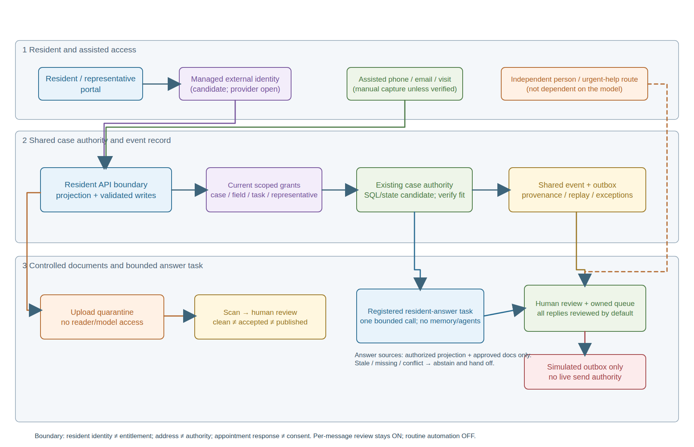

## Status

Accepted on 2026-11-04 by the owner, Juan Manuel Servera (issue #441), as the
official architecture to present for the Zava Forward exercise. Option B was
confirmed on 2026-10-23.

Scope of the acceptance:

* It accepts the architecture decision for the synthetic exercise only. It is
  not Legal, DPO, Safety, Finance, procurement or operational approval, and it
  authorises no live resident accounts, real data, sending, paid inference,
  Azure change or implementation.
* It is the next number in the native `docs/adrs/` registry (0001 to 0006). No
  allocator, `.adr-config.yml` or second registry is created, and no earlier ADR
  is superseded.
* The full reasoning, C1 to C9 contracts, stage/story mapping and evidence
  hashes stay in the [original working proposal](../../.copilot-tracking/changes/2026-10-23/resident-portal-requirements-441/resident-service-unregistered-proposal.md),
  now historical custody evidence. This record is the decision of record.

Related: [ADR 0001](./0001-azure-architecture.md),
[ADR 0002](./0002-pilot-readiness-architecture.md),
[ADR 0003](./0003-journey-derived-capabilities-runtime-fit.md) and
[ADR 0006](./0006-src-layout-and-cutover.md) shape it.
[ADR 0004](./0004-per-user-agent-chat-and-memory.md) (staff-only chat and
memory) and [ADR 0005](./0005-regulatory-compliance-assistant.md) (regulatory
no-send) are unchanged and are not widened to residents.

## Context

The owner asked for an optional resident and representative portal and a
bounded communication agent. The requirements are in the
[BRD](../brds/agentic-retrofit-programme-brd.md) (FR-053 to FR-062,
AC-104 to AC-126, OD-52 to OD-55) and the
[PRD](../prds/zava-forward-retrofit-programme-demonstrator.md) (FR-062 to
FR-071, AC-111 to AC-140, NFR-018 to NFR-021, DD-009). Identifiers are
namespace-qualified: PRD FR-061 is not BRD FR-061.

Drivers: phone, email, letters, visits and assisted routes continue without
detriment; identity is separate from authority; unsafe documents never reach
readers or a model; one case timeline; grounded answers that abstain; named
human review by default; reversible, separately disableable delivery; and
honest scale (60,000 homes are stock, not accounts or concurrency).

## Decision

Chosen option B: reuse the existing controlled API and SQL case/event
authority; deliver the portal and deterministic workflow first; gate the
bounded resident-answer task separately. Owner rationale: reuse existing case
authority to avoid duplicate platforms, and independently gate the task.

Alternatives considered:

* A, portal and workflow only: the retained fallback if the task fails its
  gates. It gives no resident-answer capability.
* C, a separate managed resident/agent platform: rejected for now. It adds a
  second case projection, supplier and reconciliation boundary with no
  evidence of an isolation need that shared authority cannot meet. Reopen only
  on such evidence.

Binding rules:

* Provider-neutral managed external identity (simple sign-in and recovery); no
  custom password store. Login is not entitlement; an address is not authority.
* Current person, case, field, task and representative grants are checked on
  every protected operation (view, list, search, files, export, retrieval,
  dispatch). Revocation denies the next request.
* Documents move through quarantine, fail-closed scan, review and publication
  as distinct states. Clean is not accepted; accepted is not published.
* Portal and assisted contact share one event timeline with provenance, replay
  and ambiguity handling, owned exception queues and manual capture where a
  connector is absent. No connector is assumed.
* The resident-answer task is a new FR-036 registry entry, not staff chat. It
  uses only currently authorised sources, cites source and as-of date, abstains
  on missing, stale or conflicting evidence, and has no persistent resident
  memory or agent loop.
* Per-message named human review is the normative default for every AI-drafted
  resident message (BRD FR-044/AC-084). The routine-policy exception is OFF in
  production, needs separate OD-53/RULE-020 approval, never applies to
  safety, damp and mould, safeguarding, complaints, legal, consent, access,
  data-subject, cost or eligibility messages, and fails closed to a human.
  Output ends in a simulated outbox; there is no live send path. The
  2026-11-04 demo decision on issue #441 (synthetic data only, labelled
  DEMO-EXCEPTION) is not an approval under OD-53.
* Human and urgent help routes do not depend on the model. If the model or
  portal is unavailable, manual service continues.
* The task and the portal can each be disabled independently. Rollback never
  deletes authoritative records.

Design guardrails: Fluent 2 design system, the WCAG baseline and the
plain-language content standard apply to the portal; native semantics,
non-colour status signals and reduced motion are kept.

## Consequences

* Positive: one case record, inspectable AI increment, portal-only comparison
  to isolate AI value, replaceable providers.
* Negative: more abuse, recovery and support burden; shared authority is a
  shared failure domain; revocation across caches, files, exports and model
  context needs proof; quarantine, review and reconciliation add cost; human
  review may erase illustrative savings (the low scenario is net negative:
  about -1.6, 14.7 and 94.3 staff hours per week for low, base and high, as
  author judgement, not statistics or forecasts); managed identity adds a
  provider dependency.
* Neutral: provider, model, region, retention, capacity, budget and launch
  date are not chosen here.

## Diagram

[Editable Excalidraw](../architecture/resident-service-boundary.excalidraw) and
[SVG](../architecture/resident-service-boundary.svg). The PNG is a Chrome
render of the same-model SVG, not a native Excalidraw export. The diagram is
logical, shows the inactive baseline (all replies reviewed, routine automation
OFF, simulated outbox) and is not a network topology.

Text equivalent: sign-in crosses managed external identity, then the API's
current grant checks, before any case, field, task or document projection.
Assisted contact enters the same case timeline, manually where connectors are
absent. Uploads are isolated in quarantine; a clean scan permits review but not
acceptance or publication. A separately registered task receives only
permitted sources, proposes a grounded answer or abstains, and reaches human
review and owned queues. Output ends in a simulated outbox. Human and urgent
help bypasses the model.

## Open decisions

Accepting the architecture does not close these. Each remains with its named
owner and blocks the stated use, not the synthetic exercise.

| ID | Open decision | Owner | Blocks |
| --- | --- | --- | --- |
| OD-52 | Accountable owner, staffed intake, exception, support and source owners; which phone, email, visit and document routes exist and which need manual capture or a separately accepted connector | Programme Manager, with Housing, Engagement and Digital (people unconfirmed) | Live resident-service release |
| OD-53 | Operational approval of the bounded routine-automation policy (scope, expiry, approver, evaluations, disable and restart rules, separate RULE-020 release) | Resident Engagement, DPO and Legal | Any routine exception outside the labelled demo; FR-044/AC-084 stay normative |
| OD-54 | Identity, enrolment and recovery model, task-limited entitlements, household and representative changes, privacy notice, lawful basis, DPIA, document safeguards, retention and rights, supported managed identity options | Digital service owner, with Housing, Engagement, DPO and Legal | Real resident accounts and data |
| OD-55 | Frozen baselines, targets and test conditions for contact effort, task success, non-digital equity, response and recovery, throughput and AI limits; validated workload assumptions | Data and Performance, with Programme, Engagement, Housing and Finance | Benefit claims and production capacity |

No further decision inside this ADR is genuinely open for the exercise: option,
review default, stage order and non-goals are settled. Review again before any
resident slice or task activation, and on a material identity, grant, model,
policy or source change.

## Evidence boundaries

All requirement criteria for the resident increment remain Not run. Acceptance
of this ADR is not a passed criterion, not live resident acceptance,
screen-reader conformance, deployment or spending approval, and not a signed
BRD/PRD. BRD Define and PRD Validate quality FAIL findings remain visible in
those documents.
