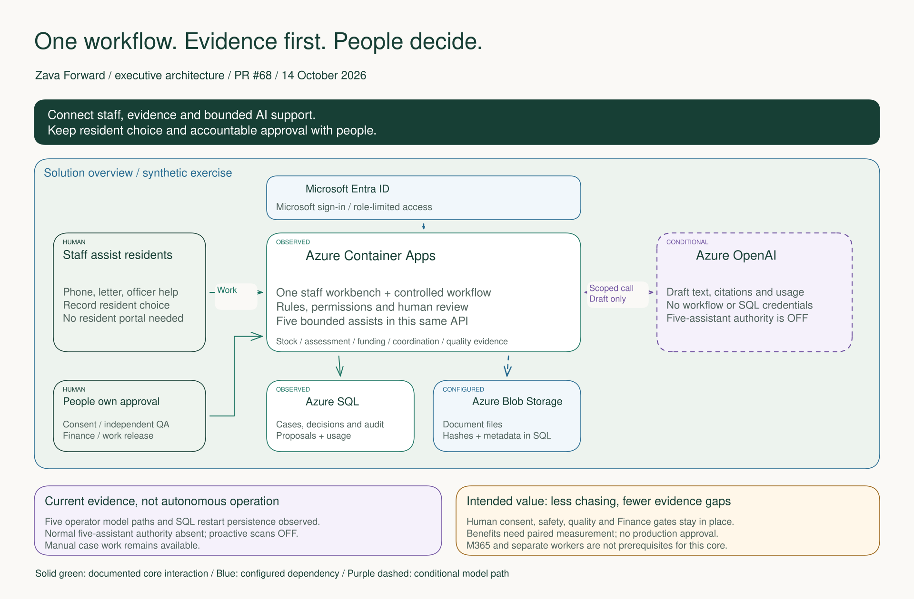
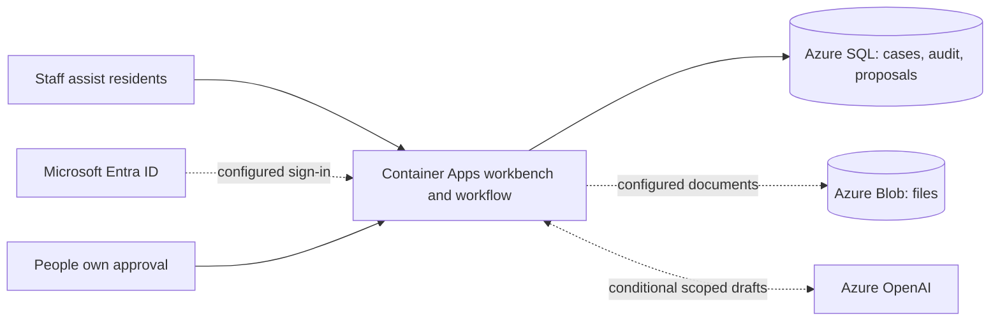
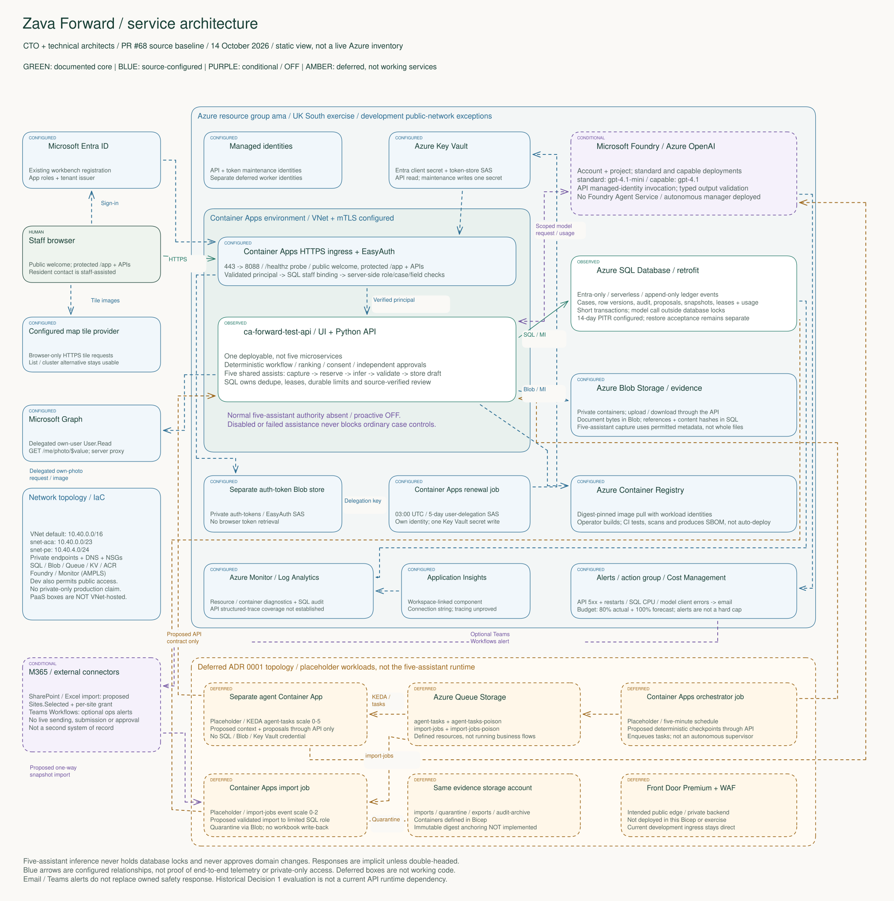
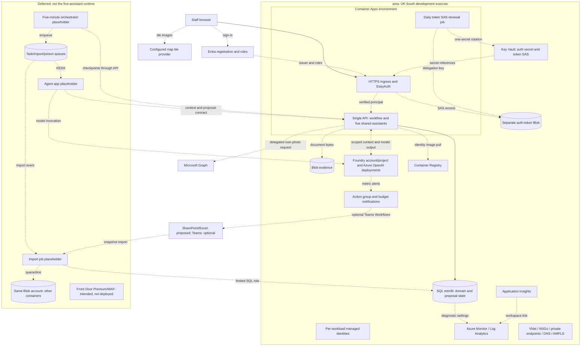

## Scope and Reading Order

These are two views of the same solution, not two alternative architectures.
They describe the sources on [PR #68](https://github.com/jmservera/ama/pull/68)
at commit `062434a1fedbf6a87d1374c767c2bf0a11491ab6`, using the dated
14 October handover for the deployed exercise. They are static source
representations, not a fresh Azure inventory, a new deployment or production
approval.

| Audience | Editable source | Vector preview | High-resolution image |
| --- | --- | --- | --- |
| CEO, CFO and executive sponsors | [Executive Excalidraw](./zava-forward-executive-architecture.excalidraw) | [Executive SVG](./zava-forward-executive-architecture.svg) | [Executive PNG](./zava-forward-executive-architecture.png) |
| CTO and technical architects | [Technical Excalidraw](./zava-forward-technical-architecture.excalidraw) | [Technical SVG](./zava-forward-technical-architecture.svg) | [Technical PNG](./zava-forward-technical-architecture.png) |

Open the `.excalidraw` file in Excalidraw or a compatible local editor. Boxes,
text and arrow bindings are native and editable; service icons are embedded
SVG images, not a flattened architecture picture. Related service labels,
icons and bodies are grouped. Read the technical image at full size or zoom
in the editable drawing rather than reducing it to a presentation thumbnail.

The executive view is intentionally a logical solution overview including
people. Its outer frame is not a network boundary. The technical resource
group and Container Apps environment boundaries are distinct; PaaS services
are not presented as VNet-hosted applications.

## Presentation Adaptation

The [24-slide capstone deck](../capstone/deck/zava-forward-executive-draft.pptx)
adapts these materials into native editable PowerPoint architecture on
slides 10, 19, 23 and 24. The executive view remains on the main route;
runtime, operations and deferred topology use readable optional slides
rather than a reduced full technical image.
[Presentation handover and previews](../capstone/README.md#architecture-and-ux-refresh-2026-10-14)
record the UX improvements, source mapping and remaining human checks.
The Excalidraw sources here retain their original baseline and editing
authority; a presentation adaptation is not a new deployment or decision.

## Executive Architecture

### Legend

* Solid green arrows: interactions documented for the existing core.
* Blue dashed arrows and blue cards: configured dependencies.
* Purple dashed model path: conditional assistance, not standing autonomy.
* Human cards: resident choice and accountable staff approval, not Azure
  services or automated agents.

### Key Relationships

Staff assist residents without requiring a resident portal. Microsoft sign-in
and service-side permissions protect the workbench. One API hosts the workflow
and five bounded assistants; SQL retains controlled records and proposals,
while Blob holds document files. AI returns drafts for review, not consent,
quality acceptance, bookings, work release, funding submission or payment.

The five capabilities are stock prioritisation, assessment preparation,
funding evidence, works/resident coordination and quality evidence.
They are not five applications or five autonomous programme managers.
Normal five-assistant authority is absent and proactive scans are off after
the finite operator QA. Other existing AI draft routes are not being declared
disabled by that statement.

The intended outcome is less chasing and fewer evidence gaps without
weakening resident choice or independent review. It is a value hypothesis:
the operator model paths and persistence checks do not measure business
benefit.

The following text topology preserves the executive drawing's component and
relationship structure:

## Technical Architecture

### Legend

* Green: core implementation or interaction documented in the dated handover.
* Blue: configuration or infrastructure-source relationship, not an assertion
  that every path has been independently accepted.
* Purple: conditional connector or assistant path requiring effective
  authority, permissions or setup.
* Amber: deferred design. Worker images remain placeholders; the five
  assistants do not run through those queues.
* Arrowheads show the initiator/dependency direction. Responses are implicit;
  the double-headed model link shows context out and drafts/usage back.
* A grouped diagnostics path represents resource/container diagnostic settings
  to Log Analytics; it is not proof of full application tracing.

### Key Relationships

| Interaction | Contract and boundary | Evidence |
| --- | --- | --- |
| Browser -> sign-in -> protected app | Existing Entra registration; EasyAuth verifies identity. The API rechecks the SQL staff binding, role, case scope and fields. `/` is public; `/app` and data APIs are protected. | [Container Apps/auth](../../infra/modules/containerapps.bicep), [auth provider](../../mvp/zavaforward_mvp/auth.py) |
| Ingress -> API | HTTPS ingress targets port 8088; `/healthz` is the implemented probe. The Python server serves the UI and APIs in one deployment. | [Container Apps](../../infra/modules/containerapps.bicep), [server](../../mvp/zavaforward_mvp/server.py) |
| API -> SQL | Managed-identity access; controlled workflow, audit and proposal state. Five-assistant deduplication, reservations and fenced claims use short transactions; inference occurs outside database locks. | [SQL module](../../infra/modules/sql.bicep), [SQL adapter](../../mvp/zavaforward_mvp/mssqlstore.py), [assistants](../../mvp/zavaforward_mvp/assistants.py) |
| API -> Blob | The document adapter transfers bytes to the `evidence` container; SQL retains references and content hashes. Five-assistant capture uses permitted metadata, not arbitrary document contents. | [Document adapter](../../mvp/zavaforward_mvp/documents.py), [storage](../../infra/modules/storage.bicep), [capture allowlists](../../mvp/zavaforward_mvp/assistants.py) |
| API -> model -> proposal | Direct Azure OpenAI chat-completions calls from the API managed identity. Foundry account/project and `standard`/`capable` deployments provide models, not a deployed Foundry Agent Service orchestrator. Citation/schema validation precedes storage. | [AI client](../../mvp/zavaforward_mvp/ai.py), [Foundry](../../infra/modules/foundry.bicep), [ADR 0002 runtime](../adrs/0002-pilot-readiness-architecture.md#five-assistant-exercise-runtime-2026-10-13) |
| Human -> proposal review | Current permission, source, version and status are rechecked. Source verification precedes acceptance/edit. Review updates proposals/audit, not controlled domain approvals. | [Assistants](../../mvp/zavaforward_mvp/assistants.py), [five PRD contracts](../prds/zava-forward-retrofit-programme-demonstrator.md#five-reactive-and-proactive-assistants-2026-10-13) |
| EasyAuth -> token Blob; renewal -> vault | A separate private `auth-tokens` store holds delegated tokens. The daily 03:00 UTC job obtains a five-day user-delegation SAS and updates one vault secret. EasyAuth uses that reference; no browser token retrieval. | [Token-store module](../../infra/modules/authTokenStore.bicep), [renewal implementation](../../mvp/zavaforward_mvp/token_store.py) |
| API -> Graph; browser -> tile provider | Graph receives the current user's delegated `User.Read` token for `/me/photo/$value`; photo bytes, not tokens, return to the browser. The browser fetches configured map tiles separately; there is a list/cluster alternative. | [Photo proxy](../../mvp/zavaforward_mvp/profile.py), [server](../../mvp/zavaforward_mvp/server.py), [browser](../../mvp/web/app.js) |
| Workloads -> ACR; operator -> deployment | Images pull using workload identities. Operator builds/deploys are distinct from GitHub CI's tests, non-root image checks, scan and SBOM. No automatic Azure deployment is implied. | [Registry](../../infra/modules/registry.bicep), [CI](../../.github/workflows/mvp-ci.yml), [operator handover](../../infra/README.md#five-assistant-version-current-handover) |
| Diagnostics/metrics -> operations | Resource/container diagnostics and SQL audit target Log Analytics. Application Insights is workspace-linked and its connection string is supplied; full structured traces are not established. API/model/SQL alerts target the action group. | [Monitoring](../../infra/modules/monitoring.bicep), [alerts and budget](../../infra/main.bicep) |
| Budget -> notification | 80% actual and 100% forecast alerts notify the configured email; this is not a hard spending stop. Shared assistant reservations and effective scoped authority are separate controls. | [Budget](../../infra/main.bicep), [assistant limits](../../mvp/README.md#operator-authority-and-finite-allowance) |
| Deferred schedule/queues/workers | Five-minute orchestrator -> `agent-tasks` -> separate agents; `import-jobs` -> import job -> limited SQL role and Blob quarantine. Agent/model and API/checkpoint paths are proposed contracts, not working placeholder code. | [Deferred workload definitions](../../infra/modules/containerapps.bicep), [ADR 0001](../adrs/0001-azure-architecture.md#decisions) |
| Conditional M365 -> workbench boundary | SharePoint/Excel imports are proposed, one-way and permission-gated. `Sites.Selected` plus a site grant is not the own-photo `User.Read` permission. Teams Workflows is an optional operations webhook, never an approval or safety-response path. | [M365 design](../adrs/0001-azure-architecture.md#m365-configuration-integration-and-use), [site grant](../../infra/scripts/grant-sharepoint-access.sh), [action group](../../infra/modules/monitoring.bicep) |

The reduced text topology below groups supporting resource declarations.
The Excalidraw view carries the detailed service labels, statuses and routes.

## State, Trade-Offs and Known Limits

The latest recorded exercise revision is `ca-forward-test-api--0000012`,
runtime source `cd14b3b379026a87ebfa3e9058ac10c0df7888eb`. The handover records
five real operator model paths and independent SQL-content/restart proof,
not a staff-browser acceptance session, calibrated semantic quality or benefit.
No cloud read, paid model call, new authority or resource change was performed
to create these diagrams.

* The existing API/SQL proposal service is the current implementation.
  Separate queue workers would add deployment, failure and permission
  boundaries; they remain deferred rather than being drawn as necessary
  infrastructure for the five capabilities.
* Current exercise hosting uses documented development network exceptions.
  Bicep declares VNet integration, two subnets, NSGs, private endpoints and DNS.
  Public access is also allowed in development. The default production
  profile and intended Front Door public edge/private backend are not the
  observed exercise.
  Network ranges in the drawing are IaC defaults, not newly measured routes.
* SQL append-only events and a hash chain are not proof of the proposed
  immutable external digest anchor. The `audit-archive` policy is defined
  unlocked in Bicep; the application does not implement/verify the complete
  anchoring workflow.
* `EVIDENCE_STORE=sharepoint` is a topology parameter, not an implemented
  SharePoint document adapter. The current adapter chooses local or
  `azure-blob`; diagrams do not claim that setting a parameter creates a
  connector.
* The earlier ADR 0001 API identity table excludes model invocation for the
  separate-runner design. `enableApiAi=true` and ADR 0002 deliberately provide
  the current API's direct model path. This is a dated topology distinction,
  not proof that the original table applies unchanged to the MVP.
* Bicep scale settings are design/configuration, not a new capacity test.
  Model failure preserves manual work; SQL failure can block controlled writes.
  Token-renewal failure requires action before SAS expiry. Safety intake must
  have its own named human route, not depend on AI or Teams.

No significant new architectural choice is made by these views; existing
[ADR 0001](../adrs/0001-azure-architecture.md) and
[ADR 0002](../adrs/0002-pilot-readiness-architecture.md) retain decision history.

## Complete Capstone Guide Check

Checked against the complete [assessment guide](../reference/method/ama-capstone-assessment-guide.md),
not only its architecture criteria. This is a source/communication check,
not an official score, independent stakeholder review or panel acceptance.

| Criterion | Diagram contribution and remaining evidence |
| --- | --- |
| A1 Architecture | Explicit single-runtime and deferred boundaries; scale settings are configuration, not performance proof. |
| A2 Trade-offs | Existing lean API versus deferred workers; private production target versus current development; ADR alternatives retained. |
| A3 Governance | Identity, field/case gates, human approvals, network exceptions and AI scope shown; legal/privacy and production approvals remain separate. |
| A4 Completeness | Working core is distinguished from placeholders and conditional connectors; no blanket end-to-end acceptance. |
| A5 Operations | Diagnostics, renewal, failure domains, alerts and budget semantics shown; measured SLOs/unit economics remain open. |
| A6 AI evaluation | Direct model path and typed/cited proposals shown; model benefit and semantic calibration are not inferred from five successful calls. |
| A7 Autonomy | Five assistants are bounded proposal services; proactive OFF and absent standing authority are explicit. |
| B1 Narrative | Executive view centres one accountable workflow, not a service catalogue; live narrative delivery is unobserved. |
| B2 Audience | Separate executive and CTO views of the same architecture; audience comprehension is not independently tested. |
| B3 Demo | Figures can explain the control boundary; no live demo or recovery is manufactured. |
| B4 Q&A | Sources and unknowns support challenge; actual composure/depth require observed Q&A. |
| B5 Delivery | No rehearsal, timing or presenter performance follows from diagram creation. |
| B6 Written craft | Editable sources, previews, text equivalents and source-linked interaction contracts; native editor/render checks retained. |
| B7 Evidence | PR baseline and dated handover are distinguished from target design; benefit remains a hypothesis. |
| C1 Discovery | Staff, residents, professional and Finance authority remain distinct; company facts are not invented. |
| C2 Listening | Owner-requested format and audiences honoured; no stakeholder dialogue/acceptance simulated. |
| C3 Honesty | Public-network, deferred-code, telemetry, audit and AI-acceptance limits are disclosed. |
| D1 Substance | These explain the project; they are not a separately completed thought-leadership artifact. |
| D2 Craft | Diagram publication does not establish a separate artifact's publish-readiness. |
| D3 Reach | Committing diagrams is not evidence of external dissemination or reviewer acceptance. |

Section floors A >= 21/35, B >= 21/35, C >= 9/15 and D >= 9/15, no individual
criterion scored 1, thought-leadership submission and required masterclasses
remain separate requirements. No floor clearance is claimed.

## Icon Provenance and Editing

Azure images are unmodified SVGs from Microsoft's
[official architecture icon pack](https://learn.microsoft.com/en-us/azure/architecture/icons/),
`Azure_Public_Service_Icons_V24.zip`, retrieved 14 October 2026. Microsoft
permits copying/distribution/display for architecture diagrams, training and
documentation; other rights are reserved. Product names stay adjacent, aspect
ratios are preserved, and icons are neither cropped, flipped nor recoloured.
Custom application modules and people are not represented as Microsoft
products.

[Asset provenance](./assets/README.md) identifies each selected icon.
The authoring script and source manifest are retained in the dated
[working folder](../../.copilot-tracking/architecture-diagrams/2026-10-14/zava-forward/).
Native Excalidraw sources are the editing authority; SVG/PNG are previews.
Both were exported locally through Excalidraw, without uploading repository
content to a third-party drawing service.

[Authoring and validation evidence](../../.copilot-tracking/architecture-diagrams/2026-10-14/zava-forward/validation.md)
records native group/arrow editing, browser layout checks, icon integrity,
preview dimensions and delivery hashes.
