## Architectural Principle and Evidence Boundary

Zava Forward isolates core data, identity, registry, AI, telemetry, and IoT services on private endpoints inside a dedicated subnet (`snet-pe`) with private DNS resolution and Microsoft Entra managed-identity authentication, eliminating literal secrets from Bicep templates, parameter files, and application source code.

* Machine-readable contract: [`infra/network-posture-inventory.json`](../../infra/network-posture-inventory.json) cross-checked against [`infra/scripts/bicep_inventory.py`](../../infra/scripts/bicep_inventory.py) and [`infra/secret-inventory.json`](../../infra/secret-inventory.json) by `infra/tests/test_network_posture.py`.
* Committed parameter baseline: `infra/main.bicepparam`, `infra/main.test.bicepparam`, and `infra/main.pilot.example.bicepparam` all set `allowPublicNetworkAccess = false`. `infra/modules/guard.bicep` mechanically blocks `allowPublicNetworkAccess == true` whenever `deploymentProfile == 'production'`, `environmentName == 'pilot'`, or `demoDirectIngress == true`.
* Unconditional private stores: Azure SQL (`infra/modules/sql.bicep`) and the IoT Hub telemetry Event Hubs namespace (`infra/modules/iothub.bicep`) hardcode `publicNetworkAccess: 'Disabled'` across every deployment profile.
* Evidence boundary: passing offline Bicep compilation and `infra/tests/test_network_posture.py` proves template topology, private-endpoint wiring, zero-secret app settings, and documentation parity. It does not claim a live Azure Front Door Shared Private Link approval or live VNet DNS resolution run.

For the executive and technical Excalidraw architecture views, see [`docs/architecture/README.md`](./README.md). For operator runbooks and Key Vault secret rotation procedures, see [`infra/README.md`](../../infra/README.md).

## Network Topology Diagram (`infra/modules/network.bicep`, `infra/modules/envDns.bicep`, `infra/main.bicep`)

Every subnet, network security group, VNet link, private DNS zone, and private endpoint in `infra/modules/network.bicep`, `infra/modules/envDns.bicep`, and `infra/main.bicep` is represented below and verified offline by `infra/tests/test_network_posture.py`.

```mermaid
flowchart TB
    subgraph Edge["Optional Public Edge (enablePublicEdge)"]
        AFD["Front Door Premium + WAF<br/>infra/modules/edge.bicep"]
    end

    subgraph VNet["VNet: vnet-${prefix} (10.40.0.0/16) - infra/modules/network.bicep"]
        subgraph SnetACA["Subnet: snet-aca (10.40.0.0/23)<br/>NSG: nsg-${prefix}-aca<br/>Delegation: Microsoft.App/environments"]
            CAE["Internal ACA Environment: cae-${prefix}<br/>ca-${prefix}-api + scheduled/event jobs<br/>User-assigned MIs: id-${prefix}-*"]
        end

        subgraph SnetACADemo["Conditional Subnet: snet-aca-demo (10.40.6.0/23)<br/>Condition: demoDirectIngress<br/>NSG: nsg-${prefix}-aca-demo<br/>Delegation: Microsoft.App/environments"]
            CAEDemo["Direct-HTTPS Demo ACA Environment<br/>Entra EasyAuth required; backing stores stay private"]
        end

        subgraph SnetPublisher["Standalone Temporary Subnet: issue360-publisher-20261019-subnet (10.40.8.0/28)<br/>infra/private-proof-publisher.bicep (undeployed)<br/>NSG: issue360-publisher-20261019-nsg (defaultOutboundAccess: false)"]
            PubVM["Temporary Private ACR Publisher VM"]
        end

        subgraph SnetPE["Subnet: snet-pe (10.40.4.0/24)<br/>NSG: nsg-${prefix}-pe (AllowVnetHttps 443, AllowVnetSql 1433, DenyAllInbound)<br/>privateEndpointNetworkPolicies: Enabled"]
            PESQL["pe-${sql} (groupId: sqlServer)<br/>Azure SQL Server (publicNetworkAccess: Disabled)"]
            PEBlob["pe-${st}-blob (groupId: blob)<br/>Core Storage Blobs + WORM"]
            PEQueue["pe-${st}-queue (groupId: queue)<br/>Core Storage Queues"]
            PEAuthBlob["pe-${stauth}-blob (groupId: blob)<br/>Conditional: enableEntraTokenStore"]
            PEKV["pe-${kv} (groupId: vault)<br/>Key Vault (RBAC-only)"]
            PEACR["pe-${acr} (groupId: registry)<br/>Container Registry (Premium, admin disabled)"]
            PEFoundry["pe-${aif} (groupId: account)<br/>AI Services / Foundry (disableLocalAuth: true)"]
            PEIoT["pe-${iot} (groupId: iotHub)<br/>IoT Hub (disableLocalAuth: true)"]
            PEEH["pe-eh-${iot} (groupId: namespace)<br/>Telemetry Event Hub (publicNetworkAccess: Disabled)"]
            PEAMPLS["pe-ampls (groupId: azuremonitor)<br/>AMPLS PrivateOnly -> Log Analytics + App Insights"]
        end
    end

    subgraph DNS["Private DNS Zones + VNet Links: link-${prefix} (registrationEnabled: false)"]
        ZSQL["sql: privatelink.database.windows.net"]
        ZBlob["blob: privatelink.blob.core.windows.net"]
        ZQueue["queue: privatelink.queue.core.windows.net"]
        ZVault["vault: privatelink.vaultcore.azure.net"]
        ZACR["acr: privatelink.azurecr.io"]
        ZCog["cognitive: privatelink.cognitiveservices.azure.com"]
        ZOAI["openai: privatelink.openai.azure.com"]
        ZAIS["aiServices: privatelink.services.ai.azure.com"]
        ZMon["monitor: privatelink.monitor.azure.com"]
        ZOMS["oms: privatelink.oms.opinsights.azure.com"]
        ZODS["ods: privatelink.ods.opinsights.azure.com"]
        ZAgt["agentsvc: privatelink.agentsvc.azure-automation.net"]
        ZIoT["iotHub: privatelink.azure-devices.net"]
        ZSB["iotHubEndpoint: privatelink.servicebus.windows.net"]
        ZACA["acaInternalDefaultDomain: <aca-defaultDomain><br/>Conditional: !externalEnvironment (infra/modules/envDns.bicep)"]
    end

    subgraph Exceptions["Outside-Core Bounded Exercise Exceptions (NP-EX-001..NP-EX-007)"]
        EX2["NP-EX-002: infra/resident-assistant.bicep<br/>Opt-in enabled=false Sweden Central AOAI (disableLocalAuth: true)"]
        EX3["NP-EX-003: infra/iot-hub-live.bicep<br/>Child consumer-group/diag on existing private IoT Hub"]
        EX4["NP-EX-004: infra/live-simulator-job.bicep + live-receiver-job.bicep<br/>Read-only ACA AzureFile synthetic X.509 cert share"]
        EX5["NP-EX-005: infra/resident-demo.bicep<br/>Standalone showcase app consuming existing private KV/ACR + MSI SQL"]
        EX6["NP-EX-006: EmptyDir /state/public-simulation/store.sqlite<br/>Opt-in volatile simulation scratch volume"]
    end

    AFD -. "sharedPrivateLinkResource (groupId: managedEnvironments)" .-> CAE
    CAE -->|"HTTPS 443 / TDS 1433 via Entra MI"| SnetPE
    CAEDemo -. "HTTPS 443 / TDS 1433 via Entra MI" .-> SnetPE
    PubVM -. "HTTPS 443 AcrPush" .-> PEACR
    VNet ===|"15 virtualNetworkLinks: link-${prefix}"| DNS
    PESQL --- ZSQL
    PEBlob --- ZBlob
    PEAuthBlob --- ZBlob
    PEQueue --- ZQueue
    PEKV --- ZVault
    PEACR --- ZACR
    PEFoundry --- ZCog
    PEFoundry --- ZOAI
    PEFoundry --- ZAIS
    PEIoT --- ZIoT
    PEIoT --- ZSB
    PEEH --- ZSB
    PEAMPLS --- ZMon
    PEAMPLS --- ZOMS
    PEAMPLS --- ZODS
    PEAMPLS --- ZAgt
    PEAMPLS --- ZBlob
    CAE --- ZACA
```

## VNet Subnets and Network Security Groups

`infra/modules/network.bicep` provisions `vnet-${prefix}` (`10.40.0.0/16`) with two unconditional subnets (`snet-aca` and `snet-pe`) and one conditional direct-ingress demo subnet (`snet-aca-demo`). `infra/private-proof-publisher.bicep` defines one undeployed temporary child subnet for bounded private ACR image publishing.

| Subnet ID | Bicep template | Default CIDR | NSG | Delegation or policy | Condition | Inbound / outbound posture |
| --- | --- | --- | --- | --- | --- | --- |
| `snet-aca` | `infra/modules/network.bicep` | `10.40.0.0/23` | `nsg-${prefix}-aca` | Delegated to `Microsoft.App/environments` | Unconditional | Inbound TCP 443 from `VirtualNetwork` and `AzureLoadBalancer`; outbound TCP 443 and 1433 to `snet-pe` (`10.40.4.0/24`) and HTTPS 443 to `Internet` for Entra/Graph/Azure control plane |
| `snet-pe` | `infra/modules/network.bicep` | `10.40.4.0/24` | `nsg-${prefix}-pe` | `privateEndpointNetworkPolicies: 'Enabled'` | Unconditional | `AllowVnetHttps` (TCP 443 from `VirtualNetwork`, priority 100), `AllowVnetSql` (TCP 1433 from `VirtualNetwork`, priority 110), `DenyAllInbound` (`*` from `*`, priority 4096) |
| `snet-aca-demo` | `infra/modules/network.bicep` | `10.40.6.0/23` | `nsg-${prefix}-aca-demo` | Delegated to `Microsoft.App/environments` | `demoDirectIngress` | Inbound TCP 443 from `Internet` (guarded by Entra EasyAuth) and `AzureLoadBalancer`; outbound TCP 443 and 1433 to `snet-pe` (`10.40.4.0/24`) and HTTPS 443 to `Internet` |
| `issue360-publisher-20261019-subnet` | `infra/private-proof-publisher.bicep` | `10.40.8.0/28` | `issue360-publisher-20261019-nsg` | `defaultOutboundAccess: false` | Standalone undeployed proof helper | Temporary VM subnet inside existing `vnet-cutover-test` to build and push images into private ACR without enabling ACR public access |

## Private DNS Zones and Virtual Network Links

`infra/modules/network.bicep` declares 14 static private-link DNS zones and attaches each zone to `vnet-${prefix}` with a `virtualNetworkLinks` child named `link-${prefix}` (`registrationEnabled: false`). When `!externalEnvironment` (default internal ACA environment), `infra/modules/envDns.bicep` adds a 15th private DNS zone and `link-${prefix}` VNet link for the Container Apps internal `defaultDomain` alongside a wildcard `*` and apex `@` A record pointing at the ACA `staticIp`.

| Zone key | Private DNS zone name | Bicep template | VNet link name | Auto-registration | Condition | Attached private endpoints |
| --- | --- | --- | --- | --- | --- | --- |
| `sql` | `privatelink.database.windows.net` | `infra/modules/network.bicep` | `link-${prefix}` | `false` | Unconditional | `sql` (`pe-${name}`) |
| `blob` | `privatelink.blob.core.windows.net` | `infra/modules/network.bicep` | `link-${prefix}` | `false` | Unconditional | `storage-blob`, `auth-token-store-blob`, `ampls` |
| `queue` | `privatelink.queue.core.windows.net` | `infra/modules/network.bicep` | `link-${prefix}` | `false` | Unconditional | `storage-queue` |
| `vault` | `privatelink.vaultcore.azure.net` | `infra/modules/network.bicep` | `link-${prefix}` | `false` | Unconditional | `keyvault` (`pe-${name}`) |
| `acr` | `privatelink.azurecr.io` | `infra/modules/network.bicep` | `link-${prefix}` | `false` | Unconditional | `acr` (`pe-${name}`) |
| `cognitive` | `privatelink.cognitiveservices.azure.com` | `infra/modules/network.bicep` | `link-${prefix}` | `false` | Unconditional | `foundry` (`pe-${name}`) |
| `openai` | `privatelink.openai.azure.com` | `infra/modules/network.bicep` | `link-${prefix}` | `false` | Unconditional | `foundry` (`pe-${name}`) |
| `aiServices` | `privatelink.services.ai.azure.com` | `infra/modules/network.bicep` | `link-${prefix}` | `false` | Unconditional | `foundry` (`pe-${name}`) |
| `monitor` | `privatelink.monitor.azure.com` | `infra/modules/network.bicep` | `link-${prefix}` | `false` | Unconditional | `ampls` (`pe-ampls`) |
| `oms` | `privatelink.oms.opinsights.azure.com` | `infra/modules/network.bicep` | `link-${prefix}` | `false` | Unconditional | `ampls` (`pe-ampls`) |
| `ods` | `privatelink.ods.opinsights.azure.com` | `infra/modules/network.bicep` | `link-${prefix}` | `false` | Unconditional | `ampls` (`pe-ampls`) |
| `agentsvc` | `privatelink.agentsvc.azure-automation.net` | `infra/modules/network.bicep` | `link-${prefix}` | `false` | Unconditional | `ampls` (`pe-ampls`) |
| `iotHub` | `privatelink.azure-devices.net` | `infra/modules/network.bicep` | `link-${prefix}` | `false` | Unconditional | `iothub` (`pe-${name}`) |
| `iotHubEndpoint` | `privatelink.servicebus.windows.net` | `infra/modules/network.bicep` | `link-${prefix}` | `false` | Unconditional | `iothub` (`pe-${name}`), `telemetry-eventhub` (`pe-eh-${name}`) |
| `acaInternalDefaultDomain` | `<aca-defaultDomain>` | `infra/modules/envDns.bicep` | `link-${prefix}` | `false` | `!externalEnvironment` | Internal Container Apps environment static IP (`*` and `@` A records) |

## Data-Store Private Endpoints and Shared Private Link Origins

Every core data store invokes `infra/modules/privateEndpoint.bicep` into `snet-pe` (`network.outputs.peSubnetId`) with a `privateDnsZoneGroups` binding. Log Analytics and Application Insights attach as `scopedResources` under the Azure Monitor Private Link Scope (`ampls`) with public ingestion and query disabled.

| Store ID | Category | Bicep module | ARM resource type | PE deployment name | Subresource `groupId` | DNS zone keys | Condition | Public network and local-auth posture |
| --- | --- | --- | --- | --- | --- | --- | --- | --- |
| `sql` | SQL | `infra/modules/sql.bicep` | `Microsoft.Sql/servers` | `pe-${name}` | `sqlServer` | `sql` | Unconditional | `publicNetworkAccess: 'Disabled'` unconditional; `azureADOnlyAuthentication: true` |
| `storage-blob` | Storage | `infra/modules/storage.bicep` | `Microsoft.Storage/storageAccounts` | `pe-${name}-blob` | `blob` | `blob` | Unconditional | Default `Disabled`; `allowSharedKeyAccess: false`, `allowBlobPublicAccess: false`, WORM retention |
| `storage-queue` | Storage | `infra/modules/storage.bicep` | `Microsoft.Storage/storageAccounts` | `pe-${name}-queue` | `queue` | `queue` | Unconditional | Default `Disabled`; `allowSharedKeyAccess: false` |
| `auth-token-store-blob` | Storage | `infra/modules/authTokenStore.bicep` | `Microsoft.Storage/storageAccounts` | `pe-${name}-blob` | `blob` | `blob` | `enableEntraTokenStore` | Default `Disabled`; `allowSharedKeyAccess: false` |
| `keyvault` | Key Vault | `infra/modules/keyvault.bicep` | `Microsoft.KeyVault/vaults` | `pe-${name}` | `vault` | `vault` | Unconditional | Default `Disabled`; `enableRbacAuthorization: true`, soft-delete and purge protection |
| `acr` | ACR | `infra/modules/registry.bicep` | `Microsoft.ContainerRegistry/registries` | `pe-${name}` | `registry` | `acr` | Unconditional | Default `Disabled`; Premium SKU, `adminUserEnabled: false`, `anonymousPullEnabled: false` |
| `foundry` | AI Services | `infra/modules/foundry.bicep` | `Microsoft.CognitiveServices/accounts` | `pe-${name}` | `account` | `cognitive`, `openai`, `aiServices` | Unconditional | Default `Disabled`; `disableLocalAuth: true` |
| `iothub` | IoT Hub | `infra/modules/iothub.bicep` | `Microsoft.Devices/IotHubs` | `pe-${name}` | `iotHub` | `iotHub`, `iotHubEndpoint` | Unconditional | Default `Disabled`; `disableLocalAuth: true`, system-assigned MI route to Event Hub |
| `telemetry-eventhub` | Event Hub | `infra/modules/iothub.bicep` | `Microsoft.EventHub/namespaces` | `pe-eh-${name}` | `namespace` | `iotHubEndpoint` | Unconditional | `publicNetworkAccess: 'Disabled'` unconditional; `disableLocalAuth: true`, `trustedServiceAccessEnabled: true` |
| `ampls` | Telemetry Store (AMPLS) | `infra/modules/monitoring.bicep` | `microsoft.insights/privateLinkScopes` | `pe-ampls` | `azuremonitor` | `monitor`, `oms`, `ods`, `agentsvc`, `blob` | Unconditional | `PrivateOnly` ingestion and query; scopes `Microsoft.OperationalInsights/workspaces` and `Microsoft.Insights/components` (both public ingestion/query `Disabled`) |

When `enablePublicEdge == true` (`infra/main.bicep` or standalone `infra/public-edge-existing.bicep`), `infra/modules/edge.bicep` configures an Azure Front Door Premium origin (`Microsoft.Cdn/profiles/originGroups/origins`) with `sharedPrivateLinkResource` (`groupId: 'managedEnvironments'`) targeting the internal Container Apps environment.

## Managed-Identity Secret Store and Zero-Secret App Settings

Zava Forward stores zero literal secrets, connection strings, SAS tokens, API keys, or client secrets in Bicep `env` / `appSettings`, `.bicepparam` files, or Python runtime configuration:

* Passwordless data-plane access: Azure SQL (`ZF_SQL_AUTH=msi` / Microsoft Entra bearer token struct `1256`), Storage Blobs and Queues (`ManagedIdentityCredential` / `DefaultAzureCredential` and user-delegation SAS in `token_store.py`), Foundry / Azure OpenAI (`ManagedIdentityCredential` / `managed-identity` bearer tokens), Event Hubs (`EventHubConsumerClient` with `ManagedIdentityCredential`), and ACR image pulls (`identity: identityIds.*`) use scoped user-assigned managed identities (`infra/modules/identity.bicep`, verified by `infra/tests/test_identity_rbac.py`).
* Key Vault secret references: the only four platform/showcase secrets in [`infra/secret-inventory.json`](../../infra/secret-inventory.json) are resolved at runtime by Container Apps directly from Key Vault using `configuration.secrets[*].keyVaultUrl` + user-assigned `identity`, then projected into EasyAuth settings or container `env` entries via `secretRef` (never `value`).
* Token-store rotation without Key Vault read on API: `authTokenStore.bicep` grants `Key Vault Secrets Officer` only to `id-${prefix}-token-renewal` (write-side scheduled job) and `Key Vault Secrets User` to `id-${prefix}-api` (read-side `keyVaultUrl` binding).

| Container App | Bicep template | Container secret name | Key Vault secret (`infra/secret-inventory.json`) | Managed identity | Condition | `secretRef` / EasyAuth consumer |
| --- | --- | --- | --- | --- | --- | --- |
| `ca-${prefix}-api` | `infra/modules/containerapps.bicep` | `entra-client-secret` (`entraClientSecretName`) | `entra-client-secret` | `identityIds.api` | `requireEntraAuth && entraCredentialStore == 'keyVault'` | `authConfigs.identityProviders.azureActiveDirectory.registration.clientSecretSettingName` |
| `ca-${prefix}-api` | `infra/modules/containerapps.bicep` | `entra-token-store-sas` | `entra-token-store-sas` | `identityIds.api` | `enableEntraTokenStore` | `env:AUTH_TOKEN_STORE_ROTATION.secretRef` and `authConfigs.login.tokenStore.azureBlobStorage.sasUrlSettingName` |
| `ca-resident-demo` | `infra/resident-demo.bicep` | `demo-password-verifier` (`verifierSecret`) | `resident-demo-password-verifier` | `identity.id` | Unconditional in standalone showcase | `env:ZF_DEMO_PASSWORD_VERIFIER.secretRef` |
| `ca-resident-demo` | `infra/resident-demo.bicep` | `demo-session-key` (`sessionSecret`) | `resident-demo-session-key` | `identity.id` | Unconditional in standalone showcase | `env:ZF_DEMO_SESSION_KEY.secretRef` |

## Recorded Exercise Exceptions

Every data-store parameter or standalone helper template that operates outside the core `snet-pe` private-endpoint modules carries an explicit owned exception in [`infra/network-posture-inventory.json`](../../infra/network-posture-inventory.json).

| Exception ID | Category | Bicep path | Resource or parameter | Named owner | Rationale and compensating controls |
| --- | --- | --- | --- | --- | --- |
| `NP-EX-001` | Storage / Key Vault / ACR / AI Services / IoT Hub | `infra/main.bicep` | `parameter:allowPublicNetworkAccess` | Juan Manuel Servera (`@jmservera`) | Dev-only operator opt-in (default `false` in `main.bicep` and all three `main*.bicepparam` files; tracks `EX-001` in `infra/policy-exceptions.json`). Blocked mechanically by `infra/modules/guard.bicep` in `production`, `pilot`, or `demoDirectIngress` mode; never applies to SQL or telemetry Event Hub; local/shared-key auth stays disabled. |
| `NP-EX-002` | AI Services (Standalone Resident Prototype) | `infra/resident-assistant.bicep` | `Microsoft.CognitiveServices/accounts` | Juan Manuel Servera (`@jmservera`) | Standalone opt-in (`enabled = false` default) Sweden Central Azure OpenAI S0 account (`aoai-resident-469`) outside the core UK private staff boundary for synthetic showcase evaluation (`docs/architecture/resident-assistant-prototype.md`). Enforces `disableLocalAuth: true`, MI-only RBAC, and SQL USD20 cap. |
| `NP-EX-003` | IoT Hub (Standalone Child Reconciliation) | `infra/iot-hub-live.bicep` | `Microsoft.Devices/IotHubs` (`existing`) | Juan Manuel Servera (`@jmservera`) | Additive child reconciliation (`api-consumer` group and metrics-only diagnostics) on existing private-endpoint-backed exercise hub `iot-cutover-test-rzsrg` without re-issuing a hub PUT; guarded by `infra/modules/iothub-scope-guard.bicep`. |
| `NP-EX-004` | Storage (ACA Environment Certificate Share) | `infra/live-simulator-job.bicep`, `infra/live-receiver-job.bicep` | `Microsoft.App/managedEnvironments/storages` (`AzureFile`) | Juan Manuel Servera (`@jmservera`) | Undeployed standalone synthetic telemetry jobs mount an operator-staged ACA environment `AzureFile` share read-only (`mountOptions: 'ro'`) inside the existing internal VNet-integrated ACA environment for synthetic X.509 device certificates only. |
| `NP-EX-005` | SQL / Key Vault / ACR (Standalone Resident Showcase) | `infra/resident-demo.bicep` | `Microsoft.App/containerApps` (`existing` KV/ACR + showcase SQL) | Juan Manuel Servera (`@jmservera`) | Standalone resident showcase app consumes an existing private ACA environment, existing private Key Vault, existing private ACR, and showcase SQL server via `ZF_SQL_AUTH = 'msi'` and MI Key Vault `secretRef` bindings rather than re-declaring private endpoints. |
| `NP-EX-006` | Volatile Simulation Store (`EmptyDir` SQLite) | `infra/modules/containerapps.bicep` | `EmptyDir:/state/public-simulation/store.sqlite` | Juan Manuel Servera (`@jmservera`) | Opt-in public simulation lane (`enablePublicSimulationLane = false` default) stores volatile synthetic exercise state on a single-replica `EmptyDir` volume isolated from Azure SQL and wiped on restart. |
| `NP-EX-007` | External Document SaaS (Proposed SharePoint) | `infra/main.bicep` | `parameter:evidenceStore=sharepoint` | Juan Manuel Servera (`@jmservera`) | SharePoint Online is a Microsoft Graph SaaS endpoint (`Sites.Selected`) without customer VNet private-link endpoints and remains unimplemented in runtime code; default `evidenceStore` is private `blob` (`pe-${name}-blob`). |
