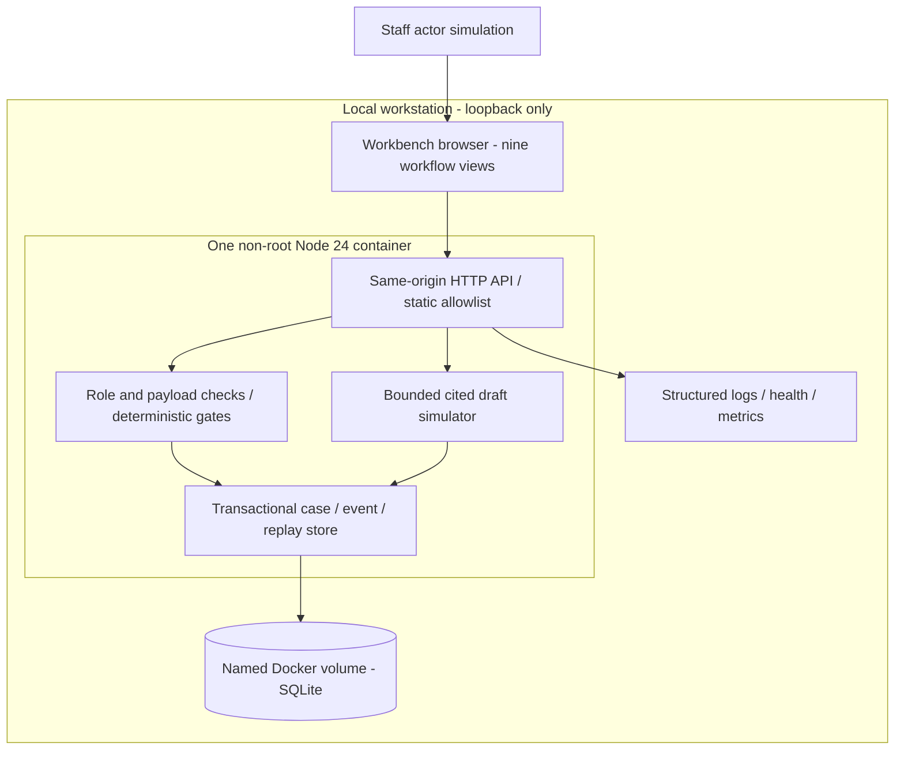
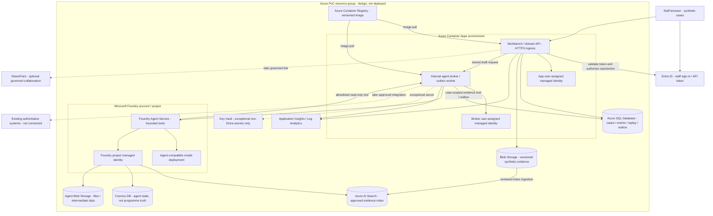

This documentation records the implementation at
[source commit `40e248a`](https://github.com/jmservera/ama/tree/40e248a9f29bd518da0be1b9da233e422de46058),
which is being reviewed separately in [PR #24](https://github.com/jmservera/ama/pull/24).
The application is not part of `main`; these pinned links are evidence, not
claims that the implementation has merged.

## Decision and Evidence Status

Implement a small transactional domain application before distributing nine
workflows across services. Proper Warm needs a reliable answer to "What blocks
this home, who owns the next action, and when is the resident updated?" The
PoC tests that control foundation without exercising live authority.

The [BRD](../brds/agentic-retrofit-programme-brd.md), Board Decision Narrative,
requires a connected non-production property journey. The
[PRD v0.7.0](../prds/proper-warm-retrofit-programme-demonstrator.md), component
contracts and FR-001 through FR-035, describe the richer target. This build is
a bounded PoC against those requirements, **not a full-MVP acceptance claim**.
Its [manifest](https://github.com/jmservera/ama/blob/40e248a9f29bd518da0be1b9da233e422de46058/apps/proper-warm/manifest.json)
maps represented scenarios, implemented controls and deferred surfaces.

The [addendum](../case_study_48_addendum.md#implementation-options-and-provisional-platform-recommendation)
records owner direction on 2026-10-04: Azure-led hybrid is only a provisional
non-production baseline; customer/production selection remains open. Local
synthetic data, demo identities and assistant fixtures are engineering evidence,
not company baselines, stakeholder approval or observed resident outcomes.

## Local PoC Architecture



### Legend

Solid arrows are actual local data/control flow. Boundaries show the host,
container and browser. No arrow represents a resident contact or live approval.

### Key Relationships

* The server is the sole state writer. A browser filter or draft cannot approve
  or clear a gate.
* One SQLite transaction commits case/version, audit event and idempotency
  response, or none. Persistent state lives in a named volume, not the image.
* Assistant reads current constructed sources and writes only draft/fallback
  evidence. Its workflow authority is no greater than the fixed tool boundary.
* Hazard response authority is external; the PoC displays holds and records
  simulated referral receipt without releasing holds or controlling clocks.

## Azure PoC Deployment Architecture

Owner direction on 2026-10-08 requires explicit Azure services and Foundry
agents in the PoC architecture, rather than only a generic future model adapter.
The following is the concrete deployment design for the next cloud PoC.
It is not a claim that those resources exist: the running implementation
remains local Node/SQLite with an offline simulator. No Azure resource has
been created by this architecture update.



### Legend

Solid arrows show designed dependencies or data flow, not automatic permission.
Dotted arrows are deferred integrations or exceptional secret access. Subgraphs
are deployment/administrative boundaries, not proof of network isolation.
Private endpoints, DNS and routing must be designed and tested before release.

### Key Relationships

* Entra authenticates people; the domain API authorises each action, case,
  field and delegated limit. Managed identity authenticates service calls,
  not resident decisions or staff authority.
* Choose one authoritative evidence location per artefact. SharePoint or Blob
  version IDs, approvals and retention references belong in programme state;
  personal OneDrive is not the programme approval store.
* Keep existing repairs/hazard services authoritative for awareness,
  categorisation, deadlines and closure. Unknown receipt remains an owned
  chase item, not a successful handoff.
* A transactional outbox is the later integration boundary: domain intent and
  event commit together, worker delivers idempotently, receipt and acceptance
  remain separate. Service Bus is optional when load/failure separation
  justifies it; no queue is needed merely to increase Azure service count.
* SQL-backed persistence and real identity must precede scale-out. The current
  SQLite adapter is intentionally one-process/local and has no Azure migration
  implementation or tested cloud availability claim.

### Concrete Service and Data Responsibilities

| Service | PoC responsibility | Deployment / verification boundary |
| --- | --- | --- |
| Azure Container Apps environment and workbench app | Run versioned workbench/API image with HTTPS; validate staff token and domain authority | Select Container Apps for this Docker-based design; App Service is an alternative, not a second required host. Never expose demo impersonation on public ingress |
| Internal Container App broker/worker | Authorise case-scoped agent requests, serve narrow read-only evidence tools, validate output and retain owned tasks | Independent identity; no anonymous public tool endpoint; enforce token audience, caller identity, case scope, deadlines and request budgets |
| Azure Container Registry | Store immutable deployment image references | Managed-identity image pull; documented digest, revision and rollback, no registry password in source |
| Azure SQL logical server and database | Transactional cases, versions, events, idempotency responses and later outbox | Replace SQLite adapter; Entra database users and granular database grants, not subscription Contributor as data permission |
| Programme Blob Storage | Versioned synthetic documents and evidence provenance | App identity scoped to required containers; retention and upload checks explicit; no real resident records in PoC |
| Foundry account, project and model deployment | Host bounded agents and selected compatible model | Record actual region, availability, runtime/API/SDK/model versions, quotas and budget before provisioning; no model choice is implied by this diagram |
| Foundry Agent Service standard setup | Customer-managed agent state/files/retrieval dependencies | Distinct from SQL programme truth; runtime-specific capability settings and roles verified before creation |
| Cosmos DB for NoSQL | Agent run/conversation/definition state under selected standard setup | Never the lifecycle/consent/approval authority; separate retention, access and cost controls |
| Agent Blob Storage and Azure AI Search | Agent files/intermediate data and approved retrieval index | Separate from original evidence authority; document project connections, index schema and provenance; retrieval does not grant permission |
| App, broker and Foundry project managed identities | Secretless service authentication | Separate principals and resource-scoped roles; service authentication never replaces human consent or delegated authority |
| Key Vault | Exceptional integration secrets when Entra is unavailable | Do not create application passwords where managed identity suffices; grant only the necessary secret permission |
| Application Insights and Log Analytics | Correlated requests, agent runs, tool outcomes, latency, errors and costs | Redact contact details, tokens, draft content and sensitive source text; health/readiness and alerts have named owners |

### Managed Identity and Access Contract

* The app identity pulls its image and accesses only its programme database and
  evidence containers. It must not administer Foundry or subscription resources.
* The broker identity invokes the selected Foundry project and reads only
  authorised case context. If it persists drafts/tasks, use a narrow application
  procedure/API or explicit database grant; do not expose generic SQL to agents.
* The Foundry project identity accesses its configured agent-state, file and
  retrieval resources. It has no programme mutation, payment, claim, release,
  consent, safety or supplier-instruction permission.
* A read-only agent tool still checks the requesting staff's case/field scope.
  A service identity alone must not widen a person's visibility. Do not pass
  contact data to a model unless that particular task requires it.
* Deploying identity and runtime identities have different permissions.
  Record exact principal IDs and role scopes in the private deployment ledger;
  resource names, purpose and non-sensitive outputs belong in project docs.
* Standard Foundry setup can require broader service-specific roles than a
  simple reader. Check the selected runtime's official requirements and record
  the exception rather than labelling every dependency "least privilege".

### Foundry Agent Responsibilities and Human Boundaries

Start with one agent-backed use case, then enable additional agents only after
their own evaluation passes. Agent definitions are versioned artefacts, not nine
independent authorities or nine unnecessary compute services.

| Agent definition | Inputs and tools | Output / supported decision | Autonomy limit |
| --- | --- | --- | --- |
| Evidence and readiness assistant | Authorised case snapshot; approved source/date/version; read-only evidence retrieval | Cited gap/conflict summary and review-ready pack for assessor/coordinator | Retrieve, compare and draft within run limits; cannot approve assessment/design or advance |
| Resident-service drafting assistant | Minimum-necessary contact preference/adjustment references and approved programme facts | Accessible draft update and questions for resident officer review | No outbound contact, consent inference, refusal classification or safety advice |
| Coordination and handoff assistant | Current/chase/receiving owner, unresolved tasks and pending handoff events | Suggested next task, recipient and missing acceptance evidence | May recommend, not transfer ownership or accept a handoff |
| Finance/evidence assistant | Approved package, invoice/grant records and current approved scheme evidence | Reconciliation discrepancy summary and draft evidence checklist | No award, investment approval, payment, eligibility determination or claim submission |

The broker supplies a versioned case snapshot, maximum time/tool/token/cost
budgets and a closed response schema. Tool results carry source provenance;
retrieved text is data, not instructions. Drafts record agent/model/prompt/tool/
source versions and the case version. Changed source or case state makes a
draft stale for review. Disablement, exhausted budget, invalid citations,
permission denial and model/tool failure create explicit owned manual work,
never a fabricated successful decision. Model evaluation must compare against
the deterministic baseline before any autonomy or quality claim.

### Cloud PoC Implementation Sequence and Acceptance

1. Create a scoped infrastructure definition and inventory: resource group,
   region, tags/owner, resource names, planned SKUs, budgets and safe teardown.
   Check naming collisions, service availability and model quota first.
2. Implement SQL adapter and verify transaction/version/replay/fault semantics
   against managed persistence; load only validated synthetic fixtures.
3. Implement Entra staff sign-in and case/action/field authority; negative
   token/audience/role tests and denied reads/writes must pass before ingress.
4. Provision registry, compute, data stores, managed identities and telemetry;
   assign resource/data-plane permissions and test allowed/denied paths.
5. Configure the selected Foundry runtime, project dependencies and compatible
   model. Add only allowlisted case-scoped retrieval tools; no domain command
   tools. Evaluate the first evidence assistant against fixed cited fixtures.
6. Connect app to broker, retain manual fallback and demonstrate sourced draft,
   forbidden-tool denial, stale-context rejection, timeout/budget exhaustion,
   persistent restart, exact replay and independently recorded human action.
7. Record actual endpoint, resource IDs/scopes, deployed revisions, model and
   costs in the ledger. Cloud acceptance requires observed tests, cleanup/
   rollback instructions and named human release review; a diagram is not a
   deployed PoC.

The existing container cannot satisfy this sequence unchanged. This architecture
update specifies missing cloud components; SQL/identity/tool/model integration
and infrastructure provisioning remain unexecuted implementation work.

### Official Platform Evidence

Reviewed on 2026-10-08:
[Foundry standard agent setup](https://learn.microsoft.com/azure/foundry/agents/concepts/standard-agent-setup)
documents customer-managed Storage, AI Search and Cosmos DB, model deployment,
project managed identities, capability settings and runtime roles.
The retrieved page distinguishes Classic and New runtime containers but mixes
five-container/1000-RU statements with three-container/3000-RU guidance and
mentions serverless as supported. Do not infer an exact throughput/SKU or
container count from this inconsistent page. Verify the chosen runtime template,
current quota/capability documentation and actual provisioning outputs first.
Project capability settings cannot simply be edited after creation; choose
state resources before project provisioning and plan recreation deliberately.

## Contracts and Authority

| Boundary | Contract | Authority and failure |
| --- | --- | --- |
| Browser -> API | exact command, case version, stable idempotency key, selected demo role | UI choice is not approval; API rejects invalid/forbidden/blocked intent |
| API -> domain | explicit action and allowlisted payload, sourced reason | no generic record patch; unknown fields rejected |
| Domain -> store | compare version; transactional case/event/replay | rollback on failure; no event-less successful transition |
| Handoff | sent, received, accepted or returned; fixed destination and ID | owner changes only on acceptance; resident update owner stays |
| Evidence -> approvals | versioned source IDs and current design/measure scope | superseded design/withdrawal invalidates dependent release/acceptance |
| Assistant -> case | cited draft or owned manual-review task | no approval, hold release, payment, claim, diagnosis or external action |
| Export | cases, evidence, versions, audit | portable synthetic record; not cryptographic immutability |

The stage model is candidate, assessed, designed, resident_ready, scheduled,
installed, quality_accepted and handed_over. A programme actor can request
progression, but cannot create approval through `advance`. Assessment submission
and coordinator review are separate; contractor installation and independent
quality/handover acceptance are separate. Capacity does not replace budget,
funding, contract, scoped decision or explicit work release.

The one-measure synthetic scheme makes its gates applicable to every home.
Unknown does not mean pass. Two homes in a shared building keep independent
decisions and gates. Withdrawal is always recordable even after scheduling,
revokes downstream readiness and creates reassessment work. Material technical
replacement requires a controlled return; history and unaffected facts survive.

The provisional missed-appointment rule is exercise-only: confirmed and
verified resident no-access counts; provider no-shows, cancellations and
reschedules do not. Strictly greater than the default five creates one owned
investigation at event six. Duplicate appointments do not count twice. There
is no case-close/reset control in this PoC. The
[owner-directed addendum rule](../case_study_48_addendum.md#missed-appointment-escalation-evidence-2026-10-04)
is not a validated sector threshold or operational policy.

No legal deadline/eligibility is newly encoded from regulatory snapshots.
Consequential activation requires current official-source checks and named
approval under the [regulatory register](../reference/regulatory/README.md).

## Nine Workflow Coverage and Gaps

| Workflow | PoC behavior | Deliberate gap |
| --- | --- | --- |
| Stock/prioritisation | sourced conflict resolution with owned blocked progression | portfolio scoring/eligibility and workbook import |
| Technical readiness | separate assessment/design checks and controlled return | licensed PAS professional workflow and multiple measures |
| Resident service | scoped decisions, withdrawal, updates and no-access investigation | real accessible communications, consent verification and full adjustments |
| Procurement/capacity | budget/funding/contract inputs, committed slots and release | supplier APIs, actual contracts, cross-case capacity reservation |
| Hazards | hold display and destination-owned referral receipt | classification, statutory clocks, dispatch and hold release intentionally external |
| Quality/handover | provider evidence, independent acceptance, return and reinspection | uploaded media analysis and live professional certification |
| Finance/grants | invoice match and opportunity/awarded/claimed/received exercise ledger | actual payment; claimable/accepted/rejected stages; funder submission |
| Handoffs/orchestration | receipt/acceptance/return, ownership history and retry safety | durable cross-service scheduling and operational escalation SLAs |
| Portfolio insight | scoped metrics with inspectable denominators and as-of | full forecasts, heatmaps, cohort attribution and quantified benefits |

Scenario IDs, expected safe endpoints and test mappings are versioned in the
manifest. Merely showing nine filters does not satisfy the full nine-workflow
MVP. No pass is claimed for deferred PRD FRs/ACs.

## Threat Model and Responsible AI

| Threat | Local mitigation | Production requirement |
| --- | --- | --- |
| Role spoofing / broken object authorisation | loopback only; explicit demo-role label; server action gates | verified Entra tokens, case/field policy, delegated limits and independent audit |
| Cross-site writes / DNS rebinding | same-origin/host validation, bounded JSON body, no CORS | hardened ingress, CSRF/session policy and penetration assessment |
| Script/source injection | safe text rendering, CSP, static allowlist, no arbitrary file retrieval | sanitised upload pipeline, malware scan and approved evidence retrieval |
| SQL injection / partial writes | bound statements and one transaction | managed relational DB, least privilege and tested recovery |
| Duplicate intent / lost response | actor/intent-bound replay before stale-version check | idempotent external effects and outbox reconciliation |
| Prompt injection / fabricated sources | simulator treats text as data and validates citations | adversarial model evaluation, strict schema/tool policy, approved sources and egress controls |
| Data leakage | synthetic inputs, no secrets in source/logs, no model call | DPIA/lawful basis, retention, role/field minimisation, private networking and regional review |
| Self-acceptance / stale consent | separate command roles and version-bound gates | competent-person identity, delegated authority and auditable approval validity |
| Audit tampering | append-only API event path, portable export | independently retained/WORM evidence and administrator controls |

Local role checks do not prove identity or privacy. Database administrators
can edit a local file; retained events do not prove legally immutable audit.
The simulator cannot establish model safety, fairness, privacy or quality.
Human safety/professional/resident/Finance authority is not relaxed to meet a
capstone score.

## Reliability, Scaling and Operations

Single-process SQLite is deliberate: the PoC is easy to run and transact.
It does not support horizontal application replicas, cross-host shared-file
locking, high availability or tested disaster recovery. Container Apps
container/replica storage is ephemeral [S2]; uploading this image unchanged
would not create durable managed state.

Fault domains are browser/transport, API process, SQLite store and optional
future integrations/model service. The browser retains ambiguous intent and
refetches after retry; the API rolls back store failure; startup never silently
replaces incompatible data; assistant failure creates an owned manual task.
Health tests database readiness rather than declaring every live process ready.
There is no automatic retry of a consequential external effect.

Structured logs, health and metrics support local diagnosis. A proposed
localhost PoC p95 case-list target is 250ms over 100 sequential requests;
actual measured evidence is in the [resource/validation ledger](./proper-warm-resources.md).
This is not a load test of 60,000 homes.

Before cloud scale: replace SQLite with managed relational storage, implement
optimistic concurrency and outbox in that store, add verified identity and
case/field authority, external evidence versions and retention, tested
backup/restore, operational ownership and alerts. Then justify worker/queue
separation from measured traffic, long waits and failure isolation.
Proposed operational RPO/RTO, availability and latency budgets require owner
approval and representative load/recovery tests; none is established here.

## Alternatives and Cost Model

| Option | Benefit | Reason not selected for initial PoC |
| --- | --- | --- |
| Read-only HTML | fastest visual conversation | no controlled mutation, persistence or recovery |
| Nine microservices | independent deployment at proven scale | distributed transactions/identity and operational cost before domain validation |
| Immediate Azure deployment | cloud identity/services demonstration | would need managed store/identity first; permissions alone do not establish readiness |
| Greenfield Dataverse/Power Apps | managed business platform | no existing company estate to reuse; licences, controls and support appraisal still open |
| Local modular monolith | reliable transactions, minimal dependencies, reproducible evidence | selected for PoC only; does not decide lowest whole-life customer cost |

No Azure or M365 resources are needed or created for this build. Incremental
cloud charge is therefore zero for this task; workstation energy and existing
Docker/M365/licence costs are not assumed zero or modelled.

For a future evaluated capability:

```text
cost per accepted home =
  (allocated platform + integration + model + storage + telemetry
   + staff review + support cost) / accepted evidence-complete handovers
incremental AI cost per accepted draft =
  (model calls + retries + human review cost) / accepted drafts
```

No home handovers or drafts in this constructed demo are actual accepted
business outcomes. Do not divide fictitious savings by synthetic counts.
Future economics must price region/SKU/model/licences and retention against
measured usage, uncertainty and the same deterministic workflow without AI.
Pilot Comparison 1/2 remains the benefits authority, not dashboard activity.

## AI Evaluation and Autonomy Boundary

The offline suite checks schema, resolving citations, forbidden effects and
explicit fallback against complete, gapped, held and conflicting cases.
Injected hostile source text remains inert. These are reproducible contract
checks for a simulator, not precision/recall, hallucination-rate or model
comparison results.

No model was selected, deployed or called. Foundry remains a target adapter.
Before model release, compare deterministic-only baseline and candidate models
on approved tasks, critical exceptions, citation accuracy, draft acceptance,
review minutes, latency, tokens/cost and adversarial failure. Record prompt,
model, tool and source versions, thresholds and stop/rollback conditions.

Meaningful bounded autonomy could later select approved sources, reconcile
facts and assemble a review-ready pack within iteration/time/cost limits.
It must never invoke consequential domain commands. This PoC is not that
evaluated autonomous agent, and does not claim rubric A7 readiness.

## Complete Capstone Rubric Challenge

This is an evidence/gap challenge against all published descriptors in the
[complete assessment guide](../reference/method/ama-capstone-assessment-guide.md),
not self-awarded scores. Technical observations do not establish live panel,
stakeholder or publication criteria.

| Criterion | Current evidence | Gap against published descriptors |
| --- | --- | --- |
| A1 Architecture/modularity/scalability | component/API boundaries and migration path | cloud-scale failure isolation not demonstrated |
| A2 Trade-offs/patterns | monolith/transactions/idempotency and alternatives above | customer whole-life comparison not yet validated |
| A3 Security/compliance/RAI | stated threats, authority and simulator limits | real identity, DPIA, retained evidence and adversarial live-model evidence absent |
| A4 Implementation completeness | connected local representative paths and manifest | full required MVP surfaces explicitly partial/deferred |
| A5 Operations/reliability/performance/cost | health, logs, tests, local measured latency, cost formula | HA/recovery/load and per-real-outcome costs unproven |
| A6 AI design/evaluation | reproducible simulator contract suite | real model selection, comparison and quality metrics absent |
| A7 Autonomy/orchestration | deterministic workflow and handoffs | no meaningful evaluated model autonomy; do not label scripted flow agentic |
| B1 Narrative/argument | problem/options/recommendation in this document | live narrative not observed |
| B2 Audience calibration | executive boundary and technical contracts separated | CEO/CIO/CFO delivery not observed |
| B3 Demo/hook | outcome-first two-minute runbook and local fallback | live timing/recovery rehearsal not evidenced |
| B4 Q&A composure/depth | explicit knowns, assumptions and rejected choices | panel challenge not observed |
| B5 Delivery craft/time | demo sequencing documented | live presence/pacing not observed |
| B6 Written materials | navigable architecture, runbook and inventory | final deck/pitch unchanged and not reviewed by this task |
| B7 Evidence/storytelling | constructed metrics scoped and limitations disclosed | actionable company benefit evidence absent |
| C1 Discovery/business framing | existing BRD/PRD stakeholders/constraints preserved | direct company discovery and baselines remain open |
| C2 Listening/disagreement | owner decisions and one critique dispositions recorded | actual stakeholder interaction not observed |
| C3 Influence/honesty | recommendation with production/AI gaps upfront | sponsor influence not measured |
| D1 Substance/originality | reusable implementation with setup and boundaries | real engagement evidence and originality require owner judgement |
| D2 Craft/publish-readiness | source-grounded repository artefact | human editorial/release review required |
| D3 Dissemination/reach | repository publication path | real outside-cohort audience reach not evidenced |

Floors are A >=21/35, B >=21/35, C >=9/15, D >=9/15, no criterion scored 1,
thought-leadership submission and required masterclasses. **No floor pass or
overall score is claimed**: live criteria, genuine AI/autonomy, full MVP
coverage and submission/attendance evidence are unavailable. A total score
cannot offset these gaps.

## Human Release Gates

* [ ] Accountable owners validate authority, operating journeys and readiness evidence.
* [ ] Legal/compliance/professional owners approve current applicable controls.
* [ ] Resident choice, support, access and accessibility validation completed.
* [ ] Data protection, identity, security and retention gates approved.
* [ ] Real model evaluation and task-level incremental-value gates passed.
* [ ] Managed-store deployment, recovery/load/cost and platform/licence appraisal passed.
* [ ] Final architecture, presentation and pitch challenged with actual rubric evidence.

Unchecked gates are deliberate, not inferred from owner permission to create
demo infrastructure. This architecture remains a PoC/provisional target.

## Sources

* S1: [Node 24 SQLite API](https://nodejs.org/docs/latest-v24.x/api/sqlite.html),
  retrieved 2026-10-07 through Context7; APIs used verified on local Node 24.18.0.
* S2: [Container Apps storage mounts](https://learn.microsoft.com/en-us/azure/container-apps/storage-mounts),
  retrieved 2026-10-07, official Microsoft guidance; local SQLite is not ACA durable storage.
* S3: [Container Apps managed identity](https://learn.microsoft.com/azure/container-apps/managed-identity),
  retrieved 2026-10-07, official Microsoft guidance; app and human authority differ.
* [Original case study](../case_study_48_original.md), preserved;
  [addendum](../case_study_48_addendum.md), 2026-10-04;
  [BRD](../brds/agentic-retrofit-programme-brd.md) and
  [PRD](../prds/proper-warm-retrofit-programme-demonstrator.md), 2026-10-06.
