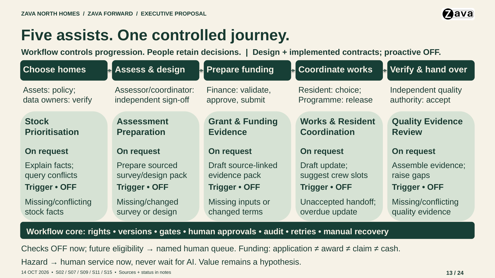

The rubric gate scores only what is committed to this repository. A criterion
that needs an artifact which has not been committed is recorded as 0 by the
gate, not by the model. Rules are in
[rubric.json](../../.github/rubric/rubric.json) and the artifact registry in
[artifacts.json](../../.github/rubric/artifacts.json); the criteria come from
the [Capstone Assessment Guide](../reference/method/ama-capstone-assessment-guide.md).

## Storage map

| Rubric section | Asset | Store it at | Format the scorer reads |
| --- | --- | --- | --- |
| A1 to A7 | Business requirements | `docs/brds/` | Markdown |
| A1 to A7, B6, C1 | Product requirements | `docs/prds/` | Markdown |
| A1 to A3, B6 | Architecture decision records | `docs/adrs/` | Markdown |
| A1, A3 to A7, B6 | Solution code, tests, README and diagrams | `src/` and `mvp/` (see the registry globs) | Source files |
| A1, A3, A5 | Infrastructure as code | `infra/` | Bicep, Terraform |
| B1, B2, B6, B7 | Capstone deck, with speaker notes | `docs/capstone/deck/` (sole published executive deck; no duplicate in `docs/presentations/`) | `.pptx` (scorer reads slide and notes text) |
| B1 to B5, B7, C2, C3 | Pitch rehearsal and Q&A transcripts, timing notes, demo script and recovery notes, restated-challenge examples | `docs/capstone/pitch/` | `.md`, `.txt`, `.vtt` |
| D1 to D3 | Thought leadership artifact | `docs/capstone/thought-leadership/<artifact-name>/` | `.md`, `.txt`, `.vtt`, plus `.pptx` as support |

Recordings (video or audio) are not read by the scorer. Commit the transcript
or written notes next to the recording and link the recording from them.

The owner selected the [Cowork v2 presentation](./deck/cowork-generated/README.md)
as the capstone scoring candidate on 2026-10-23. Its original v2 PDF, contact
sheet and both build handoffs are retained there. V1 exports, preview ZIPs
and the original protected binary are described in those handoffs but are
not retained in this checkout. The selected scoring path is
`docs/capstone/deck/zava-forward-cowork-v2-draft.pptx`; an approved unencrypted
v2 export is now supplied at that path. The scorer's actual extractor reads
54 slides and 54 speaker-note blocks, including the final slide-39 wording
recorded by Cowork. The earlier protected source is retained as history.
The registry does not fall back to the old deck or treat PDF slides as notes.

The [IoT and optional-resident-portal refinement](./deck/cowork-generated/refinement-2026-10-23/README.md)
updates the same 54-slide v2 PPTX and provides a
[new native PowerPoint PDF](./deck/zava-forward-cowork-v2-draft.pdf).
IoT is visible on the main architecture build; resident self-service is an
optional benefit assessment in issue #441, not a delivered channel or saving.
Assisted routes and human review remain explicit. Five changed slides were
natively rendered and visually checked; rehearsal, human and live acceptance
remain separate. The current owner-expanded registry also includes other
root-level PPTX files; this narrative refinement leaves that choice unchanged.

The earlier Zava Forward council proposal is now historical and its binary
is not retained in this checkout. The owner retired its
duplicate in `docs/presentations/` on 2026-10-11; that folder still holds the
separate mentor presentation. All decks remain drafts: production approval,
measured benefits and live pitch evidence are separate gates.

The deck was detected in PR #61, but the scorer's `:slideN` references did not
match the deterministic gate's text-only anchor parser. This discarded its
proposed B1, B2, B6 and B7 changes and left misleading missing-deck baseline
rationales in the comment. See the
[gate repair and activation boundary](../../.github/rubric/README.md).
Do not treat a saved-scorecard replay as a fresh score for the revised deck.

## Main Presentation Cowork Handoff (2026-10-23)

The [complete Cowork authoring package](./pitch/cowork-main-presentation/README.md)
provides the owner-requested top-down 30-minute presentation plus a separate
10-minute demo. Give Cowork the entire folder and start with its
[authoring brief](./pitch/cowork-main-presentation/COWORK-BRIEF.md).
It includes 18 main slides, 27 CXO backups, full speaker notes, interruption
routes, a preflight-gated demo, seven progressive slide-sized Excalidraw
diagrams with official Azure icons, Tokenomics and cost evidence, and the
HVE/design-thinking/prototype-to-backlog delivery story.

The original "around 180" is an approximate issue count, including epics and
stories, not agents or stories alone. A read-only AMA Plan project snapshot
retrieved on 2026-10-23 has 189 items across epics, features, stories and other
issues. Its included board image is an explicitly labelled API-derived
visual, not a screenshot of GitHub's website or accepted delivery.

This route supersedes the old 15-minute limit only for the new authoring
job. It incorporates merged Tokenomics PR #433, separates the owner-set
October USD 700 ceiling from blocked execution gates, and labels unmeasured
benefits and outstanding human acceptance.

Cowork subsequently generated a v1 presentation and a revised v2 story.
The [imported output index](./deck/cowork-generated/README.md) distinguishes
the original 54-page v2 PDF and handoff from historical v1 exports and the
original 18-slide authoring contract. The owner selected v2 for scoring and
confirmed repository clearance, but its saved PPTX is protected and its
reported OneDrive save failure is retained as historical evidence. A later
owner-supplied public v2 export is now installed at the selected scoring path;
local extraction verifies all 54 slides/notes and the final-save marker.
Full source/notes parity, review, native-viewer checks and publication gates
remain outstanding; no fresh rubric score or rehearsal is claimed. Keep the
eventual validated executive delivery under `docs/capstone/deck/`.

## Tokenomics Pitch Preparation (2026-10-22)

A mentor raised Tokenomics at the progress review, reported by the owner and
not yet confirmed with the mentor. The
[Tokenomics pitch brief](./pitch/tokenomics-pitch-brief.md) proposes where the
idea fits in the 15-minute route (a strengthened slide 16, a Q&A card on slide
20 and an optional appendix), draft slide copy and notes, the numbers to bring,
executive questions and the claims to keep out. It maps to rubric criteria A5,
A6, B7, C1 and C3. The deck is unchanged: placement is an owner decision, the
route is not rehearsed with it and no cost-per-accepted-proposal figure exists.
Sources and evidence labels are in the
[AI Tokenomics resource note](../reference/resources/ai-tokenomics.md).

## Solution Architecture Views (2026-10-14)

The [architecture handover](../architecture/README.md) provides an
[executive Excalidraw view](../architecture/zava-forward-executive-architecture.excalidraw)
and a [CTO/technical Excalidraw view](../architecture/zava-forward-technical-architecture.excalidraw),
with official Azure icons and SVG/PNG previews. Both describe the same #68
source baseline. The executive view explains one accountable workflow;
the technical view distinguishes the single-API five-assistant implementation
from deferred workers, network target versus development exceptions, and
conditional M365/operational paths. The Excalidraw sources remain separate
architecture assets; the presentation adaptation below does not replace them
or slide 13's business-process map.

### Architecture and UX Refresh (2026-10-14)

The owner-requested UX Designer and PowerPoint agents informed the current
[24-slide council proposal](./deck/zava-forward-executive-draft.pptx).
It retains the 18-slide main route and adds only two optional appendices.
The architecture is adapted into native PowerPoint boxes, text and
connectors, with individual official Azure service icons, rather than
shrinking the detailed diagram into a slide-sized picture.

| Slide | Audience and purpose | Rendered preview |
| --- | --- | --- |
| 10 | Executive: one workbench, controlled evidence, bounded AI and human authority | [Executive architecture](./deck/architecture-executive-native.png) |
| 19 | Technical: current runtime, identity, SQL/Blob/model contracts and separate proposal review | [Runtime interactions](./deck/architecture-runtime-native.png) |
| 23 | Technical: token renewal, deployment, operations, network context and failure domains | [Operations and identity](./deck/architecture-operations-native.png) |
| 24 | Technical: deferred workers/import, conditional M365, intended edge and unimplemented anchoring | [Deferred topology](./deck/architecture-deferred-native.png) |

The UX review made alternatives explicit on the main route, separated
recorded technical evidence from acceptance still outstanding, and clarified
the planning-only recommendation and proposed owner/deliverable pairs.
`Ready` means generated and unreviewed; `acceptance outstanding` replaces
ambiguous open-gate wording. Internal links lead from the executive view to
technical detail, with a return to the decision. Expert artifact review is
not real audience testing, resident engagement or observed comprehension.

Slide 13 retains its native five-capability process map and equal peer
title/body starts. Fixed top-aligned text, source-linked notes and explicit
status words preserve the distinction between current implementation,
configured controls, conditional routes and deferred work.

The planned main route remains 795 seconds, including the 110-second public
repository-evidence walkthrough and its in-slot fallback. With 75 seconds
for questions and 30 seconds contingency, the plan is 15 minutes.
Appendices 19-24 are optional depth, not extra main-route speaking time.
No timed rehearsal, fresh live demo, calibrated model benefit, spending
authority or production approval follows from this refresh.

The [current authoring and validation handover](../../.copilot-tracking/ppt/2026-10-14/zava-forward-architecture-refresh/build-handover.md)
retains all 24 YAML slides, source-to-native architecture mapping, UX
dispositions, actual rendered checks and warning limitations. The
[UX design brief](../../.copilot-tracking/ppt/2026-10-14/zava-forward-architecture-refresh/research/ux-design-review.md)
checks contributions and gaps against all 20 assessment criteria and the
section/individual floors; it is not a score or panel acceptance. Native
PowerPoint/font, keyboard/screen-reader navigation, projection, human
comprehension and pitch evidence remain separate checks.

The [parent inspection and publication receipt](../../.copilot-tracking/ppt/2026-10-14/zava-forward-architecture-refresh/reports/parent-publication.md)
records the byte-identical delivery and matching previews. All 387 current
text frames are explicit TOP/fixed and pass complete rendered-word bounds;
all 24 notes resolve to their actual slide relationships. Generic geometry
still has 197 warnings and 27 info, zero errors, with explicit dispositions.
Those local checks do not establish native-viewer accessibility or audience
acceptance.

## Agents in the Retrofit Process (2026-10-13)

### Native PowerPoint Rebuild (2026-10-14)

The earlier AMA Presentation Communications Strategist and PowerPoint Builder
refresh produced a 22-slide baseline. The current 24-slide delivery is
described above; the following records the earlier native-map implementation,
not fresh counts for the new deck.
Slide 13 now uses editable PowerPoint boxes, text and directional connectors,
not an embedded SVG or PNG. It retains all five capability stages, human
owners, on-request help, OFF-labelled proactive triggers, workflow controls
and the hazard/funding boundaries. Its notes contain the full text equivalent,
source references and a proposed 60-second explanation.

Titles have fixed, top-aligned regions and corresponding body text starts
at a common height across peer cards, including different title lengths.
The earlier checked baseline had 311 explicit TOP-anchored, fixed-size text
frames and 56 exactly aligned peer rows. The map has 43 native textboxes,
12 backgrounds,
four connectors and one identified branding image; no process-diagram image.

The revised story distinguishes five observed real operator-service model
paths and SQL-content/restart proof from unexecuted staff/human, semantic and
value acceptance. Ordinary assistant authority remains absent and proactive
scans remain off after bounded QA. The planned 18-slide main route is 13:15,
including a recorded public-evidence walkthrough; discussion/contingency
brings the plan to 15 minutes. Four appendices are optional. This is not an
observed rehearsal or a new live model demonstration.

All 22 baseline slides had relationship-correct, source-linked notes.
Whole-deck LibreOffice exports and independent saved-shape/notes checks were
inspected,
including the native map and variable-length title cards. Generic compact
spacing/edge-band warnings remain explicitly classified, not claimed as a
clean heuristic pass. Liberation Sans is explicit because Aptos is unavailable
locally; native PowerPoint/font fidelity, SDK vision validation, human
acceptance and timed rehearsal are not claimed as passed.

The [earlier working sources and handover](../../.copilot-tracking/ppt/2026-10-14/zava-forward-capstone-rebuild/build-handover.md)
include all 22 slide YAML files, style, build commands and validation assets.
At that publication, the 22-slide PPTX matched the checked working copy. The
2026-10-11 21-slide sources and 2026-10-13 image-insertion sources are historical;
do not use them or the superseded 22-slide build as the current full-deck
source. Use the architecture/UX refresh handover above.

The standalone [vector process map](./deck/agents-in-retrofit-process.svg)
and [original PNG](./deck/agents-in-retrofit-process.png) remain reference
illustrations of the proposed design, not the current editable slide or five
autonomous managers. The workflow owns progression and accountable people retain
policy, resident choice, technical acceptance, work release, grant submission,
quality acceptance and payment. Funding spans preparation through later
claim/cash reconciliation; an award is not a receipt, and reviewed funding,
budget, resident choice and capacity precede work release.

| Bounded capability | Staff-requested help | Proactive review trigger, not an approval | Intended improvement and value test |
| --- | --- | --- | --- |
| Stock Prioritisation | Explain source-bound candidate evidence; propose reconciliation of conflicting records, never change ranking policy or queues | New/conflicting stock/EPC evidence or an eligible freshness review | Fewer data blind spots; compare reconciliation time, critical conflicts found and homes still viable after survey |
| Assessment Preparation | Pre-fill a survey/design pack from sourced facts, never invent site observations | Changed, missing or stale assessment evidence | Less review/rework; compare returns, reapprovals and assessment-to-ready time, retaining separate assessor/coordinator sign-off |
| Grant and Funding Evidence | Draft a source-linked application or evidence pack; rules own eligibility and calculations, Finance owns review/submission | Changed terms or missing evidence routed for human review, never silent activation of a new rule | Fewer pack gaps; compare first-time evidence acceptance, rejection/rework and time to claim; award/claim/cash stay separate |
| Contractor and Resident Coordination | Draft an update or suggest slots within committed capacity; no auto-send, instruction, booking or consent inference | Unaccepted handoff or missed resident-update commitment to an owned queue | Clearer ownership; compare coordination effort per accepted home, failed visits and unowned handoffs, preserving resident choice and independent work release |
| Quality Evidence Assurance | Assemble evidence for independent review; raise missing or contradictory evidence, never accept or clear | New quality evidence, missing items or anomaly signals within a registered task | Earlier reviewed defect signals; compare evidence rework, first-time acceptance and missed critical defects |

Proactive means an authorized event or scheduled check makes a task eligible.
The deterministic task registry selects rules, bounded AI or human handling;
only permitted, source/version-bound tasks may produce an unreviewed draft or
raise-only flag to a named human queue. Structured freshness, deadlines and
readiness are rules, not evidence of agent reasoning. Any hazard uses the
independent human safety route immediately; a negative model result never
suppresses intake or changes its clocks. Failed/stale/disabled assistance
preserves controlled state and an owned manual route.

All improvement claims are hypotheses. Paired comparison with the same
rules/manual workflow counts preparation, review, correction and shifted
burden alongside critical errors, latency, cost and uncertainty. The observed
five operator-service model paths, fixture tests and diagram arrows do not
prove all workflow
capabilities, proactive deployment, calibrated quality or measured benefit.
The [draft closure review](../reference/research/gap-analysis-next-build.md#draft-experiment-closure-review-2026-10-13)
keeps absent #58 capabilities and current-infrastructure verification explicit.

Content is grounded in the [addendum agent map](../case_study_48_addendum.md#agentic-architecture-brief),
[agent request challenge](../reference/research/company/agent-request-challenge.md#summary)
and [PRD bounded-agent pattern](../prds/zava-forward-retrofit-programme-demonstrator.md#bounded-agent-orchestration-pattern).
No new requirement, authority, numerical benefit or operational approval is
introduced. The diagram's intended contribution to A1/A3/A6/A7 and B1/B2/B6/B7
is explanation of fit, triggers, controls and value tests, not a fresh rubric
score or panel-readiness claim. Live pitch/rehearsal and the complete rubric
floors remain separate.

## Thought leadership artifact (Section D)

Commit exactly one artifact folder, `docs/capstone/thought-leadership/<artifact-name>/`,
with a `README.md` that states the format, the audience, the engagement evidence
and where it is published or submitted.

| Format | What to commit in the folder |
| --- | --- |
| White paper or architecture guidance | The paper, 2,000+ words, structured and sourced |
| Technical blog post | The post, 800+ words, plus the publication or submission link and date |
| Reference implementation or accelerator | A `README.md` covering purpose, architecture, setup and known limitations, linking the repository that holds the working code |
| IP disclosure or patent filing | The disclosure document and the submission reference |
| Community or conference session | Published materials, written notes or a transcript, and a link to the recording |
| Slide deck | Never enough alone. Commit written notes or a transcript with it |

D1 to D3 score 0 until a text artifact exists in this folder. D3 stays at the
bottom band until a real publication, filing or delivery beyond the cohort is
recorded with its link and date. BRDs, PRDs and code never count toward Section D.

## What scores 0 or is capped until it exists

| Criteria | Needs at least one of | Without it |
| --- | --- | --- |
| B1, B2, B7 | Capstone deck or pitch transcripts | 0 |
| B3 to B5, C2, C3 | Pitch transcripts and notes (demo, Q&A, timing) | 0 |
| D1 to D3 | Thought leadership artifact | 0, and the outcome is Incomplete |
| B6 | Capstone deck, plus the documentation already in the repository | Capped at 3 |

Missing pitch and thought-leadership evidence still prevents the associated
criteria and floors from being satisfied. A deck alone cannot clear them.
Scores rise only as the assets above are committed and assessed.
Masterclass attendance is a floor in the guide but is not repository evidence
and is not scored by the gate.
