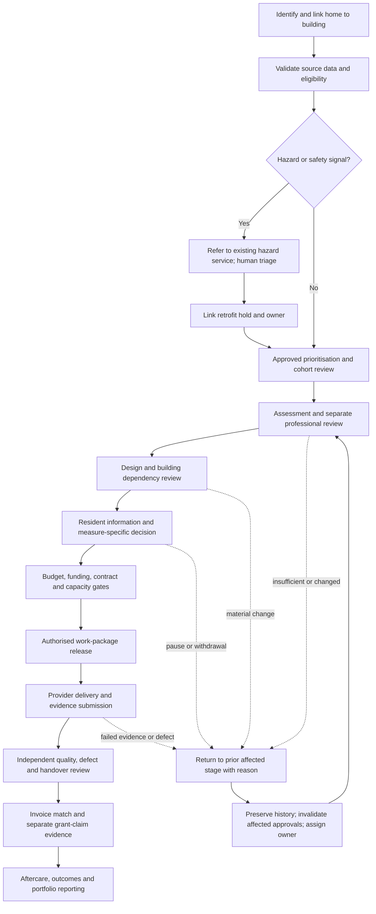

> **PRD-2026-AMA48-001** | Status: draft | Version: 0.6.0 | Last Updated: 2026-10-05

## Executive Summary

Proper Warm needs a shared product surface for the connected retrofit
workflows, not one isolated home screen or five end-to-end agents. The
proposed product is a home-centred workbench with linked building, scheme,
work-package and service cases. People use role-specific screens and queues
over the same governed case data to see new work, approved priority, stale
evidence, blockers, handoffs, progress and suggested next actions.

The scope is one PRD because the workflows share property/building identity,
case lifecycle, evidence provenance, authority checks, handoffs, audit and
reporting. The workbench will represent the full workflow portfolio in
synthetic end-to-end scenarios. Delivery is staged: establish the shared
case, role workspaces and safe workflow controls first; then complete the
domain scenarios and portfolio analytics. The stages are delivery increments
of one product, not separate products or PRDs.

The workbench covers stock and prioritisation, technical assessment/design,
resident service and measure decisions, provider capacity and work release,
hazard referrals, quality/defects/handover, provider invoices and grant
claims, cross-team case orchestration, and portfolio progress, investment and
forecasting. It is a coordination and evidence product. Existing systems and
accountable people retain authoritative decisions; the demonstrator does not
make live resident contact, instruct suppliers, approve work, submit claims,
or release payment.

The owner directed an Azure-led hybrid only as a proposed non-production
demonstrator baseline. Azure programme-state authority, integrations,
deterministic gates and bounded AI remain subject to the options and approval
gates. SharePoint/M365 capability is unverified; Excel-based coordination is
confirmed, while other company systems and their authority are unknown.
Synthetic evidence is used until a separate release decision authorises
otherwise.

## Product Context

### Problem and opportunity

Case Study 48 asks for agents to improve a small team's coordination of
assessments, grant applications, procurement, resident consent and quality.
Later analysis challenges the idea that autonomous agents own those
workflows. The core product problem is that work crosses home, building,
resident, professional, supplier, safety and finance boundaries, while each
role needs a different working view and accountable decisions must remain
visible and controlled.

The BRD identifies nine connected workflow areas and proposed value evidence.
They are evidence-backed problem hypotheses, not confirmed operational
failures at Proper North Homes. Phase 0 must establish which constraints
actually bind. The product must therefore make missing evidence and unknown
ownership visible, support conventional workflow without AI, and avoid
presenting its forecasts or suggestions as approved commitments.

### Product boundary and single-product rationale

This PRD describes one modular workbench because the workflows share:

* A versioned home case linked to its building, scheme, work package and
  relevant resident-service, hazard, supplier, quality and finance records
* Shared identity resolution, evidence lineage, lifecycle, task ownership,
  permissions, audit and deterministic transition controls
* Role-specific queues and dashboards over the same records
* Cross-domain dependencies, handoffs, returned work and common progress
  reporting

Splitting these into separate products would create competing case status,
handoff, evidence and audit views. The modules may be delivered in increments
and may integrate with separate systems of record, but they remain one
product experience and one PRD. External provider and resident interactions
are bounded channels or intake records, not assumptions that those groups use
the internal workbench directly.

### Proposed platform boundary

The owner's requested Azure-led hybrid is the demonstrator baseline, not an
approved production architecture:

* Azure-hosted web workbench, domain API, structured programme state,
  deterministic workflow and bounded AI, subject to a comparable options
  appraisal against full Azure custom and greenfield business applications.
* Excel is an import source for validated, traceable synthetic records, not
  the target workflow or approval authority. Source workbooks remain unchanged.
* SharePoint may hold managed collaboration documents only if tenant,
  licensing, governance and support checks pass. Otherwise use the documented
  controlled Azure Blob Storage fallback for the demonstrator.
* Asset, housing, repairs, hazard, finance, procurement and supplier systems
  retain their authority. The demonstrator uses synthetic adapters or mocks;
  it is not a live integration or source-system replacement.
* No Dataverse or Dynamics 365 dependency is in scope unless a later approved
  decision changes the baseline. Other existing systems remain unknown.

### Evidence status

The upstream [Agentic Retrofit Programme BRD](../brds/agentic-retrofit-programme-brd.md)
is draft v0.14.0. No signed `BRD_TO_PRD_HANDOFF_V1` or current valid BRD
quality report was available for this revision; the latest valid BRD quality
assessment remains v0.8.0. The source BRD's workflow descriptions, goals,
authority rules and targets are requirements inputs, not company operating
evidence or approval. Company systems, baselines, residents' needs, owners,
service targets, budgets, contract terms and delegated authorities remain
open. The earlier proposal for a missed-appointment threshold remains a
synthetic-only candidate test.

## Users and Personas

These are provisional product roles inferred from the BRD, not confirmed job
titles, staffing or delegated authorities. Screen content varies by task and
permission; selecting a perspective is not authentication.

| Role workspace | Primary work in the product | Key information/actions |
| --- | --- | --- |
| Asset and investment | Form and explain candidate cohorts, see asset/building dependencies and investment progress | Approved priority and reason codes, condition freshness, shared works, budget envelope, cost and forecast scenarios |
| Programme coordinator | Coordinate the end-to-end flow and prepare stakeholder progress views | Cross-workflow queue, new/priority/stale work, blockers, handoff acceptance, cases returned, heatmap, funnel, timeline and forecast |
| Retrofit case team | Progress home cases through readiness, resident, supplier, delivery and aftercare stages | Home/building links, next task, evidence, resident decision status, dependencies, appointments, holds and change history |
| Retrofit Assessor, designer and Coordinator | Complete and review technical stages within competent scope | Sourced survey facts, missing evidence, design version, return reasons, separate sign-offs and material-change re-review |
| Housing and Resident Engagement | Coordinate accessible information, service requests, complaints, repair/defect reports, decisions and contact | Minimum-necessary resident context, preferences/adjustments, safe contact and representative details, decision history and next-update commitment |
| Repairs and Building Safety | Review hazard referrals and linked retrofit holds without making retrofit the hazard system | Awareness source/time, referral receipt/acceptance, service owner, linked hold and evidence for accountable release |
| Procurement and contract manager | Confirm contract route, capacity, work order, provider exceptions and instruction authority | Contract/call-off, committed capacity, appointment outcomes, work-order version, variation and escalation task |
| Provider / contractor contact | Submit or respond to authorised work-package information through approved intake channels | Work-order scope, schedule, evidence checklist, appointment outcomes, completion pack and invoice submission status; no self-approval |
| Quality and assurance | Independently review work/evidence, defects and handover | Positive per-measure checklist, inspection/evidence, defects, remediation, audit and systemic-pattern review |
| Finance and Grants | Review investment, budget, invoice, claim and cash records | Budget line, commitment, invoice match, payment status, grant state, claim evidence, cash exposure and approval history |
| Digital operator and auditor | Resolve imports, integrations, access and recovery; reconstruct decisions | Exception queue, component health, audit trail, versions, exports and failed/replayed operations |

Residents are affected stakeholders, not users of this non-production MVP.
No resident-facing production journey or live outbound communication is
authorised. Their service intake and measure decisions must be represented in
synthetic scenarios and later validated through direct, accessible research.

## Product Goals

| Goal | Outcome | Priority | Candidate success signal | Status |
| --- | --- | --- | --- | --- |
| GOAL-001 | Give each authorised role a useful view of the same governed work, evidence and next action across the whole workflow portfolio. | MUST | Every agreed profile scenario finds new, prioritized, stale, blocked and owned work; case edits and handoffs are reconstructable. Baseline and usability threshold TBD. | Candidate |
| GOAL-002 | Demonstrate the nine connected workflows end to end with explicit authority, returns, shared building dependencies and finance/quality gates. | MUST | Every approved synthetic workflow scenario reaches its expected state or explicit safe block; all prohibited transitions are denied in the acceptance suite. | Candidate |
| GOAL-003 | Help coordinators and stakeholders understand current progress, historical flow and plausible delivery scenarios. | MUST | Heatmap, funnel, timeline and forecast reconcile to case/event records and disclose filters, definitions, unknowns and uncertainty. | Candidate |
| GOAL-004 | Establish whether bounded agents improve selected tasks over workflow-only handling without weakening resident, safety, quality or financial controls. | SHOULD | Paired tests report quality, review effort, errors, overrides and attributable value against pre-set owner thresholds; no undetected critical error. | Candidate |

**SMART status:** Deferred. Company baselines, owners, timeframe, workload,
targets, usability protocol and approval authority are not validated. The
BRD's proposed 20% cycle-time and 25% net coordination-effort improvements
remain unratified targets under OD-18, not PRD commitments.

## Workflow Coverage

| BRD workflow | Workbench module and core screen | Roles | Progress/value evidence |
| --- | --- | --- | --- |
| Stock data, safety triage and fair prioritisation | Portfolio/cohort screen; property and building records; data-quality and eligibility queues | Asset, Safety, Finance, data owner, Coordinator | Source freshness, conflicts, eligibility unknowns, cohort reasons, viability after survey, overrides |
| Technical assessment and design readiness | Home technical workspace; survey/design checklist; return and reapproval queue | Assessor, designer, Retrofit Coordinator, Programme | Assessment-to-ready-to-install time, first-pass completeness, return loops, review effort |
| Resident service, access, choice and redress | Resident-service inbox and home resident tab; measure decision history; contact/update tasks | Housing, Resident Engagement, Repairs, Coordinator | Appointments kept, adjustments met, repeat contacts, time to decision, complaint/service resolution |
| Procurement, committed capacity and work release | Supplier/capacity board; contract/work-package screen; controlled work-order view | Procurement, contract manager, Programme, provider contact | Committed vs delivered capacity, provider-caused failures, capacity gap age, accepted work |
| Hazard awareness and damp-and-mould response | Referral/hold queue linked to the existing repairs/hazard case, not a replacement service | Repairs, Building Safety, Programme | Awareness-to-referral, accepted referral age and applicable response/update performance |
| Quality acceptance, defects and handover | Quality pack, inspection/evidence review, defect and remediation queue, handover checklist | Quality, competent inspector, provider, Resident Engagement | Right-first-time evidence/physical acceptance, defect severity, recurrence, rework, handover |
| Budget, provider invoice, grant claim and cash reconciliation | Investment/budget view; invoice intake and match queue; separate grant ledger/claim pack | Finance, Grants, contract manager, Quality | Invoice exceptions, review effort, claim acceptance/rejection, receipt time, cash exposure |
| Programme handoffs and case orchestration | Cross-role work queue, case timeline, handoff and return/reopen workspace | Coordinator and every receiving team | Owned handoffs, overdue queues, return loops, stage timing and coordination effort |
| Portfolio investment, performance and scale decisions | Portfolio dashboard with heatmap, funnel, history/timeline and forecast scenarios | Asset, Finance, Programme, Sponsor/Board, Assurance | Accepted outcomes, cost, grant state, resident/safety/quality guardrails, forecast variance |

Every row above has a product representation in the MVP's synthetic scenario
suite. Live integrations, external portals, formal user research and
operational authority remain separately gated.

## Functional Requirements

All requirements are draft candidates and shall be validated by the product
owner, named control owners and affected users before implementation approval.

| ID | Requirement | Actor / trigger | Acceptance criteria | Goals |
| --- | --- | --- | --- | --- |
| FR-001 | The product shall maintain one versioned home case linked to its building, scheme, work package and relevant resident-service, hazard, provider, quality and finance records. | Any authorised user opens or updates a case | AC-001, AC-002 | GOAL-001, GOAL-002 |
| FR-002 | The product shall show building-level shared systems, dependencies, holds, works and costs separately from each home's evidence, decision, cost allocation and outcome. | User reviews a building or linked home | AC-002, AC-003 | GOAL-001, GOAL-002 |
| FR-003 | The product shall present task-focused screens and queues by authenticated role, with field/action permissions enforced by the service rather than by a selectable view label. | User signs in or changes task context | AC-004, AC-005 | GOAL-001 |
| FR-004 | The shared work queue shall identify newly arrived work, approved priority, stale evidence, blockers, overdue tasks, unowned handoffs and cases needing extra human attention using visible definitions and filters. | User opens a permitted queue | AC-006 | GOAL-001, GOAL-003 |
| FR-005 | The product shall allow authorised users to view and edit case fields, evidence references, task owners, due dates and permitted workflow details, preserving source, version, actor, timestamp and reason for each change. | User edits an individual case | AC-007, AC-008 | GOAL-001, GOAL-002 |
| FR-006 | The product shall support bulk updates of explicitly permitted fields across selected cases, with a preview of the target records, proposed changes, validation failures and resulting per-case outcomes. | User selects multiple cases and requests an allowed change | AC-009 | GOAL-001, GOAL-002 |
| FR-007 | Bulk actions shall not approve or release technical work, consent, safety decisions, procurement instructions, budget commitments, invoices, payments, claims, quality acceptance, defect closure or complaints. | User attempts a bulk action | AC-009, AC-010 | GOAL-002 |
| FR-008 | The product shall enforce deterministic evidence, eligibility, authority, safety, resident, funding, capacity, quality and finance gates before a controlled state transition. | User or workflow requests a transition | AC-010, AC-011 | GOAL-002 |
| FR-009 | An authorised reviewer shall be able to return a case or work item to an earlier lifecycle stage, request missing/corrected information, or reopen it when evidence, scope, condition, resident circumstances or status changes. | Reviewer returns/reopens a case | AC-012 | GOAL-001, GOAL-002 |
| FR-010 | Returning or reopening work shall record the reason, source, initiating authority, receiving owner and next action; preserve prior state/history; and invalidate only affected downstream approvals for human reassessment. | Case return, reopen or material change | AC-012, AC-013 | GOAL-002 |
| FR-011 | The product shall maintain role-owned handoffs with sent, received, accepted, rejected/returned, escalated and completed status; record urgency, named receiver, due date and next resident-update date where relevant. | A case crosses a team boundary | AC-014 | GOAL-001, GOAL-002 |
| FR-012 | The product shall represent stock-data reconciliation, eligibility pass/fail/unknown, prioritisation policy version, reason codes and review exceptions without allowing missing data to silently exclude a home. | Cohort or property record is prepared | AC-015 | GOAL-002 |
| FR-013 | The product shall represent assessment, separate competent sign-offs, design version, building dependency, evidence completeness, return and reapproval states. | Technical stage is updated | AC-016 | GOAL-002 |
| FR-014 | The product shall represent resident service/complaint/repair/defect intake, accessible contact requirements, measure-specific decisions, pauses, withdrawal, appointment outcomes and redress ownership. | Resident-related synthetic intake or case update | AC-017 | GOAL-001, GOAL-002 |
| FR-015 | The product shall represent hazard source and awareness time, referral to the existing hazard service, referral acceptance, linked retrofit hold and accountable release evidence without owning the hazard service's clock, classification or closure. | Potential hazard is identified | AC-018 | GOAL-002 |
| FR-016 | The product shall represent contract/call-off, committed capacity, work-package readiness, controlled work-order versions, provider appointment outcomes, completion submission and supplier exceptions. | Procurement or delivery activity occurs | AC-019 | GOAL-002 |
| FR-017 | The product shall represent quality checklist evidence, independent acceptance, defects, remediation/reinspection, resident handover and aftercare, with provider submission separate from approval. | Work evidence is submitted or reviewed | AC-020 | GOAL-002 |
| FR-018 | The product shall represent approved budgets, commitments, provider invoice/valuation intake, line-level match exceptions, payment holds/status and Finance disposition, without executing payment in the demonstrator. | Invoice or budget record is entered | AC-021 | GOAL-002 |
| FR-019 | The product shall maintain distinct, evidence-linked grant states for opportunity, award, claimable, submitted, accepted/rejected and cash received, separately from provider invoices and payments. | Finance updates grant evidence | AC-022 | GOAL-002 |
| FR-020 | The coordinator dashboard shall provide a filterable heatmap of cases by approved geography/building/archetype and stage, with counts, denominator, holds, priority and data-coverage cues. | Coordinator or authorised stakeholder selects heatmap | AC-023 | GOAL-003 |
| FR-021 | The coordinator dashboard shall provide a funnel of cases through lifecycle stages, showing entries, exits, returns, holds and exclusions with consistent definitions and drill-through to records. | Coordinator views funnel | AC-024 | GOAL-003 |
| FR-022 | The product shall provide historical views of case and cohort progression from timestamped events, including stage duration, handoff, pause, return, reopen and decision history. | Coordinator or assurance user selects a time range | AC-025 | GOAL-003 |
| FR-023 | The product shall generate delivery forecasts from declared cohort, stage, event, committed-capacity, dependency and scenario assumptions, show uncertainty and data limits, and distinguish forecast from target, approved plan and actual outcome. | Coordinator or Asset/Finance user requests forecast | AC-026 | GOAL-003 |
| FR-024 | The product shall support role-appropriate stakeholder progress views and exportable evidence for a selected cohort and as-of date, with definitions, sources, filters, unresolved items and approval status visible. | Coordinator prepares a progress review | AC-027 | GOAL-001, GOAL-003 |
| FR-025 | The product shall offer source-linked next-step suggestions based on case state, approved rules and relevant evidence, showing rationale, proposed owner, prerequisite, due-date basis and unknowns. | User reviews a case or queue | AC-028 | GOAL-001, GOAL-004 |
| FR-026 | A user shall be able to accept, edit or reject a suggestion with a reason; accepting creates a task or draft only and does not satisfy an approval or execute an external action. | User reviews an agent suggestion | AC-028, AC-029 | GOAL-001, GOAL-004 |
| FR-027 | Bounded AI may extract, reconcile, summarise, draft or raise a signal from approved synthetic sources; each material output shall cite its source and remain visibly unapproved until human review. | AI task is invoked | AC-029, AC-030 | GOAL-004 |
| FR-028 | The product shall provide a workflow-only path for every AI-assisted task and preserve failure, fallback, review, correction and override evidence for comparison. | AI unavailable, disabled or evaluated | AC-030 | GOAL-004 |
| FR-029 | The product shall import declared synthetic Excel structures with row-level preview, lineage, mapping/conflict resolution and explicit disposition without modifying source workbooks. | Data analyst previews an import | AC-031 | GOAL-001, GOAL-002 |
| FR-030 | The product shall export interpretable synthetic case, event, decision and evidence-reference data, retaining version, source, approval and supersession history independently of the AI provider. | Authorised user exports data | AC-032 | GOAL-001, GOAL-002, GOAL-003 |

## Non-Functional Requirements

Thresholds dependent on company workload, service objectives, approved
accessibility standard, tenant capabilities and support model remain TBD.
They must be set by accountable owners before the relevant gate, not inferred
from the case-study portfolio size.

* **NFR-001 Usability and accessibility:** Representative role users shall
  complete their agreed tasks in usability testing. The product shall support
  keyboard access, clear focus, readable status, accessible charts with
  equivalent tabular views, and a documented accessibility assessment.
  Participant count, conformance target and acceptance thresholds require
  owner approval.
* **NFR-002 Performance and capacity:** Before acceptance, the product owner
  shall approve case volume, concurrent users, bulk selection limits, import
  size, chart/forecast workload and response-time targets. Test results shall
  report against them; numeric targets are TBD.
* **NFR-003 Security and authorization:** Authentication and server-enforced
  role, record and field permissions shall be tested for every user profile
  and controlled action. A UI perspective switch shall never grant access.
* **NFR-004 Auditability:** Case edits, bulk changes, imports, exports,
  handoffs, returns, approvals, overrides, agent outputs and failures shall be
  attributable, timestamped, versioned and reconstructable.
* **NFR-005 Privacy:** MVP data shall be synthetic only. Personal data shall
  not be ingested without separate lawful-basis, data-protection and release
  approval. Synthetic records shall not contain real identifiers, addresses,
  contacts or health histories.
* **NFR-006 Reliability and recovery:** Component failure shall stop
  unverified controlled transitions, expose affected work and owner, and
  provide a tested reconcile/restart path. Hazard response remains available
  outside the workbench.
* **NFR-007 Forecast explainability:** Every forecast shall identify as-of
  time, included cohort, event definitions, capacity/dependency assumptions,
  exclusions, data coverage, scenario version and uncertainty representation.
  An authorised reviewer shall be able to reproduce the same output from the
  same inputs and version.
* **NFR-008 Data quality and interoperability:** Each imported or integrated
  field shall retain source authority, identifier mapping, timestamp/version,
  validation status, conflict owner and reconciliation outcome.
* **NFR-009 AI safety and evaluation:** AI tasks shall use least-privilege
  read/propose tools, source citations and human review. Every task shall have
  a workflow-only comparator, error taxonomy, review-effort capture and
  owner-defined thresholds before evaluation.
* **NFR-010 Portability:** Case, event, approval, audit, forecast-input and
  evidence-reference exports shall remain interpretable without the selected
  AI provider or optional M365 document store.
* **NFR-011 Operability:** Each release shall identify configuration,
  integration and service owner, monitored failure states, disable procedure,
  manual fallback, retention and tested rollback.
* **NFR-012 Chart integrity:** Dashboards shall disclose denominator,
  filters, missing/stale records and measure definitions; colour alone shall
  not encode status. Charts shall have accessible tabular equivalents.
* **NFR-013 Bulk-edit safety:** Bulk operations shall preview scope and
  effects, validate permissions and rules per case, report each case's result
  and retain a batch audit record. No hidden partial success is permitted.

## Constraints

| ID | Constraint | Source | Boundary |
| --- | --- | --- | --- |
| CON-001 | The MVP is non-production and uses synthetic data; it exercises no live authority over residents, providers, payment, grants or safety. | BRD v0.14.0 and owner direction | No live decisions, instructions, submissions or external integrations. |
| CON-002 | Existing asset, housing, repairs, hazard, finance, procurement and provider systems retain their authoritative responsibilities unless separately approved. | BRD v0.14.0 | Workbench coordinates and links; it does not silently replace systems of record. |
| CON-003 | Residents retain measure-specific decisions; qualified professionals, Safety, Asset, Procurement, Finance, Quality and Board/delegated authorities retain their respective decisions. | Case Study 48 and BRD | Agent suggestions and UI actions cannot substitute for approval. |
| CON-004 | The hybrid is a proposed demonstrator baseline only; full Azure custom and greenfield business applications remain comparators until an approved gate. | Owner direction and addendum | No production/platform/procurement approval inferred. |
| CON-005 | Dataverse and Dynamics 365 are not assumed present; M365/SharePoint availability, licensing and governance remain unverified. | Owner statement and PRD evidence status | Use synthetic files and documented Blob fallback unless prerequisites pass. |
| CON-006 | Retrofit tooling shall not delay, pause, reset, classify or close the existing statutory hazard response. | BRD CON-001, RULE-003 | Hazard service retains its own record, clock and authority. |
| CON-007 | No bulk action may satisfy a controlled approval, consent, instruction, payment, claim or closure decision. | BRD authority matrix and this PRD | Each consequential decision remains separately authorised and auditable. |
| CON-008 | Forecasts are scenarios, not guarantees, approved plans or commitments. | BRD evidence/value controls | Expose assumptions, uncertainty and stale/missing inputs. |

## Process Models

### Case lifecycle, role handoffs and return path

The actual regulated safety response remains outside this retrofit sequence.
An external hazard referral may create a linked hold; no retrofit workflow
controls the hazard clock or its closure.

## Acceptance Criteria

All criteria are **Not Started**. They require review by the named product,
technical, control and user representatives before acceptance.

| ID | Given / When / Then | Covers | Status |
| --- | --- | --- | --- |
| AC-001 | Given a home belongs to a block, when either record is opened, then the user can navigate between building-level shared context and home-specific evidence, decisions, costs, holds and outcomes without merging them. | FR-001, FR-002 | Not Started |
| AC-002 | Given one shared building work package affects multiple homes, when readiness is shown, then each home retains its own technical, resident, funding, quality and closure gates and only affected homes/scopes are blocked. | FR-001, FR-002 | Not Started |
| AC-003 | Given two apartments in one building have different status or consent, when the building view is displayed, then neither apartment inherits the other's decision, approval or evidence. | FR-002 | Not Started |
| AC-004 | Given a user selects a task perspective, when they view or attempt to edit a record, then the server enforces that user's permissions independently of the selected screen. | FR-003 | Not Started |
| AC-005 | Given each agreed synthetic user profile, when the profile scenario is completed, then its role screen exposes only its permitted queues, fields and actions while linking to the same underlying case history. | FR-003 | Not Started |
| AC-006 | Given records meet an owner-approved definition of new, prioritized, stale, blocked or overdue, when a queue is opened, then each record shows the applicable reason, source/as-of date, owner and next action, and the user can filter and sort without changing its state. | FR-004 | Not Started |
| AC-007 | Given an authorised user edits a permitted case field, when the change is saved, then prior value, new value, source/version, actor, timestamp and reason are retained and shown in history. | FR-005 | Not Started |
| AC-008 | Given evidence becomes stale or a material case status changes, when the case is reopened, then affected downstream tasks/approvals are visibly marked for review without deleting prior evidence or decisions. | FR-005, FR-009 | Not Started |
| AC-009 | Given a user selects multiple cases for a permitted bulk edit, when they preview and apply it, then the preview lists affected records, field changes, permission/rule failures and per-record results; no failure is hidden and the batch is auditable. | FR-006, FR-007 | Not Started |
| AC-010 | Given a selected bulk action is an approval, consent, safety release, procurement instruction, financial commitment, payment, claim submission, quality acceptance or case closure, when the user attempts it, then the action is unavailable or denied and no case changes. | FR-007 | Not Started |
| AC-011 | Given a required gate is absent, stale, conflicting or unauthorised, when a user or workflow requests a controlled transition, then the product blocks it with the unmet condition, responsible owner and correction route. | FR-008 | Not Started |
| AC-012 | Given a reviewer returns or reopens a case, when the action is confirmed, then the system records the prior/current stage, return reason, initiating authority, receiving owner and next step, preserves history and reports the result. | FR-009, FR-010 | Not Started |
| AC-013 | Given a material change affects only some prior approvals, when the case is returned, then only affected downstream approvals are invalidated and all other history remains intact; the owner must explicitly re-review affected approvals. | FR-010 | Not Started |
| AC-014 | Given work is handed to another role, when the handoff is sent, then it remains unaccepted until a named receiver accepts it; rejection/return, urgency, due date and next resident update are visible. | FR-011 | Not Started |
| AC-015 | Given prioritisation inputs are missing, conflicting or ineligible, when the cohort is computed, then the result is unknown/held or an explained policy outcome, never a silent exclusion; hazards route independently. | FR-012 | Not Started |
| AC-016 | Given an assessment/design scenario runs, when a required observation or separate professional sign-off is missing, then the technical stage cannot pass and the missing item is assigned to a competent role. | FR-013 | Not Started |
| AC-017 | Given a synthetic resident service request, complaint, repair/defect report or measure decision is recorded, when the case is reviewed, then its type, desired outcome, owner, accessibility/representative needs, status and next update are visible without treating contact or access as consent. | FR-014 | Not Started |
| AC-018 | Given a potential hazard is recorded through a synthetic channel, when the referral is created, then source and awareness time are retained, the existing-service handoff is visible, and retrofit cannot pause/reset/close the hazard response or its clock. | FR-015 | Not Started |
| AC-019 | Given a provider work package is proposed, when the work order is shown, then contract/call-off, scope/version, confirmed capacity, authorised issuer, schedule and evidence requirements are visible; a draft is marked not an instruction. | FR-016 | Not Started |
| AC-020 | Given completion evidence is incomplete or a defect exists, when quality review occurs, then the provider cannot self-accept it, the affected case is returned/reopened with an owner, and payment/claim recommendations remain blocked where applicable. | FR-017 | Not Started |
| AC-021 | Given a provider invoice is imported, when matching is run, then line items link to supplier, contract, work order, home/building allocation, approved budget, accepted milestone evidence and prior payments; exceptions enter a human Finance queue and no payment executes. | FR-018 | Not Started |
| AC-022 | Given a grant record is updated, when finance status is reported, then opportunity, award, claimable, submitted, accepted/rejected and cash received remain distinct from provider invoice/payment status, each with source and approver history. | FR-019 | Not Started |
| AC-023 | Given a coordinator opens the heatmap, when filters or as-of date change, then the map and equivalent table show reconciled counts/denominators, stage, holds, priority and data coverage and allow drill-through to permitted records. | FR-020 | Not Started |
| AC-024 | Given lifecycle events include entry, pause, return, reopen, exclusion or closure, when the funnel is displayed, then each stage count and conversion/exit definition is visible and drill-through reconciles to the same cases and filters. | FR-021 | Not Started |
| AC-025 | Given historical case events exist, when a user opens timeline/history, then stage durations, handoffs, pauses, returns, reopens and decisions are shown in event order with source, actor and version; corrected data does not erase prior events. | FR-022 | Not Started |
| AC-026 | Given a forecast is requested, when the user chooses a cohort and scenario, then the product shows a reproducible projection, range or explicit uncertainty, as-of date, capacity/dependency assumptions, stale/missing inputs and a clear distinction from target, approved plan and actuals. | FR-023 | Not Started |
| AC-027 | Given the coordinator exports a stakeholder view, when it is opened, then selected period/cohort, definitions, sources, filters, unresolved items, actuals versus forecast and approval status are included and sensitive fields follow role permissions. | FR-024 | Not Started |
| AC-028 | Given a case or queue has a suggested next step, when the suggestion is shown, then source records, rationale, proposed owner, prerequisite, due-date basis, unknowns and draft/proposal status are visible; accepting it creates a task only. | FR-025, FR-026 | Not Started |
| AC-029 | Given an AI proposal is accepted, edited or rejected, when it is reviewed, then the reviewer, reason, source references, model/configuration version, output and review effort are retained; no approval gate is satisfied by the proposal. | FR-026, FR-027 | Not Started |
| AC-030 | Given AI is disabled, unavailable or produces an unsupported output, when the task runs, then a workflow-only or human queue path remains available, failure is explicit, no success-shaped fallback is presented and no controlled state is changed. | FR-027, FR-028 | Not Started |
| AC-031 | Given a synthetic workbook has duplicate, unmapped, stale or conflicting rows, when it is imported, then users can preview every row disposition and source lineage, resolve through an authorised owner and verify the source workbook was unchanged. | FR-029 | Not Started |
| AC-032 | Given an authorised user exports a case or cohort, when the export is inspected independently, then event, source, version, approval, return/reopen and supersession history remain interpretable without the AI provider. | FR-030 | Not Started |

## Traceability Matrix

### FR-to-AC coverage

| Requirement | Acceptance criteria | Coverage |
| --- | --- | --- |
| FR-001 to FR-002 | AC-001 to AC-003 | Covered |
| FR-003 to FR-004 | AC-004 to AC-006 | Covered |
| FR-005 to FR-007 | AC-007 to AC-010 | Covered |
| FR-008 to FR-011 | AC-011 to AC-014 | Covered |
| FR-012 to FR-016 | AC-015 to AC-019 | Covered |
| FR-017 to FR-019 | AC-020 to AC-022 | Covered |
| FR-020 to FR-024 | AC-023 to AC-027 | Covered |
| FR-025 to FR-028 | AC-028 to AC-030 | Covered |
| FR-029 to FR-030 | AC-031 to AC-032 | Covered |

Coverage: 30/30 FRs linked to at least one acceptance criterion (100%). Final
review must verify this hand-maintained matrix against the identifiers.

### FR-to-goal alignment

| Requirements | Goals |
| --- | --- |
| FR-001 to FR-006, FR-011, FR-024 to FR-026, FR-029 to FR-030 | GOAL-001 |
| FR-001 to FR-002, FR-005 to FR-019, FR-029 to FR-030 | GOAL-002 |
| FR-004, FR-020 to FR-024, FR-030 | GOAL-003 |
| FR-025 to FR-028 | GOAL-004 |

All goals have linked requirements; all FRs map to at least one goal (100%).

### BRD and evidence trace

| Source | Product coverage |
| --- | --- |
| Case Study 48 original problem and requested agents | Product context, workflow coverage, role views and product goals; initial autonomy wording does not override later BRD controls |
| Case Study 48 Addendum, Modernised Retrofit Delivery Objective and Digital Foundation | Shared case, property/building linkage, deterministic gates, bounded AI and accountable human authority |
| BRD v0.14.0, Operating Model for a Home-Centred Workbench and Workflow Portfolio and Business Value | FR-001 to FR-030, profile screens, stage/return model, finance and resident/provider paths, heatmap/funnel/timeline/forecast and value measures |
| BRD BG-001 to BG-012 and RULE-001 to RULE-024 | GOAL-001 to GOAL-004, permission and transition gates, resident/safety/finance controls, and evaluation guardrails |
| BRD Comparison 1 and Comparison 2; OD-18 | GOAL-003/004 and metrics; comparison definitions and targets remain open and unratified |
| Synthetic Retrofit Evidence Pack data dictionary | Synthetic identifiers, home/building joins, lifecycle events, contacts, appointments, safety holds, quality evidence, grant and finance fields; realistic data defects inform import and stale/conflict scenarios |
| Prototype on `feat/proper-warm-prototype` at `5e52ceb` | Four synthetic task perspectives and bounded case-review suggestions inform interaction direction only; view labels are not authorization, and implemented surfaces are not proof of production readiness |

## MVP and Release Framing

### MVP learning goal

Show that one coherent product can represent every BRD workflow over shared
synthetic home/building cases, provide useful role-specific workspaces, enforce
controlled handoffs and returns, and make progress/history/forecast views
reconcilable to source events. Determine whether selected bounded AI
suggestions improve tasks over the same workflow without AI.

### Release increments within this PRD

| Increment | Product content | Exit evidence |
| --- | --- | --- |
| 1. Shared workbench foundation | Synthetic import; linked home/building case model; authenticated role permissions; common queue with new/priority/stale/blocked; case edit/history; task/handoff; return/reopen controls | Role scenarios, import/error cases, access tests, audit reconstruction and no-bypass suite pass |
| 2. Workflow portfolio coverage | Synthetic scenario screens for prioritisation, technical readiness, resident/service, supplier/capacity, hazard referral, quality/defects, invoices/grants and portfolio decisions | Every workflow in the coverage map reaches its expected terminal state or explicit safe block; cross-role handoffs and reversals are tested |
| 3. Coordinator insight | Heatmap, funnel, event timeline, stakeholder export and scenario forecasts | Views reconcile to the same source cohort/events; definitions, denominators and forecast assumptions are reviewable |
| 4. Bounded-agent comparison | Source-linked next-step, reconciliation, extraction, draft or raise-only tasks where justified | Paired workflow-only tests meet owner-approved quality, critical-error, review-effort and value thresholds; no live action |

All four increments belong to this single PRD and synthetic MVP boundary.
Implementation sequencing may change after dependency and options appraisal,
but no workflow is represented only in prose: each receives at least one
screen/queue and one acceptance scenario.

### Out of scope

* Production rollout, live resident communications, resident login, real
  personal data, or live integrations to safety, finance, provider or housing
  systems.
* Autonomous prioritisation policy, hazard diagnosis/classification, resident
  consent, professional approval, investment, procurement, provider instruction,
  invoice/payment approval, grant eligibility/submission, quality acceptance,
  complaint closure or defect/safety closure.
* A provider portal or scheduling API as a prerequisite; intake may be
  demonstrated through synthetic uploads and approved channel-neutral records.
* A resident compensation/reimbursement workflow. Resident service intake in
  scope means complaints, service requests and repair/defect reports.
* Treating a forecast as a committed delivery plan, a grant opportunity as
  award/cash, or agent activity and synthetic results as achieved benefits.
* Replacing authoritative systems or implementing all platform options as
  production systems.

## Success Metrics

| Metric | Definition | Baseline | Candidate target / acceptance | Owner |
| --- | --- | --- | --- | --- |
| Workflow representation | BRD workflow rows with at least one product screen/queue and one synthetic acceptance scenario | No complete multi-workflow workbench established | 9/9 represented and tested; each reaches expected state or safe block | Product owner and workflow owners to be named |
| Role-task completion | Agreed profile tasks completed without permission breach or unexplained dead-end | No validated user research | Tasks and pass thresholds set before usability sessions | Product/Resident Engagement |
| Case and handoff integrity | Synthetic transitions/handoffs with valid authority, history, owner and next action | No approved suite | All critical acceptance cases pass; zero silent loss or unauthorized transition | Product, control owners |
| Multi-case edit integrity | Permitted bulk edits with visible preview, per-case disposition and audit | No approved suite | All seeded allowed/denied cases visible; zero hidden partial success | Product/Data |
| Dashboard reconciliation | Heatmap/funnel/timeline values reconcilable to selected cohort/event data | No product dashboard | 100% of agreed synthetic reconciliation checks pass | Data and Performance |
| Forecast calibration/readability | Forecasts reproduce from versioned inputs and disclose uncertainty, assumptions and limits | No forecast baseline | Method and owner-approved tolerance set before forecast evaluation; no forecast shown as certainty | Programme/Asset/Finance |
| Assessment-to-ready-to-install | Elapsed time using future approved clock, cohort and case handling | Establish in Phase 0; OD-18 open | BRD's 20% lower target remains unratified and is not an MVP promise | Programme/Data/Finance |
| Net coordination effort | Effort per accepted home including review, assurance, recording and shifted work | Establish in Phase 0; OD-18 open | BRD's 25% reduction remains unratified | Programme/Finance |
| AI incremental task value | Paired quality, review time, unsupported claims, overrides and missed critical exceptions versus workflow-only | No measured product result | Thresholds approved before test; zero undetected critical error accepted | Product, Safety and Assurance |
| Safety/resident/quality/finance guardrails | Critical negative tests and outcome measures by applicable cohort | Company baselines unknown | Zero prohibited controlled approvals in the test suite; live guardrail targets require named owners | Relevant control owners |

The target values above are candidates or deterministic demonstrator test
criteria, not forecasts of live customer outcomes. No user-research result,
business benefit or operational performance is claimed until measured and
approved.

## Risks and Assumptions

### Key assumptions

| Assumption | If false | Treatment |
| --- | --- | --- |
| One shared case model can serve the related workflow portfolio without replacing existing systems of record. | Integration design or product boundary changes. | Validate identifiers, authorities and domain ownership in Phase 0; preserve explicit links and mocks in MVP. |
| Role-specific screens over common data reduce coordination effort. | Extra views may add complexity without benefit. | Test tasks with representative real users before live use; retain common data and configurable task queues. |
| All nine workflows can be shown through synthetic cases within one coherent MVP. | Delivery may need further increments or a narrower demonstrator slice. | Keep release increments explicit; do not split PRDs unless discovery reveals independent product ownership or separate source-of-truth/control boundaries. |
| Event history and capacity data are adequate for a useful synthetic timeline and forecast demonstration. | Forecasts may be illustrative only. | Label data coverage and assumptions; require calibrated company data before operational forecasting. |
| Some bounded agent tasks may add value. | Conventional workflow may be better. | Workflow-only path is first-class; no AI is a valid outcome. |
| Provider and resident service intake can be demonstrated without direct access for those external users. | External channels and permissions may require separate product decisions. | Use controlled synthetic intake; validate future channels, privacy, accessibility and contracts before productising. |
| The Azure-led hybrid is a suitable demonstrator baseline. | Full Azure or greenfield business apps may better meet controls/cost/support. | Keep options gate open and compare equivalent controls and whole-life costs. |

### Risk register

| Risk | Probability | Impact | Mitigation |
| --- | --- | --- | --- |
| Screens imply authority a profile does not hold | Medium | High | Server-enforced permissions, explicit decision types, separate approval records and negative tests. |
| Bulk edit creates hidden partial changes or bypasses stage controls | Medium | High | Preview, per-record validation and results, no bulk consequential approvals, immutable batch audit. |
| Returning a case erases history or incorrectly rolls back unrelated approvals | Medium | High | Append-only events, explicit reason, dependency-based invalidation and human review. |
| Stale status is subjective or creates unfair prioritisation | Medium | High | Show field age/source and owner-approved staleness definitions; stale data triggers review, not automatic deprioritisation. |
| Heatmap/funnel visuals hide missing cases or denominator changes | Medium | High | As-of date, cohort, filters, exclusions, denominator and accessible table; reconciliation tests. |
| Forecast is mistaken for a commitment or overstates throughput | Medium | High | Separate actual/target/approved plan/forecast; expose uncertainty, capacity, holds and data limits. |
| Role-profile hypotheses are mistaken for company or resident evidence | Medium | High | Label evidence classes and validate with named owners and residents. |
| Agent suggestions are followed without scrutiny | Medium | High | Source links, unknowns, review disposition and no direct commit tools; evaluate automation-bias indicators. |
| PRD scope is mistaken for an approved business or platform decision | Medium | High | Keep draft status, open questions, options gate and separate live-use approvals explicit. |

## Open Questions

The following remain unresolved and block the corresponding live-use or
product-approval decision. They do not block a synthetic demonstration of
screen behavior where explicitly stated.

| ID | Question | Accountable function / evidence | Impact |
| --- | --- | --- | --- |
| OQ-001 | Who is product owner and who approves product, option, scope and cost decisions? | Sponsor, Asset, Finance; named delegation and decision record | Product governance and budget |
| OQ-002 | What is the validated end-to-end case lifecycle, including event definitions, returns, reopen and accepted handover? | Retrofit Programme; process walkthrough and approved event dictionary | State machine, history and metrics |
| OQ-003 | Which systems are authoritative for each data domain and what identifiers/interfaces exist? | Data owners; source register, system/API inventory | Case linking and integration |
| OQ-004 | Which resident, provider and employee tasks, channels, access needs and escalation paths are validated by direct research? | Resident Engagement, Housing, Procurement; user research and contract evidence | Screen detail, external access and live communications |
| OQ-005 | What are company-authorised role/field permissions, approval limits and separation-of-duties rules? | All control owners, Digital, Legal | Role workspaces, approvals and audit |
| OQ-006 | What is the validated cohort, prioritisation policy, data freshness rule and interpretation of missing/unknown data? | Asset, Safety, Finance, Data; approved policy and source-quality baseline | Priority and stale queues |
| OQ-007 | What are the contract terms, committed capacity, payment milestones, payment notices and invoice evidence requirements? | Procurement, Legal, Finance; contract register and approved terms | Supplier release and finance workflows |
| OQ-008 | What are approved service targets, hold escalation, handoff SLAs and staffing capacity? | Housing, Repairs, Safety, Programme; owner-approved service model | Queue aging, notification and priority |
| OQ-009 | What event coverage, cohort and variance support forecast methods and tolerances? | Programme, Asset, Finance, Data and Performance | Historical and forecast accuracy |
| OQ-010 | Which cost, cash, grant, liquidity and covenant thresholds may be exposed to each profile? | Finance, Asset, Board/delegated authority | Financial screens and stakeholder export |
| OQ-011 | What are the accessibility standard, resident explanation tests, languages and non-digital service validation plan? | Resident Engagement, DPO | Future resident-facing readiness |
| OQ-012 | Do Azure, M365/SharePoint and alternatives meet tenant, licensing, identity, data residency, support, recovery and whole-life cost requirements? | Digital, Procurement, Finance | Architecture decision |
| OQ-013 | Which heatmap geography, funnel denominator, time windows and resident-outcome breakdowns are approved for each audience? | Programme, Data and Performance, DPO, Resident Engagement | Dashboard definitions and disclosure |
| OQ-014 | What approval and change governance applies to the owner-directed synthetic missed-appointment scenario before any operational consideration? | Housing, Repairs, Resident Engagement, Programme/Digital under BRD OD-40 | Operational use remains prohibited |

## Sign-Off and Handoff Readiness

This PRD remains a **draft**. No product, platform, business, resident,
financial, legal, professional or operational approval is implied. No signed
upstream BRD-to-PRD handoff payload or current valid BRD quality report was
available during this revision. Before Validate/approval, obtain the required
handoff and current quality evidence, close or disposition open questions,
review requirements and acceptance criteria with named owners and representative
users, and run the PRD Quality Reviewer.

### Approval checklist

* [ ] Named product owner and decision authority
* [ ] Signed/current BRD handoff and quality evidence reviewed
* [ ] All nine workflows represented and synthetic scenarios approved
* [ ] Role permissions and decision rights reviewed by control owners
* [ ] Case edit, bulk edit, return/reopen and audit behaviors accepted
* [ ] Dashboard definitions and forecast method validated
* [ ] Accessibility and representative user tasks reviewed
* [ ] Options, whole-life cost, support and recovery gate passed
* [ ] AI tasks justified against workflow-only alternatives or explicitly removed
* [ ] No unresolved blocking quality findings

## Disclaimer

> **Disclaimer:** This agent is an assistive tool only. It does not provide product management approval, technical feasibility validation, or business sign-off and does not replace product managers, engineering leads, business stakeholders, or other qualified human reviewers. The output consists of suggested requirements, acceptance criteria, and product specifications to support a user's own product planning and decision-making. All Product Requirements Documents, functional requirements, non-functional requirements, and constraint definitions generated by this tool must be independently reviewed and validated by appropriate product and engineering reviewers before adoption. Outputs from this tool do not constitute product approval, requirements sign-off, or engineering commitment.

## Document Metadata

* **Template Version:** 1.0.0
* **Created:** 2026-10-03
* **Last Updated:** 2026-10-05
* **Authoring Status:** Draft
* **Next Review:** Before PRD Validate
