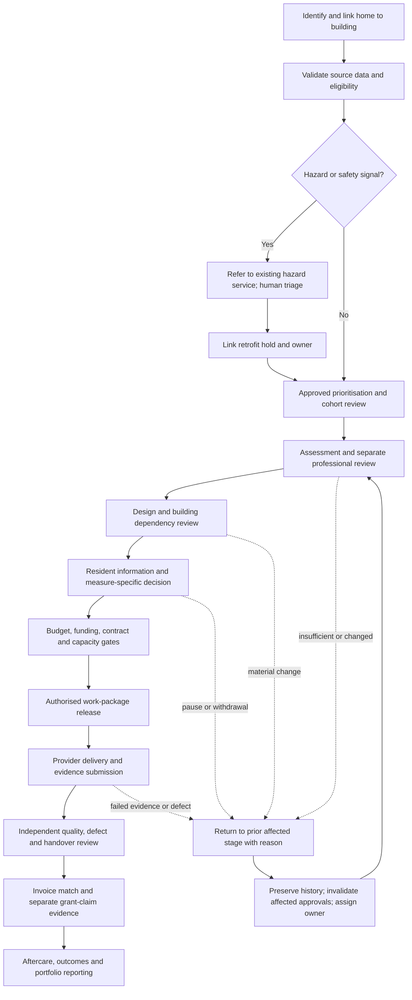

> **PRD-2026-AMA48-001** | Status: draft | Version: 0.7.0 | Last Updated: 2026-10-06

## Executive Summary

Proper Warm needs a shared product surface for the connected retrofit
workflows, not one isolated home screen or five end-to-end agents. The
proposed product is a home-centred workbench with linked building, scheme,
work-package and service cases. People use role-specific screens and queues
over the same governed case data to see new work, approved priority, stale
evidence, blockers, handoffs, progress and suggested next actions.

The scope is one PRD because the workflows share property/building identity,
case lifecycle, evidence provenance, authority checks, handoffs, audit and
reporting. The workbench will represent the full workflow portfolio in
end-to-end exercise scenarios for the Proper North Homes case. Delivery is
staged: establish the shared case, role workspaces and safe workflow controls first; then complete the
domain scenarios and portfolio analytics. The stages are delivery increments
of one product, not separate products or PRDs.

The workbench covers stock and prioritisation, technical assessment/design,
resident service and measure decisions, provider capacity and work release,
hazard referrals, quality/defects/handover, provider invoices and grant
claims, cross-team case orchestration, and portfolio progress, investment and
forecasting. It is a coordination and evidence product. Existing systems and
accountable people retain authoritative decisions; the demonstrator does not
make live resident contact, instruct suppliers, approve work, submit claims,
or release payment.

The owner directed an Azure-led hybrid only as a proposed non-production
demonstrator baseline. Azure programme-state authority, integrations,
deterministic gates and bounded AI remain subject to the options and approval
gates. SharePoint/M365 capability is unverified; Excel-based coordination is
confirmed, while other company systems and their authority are unknown.
Records used in the non-production exercise are constructed for the
demonstration and do not establish actual company performance, resident
outcomes or operational decisions. Any use of real personal or operational
data requires a separate release decision.

### Case and presentation framing

For the capstone presentation, Proper North Homes is treated as the real
customer case and attendees are addressed as its stakeholders in their actual
roles. This presentation framing does not establish unverified company
systems, baselines, staffing, delegated authority or operating outcomes.
Records used to exercise the workbench are constructed examples, not evidence
of actual company performance or resident outcomes.

## Product Context

### Problem and opportunity

Case Study 48 asks for agents to improve a small team's coordination of
assessments, grant applications, procurement, resident consent and quality.
Later analysis challenges the idea that autonomous agents own those
workflows. The core product problem is that work crosses home, building,
resident, professional, supplier, safety and finance boundaries, while each
role needs a different working view and accountable decisions must remain
visible and controlled.

The BRD identifies nine connected workflow areas and proposed value evidence.
They are evidence-backed problem hypotheses, not confirmed operational
failures at Proper North Homes. Phase 0 must establish which constraints
actually bind. The product must therefore make missing evidence and unknown
ownership visible, support conventional workflow without AI, and avoid
presenting its forecasts or suggestions as approved commitments.

### Product boundary and single-product rationale

This PRD describes one modular workbench because the workflows share:

* A versioned home case linked to its building, scheme, work package and
  relevant resident-service, hazard, supplier, quality and finance records
* Shared identity resolution, evidence lineage, lifecycle, task ownership,
  permissions, audit and deterministic transition controls
* Role-specific queues and dashboards over the same records
* Cross-domain dependencies, handoffs, returned work and common progress
  reporting

Splitting these into separate products would create competing case status,
handoff, evidence and audit views. The modules may be delivered in increments
and may integrate with separate systems of record, but they remain one
product experience and one PRD. External provider and resident interactions
are bounded channels or intake records, not assumptions that those groups use
the internal workbench directly.

### Proposed platform boundary

The owner's requested Azure-led hybrid is the demonstrator baseline, not an
approved production architecture:

* Azure-hosted web workbench, domain API, structured programme state,
  deterministic workflow and bounded AI, subject to a comparable options
  appraisal against full Azure custom and greenfield business applications.
* Excel is an import source for validated, traceable exercise records, not
  the target workflow or approval authority. Source workbooks remain unchanged.
* SharePoint may hold managed collaboration documents only if tenant,
  licensing, governance and support checks pass. Otherwise use the documented
  controlled Azure Blob Storage fallback for the demonstrator.
* Asset, housing, repairs, hazard, finance, procurement and supplier systems
  retain their authority. The demonstrator uses exercise adapters or mocks;
  it is not a live integration or source-system replacement.
* No Dataverse or Dynamics 365 dependency is in scope unless a later approved
  decision changes the baseline. Other existing systems remain unknown.

### Component Contracts and Failure Domains

The following is a proposed demonstrator decomposition, not a selected Azure
service plan or an implemented architecture. Each boundary needs a contract
and a tested failure/recovery path before build acceptance. A component
failure must not create an unrecorded transition or imply approval.

| Component | Contract and owned responsibility | Failure domain and required fallback |
| --- | --- | --- |
| Workbench and domain API | The API is the only write path for case edits, handoffs, returns, approvals and accepted suggestions. It enforces identity, field/action permissions, deterministic gates, optimistic concurrency and audit creation; UI views do not authorize actions. | If unavailable, no controlled transition or edit is committed. Permitted reads may be read-only; users see the affected action and a manual recovery route. |
| Programme state store | Stores versioned home/building relationships, workflow state, source references, transition history, tasks, handoffs and approval records. The API owns the schema contract; other components do not write state directly. | If unavailable or inconsistent, writes fail closed. Reconcile from durable audit/events before retry; do not replay a transition without idempotency protection. |
| Workflow orchestrator | Executes deterministic stage sequencing, due-date/hold tasks, handoff waits, return/reopen routing and retryable work. The programme API remains authoritative for state and permissions. | Interrupted steps resume from a durable checkpoint with idempotency keys; exhausted retries create a visible owned exception rather than advancing the case. |
| Bounded AI task service | Receives least-privilege, source-referenced inputs and returns a typed proposal for extraction, reconciliation, summarisation, drafting or raise-only review. It cannot write to the state store or invoke a consequential transition. | Timeout, invalid schema, missing citation, unsupported output or disabled model yields an explicit failure or workflow-only task. It never presents an empty or failed result as success. |
| Evidence document store | Stores exercise evidence documents; the programme store keeps stable references, versions and review/approval links, not a second approval record. SharePoint is conditional; controlled Blob storage is the proposed non-production fallback. | A missing, stale or inaccessible reference blocks the dependent review and enters an owned exception. Switching store is a configuration decision, not an assumed transparent runtime failover. |
| Exercise workbook import | Profiles declared Excel structures, validates row-level mappings and stages proposed case updates for review; source workbooks remain unchanged. | A workbook or row that fails validation is quarantined with reason and source lineage. No unreported partial batch commit is allowed. |
| Identity, authorization and telemetry | Identity claims are verified at the API; role/record/field rules and audit/telemetry are applied across screens, bulk actions, exports and AI context. | Identity or policy service uncertainty denies controlled writes and exports. Operations retains a privacy-safe diagnostic path and documents recovery before replay. |

Service names and placement are options to compare, not requirements. Azure
Container Apps, Azure SQL, Durable Functions, Azure AI Foundry, SharePoint and
Blob Storage were prior candidate examples; verify current availability,
support, tenancy, cost and data residency before selecting them.

### Proposed Azure and M365 realisation (2026-10-08)

[ADR 0001](../adrs/0001-azure-architecture.md) and the Bicep in
[`infra/`](../../infra/README.md) now realise the component contracts above as
a proposed, not deployed, demonstrator design. The service choices remain
options pending OQ-012.

| Component | Proposed realisation |
| --- | --- |
| Workbench and domain API | Container App behind Entra app authentication; only identity with SQL and Blob write access |
| Programme state store | Azure SQL Database with ledger tables, Entra-only authentication |
| Workflow orchestrator | Scheduled Container Apps job, checkpointed through the API; no data credentials |
| Bounded AI task service | Container App scaled by an `agent-tasks` queue; Foundry access only, with no SQL, Blob or Key Vault role |
| Evidence document store | Blob storage by default (`evidenceStore=blob`); SharePoint site through Microsoft Graph with `Sites.Selected` when OQ-012 checks pass |
| Exercise workbook import | Queue-triggered Container Apps job with a quarantine container |
| Identity and telemetry | Per-workload managed identities, Log Analytics, Application Insights, SQL auditing, alerts and budget |

Excel transition (reviewed 2026-10-08, hypotheses pending OQ-012 and owner
baselines): the hybrid is feasible but only convenient if it avoids double
entry. The proposed path is a staged strangler: shadow one-way snapshot imports,
a short fixed parallel run with named Excel editors, read-only workbooks, then
API-fed reports. Cut-over is judged on reconciliation, quarantine, post-import
workbook edits, evidence reference resolution and case-update effort against the
workbook baseline, with Awaab's Law clocks protected throughout and hazard
cases never routed through Teams nudges. Detail and sources are in the ADR
section Hybrid M365 and Excel transition.

M365 is limited to three roles in the demonstrator, each conditional on OQ-012:
Entra ID as the identity provider and role source, a SharePoint site as the
optional evidence store, and Teams as a notification and review channel. No
M365 service becomes a system of record, approval authority or write path
around the API, and Dataverse and Dynamics 365 remain out of scope (CON-005).

### Threat Model (illustrative, not validated)

These threat scenarios focus review of the non-production demonstrator's
workbench, imports, exports, evidence and bounded AI. They are design
hypotheses, not a completed threat assessment or evidence of implemented
controls. Security, privacy and control owners must validate the threat model
before any release gate.

| Threat scenario | Boundary / affected workflow | Mitigation and verification evidence |
| --- | --- | --- |
| Instructions embedded in workbook cells or imported reports manipulate a model into changing its task or ignoring policy. | Exercise import and AI context across stock, resident-service, provider and finance workflows. | Treat imported text as untrusted data; delimit it from instructions; accept only schema-validated proposals; deny AI write credentials. Test with seeded injection strings and verify no state mutation. |
| A user or AI output exposes resident, financial or supplier information outside the recipient's role. | Case search, AI context, bulk views, exports and stakeholder reporting. | Apply server-side record/field filtering before data reaches a model or export; use constructed, non-identifying exercise records; audit export scope; test cross-role and cross-case access denial. |
| A hallucinated or stale statement creates false reassurance, unfair priority or an unsupported resident/provider action. | Eligibility, hazard awareness, resident choice, invoice matching, quality and next-step suggestions. | Require source references, freshness, explicit unknowns and human review; AI can only propose; test seeded missing/conflicting evidence and critical false-negative/false-positive cases. |
| Spoofed identity, confused-deputy behavior or bulk-edit scope bypasses decision rights. | API write path, returns/reopens, approvals, bulk edit and provider-submitted evidence. | Re-authorize every record and action at the API; separate proposer, reviewer and approver roles; never grant by UI perspective; test forged claims, privilege escalation, stale versions and mixed-permission batches. |
| Programme state and document versions diverge, or a retry duplicates a transition/payment recommendation. | Evidence links, long-running handoffs, import retries and finance/quality review. | Keep one authoritative state store; version evidence references; use idempotency keys and reconciliation queues; inject store/document/orchestrator failures and verify no duplicate or silent transition. |
| Heatmap, cohort export or forecast reveals sensitive patterns or disguises exclusions through an unstable denominator. | Coordinator and stakeholder analytics. | Enforce audience permissions, minimum-necessary fields, approved aggregation and explicit filters/denominators; test small cohorts, missing records, changed filters and export permissions. |

### Evidence status

The upstream [Agentic Retrofit Programme BRD](../brds/agentic-retrofit-programme-brd.md)
is draft v0.14.1. No signed `BRD_TO_PRD_HANDOFF_V1` or current valid BRD
quality report was available for this revision; the latest valid BRD quality
assessment remains v0.8.0. The source BRD's workflow descriptions, goals,
authority rules and targets are requirements inputs, not company operating
evidence or approval. Company systems, baselines, residents' needs, owners,
service targets, budgets, contract terms and delegated authorities remain
open. The earlier proposal for a missed-appointment threshold remains an
exercise-only candidate test.

### Prototype-review evidence and integration

The [2026-10-06 profile review](../reference/research/ux/proper-warm-prototype-profile-review.md)
contains fresh own-role critiques from all nine `company-*` agents, an
eleven-profile UX synthesis and four relayed discussions. These are research
instruments and design hypotheses, not employee/resident interviews, company
approvals or accessibility conformance evidence. Provider, Quality and Digital
Operator perspectives have adjacent role lenses, not direct representative
validation. The owner requested integration for a subsequent prototype;
this does not approve the PRD, actual company processes or production use.

The reviewed HTML has eleven perspectives, nine workflow filters, eight
constructed case examples and narrative histories. Workflow selection filters
the queue as well as showing descriptions. It does not advance cases.
The portfolio workflow has no matching example; fixed 128/42/7/19 snapshot
figures are separate from those eight records. Ownership labels, generic
suggestion rationale and return-source wording have demonstrable
inconsistencies. This revision makes those lessons testable without treating
missing product capabilities as already delivered.

An independent [draft-stage PRD challenge and disposition](../../.copilot-tracking/reviews/2026-10-06/proper-warm-prd-v0-7-0/challenge-disposition.md)
led to explicit slice applicability, conflict inputs, per-profile reset
oracles, exact traceability, receipt/acceptance examples, separately reportable
checks and constraint classification. The final bounded follow-up found no
remaining defect in the amended default-manifest and reflow paragraphs.
This is not full PRD approval: Validate remains blocked by upstream evidence
and named human review; Finalize was not evaluated.

## Users and Personas

These are provisional product roles inferred from the BRD, not confirmed job
titles, staffing or delegated authorities. Screen content varies by task and
permission; selecting a perspective is not authentication.

| Role workspace | Primary work in the product | Key information/actions |
| --- | --- | --- |
| Asset and investment | Form and explain candidate cohorts, see asset/building dependencies and investment progress | Approved priority and reason codes, condition freshness, shared works, budget envelope, cost and forecast scenarios |
| Programme coordinator | Coordinate the end-to-end flow and prepare stakeholder progress views | Cross-workflow queue, new/priority/stale work, blockers, handoff acceptance, cases returned, heatmap, funnel, timeline and forecast |
| Retrofit case team | Progress home cases through readiness, resident, supplier, delivery and aftercare stages | Home/building links, next task, evidence, resident decision status, dependencies, appointments, holds and change history |
| Retrofit Assessor, designer and Coordinator | Complete and review technical stages within competent scope | Sourced survey facts, missing evidence, design version, return reasons, separate sign-offs and material-change re-review |
| Housing and Resident Engagement | Coordinate accessible information, service requests, complaints, repair/defect reports, decisions and contact | Minimum-necessary resident context, preferences/adjustments, safe contact and representative details, decision history and next-update commitment |
| Repairs and Building Safety | Review hazard referrals and linked retrofit holds without making retrofit the hazard system | Awareness source/time, referral receipt/acceptance, service owner, linked hold and evidence for accountable release |
| Procurement and contract manager | Confirm contract route, capacity, work order, provider exceptions and instruction authority | Contract/call-off, committed capacity, appointment outcomes, work-order version, variation and escalation task |
| Provider / contractor contact | Submit or respond to authorised work-package information through approved intake channels | Work-order scope, schedule, evidence checklist, appointment outcomes, completion pack and invoice submission status; no self-approval |
| Quality and assurance | Independently review work/evidence, defects and handover | Positive per-measure checklist, inspection/evidence, defects, remediation, audit and systemic-pattern review |
| Finance and Grants | Review investment, budget, invoice, claim and cash records | Budget line, commitment, invoice match, payment status, grant state, claim evidence, cash exposure and approval history |
| Digital operator and auditor | Resolve imports, integrations, access and recovery; reconstruct decisions | Exception queue, component health, audit trail, versions, exports and failed/replayed operations |

Residents are affected stakeholders, not users of this non-production MVP.
No resident-facing production journey or live outbound communication is
authorised. Their service intake and measure decisions must be represented in
constructed exercise scenarios and later validated through direct, accessible
research.

## Product Goals

| Goal | Outcome | Priority | Candidate success signal | Status |
| --- | --- | --- | --- | --- |
| GOAL-001 | Give each authorised role a useful view of the same governed work, evidence and next action across the whole workflow portfolio. | MUST | Every agreed profile scenario finds new, prioritized, stale, blocked and owned work; case edits and handoffs are reconstructable. Baseline and usability threshold TBD. | Candidate |
| GOAL-002 | Demonstrate the nine connected workflows end to end with explicit authority, returns, shared building dependencies and finance/quality gates. | MUST | Every approved exercise scenario reaches its expected state or explicit safe block; all prohibited transitions are denied in the acceptance suite. | Candidate |
| GOAL-003 | Help coordinators and stakeholders understand current progress, historical flow and plausible delivery scenarios. | MUST | Heatmap, funnel, timeline and forecast reconcile to case/event records and disclose filters, definitions, unknowns and uncertainty. | Candidate |
| GOAL-004 | Establish whether bounded agents improve selected tasks over workflow-only handling without weakening resident, safety, quality or financial controls. | SHOULD | Paired tests report quality, review effort, errors, overrides and attributable value against pre-set owner thresholds; no undetected critical error. | Candidate |

**SMART status:** Deferred. Company baselines, owners, timeframe, workload,
targets, usability protocol and approval authority are not validated. The
BRD's proposed 20% cycle-time and 25% net coordination-effort improvements
remain unratified targets under OD-18, not PRD commitments.

## Staff data trust and control (proposed)

These are proposed requirements from the 2026-10-08 consultation, not approved scope. They make existing controls visible to staff who work in Excel and fear losing control of their data. Existing requirements remain the source of truth: NFR-003, NFR-004, NFR-005, NFR-010, FR-029, FR-030, FR-034 and FR-044.

| Id | Proposed requirement | Priority | Basis |
| --- | --- | --- | --- |
| TR-001 | A user can export their permitted cases to Excel or CSV at any time, with source, version and history, and a colleague can open it without the workbench or an AI provider. | MVP | Extends FR-030, NFR-010, AC-032. |
| TR-002 | A user can see who viewed or changed a case, when and why, including imports and exports. | MVP | Builds on NFR-004, AC-007. |
| TR-003 | An import preview shows each row disposition and confirms the source workbook was not modified; values are tagged unverified and a decision held only in Excel is flagged invalid. | MVP | FR-029, DD-004, ADR transition rules. |
| TR-004 | A plain-language data page states what is held, where, who holds which role, what AI can and cannot do and the governing rule; each compliance statement is marked verified, designed or unknown. | MVP | New; static page acceptable. |
| TR-005 | The workbench shows only permitted fields, enforced by the server. | MVP | FR-003, NFR-003, AC-004, AC-005. |
| TR-006 | A documented statement says what the audit log is for and who may read it, agreed with staff. | Later | New; needs HR and staff input. |
| TR-007 | An offline list of open hazard and vulnerable cases supports an outage. | Later | NFR-004, hazard clock rules. |

Retention and data-handling baseline (proposed, 2026-10-08): the [addendum baseline](../case_study_48_addendum.md) sets the rules the demonstrator must follow. Each requirement below is designed to support UK GDPR and the other local sources and needs DPO, Legal and record-owner approval before production use.

| ID | Requirement | Release | Trace |
| --- | --- | --- | --- |
| DH-001 | Every data class has a recorded purpose, lawful basis, owner and retention trigger before collection; special category data names its Article 9 and Schedule 1 condition. | Later | CON-003, RULE-022, OD-14. |
| DH-002 | The demonstrator holds constructed, non-identifying data only until a DPIA, retention schedule and processor terms are approved. | MVP | NFR-005. |
| DH-003 | A scheduled retention job lists records past their trigger, requires owner approval and logs deletion without keeping deleted content; a legal hold blocks deletion. | Later | Article 5(1)(e). |
| DH-004 | Access, rectification, erasure and restriction requests are logged with receipt date and answered within one month; erasure exceptions for legally required records are documented. | Later | Articles 12, 15 to 18. |
| DH-005 | Backup restores re-apply deletions, and the restore and deletion are tested before any production use. | Later | Article 32, NFR-004. |
| DH-006 | No resident personal data reaches a model deployment until the transfer position for its processing region is approved. | MVP | Articles 44 to 46, OQ-012. |
| DH-007 | Audit entries survive deletion of the data they describe but never contain the deleted personal content. | MVP | NFR-003, TR-002. |

New open questions: the retention periods in the baseline are defaults, not approved periods; funder, PAS 2035 and limitation-period retention terms are unknown. Which retention, residency and data-handling rules apply to staff data (the organisation's own rules are not in the repository); whether current spreadsheets hold vulnerability data and who can access them; whether staff and residents have been consulted. New risk: over-claiming compliance. Wording rule: say "designed to support", never "compliant" or "certified", without named approval.

## Design Decisions and Options Gate

These are draft product decisions for the non-production demonstrator, not
production, procurement or company approvals.

| Decision | Proposed direction | Rationale and condition |
| --- | --- | --- |
| DD-001: Demonstrator platform | Use the Azure-led hybrid as the comparison baseline while retaining full Azure custom and greenfield business applications as alternatives. | The owner requested this demonstrator direction, but cost, support, tenant, control and source-system evidence remain open. The gate may reject the hybrid. |
| DD-002: Data boundary | Use constructed, non-identifying exercise records and exercise adapters/mocks for the MVP. | The records do not substantiate company performance or resident outcomes; no live resident contact or operational action is authorized. |
| DD-003: Decision authority | Keep deterministic workflow and human authority separate from bounded AI proposals. | Shared case data does not transfer decision rights. AI output cannot satisfy an approval or controlled state transition. |
| DD-004: Excel boundary | Treat Excel as a source for profiled and validated imports, not as the target workflow or approval authority. | Preserve source workbooks and expose row-level mapping/conflict outcomes. |
| DD-005: Options appraisal | Compare all three platform options against equivalent workflows, controls and workload using predeclared criteria. | Set weights and evidence thresholds before scoring; no option has been scored or selected for production. |
| DD-006: Appointment scenario | Retain the owner-directed missed-appointment rule only as a candidate exercise test. | Count only confirmed appointments with verified resident no-access while a case is active; route for human investigation only when the eligible count is greater than the configurable threshold (provisional default five). Exclude provider/contractor no-shows, cancellations and reschedules; human closure resets the active counter but preserves history. Do not infer refusal or delay urgent hazard response. Five is not a validated threshold or operational rule; evidence, Resident Engagement review and configuration governance remain open under OQ-014. |

### Options Gate Scoring Framework

This is a decision instrument, not a completed appraisal. The architecture
lead and sponsor must approve weights, minimum gates, comparable scope and
evidence sources before scoring. A high aggregate score cannot compensate
for failure of a mandatory safety, privacy, authorization, accessibility or
recovery control.

| Criterion | What the evidence must establish | Weight |
| --- | --- | --- |
| Control and workflow coverage | Whether each option supports the nine exercise scenarios, server-enforced authority, returns, bulk controls, evidence lineage and auditable state. | TBD |
| Whole-life cost and affordability | Comparable implementation, licensing, migration, support, operations, renewal and exit costs against an owner-approved workload and affordability envelope. | TBD |
| Supportability and recovery | Named skills, ownership, failure containment, manual fallback, recovery testing, service lifecycle and exit path. | TBD |
| Data and integration fit | Source-of-record boundaries, identifiers, interfaces, tenant prerequisites, reconciliation and portability. | TBD |
| Resident and accessibility readiness | Accessible staff workflows, future resident research, non-digital routes and no unapproved resident-facing dependencies. | TBD |
| Evidence confidence | Number and materiality of unresolved assumptions or external prerequisites each option depends on. | TBD |

The platform options remain full Azure custom, greenfield business
applications and the proposed Azure-led hybrid. Current Excel-based
coordination does not establish which systems are authoritative; M365,
SharePoint and licensing are unverified. The comparison must not treat an
unverified estate or role-profile hypothesis as a customer fact.

## Workflow Coverage

| BRD workflow | Workbench module and core screen | Roles | Progress/value evidence |
| --- | --- | --- | --- |
| Stock data, safety triage and fair prioritisation | Portfolio/cohort screen; property and building records; data-quality and eligibility queues | Asset, Safety, Finance, data owner, Coordinator | Source freshness, conflicts, eligibility unknowns, cohort reasons, viability after survey, overrides |
| Technical assessment and design readiness | Home technical workspace; survey/design checklist; return and reapproval queue | Assessor, designer, Retrofit Coordinator, Programme | Assessment-to-ready-to-install time, first-pass completeness, return loops, review effort |
| Resident service, access, choice and redress | Resident-service inbox and home resident tab; measure decision history; contact/update tasks | Housing, Resident Engagement, Repairs, Coordinator | Appointments kept, adjustments met, repeat contacts, time to decision, complaint/service resolution |
| Procurement, committed capacity and work release | Supplier/capacity board; contract/work-package screen; controlled work-order view | Procurement, contract manager, Programme, provider contact | Committed vs delivered capacity, provider-caused failures, capacity gap age, accepted work |
| Hazard awareness and damp-and-mould response | Referral/hold queue linked to the existing repairs/hazard case, not a replacement service | Repairs, Building Safety, Programme | Awareness-to-referral, accepted referral age and applicable response/update performance |
| Quality acceptance, defects and handover | Quality pack, inspection/evidence review, defect and remediation queue, handover checklist | Quality, competent inspector, provider, Resident Engagement | Right-first-time evidence/physical acceptance, defect severity, recurrence, rework, handover |
| Budget, provider invoice, grant claim and cash reconciliation | Investment/budget view; invoice intake and match queue; separate grant ledger/claim pack | Finance, Grants, contract manager, Quality | Invoice exceptions, review effort, claim acceptance/rejection, receipt time, cash exposure |
| Programme handoffs and case orchestration | Cross-role work queue, case timeline, handoff and return/reopen workspace | Coordinator and every receiving team | Owned handoffs, overdue queues, return loops, stage timing and coordination effort |
| Portfolio investment, performance and scale decisions | Portfolio dashboard with heatmap, funnel, history/timeline and forecast scenarios | Asset, Finance, Programme, Sponsor/Board, Assurance | Accepted outcomes, cost, grant state, resident/safety/quality guardrails, forecast variance |

Every row above shall have a product representation in the full MVP's
exercise scenario suite; this is required coverage, not a statement that the
current HTML implements it. The next read-only prototype is a learning slice
with an explicit scenario manifest and unavailable-feature labels, described
under MVP and Release Framing. Live integrations, external portals, formal
user research and operational authority remain separately gated.

## Functional Requirements

All requirements are draft candidates and shall be validated by the product
owner, named control owners and affected users before implementation approval.

| ID | Requirement | Actor / trigger | Acceptance criteria | Goals |
| --- | --- | --- | --- | --- |
| FR-001 | The product shall maintain one versioned home case linked to its building, scheme, work package and relevant resident-service, hazard, provider, quality and finance records. | Any authorised user opens or updates a case | AC-001, AC-002, AC-043 | GOAL-001, GOAL-002 |
| FR-002 | The product shall show building-level shared systems, dependencies, holds, works and costs separately from each home's evidence, decision, cost allocation and outcome; a shared building ID alone shall not establish package applicability or transfer a home-specific gate. | User reviews a building or linked home | AC-001, AC-002, AC-003, AC-043 | GOAL-001, GOAL-002 |
| FR-003 | The product shall present task-focused screens and queues by authenticated role, with field/action permissions enforced by the service rather than by a selectable view label. | User signs in or changes task context | AC-004, AC-005 | GOAL-001 |
| FR-004 | The shared work queue shall identify newly arrived work, approved priority, stale evidence, blockers, overdue tasks, unowned handoffs and cases needing extra human attention using visible definitions and filters. | User opens a permitted queue | AC-006 | GOAL-001, GOAL-003 |
| FR-005 | The product shall allow authorised users to view and edit case fields, evidence references, task owners, due dates and permitted workflow details, preserving source, version, actor, timestamp and reason for each change. | User edits an individual case | AC-007, AC-008 | GOAL-001, GOAL-002 |
| FR-006 | The product shall support bulk updates of explicitly permitted fields across selected cases, with a preview of the target records, proposed changes, validation failures and resulting per-case outcomes. | User selects multiple cases and requests an allowed change | AC-009 | GOAL-001, GOAL-002 |
| FR-007 | Bulk actions shall not approve or release technical work, consent, safety decisions, procurement instructions, budget commitments, invoices, payments, claims, quality acceptance, defect closure or complaints. | User attempts a bulk action | AC-009, AC-010 | GOAL-002 |
| FR-008 | The product shall enforce deterministic evidence, eligibility, authority, safety, resident, funding, capacity, quality and finance gates before a controlled state transition. | User or workflow requests a transition | AC-010, AC-011 | GOAL-002 |
| FR-009 | An authorised reviewer shall be able to return a case or work item to an earlier lifecycle stage, request missing/corrected information, or reopen it when evidence, scope, condition, resident circumstances or status changes. | Reviewer returns/reopens a case | AC-008, AC-012 | GOAL-001, GOAL-002 |
| FR-010 | Returning or reopening work shall record the reason, source, initiating authority, receiving owner and next action; preserve prior state/history; and invalidate only affected downstream approvals for human reassessment. | Case return, reopen or material change | AC-012, AC-013 | GOAL-002 |
| FR-011 | The product shall maintain role-owned handoffs with distinct sent, received, accepted, rejected/returned, escalated and completed states; show current accountable owner, destination, proposed/confirmed receiver, chase owner, urgency, due date and next action separately, with unknown/unassigned values explicit and receipt not implying acceptance. | A case crosses a team boundary | AC-014, AC-036 | GOAL-001, GOAL-002 |
| FR-012 | The product shall represent stock-data reconciliation, eligibility pass/fail/unknown, prioritisation policy version, reason codes and review exceptions; a conflict shall expose both compared values, source identifiers, dates/versions, validation state and resolution owner without silently excluding or resolving a home. | Cohort or property record is prepared | AC-015, AC-040 | GOAL-002 |
| FR-013 | The product shall represent assessment, separate competent sign-offs, design version, building dependency, evidence completeness, return and reapproval states. | Technical stage is updated | AC-016 | GOAL-002 |
| FR-014 | The product shall represent distinct resident service/complaint/repair/defect/hazard intake routes, desired outcome and redress owner, minimum-necessary accessible-contact/representative references, measure/scope/version-specific decisions, pauses, withdrawal and appointment outcomes; contact/access shall not imply consent. | Resident-related exercise intake or case update | AC-017, AC-037 | GOAL-001, GOAL-002 |
| FR-015 | The product shall represent hazard source and awareness time, referral destination and sent reference/time, separately evidenced receipt and acceptance, owned follow-up, affected retrofit hold scope/source/status and read-only authoritative human release-decision/evidence references; the workbench shall not judge release sufficiency or own the hazard service's clock, classification or closure. | Potential hazard is identified | AC-018, AC-038 | GOAL-002 |
| FR-016 | The product shall represent package period and scope/version, contract/call-off, offered versus evidenced committed capacity, controlled work-order versions, issuer, provider appointment outcomes, completion/correction submission and supplier exceptions; draft readiness shall show unknown/unmet prerequisites and named next reviewer, never imply instruction, booking or contractual commitment. | Procurement or delivery activity occurs | AC-019, AC-039 | GOAL-002 |
| FR-017 | The product shall represent positive per-measure checklist evidence and versions, independent acceptance, defect/remediation owner, return reasons, reinspection, resident handover and aftercare, with provider submission/correction/acknowledgement separate from reviewer disposition and approval. | Work evidence is submitted or reviewed | AC-020, AC-042 | GOAL-002 |
| FR-018 | The product shall represent approved budgets, commitments, provider invoice/valuation intake, line-level match exceptions, payment holds/status and Finance disposition, without executing payment in the demonstrator. | Invoice or budget record is entered | AC-021, AC-042 | GOAL-002 |
| FR-019 | The product shall maintain distinct, evidence-linked grant states for opportunity, award, claimable, submitted, accepted/rejected and cash received, separately from provider invoices and payments. | Finance updates grant evidence | AC-022 | GOAL-002 |
| FR-020 | The coordinator dashboard shall provide a filterable heatmap of cases by approved geography/building/archetype and stage, with counts, denominator, holds, priority and data-coverage cues. | Coordinator or authorised stakeholder selects heatmap | AC-023 | GOAL-003 |
| FR-021 | The coordinator dashboard shall provide a funnel of cases through lifecycle stages, showing entries, exits, returns, holds and exclusions with consistent definitions and drill-through to records. | Coordinator views funnel | AC-024 | GOAL-003 |
| FR-022 | The product shall provide historical views of case and cohort progression from timestamped events, including stage duration, handoff, pause, return, reopen and decision history; narrative illustrations shall be labelled separately and shall not establish auditability or durations where event times are unknown. | Coordinator or assurance user selects a time range | AC-025, AC-043 | GOAL-003 |
| FR-023 | The product shall generate delivery forecasts from declared cohort, stage, event, committed-capacity, dependency and scenario assumptions, show uncertainty and data limits, and distinguish forecast from target, approved plan and actual outcome. | Coordinator or Asset/Finance user requests forecast | AC-026 | GOAL-003 |
| FR-024 | The product shall support role-appropriate stakeholder progress views and exportable evidence for a selected cohort and as-of date, with definitions, sources, denominators, filter impact, unresolved items and approval status visible; a separate illustrative snapshot shall disclose that it is not derived from the inspectable case sample and shall not imply case drill-through or accepted handover. | Coordinator prepares a progress review | AC-027, AC-041 | GOAL-001, GOAL-003 |
| FR-025 | The product shall offer source-linked next-step suggestions based on case state, approved rules and relevant evidence, showing rationale, proposed owner, prerequisite, due-date basis and unknowns. | User reviews a case or queue | AC-028 | GOAL-001, GOAL-004 |
| FR-026 | A user shall be able to accept, edit or reject a suggestion with a reason; accepting creates a task or draft only and does not satisfy an approval or execute an external action. | User reviews an agent suggestion | AC-028, AC-029 | GOAL-001, GOAL-004 |
| FR-027 | Bounded AI may extract, reconcile, summarise, draft or raise a signal from approved exercise sources; each material output shall cite its source and remain visibly unapproved until human review. | AI task is invoked | AC-029, AC-030 | GOAL-004 |
| FR-028 | The product shall provide a workflow-only path for every AI-assisted task and preserve failure, fallback, review, correction and override evidence for comparison. | AI unavailable, disabled or evaluated | AC-030 | GOAL-004 |
| FR-029 | The product shall import declared exercise Excel structures with row-level preview, lineage, mapping/conflict resolution and explicit disposition without modifying source workbooks. | Data analyst previews an import | AC-031 | GOAL-001, GOAL-002 |
| FR-030 | The product shall export interpretable exercise case, event, decision and evidence-reference data, retaining version, source, approval and supersession history independently of the AI provider. | Authorised user exports data | AC-032 | GOAL-001, GOAL-002, GOAL-003 |
| FR-031 | For exercise scenarios only, the product shall apply a configurable missed-appointment threshold, provisionally defaulted to five, and create a human-investigation task only when the eligible active-case count is strictly greater than the configured threshold; it shall preserve event/configuration history, exclude provider/contractor no-shows, cancellations and reschedules, never infer refusal, and never delay urgent hazard response. | Exercise appointment outcome is recorded | AC-033 | GOAL-001, GOAL-002 |
| FR-032 | Queue views shall display active perspective, workflow, search and all-cases scope, explain workflow-over-profile precedence, and provide a single reset to the versioned default result set, order and selection for that perspective; reset shall retain logical focus and announce results, while empty results distinguish no matching fixture from no representative scenario supplied. | User changes profile/workflow/search or resets filters | AC-034 | GOAL-001 |
| FR-033 | The product shall represent an independent resident-update commitment with purpose/linked issue, owner, due date/basis, minimum-necessary safe-route/adjustment reference or explicit unknown, outstanding/proposed/sent state and sent time/evidence; operational receipt, acceptance or return shall not silently reassign or clear it, and sending shall not imply resident receipt or understanding. | User reviews an update commitment or operational handoff | AC-035 | GOAL-001, GOAL-002 |
| FR-034 | Queue, case, history, source trace and suggestion views shall agree on recorded ownership, reason, evidence/version and explicit unknowns; selecting a case shall refresh its rationale and proposed reviewer/prerequisite without reusing another case's explanation. | User opens a case or changes selection | AC-036, AC-040 | GOAL-001, GOAL-004 |
| FR-035 | Each prototype iteration shall include a versioned constructed-scenario manifest identifying its active slice, independently reportable applicable/deferred checks, eleven profile paths, nine workflow representations, fixture links, per-profile default IDs/count/order/selection, expected safe endpoints, deliberately unknown fields and implemented versus unavailable behaviors; same-home lifecycles and shared-building impacts shall be explicitly linked rather than inferred from unrelated examples. | Prototype is generated or reviewed | AC-043 | GOAL-001, GOAL-002 |

## Non-Functional Requirements

Thresholds dependent on company workload, service objectives, approved
accessibility standard, tenant capabilities and support model remain TBD.
They must be set by accountable owners before the relevant gate, not inferred
from the case-study portfolio size.

* **NFR-001 Usability and accessibility:** Representative role users shall
  complete their agreed tasks in usability testing. The product shall support
  keyboard access, clear focus, readable status, accessible charts with
  equivalent tabular views, and a documented accessibility assessment.
  Participant count, conformance target and acceptance thresholds require
  owner approval. For the next prototype, proposed engineering checks include
  WCAG 2.2 AA text contrast, non-color state meaning, 24-by-24 CSS pixel
  targets or documented permitted exceptions, 200% text zoom, keyboard
  focus/return, narrow-layout/reflow with recorded viewport and
  screen-reader labels/status updates. Record actual checks
  and limitations; they do not establish conformance or validated device needs.
  The proposed read-only fixture check uses 320, 390 and 1280 CSS pixel
  viewport widths and 200% text zoom: no clipped/lost content or page-level
  horizontal overflow; a genuinely two-dimensional case table may scroll
  within its labelled keyboard-focusable region. Record browser, viewport,
  zoom, exception and result. These are prototype engineering checks, not
  approved company accessibility thresholds or a WCAG conformance claim.
* **NFR-002 Performance and capacity:** Before acceptance, the product owner
  shall approve case volume, concurrent users, bulk selection limits, import
  size, chart/forecast workload and response-time targets. Test results shall
  report against them; numeric targets are TBD.
* **NFR-003 Security and authorization:** Authentication and server-enforced
  role, record and field permissions shall be tested for every user profile
  and controlled action. A UI perspective switch shall never grant access.
* **NFR-004 Auditability:** Case edits, bulk changes, imports, exports,
  handoffs, returns, approvals, overrides, agent outputs and failures shall be
  attributable, timestamped, versioned and reconstructable.
* **NFR-005 Privacy:** MVP data shall consist of constructed,
  non-identifying exercise records only. Personal data shall
  not be ingested without separate lawful-basis, data-protection and release
  approval. Exercise records shall not contain real identifiers, addresses,
  contacts or health histories.
* **NFR-006 Reliability and recovery:** Component failure shall stop
  unverified controlled transitions, expose affected work and owner, and
  provide a tested reconcile/restart path. Hazard response remains available
  outside the workbench.
* **NFR-007 Forecast explainability:** Every forecast shall identify as-of
  time, included cohort, event definitions, capacity/dependency assumptions,
  exclusions, data coverage, scenario version and uncertainty representation.
  An authorised reviewer shall be able to reproduce the same output from the
  same inputs and version.
* **NFR-008 Data quality and interoperability:** Each imported or integrated
  field shall retain source authority, identifier mapping, timestamp/version,
  validation status, conflict owner and reconciliation outcome.
* **NFR-009 AI safety and evaluation:** AI tasks shall use least-privilege
  read/propose tools, source citations and human review. Every task shall have
  a workflow-only comparator, error taxonomy, review-effort capture and
  owner-defined thresholds before evaluation.
* **NFR-010 Portability:** Case, event, approval, audit, forecast-input and
  evidence-reference exports shall remain interpretable without the selected
  AI provider or optional M365 document store.
* **NFR-011 Operability:** Each release shall identify configuration,
  integration and service owner, monitored failure states, disable procedure,
  manual fallback, retention and tested rollback.
* **NFR-012 Chart integrity:** Dashboards shall disclose denominator,
  as-of date, filters and their effect, missing/stale records and measure
  definitions; colour alone shall not encode status. Charts shall have
  accessible tabular equivalents. Separate illustrative populations shall
  be labelled independent of case samples, never presented as reconciled data.
* **NFR-013 Bulk-edit safety:** Bulk operations shall preview scope and
  effects, validate permissions and rules per case, report each case's result
  and retain a batch audit record. No hidden partial success is permitted.

### Observability and SLO Measurement Method

This is a proposed measurement contract for NFR-004, NFR-006, NFR-009 and
NFR-011, not an implemented telemetry system. Use OpenTelemetry data-model
and semantic-convention names where applicable; do not create vendor-specific
names or unbounded metric dimensions.

* Spans shall follow the relevant HTTP, database, messaging, GenAI or
  serverless semantic conventions. Other operation names shall use the
  `verb.resource` pattern. Configure the required service resource attributes
  `service.name`, `service.version`, `deployment.environment`,
  `telemetry.sdk.name`, `telemetry.sdk.language` and `telemetry.sdk.version`.
* Structured logs shall use the OpenTelemetry log fields, including
  `timestamp`, `severity_text`, `severity_number`, `body`, `attributes` and
  `resource`. When emitted within a span, logs shall carry `trace_id` and
  `span_id`. A scenario identifier belongs in the access-controlled audit
  record; any custom telemetry attribute for scenario correlation must be
  proposed through the shared telemetry vocabulary before use.
* Keep the business audit record distinct from diagnostic telemetry. Audit
  records retain the case/event/version/actor/decision needed to reconstruct
  controlled changes; telemetry must not copy resident contact, address,
  health, free-text or raw case identifiers. Apply the telemetry PII denylist
  and an explicit redaction strategy before emitting any joinable identifier.
* Measure scenario completion duration as a histogram in seconds, with
  p50/p95 reported by a defined scenario class and release. Calculate failure
  rate from failed or explicitly escalated runs divided by started runs over
  the same window; document treatment of cancelled, retried and incomplete
  scenarios. Attribute model/provider usage cost to the protected audit
  scenario record rather than a high-cardinality metric dimension.
* Establish target values, test workload, windows and alert thresholds with
  the product and operations owners before acceptance. Targets are TBD; until
  agreed and measured, report observations and method only, not SLO attainment.
  Retain error traces and a representative sample of successful traces; verify
  cardinality, access, retention and redaction in telemetry tests.

### AI Model Selection and Evaluation Harness

This proposed method supports FR-027 and FR-028 and GOAL-004. No model has
been selected, no test has been run and no performance or value result is
claimed.

* For each proposed bounded task, compare at least one smaller/lower-cost
  candidate and one more capable candidate on the same held-out exercise
  cases. Record task quality, source-support rate, false-positive and
  false-negative rates for flags, p95 latency, refusal/invalid-output rate
  and cost per invocation. Select the smallest candidate that meets
  pre-approved task-specific quality and critical-control thresholds.
* Pair AI-assisted and workflow-only runs on the same scenarios, evidence
  and acceptance conditions. Capture accuracy against a labelled exercise
  reference, precision/recall where classification applies, unsupported-claim
  rate, missed critical exceptions, reviewer override/correction rate,
  review-minutes delta and end-to-end task duration.
* Define the exercise sample, labels, exclusions, versioned prompts/models,
  metrics and thresholds before evaluation. Product, Safety, Data Protection
  and Assurance owners must approve thresholds for the relevant task.
  Sample sizes and numerical pass thresholds remain TBD.
* Record failure modes separately: missed critical exception, false positive,
  unsupported source reference, stale evidence, malformed output, refusal,
  privacy leakage and operator override. Report results by task and workflow;
  do not combine unlike tasks into one aggregate accuracy score.
* Zero undetected critical-control failures is a release condition for the
  evaluated task. Any failure blocks that task's AI path until corrected and
  retested; the workflow-only path remains available. The evaluator records
  evidence and does not grant operational approval.

### Bounded-Agent Orchestration Pattern

Orchestration is a deterministic, reviewable state graph, not an open-ended
agent loop. It supports source-linked next-step suggestions while preserving
the shared case state and human decision rights.

1. The workflow engine selects an eligible task from the current authorized
   case state and records the task, version and prerequisites.
2. The task broker provides the model only the minimum permitted, source-linked
   context and a typed read/propose tool contract. No credential or tool can
   commit a case transition, contact a resident/provider, issue a work order,
   approve expenditure, submit a claim or release payment.
3. The model returns a typed proposal with source references, rationale,
   uncertainties and a proposed next task/owner. Schema validation and
   source-reference checks reject malformed or unsupported proposals to a
   visible human queue. A model self-check may identify missing support; it
   is not treated as independent verification.
4. The API rechecks identity, permissions, current case version and
   deterministic gates when a human accepts or edits a proposal. Acceptance
   creates a draft or task only. Human approval remains a separate recorded
   action.
5. Each step is idempotent and auditable. Failure, timeout, stale input,
   refusal or disabled AI leaves the case in its prior controlled state and
   routes to workflow-only handling or an owned exception. A human can return
   or reopen work with the reason and affected approvals captured.

This design deliberately avoids autonomous stage selection or an agent-owned
case lifecycle. The value question is whether the proposal step improves the
measured task against workflow-only handling, not whether the agent can act
without a reviewer.

## Constraints

| ID | Category | Constraint | Imposing source | Boundary |
| --- | --- | --- | --- | --- |
| CON-001 | Scope / data | The MVP is non-production and uses constructed, non-identifying exercise records; it exercises no live authority over residents, providers, payment, grants or safety. | BRD v0.14.1, demonstrator scope; owner direction | No live decisions, instructions, submissions or external integrations. |
| CON-002 | Integration / authority | Existing asset, housing, repairs, hazard, finance, procurement and provider systems retain authoritative responsibilities unless separately approved. | BRD v0.14.1, home-centred operating model | Workbench coordinates and links; it does not silently replace systems of record. |
| CON-003 | Human decision rights | Residents retain measure-specific decisions; qualified professionals, Safety, Asset, Procurement, Finance, Quality and Board/delegated authorities retain respective decisions. | Original case, governance brief; BRD authority matrix | Agent suggestions and UI actions cannot substitute for approval. |
| CON-004 | Governance / appraisal | No production/platform/procurement approval shall be inferred from the owner's demonstrator preference; alternatives remain subject to the options gate. | Addendum, Implementation Options and Provisional Platform Recommendation; owner direction | Hybrid design is DD-001, not a mandate for production selection. |
| CON-005 | Estate / evidence | Dataverse and Dynamics 365 are not assumed present; M365/SharePoint availability, licensing and governance remain unverified. | Owner estate statement, recorded in Product Context and OQ-012 | No unverified estate dependency; proposed document-store fallback is a design option under Component Contracts, not a company constraint. |
| CON-006 | Safety / authority | Retrofit tooling shall not delay, pause, reset, classify or close the existing statutory hazard response. | BRD CON-001, RULE-003 | Hazard service retains its own record, clock and authority. |
| CON-007 | Workflow / separation of duties | No bulk action may satisfy a controlled approval, consent, instruction, payment, claim or closure decision. | BRD authority matrix; FR-007 | Each consequential decision remains separately authorised and auditable. |
| CON-008 | Reporting / evidence | Forecasts are scenarios, not guarantees, approved plans or commitments. | BRD evidence/value controls; FR-023 | Expose assumptions, uncertainty and stale/missing inputs. |

## Process Models

### Case lifecycle, role handoffs and return path

The actual regulated safety response remains outside this retrofit sequence.
An external hazard referral may create a linked hold; no retrofit workflow
controls the hazard clock or its closure.

## Acceptance Criteria

All criteria are **Not Started**. They require review by the named product,
technical, control and user representatives before acceptance.

| ID | Given / When / Then | Covers | Status |
| --- | --- | --- | --- |
| AC-001 | Given a home belongs to a block, when either record is opened, then the user can navigate between building-level shared context and home-specific evidence, decisions, costs, holds and outcomes without merging them. | FR-001, FR-002 | Not Started |
| AC-002 | Given one shared building work package affects multiple homes, when readiness is shown, then each home retains its own technical, resident, funding, quality and closure gates and only affected homes/scopes are blocked. | FR-001, FR-002 | Not Started |
| AC-003 | Given two apartments in one building have different status or consent, when the building view is displayed, then neither apartment inherits the other's decision, approval or evidence. | FR-002 | Not Started |
| AC-004 | Given a user selects a task perspective, when they view or attempt to edit a record, then the server enforces that user's permissions independently of the selected screen. | FR-003 | Not Started |
| AC-005 | Given each agreed user profile, when the profile scenario is completed, then its role screen exposes only its permitted queues, fields and actions while linking to the same underlying case history. | FR-003 | Not Started |
| AC-006 | Given records meet an owner-approved definition of new, prioritized, stale, blocked or overdue, when a queue is opened, then each record shows the applicable reason, source/as-of date, owner and next action, and the user can filter and sort without changing its state. | FR-004 | Not Started |
| AC-007 | Given an authorised user edits a permitted case field, when the change is saved, then prior value, new value, source/version, actor, timestamp and reason are retained and shown in history. | FR-005 | Not Started |
| AC-008 | Given evidence becomes stale or a material case status changes, when the case is reopened, then affected downstream tasks/approvals are visibly marked for review without deleting prior evidence or decisions. | FR-005, FR-009 | Not Started |
| AC-009 | Given a user selects multiple cases for a permitted bulk edit, when they preview and apply it, then the preview lists affected records, field changes, permission/rule failures and per-record results; no failure is hidden and the batch is auditable. | FR-006, FR-007 | Not Started |
| AC-010 | Given a selected bulk action is an approval, consent, safety release, procurement instruction, financial commitment, payment, claim submission, quality acceptance or case closure, when the user attempts it, then the action is unavailable or denied and no case changes. | FR-007, FR-008 | Not Started |
| AC-011 | Given a required gate is absent, stale, conflicting or unauthorised, when a user or workflow requests a controlled transition, then the product blocks it with the unmet condition, responsible owner and correction route. | FR-008 | Not Started |
| AC-012 | Given a reviewer returns or reopens a case, when the action is confirmed, then the system records the prior/current stage, return reason, initiating authority, receiving owner and next step, preserves history and reports the result. | FR-009, FR-010 | Not Started |
| AC-013 | Given a material change affects only some prior approvals, when the case is returned, then only affected downstream approvals are invalidated and all other history remains intact; the owner must explicitly re-review affected approvals. | FR-010 | Not Started |
| AC-014 | Given work is handed to another role, when the handoff is sent, then it remains unaccepted until a named receiver accepts it; rejection/return, urgency, due date and next resident update are visible. | FR-011 | Not Started |
| AC-015 | Given prioritisation inputs are missing, conflicting or ineligible, when the cohort is computed, then the result is unknown/held or an explained policy outcome, never a silent exclusion; hazards route independently. | FR-012 | Not Started |
| AC-016 | Given an assessment/design scenario runs, when a required observation or separate professional sign-off is missing, then the technical stage cannot pass and the missing item is assigned to a competent role. | FR-013 | Not Started |
| AC-017 | Given an exercise resident service request, complaint, repair/defect report or measure decision is recorded, when the case is reviewed, then its type, desired outcome, owner, accessibility/representative needs, status and next update are visible without treating contact or access as consent. | FR-014 | Not Started |
| AC-018 | Given a potential hazard is recorded through an exercise channel, when the referral is created, then source and awareness time are retained, the existing-service handoff is visible, and retrofit cannot pause/reset/close the hazard response or its clock. | FR-015 | Not Started |
| AC-019 | Given a provider work package is proposed, when the work order is shown, then contract/call-off, scope/version, confirmed capacity, authorised issuer, schedule and evidence requirements are visible; a draft is marked not an instruction. | FR-016 | Not Started |
| AC-020 | Given completion evidence is incomplete or a defect exists, when quality review occurs, then the provider cannot self-accept it, the affected case is returned/reopened with an owner, and payment/claim recommendations remain blocked where applicable. | FR-017 | Not Started |
| AC-021 | Given a provider invoice is imported, when matching is run, then line items link to supplier, contract, work order, home/building allocation, approved budget, accepted milestone evidence and prior payments; exceptions enter a human Finance queue and no payment executes. | FR-018 | Not Started |
| AC-022 | Given a grant record is updated, when finance status is reported, then opportunity, award, claimable, submitted, accepted/rejected and cash received remain distinct from provider invoice/payment status, each with source and approver history. | FR-019 | Not Started |
| AC-023 | Given a coordinator opens the heatmap, when filters or as-of date change, then the map and equivalent table show reconciled counts/denominators, stage, holds, priority and data coverage and allow drill-through to permitted records. | FR-020 | Not Started |
| AC-024 | Given lifecycle events include entry, pause, return, reopen, exclusion or closure, when the funnel is displayed, then each stage count and conversion/exit definition is visible and drill-through reconciles to the same cases and filters. | FR-021 | Not Started |
| AC-025 | Given historical case events exist, when a user opens timeline/history, then stage durations, handoffs, pauses, returns, reopens and decisions are shown in event order with source, actor and version; corrected data does not erase prior events. | FR-022 | Not Started |
| AC-026 | Given a forecast is requested, when the user chooses a cohort and scenario, then the product shows a reproducible projection, range or explicit uncertainty, as-of date, capacity/dependency assumptions, stale/missing inputs and a clear distinction from target, approved plan and actuals. | FR-023 | Not Started |
| AC-027 | Given the coordinator exports a stakeholder view, when it is opened, then selected period/cohort, definitions, sources, filters, unresolved items, actuals versus forecast and approval status are included and sensitive fields follow role permissions. | FR-024 | Not Started |
| AC-028 | Given a case or queue has a suggested next step, when the suggestion is shown, then source records, rationale, proposed owner, prerequisite, due-date basis, unknowns and draft/proposal status are visible; accepting it creates a task only. | FR-025, FR-026 | Not Started |
| AC-029 | Given an AI proposal is accepted, edited or rejected, when it is reviewed, then the reviewer, reason, source references, model/configuration version, output and review effort are retained; no approval gate is satisfied by the proposal. | FR-026, FR-027 | Not Started |
| AC-030 | Given AI is disabled, unavailable or produces an unsupported output, when the task runs, then a workflow-only or human queue path remains available, failure is explicit, no success-shaped fallback is presented and no controlled state is changed. | FR-027, FR-028 | Not Started |
| AC-031 | Given an exercise workbook has duplicate, unmapped, stale or conflicting rows, when it is imported, then users can preview every row disposition and source lineage, resolve through an authorised owner and verify the source workbook was unchanged. | FR-029 | Not Started |
| AC-032 | Given an authorised user exports a case or cohort, when the export is inspected independently, then event, source, version, approval, return/reopen and supersession history remain interpretable without the AI provider. | FR-030 | Not Started |
| AC-033 | Given an exercise case has confirmed appointments with verified resident no-access outcomes, when its active-case count exceeds the configured threshold, then the product creates a human-investigation task with the counted events and rule version; provider/contractor no-shows, cancellations and reschedules do not count, human closure resets only the active counter while preserving history, no refusal is inferred, and hazard response is not delayed. | FR-031 | Not Started |
| AC-034 | Given a search is active when perspective or workflow changes, when the queue is rendered, then perspective, workflow, query and scope precedence are visible and announced; reset clears search/workflow/all-cases overrides and returns the selected perspective's default queue without changing a record; an unrepresented portfolio fixture is distinguished from a query with zero matches. | FR-032 | Not Started |
| AC-035 | Given a constructed update commitment and a rejected/unaccepted operational handoff, when either is inspected, then purpose, owner, illustrative due date/basis and safe-route/adjustment reference or unknown are visible; the outstanding update stays with its owner until sent or explicitly reassigned, reassignment preserves the commitment/history, and sent time/evidence never implies receipt or understanding. | FR-033 | Not Started |
| AC-036 | Given a current owner but an unassigned receiver or missing return reason, when queue, detail, source and history are inspected, then labels consistently distinguish current owner, destination, proposed/confirmed receiver and chase owner; absent receiver/reason stays unknown, receipt does not imply acceptance, and source wording does not claim evidence absent from the fixture. | FR-011, FR-034 | Not Started |
| AC-037 | Given separate constructed measures with different decision versions and an accessible service/complaint/defect request, when one measure is paused or withdrawn in the fixture, then other measures do not inherit its choice, contact/access is not consent, desired outcome and distinct service/redress owners are visible, and safe-route/representative/adjustment references disclose only necessary details or unknowns. | FR-014 | Not Started |
| AC-038 | Given a constructed referral with unconfirmed receipt and a linked retrofit hold, when the referral is inspected, then awareness source/time, sent reference/time, destination, chase owner and follow-up are visible; received/accepted role/time require separate evidence; hold scope/source/status and any authoritative human release reference are read-only and no workbench action classifies, closes, resets a hazard clock or authorizes release. | FR-015 | Not Started |
| AC-039 | Given a draft constructed package with unconfirmed capacity, when readiness is reviewed, then period, scope/version, call-off/work-order reference, offered versus committed state, unknown/unmet prerequisites and next reviewer are visible; provider submission/correction remains distinct from independent review and readiness is not an instruction, booking, commitment, acceptance or payment. | FR-016 | Not Started |
| AC-040 | Given the designated source-conflict fixture and the capacity, quality and invoice fixtures, when users compare sources and switch between cases, then the conflict shows two different constructed values with supplied source identifiers/dates/versions, validation state and resolution owner, authority/resolution/eligibility remain explicitly unknown, and each case's rationale cites its own unresolved condition and evidence rather than a generic missing-link explanation. | FR-012, FR-034 | Not Started |
| AC-041 | Given fixed illustrative portfolio figures alongside inspectable cases, when filters change or a metric is opened, then population, as-of basis, denominator and filter impact remain explicit; the figures reconcile to declared records or are labelled a separate illustrative cohort with no implied drill-through, and handover stage is distinct from accepted handover. | FR-024 | Not Started |
| AC-042 | Given a constructed incomplete completion pack and quantity-mismatch invoice, when provider correction, quality and Finance views are inspected, then positive per-measure evidence/version, defect/return/reinspection owner and independent disposition are visible; invoice lines compare authorized scope/work-order, budget and accepted-milestone evidence or explicit unknowns; submission never implies acceptance and no payment or grant state is inferred. | FR-017, FR-018 | Not Started |
| AC-043 | Given an iteration manifest declaring its active slice and check applicability, when eleven perspective paths and nine workflow entries are inspected, then each is represented by fixtures/expected endpoints or explicitly unrepresented/deferred and unavailable behavior is not claimed; Slice A passes its correctness/orientation checks, Slice B additionally has a connected exception-to-owner path and independent shared-building gates, and Slice C additionally uses one explicitly linked home with labelled constructed lifecycle events; deferred labels never satisfy full MVP coverage. | FR-035, FR-001, FR-002, FR-022 | Not Started |

### Independently reportable review checks

Parent AC identifiers remain stable. Test reports shall record each named
subcheck below separately as pass/fail/not-applicable with fixture reference
and observed output; applicability is versioned by active slice, not silently
waived. Unimplemented required checks are failures, not not-applicable.

| Parent | Subcheck | Fixture and independent result |
| --- | --- | --- |
| AC-034 | scope / reset / selection-focus | For each profile, compare active scope and reset IDs/count/order to the default manifest. Check selected case and focus/announcement separately, including no matches. |
| AC-036 | owner / reason-source / receipt-acceptance | Keep the incomplete return fixture; in Slice B add static received-but-unaccepted and explicitly accepted snapshots, each with separate time/evidence/receiver and retained or explicitly transferred chase owner. Receipt alone never transfers ownership. |
| AC-040 | conflict-comparison | Two distinct constructed values with source/date/version are mandatory in the designated fixture; unresolved authority and eligibility are valid, invisible comparison inputs are not. |
| AC-040 | case-rationale | Independently inspect all eight original fixtures, or their manifest-declared replacements, for selection-specific evidence/rationale and source/context agreement. |
| AC-042 | quality-review | Completion pack has per-measure evidence/version, defect/return/reinspection owner and independent disposition; provider correction is not acceptance. |
| AC-042 | invoice-comparison | Slice B invoice shows constructed supplier/contract, scope/work-order, home/building allocation, budget, accepted-milestone and prior-payment comparison references. Each missing input is explicitly unknown and blocks a match; payment remains unavailable. |
| AC-043 | manifest-coverage | All eleven paths and nine entries have declared coverage, active slice, required/deferred checks, fixture/version and endpoint. |
| AC-043 | connected-exception | Required in Slice B/C: exception -> evidence -> accountable reviewer with owned unknown; not required for Slice A. |
| AC-043 | independent-building | Required in Slice B/C: distinct home gates; shared ID alone does not prove package applicability. |
| AC-043 | same-home-events | Required in Slice C: one explicitly linked home, event order, constructed time/source/actor/version and unknown intervals; not required for A/B. |

## Traceability Matrix

### FR-to-AC coverage

| Requirement | Acceptance criteria | Coverage |
| --- | --- | --- |
| FR-001 | AC-001, AC-002, AC-043 | Linked |
| FR-002 | AC-001, AC-002, AC-003, AC-043 | Linked |
| FR-003 | AC-004, AC-005 | Linked |
| FR-004 | AC-006 | Linked |
| FR-005 | AC-007, AC-008 | Linked |
| FR-006 | AC-009 | Linked |
| FR-007 | AC-009, AC-010 | Linked |
| FR-008 | AC-010, AC-011 | Linked |
| FR-009 | AC-008, AC-012 | Linked |
| FR-010 | AC-012, AC-013 | Linked |
| FR-011 | AC-014, AC-036 | Linked |
| FR-012 | AC-015, AC-040 | Linked |
| FR-013 | AC-016 | Linked |
| FR-014 | AC-017, AC-037 | Linked |
| FR-015 | AC-018, AC-038 | Linked |
| FR-016 | AC-019, AC-039 | Linked |
| FR-017 | AC-020, AC-042 | Linked |
| FR-018 | AC-021, AC-042 | Linked |
| FR-019 | AC-022 | Linked |
| FR-020 | AC-023 | Linked |
| FR-021 | AC-024 | Linked |
| FR-022 | AC-025, AC-043 | Linked |
| FR-023 | AC-026 | Linked |
| FR-024 | AC-027, AC-041 | Linked |
| FR-025 | AC-028 | Linked |
| FR-026 | AC-028, AC-029 | Linked |
| FR-027 | AC-029, AC-030 | Linked |
| FR-028 | AC-030 | Linked |
| FR-029 | AC-031 | Linked |
| FR-030 | AC-032 | Linked |
| FR-031 | AC-033 | Linked |
| FR-032 | AC-034 | Linked |
| FR-033 | AC-035 | Linked |
| FR-034 | AC-036, AC-040 | Linked |
| FR-035 | AC-043 | Linked |

Link coverage: 35/35 FRs linked to at least one criterion (100%); this matrix
matches both requirement and criterion tables. Behavioral acceptance remains
Not Started. Links and named subchecks are not proof that every behavior has
been implemented or tested.

### FR-to-goal alignment

| Requirements | Goals |
| --- | --- |
| FR-001 to FR-006, FR-011, FR-024 to FR-026, FR-029 to FR-035 | GOAL-001 |
| FR-001 to FR-002, FR-005 to FR-019, FR-029 to FR-031, FR-033, FR-035 | GOAL-002 |
| FR-004, FR-020 to FR-024, FR-030 | GOAL-003 |
| FR-025 to FR-028, FR-034 | GOAL-004 |

All goals have linked requirements; all FRs map to at least one goal (100%).

### BRD and evidence trace

| Source | Product coverage |
| --- | --- |
| Case Study 48 original problem and requested agents | Product context, workflow coverage, role views and product goals; initial autonomy wording does not override later BRD controls |
| Case Study 48 Addendum, Modernised Retrofit Delivery Objective and Digital Foundation | Shared case, property/building linkage, deterministic gates, bounded AI and accountable human authority |
| BRD v0.14.1, Operating Model for a Home-Centred Workbench and Workflow Portfolio and Business Value | FR-001 to FR-031, profile screens, stage/return model, finance and resident/provider paths, heatmap/funnel/timeline/forecast and value measures |
| BRD BG-001 to BG-012 and RULE-001 to RULE-024 | GOAL-001 to GOAL-004, permission and transition gates, resident/safety/finance controls, and evaluation guardrails |
| BRD Comparison 1 and Comparison 2; OD-18 | GOAL-003/004 and metrics; comparison definitions and targets remain open and unratified |
| Retrofit operating-data exercise pack and data dictionary | Constructed identifiers, home/building joins, lifecycle events, contacts, appointments, safety holds, quality evidence, grant and finance fields; realistic data defects inform import and stale/conflict scenarios. The records do not establish actual company performance or resident outcomes. |
| Prototype on `feat/proper-warm-prototype` at `5e52ceb` | Four role-based task perspectives and bounded case-review suggestions inform interaction direction only; view labels are not authorization, and implemented surfaces are not proof of production readiness |
| [2026-10-06 nine-role/eleven-profile UX review](../reference/research/ux/proper-warm-prototype-profile-review.md) | Candidate journey contract, next-prototype slice and FR-011/012/014-017/024/032-035 with AC-034-043; source-based observations and proposed UX tests, not company/user validation |

### Review-learning disposition

| Review learning | Incorporated product/test contract | Deferred validation or boundary |
| --- | --- | --- |
| Current owner mislabeled next owner; generic rationale and contradictory return source | FR-011/034; AC-036/040; first correctness slice | No assignment or permission from a perspective switch |
| Hidden retained search, workflow/profile precedence and empty portfolio queue | FR-032/035; AC-034/043 | Full MVP still requires all nine scenario representations |
| Fixed metrics disconnected from cases; handover stage not acceptance | FR-024, NFR-012; AC-041 | Company baselines, dashboard definitions and forecasting OQ-009/013 |
| Stock values hidden and investment evidence absent | FR-012; AC-040; Asset journey | Real source authority/priority/budget OQ-003/006/010; unknown is valid |
| Same-home lifecycle missing; shared-building relationship does not prove package impact | FR-001/002/022/035; AC-001-003/025/043 | Actual lifecycle and package applicability OQ-002/007 |
| Update continuity needs purpose, safe-route reference and sent evidence, not owner/date alone | FR-014/033; AC-035/037 | Synthetic responsibility model, Housing/Programme validation OQ-008; direct resident research OQ-004/011 |
| Hazard receipt confused with ownership; hold scope/release evidence missing | FR-011/015; AC-036/038 | Real service/clock/release authority OQ-003/005/008; never workbench-owned |
| Offered capacity, draft readiness and provider submission need independent review | FR-016/017; AC-039/042 | Actual provider channels/terms/authority OQ-004/005/007 |
| Quality checklist/returns and invoice match evidence need depth before new ledgers | FR-017/018/019; AC-020-022/042 | Keep independent acceptance and invoice/payment/grant/cash distinct |
| Narrative timeline lacks audit fields; original examples cannot establish durations | FR-022, NFR-004; AC-025/043 | Constructed events labelled as such; operational audit/recovery deferred |
| Eleven perspectives not eleven validated journeys; adjacent provider/quality/operator lenses insufficient | FR-035, NFR-001; profile journey contract | Direct representative/device/accessibility research OQ-004/011; no conformance claimed |

## MVP and Release Framing

### MVP learning goal

Show that one coherent product can represent every BRD workflow over shared
constructed home/building exercise records, provide useful role-specific
workspaces, enforce controlled handoffs and returns, and make
progress/history/forecast views
reconcilable to source events. Determine whether selected bounded AI
suggestions improve tasks over the same workflow without AI.

### Release increments within this PRD

#### Next read-only prototype generation contract

This learning slice precedes the four full MVP increments below. It does not
waive their authentication, controlled-edit, event, integration-test or
analytics requirements. Generating this slice requires no live systems or
personal data. It shall not be presented as a working implementation of the
whole PRD or as approval to implement operational behavior.

| Slice | Required content and expected checks | Explicit exclusions |
| --- | --- | --- |
| A: Correctness and orientation (first) | Current-owner/receiver labels, per-case rationale, consistent return source/context, visible filter/reset and portfolio unrepresented state; AC-034/036/040/041 against all existing fixtures | No fixture state mutation, actual permissions or metrics-to-case drill-through claim |
| B: Exception-to-accountable-owner (next) | Queue -> evidence comparison -> owned unknown/safe block -> linked home/building/package -> return to queue. Deepen stock conflict, draft package and invoice match; scoped referral/update and independent quality states. AC-035/037-039/042; shared-building AC-001-003. | No instruction, consent capture, resident contact, hazard decision, acceptance or payment; actual authority remains unknown |
| C: Connected lifecycle (later) | One explicitly linked constructed home with dated/source/actor/version-labelled example events, returns, choice and independent stage gates, plus separate second-home building dependency; AC-025/043 | Static examples are not durable audit events; cannot infer durations where times are unknown |

The generated artifact shall include a visible capability/scenario manifest
(FR-035), listing every profile and workflow as represented, unavailable or
deferred. Retain all eleven profile perspectives. For Slice A, the portfolio
queue may explicitly say no representative case supplied; Slice B shall add
a constructed portfolio context/exception route with missing investment
inputs shown as unknown, not invent a cohort-to-metric link. Before full MVP
acceptance, all nine workflows require screen and scenario coverage; a
deferred label alone does not pass that gate.

The baseline manifest uses the default fixture sets in the Profile Journey
Contract; Coordinator includes all eight IDs 104/208/317/422/531/646/752/863.
Sort by full fixture ID ascending. With workflow unset and all-cases off,
profile focus selects its declared set; all-cases bypasses that focus; an
explicit workflow overrides profile focus and all-cases; trimmed,
case-insensitive search is applied to the resulting set. These are view
rules, not permissions. The manifest shall list exact expected IDs/counts
for each baseline and changed fixture version.

Baseline fixture manifest v1 below is exhaustive for Slice A. Suffixes
abbreviate EX-HOME-; reset selects the first listed ID. Slice B/C may add
linked fixtures, but shall publish a new manifest with complete IDs/counts,
order and selected-ID expectations before running AC-034/043. An example
mentioned in a journey is not an implicit default.

| Perspective ID | Default ordered fixture suffixes | Count | Reset selection |
| --- | --- | --- | --- |
| asset | 317, 646, 752 | 3 | EX-HOME-317 |
| coordinator | 104, 208, 317, 422, 531, 646, 752, 863 | 8 | EX-HOME-104 |
| case-team | 104, 208, 317, 422, 531, 863 | 6 | EX-HOME-104 |
| technical | 104 | 1 | EX-HOME-104 |
| resident | 208 | 1 | EX-HOME-208 |
| safety | 531 | 1 | EX-HOME-531 |
| procurement | 317 | 1 | EX-HOME-317 |
| provider | 317 | 1 | EX-HOME-317 |
| quality | 422 | 1 | EX-HOME-422 |
| finance | 752 | 1 | EX-HOME-752 |
| digital | 646, 863 | 2 | EX-HOME-646 |

A profile change clears workflow/all-cases but retains visibly disclosed
search. Reset clears workflow/search/all-cases and selects the first case
in the restored default set; if none exists, no case is selected. Other
filter changes retain the selected case only if it remains visible, otherwise
select the first result or clear selection. Reset keeps focus on its button;
profile/workflow activation retains focus on its control and announces
scope/count and selected case or empty state. Case selection announces the
case without forcing focus into details; related-record navigation shall
provide a labelled return to the originating context.

For the synthetic handoff/update model, current chase and next-update owners
remain responsible while operational receipt/acceptance is pending.
Receipt does not equal acceptance. A return does not silently clear an
update; sent evidence completes only the send commitment, not resident receipt
or understanding, and explicit reassignment preserves outstanding work and
history. This is an exercise assumption to test, not validated company policy;
actual activation is blocked by OQ-008 and named Housing/Programme approval.

The proposed engineering checks in NFR-001 apply to all eleven paths, including
keyboard focus/return, accessible related-record links, textual unknowns and
status/filter announcements. Record supported browser/viewport/assistive-tool
checks separately from user validation and accessibility conformance.

| Increment | Product content | Exit evidence |
| --- | --- | --- |
| 1. Shared workbench foundation | Exercise-record import; linked home/building case model; authenticated role permissions; common queue with new/priority/stale/blocked; case edit/history; task/handoff; return/reopen controls | Role scenarios, import/error cases, access tests, audit reconstruction and no-bypass suite pass |
| 2. Workflow portfolio coverage | Exercise scenario screens for prioritisation, technical readiness, resident/service, supplier/capacity, hazard referral, quality/defects, invoices/grants and portfolio decisions | Every workflow in the coverage map reaches its expected terminal state or explicit safe block; cross-role handoffs and reversals are tested |
| 3. Coordinator insight | Heatmap, funnel, event timeline, stakeholder export and scenario forecasts | Views reconcile to the same source cohort/events; definitions, denominators and forecast assumptions are reviewable |
| 4. Bounded-agent comparison | Source-linked next-step, reconciliation, extraction, draft or raise-only tasks where justified | Paired workflow-only tests meet owner-approved quality, critical-error, review-effort and value thresholds; no live action |

All four increments belong to this single PRD and non-production exercise
boundary. The exercise records are constructed and are not company evidence.
Implementation sequencing may change after dependency and options appraisal.
For full MVP acceptance, no workflow may be represented only in prose: each
receives at least one screen/queue and one acceptance scenario. A next-prototype
unavailable-feature label is transparent scope, not evidence of full delivery.

### Out of scope

* Production rollout, live resident communications, resident login, real
  personal data, or live integrations to safety, finance, provider or housing
  systems.
* Autonomous prioritisation policy, hazard diagnosis/classification, resident
  consent, professional approval, investment, procurement, provider instruction,
  invoice/payment approval, grant eligibility/submission, quality acceptance,
  complaint closure or defect/safety closure.
* A provider portal or scheduling API as a prerequisite; intake may be
  demonstrated through constructed uploads and approved channel-neutral records.
* A resident compensation/reimbursement workflow. Resident service intake in
  scope means complaints, service requests and repair/defect reports.
* Treating a forecast as a committed delivery plan, a grant opportunity as
  award/cash, or agent activity and exercise results as achieved benefits.
* Replacing authoritative systems or implementing all platform options as
  production systems.

## Success Metrics

| Metric | Definition | Baseline | Candidate target / acceptance | Owner |
| --- | --- | --- | --- | --- |
| Workflow representation | BRD workflow rows with at least one product screen/queue and one exercise acceptance scenario | No complete multi-workflow workbench established | 9/9 represented and tested; each reaches expected state or safe block | Product owner and workflow owners to be named |
| Role-task completion | Agreed profile tasks completed without permission breach or unexplained dead-end | No validated user research | Tasks and pass thresholds set before usability sessions | Product/Resident Engagement |
| Case and handoff integrity | Exercise transitions/handoffs with valid authority, history, owner and next action | No approved suite | All critical acceptance cases pass; zero silent loss or unauthorized transition | Product, control owners |
| Multi-case edit integrity | Permitted bulk edits with visible preview, per-case disposition and audit | No approved suite | All seeded allowed/denied cases visible; zero hidden partial success | Product/Data |
| Dashboard reconciliation | Heatmap/funnel/timeline values reconcilable to selected cohort/event data | No product dashboard | 100% of agreed exercise reconciliation checks pass | Data and Performance |
| Forecast calibration/readability | Forecasts reproduce from versioned inputs and disclose uncertainty, assumptions and limits | No forecast baseline | Method and owner-approved tolerance set before forecast evaluation; no forecast shown as certainty | Programme/Asset/Finance |
| Assessment-to-ready-to-install | Elapsed time using future approved clock, cohort and case handling | Establish in Phase 0; OD-18 open | BRD's 20% lower target remains unratified and is not an MVP promise | Programme/Data/Finance |
| Net coordination effort | Effort per accepted home including review, assurance, recording and shifted work | Establish in Phase 0; OD-18 open | BRD's 25% reduction remains unratified | Programme/Finance |
| AI incremental task value | Paired quality, review time, unsupported claims, overrides and missed critical exceptions versus workflow-only | No measured product result | Thresholds approved before test; zero undetected critical error accepted | Product, Safety and Assurance |
| Safety/resident/quality/finance guardrails | Critical negative tests and outcome measures by applicable cohort | Company baselines unknown | Zero prohibited controlled approvals in the test suite; live guardrail targets require named owners | Relevant control owners |

The target values above are candidates or deterministic demonstrator test
criteria, not forecasts of live customer outcomes. No user-research result,
business benefit or operational performance is claimed until measured and
approved.

## Profile Journey Contract for the Next Prototype

The following are proposed, constructed walkthroughs, not observed user
behavior. Each perspective shall expose an entry, evidence inspection, safe
endpoint, recovery route and accountable handoff over linked records
(FR-003/004/035). Fixture identifiers such as EX-HOME-646 describe the
reviewed examples, not company properties; new fixtures may replace them if
the same checks remain reproducible. The existing separate home examples
shall not be relabelled as stages of one home.

| Perspective | Entry and evidence task | Safe endpoint and recovery/handoff |
| --- | --- | --- |
| Asset and investment | Asset queue -> compare the stock conflict (646), source age and missing investment inputs; separately inspect portfolio scope. | Eligibility remains unknown, with resolution owner; budgets, approved priorities and forecasts remain unknown unless supplied as explicitly constructed fixtures. No investment approval. |
| Programme coordinator | Shared queue -> inspect returned work (863), filter scope, sender/current owner and proposed receiver. | Return reason, acceptance and next action visible or unknown; chase/update responsibility retained separately. Reset recovers the default view without changing records. |
| Retrofit case team | Home -> linked building/package -> independent technical, resident, delivery, quality and finance states. | Inspect a connected exception first, then a read-only lifecycle for one newly linked fixture home; missing gates stay blocked and specialist review remains explicit. |
| Retrofit Assessor, designer and Coordinator | Technical queue -> source facts, design version, missing reference (104) and separate sign-offs. | Missing/stale evidence cannot demonstrate readiness; route a specific return to a competent reviewer, not a generic approval. |
| Housing and Resident Engagement | Resident queue -> measure/version-specific choice (208), accessible service issue and linked update commitment. | Pause/withdrawal distinct from contact/access; update purpose, owner, safe-route reference and sent evidence separate from operational acceptance. No resident contact. |
| Repairs and Building Safety | Referral queue -> awareness time/source, destination, sent/received/accepted states and scoped hold (531). | Pending receipt has an owned follow-up; release shows authoritative human decision evidence only. No hazard classification, clock, closure or work authorization by this UI. |
| Procurement and contract manager | Package queue -> period, scope/version, offered/committed capacity and call-off/work-order reference (317). | Draft readiness only; unmet prerequisites and next reviewer visible. No instruction, booking or contractual commitment. |
| Provider / contractor contact | Staff-facing constructed package intake -> submission, correction and evidence checklist. | Submission/acknowledgement separate from independent review and acceptance. No provider portal, identity claim or self-approval. |
| Quality and assurance | Quality queue -> positive per-measure evidence, defect owner, return/reinspection (422). | Incomplete evidence blocks handover; independent acceptance and provider correction remain separate. No safety conclusion from absence of an alert. |
| Finance and Grants | Invoice queue -> compare quantities/scope/version/budget and accepted milestone evidence (752). | Explain exception and Finance reviewer; payment remains unavailable. Opportunity/award/claim/cash shown as separate linked states, not inferred from invoice. |
| Digital operator and auditor | Conflict/return queue -> both source values/provenance (646), illustrative event metadata and recovery context (863). | Preserve unresolved eligibility and original source; no replay, silent correction or claim that narrative history is an operational audit trail. |

All paths shall retain textual state meaning, keyboard-operable navigation,
logical focus, labelled controls and status announcements. Missing resident
route/adjustment data shall be shown as unknown rather than fabricated as
company fact. A staff view may link minimum-necessary related hazard, defect
or return context without implying that a profile label grants permissions.
Direct staff/provider/resident research must validate tasks, priority,
device/environment, accessibility and actual decision rights (OQ-004/005/011).

## Risks and Assumptions

### Key assumptions

| Assumption | If false | Treatment |
| --- | --- | --- |
| One shared case model can serve the related workflow portfolio without replacing existing systems of record. | Integration design or product boundary changes. | Validate identifiers, authorities and domain ownership in Phase 0; preserve explicit links and mocks in MVP. |
| Role-specific screens over common data reduce coordination effort. | Extra views may add complexity without benefit. | Test tasks with representative real users before live use; retain common data and configurable task queues. |
| All nine workflows can be shown through constructed exercise cases within one coherent MVP. | Delivery may need further increments or a narrower demonstrator slice. | Keep release increments explicit; do not split PRDs unless discovery reveals independent product ownership or separate source-of-truth/control boundaries. |
| Event history and capacity data are adequate for a useful exercise timeline and forecast demonstration. | Forecasts may be illustrative only. | Label data coverage and assumptions; require calibrated company data before operational forecasting. |
| Some bounded agent tasks may add value. | Conventional workflow may be better. | Workflow-only path is first-class; no AI is a valid outcome. |
| Provider and resident service intake can be demonstrated without direct access for those external users. | External channels and permissions may require separate product decisions. | Use controlled exercise intake; validate future channels, privacy, accessibility and contracts before productising. |
| The Azure-led hybrid is a suitable demonstrator baseline. | Full Azure or greenfield business apps may better meet controls/cost/support. | Keep options gate open and compare equivalent controls and whole-life costs. |

### Risk register

| Risk | Probability | Impact | Mitigation |
| --- | --- | --- | --- |
| Screens imply authority a profile does not hold | Medium | High | Server-enforced permissions, explicit decision types, separate approval records and negative tests. |
| Read-only learning slice is mistaken for full MVP or a validated company process | Medium | High | Visible capability/scenario manifest, separate slice checks/full MVP gates, labelled constructed history/metrics and outstanding user/control-owner validation. |
| Bulk edit creates hidden partial changes or bypasses stage controls | Medium | High | Preview, per-record validation and results, no bulk consequential approvals, immutable batch audit. |
| Returning a case erases history or incorrectly rolls back unrelated approvals | Medium | High | Append-only events, explicit reason, dependency-based invalidation and human review. |
| Stale status is subjective or creates unfair prioritisation | Medium | High | Show field age/source and owner-approved staleness definitions; stale data triggers review, not automatic deprioritisation. |
| Heatmap/funnel visuals hide missing cases or denominator changes | Medium | High | As-of date, cohort, filters, exclusions, denominator and accessible table; reconciliation tests. |
| Forecast is mistaken for a commitment or overstates throughput | Medium | High | Separate actual/target/approved plan/forecast; expose uncertainty, capacity, holds and data limits. |
| Role-profile hypotheses are mistaken for company or resident evidence | Medium | High | Label evidence classes and validate with named owners and residents. |
| Agent suggestions are followed without scrutiny | Medium | High | Source links, unknowns, review disposition and no direct commit tools; evaluate automation-bias indicators. |
| PRD scope is mistaken for an approved business or platform decision | Medium | High | Keep draft status, open questions, options gate and separate live-use approvals explicit. |

## Open Questions

The following remain unresolved and block the corresponding live-use or
product-approval decision. They do not block an exercise demonstration of
screen behavior where explicitly stated.

| ID | Question | Accountable function / evidence | Impact |
| --- | --- | --- | --- |
| OQ-001 | Who is product owner and who approves product, option, scope and cost decisions? | Sponsor, Asset, Finance; named delegation and decision record | Product governance and budget |
| OQ-002 | What is the validated end-to-end case lifecycle, including event definitions, returns, reopen and accepted handover, and what evidence establishes shared-package impact per home? | Retrofit Programme and Procurement/Quality; process walkthrough, package applicability and approved event dictionary | State machine, independent home gates, history and metrics |
| OQ-003 | Which systems are authoritative for each data domain and what identifiers/interfaces exist? | Data owners; source register, system/API inventory | Case linking and integration |
| OQ-004 | Which resident, provider and employee tasks, channels, access needs and escalation paths are validated by direct research? | Resident Engagement, Housing, Procurement; user research and contract evidence | Screen detail, external access and live communications |
| OQ-005 | What are company-authorised role/field permissions, approval limits and separation-of-duties rules? | All control owners, Digital, Legal | Role workspaces, approvals and audit |
| OQ-006 | What is the validated cohort, prioritisation policy, data freshness rule and interpretation of missing/unknown data? | Asset, Safety, Finance, Data; approved policy and source-quality baseline | Priority and stale queues |
| OQ-007 | What are the contract terms, committed capacity, payment milestones, payment notices and invoice evidence requirements? | Procurement, Legal, Finance; contract register and approved terms | Supplier release and finance workflows |
| OQ-008 | What are approved service targets, hold escalation, handoff SLAs, staffing capacity and chase/update ownership while receipt/acceptance is pending, including explicit reassignment and sent-evidence completion rules? | Housing, Repairs, Safety, Programme; approved service model and update-continuity walkthrough | Synthetic continuity remains an assumption; operational queue aging, notification and ownership blocked |
| OQ-009 | What event coverage, cohort and variance support forecast methods and tolerances? | Programme, Asset, Finance, Data and Performance | Historical and forecast accuracy |
| OQ-010 | Which cost, cash, grant, liquidity and covenant thresholds may be exposed to each profile? | Finance, Asset, Board/delegated authority | Financial screens and stakeholder export |
| OQ-011 | What are the approved accessibility standard, staff/provider device and assistive-tool contexts, resident explanation tests, languages and non-digital service validation plan? | Product, Resident Engagement, Digital, DPO; direct accessible research and assessment plan | Prototype engineering checks do not establish conformance or live readiness |
| OQ-012 | Do Azure, M365/SharePoint and alternatives meet tenant, licensing, identity, data residency, support, recovery and whole-life cost requirements? | Digital, Procurement, Finance | Architecture decision |
| OQ-013 | Which heatmap geography, funnel denominator, time windows and resident-outcome breakdowns are approved for each audience? | Programme, Data and Performance, DPO, Resident Engagement | Dashboard definitions and disclosure |
| OQ-014 | What approval and change governance applies to the owner-directed missed-appointment exercise scenario before any operational consideration? | Housing, Repairs, Resident Engagement, Programme/Digital under BRD OD-40 | Operational use remains prohibited |

## Sign-Off and Handoff Readiness

This PRD remains a **draft**. No product, platform, business, resident,
financial, legal, professional or operational approval is implied. No signed
upstream BRD-to-PRD handoff payload or current valid BRD quality report was
available during this revision. Before Validate/approval, obtain the required
handoff and current quality evidence, close or disposition open questions,
review requirements and acceptance criteria with named owners and representative
users, and run the PRD Quality Reviewer. A draft-stage independent challenge
of v0.7.0 is permitted now to find defects; it does not authorize Validate exit,
waive upstream evidence or count as human sign-off.

### Approval checklist

* [ ] Named product owner and decision authority
* [ ] Signed/current BRD handoff and quality evidence reviewed
* [ ] All nine workflows represented and exercise scenarios approved
* [ ] Role permissions and decision rights reviewed by control owners
* [ ] Case edit, bulk edit, return/reopen and audit behaviors accepted
* [ ] Dashboard definitions and forecast method validated
* [ ] Accessibility and representative user tasks reviewed
* [ ] Options, whole-life cost, support and recovery gate passed
* [ ] AI tasks justified against workflow-only alternatives or explicitly removed
* [ ] No unresolved blocking quality findings

## Disclaimer

> **Disclaimer:** This agent is an assistive tool only. It does not provide product management approval, technical feasibility validation, or business sign-off and does not replace product managers, engineering leads, business stakeholders, or other qualified human reviewers. The output consists of suggested requirements, acceptance criteria, and product specifications to support a user's own product planning and decision-making. All Product Requirements Documents, functional requirements, non-functional requirements, and constraint definitions generated by this tool must be independently reviewed and validated by appropriate product and engineering reviewers before adoption. Outputs from this tool do not constitute product approval, requirements sign-off, or engineering commitment.

## Document Metadata

* **Template Version:** 1.0.0
* **Created:** 2026-10-03
* **Last Updated:** 2026-10-08 (v0.9.0, data handling baseline)
* **Authoring Status:** Draft
* **Next Review:** Before PRD Validate
