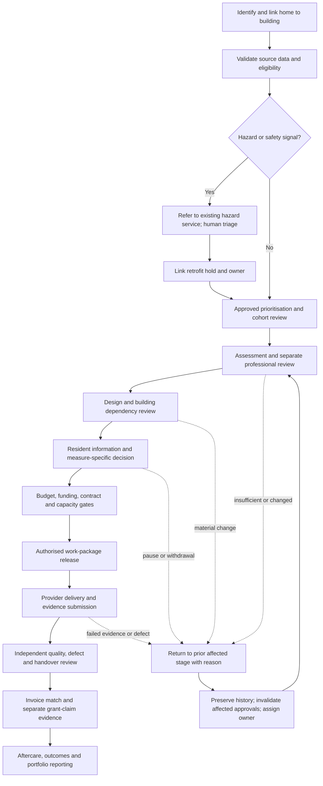

> **PRD-2026-AMA48-001** | Exercise: candidate awaiting review and owner acceptance; formal governance: in-review | Version: 0.19.0 | Last Updated: 2026-10-24

## Executive Summary

Zava Forward needs a shared product surface for the connected retrofit
workflows, not one isolated home screen or five end-to-end agents. The
proposed product is a home-centred workbench with linked building, scheme,
work-package and service cases. People use role-specific screens and queues
over the same governed case data to see new work, approved priority, stale
evidence, blockers, handoffs, progress and suggested next actions.

The scope is one PRD because the workflows share property/building identity,
case lifecycle, evidence provenance, authority checks, handoffs, audit and
reporting. The workbench will represent the full workflow portfolio in
end-to-end exercise scenarios for the Zava North Homes case. Delivery is
staged: establish the shared case, role workspaces and safe workflow controls first; then complete the
domain scenarios and portfolio analytics. The stages are delivery increments
of one product, not separate products or PRDs.

The workbench covers stock and prioritisation, technical assessment/design,
resident service and measure decisions, provider capacity and work release,
hazard referrals, quality/defects/handover, provider invoices, funding
application preparation and separate grant claims, cross-team case orchestration, and portfolio progress, investment and
forecasting. It is a coordination and evidence product. Existing systems and
accountable people retain authoritative decisions; the demonstrator does not
make live resident contact, instruct suppliers, approve work, submit claims,
or release payment. Real AI is required in each accepted application exercise
build; optional per-task System One decision models support bounded
classification, candidate-value selection and evidence checks, not approvals.
Form assistance stages source-linked field proposals for human review; it
does not invent missing facts or submit an application.

The owner directed an Azure-led hybrid only as a proposed non-production
production-path design. The 2026-10-11 direction makes actual Azure deployment,
real SQL state and enabled AI mandatory for subsequent accepted application
exercise builds. Production options, topology, integrations and live authority
remain subject to appraisal and approval. SharePoint/M365 capability is unverified; Excel-based coordination is
confirmed, while other company systems and their authority are unknown.
Records used in the non-production exercise are constructed for the
demonstration and do not establish actual company performance, resident
outcomes or operational decisions. Any use of real personal or operational
data requires a separate release decision.

### Case and presentation framing

For the capstone presentation, Zava North Homes is treated as the real
customer case and attendees are addressed as its stakeholders in their actual
roles. This presentation framing does not establish unverified company
systems, baselines, staffing, delegated authority or operating outcomes.
Records used to exercise the workbench are constructed examples, not evidence
of actual company performance or resident outcomes.

### Exercise Baseline Authority

On 2026-10-10 the owner approved the
[exercise assumption register](../case_study_48_addendum.md#owner-approved-exercise-baseline-2026-10-10)
and numerical test targets, after grounded role-agent proposals. All sixteen
OQs now have an exercise disposition, EXA-001 to EXA-016 respectively.
Missing fictional company approvals no longer block exercise requirements
design. They remain real-world validation gates, not fabricated signatures.
After independent review and the documented corrections, the owner accepted
v0.12.0 for exercise implementation planning on 2026-10-10 with no changes.
That acceptance is separate from formal governed/company approval.

The [subsequent-build direction](../case_study_48_addendum.md#subsequent-application-exercise-builds-2026-10-11)
supersedes the earlier local-only acceptance option prospectively.
An accepted application exercise build is each delivered AMA prototype, PoC
or MVP, including updates of this application. Every such build uses actual
Azure deployment, real SQL programme-state authority (the existing Azure SQL
realization), and at least one permitted real generative or decision-model
task in the exercised application path. Local SQLite, mocks and small
fixtures remain valid for unit/CI tests and non-delivery development checks,
not delivered prototypes or acceptance substitutes.

Continue the existing generated 60,000-home stock and retained 980-case
programme, histories and evidence; test cohorts are not replacement MVP data.
Keep unverified stock-to-case links unknown. Real AI is not required for every
atomic module/test or every home. Task-level rejection of Decision 1 preserves
rules/manual handling there, not an entirely disabled-AI accepted delivery.

T0 for the four-week delivery target is acceptance of the reviewed baseline,
not this candidate amendment. Record effective per-build budget and authority.
EXA-012's USD 450/360/405 limits remain historical; #58 records a scoped
owner override for its rebuild, not a blanket future spending permission.
Lean Azure hosting may reuse resources without the full production ADR
topology; optional M365 and expensive resilience are not prerequisites.
Missing budget/authorization or real-service evidence means Blocked or Not run,
not a mock-only Pass. This documentation task authorizes no cloud/model work.

Pinned [#58 feasibility learning](../ideas/typesafe-system-one-agent-fit.md#observed-feasibility-and-parallel-value-experiment-2026-10-11)
records successful real selection and cited generation on Azure SQL-backed
deployment. Earlier access failures remain history, not current infeasibility.
Quality/calibration, three-class screening, net benefit and full application
acceptance remain unproved. v0.13.0 requires fresh independent requirements
review and owner acceptance; v0.12.0 acceptance does not transfer.

## Product Context

### Problem and opportunity

Case Study 48 asks for agents to improve a small team's coordination of
assessments, grant applications, procurement, resident consent and quality.
Later analysis challenges the idea that autonomous agents own those
workflows. The core product problem is that work crosses home, building,
resident, professional, supplier, safety and finance boundaries, while each
role needs a different working view and accountable decisions must remain
visible and controlled.

The BRD identifies nine connected workflow areas and proposed value evidence.
They are evidence-backed problem hypotheses, not confirmed operational
failures at Zava North Homes. Phase 0 must establish which constraints
actually bind. The product must therefore make missing evidence and unknown
ownership visible, support manual workflow during AI failure or for non-model
tasks without waiving required deployed AI, and avoid
presenting its forecasts or suggestions as approved commitments.

### Product boundary and single-product rationale

This PRD describes one modular workbench because the workflows share:

* A versioned home case linked to its building, scheme, work package and
  relevant resident-service, hazard, supplier, quality and finance records
* Shared identity resolution, evidence lineage, lifecycle, task ownership,
  permissions, audit and deterministic transition controls
* Role-specific queues and dashboards over the same records
* Cross-domain dependencies, handoffs, returned work and common progress
  reporting

Splitting these into separate products would create competing case status,
handoff, evidence and audit views. The modules may be delivered in increments
and may integrate with separate systems of record, but they remain one
product experience and one PRD. External provider and resident interactions
are bounded channels or intake records, not assumptions that those groups use
the internal workbench directly.

### Proposed platform boundary

The owner's requested Azure-led hybrid remains the production-path comparison
baseline, not approved production architecture. For accepted application
exercise builds, actual Azure hosting, Azure SQL state and enabled real AI
are mandatory; topology and other integrations remain proportionate:

* Azure-hosted web workbench, domain API, actual Azure SQL programme state,
  deterministic workflow and bounded real AI; production selection remains
  subject to a comparable options appraisal against full Azure custom and
  greenfield business applications.
* Excel is an import source for validated, traceable exercise records, not
  the target workflow or approval authority. Source workbooks remain unchanged.
* SharePoint may hold managed collaboration documents only if tenant,
  licensing, governance and support checks pass. Otherwise use the documented
  controlled Azure Blob Storage fallback for the demonstrator.
* Asset, housing, repairs, hazard, finance, procurement and supplier systems
  retain their authority. The demonstrator uses exercise adapters or mocks;
  it is not a live integration or source-system replacement.
* No Dataverse or Dynamics 365 dependency is in scope unless a later approved
  decision changes the baseline. Other existing systems remain unknown.

### Component Contracts and Failure Domains

The following is a proposed decomposition, not proof of full implementation.
The required real Azure/SQL/AI baseline does not prescribe all topology
choices. Each boundary needs a contract
and a tested failure/recovery path before build acceptance. A component
failure must not create an unrecorded transition or imply approval.

| Component | Contract and owned responsibility | Failure domain and required fallback |
| --- | --- | --- |
| Workbench and domain API | The API is the only write path for case edits, handoffs, returns, approvals and accepted suggestions. It enforces identity, field/action permissions, deterministic gates, optimistic concurrency and audit creation; UI views do not authorize actions. | If unavailable, no controlled transition or edit is committed. Permitted reads may be read-only; users see the affected action and a manual recovery route. |
| Programme state store | Stores versioned home/building relationships, workflow state, source references, transition history, tasks, handoffs and approval records. The API owns the schema contract; other components do not write state directly. | If unavailable or inconsistent, writes fail closed. Reconcile from durable audit/events before retry; do not replay a transition without idempotency protection. |
| Workflow orchestrator | Executes deterministic stage sequencing, due-date/hold tasks, handoff waits, return/reopen routing and retryable work. The programme API remains authoritative for state and permissions. | Interrupted steps resume from a durable checkpoint with idempotency keys; exhausted retries create a visible owned exception rather than advancing the case. |
| Bounded AI task service | Receives least-privilege, source-referenced inputs; task configuration selects deterministic handling, optional System One scoring, generative drafting or human review. A provider adapter and application validator wrap model output in a source-linked, unapproved proposal. The model cannot write to the state store or invoke a consequential transition. | Timeout, invalid schema, missing evidence, unsupported output, abstention or disabled model yields an explicit failure or workflow-only task. It never presents an empty or failed result as success. |
| Evidence document store | Stores exercise evidence documents; the programme store keeps stable references, versions and review/approval links, not a second approval record. SharePoint is conditional; controlled Blob storage is the proposed non-production fallback. | A missing, stale or inaccessible reference blocks the dependent review and enters an owned exception. Switching store is a configuration decision, not an assumed transparent runtime failover. |
| Exercise workbook import | Profiles declared Excel structures, validates row-level mappings and stages proposed case updates for review; source workbooks remain unchanged. | A workbook or row that fails validation is quarantined with reason and source lineage. No unreported partial batch commit is allowed. |
| Identity, authorization and telemetry | Identity claims are verified at the API; role/record/field rules and audit/telemetry are applied across screens, bulk actions, exports and AI context. | Identity or policy service uncertainty denies controlled writes and exports. Operations retains a privacy-safe diagnostic path and documents recovery before replay. |

Placement and additional service names remain options. Actual Azure hosting,
SQL state and real AI are exercise requirements; Azure SQL is the existing
realization. Durable Functions, SharePoint and advanced resilience are not
mandatory. Verify applicable availability, identity, cost and processing
terms for the changed build, not just catalog presence.

### Proposed Azure and M365 realisation (2026-10-08)

[ADR 0001](../adrs/0001-azure-architecture.md) and the Bicep in
[`infra/`](../../infra/README.md) now realise the component contracts above as
a proposed demonstrator topology. This dated full-topology description is
not the deployed MVP: #58's pinned learning records a lean Azure SQL/Blob/AI
deployment, not all rows below, production Entra user login or private-only
isolation. OQ-012 remains an operational appraisal gate.

| Component | Proposed realisation |
| --- | --- |
| Workbench and domain API | Container App behind Entra app authentication; only identity with SQL and Blob write access |
| Programme state store | Azure SQL Database with ledger tables, Entra-only authentication |
| Workflow orchestrator | Scheduled Container Apps job, checkpointed through the API; no data credentials |
| Bounded AI task service | Container App scaled by an `agent-tasks` queue; Foundry access only, with no SQL, Blob or Key Vault role; optional Decision API adapter alongside generative model adapters, subject to DD-007 and OQ-016 |
| Evidence document store | Blob storage by default (`evidenceStore=blob`); SharePoint site through Microsoft Graph with `Sites.Selected` when OQ-012 checks pass |
| Exercise workbook import | Queue-triggered Container Apps job with a quarantine container |
| Identity and telemetry | Per-workload managed identities, Log Analytics, Application Insights, SQL auditing, alerts and budget |

Excel transition (reviewed 2026-10-08, hypotheses pending OQ-012 and owner
baselines): the hybrid is feasible but only convenient if it avoids double
entry. The proposed path is a staged strangler: shadow one-way snapshot imports,
a short fixed parallel run with named Excel editors, read-only workbooks, then
API-fed reports. Cut-over is judged on reconciliation, quarantine, post-import
workbook edits, evidence reference resolution and case-update effort against the
workbook baseline, with Awaab's Law clocks protected throughout and hazard
cases never routed through Teams nudges. Detail and sources are in the ADR
section Hybrid M365 and Excel transition.

For P0 staff access, owner direction dated 2026-10-24 makes verified Entra
identity and explicitly assigned application roles authoritative. This is
not conditional on optional SharePoint or Teams adoption under OQ-012.
SharePoint remains an optional evidence store and Teams an optional
notification/review channel, each subject to OQ-012. Entra determines
application access, not professional competence, resident consent or
financial delegation. No M365 service becomes the programme-state system
of record or a write path around the API; Dataverse and Dynamics 365 remain
out of scope (CON-005).

### Threat Model (illustrative, not validated)

These threat scenarios focus review of the non-production demonstrator's
workbench, imports, exports, evidence and bounded AI. They are design
hypotheses, not a completed threat assessment or evidence of implemented
controls. Security, privacy and control owners must validate the threat model
before any release gate.

| Threat scenario | Boundary / affected workflow | Mitigation and verification evidence |
| --- | --- | --- |
| Instructions embedded in workbook cells or imported reports manipulate a model into changing its task or ignoring policy. | Exercise import and AI context across stock, resident-service, provider and finance workflows. | Treat imported text as untrusted data; delimit it from instructions; accept only schema-validated proposals; deny AI write credentials. Test with seeded injection strings and verify no state mutation. |
| A user or AI output exposes resident, financial or supplier information outside the recipient's role. | Case search, AI context, bulk views, exports and stakeholder reporting. | Apply server-side record/field filtering before data reaches a model or export; use constructed, non-identifying exercise records; audit export scope; test cross-role and cross-case access denial. |
| A hallucinated or stale statement creates false reassurance, unfair priority or an unsupported resident/provider action. | Eligibility, hazard awareness, resident choice, invoice matching, quality and next-step suggestions. | Require source references, freshness, explicit unknowns and human review; AI can only propose; test seeded missing/conflicting evidence and critical false-negative/false-positive cases. |
| Spoofed identity, confused-deputy behavior or bulk-edit scope bypasses decision rights. | API write path, returns/reopens, approvals, bulk edit and provider-submitted evidence. | Re-authorize every record and action at the API; separate proposer, reviewer and approver roles; never grant by UI perspective; test forged claims, privilege escalation, stale versions and mixed-permission batches. |
| Programme state and document versions diverge, or a retry duplicates a transition/payment recommendation. | Evidence links, long-running handoffs, import retries and finance/quality review. | Keep one authoritative state store; version evidence references; use idempotency keys and reconciliation queues; inject store/document/orchestrator failures and verify no duplicate or silent transition. |
| Heatmap, cohort export or forecast reveals sensitive patterns or disguises exclusions through an unstable denominator. | Coordinator and stakeholder analytics. | Enforce audience permissions, minimum-necessary fields, approved aggregation and explicit filters/denominators; test small cohorts, missing records, changed filters and export permissions. |

### Evidence status

The upstream [Agentic Retrofit Programme BRD](../brds/agentic-retrofit-programme-brd.md)
is draft v0.17.0. No signed `BRD_TO_PRD_HANDOFF_V1` or current valid BRD
quality report was available for this revision; the latest valid BRD quality
assessment remains v0.8.0. The source BRD's workflow descriptions, goals,
authority rules and targets are requirements inputs, not company operating
evidence or approval. Company systems, baselines, residents' needs, owners,
service targets, budgets, contract terms and delegated authorities remain
open. The earlier proposal for a missed-appointment threshold remains an
exercise-only candidate test.

### Prototype-review evidence and integration

The [2026-10-06 profile review](../reference/research/ux/zava-forward-prototype-profile-review.md)
contains fresh own-role critiques from all nine `company-*` agents, an
eleven-profile UX synthesis and four relayed discussions. These are research
instruments and design hypotheses, not employee/resident interviews, company
approvals or accessibility conformance evidence. Provider, Quality and Digital
Operator perspectives have adjacent role lenses, not direct representative
validation. The owner requested integration for a subsequent prototype;
this does not approve the PRD, actual company processes or production use.

The reviewed HTML has eleven perspectives, nine workflow filters, eight
constructed case examples and narrative histories. Workflow selection filters
the queue as well as showing descriptions. It does not advance cases.
The portfolio workflow has no matching example; fixed 128/42/7/19 snapshot
figures are separate from those eight records. Ownership labels, generic
suggestion rationale and return-source wording have demonstrable
inconsistencies. This revision makes those lessons testable without treating
missing product capabilities as already delivered.

An independent [draft-stage PRD challenge and disposition](../../.copilot-tracking/reviews/2026-10-06/proper-warm-prd-v0-7-0/challenge-disposition.md)
led to explicit slice applicability, conflict inputs, per-profile reset
oracles, exact traceability, receipt/acceptance examples, separately reportable
checks and constraint classification. The final bounded follow-up found no
remaining defect in the amended default-manifest and reflow paragraphs.
This is not full PRD approval: Validate remains blocked by upstream evidence
and named human review; Finalize was not evaluated.

## Users and Personas

These are provisional product roles inferred from the BRD, not confirmed job
titles, staffing or delegated authorities. Screen content varies by task and
permission; selecting a perspective is not authentication.

| Role workspace | Primary work in the product | Key information/actions |
| --- | --- | --- |
| Asset and investment | Form and explain candidate cohorts, see asset/building dependencies and investment progress | Approved priority and reason codes, condition freshness, shared works, budget envelope, cost and forecast scenarios |
| Programme coordinator | Coordinate the end-to-end flow and prepare stakeholder progress views | Cross-workflow queue, new/priority/stale work, blockers, handoff acceptance, cases returned, heatmap, funnel, timeline and forecast |
| Retrofit case team | Progress home cases through readiness, resident, supplier, delivery and aftercare stages | Home/building links, next task, evidence, resident decision status, dependencies, appointments, holds and change history |
| Retrofit Assessor, designer and Coordinator | Complete and review technical stages within competent scope | Sourced survey facts, missing evidence, design version, return reasons, separate sign-offs and material-change re-review |
| Housing and Resident Engagement | Coordinate accessible information, service requests, complaints, repair/defect reports, decisions and contact | Minimum-necessary resident context, preferences/adjustments, safe contact and representative details, decision history and next-update commitment |
| Repairs and Building Safety | Review hazard referrals and linked retrofit holds without making retrofit the hazard system | Awareness source/time, referral receipt/acceptance, service owner, linked hold and evidence for accountable release |
| Procurement and contract manager | Confirm contract route, capacity, work order, provider exceptions and instruction authority | Contract/call-off, committed capacity, appointment outcomes, work-order version, variation and escalation task |
| Provider / contractor contact | Submit or respond to authorised work-package information through approved intake channels | Work-order scope, schedule, evidence checklist, appointment outcomes, completion pack and invoice submission status; no self-approval |
| Quality and assurance | Independently review work/evidence, defects and handover | Positive per-measure checklist, inspection/evidence, defects, remediation, audit and systemic-pattern review |
| Finance and Grants | Review investment, budget, invoice, claim and cash records | Budget line, commitment, invoice match, payment status, grant state, claim evidence, cash exposure and approval history |
| Digital operator and auditor | Resolve imports, integrations, access and recovery; reconstruct decisions | Exception queue, component health, audit trail, versions, exports and failed/replayed operations |

Residents are affected stakeholders, not users of this non-production MVP.
No resident-facing production journey or live outbound communication is
authorised. Their service intake and measure decisions must be represented in
constructed exercise scenarios and later validated through direct, accessible
research.

## Product Goals

| Goal | Outcome | Priority | Candidate success signal | Status |
| --- | --- | --- | --- | --- |
| GOAL-001 | By T0+4 weeks, each of the eleven profile scripts shall identify its permitted work, blocker, evidence, owner and next action without an unexplained dead-end or permission breach. | MUST | 11/11 versioned scripts pass their expected permitted/denied outcomes and listed engineering/accessibility checks; baseline is the unexecuted script suite, not a user study. Programme/Product owns the result. | Owner-approved exercise target |
| GOAL-002 | By T0+4 weeks, demonstrate the nine connected workflows, including one same-home journey with an EPC conflict, correction, independent handover and financial closure. | MUST | 9/9 workflow scenarios reach their exact expected state or safe block; all seeded prohibited transitions denied; audit and sibling/dependency isolation pass. Programme/control-role owners review evidence. | Owner-approved exercise target |
| GOAL-003 | By T0+4 weeks, produce reconciled cohort dashboards and a reproducible four-week scenario forecast. | MUST | 100% defined reconciliation checks; identical reruns; constructed week-four error at most two homes and weekly cumulative MAE at most one on the six frozen forecast scenarios. Data/Programme owns definitions. No real forecast baseline claimed. | Owner-approved exercise target |
| GOAL-004 | By T0+4 weeks, establish task-level value or lack of value using real Foundry inference and paired manual/parser comparisons without weakening controls. | MUST | Meet the task-quality/critical-control gates below, evaluate 12 paired packs and report whether the 15% net-effort hypothesis passes. Demonstrating measured lack of benefit passes the learning goal but does not activate a failing task. Product/Finance owns the decision. | Owner-approved exercise target |

SMART applies to the exercise targets above, not promised company outcomes.
T0, workload, role accountability and falsifiable thresholds are defined.
No target has been measured by this revision. The BRD's 20% cycle-time and
25% net coordination-effort improvements remain unratified operational
hypotheses under OD-18, not four-week PRD benefit commitments.

## Staff data trust and control (proposed)

These tables preserve the 2026-10-08 consultation as non-normative source
aliases, not additional requirement namespaces. Release labels record the
original proposal, not current acceptance scope. The canonical FR/AC/NFR/CON
requirements and the exercise contract alone determine acceptance.

| Source aliases | Canonical exercise disposition |
| --- | --- |
| TR-001, SA-006 | Permitted portable export: FR-030, AC-032, NFR-010. No source write-back. |
| TR-002 | Attributable change/import/export history: FR-005, AC-007, NFR-004. Recording every read is a future proposal, not added acceptance scope. |
| TR-003, SA-005 | Declared supported workbook contract: FR-029, AC-031; not arbitrary workbook support. |
| TR-004, TR-006, TR-007 | Future data/audit-use explanatory page and offline hazard-list proposals; not adopted as additional exercise features or substitute for independent hazard service. |
| TR-005, PR-002, SA-001/002 | Role/case/field-scoped workspaces: FR-003/034, AC-004/005/036/040, NFR-003. Minimum-necessary adjustment references, no provider diagnoses. |
| DH-002, DH-006 | Constructed non-identifying inputs and no unapproved personal-data inference: NFR-005/009, CON-003. |
| DH-001/003/004/005/007, PR-001/003/004 | Future personal-data lawful-basis, retention, rights-request, restore/erasure and staff-measurement proposals. Not exercise data permissions, verified legal rules or assumed company approval. |
| PR-005 | Declared scale fixture: NFR-002 and contract; no production-scale claim without results. |
| PR-006 | Deterministic policy/version and conflict outcomes: FR-012, AC-015/040. |
| PR-007/008, SA-004 | Bounded optional proposals and review: FR-025-028/036/044, AC-028-030/044/052/054. No consequential AI approval or ranking change. |
| SA-003/007 | Visible blockers and independent human hazard ownership: FR-004/015/034, AC-006/018/036/038, NFR-001. No simplification of controls. |
| SA-008 | Resident-owned scoped decision: FR-045/046/044, AC-055/056/054, CON-003. |
| SA-009/010 | Future direct-user protocol; not current participant recruitment or a claim of user validation. Exercise engineering contract uses NFR-001/012. |

All RULE and OD references in these preserved tables refer to the upstream
BRD, not locally defined PRD requirement IDs.

| Id | Proposed requirement | Priority | Basis |
| --- | --- | --- | --- |
| TR-001 | A user can export their permitted cases to Excel or CSV at any time, with source, version and history, and a colleague can open it without the workbench or an AI provider. | MVP | Extends FR-030, NFR-010, AC-032. |
| TR-002 | A user can see who viewed or changed a case, when and why, including imports and exports. | MVP | Builds on NFR-004, AC-007. |
| TR-003 | An import preview shows each row disposition and confirms the source workbook was not modified; values are tagged unverified and a decision held only in Excel is flagged invalid. | MVP | FR-029, DD-004, ADR transition rules. |
| TR-004 | A plain-language data page states what is held, where, who holds which role, what AI can and cannot do and the governing rule; each compliance statement is marked verified, designed or unknown. | MVP | New; static page acceptable. |
| TR-005 | The workbench shows only permitted fields, enforced by the server. | MVP | FR-003, NFR-003, AC-004, AC-005. |
| TR-006 | A documented statement says what the audit log is for and who may read it, agreed with staff. | Later | New; needs HR and staff input. |
| TR-007 | An offline list of open hazard and vulnerable cases supports an outage. | Later | NFR-004, hazard clock rules. |

Retention and data-handling baseline (proposed, 2026-10-08): the [addendum baseline](../case_study_48_addendum.md) sets the rules the demonstrator must follow. Each requirement below is designed to support UK GDPR and the other local sources and needs DPO, Legal and record-owner approval before production use.

| ID | Requirement | Release | Trace |
| --- | --- | --- | --- |
| DH-001 | Every data class has a recorded purpose, lawful basis, owner and retention trigger before collection; special category data names its Article 9 and Schedule 1 condition. | Later | CON-003, RULE-022, OD-14. |
| DH-002 | The demonstrator holds constructed, non-identifying data only until a DPIA, retention schedule and processor terms are approved. | MVP | NFR-005. |
| DH-003 | A scheduled retention job lists records past their trigger, requires owner approval and logs deletion without keeping deleted content; a legal hold blocks deletion. | Later | Article 5(1)(e). |
| DH-004 | Access, rectification, erasure and restriction requests are logged with receipt date and answered within one month; erasure exceptions for legally required records are documented. | Later | Articles 12, 15 to 18. |
| DH-005 | Backup restores re-apply deletions, and the restore and deletion are tested before any production use. | Later | Article 32, NFR-004. |
| DH-006 | No resident personal data reaches a model deployment until the transfer position for its processing region is approved. | MVP | Articles 44 to 46, OQ-012. |
| DH-007 | Audit entries are kept in full for the legal retention period, including personal content (owner direction 2026-10-08; DPO to confirm Article 17(3) before any production use). Each erasure refusal for audit data is logged, justified and told to the resident. Supersedes the earlier rule that audit entries never hold deleted content. | MVP | NFR-003, TR-002, OD-14. |

### Owner direction for pilot readiness (2026-10-08)

Owner direction, not DPO, Legal or Board approval. Each item records the
decision and the requirement it creates. The MVP in `mvp/` is the build baseline
and replaces `prototype/`.

| ID | Requirement | Release | Trace |
| --- | --- | --- | --- |
| PR-001 | The lawful basis for case management data is assumed to be the tenancy contract, with consent for decisions on works. The DPO confirms it per data class and names the Article 9 condition before production. | MVP | OD-14, DH-001. |
| PR-002 | Contractors and providers see only "needs notice and a named contact", never the reason for a vulnerability or adjustment. Staff see the reason only where their role needs it, enforced by the server. | MVP | OD-14, TR-005, NFR-003. |
| PR-003 | The addendum retention defaults are the design baseline pending DPO and Legal approval. | MVP | OD-14, DH-003. |
| PR-004 | Individual staff time capture is allowed for pilot measurement with the staff's knowledge and a completed DPIA. Capture stays off until the DPIA exists. The data supports process measurement and shall not be used as a performance rating without a separate decision. | Pilot | OD-36. |
| PR-005 | The product shall load and operate over the whole stock of about 60,000 homes: server-side paging, indexed filters and search, map clustering, and list and map views that agree on the same filter. Staff decide which homes to work on. | Pilot | OD-17. |
| PR-006 | Home ranking shall be deterministic: the same data and the same published policy version give the same order, with visible reason codes, fixed tie-breaks and a named policy owner. Changing the policy creates a new version and keeps the old one. | Pilot | OD-17, FR-012, AC-015. |
| PR-007 | AI prioritisation is a recommendation only. It appears beside the deterministic order with cited reasons, can be accepted, edited or rejected with a reason, and never changes a ranking, queue or case. Its value is measured against the deterministic order. | Pilot | OD-19, FR-025, FR-026, FR-028. |
| PR-008 | AI is limited to recommend, draft, reconcile and flag. A person approves every action. | MVP | OD-19, FR-027. |

Pilot-readiness build scope (replacing the read-only slices A to C as the
next step, which the MVP already exceeds): durable storage in the ADR
data store, Entra ID sign-in with role and field permissions, return and
reopen, distinct handoff states, safety referral and scoped hold, quality
acceptance and defects, deterministic ranking with reason codes, an AI
evaluation harness against the deterministic baseline, and 60,000-home scale.
Retention jobs and staff time capture wait for DPO approval and the DPIA.

New open questions: the retention periods in the baseline are defaults, not approved periods; funder, PAS 2035 and limitation-period retention terms are unknown. Which retention, residency and data-handling rules apply to staff data (the organisation's own rules are not in the repository); whether current spreadsheets hold vulnerability data and who can access them; whether staff and residents have been consulted. New risk: over-claiming compliance. Wording rule: say "designed to support", never "compliant" or "certified", without named approval.

## Design Decisions and Options Gate

These are draft product decisions for the non-production demonstrator, not
production, procurement or company approvals.

| Decision | Proposed direction | Rationale and condition |
| --- | --- | --- |
| DD-001: Demonstrator platform | Require real Azure deployment, Azure SQL programme state and real AI in each accepted application exercise build; retain the Azure-led hybrid as the production-path comparison baseline alongside full Azure custom and greenfield business applications. | The owner requires actual platform learning, not production superiority or a premium estate. Production appraisal may reject the hybrid; it does not waive the exercise baseline. Per-build access, identity, cost and version-linked evidence are required under CON-009/AC-057. |
| DD-002: Data boundary | Use constructed, non-identifying exercise records and exercise adapters/mocks for the MVP. | The records do not substantiate company performance or resident outcomes; no live resident contact or operational action is authorized. |
| DD-003: Decision authority | Keep deterministic workflow and human authority separate from bounded AI proposals. | Shared case data does not transfer decision rights. AI output cannot satisfy an approval or controlled state transition. |
| DD-004: Excel boundary | Treat Excel as a source for profiled and validated imports, not as the target workflow or approval authority. | Preserve source workbooks and expose row-level mapping/conflict outcomes. |
| DD-005: Options appraisal | Compare all three platform options against equivalent workflows, controls and workload using predeclared criteria. | Set weights and evidence thresholds before scoring; no option has been scored or selected for production. |
| DD-006: Appointment scenario | Retain the owner-directed missed-appointment rule only as a candidate exercise test. | Count only confirmed appointments with verified resident no-access while a case is active; route for human investigation only when the eligible count is greater than the configurable threshold (provisional default five). Exclude provider/contractor no-shows, cancellations and reschedules; human closure resets the active counter but preserves history. Do not infer refusal or delay urgent hazard response. Five is not a validated threshold or operational rule; evidence, Resident Engagement review and configuration governance remain open under OQ-014. |
| DD-007: Bounded decision scoring | Include Microsoft Decision 1 as a task-specific evaluation candidate alongside rules, generative models and manual handling; the deployed build must still exercise real AI under CON-009. | #58 records source-bound candidate selection feasibility, not calibrated quality, three-class screening, UK-only inference or net benefit. Closed text/JSON output produces no rationale. Task adoption requires reviewed experiment and serving/privacy evidence; see [current learning](../ideas/typesafe-system-one-agent-fit.md#observed-feasibility-and-parallel-value-experiment-2026-10-11). |
| DD-008: Form-assistance boundary | Use versioned form schemas and source-linked field proposals, with deterministic validation and an explicit human review/export step. | Funding applications seek awards; claims seek reimbursement under an evidenced award. A draft/export is neither submission nor award. Finance owns the route, template and declarations; no model or bulk action signs or submits. |
| DD-009: Entra-authoritative staff access (P0, owner direction 2026-10-24) | Use verified Entra tenant and object identity plus explicitly assigned supported application roles as staff application-access authority, with no database staff provisioning or database read as a login prerequisite. Provide explicit `ZavaForward.ApplicationAdmin`, alone or composed with a staff role such as `ZavaForward.ProgrammeManager`. | Email, display name, a roster entry and a selected screen grant no authority. ApplicationAdmin alone is the distinct "Application Administrator" role: every option is visible and flagged, but no business data, exports or actions are available; with a staff role, that role's authority applies and every option stays visible. Database programme state, object/field/action checks, resident separation, no-self-approval and independent human/professional/finance/consent gates remain unchanged. This decision authorizes the bounded access correction, not unrelated architecture changes or blanket production use; implementation, deployment and real-user observation require separate evidence. |

### Options Gate Scoring Framework

This is a decision instrument, not a completed appraisal. The architecture
lead and sponsor must approve weights, minimum gates, comparable scope and
evidence sources before scoring. A high aggregate score cannot compensate
for failure of a mandatory safety, privacy, authorization, accessibility or
recovery control.

| Criterion | What the evidence must establish | Weight |
| --- | --- | --- |
| Control and workflow coverage | Whether each option supports the nine exercise scenarios, server-enforced authority, returns, bulk controls, evidence lineage and auditable state. | TBD |
| Whole-life cost and affordability | Comparable implementation, licensing, migration, support, operations, renewal and exit costs against an owner-approved workload and affordability envelope. | TBD |
| Supportability and recovery | Named skills, ownership, failure containment, manual fallback, recovery testing, service lifecycle and exit path. | TBD |
| Data and integration fit | Source-of-record boundaries, identifiers, interfaces, tenant prerequisites, reconciliation and portability. | TBD |
| Resident and accessibility readiness | Accessible staff workflows, future resident research, non-digital routes and no unapproved resident-facing dependencies. | TBD |
| Evidence confidence | Number and materiality of unresolved assumptions or external prerequisites each option depends on. | TBD |

The platform options remain full Azure custom, greenfield business
applications and the proposed Azure-led hybrid. Current Excel-based
coordination does not establish which systems are authoritative; M365,
SharePoint and licensing are unverified. The comparison must not treat an
unverified estate or role-profile hypothesis as a customer fact.

## Simplicity and adoption requirements (proposed)

Source: [Prototype Learnings and Simplicity Review](../reference/research/ux/prototype-learnings-and-simplicity-review.md), 2026-10-08. The aim is a genuinely easy move from Excel, not a copy of it. All requirements are proposals, untested with real staff, and need owner and DPO approval. Role views are hypotheses, not company facts.

| ID | Requirement | Release | Trace |
| --- | --- | --- | --- |
| SA-001 | The default view is a single list of the signed-in user's cases with one plain status and one next action per case. There is no perspective picker or role simulator in user views. | MVP | FR-003, NFR-003. |
| SA-002 | A case opens full screen with contact details, preferences and adjustments, flags, last contact, next appointment and next owner, limited to permitted fields. | MVP | TR-005. |
| SA-003 | Blocked steps show the reason, the named owner and a next action in plain words. Internal terms (gate, hold, provenance, trace) are not used in the core flow and are checked by a copy audit. | MVP | RULE-022. |
| SA-004 | Real AI is required in the accepted deployed build; requesting assistance for a record is optional and never required to view a case or complete a permitted manual draft. Unreviewed output is labelled "AI suggestion, not approved"; reviewed drafts never imply a controlled approval, consent or safety decision. | MVP | FR-034, FR-044; CON-009, AC-057. |
| SA-005 | Import accepts declared supported exercise workbook structures, maps columns, imports good rows and lists rows to fix with a plain reason. The source file is never modified. | MVP | TR-003, FR-029, AC-031. |
| SA-006 | Every list offers an Excel or CSV export. Excel stays one-way read-only; no write back. | MVP | TR-001. |
| SA-007 | Hazard and safeguarding items show a clock and a named owner and are never hidden by simplification. | MVP | CON-001, TR-007. |
| SA-008 | Resident decision is a separate, resident-owned field and is never inferred or pre-filled. | MVP | CON-003, FR-044/045/046. |
| SA-009 | Acceptance: at least 80 percent of 5 to 8 Excel users per role find their case and say the next step and owner in under 5 minutes, unaided; SUS at least 70. Thresholds are proposals. | Later | AC set to be added. |
| SA-010 | Usability measures are aggregate only and the audit-use statement is agreed with staff before any is reported. | Later | TR-006. |

Open: observe real Excel users first; real workbook shapes, who owns them and what they hold are unknown (OQ-005, OQ-012).

## Workflow Coverage

| BRD workflow | Workbench module and core screen | Roles | Progress/value evidence |
| --- | --- | --- | --- |
| Stock data, safety triage and fair prioritisation | Portfolio/cohort screen; property and building records; data-quality and eligibility queues | Asset, Safety, Finance, data owner, Coordinator | Source freshness, conflicts, eligibility unknowns, cohort reasons, viability after survey, overrides |
| Technical assessment and design readiness | Home technical workspace; survey/design checklist; return and reapproval queue | Assessor, designer, Retrofit Coordinator, Programme | Assessment-to-ready-to-install time, first-pass completeness, return loops, review effort |
| Resident service, access, choice and redress | Resident-service inbox and home resident tab; measure decision history; contact/update tasks | Housing, Resident Engagement, Repairs, Coordinator | Appointments kept, adjustments met, repeat contacts, time to decision, complaint/service resolution |
| Procurement, committed capacity and work release | Supplier/capacity board; contract/work-package screen; controlled work-order view | Procurement, contract manager, Programme, provider contact | Committed vs delivered capacity, provider-caused failures, capacity gap age, accepted work |
| Hazard awareness and damp-and-mould response | Referral/hold queue linked to the existing repairs/hazard case, not a replacement service | Repairs, Building Safety, Programme | Awareness-to-referral, accepted referral age and applicable response/update performance |
| Quality acceptance, defects and handover | Quality pack, inspection/evidence review, defect and remediation queue, handover checklist | Quality, competent inspector, provider, Resident Engagement | Right-first-time evidence/physical acceptance, defect severity, recurrence, rework, handover |
| Budget, provider invoice, grant claim and cash reconciliation | Investment/budget view; invoice intake and match queue; funding-application form workspace; separate award, claim pack and cash records | Finance, Grants, contract manager, Quality | Application field accuracy/review effort, submission/award evidence, invoice exceptions, claim acceptance/rejection, receipt time, cash exposure |
| Programme handoffs and case orchestration | Cross-role work queue, case timeline, handoff and return/reopen workspace | Coordinator and every receiving team | Owned handoffs, overdue queues, return loops, stage timing and coordination effort |
| Portfolio investment, performance and scale decisions | Portfolio dashboard with heatmap, funnel, history/timeline and forecast scenarios | Asset, Finance, Programme, Sponsor/Board, Assurance | Accepted outcomes, cost, grant state, resident/safety/quality guardrails, forecast variance |

Every row above shall have a product representation in the full MVP's
exercise scenario suite; this is required coverage, not a statement that the
current HTML implements it. The next read-only prototype is a learning slice
with an explicit scenario manifest and unavailable-feature labels, described
under MVP and Release Framing. Live integrations, external portals, formal
user research and operational authority remain separately gated.

### AI-Assisted Decision Coverage

Every proposed AI-assisted feature, including future features, shall be
registered under FR-036 before activation. The following is the initial
coverage map, not a mandate to invoke a model at every step. Deterministic
checks and manual handling remain first-class; task-level evidence may remove
the model path. DD-007 and the
[model reassessment](../ideas/typesafe-system-one-agent-fit.md#microsoft-decision-1-reassessment-2026-10-10)
are the evidence basis, not performance results.

| Workflow / application surface | Optional System One task | Required non-model boundary |
| --- | --- | --- |
| Stock and import conflict review | Classify document/field type, select supplied candidate values, flag conflicts or insufficient evidence | No identifier merge, inferred feature or model score changes authoritative ranking, eligibility, queue membership or case state |
| Assessment and design forms | Match a source excerpt to an approved field/checklist; suggest an omission or conflicting version | No invented observation, technical judgment, design approval or PAS 2035 sign-off |
| Resident service and communications | Independent intent, complaint, possible pause/withdrawal flags; screen drafts for unsupported promises or implied consent | First human urgent triage is independent; no profiling, consent/refusal inference, unreviewed contact or suppressed secondary intent |
| Provider capacity and work packages | Classify textual delay causes and compare proposed scope/evidence to authorized records | Scheduling, confirmed capacity, contract interpretation, instructions and variations stay deterministic/human |
| Hazard referral | Supplemental raise-only possible-signal check on supplied text | No model-dependent first triage, clock, classification, downgrade, hold release or closure |
| Quality and handover | Documentary support/mismatch checks and draft handover screening | Text-only checks are not photo inspection, physical acceptance, defect grading or proof of resident understanding |
| Funding applications, invoices and claims | Candidate-field selection, form-section mapping and supported/contradicted/insufficient-evidence checks | Formulas, deadlines and eligibility are rules; application, award, invoice, claim and cash remain separate; Finance reviews declarations and submits externally |
| Case handoffs and next-step assistance | Suggest an exception category or next task from engine-permitted candidates; classify delay notes | No autonomous workflow selection, authority assignment, transition, retry policy or accepted handoff |
| Portfolio reporting | Screen cited narrative for unsupported claims or forecasts presented as facts | Numeric forecasts, denominators, attribution, investment and scale decisions stay with code and accountable people |
| Cross-cutting retrieval, output screening and change review | Judge access-filtered snippet relevance; flag proposed output issues; suggest change categories from verified old/new text | Model judging is not independent assurance; source access, legal interpretation and rule activation remain controlled |

### Five Reactive and Proactive Assistants (2026-10-13)

The owner requested these five capabilities in the existing application after
the [capstone process map](../capstone/README.md#agents-in-the-retrofit-process-2026-10-13).
FR-047 refines FR-025 to FR-028/036/044; it does not authorize the original
case's higher autonomy levels or imply production acceptance. They share one
proposal service, not five applications. Each has a stable capability ID,
registry version, source allowlist, explicit deterministic trigger and owned
manual route. Reactive means a permitted staff request; proactive means a
bounded scan detects the registered condition without waiting for a request.
Both modes use the same source and authority boundaries.

| Capability ID / responsibility | Permitted source categories | Proactive exercise predicate | Request/review audience and separate decision |
| --- | --- | --- | --- |
| `stock-prioritisation`: explain supplied stock facts, reconcile gaps and prepare a data-owner query | Home/EPC, disclosed survey facts and deterministic ranking policy/reasons; no private resident reasons or finance | Missing EPC/stock fact or conflicting supplied stock value; unchanged valid evidence is ineligible | Retrofit Coordinator / Programme Manager exercise proxies for data owners and Assets. No rank, queue, eligibility or investment change |
| `assessment-preparation`: assemble the missing-evidence and survey/design preparation checklist | Home, survey, measures and permitted document metadata/version/hash | Required survey/design preparation evidence is absent or a relevant version changes | Retrofit Coordinator / Programme Manager. Separate competent assessor/coordinator sign-off; draft is not an assessment or certification |
| `funding-evidence`: prepare source-linked application/claim evidence gaps | Home/measures, funding and permitted finance/grant evidence/version metadata | Required application/claim input is absent or relevant terms/evidence change | Grants and Evidence Officer / Programme Manager exercise proxies for Finance. No eligibility, totals, award, funding-state, claim, submission or payment change |
| `works-resident-coordination`: draft an update or committed-capacity option | Home/measures, disclosed contact/access preferences, appointments, handoffs and committed provider capacity; no vulnerability reason or private finance | Unaccepted handoff or missed recorded update/appointment commitment | Retrofit Coordinator / Resident Liaison Officer / Programme Manager. Resident choice and Programme/contract release remain separate; no send, booking or instruction |
| `quality-evidence`: assemble per-measure evidence and discrepancies | Home/measures, quality/checklist and permitted document metadata/version/hash | Required quality evidence is missing, conflicting or a relevant version changes | Quality Inspector / Programme Manager, subject to independent reviewer checks. No defect closure, hold release, acceptance, handover or certification |

These are selected synthetic exercise predicates, not approved company policy.
Unknown source values remain unknown. New source categories or audiences
require a registry/version change and fresh access tests. Contractors and
unknown roles cannot invoke, scan, read or review these shared staff proposals;
supplier-scoped domain access is unaffected. The proactive purpose principal
is explicitly separate from a staff requester. Its allowed context must be
safe for every permitted reader, including citations and stored metadata.
Current role/case scope is rechecked on every enqueue, read and review; richer
private outputs must never be returned merely because their case is visible.

Output is a bounded typed evidence proposal: summary, cited findings and
explicit unknowns, with capability/version, invocation provenance, source
signature, provider/model/usage/outcome and human review status. Prompt text
is inert evidence, not a tool/authority instruction. Citation validity is
provenance, not entailment: human source verification must be explicitly
recorded before accept/edit-accept. Failed, malformed, unsupported, stale or
otherwise unverified output cannot be accepted; rejection and history remain
available. Review changes only proposal/audit state, never the controlled case.

The durable key combines capability/version, case, canonical intended proposal
identity (the registered purpose) and material dependency signature, not
invocation mode. Changed intent or dependencies cannot replay another proposal;
repeated scans and a reactive/proactive collision with the same identity share
the proposal, while invocation provenance is recorded separately. Short SQL
transactions own enqueue, bounded allowance reservation,
claim, fenced lease and completion. Database time, monotonic attempt fences,
lease takeover and compare-and-swap completion reject late workers. Recovery
looks up uncertain acknowledgements; provider timeout retains unknown usage/
liability rather than recording zero. Exactly-once inference/billing is not
promised. Model calls run outside case/database locks.

Automatic execution is off until valid purpose authority and effective limits
are configured: input/output size, scan interval/size, concurrency, attempts,
backoff and shared durable allowance. All retries reserve against that same
allowance before dispatch. Disabled/unavailable/throttled assistance shows
the reason, owner and manual route without blocking case work. Additive
idempotent SQL migrations preserve retained records; rollback disables the
worker and restores the previous image without deleting proposal evidence.
AC-058 to AC-061 cover these mechanisms; AC-057 separately requires
changed-image real Azure/SQL/AI evidence. Task calibration, staff acceptance
and comparative improvement are not established by the technical build.

Corrected runtime source `bf383c4` and the locally built image are recorded in
[ADR 0002](../adrs/0002-pilot-readiness-architecture.md#implementation-and-build-evidence).
Automated fixtures exercise the contracts, not formal PRD acceptance.
Manual controls render independently of assistant reads, which have a
10-second abort deadline and ignore late results after navigation. Shutdown
closes new provider-thread admission without holding SQL/inference locks.
Actual disposable SQL Server now exercises all five assistants, current-source/
role review, claims/reservations, recovery and concurrent additive startup,
alongside general parity; provider and human actions are still fixtures.
The owner subsequently authorized rollout and bounded QA. Image `d3e652ce`
reached the existing Azure app, with independent managed-identity SQL reads and
unchanged private configuration/authentication. Before any paid call, the live
ledger database exposed unsupported trigger DDL; source `99aeaac` corrects fresh
ledger creation and adds real ledger tests. This is not real-model acceptance.
Combined backend source `ec7721b` preserves the concurrent intended-proposal
identity fix, with 73 actual disposable SQL tests passing. The populated-data
browser check then found that day-group arrays were silently dropped from
Visits. Source `a76d281` corrects rendering; latest local image05/source
`cd14b3b` passes 21 browser regressions and 21 generated-data UI/API/local
restart checks with no provider attempt. Local SQLite persistence and disabled
proposals do not satisfy the separate actual Azure/model acceptance gate.
The owner then stopped migration and authorized a fresh synthetic database.
The initial deletion operation was cancelled on 2026-10-13, so that segment
did not reset/reseed. On 2026-10-14 the owner reauthorized the exact reset and
all remaining delivery. Image05/revision `--0000012` now serves the regenerated
980-case/11-bound-staff ledger baseline with 38 booked visits and enriched
operating queues. Renewed process-local bounded operator QA invoked all five
registered paths against real Azure OpenAI/SQL: five distinct citation-validated
ready proposals, five attempts/6884 tokens, 15 ledger events and durable
output/usage evidence after actual revision restart. Controlled-domain hashes
are unchanged by generation. These are operator service/model/storage results,
not human source verification or a real staff-authenticated browser/API
acceptance session; semantic/accessibility/business gates remain open. QA is
disabled. CON-009/AC-057 acceptance stays Blocked.

The [coverage recipe](../reference/research/retrofit-synthetic-data/README.md#mvp-operational-coverage-2026-10-13)
now generates repeatable dated visits and nonempty operational queues from the
existing stock/simulation. Six designated assessment visits supplement source
bookings, with historical attended/no-access/cancelled contrasts kept separate.
Pending/unverified Finance, grant, quality, handoff and request fixtures do not
assert consent, technical release, human sign-off or payment. The generated
private baseline is now seeded in the exercise database; it remains synthetic,
not measured benefit or a new company fact.

### Form Extraction and Assisted Filling

FR-038 to FR-043 apply to technical, work-package, invoice and funding forms,
with particular emphasis on applications for retrofit subsidy awards. This
is proposed product behavior over constructed records, not evidence that a
funding round is open or that any company application/award is documented.
No particular funder's schema, required attachment list, portal or eligibility
rule is assumed; Finance approves those inputs under OQ-015.

1. Select an approved form type/template. For funding forms, select a scheme
   and evidenced funding route: competitive application,
   allocation/integrated-settlement request, award-delivery return or separate
   reimbursement claim. An unknown route blocks bid/form preparation; users
   can still collect sources and resolve the route. Technical/work-package
   and invoice forms require their own approved schema, not a funding route;
   their funding association is explicitly not applicable unless the schema
   requires it. For funding exercises, use a
   Finance-reviewed constructed route and template labelled as such.
2. Load the versioned schema: stable field/section IDs, data types, units,
   allowed values, required/conditional rules, evidence requirements,
   source-authority precedence, calculation/rule versions, reviewer and
   external-template version. Model text cannot change the schema or activate
   regulatory/funding rules. Explicit unknown is not "not applicable".
3. Read approved structured records directly. For documents, parse supported
   text/tables into candidate values/spans with document version/hash,
   page/section/table-row or cell locator, raw value and date. Scanned files
   require a separately approved OCR/transcription route and its error record;
   Decision 1 cannot read images. Unsupported/unreadable input has a visible
   manual-transcription or correction path, not fabricated extracted data.
4. Use a closed Choice only where semantic selection is needed: for example,
   select the current assessed EPC from two cited candidate values rather
   than generate an EPC. Include `cannot_tell`/no-match; keep conflicting
   values visible. Evidence checks may return supported, contradicted or
   insufficient evidence. Noul/Score probabilities do not prove eligibility,
   completeness, approval or the truth of a field.
5. Assemble a separate draft with field states such as proposed, unknown,
   conflicting, reviewer-confirmed or reviewer-corrected. Copy selected
   values from their candidate spans; keep deterministic normalization and
   calculations distinct from extraction. Generative narrative, if needed,
   uses the same approved evidence and remains separately cited and reviewed.
6. Show each field next to its source, compared alternatives, validation
   result, AI involvement and named reviewer. Users accept, correct or reject
   fields individually; a correction records its evidence/reason. A model
   answer cannot overwrite an authoritative source or a human-confirmed
   field. Missing reviewer competence/authority leaves the item unapproved.
7. Run deterministic required/conditional-field, format/unit, duplicate-home,
   scope/version, totals, match-funding, approved-budget and versioned
   eligibility checks. Review negative/uncertain evidence checks and every
   unflagged required field as well. No single aggregate score bypasses an
   unresolved mandatory field or financial control.
8. Finance reviews the complete application/claim and attachments. Keep
   declarations, signatures, professional certifications, resident choices
   and authority-bearing attestations outside AI pre-fill; only the
   designated human may supply them through a separate recorded action.
   An optional reviewed export matches the approved template and lists
   attachments, sources, schema/input versions and reviewer decisions.
   Incomplete drafts may be saved or exported only as visibly incomplete
   working copies, never as reviewed submission packs.
9. External submission remains outside the demonstrator. A later authorized
   human-entered submission reference must cite external evidence; export,
   a model recommendation or an invoice does not establish submission,
   award, accepted claim or cash. New source/template/rule versions mark only
   dependent fields and pack reviews stale, preserving the previous pack and
   all human decisions for re-review.

Illustrative fields below are constructed design examples, not a prescribed
scheme application:

| Form content | Method | Review / safe failure |
| --- | --- | --- |
| Organisation, scheme and property IDs; existing awarded reference | Copy approved, access-filtered structured values | Unknown/conflicting identity is owned and unresolved; no cross-home or cross-scheme fill |
| EPC, survey date, measure and design reference from mixed documents | Parser candidates plus optional closed semantic selection | Show raw span/version and competing values; no missing site observation invented |
| Proposed measures, home schedule and attachment-to-section links | Controlled mapping and optional evidence-support classification | Required evidence checked positively; no implication that attachment presence proves compliance |
| Requested subsidy, co-funding and cost totals | Deterministic formulas over reviewer-confirmed inputs and approved scheme rules | Calculated values carry formula/input lineage; unknown eligibility or budget cannot become a pass |
| Narrative delivery plan or business case | Optional generative draft; System One support/contradiction screening | Human validates claims, assumptions and qualifications; model score is not independent verification |
| Applicant declaration, signature, professional certification or resident choice | Designated human action only | No AI proposal, inferred agreement, default checkbox or batch acceptance |

## Per-user agent chat and memory

Status: owner accepted ADR 0004 on 2026-10-15 (BRD OD-44 decided); live use
stays inactive. The DPO and Legal have not decided lawful basis,
notice, DPIA or retention (BRD OD-45, OD-46). Nothing in this section changes
the exercise baseline, CON-009, FR-036 or FR-047. The capability appears in no
earlier BRD, PRD or ADR; it is tracked as backlog epic #157 and children #158
to #164 on GitHub and is analysed in
[ADR 0004](../adrs/0004-per-user-agent-chat-and-memory.md), status Accepted (2026-10-15).
Identifiers here are PRD identifiers; the BRD uses the same FR, AC and NFR
prefixes for different rows, so every trace below names its document.

The problem it addresses is a hypothesis: staff may need to ask follow-up
questions of a registered assistant about one case instead of re-running a
one-shot proposal. The atlas is desk research and does not show that staff want
this (BRD OD-41). The comparator is the existing proposal-only assistants, which
return one typed proposal per request and keep no thread or memory today.

### Journey, agent and UI mapping

The base is the 28-journey
[customer journey atlas](../reference/research/ux/customer-journeys/customer-journey-atlas.md)
and its opportunities O01 to O24, which are hypotheses until BRD OD-41 closes.
The mapping extends the five assistants in the capability matrix above. It adds
no sixth agent: a new assistant needs a registry change under FR-036 and
ADR 0003 decision 3. The surface is a panel embedded in the role workbench case
view, not a standalone chat application, so the case, the role projection and
the reviewer stay in one place.

| Journey role and step | Chat useful? | Existing assistant extended | UI surface | Slice | Autonomy | Consent and safety boundary |
| --- | --- | --- | --- | --- | --- | --- |
| Stock and data steward: reconcile EPC or stock facts, prepare a data-owner query | Yes, follow-up on a conflict | `stock-prioritisation` | Case view panel in the data steward and coordinator workbench | First | Recommend and flag | Cannot change identifiers, ranking or queue membership |
| Retrofit Assessor and Coordinator: assemble survey and design preparation, find missing evidence (atlas O06, O07) | Yes | `assessment-preparation` | Case view panel in the assessor and coordinator workbench | First | Draft and flag | No technical judgement, design approval or PAS 2035 sign-off |
| Neighbourhood officer and contact-centre officer: understand a case before contacting a household (atlas O01 to O05, O08, O09) | Yes, staff side only | `works-resident-coordination` | Case view panel in the housing and resident engagement workbench | First, staff drafts only | Draft | No contact is sent, no consent is recorded or inferred; first human triage stays independent |
| Retrofit Coordinator: draft an update or option for a household | Yes | `works-resident-coordination` | Same panel; the draft goes to the existing proposal review | First | Draft | A human sends; resident choice and pause or withdrawal are preserved (FR-046) |
| Finance and Grants: assemble application or claim evidence gaps (atlas O16, O17) | Yes | `funding-evidence` | Case view panel in the finance and grants workbench | First | Draft and flag | Eligibility, declarations, submission and cash stay rules and humans |
| Quality and assurance: reconcile per-measure evidence and discrepancies (atlas O11, O12) | Yes | `quality-evidence` | Case view panel in the quality workbench | First | Recommend and flag | No defect grading, closure or acceptance |
| Programme and executive: ask about one case's blockers and next step | Yes, as a requester of the five assistants | The same five; no portfolio assistant | Case view panel in the programme workbench | First | Recommend | Portfolio narrative and analytics (atlas O10, O18 to O20) stay out of scope |
| Safety and hazard intake | Limited | None; raise-only possible-signal check stays as in the AI coverage map | Existing hazard referral screen, no chat | Deferred | Flag only | First human triage, clocks, classification and closure never depend on a model or a conversation |
| Provider or installer: job pack questions (atlas O11) | Possibly | None today; contractors cannot use the shared staff proposals | Contractor job pack | Deferred; separate decision | Not decided | Needs supplier-scoped access design and BRD OD-47 |
| Resident and representative: report, give consent, choose a slot | Unknown | None | Resident-facing channel | Deferred; separate decision | Not decided | Needs BRD OD-47, OD-41, OD-42 and FR-045; resident memory is a different class from staff memory and is not proposed here |
| DPO and Legal: rights-request inventory (atlas O22) | Possible later task | None; would need a registry change | DPO workbench | Deferred | Not decided | Decided by the DPO and Legal under BRD OD-45 |
| Digital operator: outage questions (atlas O21) and source-change tracing (atlas O24) | Possible later task | None | Operator console | Deferred | Not decided | Each needs its own registry entry and thresholds |

First slice: the five rows above marked First, staff only, behind the OD-44
decision, with threads before memory. Memory (FR-057) is a later gate inside the
first slice and needs the DPO decisions in BRD OD-45, OD-46 and OD-48. Deferred
rows are listed so the owner can see the intended boundary, not as commitments.

### Product requirements

IDs start at FR-055, NFR-015, AC-091 and OQ-020, after the highest PRD numbers
in use (FR-054, NFR-014, AC-073 with BRD-referenced AC-086 to AC-090, and
OQ-019). The BRD already uses FR-049 and FR-050 for these topics, and the PRD
uses FR-049 and FR-050 for closure and monitoring, so every trace names its
document.

| ID | Requirement | Actor / trigger | Acceptance criteria | Goals |
| --- | --- | --- | --- | --- |
| FR-055 | If adopted, the product shall embed a case-aware conversation panel in the staff workbench case view that talks only to an assistant registered under FR-036 for the user's role, shows the task, sources and data version behind each reply, and distinguishes a proposal from a conversational answer. Backlog #159. | A permitted staff user opens a case and starts a conversation | AC-091, AC-092, AC-093 | GOAL-002, GOAL-004 |
| FR-056 | If adopted, the product shall store each conversation as a thread owned by one user and tied to a case and task, with view, export and delete by the owner and configured retention, in the existing Azure SQL store through additive idempotent migrations and separate from the append-only audit ledger, which holds event metadata only. Backlog #160. | A user sends, views, exports or deletes a thread | AC-094, AC-095 | GOAL-002, GOAL-004 |
| FR-057 | If adopted, the product shall offer opt-in per-user memory scoped to one user and one role that the user can inspect, edit and delete, with per-item expiry, a global off switch and a per-task off switch, and that excludes resident health, safeguarding, vulnerability, special-category and consent data. Backlog #161. | A user opts in, reviews, edits, withdraws or deletes memory | AC-096, AC-097 | GOAL-002, GOAL-004 |
| FR-058 | If adopted, the conversation channel shall refuse requests to approve, decide, certify, record consent, diagnose or contact a resident, treat case text and memory as untrusted input, never cite memory or conversation as evidence, and route any record-changing output through the FR-047 proposal review. | A user asks for an out-of-authority action, or text contains an instruction | AC-098, AC-099 | GOAL-002, GOAL-004 |
| FR-059 | If adopted, each conversational task shall be registered under FR-036 with its approved thresholds and accountable reviewer, be individually enabled or disabled, be switchable off globally for memory, and be evaluated by a multi-turn harness before activation. Backlog #164. | A conversational task is configured or requested | AC-100, AC-101 | GOAL-004 |
| FR-060 | The product shall provide a regulatory compliance assistant with a versioned store of approved regulatory sources and owner-approved rule cards, deterministic proactive checks and role-appropriate alerts at journey steps, and a chat that answers questions about one home from cited sources and that home's role-scoped facts. It shall retrieve, compare, cite, flag and route only; it shall not decide that a duty is met, interpret law, activate a rule or send resident communications. | Workflow step transition, change to a home or case, scheduled clock, source change, or a user question on a home | AC-104, AC-105, AC-106 | GOAL-001, GOAL-002 |
| NFR-015 | If adopted, conversations and memory shall be isolated per user: a server-derived user key, the field projection applied on every turn, re-authorisation of role and case on every turn, and audited administrator or break-glass access. Backlog #162. | Every turn, export and deletion | AC-102 | GOAL-002 |
| NFR-016 | If adopted, conversation and memory data shall have DPO-approved retention per class (Unknown until BRD OD-46), rights-request handling, content exclusions, and logs and telemetry that exclude content or follow the same retention. Backlog #163. | Any live personal data in a thread or memory item | AC-103 | GOAL-002 |
| AC-104 | Given sources that are in force, guidance, consultation, historical, partial or missing, when the store is loaded, queried or changed, then each source and provision keeps official URL, status, effective, retrieval and review dates, hash, completeness and owner; a newer retrieval is a new version; a detected change never overwrites an approved rule card; only a card approved by its named owner (not its author) is active; and a gap is recorded as no source held. |
| AC-105 | Given seeded cases including a possible hazard report, a case with missing evidence, an unapproved or future rule, a measure changed after review and a significant automated recommendation, when step transitions, data changes and scheduled clocks run, then deterministic checks return clear, attention, breach risk, unknown or not applicable with cited source and status; missing evidence is unknown, never clear; a model never sets an awareness date or suppresses a check; an alert names the safe action, the owner and the clock; a breach risk alert needs owner acknowledgement and outcome; and no alert sends a resident message. |
| AC-106 | Given graded home questions, adversarial prompts, conflicting or stale sources, a future-law question and a request for lease, grant or contract terms, when the chat answers, then every statement cites a provision or fact ID with status and dates, unsupported claims are dropped, role-scoped facts exclude unneeded fields, no compliance conclusion, legal advice or future-as-active rule is given, a doubt route sends the turn to the named owner, retrieved text is treated as data not instruction, and a paired comparison reports value against deterministic rule cards with provision links alone. |

### Acceptance criteria

All proposed criteria are Not run and are inactive until BRD OD-44.

| ID | Given / When / Then | Covers | Status |
| --- | --- | --- | --- |
| AC-091 | Given a staff user with case access and one without, when each opens the case, then only the first sees the panel, and it offers only tasks registered for that role. | FR-055 | Not run |
| AC-092 | Given a reply, when it is displayed, then the task, registry version, sources and data version are shown, and a proposal is visually distinct from an answer. | FR-055 | Not run |
| AC-093 | Given keyboard-only use, 200% text zoom and a screen reader, when a user holds a conversation, then focus, status updates and reflow meet the WCAG 2.2 AA engineering target; the case stays usable when the model is unavailable. | FR-055, NFR-001 in the earlier PRD revision | Not run |
| AC-094 | Given two users in the same role on the same case, when one creates a thread, then the other cannot read, list or search it; the owner can view, export and delete it. | FR-056 | Not run |
| AC-095 | Given a thread and a ledger entry about it, when the thread is deleted, then its content is gone from the conversation store and the ledger keeps event metadata only; the existing ledger parity and tamper tests still pass. | FR-056 | Not run |
| AC-096 | Given a new user, when no choice is made, then no memory is stored; opting in shows the categories, and withdrawing takes effect on the next turn. | FR-057 | Not run |
| AC-097 | Given memory items, when a user inspects, edits or deletes one, then the next turn reflects it; an item has a source and expiry; a seeded health, safeguarding, vulnerability, special-category or consent value is not stored. | FR-057 | Not run |
| AC-098 | Given requests to approve, decide, certify, record consent, diagnose or contact a resident, when asked in a conversation, then each is refused and recorded as event metadata, and no case state changes. | FR-058 | Not run |
| AC-099 | Given case text or a memory item that contains an instruction, when a turn runs, then the instruction is not followed, memory never overrides a rule, rank or permission, and a record-changing output enters the FR-047 review with provenance. | FR-058 | Not run |
| AC-100 | Given a conversational task, when it has no registry entry, thresholds or reviewer, then it cannot be enabled; each task and memory can be switched off without redeploying. | FR-059 | Not run |
| AC-101 | Given a multi-turn evaluation set with seeded refusals, injections, stale context and cross-user probes, when run, then each result is reported separately and thresholds are those approved under BRD OD-49; no threshold is assumed. | FR-059 | Not run |
| AC-102 | Given a changed or revoked role mid-thread, a cross-user probe and an administrator access, when tested, then the next turn is denied or reprojected and administrator access is reasoned, time-limited and audited. | NFR-015 | Not run |
| AC-103 | Given retention, a rights request and the logs, when reviewed, then retention per class is DPO-approved, the request finds and acts on thread and memory data, and logs hold no content beyond the approved period. | NFR-016 | Not run |

### Evaluation, safety and runtime fit

* Runtime: direct Azure OpenAI calls through the existing Foundry account and
  `standard` and `capable` deployments, as in ADR 0001, ADR 0002 and ADR 0003.
  No Foundry Agent Service orchestrator is deployed and none is proposed here.
* Storage: Azure SQL behind the `Store` interface. A managed memory service is
  compared in ADR 0004 and not chosen for the first slice.
* Evaluation: a multi-turn harness extends the existing AI evaluation tests with
  refusal, injection, cross-user and stale-context cases. Thresholds are BRD
  OD-49 decisions and are not set here.
* Safety: chat adds no authority. First human hazard triage, clocks, ranking,
  eligibility, consent, approval and closure stay deterministic or human.
* Evidence status: this is a design proposal. No criterion has been run and no
  user has been asked.

### Traceability to the BRD

| PRD ID | BRD v0.18.0 IDs |
| --- | --- |
| FR-055, FR-056 | BRD FR-049, RULE-025, NFR-010, AC-091, AC-092 |
| FR-057 | BRD FR-050, RULE-025, RULE-026, AC-093, AC-094 |
| FR-058 | BRD RULE-025, AC-095 |
| FR-059 | BRD FR-036 (existing), OD-49 |
| FR-060 | BRD FR-051, AC-099, OD-50; ADR 0005 |
| NFR-015 | BRD NFR-010, AC-097 |
| NFR-016 | BRD NFR-011, RULE-026, AC-096, AC-098 |
| FR-061 | BRD FR-052, AC-102, AC-103, OD-51 |
| FR-062 | BRD FR-053, AC-106 |
| FR-063 | BRD FR-054, AC-108 |
| NFR-017 | BRD NFR-012, AC-100, AC-101, OD-51 |

Open questions OQ-020 to OQ-025 below map to BRD OD-44 to OD-49.

## Functional Requirements

All requirements are draft candidates and shall be validated by the product
owner, named control owners and affected users before implementation approval.

| ID | Requirement | Actor / trigger | Acceptance criteria | Goals |
| --- | --- | --- | --- | --- |
| FR-001 | The product shall maintain one versioned home case linked to its building, scheme, work package and relevant resident-service, hazard, provider, quality and finance records. | Any authorised user opens or updates a case | AC-001, AC-002, AC-043 | GOAL-001, GOAL-002 |
| FR-002 | The product shall show building-level shared systems, dependencies, holds, works and costs separately from each home's evidence, decision, cost allocation and outcome; a shared building ID alone shall not establish package applicability or transfer a home-specific gate. | User reviews a building or linked home | AC-001, AC-002, AC-003, AC-043 | GOAL-001, GOAL-002 |
| FR-003 | For staff sign-in, the product shall derive application access from a verified Entra principal in the configured tenant with one unambiguous valid object ID and explicitly assigned supported application roles, without requiring a database staff record, staff provisioning or database reads on the authentication path; task screens and queues shall use server-enforced role, record, field and action permissions, never a selectable view label, email or display name. | Staff user signs in or changes task context | AC-004, AC-005, AC-060, AC-067, AC-111, AC-112, AC-113, AC-114, AC-116, AC-117 | GOAL-001 |
| FR-004 | The shared work queue shall identify newly arrived work, approved priority, stale evidence, blockers, overdue tasks, unowned handoffs and cases needing extra human attention using visible definitions and filters. | User opens a permitted queue | AC-006 | GOAL-001, GOAL-003 |
| FR-005 | The product shall allow authorised users to view and edit case fields, evidence references, task owners, due dates and permitted workflow details, preserving source, version, actor, timestamp and reason for each change. | User edits an individual case | AC-007, AC-008, AC-057, AC-116 | GOAL-001, GOAL-002 |
| FR-006 | The product shall support bulk updates of explicitly permitted fields across selected cases, with a preview of the target records, proposed changes, validation failures and resulting per-case outcomes. | User selects multiple cases and requests an allowed change | AC-009 | GOAL-001, GOAL-002 |
| FR-007 | Bulk actions shall not approve or release technical work, consent, safety decisions, procurement instructions, budget commitments, invoices, payments, claims, quality acceptance, defect closure or complaints. | User attempts a bulk action | AC-009, AC-010 | GOAL-002 |
| FR-008 | The product shall enforce deterministic evidence, eligibility, authority, safety, resident, funding, capacity, quality and finance gates before a controlled state transition. | User or workflow requests a transition | AC-010, AC-011, AC-067, AC-114 | GOAL-002 |
| FR-009 | An authorised reviewer shall be able to return a case or work item to an earlier lifecycle stage, request missing/corrected information, or reopen it when evidence, scope, condition, resident circumstances or status changes. | Reviewer returns/reopens a case | AC-008, AC-012 | GOAL-001, GOAL-002 |
| FR-010 | The product shall record each return/reopen as a versioned disposition with reason, source, initiating authority, receiving owner and next action. History preservation is governed by FR-022; dependent invalidation by FR-043. | Case return, reopen or material change | AC-012, AC-013 | GOAL-002 |
| FR-011 | The product shall maintain role-owned handoffs with distinct sent, received, accepted, rejected/returned, escalated and completed states; show current accountable owner, destination, proposed/confirmed receiver, chase owner, urgency, due date and next action separately, with unknown/unassigned values explicit and receipt not implying acceptance. | A case crosses a team boundary | AC-014, AC-036 | GOAL-001, GOAL-002 |
| FR-012 | The product shall represent stock-data reconciliation, eligibility pass/fail/unknown, prioritisation policy version, reason codes and review exceptions; a conflict shall expose both compared values, source identifiers, dates/versions, validation state and resolution owner without silently excluding or resolving a home. | Cohort or property record is prepared | AC-015, AC-040, AC-073 | GOAL-002 |
| FR-013 | The product shall represent assessment, separate competent sign-offs, design version, building dependency, evidence completeness, return and reapproval states. | Technical stage is updated | AC-016 | GOAL-002 |
| FR-014 | The product shall register a resident service item with distinct service/complaint/repair/defect/hazard type, desired outcome, redress owner and permitted accessible-contact/representative references. Measure decisions and withdrawal are separate under FR-045/046; appointment outcomes under FR-031. | Resident-related exercise intake | AC-017, AC-037 | GOAL-001, GOAL-002 |
| FR-015 | The product shall represent hazard source and awareness time, referral destination and sent reference/time, separately evidenced receipt and acceptance, owned follow-up, affected retrofit hold scope/source/status and read-only authoritative human release-decision/evidence references; the workbench shall not judge release sufficiency or own the hazard service's clock, classification or closure. | Potential hazard is identified | AC-018, AC-038 | GOAL-002 |
| FR-016 | The product shall maintain a versioned provider-package record with period/scope, contract/call-off, offered/committed capacity evidence, work-order issuer/version and provider submission/exception references. Readiness and authority are governed by FR-008, returns by FR-009 and chronology by FR-022. | Procurement or delivery record changes | AC-019, AC-039 | GOAL-002 |
| FR-017 | The product shall maintain an independent per-measure quality-disposition record linking checklist evidence/version, provider submission, reviewer acceptance or defect/remediation/reinspection, resident handover and aftercare evidence. Return behavior is governed by FR-009 and consequential gates by FR-008. | Work evidence is submitted or reviewed | AC-020, AC-042 | GOAL-002 |
| FR-018 | The product shall represent approved budgets, commitments, provider invoice/valuation intake, line-level match exceptions, payment holds/status and Finance disposition, without executing payment in the demonstrator. | Invoice or budget record is entered | AC-021, AC-042 | GOAL-002 |
| FR-019 | The product shall maintain distinct evidence-linked opportunity, application preparation/review/export/submission/disposition, award, claimable, claim-submission/disposition and cash records, separately from provider invoices/payments; each external application or claim event shall identify its scheme/route, pack version and authorized evidence without changing unrelated finance states. | Finance updates grant evidence | AC-022, AC-050 | GOAL-002 |
| FR-020 | The coordinator dashboard shall provide a filterable heatmap of cases by approved geography/building/archetype and stage, with counts, denominator, holds, priority and data-coverage cues. | Coordinator or authorised stakeholder selects heatmap | AC-023 | GOAL-003 |
| FR-021 | The coordinator dashboard shall provide a funnel of cases through lifecycle stages, showing entries, exits, returns, holds and exclusions with consistent definitions and drill-through to records. | Coordinator views funnel | AC-024 | GOAL-003 |
| FR-022 | The product shall provide historical views of case and cohort progression from timestamped events, including stage duration, handoff, pause, return, reopen and decision history; narrative illustrations shall be labelled separately and shall not establish auditability or durations where event times are unknown. | Coordinator or assurance user selects a time range | AC-025, AC-043, AC-057, AC-116 | GOAL-003 |
| FR-023 | The product shall generate delivery forecasts from declared cohort, stage, event, committed-capacity, dependency and scenario assumptions, show uncertainty and data limits, and distinguish forecast from target, approved plan and actual outcome. | Coordinator or Asset/Finance user requests forecast | AC-026 | GOAL-003 |
| FR-024 | The product shall support role-appropriate stakeholder progress views and exportable evidence for a selected cohort and as-of date, with definitions, sources, denominators, filter impact, unresolved items and approval status visible; a separate illustrative snapshot shall disclose that it is not derived from the inspectable case sample and shall not imply case drill-through or accepted handover. | Coordinator prepares a progress review | AC-027, AC-041 | GOAL-001, GOAL-003 |
| FR-025 | The product shall offer source-linked next-step suggestions based on case state, approved rules and relevant evidence, showing rationale, proposed owner, prerequisite, due-date basis and unknowns. | User reviews a case or queue | AC-028 | GOAL-001, GOAL-004 |
| FR-026 | A user shall be able to accept, edit or reject a suggestion with a reason; accepting creates a task or draft only and does not satisfy an approval or execute an external action. | User reviews an agent suggestion | AC-028, AC-029, AC-060, AC-070 | GOAL-001, GOAL-004 |
| FR-027 | Bounded AI may extract, reconcile, summarise, draft or raise a signal from approved exercise sources; each material output shall cite its source and remain visibly unapproved until human review. | AI task is invoked | AC-029, AC-030, AC-060, AC-070 | GOAL-004 |
| FR-028 | The product shall provide a workflow-only path for every AI-assisted task and preserve failure, fallback, review, correction and override evidence for comparison. | AI unavailable, disabled or evaluated | AC-030, AC-061, AC-072 | GOAL-004 |
| FR-029 | The product shall import declared exercise Excel structures with row-level preview, lineage, mapping/conflict resolution and explicit disposition without modifying source workbooks. | Data analyst previews an import | AC-031 | GOAL-001, GOAL-002 |
| FR-030 | The product shall export interpretable exercise case, event, decision and evidence-reference data, retaining version, source, approval and supersession history independently of the AI provider. | Authorised user exports data | AC-032 | GOAL-001, GOAL-002, GOAL-003 |
| FR-031 | For exercise scenarios only, the product shall apply a configurable missed-appointment threshold, provisionally defaulted to five, and create a human-investigation task only when the eligible active-case count is strictly greater than the configured threshold; it shall preserve event/configuration history, exclude provider/contractor no-shows, cancellations and reschedules, never infer refusal, and never delay urgent hazard response. | Exercise appointment outcome is recorded | AC-033 | GOAL-001, GOAL-002 |
| FR-032 | Queue views shall display active perspective, workflow, search and all-cases scope, explain workflow-over-profile precedence, and provide a single reset to the versioned default result set, order and selection for that perspective; reset shall retain logical focus and announce results, while empty results distinguish no matching fixture from no representative scenario supplied. | User changes profile/workflow/search or resets filters | AC-034 | GOAL-001 |
| FR-033 | The product shall represent an independent resident-update commitment with purpose/linked issue, owner, due date/basis, minimum-necessary safe-route/adjustment reference or explicit unknown, outstanding/proposed/sent state and sent time/evidence; operational receipt, acceptance or return shall not silently reassign or clear it, and sending shall not imply resident receipt or understanding. | User reviews an update commitment or operational handoff | AC-035 | GOAL-001, GOAL-002 |
| FR-034 | Queue, case, history, source trace and suggestion views shall agree on recorded ownership, reason, evidence/version and explicit unknowns; selecting a case shall refresh its rationale and proposed reviewer/prerequisite without reusing another case's explanation. | User opens a case or changes selection | AC-036, AC-040 | GOAL-001, GOAL-004 |
| FR-035 | Each prototype iteration shall include a versioned constructed-scenario manifest identifying its active slice, independently reportable applicable/deferred checks, eleven profile paths, nine workflow representations, fixture links, per-profile default IDs/count/order/selection, expected safe endpoints, deliberately unknown fields and implemented versus unavailable behaviors; same-home lifecycles and shared-building impacts shall be explicitly linked rather than inferred from unrelated examples. | Prototype is generated or reviewed | AC-043 | GOAL-001, GOAL-002 |
| FR-036 | The product shall maintain a versioned registry for every AI-assisted task with workflow/field scope, permitted capability, question/options or prompt, source permissions, accountable reviewer, approved evaluation thresholds, abstention/fallback and enable/disable state; unregistered or unapproved tasks shall use manual/workflow-only handling. | A task is configured or requested | AC-044, AC-057, AC-058, AC-069 | GOAL-002, GOAL-004 |
| FR-037 | For decision-scoring tasks, the product shall return a validated, unapproved proposal envelope containing task/case/source versions, question/criteria version, provider/deployment/model identity, permitted selected value and raw probabilities, abstention/failure, bound evidence references and application-derived explanation, without inventing a model rationale or authoritative fact. | System One adapter returns an answer | AC-045, AC-054 | GOAL-002, GOAL-004 |
| FR-038 | The product shall bind each assisted form to an approved, versioned type/template schema specifying field types, units/options, required/conditional fields, source authority, evidence, calculation/rule references and reviewer; funding forms additionally require an evidenced scheme/route, while non-funding forms explicitly mark that association not applicable unless required by their schema. | User selects a form or funding route | AC-046 | GOAL-001, GOAL-002 |
| FR-039 | The product shall stage extracted candidate field values with raw text/value, permitted source ID, document hash/version, locator and parser/OCR lineage; optional semantic selection shall choose only a supplied candidate or explicit no-match and retain all conflicting alternatives. | Approved evidence is parsed for a form | AC-047, AC-053 | GOAL-001, GOAL-004 |
| FR-040 | The form workspace shall support individual accept, correct or reject decisions on proposed fields, preserving prior values, reviewer, evidence/reason and review state; accepting a field changes only the draft and shall not overwrite source records or satisfy an approval. | Authorized reviewer inspects a proposed field | AC-048, AC-053 | GOAL-001, GOAL-002, GOAL-004 |
| FR-041 | The product shall report deterministic form-validation results against the selected schema, approved funding/eligibility rules and reviewer-confirmed inputs, with field-specific unknown/conflict/failure reasons that block reviewed-pack readiness for unmet mandatory conditions. | Draft validation or readiness is requested | AC-049 | GOAL-002 |
| FR-042 | The product shall assemble a reviewable funding application or separate claim pack with field/evidence/attachment links, template/input versions and Finance review history; a reviewed export shall not establish application submission/disposition, award, claim submission/disposition or cash, each requiring its own authorized evidence record. | Finance prepares or exports a pack | AC-022, AC-050, AC-054 | GOAL-001, GOAL-002 |
| FR-043 | When a source, schema, approved rule or reviewer-confirmed value changes, the product shall mark exactly the dependent proposals, calculations, pack reviews and downstream approvals stale for re-review, preserving prior versions and unrelated decisions. | Version or material input changes | AC-013, AC-051, AC-071 | GOAL-002 |
| FR-044 | The product shall provide real AI in each accepted deployed application build, while making assistance per record optional, displaying proposed versus human-reviewed output distinctly and excluding declarations, signatures, certifications, resident decisions and controlled approvals from AI pre-fill or batch acceptance; case access and permitted manual draft completion shall not depend on model availability. | User opens a case/form or requests assistance; build acceptance | AC-052, AC-054, AC-057, AC-058, AC-061, AC-066 | GOAL-001, GOAL-002, GOAL-004 |
| FR-045 | The product shall maintain each resident-owned measure decision against its exact home, measure, scope and design version, with decision source, explicit unknown status and each representative's task-limited authority, source, scope, review date and the resident's own stated wishes; expired, unclear or disputed authority holds disclosure and consent actions. | Authorized user records a supplied resident decision | AC-037, AC-055, AC-064 | GOAL-001, GOAL-002 |
| FR-046 | The product shall apply a supplied resident pause/withdrawal only to its identified measure/scope and flag dependent discretionary readiness for human review, leaving unrelated measure choices unchanged. | Authorized user records a supplied pause/withdrawal | AC-037, AC-056 | GOAL-001, GOAL-002 |
| FR-047 | The product shall expose the five versioned reactive/proactive assistants in the capability matrix through one bounded, durable, source-authorized proposal service, with independent human review and no controlled-domain mutation. | Permitted staff request or registered proactive predicate | AC-058, AC-059, AC-060, AC-061 | GOAL-002, GOAL-004 |
| FR-048 | The product shall distinguish an offered appointment, visit bundle or contractor slot from a commitment confirmed by the resident or authorised representative, staff and contractor capacity, with no bundle delaying urgent safety work, record household constraints, options offered, deferral or pause and a named update owner, and keep provider no-shows separate from resident non-access. | Authorized user offers, confirms, defers or records a visit outcome | AC-062, AC-065 | GOAL-001, GOAL-002 |
| FR-049 | The product shall keep complaint response, remedy completion, package, handover and financial closure as distinct statuses with named owners and dates; open remedies, defects and household or leaseholder disputes shall remain visible, affected approvals require re-review on scope change, and missing lease evidence holds the affected decision. | Authorized user records closure, an open remedy or a scope change | AC-063 | GOAL-001, GOAL-002 |
| FR-050 | The product shall capture simulated in-use monitoring observations (humidity and temperature) through Azure IoT Hub as the ingestion product, validate and append them to the Azure SQL record with provenance, and derive versioned deterministic review signals that can only create a human condition-review task. | Simulator or authenticated device sends telemetry; scheduled analysis runs | AC-066, AC-067, AC-068 | GOAL-002, GOAL-003 |
| FR-051 | The product shall bind each AI task activation to a versioned RAI release record containing intended/prohibited use, affected stakeholders, accountable owner, impact and residual-risk decision, approved evaluation evidence and material-change triggers; absent, expired or mismatched records shall prevent reactive and proactive dispatch. | Task is enabled or invoked | AC-069 | GOAL-002, GOAL-004 |
| FR-052 | The product shall record an affected person's supplied challenge or correction request against the relevant source, policy/proposal version and human decision, with a permitted plain-language explanation, human owner, accessible/non-digital route, next-update commitment and resolution evidence. | Authorized staff record a constructed challenge or correction | AC-071 | GOAL-001, GOAL-002 |
| FR-053 | An authorized operator shall be able to suspend an affected AI task and record its incident, impacted proposal/version set, accountable owner and restart decision, preserving permitted history and independent manual and hazard routes. | RAI incident or threshold breach | AC-072 | GOAL-002, GOAL-004 |
| FR-054 | The product shall retain a versioned evaluation record for deterministic prioritisation and AI tasks with declared cohort definitions, denominators, missing-data treatment, subgroup error/exclusion/review-burden results, uncertainty, approved thresholds and human disparity disposition. | Release evaluation or material policy/model/data change | AC-073 | GOAL-002, GOAL-004 |
| FR-061 | The product shall report AI consumption economics for the exercise: for each registered AI task, calls, input, output and cached tokens, retries, failures and outcome joined to the audit scenario record and the human review outcome, with the Total Cost of AI components and the cost per accepted proposal shown beside the quality floor met. It shall state no cost that it cannot tie to a dated price source and a billing record. | Finance, Digital or Product views AI economics, or an evaluation run completes | AC-107, AC-108 | GOAL-004 |
| FR-062 | The product shall recognize the explicitly assigned `ZavaForward.ApplicationAdmin` role as sufficient for staff application access and visibility of every application option, both alone and with a staff role such as `ZavaForward.ProgrammeManager`, without a database staff record. ApplicationAdmin alone is not a staff role: it reads no business data, exports or staff directory and every state-changing request is refused until an explicit staff role is also assigned; options beyond the staff role are flagged. A verified OID matching one enabled roster row keeps its legacy business code, scoped finance/contract authority is resolved by that identity at the protected operation, and a Contractor needs one company-bound row. Administrative access administrative access shall not confer independent professional, finance, resident, named-approver or AI-restart authority. | Verified staff principal has the ApplicationAdmin role | AC-113, AC-114 | GOAL-001, GOAL-002 |
| FR-063 | The controlled M365/Microsoft Graph provisioning script shall support an idempotent ApplicationAdmin assignment with a non-mutating dry run, exact configured tenant/application/service-principal/target-principal verification and verification of the resulting role assignment, preserving unrelated role definitions and assignments and requiring no database staff provisioning. | Authorized operator requests a plan or applies the exact approved assignment | AC-115 | GOAL-001, GOAL-002 |

## Non-Functional Requirements

The Exercise Acceptance Contract below supplies owner-approved quantitative
targets for the non-production exercise. They qualify NFR-001/002/006/007/009/011/012;
company service objectives remain future operational validation, not missing
exercise thresholds. NFR classification: usability/accessibility (001),
performance/capacity and scalability/elasticity (002), security (003),
audit/observability (004/011), privacy (005), resilience (006),
interoperability (008), portability (010), plus integrity and AI controls.

* **NFR-001 Usability and accessibility:** Representative role users shall
  complete their agreed tasks in usability testing. The product shall support
  keyboard access, clear focus, readable status, accessible charts with
  equivalent tabular views, and a documented accessibility assessment.
  For this exercise, eleven profile scripts and the WCAG 2.2 AA engineering
  target are owner-approved; direct human participant recruitment remains
  a later explicit gate, not a simulated user-validation claim.
  For the next prototype, engineering checks include
  WCAG 2.2 AA text contrast, non-color state meaning, 24-by-24 CSS pixel
  targets or documented permitted exceptions, 200% text zoom, keyboard
  focus/return, narrow-layout/reflow with recorded viewport and
  screen-reader labels/status updates. Record actual checks
  and limitations; they do not establish conformance or validated device needs.
  The proposed read-only fixture check uses 320, 390 and 1280 CSS pixel
  viewport widths and 200% text zoom: no clipped/lost content or page-level
  horizontal overflow; a genuinely two-dimensional case table may scroll
  within its labelled keyboard-focusable region. Record browser, viewport,
  zoom, exception and result. These are prototype engineering checks, not
  approved company accessibility thresholds or a WCAG conformance claim.
* **NFR-002 Performance and capacity:** The product shall meet the scoped
  five-session workload and response targets in the Exercise Acceptance
  Contract. It shall support the separately declared scaling dimension
  from one home to 60,000 fictional homes/600,000 events under the bounded
  scale-test workload, reporting results separately from the core journey.
  A failing/unexecuted scale test prevents a scale claim, not a silent
  reduction in fidelity. No production elasticity is established.
* **NFR-003 Security and authorization:** Verified Entra tenant, object
  identity and explicitly assigned supported app roles shall determine staff
  application access. Authentication shall perform zero database reads and
  shall not require a staff record or email match. Missing, malformed,
  conflicting, wrong-tenant or unverified identity, and missing or
  unsupported-only role claims, shall deny staff access. Server-enforced
  role, record, field and action permissions shall be tested for every user
  profile and controlled action; a UI perspective switch grants nothing.
  ApplicationAdmin shall compose with ProgrammeManager without bypassing
  resident separation, no-self-approval or independent human, professional,
  finance, consent, named-approver and AI-restart gates. Verify through
  AC-004, AC-005 and AC-111 to AC-114.
* **NFR-004 Auditability:** Case edits, bulk changes, imports, exports,
  handoffs, returns, approvals, overrides, agent outputs and failures shall be
  attributable, timestamped, versioned and reconstructable. For Entra
  actors, attribution and user-owned records shall use a stable
  server-derived identity bound to the canonical tenant and object ID,
  not email, display name or the presence of a database staff record.
  Display-claim changes shall not change the actor or transfer ownership;
  a different tenant/object pair shall not inherit ownership. Preserve
  historical attribution and existing case/staff assignment references
  without silently relabelling or merging them. Verify through AC-007,
  AC-025 and AC-116.
* **NFR-005 Privacy:** MVP data shall consist of constructed,
  non-identifying exercise records only. Personal data shall
  not be ingested without separate lawful-basis, data-protection and release
  approval. Exercise records shall not contain real identifiers, addresses,
  contacts or health histories.
* **NFR-006 Reliability and recovery:** Component failure shall stop
  unverified controlled transitions, expose affected work and owner, and
  provide the tested restart/restore/RPO path defined below. Hazard response remains available
  outside the workbench.
* **NFR-007 Forecast explainability:** Every forecast shall identify as-of
  time, included cohort, event definitions, capacity/dependency assumptions,
  exclusions, data coverage, scenario version and uncertainty representation.
  An authorised reviewer shall be able to reproduce the same output from the
  same inputs and version.
* **NFR-008 Data quality and interoperability:** Each imported or integrated
  field shall retain source authority, identifier mapping, timestamp/version,
  validation status, conflict owner and reconciliation outcome.
* **NFR-009 AI safety and evaluation:** AI tasks shall use least-privilege
  read/propose tools, source citations and human review. Every task shall have
  a workflow-only comparator, error taxonomy, review-effort capture and
  owner-defined thresholds before evaluation. Decision models shall be
  evaluated per task and field type for calibration, abstention, false
  positives/negatives and wording/option-order sensitivity. Form evaluation
  shall measure source-grounded field accuracy, unsupported-fill rate,
  mandatory-omission detection, downstream propagation of parser/OCR errors,
  reviewer corrections and total preparation-plus-review effort; average
  accuracy shall not offset a critical unsupported declaration or funding fact.
  Evaluate semantic truth and unsafe-advice handling, not only citation
  existence/schema validity. Human adjudication shall include materially
  incorrect recommendations with valid citations and advice that could delay
  hazard response or override resident choice; such outputs block the task's
  release even when structurally valid.
* **NFR-010 Portability:** Case, event, approval, audit, forecast-input and
  evidence-reference exports shall remain interpretable without the selected
  AI provider or optional M365 document store.
* **NFR-011 Operability:** Each release shall identify configuration,
  integration and service owner, monitored failure states, disable procedure,
  manual fallback, retention and tested rollback.
* **NFR-012 Chart integrity:** Dashboards shall disclose denominator,
  as-of date, filters and their effect, missing/stale records and measure
  definitions; colour alone shall not encode status. Charts shall have
  accessible tabular equivalents. Separate illustrative populations shall
  be labelled independent of case samples, never presented as reconciled data.
* **NFR-013 Bulk-edit safety:** Bulk operations shall preview scope and
  effects, validate permissions and rules per case, report each case's result
  and retain a batch audit record. No hidden partial success is permitted.

* NFR-014 RAI monitoring and change control: Each activated task shall have
  approved harm/quality/disparity/review-burden indicators, observation window,
  response thresholds, named monitoring/incident owners and a tested suspend/
  manual-fallback/restart procedure. Material changes to intended use, model,
  prompt, policy, evidence or permissions shall invalidate dependent release
  evidence until re-evaluation; unmeasured indicators cannot be reported green.
  Verify through AC-069/AC-072/AC-073. Live thresholds require human approval.

* **NFR-017 AI consumption bounds and metering:** Each registered AI task shall
  have finite call, token, budget and expiry limits, a maximum number of model
  calls and agent depth per request and a hard termination, so consumption
  cannot grow with usage unseen. A reached limit, missing price source or
  unknown liability shall degrade the task to the workflow-only path, raise an
  owned alert and never delay hazard response. Metered usage shall reconcile to
  Azure cost records, with the billing record as the financial source. Verify
  through AC-109 and AC-110. Live budgets, owners and price sources require
  human approval (BRD OD-51).

### Observability and SLO Measurement Method

This is a proposed measurement contract for NFR-004, NFR-006, NFR-009 and
NFR-011, not an implemented telemetry system. Use OpenTelemetry data-model
and semantic-convention names where applicable; do not create vendor-specific
names or unbounded metric dimensions.

* Spans shall follow the relevant HTTP, database, messaging, GenAI or
  serverless semantic conventions. Other operation names shall use the
  `verb.resource` pattern. Configure the required service resource attributes
  `service.name`, `service.version`, `deployment.environment`,
  `telemetry.sdk.name`, `telemetry.sdk.language` and `telemetry.sdk.version`.
* Structured logs shall use the OpenTelemetry log fields, including
  `timestamp`, `severity_text`, `severity_number`, `body`, `attributes` and
  `resource`. When emitted within a span, logs shall carry `trace_id` and
  `span_id`. A scenario identifier belongs in the access-controlled audit
  record; any custom telemetry attribute for scenario correlation must be
  proposed through the shared telemetry vocabulary before use.
* Keep the business audit record distinct from diagnostic telemetry. Audit
  records retain the case/event/version/actor/decision needed to reconstruct
  controlled changes; telemetry must not copy resident contact, address,
  health, free-text or raw case identifiers. Apply the telemetry PII denylist
  and an explicit redaction strategy before emitting any joinable identifier.
* Measure scenario completion duration as a histogram in seconds, with
  p50/p95 reported by a defined scenario class and release. Calculate failure
  rate from failed or explicitly escalated runs divided by started runs over
  the same window; document treatment of cancelled, retried and incomplete
  scenarios. Attribute model/provider usage cost to the protected audit
  scenario record rather than a high-cardinality metric dimension. NFR-017 and
  FR-061 add the limits, reconciliation and reporting that use this record.
* Use the approved exercise workload, recovery and spending thresholds below;
  record observations and method, not SLO attainment, until actually measured.
  Production availability windows/error budgets remain out of scope.
  Retain error traces and a representative sample of successful traces; verify
  cardinality, access, retention and redaction in telemetry tests.

### AI Model Selection and Evaluation Harness

This proposed method supports FR-027/028 and FR-036 to FR-044 under GOAL-004.
Decision 1 is a candidate under DD-007, not an evaluated production choice.
The pinned #58 record demonstrates real candidate-selection and generative
integration, not held-out quality/calibration, three-class screening or
incremental value. Those targets remain unproved by this amendment.

* For each proposed bounded task, compare at least one smaller/lower-cost
  candidate and one more capable candidate on the same held-out exercise
  cases. Record task quality, source-support rate, false-positive and
  false-negative rates for flags, p95 latency, refusal/invalid-output rate
  and cost per invocation. Select the smallest candidate that meets
  pre-approved task-specific quality and critical-control thresholds.
* Pair AI-assisted and workflow-only runs on the same scenarios, evidence
  and acceptance conditions. Capture accuracy against a labelled exercise
  reference, precision/recall where classification applies, unsupported-claim
  rate, missed critical exceptions, reviewer override/correction rate,
  review-minutes delta and end-to-end task duration.
* Define the exercise sample, labels, exclusions, versioned prompts/models,
  metrics and thresholds before evaluation. Product, Safety, Data Protection
  and Assurance owners must approve thresholds for the relevant task.
  The exercise sample and numerical thresholds are specified below.
  Live-use sample sufficiency and thresholds require separate approval.
* Record failure modes separately: missed critical exception, false positive,
  unsupported source reference, stale evidence, malformed output, refusal,
  privacy leakage and operator override. Report results by task and workflow;
  do not combine unlike tasks into one aggregate accuracy score.
* Zero undetected critical-control failures is a release condition for the
  evaluated task. Any failure blocks that task's AI path until corrected and
  retested; the workflow-only path remains available. The evaluator records
  evidence and does not grant operational approval.
* Form tests shall compare manual/template handling, parser-plus-rules,
  parser-plus-System-One selection and an appropriate generative candidate
  on identical held-out sources, fields and review conditions. Human reviewers
  adjudicate labels before testing; tuning/calibration/test splits keep the
  same case/building/document family together to prevent leakage.
* The form suite shall include successful pre-fill; unreadable scan; missing,
  conflicting and outdated EPC; duplicate homes; mismatched scheme/template;
  unknown route; changed source after review; invalid unit/currency; changed
  totals; unsupported co-funding/award; conditional fields; restricted-role
  source; missing attachment; malicious instructions within source text;
  prohibited declaration/consent fill; and failed/disabled model. Report
  each field disposition and full-pack outcome, including unflagged fields.
* Probability thresholds and reviewer-capacity budgets are owner-approved per
  task, not a universal confidence cutoff. Require zero undetected critical
  unsupported values or prohibited approvals in the agreed tests; this does
  not prove zero population risk. Record exact-match/normalized-field accuracy,
  calibration/coverage and net review effort separately; Finance approves
  critical financial fields and submission-readiness criteria.
* Before enabling a Foundry adapter, verify the actual response contract,
  model/deployment version, quota, inference RBAC, private network path,
  processing location/terms and failure behavior. Catalog availability is
  neither a deployment result nor a UK-residency claim. No resident personal
  data reaches inference before DH-006 and NFR-005 approval.

### Responsible AI Release and Oversight Contract (2026-10-14)

This v0.16.0 amendment proposes RAI gates; it does not transfer historical
exercise acceptance, approve live use or claim the new controls are built.
Use NIST AI RMF Govern/Map/Measure/Manage as voluntary risk-management guidance
and AI STRIDE for AI-specific misuse scenarios. DPO/Legal must separately
screen current UK automated-decision rules and conditional EU AI Act scope;
no legal risk tier follows from housing context or model location alone.
The [addendum](../case_study_48_addendum.md#responsible-ai-release-position-2026-10-14)
sets the executive boundary. The [original failed attempt](../case_study_48_addendum.md#assessment-attempt-and-evidence-limits)
is preserved alongside the [validated recovery](../case_study_48_addendum.md#verified-recovery-and-open-dispositions-2026-10-14)
and [baseline RAI report](../../.copilot-tracking/rai-reviews/2026-10-14/rai-report-ama-20261014.md).
The report verifies findings against the original v0.14.0/source baseline,
not implementation of this v0.16.0 proposal or finding closure. ADRs distinguish
the future estate from the current shared-API control plane.
The owner accepted the bounded baseline report on 2026-10-15 for remediation
planning only. That acceptance does not approve this PRD, close findings or
replace qualified release, legal/privacy or operational gates.

FR-051 to FR-054 and AC-069 to AC-073 extend existing source, permission,
registry and human-authority controls rather than replace them. Proposed
owners are exercise role functions, not named company approvals.

* Before task activation, bind the intended use, prohibited use, affected
  residents/staff/providers, model/prompt/policy/data versions, owner,
  permissions, impact/risk record, approved thresholds, evaluation evidence,
  residual-risk decision and expiry/change triggers. An absent or stale
  release record blocks that task, including proactive invocation.
  Prohibited design uses include tenant social scoring, inferred refusal or
  vulnerability from contact/access/sensor absence, manipulation of consent,
  and unapproved staff performance assessment or emotion inference. A new
  purpose requires a fresh impact/legal review, not a prompt-only change.
* Evaluate deterministic ranking and missing-data policy as well as model
  recommendations. Predeclare relevant cohorts, denominators, sample sizes,
  uncertainty and disparity/action thresholds. Cover sensor presence,
  source completeness, archetype/geography, accessibility/contact needs and
  appointment histories. Protected-characteristic analysis needs a lawful,
  minimum-necessary basis and DPO approval, not speculative inference.
  Exercise cohort fixtures do not prove population fairness.
* Test oversight with deliberately plausible but wrong, stale, incomplete and
  unsupported outputs. Reviewers must explain their source-based disposition,
  not merely tick acceptance. Review all critical fields, including unflagged
  ones, and measure error detection and preparation-plus-review effort against
  workflow-only handling. No score or citation syntax proves factual truth.
* Provide permitted, plain-language explanations of AI involvement, relevant
  sources/policy reasons, uncertainty and human decision ownership. An
  affected person can challenge/correct the information through a human and
  non-digital route. Keep the request and resolution distinct from consent,
  complaint closure or a hazard release; do not penalise challenge or silence.
* Treat imported text, documents, model responses and citations as untrusted.
  Source permissions apply before inference and again to outputs, citations,
  explanations, exports and retained prompt/review records. Model text cannot
  alter tools, roles, approved rules or release state. Negative tests include
  injected instructions, forged sources, cross-role disclosure and unsafe
  advice. Verify every retained legacy and newer model path, not only the
  five-assistant service. Existing AC-053/054/060 remain mandatory.
* Monitor unsupported claims, critical misses, overrides, abstentions,
  differential exclusions and review burden by task/version. NFR-014 requires
  a pre-approved observation window, owner and response thresholds; missing
  evidence is Not run/Blocked, never a green status. A critical safety,
  privacy, authority or unfair-treatment incident suspends the affected task,
  preserves permitted incident evidence and routes to the accountable human.
  Disable pending/ready affected proposals for consequential reliance while
  preserving history and independent manual/hazard paths. Restart requires
  corrective evidence, re-evaluation and recorded human approval.

Before live use, resident/staff participation, DPIA and processor/transfer
review, legally approved retention and meaningful oversight evidence remain
mandatory. Synthetic resident content does not remove actual staff/tenant
identity processing from privacy scope. The report's MAP-02 requires current
staff-data necessity, lawful-authority, processor/transfer and retention review;
reconcile that observed scope with NFR-005/DH-002 rather than asserting that
all data is non-identifying or waiting for real resident ingestion. New RAI governance questions are not covered by EXA-001 to EXA-016.
Formal requirements review and owner acceptance of this candidate remain
pending. Zero critical failures in a finite agreed suite is a test gate, not
proof of zero real-world harm.

#### Constructed Finding-Evidence Engineering (2026-10-18, #126)

The existing governance API/store now supports append-only constructed evidence
claims and deterministic reads of all eleven residual and eleven unassessed
baseline checks. This is an implementation-status note, not a change to FR-051
task activation authority, OQ-017 delegation, requirements approval or historical
versions. The [API contract](../../src/api/README.md#constructed-rai-evidence-register-api-126)
specifies exact caller-declared source/task/release comparison, explicit unknowns,
server recorder/UTC/event/revision and inert bounded references. It does not
attest the deployed source or verify supplied human acceptance.

Baseline v0.14.0/source `1cb398c7b90bec05a5700008a97d0cfac494144a`, report
2026-10-14 and planning-only acceptance 2026-10-15 remain unchanged. DOWNGRADED
is open. Disposition completeness is not evidence adequacy or finding closure;
even an independent-acceptance claim cannot promote acceptance from Unknown.
Qualified current-source assessment, inline verifier evidence, owner authority,
privacy/legal, held-out real-model, witnessed recovery, operational and current
PRD quality/owner acceptance gates remain separate and unmet. No release,
signature, capture, spending or live-use authority is inferred.

### Bounded-Agent Orchestration Pattern

Orchestration is a deterministic, reviewable state graph, not an open-ended
agent loop. It supports source-linked next-step suggestions while preserving
the shared case state and human decision rights.

1. The workflow engine selects an eligible task from the current authorized
   case state and FR-036 registry and records the task, version and
   prerequisites. Static capability routing chooses rules, System One
   scoring, generative drafting or manual review; a model never determines
   its own authority or selects an unregistered task.
2. The task broker provides the model only the minimum permitted, source-linked
   context and a typed read/propose tool contract. No credential or tool can
   commit a case transition, contact a resident/provider, issue a work order,
   approve expenditure, submit a claim or release payment.
3. The provider adapter validates all required answers, types, allowed
   options and finite probability bounds; a missing/invalid answer is not
   normalized into a successful result. Decision 1 uses the Microsoft
    provider's Foundry services host and `/providers/microsoft/v1/systemone`
    endpoint, not a generic cognitive-services host or the generative
   API or an assumed drop-in TypeSafe SDK response. The application binds
   evidence IDs and renders a plain explanation of the question, selected
   source/label, uncertainty and proposed owner. It never claims a generated
   reasoning trace from a scorer that returns no rationale. Malformed,
   unsupported or stale proposals enter a visible human queue. A model
   self-check is supplementary, not independent verification.
4. The API rechecks identity, permissions, current case version and
   deterministic gates when a human accepts or edits a proposal. Acceptance
   creates a draft or task only. Human approval remains a separate recorded
   action.
5. Each step is idempotent and auditable. Failure, timeout, stale input,
   refusal or disabled AI leaves the case in its prior controlled state and
   routes to workflow-only handling or an owned exception. A human can return
   or reopen work with the reason and affected approvals captured.

This design deliberately avoids autonomous stage selection or an agent-owned
case lifecycle. The value question is whether the proposal step improves the
measured task against workflow-only handling, not whether the agent can act
without a reviewer.

Decision output cannot feed authoritative ranking directly or through
unverified extracted features. A negative/low-probability hazard, complaint
or withdrawal answer cannot suppress human triage, release a hold or infer
consent. Form proposals do not mutate source records, queue membership or
case gates; only authorized human-reviewed draft edits use the API.

### Exercise Acceptance Contract

The owner approved the original falsifiable targets on 2026-10-10; the
2026-10-11 real-platform amendment adds AC-057 and awaits fresh acceptance.
This is a
requirements/test-design contract, not evidence of passing implementation.
An unexecuted required check is Not run, not Pass; an unmet prerequisite is
Blocked. Report each check independently with fixture/version, expected and
actual outcome, environment and evidence. No average score can offset a
critical permission, resident-choice, safety, professional or financial
control failure. Freeze fixture oracles before execution.

P0 access correction, owner direction 2026-10-24: DD-009 and AC-111 to
AC-117 define a bounded Entra-authoritative staff-access increment.
Report three independent evidence states: implemented, deployed and
real-user-observed. Implemented means the named source passes the scoped
tests; deployed means the verified serving image/revision carries that
source and relevant authentication configuration; real-user-observed
means a fresh authorized Entra browser session reaches the intended staff
UI/API without database staff provisioning. Current login is not fixed.
Local source changes and historical successes do not close this failure.
The access decision does not require blanket production approval,
optional M365 adoption or unrelated architecture work before its bounded
implementation; existing change/deployment authority and all domain
controls remain applicable. Full-build acceptance under AC-057/CON-009
and live-use governance remain separate.

#### Core Journey, UX and Source Contracts

Use one wholly fictional home, building and versioned package, with a sibling
to test independent decisions. Retain separate evidence, receiver acceptance,
resident-choice and financial events. The main story runs prioritisation ->
assessment -> funding field proposals -> EPC conflict/no-match -> human
source correction and affected-review invalidation -> independent technical,
resident, funding and capacity checks -> constructed work release/completion
-> independent quality/handback -> resident handover -> separately evidenced
invoice, claim, cash and financial close. It moves no real money or messages.

| Check | Requirement links | Independent expected result |
| --- | --- | --- |
| Role and workflow coverage | FR-003/035, NFR-001/003; GOAL-001/002 | Eleven profile scripts and nine workflow scenarios each reach declared permitted results or explicit safe blocks. Every script identifies case/work, blocker, evidence, owner and next action. No permission breach or unexplained dead-end; timestamps/actors reconstruct every controlled transition. |
| Source and package isolation | FR-001/002/012/022/039/043; AC-001-003/025/047/051 | Namespace-qualified IDs and field-authority/version matrix resolve exact fixture joins. Ambiguous identity stays unresolved. Corrected EPC invalidates the oracle's exact dependent field/pack reviews, preserving unaffected reviews and sibling choice. No building-only inference of package applicability. |
| Resident/hazard ownership | FR-011/014/015/031/033; AC-033/035-038 | No inferred consent/refusal; sixth eligible no-access only triggers review. Receipt does not transfer ownership; reassignment retains pending updates. Model failure/negative output never suppresses independent human hazard intake or changes duty clocks. Routine 24/48/72h and 48h update fixtures are internal elapsed-hour targets, not law. |
| Technical, provider and finance control | FR-009/010/016-019/042; AC-012-015/018-022/050 | Distinct exercise actors/evidence approve relevant gates; provider cannot self-accept. Funding submission, award, claim and cash never establish one another. GBP 18,000 contractor milestone values are GBP 3,600/12,600/1,800. Missing capacity, stale approval, duplicate invoice, over-envelope or unsupported variation blocks the relevant action. |
| Accessibility engineering | NFR-001/012; AC-034/037 | Keyboard-only core tasks, focus/return, readable errors/status, screen-reader names/announcements, contrast/non-colour and chart/table equivalents pass recorded checks at 320/390/1280 CSS px, 200% text resize and zoom/reflow. Test 400% zoom where applicable; genuinely two-dimensional tables may scroll in a labelled focusable region. Record browser/tool versions, applicable criteria, exceptions and limitations. No finite-check or role-agent result is a full WCAG/user-validation claim. |

English is the exercise content baseline. Unknown language/access needs create
an owned translation/interpreter or officer-assisted non-digital task rather
than silently assuming English/digital access. Actual resident comprehension,
representative staff/provider/device testing and full accessibility assessment
remain separately required before live-use or user-validated claims.

#### Performance, Scale, Recovery and Budget

Use fixed hardware/service configuration and release; log p50/p95/max,
errors and sample size per operation. Measure server requests using applicable
OpenTelemetry HTTP conventions; report end-to-end model completion separately.
Take at least 200 observations per reported interactive operation after
declared warm-up. Record cold starts separately, not excluded without disclosure.

| Requirement | Approved exercise target and test boundary |
| --- | --- |
| NFR-002 core workload | Five concurrent sessions, two writers, 500-row import at most 5 MB and 25-case permitted non-consequential bulk edit. One story home with up to three measures, 150 events and 20 documents; 5 MB/file and 100 MB total evidence. Thirty-minute steady core session; identify request mix. Warm p95 list/detail at most 1s, controlled write 2s, dashboard 3s and import preview 10s. |
| NFR-002 scale dimension | Separately generated wholly fictional 60,000-home/600,000-event fixture; twenty sessions and five requests/s for thirty minutes. No inference per home. Report identical data/permission integrity and bounded query/import behavior separately. Scale failure blocks scale-readiness claims; it cannot be hidden by substituting the one-home sample. No production autoscaling/availability claim is made. |
| NFR-009 inference duration | Decision 1 task warm end-to-end p95 at most 10s; generative narrative at most 30s. Record network/provider/model/version, retries, failures and total elapsed duration. Timeout/invalid response must create explicit failed/owned work, not empty success. |
| NFR-006 recovery | Restart within 10min; backup restore within 60min; backup RPO at most 15min. Test interruption before commit, after commit/before response and during background work against independent expected-state/audit snapshots. Zero lost acknowledged changes in restart/retry drills; zero duplicate controlled transitions. Disaster restore may lose at most the declared RPO, with missing post-backup events explicitly reconciled before controlled work resumes. |
| NFR-011 support | Digital exercise operator and backup roles; weekday 09:00-17:00 UTC coverage, no 24/7 commitment. Owned failure/disable/reconcile/rollback instructions. No live safety dependency on operator availability. |
| EXA-012 spending | USD 450/month total attributable technology, including existing charges and accrued/unbilled liabilities. Allocations: 100 hosting/storage, 200 inference/comparators, 50 diagnostics, 100 reserve; these are ceilings, not vendor quotes. Warn/review at 360 or projected excess; pause optional work by 405 or earlier when liabilities threaten 450. Unknown price/remaining liability blocks billable batches; budget alerts alone are not a hard cap. Report labour separately. |

Measure NFR-002/006/009/011 against the deployed release and fixed service
profile for acceptance, with authorized identity, actual Azure SQL and AI
evidence. Extra profiles and local tests do not replace required workloads.
Local application plus real Foundry was the v0.12.0 option; it is not
accepted delivery after the 2026-10-11 direction. Actual managed SQL is now
mandatory; production private networking, replicas and premium topology
remain separate ADR/pilot gates.

The EXA-012 spending row above preserves the 2026-10-10 approval, not the
effective #58 budget: that rebuild has a recorded owner cap override.
Before each build, record applicable approval/override, scope, accrued/
unbilled liabilities and remaining permitted spend. Unknown price, missing
authority or a threatened effective limit blocks billable batches, even
if inference is required for acceptance. Retain source/task/input limits,
upper-liability reservations and usage/cost records; mark acceptance Blocked
or Not run until evidence exists, never pass by replay or silently lift a cap.

#### Forecast, Dashboard and Financial Oracles

Freeze sixteen distinct fictional homes at T0: twelve installation-ready
and four held. Central scenario allocates two homes/week in deterministic
priority/ID order to prerequisite-complete stages, with one full week per
stage; completions cannot start the next stage until the following week.
Installation and QA/handover have separate resource pools, each capable of
two homes/week in the central scenario; they operate concurrently on
different homes. The one committed lead-home crew is not evidence of these
separate constructed forecast resources. Independent central cumulative
handover oracle at the ends of weeks 1-4 is [0, 2, 4, 6].
Capacity one/three at each stage gives [0, 1, 2, 3] / [0, 3, 6, 9].
The approved two-week-per-stage sensitivity uses two simultaneous slots
per stage, each occupied for two weeks: handover oracle [0, 0, 0, 2].
These are scenario bounds, not confidence
intervals. Unknown hold release remains unknown, not automatic future readiness.

NFR-007 and GOAL-003 require exact reruns and six predeclared scenarios:
steady flow, reduced capacity, new hold, resident withdrawal, QA return and
missing mandatory input. Use independently authored event/capacity schedules
as constructed outcomes, not the model's output as its own oracle. Week-four
absolute error is at most two homes; mean absolute error across weeks 1-4
cumulative handovers is at most one. Report forecast coverage and abstentions;
unknown-input cases cannot be counted as zero-error predictions.

NFR-012 requires 100% fixture reconciliation of each chart to its role-filtered
cohort/event snapshot, explicit as-of/numerator/denominator/unknowns and tabular
equivalents. Separate analytical population, forecast sixteen-home cohort,
lead home and scale fixture. Current-state inventory is not cumulative flow;
closed is not accepted. Stakeholder aggregates below ten are suppressed with
complementary suppression; no invented resident/energy outcomes.

The fictional fund's eligible cost GBP 16,000 permits
min(GBP 7,500, 50% of eligible cost) = GBP 7,500. Base cost GBP 20,000 yields
provider base GBP 12,500; contingency raises the envelope to GBP 22,000.
Before cash receipt show gross GBP 20,000 base exposure. Asset+Finance approve
initial investment; cumulative variations over GBP 1,000 add Sponsor review;
envelope breach stops new commitments. These fixture decisions do not create
real delegations, tax rules, grant entitlement or UK payment-law claims.

#### Real-Inference Quality and Incremental Value

For FR-036/037/039/040/044 and NFR-009, register versioned form-candidate
selection and documentary support screening as Decision 1 candidate tasks,
and source-bound narrative as a generative candidate. At least one permitted
task must use a real model in the exercised application; successful selection
does not certify screening. Required record: task/workflow/field scope,
capability, allowed sources/options, prompt/question and model version,
reviewer, thresholds, usage/time/review budget, failure route and enable state.
Unregistered/unapproved tasks remain disabled or workflow-only.

Before any permitted billable work, verify subscription/deployment access,
the real request/answer contract including finite/normalized probabilities
where documented, version, inference role/audience, quota, network/processing
terms and chargeable SKU. No generic Foundry support or advertisement proves
these. No new personal-data use is permitted. Retain actual request/model IDs,
source/prompt versions, usage, latency, outcomes, errors and cost evidence in
protected evaluation records; do not emit raw source text into diagnostics.

| Test | Frozen exercise definition and target |
| --- | --- |
| Label and split independence | 120 synthetic case/building/document families: 30 tuning, 30 calibration, 60 held-out. Twelve fields per held-out pack give 720 field dispositions. Human engineering reviewers adjudicate labels before testing; unresolved labels are explicitly excluded with counts/reasons and restored sample coverage before acceptance. Role-agent labels alone cannot serve as gold truth. Keep related families together across splits. |
| Supplied-candidate field selection | On held-out fields, overall correct dispositions (including required abstention) at least 95%; selected-field accuracy at least 98%; coverage at least 50% of the predeclared answerable subset. Report by critical field type, not only aggregate. Explicit no-match is required for missing/conflicting sources. |
| Evidence screening | Held-out supported/contradicted/insufficient macro-F1 at least 0.90. Zero undetected critical unsupported values, prohibited approvals or missed critical controls in the agreed suite. Report each critical category and sample count separately. |
| Threshold calibration | Proposed candidate p at least 0.90 with runner-up margin at least 0.20 for selection; support p at least 0.95 with margin at least 0.20 for screening. Set/calibrate on calibration families, freeze before held-out tests; never tune on test failures. A changed threshold needs a new held-out evaluation. Probability is not authority or truth. |
| Provenance and export | 100% source binding and matching reviewed-export field/attachment manifest. Narrative material claims have cited support; no invented funding, resident or technical fact. Any critical unsupported fact, prohibited fill, restricted-source leakage or silent model failure blocks that task. |
| Comparative effort | Twelve counterbalanced complete-pack pairs versus manual/template and parser/rules on identical inputs. Measure gathering, preparation, validation, full review, correction and re-review. Hypothesis: median per-pair relative net-effort reduction at least 15% versus parser/rules without quality regression. Report every pair/range and adverse results; no benefit claim from token prices alone. |
| Actual platform use | AC-057 requires a real Azure-hosted app, actual SQL durability and at least one registered real generative or Decision task, with explicit failure/manual tests. Report selection, screening and generation separately; #58 selection/generation does not prove screening or every updated build. Mocks test failures, never success. Missing budget, authority or provider evidence leaves acceptance Blocked or Not run. |

All required fields and the complete pack receive human exercise review.
Zero misses in a finite suite does not prove zero population risk; report
sample size and coverage. If measured quality or incremental value fails,
retain the simpler passing path and report the result honestly. That can
fulfil GOAL-004's learning outcome; it does not activate a failing AI task
or substitute for essential real inference.

#### Parallel Decision-Model Experiment Intake

The owner reports parallel experimentation. The available
[protocol at pinned #58](https://github.com/jmservera/ama/blob/5136f192d583a5bf53adeeec4b0f21369b005c9d/.copilot-tracking/mve/2026-10-10/decision-model-value/mve-plan.md)
is proposed design, not verified execution/results. Retain four arms:
R rules/parsers/templates/manual, D Decision with templates, A generative
agent and H agent with Decision tools. A versus D tests narrow replacement;
H versus A tests complementarity; H versus R tests overhead and task value,
not whether to replace all agents.

Keep the 120 grouped families/30 tuning/30 calibration/60 held-out split,
720 dispositions, two independent human label adjudicators and twelve
counterbalanced human pack blocks. Intake includes protocol/split/source
hashes; model/deployment, prompt/question, schema and frozen threshold
versions; attempts, denominators/exclusions, failures/fallbacks; per-task
quality, coverage/calibration and critical errors; paired complete
preparation/review/correction effort, cost, latency and uncertainty.
Synthetic agent labels or scripted timings cannot substitute for human
gold labels or effort. Additional comparative margins remain proposed
until frozen and approved.

The current binary support adapter cannot establish supported/contradicted/
insufficient macro-F1 by collapsing labels. Evaluate a separately frozen
three-option shadow task or record screening Not evaluated; do not
reinterpret the 0.90 target as binary accuracy. Insufficient participants,
labels, schema or precision means Inconclusive, not benefit demonstrated.
Product/task owners review placement, Data reviews method and uncertainty,
Finance reviews costs/effort and the exercise owner decides adoption.
Operational use still requires named control/legal/DPO approval. Independent
platform/control work continues where dependencies allow; quality/value
claims await reviewed results. No automatic model activation.

#### Four-Week Evidence Plan

From T0: week 1 freezes contracts, fixtures/oracles and real-inference
prerequisites; week 2 delivers the connected journey, exception and financial
closure; week 3 collects authorised real inference/comparisons and performance/
recovery evidence; week 4 records engineering/accessibility checks, role-agent
walkthroughs and the tribunal evidence report. Implementation follows this
documentation task separately. At T0+4 weeks publish each requirement's
Pass/Fail/Not run/Blocked/Not applicable result and separate observations;
an overrun requires an explicit scope/date
decision rather than retroactively calling an unexecuted target passed.

## Constraints

| ID | Category | Constraint | Imposing source | Boundary |
| --- | --- | --- | --- | --- |
| CON-001 | Scope / data | The MVP is non-production and uses constructed, non-identifying exercise records; it exercises no live authority over residents, providers, payment, grants or safety. | BRD v0.16.0, demonstrator scope; owner direction | No live decisions, instructions, submissions or external integrations. |
| CON-002 | Integration / authority | Existing asset, housing, repairs, hazard, finance, procurement and provider systems retain authoritative responsibilities unless separately approved. | BRD v0.16.0, home-centred operating model | Workbench coordinates and links; it does not silently replace systems of record. |
| CON-003 | Human decision rights | Residents retain measure-specific decisions; qualified professionals, Safety, Asset, Procurement, Finance, Quality and Board/delegated authorities retain respective decisions. | Original case, governance brief; BRD authority matrix | Agent suggestions and UI actions cannot substitute for approval. |
| CON-004 | Governance / appraisal | No production/platform/procurement approval shall be inferred from the owner's demonstrator preference; alternatives remain subject to the options gate. | Addendum, Implementation Options and Provisional Platform Recommendation; owner direction | Hybrid design is DD-001, not a mandate for production selection. |
| CON-005 | Estate / evidence | Dataverse and Dynamics 365 are not assumed present; M365/SharePoint availability, licensing and governance remain unverified. | Owner estate statement, recorded in Product Context and OQ-012 | No unverified estate dependency; proposed document-store fallback is a design option under Component Contracts, not a company constraint. |
| CON-006 | Safety / authority | Retrofit tooling shall not delay, pause, reset, classify or close the existing statutory hazard response. | BRD CON-001, RULE-003 | Hazard service retains its own record, clock and authority. |
| CON-007 | Workflow / separation of duties | No bulk action may satisfy a controlled approval, consent, instruction, payment, claim or closure decision. | BRD authority matrix; FR-007 | Each consequential decision remains separately authorised and auditable. |
| CON-008 | Reporting / evidence | Forecasts are scenarios, not guarantees, approved plans or commitments. | BRD evidence/value controls; FR-023 | Expose assumptions, uncertainty and stale/missing inputs. |
| CON-009 | Exercise delivery / platform | Every accepted application exercise build uses actual Azure hosting, real SQL programme state (existing Azure SQL realization) and at least one registered real AI task on the continuing generated dataset. | Owner direction 2026-10-11; addendum Subsequent Application Exercise Builds; BRD CON-007/AC-086 | Delivered prototypes/PoCs/MVPs and updates, not docs/unit/CI checks; AC-057. Local/mock-only delivery cannot pass; missing authority/budget/evidence blocks acceptance. No production topology or spending approval inferred. |

## Process Models

### Case lifecycle, role handoffs and return path

The actual regulated safety response remains outside this retrofit sequence.
An external hazard referral may create a linked hold; no retrofit workflow
controls the hazard clock or its closure.

## Acceptance Criteria

All criteria are **Not run**. They require review by the named product,
technical, control and user representatives before acceptance.

| ID | Given / When / Then | Covers | Status |
| --- | --- | --- | --- |
| AC-001 | Given a home belongs to a block, when either record is opened, then the user can navigate between building-level shared context and home-specific evidence, decisions, costs, holds and outcomes without merging them. | FR-001, FR-002 | Not run |
| AC-002 | Given one shared building work package affects multiple homes, when readiness is shown, then each home retains its own technical, resident, funding, quality and closure gates and only affected homes/scopes are blocked. | FR-001, FR-002 | Not run |
| AC-003 | Given two apartments in one building have different status or consent, when the building view is displayed, then neither apartment inherits the other's decision, approval or evidence. | FR-002 | Not run |
| AC-004 | Given a user selects a task perspective, when they view or attempt to edit a record, then the server enforces that user's permissions independently of the selected screen. | FR-003 | Not run |
| AC-005 | Given each agreed user profile, when the profile scenario is completed, then its role screen exposes only its permitted queues, fields and actions while linking to the same underlying case history. | FR-003 | Not run |
| AC-006 | Given records meet an owner-approved definition of new, prioritized, stale, blocked or overdue, when a queue is opened, then each record shows the applicable reason, source/as-of date, owner and next action, and the user can filter and sort without changing its state. | FR-004 | Not run |
| AC-007 | Given an authorised user edits a permitted case field, when the change is saved, then prior value, new value, source/version, actor, timestamp and reason are retained and shown in history. | FR-005 | Not run |
| AC-008 | Given evidence becomes stale or a material case status changes, when the case is reopened, then affected downstream tasks/approvals are visibly marked for review without deleting prior evidence or decisions. | FR-005, FR-009 | Not run |
| AC-009 | Given a user selects multiple cases for a permitted bulk edit, when they preview and apply it, then the preview lists affected records, field changes, permission/rule failures and per-record results; no failure is hidden and the batch is auditable. | FR-006, FR-007 | Not run |
| AC-010 | Given a selected bulk action is an approval, consent, safety release, procurement instruction, financial commitment, payment, claim submission, quality acceptance or case closure, when the user attempts it, then the action is unavailable or denied and no case changes. | FR-007, FR-008 | Not run |
| AC-011 | Given a required gate is absent, stale, conflicting or unauthorised, when a user or workflow requests a controlled transition, then the product blocks it with the unmet condition, responsible owner and correction route. | FR-008 | Not run |
| AC-012 | Given a reviewer returns or reopens a case, when the action is confirmed, then the system records the prior/current stage, return reason, initiating authority, receiving owner and next step, preserves history and reports the result. | FR-009, FR-010 | Not run |
| AC-013 | Given a material change affects only some prior approvals, when the case is returned, then only affected downstream approvals are invalidated and all other history remains intact; the owner must explicitly re-review affected approvals. | FR-010, FR-043 | Not run |
| AC-014 | Given work is handed to another role, when the handoff is sent, then it remains unaccepted until a named receiver accepts it; rejection/return, urgency, due date and next resident update are visible. | FR-011 | Not run |
| AC-015 | Given prioritisation inputs are missing, conflicting or ineligible, when the cohort is computed, then the result is unknown/held or an explained policy outcome, never a silent exclusion; hazards route independently. | FR-012 | Not run |
| AC-016 | Given an assessment/design scenario runs, when a required observation or separate professional sign-off is missing, then the technical stage cannot pass and the missing item is assigned to a competent role. | FR-013 | Not run |
| AC-017 | Given an exercise resident service request, complaint or repair/defect report is recorded, when the case is reviewed, then its type, desired outcome, owner, accessibility/representative needs, status and next update are visible without treating contact or access as consent. | FR-014 | Not run |
| AC-018 | Given a potential hazard is recorded through an exercise channel, when the referral is created, then source and awareness time are retained, the existing-service handoff is visible, and retrofit cannot pause/reset/close the hazard response or its clock. | FR-015 | Not run |
| AC-019 | Given a provider work package is proposed, when the work order is shown, then contract/call-off, scope/version, confirmed capacity, authorised issuer, schedule and evidence requirements are visible; a draft is marked not an instruction. | FR-016 | Not run |
| AC-020 | Given completion evidence is incomplete or a defect exists, when quality review occurs, then the provider cannot self-accept it, the affected case is returned/reopened with an owner, and payment/claim recommendations remain blocked where applicable. | FR-017 | Not run |
| AC-021 | Given a provider invoice is imported, when matching is run, then line items link to supplier, contract, work order, home/building allocation, approved budget, accepted milestone evidence and prior payments; exceptions enter a human Finance queue and no payment executes. | FR-018 | Not run |
| AC-022 | Given distinct opportunity, application, award, claim and cash records, when an authorized Finance reviewer records externally evidenced application submission/rejection or claim submission/acceptance, then each event binds its own scheme/route, pack version, source and approver history; application events leave claim states unchanged, claim events leave application states unchanged, and neither implies award, cash or provider invoice/payment status. | FR-019, FR-042 | Not run |
| AC-023 | Given a coordinator opens the heatmap, when filters or as-of date change, then the map and equivalent table show reconciled counts/denominators, stage, holds, priority and data coverage and allow drill-through to permitted records. | FR-020 | Not run |
| AC-024 | Given lifecycle events include entry, pause, return, reopen, exclusion or closure, when the funnel is displayed, then each stage count and conversion/exit definition is visible and drill-through reconciles to the same cases and filters. | FR-021 | Not run |
| AC-025 | Given historical case events exist, when a user opens timeline/history, then stage durations, handoffs, pauses, returns, reopens and decisions are shown in event order with source, actor and version; corrected data does not erase prior events. | FR-022 | Not run |
| AC-026 | Given a forecast is requested, when the user chooses a cohort and scenario, then the product shows a reproducible projection, range or explicit uncertainty, as-of date, capacity/dependency assumptions, stale/missing inputs and a clear distinction from target, approved plan and actuals. | FR-023 | Not run |
| AC-027 | Given the coordinator exports a stakeholder view, when it is opened, then selected period/cohort, definitions, sources, filters, unresolved items, actuals versus forecast and approval status are included and sensitive fields follow role permissions. | FR-024 | Not run |
| AC-028 | Given a case or queue has a suggested next step, when the suggestion is shown, then source records, rationale, proposed owner, prerequisite, due-date basis, unknowns and draft/proposal status are visible; accepting it creates a task only. | FR-025, FR-026 | Not run |
| AC-029 | Given an AI proposal is accepted, edited or rejected, when it is reviewed, then the reviewer, reason, source references, model/configuration version, output and review effort are retained; no approval gate is satisfied by the proposal. | FR-026, FR-027 | Not run |
| AC-030 | Given AI is disabled, unavailable or produces an unsupported output, when the task runs, then a workflow-only or human queue path remains available, failure is explicit, no success-shaped fallback is presented and no controlled state is changed. | FR-027, FR-028 | Not run |
| AC-031 | Given an exercise workbook has duplicate, unmapped, stale or conflicting rows, when it is imported, then users can preview every row disposition and source lineage, resolve through an authorised owner and verify the source workbook was unchanged. | FR-029 | Not run |
| AC-032 | Given an authorised user exports a case or cohort, when the export is inspected independently, then event, source, version, approval, return/reopen and supersession history remain interpretable without the AI provider. | FR-030 | Not run |
| AC-033 | Given an exercise case has confirmed appointments with verified resident no-access outcomes, when its active-case count exceeds the configured threshold, then the product creates a human-investigation task with the counted events and rule version; provider/contractor no-shows, cancellations and reschedules do not count, human closure resets only the active counter while preserving history, no refusal is inferred, and hazard response is not delayed. | FR-031 | Not run |
| AC-034 | Given a search is active when perspective or workflow changes, when the queue is rendered, then perspective, workflow, query and scope precedence are visible and announced; reset clears search/workflow/all-cases overrides and returns the selected perspective's default queue without changing a record; an unrepresented portfolio fixture is distinguished from a query with zero matches. | FR-032 | Not run |
| AC-035 | Given a constructed update commitment and a rejected/unaccepted operational handoff, when either is inspected, then purpose, owner, illustrative due date/basis and safe-route/adjustment reference or unknown are visible; the outstanding update stays with its owner until sent or explicitly reassigned, reassignment preserves the commitment/history, and sent time/evidence never implies receipt or understanding. | FR-033 | Not run |
| AC-036 | Given a current owner but an unassigned receiver or missing return reason, when queue, detail, source and history are inspected, then labels consistently distinguish current owner, destination, proposed/confirmed receiver and chase owner; absent receiver/reason stays unknown, receipt does not imply acceptance, and source wording does not claim evidence absent from the fixture. | FR-011, FR-034 | Not run |
| AC-037 | Given separate constructed measures with different decision versions and an accessible service/complaint/defect request, when one measure is paused or withdrawn in the fixture, then other measures do not inherit its choice, contact/access is not consent, desired outcome and distinct service/redress owners are visible, and safe-route/representative/adjustment references disclose only necessary details or unknowns. | FR-014, FR-045, FR-046 | Not run |
| AC-038 | Given a constructed referral with unconfirmed receipt and a linked retrofit hold, when the referral is inspected, then awareness source/time, sent reference/time, destination, chase owner and follow-up are visible; received/accepted role/time require separate evidence; hold scope/source/status and any authoritative human release reference are read-only and no workbench action classifies, closes, resets a hazard clock or authorizes release. | FR-015 | Not run |
| AC-039 | Given a draft constructed package with unconfirmed capacity, when readiness is reviewed, then period, scope/version, call-off/work-order reference, offered versus committed state, unknown/unmet prerequisites and next reviewer are visible; provider submission/correction remains distinct from independent review and readiness is not an instruction, booking, commitment, acceptance or payment. | FR-016 | Not run |
| AC-040 | Given the designated source-conflict fixture and the capacity, quality and invoice fixtures, when users compare sources and switch between cases, then the conflict shows two different constructed values with supplied source identifiers/dates/versions, validation state and resolution owner, authority/resolution/eligibility remain explicitly unknown, and each case's rationale cites its own unresolved condition and evidence rather than a generic missing-link explanation. | FR-012, FR-034 | Not run |
| AC-041 | Given fixed illustrative portfolio figures alongside inspectable cases, when filters change or a metric is opened, then population, as-of basis, denominator and filter impact remain explicit; the figures reconcile to declared records or are labelled a separate illustrative cohort with no implied drill-through, and handover stage is distinct from accepted handover. | FR-024 | Not run |
| AC-042 | Given a constructed incomplete completion pack and quantity-mismatch invoice, when provider correction, quality and Finance views are inspected, then positive per-measure evidence/version, defect/return/reinspection owner and independent disposition are visible; invoice lines compare authorized scope/work-order, budget and accepted-milestone evidence or explicit unknowns; submission never implies acceptance and no payment or grant state is inferred. | FR-017, FR-018 | Not run |
| AC-043 | Given an iteration manifest declaring its active slice and check applicability, when eleven perspective paths and nine workflow entries are inspected, then each is represented by fixtures/expected endpoints or explicitly unrepresented/deferred and unavailable behavior is not claimed; Slice A passes its correctness/orientation checks, Slice B additionally has a connected exception-to-owner path and independent shared-building gates, and Slice C additionally uses one explicitly linked home with labelled constructed lifecycle events; deferred labels never satisfy full MVP coverage. | FR-035, FR-001, FR-002, FR-022 | Not run |
| AC-044 | Given one task from each workflow/cross-cutting row and an unregistered or unapproved task, when assistance is requested, then every permitted call matches its registry version, capability, reviewer, evidence permissions and thresholds; denied tasks have no model call and an explicit manual route, with no workflow state change. | FR-036 | Not run |
| AC-045 | Given constructed valid, missing-answer, malformed, disallowed-option, non-finite-probability, timeout and stale-input responses, when the Decision adapter processes them, then only validated answers become unapproved envelopes with bound evidence, versions and truthful application explanations; every other result records explicit failure/abstention and owner, with no fabricated rationale, invented answer or "all clear". | FR-037 | Not run |
| AC-046 | Given approved constructed competitive, allocation, award-return, claim and non-funding technical/invoice templates plus an unknown funding route/unapproved schema, when a user selects a form, then permitted drafts bind the exact approved template/field/rule version and funding drafts additionally bind scheme/route; non-funding drafts can open with an explicit not-applicable funding association, while unknown funding routes or unapproved schemas block preparation with owner/correction path and no invented current round. | FR-038 | Not run |
| AC-047 | Given readable text/table sources, an unreadable scan and two conflicting EPC candidates, when extraction and optional selection run, then each staged candidate preserves raw value, source hash/version, locator and processing lineage; selection copies only an authorized supplied candidate or returns no-match, alternatives stay visible, and unreadable input becomes a manual task rather than an inferred value. | FR-039 | Not run |
| AC-048 | Given proposed, unknown and conflicting fields, when an authorized reviewer accepts, corrects or rejects one, then the workspace records reviewer, prior/new draft value, evidence/reason and state and permits manual recovery; no source record, authoritative ranking, queue membership, controlled approval or unrelated confirmed field changes. | FR-040 | Not run |
| AC-049 | Given constructed duplicate-home, missing-required/conditional-field, wrong-unit/currency, changed-total, unknown-eligibility and unapproved-match-budget cases, when validation runs, then each seeded defect is reported against the exact schema/rule/input versions, calculated fields reproduce from confirmed inputs, and every unresolved mandatory failure blocks reviewed-pack readiness regardless of model probability. | FR-041 | Not run |
| AC-050 | Given a complete Finance-reviewed constructed application and a separate claim under an evidenced award, when reviewed packs are exported, then independent comparison matches every field ID/value and attachment link to the approved template and review manifest; export changes no submission/disposition, award, claim or cash record, incomplete packs cannot be marked reviewed, and separately entered external application rejection or claim acceptance preserves unrelated ledger states under AC-022. | FR-019, FR-042 | Not run |
| AC-051 | Given confirmed fields, a reviewed pack and a fixture-owned manifest of exact expected affected/transitive and unaffected field/calculation/review IDs, when one source/template/rule/input version changes, then actual stale sets exactly match that manifest, reviewed re-export is blocked until re-review, prior values/decisions are preserved and unrelated field reviews remain intact. | FR-043 | Not run |
| AC-052 | Given AI enabled, disabled, throttled or unavailable, when a user opens a case/form, then viewing and permitted manual draft completion remain available with explicit assistance status; proposed and human-reviewed labels differ, every unknown remains visible, and no default checkbox or batch acceptance fills a declaration, signature, certification, resident decision or controlled approval. | FR-044 | Not run |
| AC-053 | Given another home's/scheme's candidate, a restricted source and instructions embedded in a supplied document, when selection or review is attempted, then disallowed sources/values are rejected without disclosure, model text cannot change permissions/schema or overwrite confirmed values, and every permitted correction retains its own evidence or unresolved reason. | FR-039, FR-040 | Not run |
| AC-054 | Given positive/negative model answers, a valid draft and attempts to sign, submit, infer consent, approve eligibility/payment/quality, suppress a hazard/complaint/withdrawal or alter ranking, when assistance/pack actions run, then zero prohibited actions execute, mandatory human routes remain independent, and any authorized external-submission record requires distinct human-entered evidence rather than an export or model score. | FR-037, FR-042, FR-044 | Not run |
| AC-055 | Given two measures with distinct source/design versions and a scheduling-only representative, when a decision record is entered, then only the expressly evidenced measure/version receives the decision; the other remains unknown and representative scheduling authority cannot create works consent. | FR-045 | Not run |
| AC-056 | Given an agreed measure and an unrelated agreed sibling measure, when a supplied withdrawal of the first is recorded, then its dependent discretionary readiness requires review while the other choice is unchanged; no refusal, sanction or hazard-service pause is inferred. | FR-046 | Not run |
| AC-057 | Given an authorized accepted application exercise build on the retained generated stock/programme lineage, when its permitted browser/API workflow runs at its recorded Azure endpoint and source/image/revision/config versions, then the API writes actual Azure SQL with verified least-privilege workload identity, independent before/after SQL checks show acknowledged state/audit survives an app restart, and at least one registered real generative or Decision task records source/model/provider/usage/outcome with citations and Not reviewed authority. Failure/manual paths preserve controls and case access; templates, mocks, local state or unrelated historical calls cannot pass. Missing budget, authorization or service evidence is Blocked or Not run, with separate task-quality/value and full-workflow gates. | FR-005, FR-022, FR-036, FR-044; CON-009 | Not run |
| AC-058 | Given each of the five registered capabilities and its permitted source fixture, when reactive requests and eligible/ineligible proactive checks run, then only eligible permitted work is enqueued, distinct source-linked outputs or explicit unknown/failure/manual states are shown, malformed/unsupported citations cannot pass, and before/after comparisons show unchanged case, rank/order, consent, holds, funding, appointments, work orders and quality approvals across generation, retries and proposal reviews. | FR-047, FR-036, FR-044 | Not run |
| AC-059 | Given independent SQL connections and competing enqueue/claim/reservation operations, when reactive/proactive collisions, changed intended proposal identities with unchanged dependencies, lease expiry, late completion, restart, lost acknowledgement and exhausted attempts are exercised, then identical identities share one proposal while changed intent receives a distinct key, the unique proposal/fenced attempt contract holds, only a current claim completes, every provider dispatch has a durable shared reservation, retries respect aggregate limits and timeout/missing usage remains charged or unknown, never zero or exactly-once billing. | FR-047 | Not run |
| AC-060 | Given permitted/revoked roles, incompatible reader sources and changed relevant/unrelated dependencies, when prompts, list/detail/report and accept/edit/reject are exercised, then access enforcement covers input/output/citations/metadata, stale/failed/unverified accept/edit is denied with no case mutation, authorized source verification is separately recorded and review atomically rechecks permission, dependency signature and proposal version. | FR-047, FR-003, FR-026, FR-027 | Not run |
| AC-061 | Given disabled/invalid limits, a slow/failed model and concurrent startup on retained SQL state, when scans, manual case work, migration and old-image rollback are exercised, then invalid configuration makes no automatic call, scans/calls/attempts stay within effective bounds, inference holds no domain lock, additive idempotent migrations preserve records/audit, and disabling assistance/restoring the prior image preserves manual access and proposal history. | FR-047, FR-028, FR-044 | Not run |
| AC-062 | Given an offered slot, a proposed visit bundle and a constructed contractor capacity, when each is recorded, then it remains an offer, not a commitment, until the resident or authorised representative and an authorised staff member confirm it and the contractor confirms capacity (BRD FR-019); bundling needs recorded resident agreement and competence checks and never delays urgent safety work (BRD FR-002); a non-digital confirmation route is shown; and no contact, booking or instruction is sent. | FR-048 | Not run |
| AC-063 | Given a closed complaint response, a completed package and an open household remedy, defect or leaseholder charge query, when package, handover or financial status changes, then each status keeps its own owner and date, the open item stays visible and ages by fixture-configured bands owned by Housing/Complaints (Unknown until set), an affected approval is flagged for review on scope change, missing lease evidence stays Unknown and holds the decision, leasehold text appears only as a constructed Legal-reviewed position ID, and the complaints route stays available without detriment (BRD RULE-005). | FR-049 | Not run |
| AC-064 | Given a representative with expired, interpreter-only, disputed or several authorities and a changed safe contact, when a decision or disclosure is attempted, then only the recorded task, scope, source, review date and the resident's own stated wishes apply; a representative's agreement is not the resident's consent unless the authority covers that decision; expired or disputed authority holds disclosure and consent actions as a constructed staff confirmation task with nothing sent; representative fields show only to roles in the permitted-field matrix (NFR-003) and retention is Unknown until approved. See also AC-037. | FR-045 | Not run |
| AC-065 | Given household constraints (care, noise, work pattern, outage), options offered, a deferral or pause, a provider no-show and a verified resident no-access event, when each is recorded, then constraints and options are visible to scheduling with a named update owner, the provider no-show is recorded separately and never attributed to the resident (FR-031/AC-033), and preference breaches and abortive visits are counted by cause and owner; breach thresholds are Unknown until the programme owner sets them. | FR-048 | Not run |
| AC-066 | Given a simulator device identity sending valid, duplicate, out-of-order, unmapped, wrong-unit, clock-skewed and uncalibrated telemetry through Azure IoT Hub, when the API consumer processes it, then valid readings are appended once per sensor and reading ID with source type, scenario, seed, schema version and receipt time; others create an owned data-quality exception and never change a property record; ingestion has no public unauthenticated endpoint and no secret in source or telemetry; and the accepted build exercises actual IoT Hub, Azure SQL persistence after restart and a registered real AI task under CON-009. | FR-050, FR-044 | Not run |
| AC-067 | Given sufficient, insufficient, stale, declined-monitoring and condition-triggering synthetic series, when analysis runs, then outputs are versioned, reproducible from retained readings and labelled by sufficiency; only an approved rule creates `SENSOR_REVIEW_DUE` for a human; no signal diagnoses a hazard, starts a clock, overrides a resident report, releases a hold or changes ranking; insufficient or declined data never lowers priority or service; raw readings and device identifiers are absent from AI prompts, map clusters and diagnostic logs; and the accessible list mirrors the map status text. | FR-050, FR-008, FR-003 | Not run |
| AC-068 | Given the analytics research plan, when a derived measure such as dew point, dew point margin or sustained-high-humidity duration is proposed for use, then research phases R1 to R3 have cited primary sources, a versioned method specification and a synthetic validation result, every threshold is sourced or labelled an exercise value, and the deterministic result is the comparator for any AI-assisted trend finding. | FR-050 | Not run |
| AC-069 | Given registered tasks and release records that are absent, expired or mismatched to model/prompt/policy/data/permission versions, when reactive and proactive dispatch is attempted, then no provider call occurs, the missing evidence/owner/manual route is visible and the denial is recorded; an approved matching exercise record allows bounded proposal generation only. | FR-051, FR-036 | Not run |
| AC-070 | Given plausible but wrong, stale, unsupported and incomplete critical proposals plus correct controls, when competent exercise reviewers compare sources and accept/edit/reject, then every seeded critical defect is detected and prevented from satisfying a controlled gate, reviewer/source/reason is retained, and detection, corrections and total review effort are reported against the same workflow-only scenarios; default acceptance and citation validity alone cannot pass. | FR-026, FR-027 | Not run |
| AC-071 | Given an affected person's constructed challenge through digital and staff-recorded non-digital routes, when the information is reviewed/corrected, then permitted AI/source/policy explanations, owner, next update and resolution are visible, only dependent proposals/reviews become stale, and no consent, refusal, sanction, unrelated closure or hazard-clock change is inferred. | FR-052, FR-043 | Not run |
| AC-072 | Given a seeded critical harm incident or approved monitoring threshold breach, when the operator suspends the affected task, then new dispatch and reliance on its pending/ready proposals are blocked, impacted versions and owner are recorded, manual case work and hazard response remain available, and restart is denied until corrective tests and distinct authorized human approval are recorded. | FR-053, FR-028 | Not run |
| AC-073 | Given paired constructed cohorts differing in sensor/source completeness, accessibility/contact need or appointment history and an approved expected-outcome manifest, when deterministic and AI evaluation runs, then all seeded unjustified exclusion/deprioritisation defects are detected, per-cohort counts/errors/review burden and uncertainty reconcile, small or missing samples remain insufficient, and exceeded or unapproved thresholds block task activation pending human disposition rather than being averaged away. | FR-054, FR-012 | Not run |
| AC-107 | Given the registered AI tasks, a completed evaluation run and a call that fails, retries or is refused, when AI economics are reported, then each task shows calls, input, output and cached tokens, retries, failures and outcome joined to the protected audit scenario record and the reviewer decision; token cost is shown separately from review, correction, re-review, hosting, diagnostics and support effort; the denominator (per run or per accepted proposal) is named; and a missing, undated or unversioned price source yields Unknown, never an estimate. | FR-061 | Not run |
| AC-108 | Given a cheaper candidate or cache setting that lowers cost per invocation but raises a critical miss, unsupported-claim, override or reopened-case rate on the same held-out scenarios, when results are compared, then the change is reported as a failure, not a saving; time released is reported as capacity, not cash, unless Finance confirms a booked destination; and no token-cost benefit is claimed. | FR-061, FR-027 | Not run |
| AC-109 | Given a registered task with limits, a request built to loop or fan out beyond its approved call count or agent depth, a reached token or budget limit, an unknown price and an expired authority, when each occurs, then dispatch stops with a recorded outcome, no further provider call is made, the case continues on the workflow-only path, an owned alert names the limit reached, and hazard response and statutory clocks are unaffected. | NFR-017, FR-044 | Not run |
| AC-110 | Given a period of metered usage and the Azure cost record, when Finance reconciles them, then variance above the owner-set tolerance is reported, the billing record is the financial source, the price source is dated and versioned, and usage by task, case type and release can be reconstructed without raw case content in telemetry. | NFR-017 | Not run |
| AC-111 | Given a verified configured-tenant staff principal with a valid object ID, one supported assigned staff role and no database staff record, when authentication runs against a database/store double that raises on any access, then authentication succeeds with zero database access; with programme state available, a permitted case action also succeeds without an actor-roster lookup becoming a substitute login prerequisite, while its normal record/field/action gates still apply. | FR-003 | Not run |
| AC-112 | Given anonymous, forged or untrusted principal input, a wrong tenant, missing/malformed/conflicting tenant or object IDs, no app role, unsupported-only roles or conflicting mapped staff roles, when staff access is requested, then access is denied without database access; a matching email, name, roster row or selected perspective cannot rescue it, and unknown supplementary roles add no capability to an otherwise valid supported principal. | FR-003 | Not run |
| AC-113 | Given separate verified principals assigned ApplicationAdmin alone, ApplicationAdmin with ProgrammeManager, and ProgrammeManager without ApplicationAdmin, each with no database staff record, when they sign in and request their option sets through the UI and API, then both admin combinations succeed with every option visible (alone: flagged, no business data), role composition does not create a conflicting-staff-role denial, and the manager-only principal is not labelled or authorized as ApplicationAdmin. | FR-003, FR-062 | Not run |
| AC-114 | Given ApplicationAdmin alone and with ProgrammeManager, when permitted and prohibited object/field/action, bulk, export, assistant and private-conversation scenarios are exercised, then ApplicationAdmin alone refuses every state-changing request, permitted application operations work with an explicit staff role, but unauthorized records/fields and another user's private conversation or memory are not disclosed; self-approval, provider self-acceptance, missing competent professional or Finance authority, missing resident/representative consent, named rule-owner approval and distinct AI-restart approval remain denied unless their separate existing requirements are satisfied. | FR-003, FR-008, FR-062 | Not run |
| AC-115 | Given an explicitly selected tenant, application/client ID, resource service-principal ID, target principal object ID and enabled ApplicationAdmin role definition, when the provisioning script plans, applies and reruns the assignment, then dry run performs no mutation or SQL staff provisioning, apply verifies the exact tenant/app/resource/principal and adds only the missing intended assignment, and rerun is a no-op; wrong, missing, ambiguous or incompatible targets and insufficient authority refuse mutation, result verification is required, and before/after comparisons preserve all unrelated app-role definitions and assignments. | FR-063 | Not run |
| AC-116 | Given a verified Entra actor without a staff row, when a permitted change is audited and the actor later signs in with changed email/name or a different supported role, then the canonical tenant/object-bound actor and ownership remain stable; a different object ID with the old email cannot inherit private records or satisfy a distinct-actor check, existing historical attribution/assignment references remain unchanged, and neither display claims nor a roster match authorize access. | FR-003, FR-005, FR-022 | Not run |
| AC-117 | Given the P0 access correction, when delivery status is reported, then implemented, deployed and real-user-observed outcomes are recorded separately: implementation names the tested source and AC-111 to AC-116 results; deployment names the serving image/revision and relevant auth configuration verification; real-user observation records a fresh authorized Entra browser session reaching the intended staff UI/API with the expected role set and no staff-binding prerequisite. Local tests, role assignment, a healthy endpoint, operator/model probes and historical login reports do not substitute for the last two outcomes; missing evidence is Not run or Blocked and login is not reported fixed. | FR-003 | Not run |

### Independently reportable review checks

Parent AC identifiers remain stable. Test reports shall record each named
subcheck below separately as Pass/Fail/Not run/Blocked/Not applicable with fixture reference
and observed output; applicability is versioned by active slice, not silently
waived. Pass requires executed matching results; Fail means executed mismatch;
Not run means no execution; Blocked means an unmet execution prerequisite.
Not applicable requires a versioned scope rationale. Required unexecuted
checks cannot pass acceptance but are not falsely labelled executed failures.

| Parent | Subcheck | Fixture and independent result |
| --- | --- | --- |
| AC-017 | intake-type-outcome-owner | For each declared service/complaint/repair/defect/hazard type, verify the supplied desired outcome, distinct redress owner and linked issue without fabricating them from contact text. |
| AC-017/037 | accessible-reference-permission | Compare exact expected visible safe-route/adjustment/representative reference fields per role; hidden details must also be absent from API/export/model context. |
| AC-062 | offer-vs-commitment | Independently compare each state with its three confirmations and verify no send, booking or instruction. |
| AC-063 | closure-independence | Compare status, owner, date and age band of response, package and open remedy; lease evidence unknown holds the decision. |
| AC-064 | authority-scope | Compare task, scope, source, review date and wishes; expired or disputed authority holds actions with nothing sent. |
| AC-065 | provider-no-show | Verify provider no-show is separate from verified resident no-access and breach counts show cause and owner. |
| AC-066 | iot-ingestion-idempotency | Independently replay valid, duplicate, out-of-order and unmapped telemetry and compare appended rows and exception records; confirm no public endpoint and actual hub, SQL and AI evidence. |
| AC-067 | review-signal-authority | Verify the signal only creates a human task and that insufficient or declined data leaves priority and service unchanged. |
| AC-068 | method-evidence | Verify cited sources, method version, synthetic result and labelled thresholds for each derived measure. |
| AC-055 | measure-version-authority | Independently compare each decision's home/measure/scope/version/source and representative permissions; contact/access alone leaves unknown. |
| AC-056 | withdrawal-isolation | Compare exact affected discretionary-readiness IDs and unaffected choices; verify no inferred sanction or hazard pause. |
| AC-012 | return-disposition | Compare expected reason/source/actor/receiver/next-action record independently of history and invalidation tests. |
| AC-013/051 | dependent-invalidation | Compare exact fixture-owned affected/unaffected sets; history preservation is separately checked under AC-025. |
| AC-019/039 | provider-package-readiness | Inspect declared package fields/versions and each unknown prerequisite independently; no committed capacity without its evidence, no instruction implied by draft. |
| AC-020/042 | independent-quality-disposition | Compare expected evidence, reviewer and defect/reinspection disposition separately from provider submission and history. |
| AC-034 | scope / reset / selection-focus | For each profile, compare active scope and reset IDs/count/order to the default manifest. Check selected case and focus/announcement separately, including no matches. |
| AC-036 | owner / reason-source / receipt-acceptance | Keep the incomplete return fixture; in Slice B add static received-but-unaccepted and explicitly accepted snapshots, each with separate time/evidence/receiver and retained or explicitly transferred chase owner. Receipt alone never transfers ownership. |
| AC-040 | conflict-comparison | Two distinct constructed values with source/date/version are mandatory in the designated fixture; unresolved authority and eligibility are valid, invisible comparison inputs are not. |
| AC-040 | case-rationale | Independently inspect all eight original fixtures, or their manifest-declared replacements, for selection-specific evidence/rationale and source/context agreement. |
| AC-042 | quality-review | Completion pack has per-measure evidence/version, defect/return/reinspection owner and independent disposition; provider correction is not acceptance. |
| AC-042 | invoice-comparison | Slice B invoice shows constructed supplier/contract, scope/work-order, home/building allocation, budget, accepted-milestone and prior-payment comparison references. Each missing input is explicitly unknown and blocks a match; payment remains unavailable. |
| AC-043 | manifest-coverage | All eleven paths and nine entries have declared coverage, active slice, required/deferred checks, fixture/version and endpoint. |
| AC-043 | connected-exception | Required in Slice B/C: exception -> evidence -> accountable reviewer with owned unknown; not required for Slice A. |
| AC-043 | independent-building | Required in Slice B/C: distinct home gates; shared ID alone does not prove package applicability. |
| AC-043 | same-home-events | Required in Slice C: one explicitly linked home, event order, constructed time/source/actor/version and unknown intervals; not required for A/B. |
| AC-022 | application-submission-rejection / claim-submission-acceptance / unrelated-ledger-invariance | Separate fixtures bind scheme/route, pack version and external evidence; compare exact unchanged application/claim/award/cash/invoice records after each event. |
| AC-045 | provider-contract / explicit-failure / source-envelope | Record each valid/malformed/missing/failed response separately; synthetic response conformance is not a live deployment result. |
| AC-047 | parser-OCR-lineage / candidate-no-match / conflict-retention / unreadable-manual-recovery | Independently compare raw value, source hash/version and locator, allowed selection or abstention, all alternative values and visible recovery owner; unreadable input yields no fabricated candidate. |
| AC-049 | required-conditional / eligibility-budget / calculations | Report each seeded defect and each formula independently; one passing total cannot hide a mandatory-field or eligibility failure. |
| AC-050 | application-vs-claim / export-fidelity / finance-readiness | Compare every exported field and attachment against the manifest; separately test incomplete draft, reviewed application and reviewed claim, with no inferred submission or award. |
| AC-051 | dependency-invalidation / confirmed-value-preservation | Before execution, publish fixture-owned exact direct/transitive affected IDs, unaffected reviews and blocked-export expectation; compare actual sets for each source/schema/rule/input change, separately checking history and unchanged values. |
| AC-054 | authority / first-human-triage / ranking-invariant | Report every prohibited action separately, including low/negative signal and disabled-model cases; ranking and queue membership are identical before/after assistance. |

## Traceability Matrix

### FR-to-AC coverage

| Requirement | Acceptance criteria | Coverage |
| --- | --- | --- |
| FR-001 | AC-001, AC-002, AC-043 | Linked |
| FR-002 | AC-001, AC-002, AC-003, AC-043 | Linked |
| FR-003 | AC-004, AC-005, AC-060, AC-067, AC-111, AC-112, AC-113, AC-114, AC-116, AC-117 | Linked |
| FR-004 | AC-006 | Linked |
| FR-005 | AC-007, AC-008, AC-057, AC-116 | Linked |
| FR-006 | AC-009 | Linked |
| FR-007 | AC-009, AC-010 | Linked |
| FR-008 | AC-010, AC-011, AC-067, AC-114 | Linked |
| FR-009 | AC-008, AC-012 | Linked |
| FR-010 | AC-012, AC-013 | Linked |
| FR-011 | AC-014, AC-036 | Linked |
| FR-012 | AC-015, AC-040, AC-073 | Linked |
| FR-013 | AC-016 | Linked |
| FR-014 | AC-017, AC-037 | Linked |
| FR-015 | AC-018, AC-038 | Linked |
| FR-016 | AC-019, AC-039 | Linked |
| FR-017 | AC-020, AC-042 | Linked |
| FR-018 | AC-021, AC-042 | Linked |
| FR-019 | AC-022, AC-050 | Linked |
| FR-020 | AC-023 | Linked |
| FR-021 | AC-024 | Linked |
| FR-022 | AC-025, AC-043, AC-057, AC-116 | Linked |
| FR-023 | AC-026 | Linked |
| FR-024 | AC-027, AC-041 | Linked |
| FR-025 | AC-028 | Linked |
| FR-026 | AC-028, AC-029, AC-060, AC-070 | Linked |
| FR-027 | AC-029, AC-030, AC-060, AC-070 | Linked |
| FR-028 | AC-030, AC-061, AC-072 | Linked |
| FR-029 | AC-031 | Linked |
| FR-030 | AC-032 | Linked |
| FR-031 | AC-033 | Linked |
| FR-032 | AC-034 | Linked |
| FR-033 | AC-035 | Linked |
| FR-034 | AC-036, AC-040 | Linked |
| FR-035 | AC-043 | Linked |
| FR-036 | AC-044, AC-057, AC-058, AC-069 | Linked |
| FR-037 | AC-045, AC-054 | Linked |
| FR-038 | AC-046 | Linked |
| FR-039 | AC-047, AC-053 | Linked |
| FR-040 | AC-048, AC-053 | Linked |
| FR-041 | AC-049 | Linked |
| FR-042 | AC-022, AC-050, AC-054 | Linked |
| FR-043 | AC-013, AC-051, AC-071 | Linked |
| FR-044 | AC-052, AC-054, AC-057, AC-058, AC-061, AC-066 | Linked |
| FR-045 | AC-037, AC-055, AC-064 | Linked |
| FR-046 | AC-037, AC-056 | Linked |
| FR-047 | AC-058, AC-059, AC-060, AC-061 | Linked |
| FR-048 | AC-062, AC-065 | Linked |
| FR-049 | AC-063 | Linked |
| FR-050 | AC-066, AC-067, AC-068 | Linked |
| FR-051 | AC-069 | Linked |
| FR-052 | AC-071 | Linked |
| FR-053 | AC-072 | Linked |
| FR-054 | AC-073 | Linked |
| FR-055 | AC-091, AC-092, AC-093 | Linked |
| FR-056 | AC-094, AC-095 | Linked |
| FR-057 | AC-096, AC-097 | Linked |
| FR-058 | AC-098, AC-099 | Linked |
| FR-059 | AC-100, AC-101 | Linked |
| FR-060 | AC-104, AC-105, AC-106 | Linked |
| NFR-015 | AC-102 | Linked |
| NFR-016 | AC-103 | Linked |
| FR-061 | AC-107, AC-108 | Linked |
| FR-062 | AC-113, AC-114 | Linked |
| FR-063 | AC-115 | Linked |
| NFR-017 | AC-109, AC-110 | Linked |

Link coverage: 63/63 FRs (including those proposed) and the proposed NFR-015 to NFR-017 linked to at least one criterion (100%); this matrix
matches both requirement and criterion tables. Behavioral acceptance remains
Not run. Links and named subchecks are not proof that every behavior has
been implemented or tested.

### FR-to-goal alignment

| Requirements | Goals |
| --- | --- |
| FR-001 to FR-006, FR-009, FR-011, FR-014, FR-024 to FR-026, FR-029 to FR-035, FR-038 to FR-040, FR-042, FR-044 to FR-046 | GOAL-001 |
| FR-048, FR-049, FR-052, FR-060 | GOAL-001 |
| FR-001 to FR-002, FR-005 to FR-019, FR-029 to FR-031, FR-033, FR-035 to FR-038, FR-040 to FR-047 | GOAL-002 |
| FR-048 to FR-060 | GOAL-002 |
| FR-004, FR-020 to FR-024, FR-030, FR-050 | GOAL-003 |
| FR-025 to FR-028, FR-034, FR-036 to FR-037, FR-039 to FR-040, FR-044, FR-047 | GOAL-004 |
| FR-051, FR-053, FR-054, FR-055 to FR-059, FR-061 | GOAL-004 |
| FR-062, FR-063 | GOAL-001, GOAL-002 |

All goals have linked requirements; all FRs map to at least one goal (100%).

### RAI draft identifier reconciliation (2026-10-15)

The two independently drafted v0.15.0 candidates allocated the same IDs.
This v0.16.0 candidate preserves main's journey and sensor IDs and reassigns
only the unmerged RAI additions. The original audit and earlier log entries
remain historical evidence, not current identifier authority.

| RAI draft ID | Current PRD ID | Control |
| --- | --- | --- |
| FR-048 / AC-062 | FR-051 / AC-069 | Version-bound RAI release |
| FR-049 / AC-064 | FR-052 / AC-071 | Affected-person challenge and correction |
| FR-050 / AC-065 | FR-053 / AC-072 | Suspension and controlled restart |
| FR-051 / AC-066 | FR-054 / AC-073 | Cohort and missing-data evaluation |
| AC-063 | AC-070 | Meaningful source-based human oversight |

Main's FR-048 to FR-050 and AC-062 to AC-068 retain the offered-versus-confirmed,
independent-remedy, representative-authority and sensor contracts. Restored
requirement and criterion tables retain the previous NFRs and AC-001 to AC-061;
the missing incoming FR-049 definition is reconciled to BRD FR-047/AC-089.
Nothing here records implementation, requirements approval or live-use acceptance.

### BRD and evidence trace

| Source | Product coverage |
| --- | --- |
| Case Study 48 original problem and requested agents | Product context, workflow coverage, role views and product goals; initial autonomy wording does not override later BRD controls |
| Case Study 48 Addendum, Modernised Retrofit Delivery Objective and Digital Foundation | Shared case, property/building linkage, deterministic gates, bounded AI and accountable human authority |
| BRD v0.17.0, Operating Model, Workflow Portfolio and CON-007/AC-086 | FR-001 to FR-031 plus real-platform CON-009/AC-057; BRD FR-045/046/047 and AC-087/088/089 map to PRD FR-045 with FR-048/049 and AC-064/062/063 (BRD priorities Should, Should, Must); profile screens, state, finance, resident/provider paths and value measures; signed handoff and full approval remain outstanding |
| BRD v0.18.0 proposal: BG-013, FR-049, FR-050, RULE-025, RULE-026, NFR-010, NFR-011, OD-44 to OD-49 | FR-055 to FR-059, NFR-015, NFR-016 and OQ-020 to OQ-025; inactive until BRD OD-44; see ADR 0004 and backlog #157 to #164 |
| BRD BG-001 to BG-012 and RULE-001 to RULE-024 | GOAL-001 to GOAL-004, permission and transition gates, resident/safety/finance controls, and evaluation guardrails |
| BRD Comparison 1 and Comparison 2; OD-18 | GOAL-003/004 and metrics; comparison definitions and targets remain open and unratified |
| Retrofit operating-data exercise pack and data dictionary | Constructed identifiers, home/building joins, lifecycle events, contacts, appointments, safety holds, quality evidence, grant and finance fields; realistic data defects inform import and stale/conflict scenarios. The records do not establish actual company performance or resident outcomes. |
| [#19 prototype](https://github.com/jmservera/ama/pull/19) on historical `feat/proper-warm-prototype` at `5e52ceb7d5937f21a5eb7380ad009833608ed811` | Four role-based task perspectives and bounded case-review suggestions inform interaction direction only; preserve the actual historical branch name, not a renamed ref. View labels are not authorization, and implemented surfaces are not proof of production readiness |
| [2026-10-06 nine-role/eleven-profile UX review](../reference/research/ux/zava-forward-prototype-profile-review.md) | Candidate journey contract, next-prototype slice and FR-011/012/014-017/024/032-035 with AC-034-043; source-based observations and proposed UX tests, not company/user validation |
| [System One reassessment, 2026-10-10](../ideas/typesafe-system-one-agent-fit.md#microsoft-decision-1-reassessment-2026-10-10), Microsoft catalog/API documentation and [2026-10-11 learning](../ideas/typesafe-system-one-agent-fit.md#observed-feasibility-and-parallel-value-experiment-2026-10-11) | DD-007, FR-036/037/044, AC-044/045/052/054/057 and NFR-009; API and source-bound selection feasibility, not calibrated screening or comparative value |
| Owner direction on form extraction/filling and AI-assisted decisions, 2026-10-10; BRD FR-023/024/026/027 and RULE-009/010; proposed form pattern in the model reassessment | DD-008, FR-038 to FR-043, AC-046 to AC-051/053/054 and Finance journey; evidenced route, deterministic eligibility, separate application/award/claim/cash and human submission; schema/terms unresolved under OQ-015 |
| [Recovered baseline RAI report, 2026-10-14](../../.copilot-tracking/rai-reviews/2026-10-14/rai-report-ama-20261014.md) and [failed-attempt history](../case_study_48_addendum.md#assessment-attempt-and-evidence-limits) | Original v0.14.0/source baseline: 29 checks, 7 PASS, 11 PARTIAL, 11 NOT_ASSESSED; 8 MEDIUM/3 LOW residuals, 2 confirmed/9 downgraded. Informs proposed FR-051 to FR-054, AC-069 to AC-073, NFR-014 and semantic/privacy evaluation; recovery is not remediation closure or human acceptance. |

### Review-learning disposition

| Review learning | Incorporated product/test contract | Deferred validation or boundary |
| --- | --- | --- |
| Current owner mislabeled next owner; generic rationale and contradictory return source | FR-011/034; AC-036/040; first correctness slice | No assignment or permission from a perspective switch |
| Hidden retained search, workflow/profile precedence and empty portfolio queue | FR-032/035; AC-034/043 | Full MVP still requires all nine scenario representations |
| Fixed metrics disconnected from cases; handover stage not acceptance | FR-024, NFR-012; AC-041 | Company baselines, dashboard definitions and forecasting OQ-009/013 |
| Stock values hidden and investment evidence absent | FR-012; AC-040; Asset journey | Real source authority/priority/budget OQ-003/006/010; unknown is valid |
| Same-home lifecycle missing; shared-building relationship does not prove package impact | FR-001/002/022/035; AC-001-003/025/043 | Actual lifecycle and package applicability OQ-002/007 |
| Update continuity needs purpose, safe-route reference and sent evidence, not owner/date alone | FR-014/033; AC-035/037 | Synthetic responsibility model, Housing/Programme validation OQ-008; direct resident research OQ-004/011 |
| Hazard receipt confused with ownership; hold scope/release evidence missing | FR-011/015; AC-036/038 | Real service/clock/release authority OQ-003/005/008; never workbench-owned |
| Offered capacity, draft readiness and provider submission need independent review | FR-016/017; AC-039/042 | Actual provider channels/terms/authority OQ-004/005/007 |
| Quality checklist/returns and invoice match evidence need depth before new ledgers | FR-017/018/019; AC-020-022/042 | Keep independent acceptance and invoice/payment/grant/cash distinct |
| Narrative timeline lacks audit fields; original examples cannot establish durations | FR-022, NFR-004; AC-025/043 | Constructed events labelled as such; operational audit/recovery deferred |
| Eleven perspectives not eleven validated journeys; adjacent provider/quality/operator lenses insufficient | FR-035, NFR-001; profile journey contract | Direct representative/device/accessibility research OQ-004/011; no conformance claimed |
| #58 actual selection/generation and Azure SQL deployment; endpoint fixed; later source controls not all deployed | CON-009/AC-057, DD-007 and separate source/image/revision records | Narrow feasibility observed, not calibrated screening, benefit or full acceptance; [pinned learning](../ideas/typesafe-system-one-agent-fit.md#observed-feasibility-and-parallel-value-experiment-2026-10-11) |
| 2026-10-12/13 historical login required SQL staff binding; owner superseded that access design on 2026-10-24 after renewed login failure | DD-009, FR-003/062/063, NFR-003/004 and AC-111 to AC-117 require verified Entra tenant/object identity and explicit app roles, with no database staff provisioning/read as a login prerequisite and no email authorization fallback | Earlier private initialization and reported successful login remain historical observations, not the current remedy or proof of this correction. ApplicationAdmin composition, controlled-action regression, serving-image deployment and a fresh real-user session still require separate evidence; login is not fixed |
| 2026-10-12: current names changed but staff/workload codes and historical attribution must not | FR-005/011/022, NFR-004; shared-lock atomic update, exact private preservation and no-op restart recovery | Observed 980-case programme, not 60,000 live SQL cases; stock retained, no operational business-value claim |
| 2026-10-12/13: welcome, own-account photo and switching are distinct from authorisation | NFR-001/003 and GOAL-001; public logo/name with deliberate entry, private delegated own-photo transport, image-only Blob CSP and explicit Microsoft account picker | Owner reports sign-in works; synthetic/photo transport and anonymous platform traces do not establish a person's photo, accessibility or changed authenticated session |
| 2026-10-13: useful diagnostics require safe events and deployed configuration evidence, not generic request logs | FR-003/022, NFR-003/004; [fixed flow events](../../infra/README.md#account-selection-and-safe-flow-diagnostics), existing centralized routing and private image-only config comparison | Markers contain no new identity/token payload; existing logs need controlled handling. CI provider failures and rubric scores are not app or business acceptance |
| 2026-10-13: #24 uncertain-write UI retains exact intent/key/version/role; recovery is tab-local, not proven across browser restart | FR-008/011/022, NFR-004/006; distinguish unknown outcome, exact retry/replay and changed-intent conflict; [pinned UX evidence](../reference/research/ux/prototype-learnings-and-simplicity-review.md#draft-ux-closure-review-2026-10-13) | Historical simulator/source evidence only; current SQL/role/recovery checks and usable announced error/owner/next action remain unexecuted acceptance |
| 2026-10-13: replacing accepted quality evidence invalidates independent handover; later #58 binds evidence/milestones to current work-order/scope versions | FR-009/010/013/016-019/043, AC-012/013/016/019-022/042/051; invalidate affected dependent approvals, not historical payments or unrelated resident decisions; [ADR regression learning](../adrs/0002-pilot-readiness-architecture.md#retained-draft-architecture-learning-2026-10-13) | Source-tested/report evidence is not proof that current delivered code enforces all controls; completion counts require renewed independent acceptance |
| 2026-10-13: current welcome/identity progress does not replace #58 stock/forms/building/event/forecast/portability journeys absent from main | Existing workflow and AI/form contracts; [carry-forward queue](../reference/research/gap-analysis-next-build.md#58-carry-forward-and-acceptance-queue) assigns carry/replace/defer decisions and version-linked evidence | Keep #58 draft pending explicit disposition and current-infrastructure verification. Eleven descriptions/nine links, raw JSON editors, tests and historical live inference do not establish complete staff journeys |

The v0.16.0 amendment follows BRD v0.17.0 (candidate; its `business_goal_smart_status` is fail pending
open decisions and no current BRD quality report exists) and the
[customer journey atlas](../reference/research/ux/customer-journeys/customer-journey-atlas.md),
which is desk research, not user validation. It adds FR-048/049 and AC-062 to AC-065, extends FR-045 and adds FR-050 with AC-066 to AC-068 for in-use monitoring.
BRD and PRD numbers differ, so always cite the document:

| BRD v0.17.0 | PRD v0.16.0 |
| --- | --- |
| FR-045, AC-087 (Should) | FR-045, AC-064 |
| FR-046, AC-088 (Should) | FR-048, AC-062, AC-065 |
| FR-047, AC-089 (Must) | FR-049, AC-063 |
| AC-011 reuse never transfers approval | AC-011 |
| AC-023 purpose-scoped reuse | AC-035 (changed safe contact or consent stops reuse) |
| AC-065 owned review and challenge | Deferred; FR-052 supplies generic challenge/correction, but the nomination-specific workflow (BRD FR-037) and owner disposition remain open |
| FR-048, AC-090 (Should), OD-43 | FR-050, AC-066 to AC-068; IoT Hub ingestion per [ADR 0003](../adrs/0003-journey-derived-capabilities-runtime-fit.md) and [research plan](../reference/research/iot-sensor-analytics-research-plan.md); real data waits for OD-43 |
| OD-41, OD-42 | Deferred to Open Questions; no resident, staff or contractor validation yet |

Historical approval is not inherited.

The v0.13.2 evidence-only update preserved counts and approval status.
The v0.14.0 amendment added FR-047 and AC-058 to AC-061 for the
owner-requested five assistants; historical approval is not inherited.
The [PM/UX closure review](../reference/research/gap-analysis-next-build.md#draft-experiment-closure-review-2026-10-13)
preserves source pins and requires explicit disposition of unique work before
retirement; it is not a fresh quality regrade or owner acceptance.
See [dated exercise observations](../case_study_48_addendum.md#observed-deployment-and-identity-learning-2026-10-1213)
and [ADR 0002 identity learning](../adrs/0002-pilot-readiness-architecture.md#observed-exercise-identity-and-session-learning-2026-10-13).
Record actual account selection separately; no unit test or CLI profile can
stand in for an authenticated user's session.

## MVP and Release Framing

### MVP learning goal

Show that one coherent product can represent every BRD workflow over shared
constructed home/building exercise records, provide useful role-specific
workspaces, enforce controlled handoffs and returns, and make
progress/history/forecast views
reconcilable to source events. Determine whether selected bounded AI
suggestions improve tasks over the same workflow without AI.

### Release increments within this PRD

#### Next read-only prototype generation contract

This historical Slice A/B/C contract is retained for UX checks. Static
examples alone are not a subsequent accepted application exercise build.
Delivered prototypes use the continuing real-service application under
CON-009/AC-057; small fixtures remain reproducible tests.

This learning slice precedes the four full MVP increments below. It does not
waive their authentication, controlled-edit, event, integration-test or
analytics requirements. Generating this slice requires no live systems or
personal data. It shall not be presented as a working implementation of the
whole PRD or as approval to implement operational behavior.

| Slice | Required content and expected checks | Explicit exclusions |
| --- | --- | --- |
| A: Correctness and orientation (first) | Current-owner/receiver labels, per-case rationale, consistent return source/context, visible filter/reset and portfolio unrepresented state; AC-034/036/040/041 against all existing fixtures | No fixture state mutation, actual permissions or metrics-to-case drill-through claim |
| B: Exception-to-accountable-owner (next) | Queue -> evidence comparison -> owned unknown/safe block -> linked home/building/package -> return to queue. Deepen stock conflict, draft package and invoice match; scoped referral/update and independent quality states. AC-035/037-039/042; shared-building AC-001-003. | No instruction, consent capture, resident contact, hazard decision, acceptance or payment; actual authority remains unknown |
| C: Connected lifecycle (later) | One explicitly linked constructed home with dated/source/actor/version-labelled example events, returns, choice and independent stage gates, plus separate second-home building dependency; AC-025/043 | Static examples are not durable audit events; cannot infer durations where times are unknown |

The generated artifact shall include a visible capability/scenario manifest
(FR-035), listing every profile and workflow as represented, unavailable or
deferred. Retain all eleven profile perspectives. For Slice A, the portfolio
queue may explicitly say no representative case supplied; Slice B shall add
a constructed portfolio context/exception route with missing investment
inputs shown as unknown, not invent a cohort-to-metric link. Before full MVP
acceptance, all nine workflows require screen and scenario coverage; a
deferred label alone does not pass that gate.

The baseline manifest uses the default fixture sets in the Profile Journey
Contract; Coordinator includes all eight IDs 104/208/317/422/531/646/752/863.
Sort by full fixture ID ascending. With workflow unset and all-cases off,
profile focus selects its declared set; all-cases bypasses that focus; an
explicit workflow overrides profile focus and all-cases; trimmed,
case-insensitive search is applied to the resulting set. These are view
rules, not permissions. The manifest shall list exact expected IDs/counts
for each baseline and changed fixture version.

Baseline fixture manifest v1 below is exhaustive for Slice A. Suffixes
abbreviate EX-HOME-; reset selects the first listed ID. Slice B/C may add
linked fixtures, but shall publish a new manifest with complete IDs/counts,
order and selected-ID expectations before running AC-034/043. An example
mentioned in a journey is not an implicit default.

| Perspective ID | Default ordered fixture suffixes | Count | Reset selection |
| --- | --- | --- | --- |
| asset | 317, 646, 752 | 3 | EX-HOME-317 |
| coordinator | 104, 208, 317, 422, 531, 646, 752, 863 | 8 | EX-HOME-104 |
| case-team | 104, 208, 317, 422, 531, 863 | 6 | EX-HOME-104 |
| technical | 104 | 1 | EX-HOME-104 |
| resident | 208 | 1 | EX-HOME-208 |
| safety | 531 | 1 | EX-HOME-531 |
| procurement | 317 | 1 | EX-HOME-317 |
| provider | 317 | 1 | EX-HOME-317 |
| quality | 422 | 1 | EX-HOME-422 |
| finance | 752 | 1 | EX-HOME-752 |
| digital | 646, 863 | 2 | EX-HOME-646 |

A profile change clears workflow/all-cases but retains visibly disclosed
search. Reset clears workflow/search/all-cases and selects the first case
in the restored default set; if none exists, no case is selected. Other
filter changes retain the selected case only if it remains visible, otherwise
select the first result or clear selection. Reset keeps focus on its button;
profile/workflow activation retains focus on its control and announces
scope/count and selected case or empty state. Case selection announces the
case without forcing focus into details; related-record navigation shall
provide a labelled return to the originating context.

For the synthetic handoff/update model, current chase and next-update owners
remain responsible while operational receipt/acceptance is pending.
Receipt does not equal acceptance. A return does not silently clear an
update; sent evidence completes only the send commitment, not resident receipt
or understanding, and explicit reassignment preserves outstanding work and
history. This is an exercise assumption to test, not validated company policy;
actual activation is blocked by OQ-008 and named Housing/Programme approval.

The proposed engineering checks in NFR-001 apply to all eleven paths, including
keyboard focus/return, accessible related-record links, textual unknowns and
status/filter announcements. Record supported browser/viewport/assistive-tool
checks separately from user validation and accessibility conformance.

| Increment | Product content | Exit evidence |
| --- | --- | --- |
| 1. Shared workbench foundation | Exercise-record import; linked home/building case model; authenticated role permissions; common queue with new/priority/stale/blocked; case edit/history; task/handoff; return/reopen controls | Role scenarios, import/error cases, access tests, audit reconstruction and no-bypass suite pass |
| 2. Workflow portfolio coverage | Exercise scenario screens for prioritisation, technical readiness, resident/service, supplier/capacity, hazard referral, quality/defects, invoices/grants and portfolio decisions; manual versioned funding form workspace, deterministic validation and review/export | Every workflow in the coverage map reaches its expected terminal state or explicit safe block; cross-role handoffs, reversals and AC-046/048-052 form controls are tested independently of AI |
| 3. Coordinator insight | Heatmap, funnel, event timeline, stakeholder export and scenario forecasts | Views reconcile to the same source cohort/events; definitions, denominators and forecast assumptions are reviewable |
| 4. Bounded-agent comparison | Registered source-linked next-step, reconciliation, candidate-field selection, draft or raise-only tasks where justified; optional Decision 1 adapter and constructed application/claim comparison | Paired manual/rules, System One and generative tests meet owner-approved quality, critical-error, review-effort and value thresholds; every AI task has explicit failure/disable paths; no live action |

All four increments belong to this single PRD and non-production exercise
boundary. The exercise records are constructed and are not company evidence.
Each increment delivered as a prototype/PoC/MVP retains real Azure/SQL/AI;
staged construction does not postpone all AI to increment 4.
Implementation sequencing may change after dependency and options appraisal.
For full MVP acceptance, no workflow may be represented only in prose: each
receives at least one screen/queue and one acceptance scenario. A next-prototype
unavailable-feature label is transparent scope, not evidence of full delivery.

### Out of scope

* Production rollout, live resident communications, resident login, real
  personal data, or live integrations to safety, finance, provider or housing
  systems.
* Autonomous prioritisation policy, hazard diagnosis/classification, resident
  consent, professional approval, investment, procurement, provider instruction,
  invoice/payment approval, grant eligibility/submission, quality acceptance,
  complaint closure or defect/safety closure.
* A provider portal or scheduling API as a prerequisite; intake may be
  demonstrated through constructed uploads and approved channel-neutral records.
* Live funder-portal filling/submission, automated signatures/declarations,
  real award/claim certification, new model deployment or resident-data
  inference merely because the catalog now lists a decision model.
* A resident compensation/reimbursement workflow. Resident service intake in
  scope means complaints, service requests and repair/defect reports.
* Treating a forecast as a committed delivery plan, a grant opportunity as
  award/cash, or agent activity and exercise results as achieved benefits.
* Replacing authoritative systems or implementing all platform options as
  production systems.
* Per-user agent chat and memory (FR-055 to FR-059) until the owner, DPO and
  Legal decide under BRD OD-44 to OD-46; resident, representative, provider and
  installer chat until BRD OD-47; any new assistant not in the registry.

## Success Metrics

| Metric | Definition | Baseline | Candidate target / acceptance | Owner |
| --- | --- | --- | --- | --- |
| Workflow representation | BRD workflow rows with at least one product screen/queue and one exercise acceptance scenario | No complete multi-workflow workbench established | 9/9 represented and tested; each reaches expected state or safe block | Product owner and workflow owners to be named |
| Role-task completion | Agreed profile tasks completed without permission breach or unexplained dead-end | No validated user research | Tasks and pass thresholds set before usability sessions | Product/Resident Engagement |
| Case and handoff integrity | Exercise transitions/handoffs with valid authority, history, owner and next action | No approved suite | All critical acceptance cases pass; zero silent loss or unauthorized transition | Product, control owners |
| Multi-case edit integrity | Permitted bulk edits with visible preview, per-case disposition and audit | No approved suite | All seeded allowed/denied cases visible; zero hidden partial success | Product/Data |
| Dashboard reconciliation | Heatmap/funnel/timeline values reconcilable to selected cohort/event data | No product dashboard | 100% of agreed exercise reconciliation checks pass | Data and Performance |
| Forecast calibration/readability | Forecasts reproduce from versioned inputs and disclose uncertainty, assumptions and limits | No forecast baseline | Method and owner-approved tolerance set before forecast evaluation; no forecast shown as certainty | Programme/Asset/Finance |
| Assessment-to-ready-to-install | Elapsed time using future approved clock, cohort and case handling | Establish in Phase 0; OD-18 open | BRD's 20% lower target remains unratified and is not an MVP promise | Programme/Data/Finance |
| Net coordination effort | Effort per accepted home including review, assurance, recording and shifted work | Establish in Phase 0; OD-18 open | BRD's 25% reduction remains unratified | Programme/Finance |
| AI incremental task value | Paired quality, review time, unsupported claims, overrides and missed critical exceptions versus workflow-only | No measured product result | Thresholds approved before test; zero undetected critical error accepted | Product, Safety and Assurance |
| Form field accuracy and abstention | Correct supplied-candidate/normalized values divided by evaluated fields; missing/conflicting/no-match outcomes and source-lineage correctness reported by field type, including manual/parser errors | No evaluated form set | 100% source-bound proposals and zero unsupported critical values in the agreed suite; exact-match/calibration/coverage thresholds approved before testing | Finance, Data and Product |
| Application/claim preparation effort | Staff minutes for source gathering, draft creation, validation, full review, correction and re-review on the same complete pack versus manual/template and parser/rules alternatives | No measured pack baseline | Positive incremental value demonstrated under owner-approved quality/review budgets; no token-cost or vendor-speed benefit assumed | Finance and Programme |
| AI economics (Tokenomics) | Metered usage, Total Cost of AI components and cost per accepted proposal for each registered task, beside the quality floor met and any booked value destination | No price source, accepted-proposal count or measured product result | Reported as Unknown until a dated price source and a human-accepted outcome count exist; zero cost stated without a billing record; no token-cost saving counted if a quality measure worsens | Finance and Product |
| Reviewed-pack fidelity | Exported field IDs/values and attachment references matching the approved schema/input/review manifest | No constructed export result | 100% match on the agreed fixture; stale or unmet mandatory conditions never yield a reviewed pack | Finance and Quality |
| Safety/resident/quality/finance guardrails | Critical negative tests and outcome measures by applicable cohort | Company baselines unknown | Zero prohibited controlled approvals in the test suite; live guardrail targets require named owners | Relevant control owners |

For this exercise, the acceptance contract supplies exact role/workflow,
forecast, form/AI, performance and effort-test targets for this metric table;
references to thresholds awaiting owners mean future operational thresholds,
not missing exercise decisions. The 20%/25% hypotheses remain non-commitments.
No user-research result,
business benefit or operational performance is claimed until measured and
approved.

## Profile Journey Contract for the Next Prototype

The following are proposed, constructed walkthroughs, not observed user
behavior. Each perspective shall expose an entry, evidence inspection, safe
endpoint, recovery route and accountable handoff over linked records
(FR-003/004/035). Fixture identifiers such as EX-HOME-646 describe the
reviewed examples, not company properties; new fixtures may replace them if
the same checks remain reproducible. The existing separate home examples
shall not be relabelled as stages of one home.

| Perspective | Entry and evidence task | Safe endpoint and recovery/handoff |
| --- | --- | --- |
| Asset and investment | Asset queue -> compare the stock conflict (646), source age and missing investment inputs; separately inspect portfolio scope. | Eligibility remains unknown, with resolution owner; budgets, approved priorities and forecasts remain unknown unless supplied as explicitly constructed fixtures. No investment approval. |
| Programme coordinator | Shared queue -> inspect returned work (863), filter scope, sender/current owner and proposed receiver. | Return reason, acceptance and next action visible or unknown; chase/update responsibility retained separately. Reset recovers the default view without changing records. |
| Retrofit case team | Home -> linked building/package -> independent technical, resident, delivery, quality and finance states. | Inspect a connected exception first, then a read-only lifecycle for one newly linked fixture home; missing gates stay blocked and specialist review remains explicit. |
| Retrofit Assessor, designer and Coordinator | Technical queue -> source facts, design version, missing reference (104) and separate sign-offs. | Missing/stale evidence cannot demonstrate readiness; route a specific return to a competent reviewer, not a generic approval. |
| Housing and Resident Engagement | Resident queue -> measure/version-specific choice (208), accessible service issue and linked update commitment. | Pause/withdrawal distinct from contact/access; update purpose, owner, safe-route reference and sent evidence separate from operational acceptance. No resident contact. |
| Repairs and Building Safety | Referral queue -> awareness time/source, destination, sent/received/accepted states and scoped hold (531). | Pending receipt has an owned follow-up; release shows authoritative human decision evidence only. No hazard classification, clock, closure or work authorization by this UI. |
| Procurement and contract manager | Package queue -> period, scope/version, offered/committed capacity and call-off/work-order reference (317). | Draft readiness only; unmet prerequisites and next reviewer visible. No instruction, booking or contractual commitment. |
| Provider / contractor contact | Staff-facing constructed package intake -> submission, correction and evidence checklist. | Submission/acknowledgement separate from independent review and acceptance. No provider portal, identity claim or self-approval. |
| Quality and assurance | Quality queue -> positive per-measure evidence, defect owner, return/reinspection (422). | Incomplete evidence blocks handover; independent acceptance and provider correction remain separate. No safety conclusion from absence of an alert. |
| Finance and Grants | Invoice queue -> compare quantities/scope/version/budget and accepted milestone evidence (752); separately select an evidenced funding route/template and inspect a constructed subsidy-application field draft with conflicting source candidates. | Explain exceptions/unknowns; review field/evidence/calculation and application pack, then inspect a reviewed export or safe readiness block. Declaration/submission/payment remain unavailable. Application/export, award, claim and cash are separate linked states; no award inferred from an invoice or draft. |
| Digital operator and auditor | Conflict/return queue -> both source values/provenance (646), illustrative event metadata and recovery context (863). | Preserve unresolved eligibility and original source; no replay, silent correction or claim that narrative history is an operational audit trail. |

### Candidate journey learning tests (hypotheses)

These bundles come from the customer journey atlas (O01 to O24 are test-design
candidates, not approved features). Each needs a deterministic non-AI comparator,
the five assistants keep their existing bounded proposal authority with proactive
scans off by default, and saved minutes are capacity until Finance validates them.
Exploratory opportunities (O10, O18 to O20) stay out of the next accepted application exercise build. Any AI use in a bundle is registered under FR-036 and uses the existing five assistants or a registry change; a non-AI comparator never waives CON-009.

| Bundle | Atlas IDs | Linked requirements | Comparator and stop rule |
| --- | --- | --- | --- |
| Story once and promise ownership | O01, O02, O03, O15 | FR-045, FR-048, AC-062, AC-064, GOAL-004 | Manual re-asking and chase log; stop if representative or consent boundaries blur |
| Pre-visit pack and readiness rehearsal | O06, O08, O09 | FR-048, FR-049, AC-062, AC-063, AC-065 | Current visit preparation; stop if an offer reads as a commitment |
| Change impact and evidence reuse | O07, O16 | FR-008, FR-043, AC-011, AC-013, AC-051 | Manual dependency check; reuse never transfers approval |
| Accessible handover and aftercare | O13, O14 | FR-049, FR-014, AC-063 | Paper handover; open remedies never closed by handover |
| Review-ready funding evidence | O16, O17 | FR-019, FR-042, AC-050 | Manual evidence pack; no submission or award inferred |

Compare net effort with and without assistance, counting preparation, checking, correction, coordination, resident effort and support cost (NFR-009).
Atlas IDs are the author's mapping of bundles to atlas opportunities and need atlas-owner confirmation.

All paths shall retain textual state meaning, keyboard-operable navigation,
logical focus, labelled controls and status announcements. Missing resident
route/adjustment data shall be shown as unknown rather than fabricated as
company fact. A staff view may link minimum-necessary related hazard, defect
or return context without implying that a profile label grants permissions.
Direct staff/provider/resident research must validate tasks, priority,
device/environment, accessibility and actual decision rights (OQ-004/005/011).

## Risks and Assumptions

### Key assumptions

| Assumption | If false | Treatment |
| --- | --- | --- |
| One shared case model can serve the related workflow portfolio without replacing existing systems of record. | Integration design or product boundary changes. | Validate identifiers, authorities and domain ownership in Phase 0; preserve explicit links and mocks in MVP. |
| Role-specific screens over common data reduce coordination effort. | Extra views may add complexity without benefit. | Test tasks with representative real users before live use; retain common data and configurable task queues. |
| All nine workflows can be shown through constructed exercise cases within one coherent MVP. | Delivery may need further increments or a narrower demonstrator slice. | Keep release increments explicit; do not split PRDs unless discovery reveals independent product ownership or separate source-of-truth/control boundaries. |
| Event history and capacity data are adequate for a useful exercise timeline and forecast demonstration. | Forecasts may be illustrative only. | Label data coverage and assumptions; require calibrated company data before operational forecasting. |
| Some bounded agent tasks may add value. | Conventional workflow may be better. | Workflow-only path is first-class; negative measured value is valid learning. Real Foundry inference remains essential demonstration evidence even if a task is not activated. |
| Provider and resident service intake can be demonstrated without direct access for those external users. | External channels and permissions may require separate product decisions. | Use controlled exercise intake; validate future channels, privacy, accessibility and contracts before productising. |
| The Azure-led hybrid is a suitable demonstrator baseline. | Full Azure or greenfield business apps may better meet controls/cost/support. | Keep options gate open and compare equivalent controls and whole-life costs. |

### Risk register

| Risk | Probability | Impact | Mitigation |
| --- | --- | --- | --- |
| Screens imply authority a profile does not hold | Medium | High | Server-enforced permissions, explicit decision types, separate approval records and negative tests. |
| Read-only learning slice is mistaken for full MVP or a validated company process | Medium | High | Visible capability/scenario manifest, separate slice checks/full MVP gates, labelled constructed history/metrics and outstanding user/control-owner validation. |
| Bulk edit creates hidden partial changes or bypasses stage controls | Medium | High | Preview, per-record validation and results, no bulk consequential approvals, immutable batch audit. |
| Returning a case erases history or incorrectly rolls back unrelated approvals | Medium | High | Append-only events, explicit reason, dependency-based invalidation and human review. |
| Stale status is subjective or creates unfair prioritisation | Medium | High | Show field age/source and owner-approved staleness definitions; stale data triggers review, not automatic deprioritisation. |
| Heatmap/funnel visuals hide missing cases or denominator changes | Medium | High | As-of date, cohort, filters, exclusions, denominator and accessible table; reconciliation tests. |
| Forecast is mistaken for a commitment or overstates throughput | Medium | High | Separate actual/target/approved plan/forecast; expose uncertainty, capacity, holds and data limits. |
| Deterministic policy or missing-data proxies create unjustified disadvantage | Medium | High | Cohort evaluation of rules and AI, explicit insufficient evidence, approved thresholds and human disparity disposition under FR-054/AC-073. |
| AI harm is not detected or a suspended proposal remains actionable | Medium | High | Version-bound release evidence, monitored indicators and tested suspend/restart/manual route under FR-051/FR-053 and NFR-014. |
| Role-profile hypotheses are mistaken for company or resident evidence | Medium | High | Label evidence classes and validate with named owners and residents. |
| Agent suggestions are followed without scrutiny | Medium | High | Source links, unknowns, review disposition and no direct commit tools; evaluate automation-bias indicators. |
| Wrong/OCR-corrupted value propagates into a subsidy application or claim | Medium | High | Candidate spans and lineage, field-level human review, deterministic financial checks, source/template dependency invalidation and held-out critical-field tests; no automatic source overwrite or submission. |
| Catalog availability is mistaken for UK-only processing or proven model value | Medium | High | Task-specific evaluation, conformance/serving/privacy gate, verified subscription deployment and pricing; manual handling retained; OQ-016 unresolved. |
| PRD scope is mistaken for an approved business or platform decision | Medium | High | Separate approved exercise assumptions, final owner PRD acceptance, unexecuted tests and real-world gates. No inferred company approval. |

## Open Questions

OQ-001 to OQ-016 are retained for future operational validation.
For the historical exercise baseline, each is dispositioned by the owner-approved
EXA record with the same suffix in the addendum. OQ-017 to OQ-019 are new
RAI review dependencies, not owner-approved exercise assumptions. OQ-020 to
OQ-026 are new proposal questions for per-user agent chat and memory with no EXA
record: they are open, unanswered and owned by the functions named. This is not evidence of real company answers. OQ-016's
actual access/API/processing/cost verification remains an essential execution
dependency and cannot be assumed away.

| ID | Question | Accountable function / evidence | Impact |
| --- | --- | --- | --- |
| OQ-001 | Who is product owner and who approves product, option, scope and cost decisions? | Sponsor, Asset, Finance; named delegation and decision record | Product governance and budget |
| OQ-002 | What is the validated end-to-end case lifecycle, including event definitions, returns, reopen and accepted handover, and what evidence establishes shared-package impact per home? | Retrofit Programme and Procurement/Quality; process walkthrough, package applicability and approved event dictionary | State machine, independent home gates, history and metrics |
| OQ-003 | Which systems are authoritative for each data domain and what identifiers/interfaces exist? | Data owners; source register, system/API inventory | Case linking and integration |
| OQ-004 | Which resident, provider and employee tasks, channels, access needs and escalation paths are validated by direct research? | Resident Engagement, Housing, Procurement; user research and contract evidence | Screen detail, external access and live communications |
| OQ-005 | What are company-authorised role/field permissions, approval limits and separation-of-duties rules? | All control owners, Digital, Legal | Role workspaces, approvals and audit |
| OQ-006 | What is the validated cohort, prioritisation policy, data freshness rule and interpretation of missing/unknown data? | Asset, Safety, Finance, Data; approved policy and source-quality baseline | Priority and stale queues |
| OQ-007 | What are the contract terms, committed capacity, payment milestones, payment notices and invoice evidence requirements? | Procurement, Legal, Finance; contract register and approved terms | Supplier release and finance workflows |
| OQ-008 | What are approved service targets, hold escalation, handoff SLAs, staffing capacity and chase/update ownership while receipt/acceptance is pending, including explicit reassignment and sent-evidence completion rules? | Housing, Repairs, Safety, Programme; approved service model and update-continuity walkthrough | Synthetic continuity remains an assumption; operational queue aging, notification and ownership blocked |
| OQ-009 | What event coverage, cohort and variance support forecast methods and tolerances? | Programme, Asset, Finance, Data and Performance | Historical and forecast accuracy |
| OQ-010 | Which cost, cash, grant, liquidity and covenant thresholds may be exposed to each profile? | Finance, Asset, Board/delegated authority | Financial screens and stakeholder export |
| OQ-011 | What are the approved accessibility standard, staff/provider device and assistive-tool contexts, resident explanation tests, languages and non-digital service validation plan? | Product, Resident Engagement, Digital, DPO; direct accessible research and assessment plan | Prototype engineering checks do not establish conformance or live readiness |
| OQ-012 | Do Azure, M365/SharePoint and alternatives meet tenant, licensing, identity, data residency, support, recovery and whole-life cost requirements? | Digital, Procurement, Finance | Architecture decision |
| OQ-013 | Which heatmap geography, funnel denominator, time windows and resident-outcome breakdowns are approved for each audience? | Programme, Data and Performance, DPO, Resident Engagement | Dashboard definitions and disclosure |
| OQ-014 | What approval and change governance applies to the owner-directed missed-appointment exercise scenario before any operational consideration? | Housing, Repairs, Resident Engagement, Programme/Digital under BRD OD-40 | Operational use remains prohibited |
| OQ-015 | Which evidenced funding routes, current application/award/claim templates, scheme terms, field/attachment authorities and financial-readiness criteria should the form workspace support, and who approves each version? | Finance and Grants, Legal, Data and competent technical owners; scheme/award evidence and approved constructed schema for the exercise | Unknown route blocks bid preparation; no current round, eligibility, award terms or external submission assumed |
| OQ-016 | Which decision-scoring tasks justify activation, with what adjudicated datasets, probability/abstention thresholds and reviewer budgets, and can the target Foundry deployment meet response-contract, quota, inference-role, network, processing-location/terms and whole-life-cost gates? | Product, task/control owners, Digital, DPO, Procurement and Finance; conformance and versioned paired-experiment evidence | #58 demonstrates narrow selection/generation feasibility, not calibration, screening, value or production approval. Decision placement remains conditional; whole-app real AI is mandatory under CON-009. |
| OQ-017 | Who holds RAI release, residual-risk acceptance, incident suspension/restart and competent-review authority, and what evidence makes human oversight meaningful? | Sponsor, Programme, Safety, DPO/Legal and Assurance; task impact register and approved authority/review protocol | FR-051/FR-053, AC-069/AC-070/AC-072; no live activation without named approval |
| OQ-018 | Which representative cohorts, lawful fairness-analysis fields, sample sufficiency, disparity/quality thresholds and observation windows apply to each task and deterministic policy? | Data and Performance, Resident Engagement, DPO and competent task owners; approved evaluation/monitoring plan | FR-054, NFR-014, AC-073; synthetic scenarios do not prove fairness |
| OQ-019 | What current UK automated-decision requirements and, if territorial/intended-use conditions arise, EU AI Act role/classification and obligations apply? | Legal and DPO; dated official-source review and applicability decision | RAI legal screening; no jurisdiction, risk-tier or compliance approval inferred |
| OQ-020 | Should the owner adopt per-user agent chat at all, for which staff roles and tasks, and as a registry change under FR-036? (BRD OD-44) | Owner, Executive Director of Assets | Proposal only; blocks FR-055 to FR-059 and NFR-015 and NFR-016 |
| OQ-021 | What are the lawful basis, staff notice, DPIA, model provider and region terms and rights handling for conversation and memory data? (BRD OD-45) | DPO, Legal | Blocks any live personal data |
| OQ-022 | What retention applies to each class, who may access it and is any aggregate use allowed? (BRD OD-46) | DPO, Legal, HR if named | Retention Unknown; blocks FR-057 and NFR-016 |
| OQ-023 | May residents, representatives or providers ever use a conversational channel, and on what consent and authority evidence? (BRD OD-47) | Resident Engagement, DPO, Legal, Owner | Out of scope until decided |
| OQ-024 | Is memory in scope or only thread history, and which content classes may be remembered? (BRD OD-48) | Owner, DPO, Digital | Blocks FR-057 |
| OQ-025 | What grounding, abstention and injection thresholds apply, and who is the accountable reviewer? (BRD OD-49) | Accountable AI reviewer, Data and Performance Lead | Blocks activation of any conversational task |
| OQ-026 | Which regulatory duties, sources and delegations apply to Zava North Homes, who approves rule cards and interprets sources, what alert and chat audiences and alert-fatigue tolerance are acceptable, and does chat add value over deterministic rule cards with provision links? (BRD OD-50) | Legal, compliance, DPO, Building Safety, Assets, Digital | Blocks live use of FR-060 and any compliance claim; the synthetic exercise may proceed with fixture cards |
| OQ-027 | What cost denominator, quality floor, finite budgets, alert owners, Total Cost of AI components and dated price source apply to each AI task? (BRD OD-51) | Finance and Grants Lead, Digital, Data and Performance Lead, Executive Director of Assets | Blocks any AI cost per accepted proposal statement (FR-061) and any production limit change (NFR-017); the synthetic exercise and metering may proceed |

## Sign-Off and Handoff Readiness

The owner accepted the reviewed v0.12.0 **exercise-only baseline for
implementation planning** on 2026-10-10 with no changes, after approving its
assumptions and targets before editing. Formal governance status remains
in-review. Neither acceptance approves completed implementation or
operational use; grounded role agents do not sign for the company, residents
or competent professionals.

The unsigned BRD v0.17.0 remains upstream intent. No signed handoff or current
approved upstream quality evidence exists; no payload or signature is
manufactured. For this bounded exercise the owner-directed assumptions
explicitly disposition missing company discovery/approval prerequisites,
allowing document-quality review and implementation planning. They do not
waive controls or meet the formal upstream/production governance gate.
Historical v0.11.0 FAIL/Validate BLOCKED reports remain immutable history.

Run independent review of requirement quality, exact traceability, test
oracles and assumption fidelity against this version. Record its real
Validate/Finalize decisions without changing failed reports or declaring
formal approval over a blocked gate. Return the reviewed baseline to the
owner for final exercise acceptance. Operational adoption separately requires
current legal/technical/funding evidence, signed upstream handoff, actual
delegations and human stakeholder/user reviews; these are not fictional
company research tasks that must recur before every exercise iteration.

The [historical v0.12.0 independent review](../../.copilot-tracking/reviews/2026-10-10/proper-warm-prd-v0-12-0/quality-report.json)
and [targeted correction disposition](../../.copilot-tracking/reviews/2026-10-10/proper-warm-prd-v0-12-0/targeted-closure.md)
retain the formal upstream limitation. Four actionable source findings were
corrected, including canonical resident-choice decomposition, supplementary
source classification, forecast-resource precision and result terminology.
Independent closure found the substantive corrections adequate and requested
two editorial edits; both were applied and mechanically verified. Four
SMART goals, all ten NFR categories and 100% FR/AC and FR/goal coverage were
reported. No passing implementation or formal governed approval is inferred.

### Historical v0.12.0 Approval Checklist

* [x] Owner-approved exercise assumptions, role accountability and numerical targets
* [x] All sixteen exercise OQs dispositioned; future operational questions retained
* [x] Four-week plan, USD 450/month cap and no-purchase/deployment boundary
* [x] Fictional source/route/finance rules, real-inference prerequisite and explicit test contract
* [x] Independent current-version findings dispositioned; upstream governance boundary retained
* [x] Final reviewed exercise baseline accepted by project owner on 2026-10-10, with no changes

### Current v0.17.0 Candidate Handoff

User direction authorizes the amendment, not independent requirements
approval or inherited v0.12.0 acceptance.

* [x] Real AI/SQL/Azure scope and evidence recorded in CON-009/AC-057
* [x] #58 feasibility separated from screening/calibration/value and full delivery
* [x] Scoped budget history and versioned parallel experiment intake recorded
* [x] Proposed RAI release, fairness, oversight, redress and incident gates recorded; baseline audit recovery validated, with implementation/human acceptance unproved
* [x] Journey/sensor requirements FR-048 to FR-050 and AC-062 to AC-068 retained from main; FR-045 extended
* [x] FR-055 to FR-059, NFR-015, NFR-016 and AC-091 to AC-103 added as a proposal from BRD v0.18.0 (per-user agent chat and memory); inactive until BRD OD-44
* [ ] Disposition of BRD OD-41/OD-42/OD-43 and BRD FR-037 nomination-challenge refinement
* [ ] Fresh independent full-PRD requirements-quality review and disposition
* [ ] Owner acceptance of this amended exercise candidate

Counts: 59 FRs (five proposed), 86 ACs (thirteen proposed), 16 NFRs (two proposed) and 9 constraints; main IDs preserved, unmerged RAI IDs reconciled in the mapping table.
Document implementation and RPI outcome review are not formal PRD approval.
Implementation acceptance is separate: nine workflow
and eleven profile suites, permission/control/source/bulk/return tests,
reconciled dashboard/forecast, accessibility checks, real-inference quality/
value evidence, cost and recovery results. None is marked passed here.
Pinned #58 observations establish narrow service feasibility only; AC-057
and complete acceptance remain Not run for this candidate.
Signed current upstream evidence, company control-owner sign-off, direct
human user research and live-use approval remain future operational gates.

## Disclaimer

> **Disclaimer:** This agent is an assistive tool only. It does not provide product management approval, technical feasibility validation, or business sign-off and does not replace product managers, engineering leads, business stakeholders, or other qualified human reviewers. The output consists of suggested requirements, acceptance criteria, and product specifications to support a user's own product planning and decision-making. All Product Requirements Documents, functional requirements, non-functional requirements, and constraint definitions generated by this tool must be independently reviewed and validated by appropriate product and engineering reviewers before adoption. Outputs from this tool do not constitute product approval, requirements sign-off, or engineering commitment.

## Document Metadata

* **Template Version:** 1.0.0
* **Created:** 2026-10-03
* **Last Updated:** 2026-10-24 (owner-directed Entra-authoritative staff access added); earlier: 2026-10-22 (AI Tokenomics proposals FR-061 and NFR-017 added; 2026-10-18 constructed RAI finding-evidence engineering status retained; FR-060 and v0.17.0 chat/memory proposals remain pending fresh approval)
* **Authoring Status:** Amended candidate awaiting requirements review and owner acceptance; formal governance remains in-review
* **Next Review:** Full-PRD requirement quality and amended exercise acceptance; implementation and governed adoption are separate gates

### Version history

| Version | Date | Change |
| --- | --- | --- |
| 0.19.0 | 2026-10-24 | Owner-directed P0 Entra-authoritative staff access: DD-009, amended FR-003/NFR-003/NFR-004, FR-062/063 and AC-111 to AC-117; no SQL staff provisioning/read as login prerequisite; explicit ApplicationAdmin composition (alone it is a non-staff role: all options visible, no data or actions); 2026-10-24 correction adds OID roster continuity, scoped-authority resolution, contractor binding and OID-bound grants; domain gates retained; implementation, deployment and real-user observation remain separate and login is not fixed |
| 0.18.0 | 2026-10-22 | Proposal: AI Tokenomics (FR-061, NFR-017, AC-107 to AC-110, OQ-027) mapped to BRD v0.19.0 FR-052, NFR-012, AC-100 to AC-103 and OD-51; no existing ID renumbered; no price, budget or cost figure added |
| 0.17.0 | 2026-10-15 | Proposal: per-user agent chat and memory (FR-055 to FR-059, NFR-015, NFR-016, AC-091 to AC-103, OQ-020 to OQ-025) with a journey, agent and UI mapping; renumbered after the RAI controls took FR-051 to FR-054, NFR-014, AC-069 to AC-073 and OQ-017 to OQ-019; inactive until BRD OD-44 |
| 0.16.0 | 2026-10-15 | Journey and sensor requirements reconciled with proposed RAI release and oversight controls |
| 0.15.0 | 2026-10-14 | BRD v0.17.0 journey amendment: FR-048, FR-049, FR-050 and AC-062 to AC-068 |
