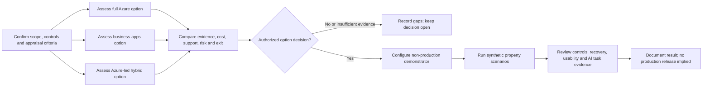

# Proper Warm Retrofit Programme Demonstrator and Platform Assessment

> **PRD-2026-AMA48-001** | Status: draft | Version: 0.1.0 | Last Updated: 2026-10-03

## Executive Summary

Proper Warm needs to modernise retrofit programme coordination while preserving
resident choice, safety, competent professional authority and financial
controls. The source BRD describes a 60,000-home case-study in which a small
team coordinates assessment, funding, procurement, resident engagement and
quality through spreadsheets. It also cautions that spreadsheets have not
been established as the binding delivery constraint.

This PRD proposes a non-production demonstrator and platform-options
assessment. It compares three approaches against the same control and
whole-life-value criteria: full Azure custom development; a business-apps
approach using Power Platform, Dataverse, Copilot Studio and SharePoint, with
existing Dynamics 365 considered if present; and an Azure control layer with
M365 collaboration and document services. No company platform estate,
licensing, integration, budget or operational-support facts have been
confirmed.

The demonstrator will use synthetic data by default and will prove one
representative property journey, including failure and exception paths. A
platform decision is a gate, not an assumption. If a candidate cannot meet the
required controls or its support and whole-life costs cannot be justified, the
decision remains open. The demonstrator will not exercise production
authority, contact residents, or establish operational benefit.

The primary success signal is a reviewable decision package covering all three
options plus a non-production end-to-end scenario suite for the candidate
selected through the options gate. Safety, consent, authority, recovery and
evidence traceability are release conditions, not tradeable throughput
targets. Calendar dates, cost ceilings, performance thresholds, baselines and
named approvers remain to be established.

## Product Context

### Problem and opportunity

The business problem is fragmented coordination across a property lifecycle,
not simply the existence of spreadsheets. Programme teams need to understand
which homes are ready, what is blocking progress, who owns the next action,
which evidence is authoritative, and whether capacity, resident decisions,
funding and safety conditions allow progression. The source BRD requires
existing authoritative housing, asset, repairs, finance, procurement and
contractor services to retain their accountability.

The project owner prefers Azure for the AMA capstone and their Solution
Architect practice, while explicitly requesting an objective assessment of
business-app and mixed options. That preference is an owner statement about
the capstone, not evidence that Azure is the best customer investment or a
platform approval.

### Options presented to the Proper Warm role profiles

The eight `company-*` role profiles were asked to challenge the same three
options from their defined perspectives: Asset Executive, Retrofit Programme
Manager, Finance and Grants, Procurement and Contracts, Resident Engagement,
Data and Performance, Building Safety, and Neighbourhood Housing Officer.
These profiles are sector-informed research instruments, not actual
employees, customers, residents or decision-makers. Their output is not
company evidence, resident research, approval or legal advice.

| Option | Candidate boundary | Role-profile challenge |
| --- | --- | --- |
| Full Azure custom | Azure workbench, APIs, programme data and deterministic workflow, integrations, and bounded Foundry-based AI | Offers maximum control over bespoke lifecycle contracts, but requires the strongest evidence for build cost, engineering support, operations, maintenance and exit. It does not create competent or supplier capacity. |
| Business apps | Power Apps, Dataverse, Power Automate, Copilot Studio and SharePoint; reuse Dynamics 365 only if the estate and capabilities are confirmed | Could reduce bespoke work if a suitable, governed estate, licensing and support capability already exist. Must prove server-side authority, evidence retention/export, failure recovery and cross-system fit; familiar tools do not establish resident suitability. |
| Azure-led hybrid | Azure control plane for programme state and bounded AI, with M365 collaboration/documents and optional Copilot Studio staff channels | A plausible candidate to test for cross-system control needs and commodity reuse. It adds identity, permissions, support, evidence-authority and integration boundaries that must be demonstrated end to end. |

The role-profile synthesis is deliberately conditional:

* Asset found no platform winner without the asset plan, capital envelope,
  current systems and whole-life-cost evidence.
* Retrofit and frontline profiles considered a mixed approach a candidate,
  but noted that existing business applications could be preferable if they
  meet the same controls with less effort and cost.
* Finance and Procurement required equivalent whole-life costing, real
  entitlement and contract evidence, explicit support ownership and a
  testable exit path.
* Resident Engagement found no resident preference evidence and called for
  direct research, accessible and non-digital routes, measure-specific
  decisions and human-authorised consequential contact.
* Data and Performance required source ownership, stable identifiers,
  event-level evidence, reproducible measures and portable exports.
* Building Safety found no inherently safer platform and required the hazard
  service, human safety authority, fail-closed controls and tested recovery to
  remain effective across all options.

The full option comparison in the
[Case Study 48 Addendum](../case_study_48_addendum.md#implementation-options-and-provisional-platform-recommendation)
is the current architecture hypothesis. The PRD keeps implementation
selection open until the appraisal and decision gate are completed.

### Evidence status and source readiness

The upstream
[Agentic Retrofit Programme BRD](../brds/agentic-retrofit-programme-brd.md)
is draft version 0.6.0. No signed `BRD_TO_PRD_HANDOFF_V1` payload was present
for this authoring session. The BRD session state records a prior quality
report with Define exit blocked; confirm the latest formal BRD quality and
approval status before treating its requirements as an approved baseline.
This PRD is therefore an initial draft derived from the current BRD and case
study, not a governed handoff.

## Users and Personas

The following are provisional role archetypes inferred from the BRD. Direct
observation, company validation and resident research have not been completed.

| Persona | Primary job | Pain point or risk to validate | Success outcome |
| --- | --- | --- | --- |
| Asset decision-maker | Compare investment options and understand portfolio consequences | Current asset plan, portfolio data, affordability and decision rights are unknown | A traceable platform recommendation and decision record within delegated governance |
| Retrofit programme manager | Progress a property through assessment, resident, supplier, funding and quality handoffs | Current workflow, PAS 2035 capacity, queues and binding constraint are unknown | One journey with explicit state, evidence, hold, owner and next action |
| Finance and grants reviewer | Test affordability, whole-life cost and evidence status | Actual licences, budget, awards, match funding and cash profile are unknown | Comparable cost assumptions; opportunities, awards, claims and cash remain distinct |
| Digital / architecture lead | Validate security, integration, operability and support feasibility | Existing systems, APIs, platform skills and support model are unknown | An option appraisal and testable target boundary without duplicate authoritative records |
| Safety and repairs owner | Preserve hazard routing, clocks and safety holds | Current hazard integrations and operational recovery are unknown | No demonstrator transition bypasses a hold or replaces the existing hazard service |
| Resident-facing staff and resident representatives | Keep communications, adjustments, decisions and redress accessible | Actual channels, needs, trust and resident preferences are unknown | Demonstrated staff handoff and documented research needs; no assumed resident endorsement |

Residents are affected stakeholders but are not users of this non-production
demonstrator. No resident-facing live journey is authorised in this scope.

## Design Decisions

| Decision ID | Draft decision | Rationale | Decision maker | Status |
| --- | --- | --- | --- | --- |
| DD-001 | Keep full Azure, business-app and mixed implementations in the options appraisal until the evidence gate. | The owner asked for a comparative assessment; role profiles did not establish a platform winner and company estate facts are unknown. | Sponsor and named architecture authority to confirm | Proposed |
| DD-002 | Use synthetic data for the initial demonstrator. | Avoids implying access or authority to process resident or production data while testing the workflow. | Product, Data and DPO reviewers to confirm | Proposed |
| DD-003 | Separate deterministic controls from bounded AI and compare agent-assisted tasks against workflow-only handling. | The BRD requires accountable human decisions and evidence that any AI adds incremental value. | Product and control owners to confirm | Proposed |

## Product Goals

| Goal | Outcome | Priority | KPI and target | Status |
| --- | --- | --- | --- | --- |
| GOAL-001 | Enable accountable decision-makers to compare three implementation options on equivalent scope and evidence. | MUST | One option appraisal covers all 3 options, the same mandatory controls, explicit unknowns and whole-life cost categories before architecture selection. Baseline: no completed appraisal in evidence. | Candidate |
| GOAL-002 | Demonstrate a controlled property journey end to end in a non-production environment. | MUST | All agreed representative scenarios execute or block as expected; 100% of prohibited transitions are blocked in the acceptance suite. Baseline: no PRD demonstrator delivered. | Candidate |
| GOAL-003 | Determine whether bounded AI adds measurable task value over workflow-only handling without weakening safeguards. | SHOULD | Paired evaluation records task quality, unsupported claims, review effort, overrides and missed critical exceptions; owner-set thresholds are approved before evaluation. No numeric quality threshold is established yet. | Candidate |

**SMART status:** Deferred. Scope and candidate signals are stated, but
baselines, calendar horizon, cost ceiling, evaluation thresholds, owners and
achievability require sponsor and Finance input.

## Functional Requirements

| ID | Requirement | Actor / trigger | Expected outcome | Acceptance criteria | Goals |
| --- | --- | --- | --- | --- | --- |
| FR-001 | When the product team begins the options gate, the system shall assess full Azure custom, business apps and Azure-led hybrid against one approved set of scope, control, cost, support, evidence and exit criteria. | Architecture lead; options gate | A comparable, sourced appraisal for all three options | AC-001, AC-002 | GOAL-001 |
| FR-002 | When an option score or cost assumption is entered, the system shall record its source, owner, date, confidence/evidence status and unresolved gap. | Finance, Digital or control owner; appraisal update | Reviewers can distinguish evidence, estimate and unknown | AC-002 | GOAL-001 |
| FR-003 | When a demonstrator case is created, the system shall assign a synthetic property and building identifier and link each lifecycle event to source and evidence version. | Programme user; case creation | Reconstructable synthetic property journey | AC-003, AC-009 | GOAL-002 |
| FR-004 | When a lifecycle transition is requested, the system shall evaluate deterministic evidence, hold, role and approval gates before changing state. | Programme user or test harness; transition request | Allowed transition or explicit block with reason and owner | AC-004, AC-005 | GOAL-002 |
| FR-005 | If safety, consent, professional approval, funding, capacity or required evidence is missing, stale, contradictory or unresolved, then the system shall block the affected demonstrator transition and identify the unresolved condition. | Workflow; gate evaluation | Fail-closed transition, with no inferred approval | AC-004, AC-005 | GOAL-002 |
| FR-006 | When an approved synthetic scenario is run, the system shall show property readiness, current stage, holds, evidence status, next-action owner and handoff state. | Programme manager; scenario run | A reviewable end-to-end case view | AC-003, AC-006 | GOAL-002 |
| FR-007 | Where bounded AI is included, the system shall produce only source-linked extraction, reconciliation, draft or raise-only flag outputs for human review. | Named reviewer; AI task invocation | Reviewable suggestion; no consequential action | AC-007, AC-008 | GOAL-003 |
| FR-008 | When an AI output is generated or reviewed, the system shall retain the applicable source, output, model/configuration version, reviewer decision and correction or override. | Reviewer; output review | Reproducible task-level evaluation evidence | AC-008, AC-009 | GOAL-003 |
| FR-009 | When a scenario, option appraisal or evidence pack is exported, the system shall include its source links, versions, approval state and explicit unresolved items. | Sponsor, Finance or assurance reviewer; export | Portable, interpretable decision evidence | AC-009 | GOAL-001, GOAL-002 |
| FR-010 | When a demonstrator component or integration fails, the system shall expose the affected work, block unverified state changes and support controlled reconciliation before restart. | Digital operator; failure injection | Visible, recoverable failure; no silent progression | AC-005, AC-010 | GOAL-002 |
| FR-011 | When the options gate is reviewed, the system shall record the recommendation, alternatives, criteria, evidence, dissent, approvers and decision status. | Sponsor and designated reviewers; gate review | Decision record; remains open if evidence or authority is insufficient | AC-001, AC-002 | GOAL-001 |
| FR-012 | Before any resident-facing communication or live operational use is enabled, the system shall require a separately approved release configuration and the applicable data-protection, safety, service and authority gates. | Product / control owners; release configuration | Non-production draft cannot silently become operational | AC-010 | GOAL-002, GOAL-003 |

All requirements are draft candidates. The implementation team and product
owner must validate actors, system boundaries and acceptance evidence.

## Non-Functional Requirements

Thresholds dependent on real company workload, service objectives, platform
licences or accessibility standards remain open; they must be set before the
relevant validation gate, not guessed in this draft.

### Performance and Capacity

* **NFR-001:** Before performance acceptance, the product owner shall approve
  representative scenario volume, concurrency and response-time targets.
  The demonstrator shall report measured results against those targets.
  Numeric targets are **TBD**.

### Reliability and Resilience

* **NFR-002:** If a model, workflow component or integration is unavailable
  during a failure-injection test, the system shall not complete an
  unverified controlled transition and shall expose affected work for
  reconciliation before restart.

### Security

* **NFR-003:** All demonstrator users and service identities shall be
  authenticated and least-privilege authorization shall be tested for each
  role and controlled action before acceptance.
* **NFR-004:** Every approval, state transition, override and exported
  decision record shall be attributable to a user or service identity and
  timestamp; unauthorized change attempts shall be denied and recorded.

### Privacy

* **NFR-005:** The MVP shall use synthetic data only. Production and resident
  personal data shall not be ingested unless a separate documented lawful
  basis, data-protection review, approved controls and release decision exist.
* **NFR-006:** Synthetic cases shall not contain real names, addresses,
  contact details, identifiers or free-text health histories.

### Scalability and Elasticity

* **NFR-007:** Before option selection, each candidate's supported scale,
  capacity and cost assumptions shall be recorded for the same approved
  workload. A production-scale requirement is not established by the
  60,000-home case-study portfolio figure alone.

### Maintainability and Operability

* **NFR-008:** Every demonstrator release shall identify its configuration,
  integration contract and operating owner; configuration or model changes
  shall be versioned and have a documented rollback or disable procedure.

### Observability

* **NFR-009:** The demonstrator shall provide traceable records of scenario
  execution, state transitions, handoffs, failure, recovery and AI review,
  with identifiers sufficient to correlate events without logging
  unnecessary resident data.

### Usability and Accessibility

* **NFR-010:** Before acceptance, representative programme and frontline
  users shall complete the agreed demonstrator tasks in a review session;
  blocking usability and accessibility issues shall be recorded and
  dispositioned. Participant count and formal conformance target are **TBD**.
* No resident-facing production experience is in scope; resident needs must
  be researched before productizing any resident channel.

### Compatibility and Interoperability

* **NFR-011:** Each proposed integration shall document source authority,
  identifiers, schema, access, conflict handling, failure behavior and
  reconciliation. MVP integrations shall use mocks, synthetic interfaces
  or explicitly approved test environments.

### Portability

* **NFR-012:** Reviewers shall be able to export the complete synthetic
  appraisal and demonstrator evidence, including source references,
  versions, approvals and supersession links, in a documented format that
  remains interpretable without the selected AI provider.

## Constraints

| ID | Constraint | Imposing source | Boundary and impact |
| --- | --- | --- | --- |
| CON-001 | The MVP shall run in a non-production environment and shall not exercise live authority over a resident, contractor, payment, grant claim or safety decision. | BRD v0.6 draft, Executive Summary and Phase 0D; PRD scope decision proposed | Environment and release: no operational action or production dependency. |
| CON-002 | Existing asset, housing, repairs, safety, finance, procurement and contractor systems retain their authoritative responsibilities unless a separately approved change says otherwise. | BRD v0.6, Digital Foundation and Authority | Architecture: the demonstrator may link or simulate; it must not silently replace source systems. |
| CON-003 | Residents retain measure-specific decision rights; safety, statutory hazard handling, professional judgement, investment, procurement, grant submission, payment and quality acceptance remain with accountable human roles. | Case Study 48 Addendum; BRD FR-036, RULE-018 and imposed constraints | Authority: AI and flows cannot satisfy a human approval gate. |
| CON-004 | The initial demonstrator shall use synthetic data; any future personal-data processing requires separate approval and applicable privacy controls. | PRD MVP boundary; BRD RULE-022 | Data: no production or resident personal data in MVP. |
| CON-005 | No platform choice is approved until equivalent-scope options evidence, whole-life cost, supportability and required control tests are reviewed by named authorities. | Owner request and BRD RULE-016 / AC-053 | Technology and governance: architecture decision remains open. |
| CON-006 | The demonstrator must not delay, pause, reset or close the separate statutory hazard response. | BRD CON-001 and RULE-003 | Safety: hazard-service authority remains outside the retrofit demonstrator. |

## Process Models

## Acceptance Criteria

All criteria are **Not Started** and require review by the named product,
technical and control owners.

| ID | Given / When / Then | Covers | Status |
| --- | --- | --- | --- |
| AC-001 | Given the three approaches are in scope, when the options gate is reviewed, then one decision pack compares all three against the same approved criteria and records recommendation, alternatives and decision authority. | FR-001, FR-011 | Not Started |
| AC-002 | Given an appraisal contains a cost, capability or risk claim, when a reviewer inspects it, then its source or explicit unknown status, owner, date and assumptions are visible. | FR-001, FR-002, FR-011 | Not Started |
| AC-003 | Given a synthetic property scenario, when the lifecycle is displayed, then each event can be reconstructed by property/building identifier, stage, source and evidence version, with current hold and next owner visible. | FR-003, FR-006 | Not Started |
| AC-004 | Given a required approval, safety hold, resident decision or evidence item is absent, stale or contradictory, when progression is requested, then the transition is blocked with the unmet condition and responsible role shown. | FR-004, FR-005 | Not Started |
| AC-005 | Given safety, consent, professional approval, funding or capacity is unresolved, when a direct API, workflow or agent tool attempts a prohibited action, then the action is denied and no controlled state is changed. | FR-004, FR-005, FR-010 | Not Started |
| AC-006 | Given an authorized synthetic journey is run, when the programme manager opens its case view, then stage, evidence status, hold reason, next-action owner and handoff state are available without implying that work is approved for production. | FR-006 | Not Started |
| AC-007 | Given bounded AI is enabled for a test task, when it extracts, reconciles, drafts or flags, then every material output links to its source and is visibly a proposal for human review. | FR-007 | Not Started |
| AC-008 | Given an AI proposal is accepted, edited, overridden or rejected, when the task is evaluated, then output/configuration version, reviewer action, review effort and error classification are retained. | FR-007, FR-008 | Not Started |
| AC-009 | Given the decision pack or scenario evidence is exported, when another reviewer opens the export without the AI provider, then source links, evidence versions, approval state, unresolved items and supersession history remain interpretable. | FR-003, FR-008, FR-009 | Not Started |
| AC-010 | Given a model, workflow or integration failure is injected, when the scenario is exercised, then controlled progression stops, affected work and owner are visible, and restart requires reconciliation; the failure cannot affect a live hazard service. | FR-010, FR-012 | Not Started |
| AC-011 | Given a proposed move from non-production to any live use, when release readiness is reviewed, then separate approval records exist for product, data protection, safety, resident service, finance, procurement and technical authority as applicable; otherwise live release remains blocked. | FR-012 | Not Started |
| AC-012 | Given three platform candidates, when the option matrix is scored, then criteria weights and pass/fail thresholds have documented owners and rationale; no platform is selected solely because of the capstone owner's preference. | FR-001, FR-011 | Not Started |
| AC-013 | Given synthetic data is loaded, when privacy checks run, then no real resident identifier, address, contact detail or health-history text is present. | FR-003, FR-012 | Not Started |

## Traceability Matrix

### FR-to-AC Coverage

| Source ID | Requirement | Acceptance criteria | Coverage |
| --- | --- | --- | --- |
| FR-001 | Compare all implementation options | AC-001, AC-002, AC-012 | 3 |
| FR-002 | Record evidence status and assumptions | AC-002 | 1 |
| FR-003 | Create traceable synthetic property events | AC-003, AC-009, AC-013 | 3 |
| FR-004 | Enforce transition gates | AC-004, AC-005 | 2 |
| FR-005 | Fail closed on unresolved conditions | AC-004, AC-005 | 2 |
| FR-006 | Show case state and ownership | AC-003, AC-006 | 2 |
| FR-007 | Bound AI output to source-linked review proposals | AC-007, AC-008 | 2 |
| FR-008 | Retain AI evaluation and reviewer evidence | AC-008, AC-009 | 2 |
| FR-009 | Export interpretable evidence | AC-009 | 1 |
| FR-010 | Expose and reconcile failures | AC-005, AC-010 | 2 |
| FR-011 | Record the option decision | AC-001, AC-002, AC-012 | 3 |
| FR-012 | Gate live-use configuration | AC-010, AC-011, AC-013 | 3 |

Coverage: 12/12 requirements linked, **100%**. Threshold: 80.0%.

### FR-to-GOAL Alignment

| Source ID | Requirement | Product goals | Coverage |
| --- | --- | --- | --- |
| FR-001 | Compare all implementation options | GOAL-001 | 1 |
| FR-002 | Record evidence status and assumptions | GOAL-001 | 1 |
| FR-003 | Create traceable synthetic property events | GOAL-002 | 1 |
| FR-004 | Enforce transition gates | GOAL-002 | 1 |
| FR-005 | Fail closed on unresolved conditions | GOAL-002 | 1 |
| FR-006 | Show case state and ownership | GOAL-002 | 1 |
| FR-007 | Bound AI output to review proposals | GOAL-003 | 1 |
| FR-008 | Retain AI evaluation evidence | GOAL-003 | 1 |
| FR-009 | Export interpretable evidence | GOAL-001, GOAL-002 | 2 |
| FR-010 | Expose and reconcile failures | GOAL-002 | 1 |
| FR-011 | Record the option decision | GOAL-001 | 1 |
| FR-012 | Gate live-use configuration | GOAL-002, GOAL-003 | 2 |

Coverage: 12/12 requirements linked, **100%**. Target: 100.0%.

### Requirement-to-source trace

| Source | Relevant requirement area |
| --- | --- |
| BRD FR-036, RULE-016, AC-053 | FR-001, FR-004, FR-005, FR-011 |
| BRD NFR-002 to NFR-007 | FR-003, FR-008, FR-009, FR-010; NFR-002 to NFR-009, NFR-011, NFR-012 |
| BRD CON-001, CON-003, RULE-003, FR-002 to FR-004 | FR-004, FR-005, FR-010, FR-012; CON-003, CON-006 |
| BRD RULE-018, RULE-022, RULE-024 | FR-007, FR-008, FR-012; CON-003 to CON-006 |
| Case Study 48 Addendum, “Implementation Options and Provisional Platform Recommendation” | FR-001, FR-002, FR-009, FR-011; DD-001 |
| Eight company-role profile option challenges, 2026-10-03 | Product Context; decision criteria and open questions only; not company evidence |

## MVP and Release Framing

### MVP learning goal

Determine whether one candidate architecture can satisfy the minimum
cross-system control, evidence, recovery and operability needs at a credible
whole-life cost, and whether a bounded AI task improves on workflow-only
handling. Option comparison precedes any architecture lock.

### MVP slice

* Deliver a decision pack for full Azure, business apps and Azure-led hybrid
  using identical criteria, documented evidence and explicit unknowns.
* Following an authorized option decision, deliver one non-production
  demonstrator with a synthetic property lifecycle and representative
  exception/failure paths.
* Compare at least one bounded AI task with workflow-only handling in paired
  test cases if AI is justified by the appraisal; document the result even if
  the decision is not to use AI.
* Demonstrate export, role boundaries, failure handling and a no-bypass
  acceptance suite.

This slice has learning value and limits risk, but does not establish
operational outcomes or prove readiness for live validation. The sample size,
calendar, implementation cost and user-research plan require discovery.

### Out of scope

* Production deployment, portfolio rollout, capital acceleration or live
  integrations to resident, safety, finance or contractor systems.
* Live resident contact, collecting consent, or autonomous appointment,
  works, payment, funding, hazard or quality decisions.
* Replacing housing-management, asset, repairs, finance, safety, procurement
  or contractor systems of record.
* Treating agent output, missing alerts or synthetic evaluation as evidence of
  legal compliance, professional approval or achieved customer benefits.
* Building all three options as production-grade implementations; compare all
  three consistently and implement only the candidate authorized at the gate.

## Success Metrics

| Metric | Definition | Baseline | Target | Window / source | Owner |
| --- | --- | --- | --- | --- | --- |
| Option appraisal completeness | Count of candidate options assessed against each approved criterion with evidence or an explicit gap | No completed comparative appraisal evidenced | 3/3 options; every criterion has evidence, unknown status or justified N/A before decision | Architecture gate; decision pack | Product owner and architecture lead, to be named |
| Critical transition control pass rate | Prohibited or unresolved transitions blocked / total negative control tests | No PRD demo test suite | 100%; zero unauthorized controlled transitions in the agreed suite | Each demonstrator release; versioned test results | Safety and technical authority, to be named |
| Scenario completion | Approved end-to-end scenarios that reach expected terminal state or explicit safe block / total approved scenarios | No PRD demonstrator delivered | 100% of the agreed scenario suite | Demonstrator acceptance; scenario evidence | Retrofit product owner, to be named |
| Evidence export completeness | Required synthetic records whose source, version, approval and supersession metadata survive export / required records | Unknown | 100% of required synthetic test records | Each export acceptance run | Data owner, to be named |
| AI incremental task value | Paired comparison of output quality, unsupported-claim rate, review minutes, overrides and missed critical exceptions versus workflow-only | No measured PRD task baseline | Thresholds set by owners before evaluation; zero undetected critical safety, eligibility or consent errors accepted | Shadow evaluation only; paired test record | Product, safety and assurance owners |
| Whole-life cost confidence | Major cost categories with sourced estimate or explicit gap / required categories | Unknown; no company platform inventory or comparable quotation | All agreed categories shown for each option; Finance validates before decision | Options gate; estimate and evidence log | Finance |

Any quantitative target beyond the defined test pass criteria is provisional
until the product sponsor, Finance and relevant control owners approve it.
Do not convert this demonstrator scorecard into operational throughput or
resident-benefit claims.

## Risks and Assumptions

### Key Assumptions

| Assumption | Impact if false | Mitigation |
| --- | --- | --- |
| The BRD's proposed end-to-end demonstrator is the intended PRD scope. | High | Confirm product boundary and demonstrate how a platform appraisal leads to a bounded demo. |
| Each of the three options can be described against a common control and evidence model. | Medium | Architecture lead to define neutral criteria and disclose any unequal evidence quality. |
| Synthetic data is sufficient to test representative flows and failure paths. | Medium | Data and programme roles review scenario validity; no claim of live-user validation. |
| Foundry/agent evaluation is relevant only if a bounded task demonstrates value over conventional workflow. | Medium | Include workflow-only baseline and permit an explicit no-AI recommendation. |
| A non-production prototype can use mocks or test adapters for unknown company systems. | High | Inventory system/API constraints before architecture selection; record mock limitations. |

### Risk Register

| Risk | Probability | Impact | Mitigation |
| --- | --- | --- | --- |
| Azure preference predetermines the appraisal | Medium | High | Freeze criteria before scoring; document business-app alternative and decision authority. |
| Role-agent hypotheses are mistaken for company or resident evidence | Medium | High | Label their status; validate with actual stakeholders and residents before commitment. |
| Incomplete BRD handoff or unresolved upstream quality issues propagate into the PRD | High | High | Obtain latest BRD quality report, coverage/waiver context and named approvals before Validate. |
| Split authority across Azure, Dataverse and SharePoint creates conflicting approvals or evidence | Medium | High | Map one authoritative record per entity and test conflict, export and reconciliation behavior. |
| Product demo passes while operational support or failure recovery is inadequate | Medium | High | Require runbooks, owner, recovery exercise and support model before any later live gate. |
| Synthetic success is presented as actual delivery benefit | Medium | High | Label every output synthetic and separate feasibility evidence from the BRD's operational Comparisons 1 and 2. |
| Unverified resident needs or platform channels exclude people | Medium | High | Conduct direct resident research and accessibility testing before any resident-facing product scope. |

## Glossary

| Term | Definition |
| --- | --- |
| Azure-led hybrid | Candidate architecture in which Azure provides the programme control plane while M365 supports collaboration/documents and optional staff channels. |
| Business apps | Candidate Power Platform and M365 approach; Dynamics 365 is considered only if its presence and suitability are confirmed. |
| Control plane | Programme-specific lifecycle, gates, evidence links, handoffs and status coordination; it does not replace existing authoritative systems. |
| Demonstrator | Non-production implementation used to prove representative technical paths and controls, not operational benefits. |
| Foundry | Azure AI platform candidate for bounded AI capabilities; specific model, availability, region and deployment are undecided. |
| Accepted handover | BRD outcome separating installation, physical acceptance, evidence acceptance and resident handover; operational definition remains subject to BRD and protocol approval. |
| Synthetic data | Clearly fictional test data with no real resident identifiers or personal information. |

## Sign-Off

### Approval Checklist

* Product Sponsor: To be named.
* Product Owner: To be named.
* Technical Lead: To be named.
* Quality Lead: To be named.
* Legal/Compliance and DPO: To be named for applicable review.
* Resident Engagement and safety control owners: To be named.
* Finance and Procurement reviewers: To be named.

Approval date: Not approved; draft for discovery and review.

### Waivers

None requested. Requirements and targets remain draft; missing approval is not
a waiver.

### Handoff Readiness

Not ready for implementation handoff. No signed upstream BRD-to-PRD handoff,
named product owner, approved platform decision, formal user research,
verified cost model or completed PRD quality review is recorded. Before
Validate, reconcile this draft against the current BRD version, approved
handoff payload and latest quality findings.

## Disclaimer

> [!CAUTION]
> **Disclaimer:** This agent is an assistive tool only. It does not provide product management approval, technical feasibility validation, or business sign-off and does not replace product managers, engineering leads, business stakeholders, or other qualified human reviewers. The output consists of suggested requirements, acceptance criteria, and product specifications to support a user's own product planning and decision-making. All Product Requirements Documents, functional requirements, non-functional requirements, and constraint definitions generated by this tool must be independently reviewed and validated by appropriate product and engineering reviewers before adoption. Outputs from this tool do not constitute product approval, requirements sign-off, or engineering commitment.

## Document Metadata

* Template Version: 1.0.0.
* Canonical Template: `requirements-author/templates/prd/prd-full.md`.
* License: CC-BY 4.0 (Microsoft HVE-Core).
* Attribution: Microsoft HVE-Core Team.
