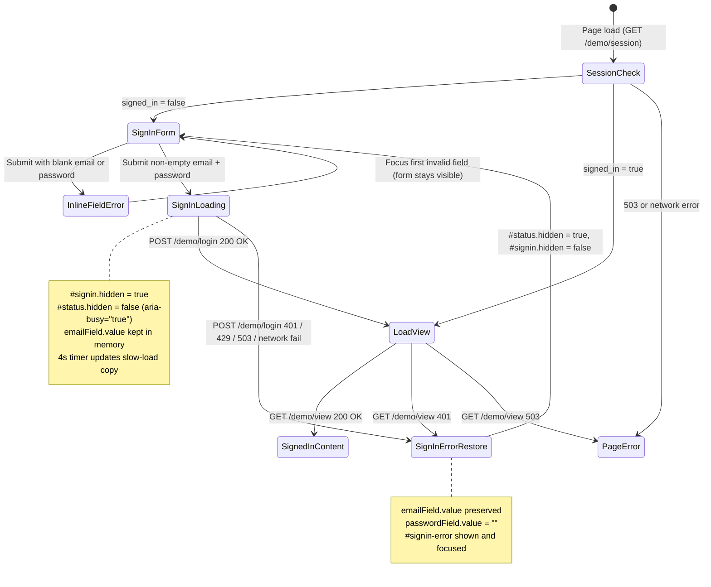

## Scope, governance boundary, and evidence status

This document specifies the UX redesign for the synthetic resident showcase web application at `src/api/src/zava_forward/api/resident_demo/web/` (`index.html`, `demo.css`, `demo.js`, `assistant.js`) under issue #462. It responds to project owner feedback from the live demonstration on 2026-11-04 and follows:

* [Zava Forward Workbench Design System Foundations](./design-system.md) (Fluent 2 token foundations, native HTML semantics, non-colour status signals, two-tone focus indicator, reduced motion)
* [Zava Forward Workbench WCAG 2.2 Conformance Baseline](./wcag-conformance-baseline.md) (WCAG 2.2 Level AA target across 320, 390, and 1280 CSS px viewports, 200% text resize, 400% zoom, keyboard-only operation, and chart table equivalents)
* [Zava Forward Workbench Content Standard, Glossary and Copy Audit](./content-standard.md) (plain language, active voice, exact AI labelling under SA-004, three-part blocked/error pattern under SA-003, no internal jargon)
* [Today's briefing HAX design note (#531)](./briefing-hax-design-note.md) (Microsoft HAX Toolkit guidelines G1, G2, G7, G8, G10, G11, G16, G17 for separating generated, rules-derived, and source content)
* [Resident and representative task designs](./customer-journeys/residents.md#resident-and-representative-task-designs-2026-10-27-154)

Governance and safety boundaries preserved unchanged:

* This application is a temporary synthetic-data showcase (`Synthetic showcase - not a live resident service`). It is not resident enrolment, not real resident identity, and not production authentication.
* Legal and Data Protection Officer (DPO) review remains outstanding. No real resident personal data may be used.
* Named human review of resident-facing wording (appointed reviewer: Juan Manuel Servera, #153) is required before any live resident communication or service use. All copy in this specification is candidate synthetic-showcase copy.
* No screen-reader test, assistive-technology audit, or usability session with real residents has been executed. All behavioural and comprehension improvements described here are design hypotheses until validated with real participants.

### Evidence classification key

Every insight, constraint, and design decision in this specification is tagged with its evidence basis:

* `[Observed]` Verified directly in repository source code, SQL scripts, automated tests, or the 2026-11-04 live owner demonstration.
* `[Reported]` Stated in project owner feedback (2026-11-04) or prior role-agent research notes.
* `[Assumed]` UX hypothesis requiring validation through usability testing and assistive-technology checks with real residents before any production adoption.

### Jobs-to-be-Done (JTBD) analysis

| Dimension | Specification | Evidence tag |
| --- | --- | --- |
| Primary job statement | When I sign in to check my home retrofit case, I want to see a clear summary of what has happened, where my case stands right now, and whether anything is needed from me, so I can understand what to expect next or speak to a person without hunting through a long page. | `[Assumed]` (resident need), `[Reported]` (owner demo feedback) |
| Secondary job statement (sensors) | When I look at my home sensor section below my case progress, I want to see stored indoor temperature and humidity readings and a clearly labelled short-term forecast in plain words and a table, so I can see how my home environment is trending without feeling judged or receiving automated fault diagnoses. | `[Reported]` (owner demo feedback), `[Assumed]` (resident comprehension) |
| Incumbent solution | In the current showcase (`demo.js`), signing in leaves the empty login form visible next to a loading message, then renders up to nine cards in one flat vertical column without navigation (`About this showcase`, `Your home`, `Your home sensors`, `Planned improvements`, `Where things are`, `What happens next`, `Help`, `Synthetic callbacks`, `Not available`). Sensors sit above case progress when present, or do not appear when the showcase SQL view or fixture lacks linked stock sensor rows. | `[Observed]` in `demo.js`, `index.html`, and `infra/sql/resident-showcase.sql` |
| Why current approach fails | 1. During sign-in (`POST /demo/login` followed by `GET /demo/view`), `scrypt` verification and SQL reads take noticeable time; `demo.js` keeps `#signin` visible while `#status` updates, and clears `passwordField.value` before `loadView()` finishes, making the form look broken (`[Reported]`, `[Observed]`). 2. The flat scroll forces users to read past secondary cards (including sensors) before reaching `Where things are` and `What happens next` (`[Observed]`). 3. Document requests and scan statuses (`row.documents`) are parsed in `resident_showcase_sql.py` for chat (`Topic.DOCUMENTS`) but omitted from `showcase_view()` and invisible on the page (`[Observed]`). | `[Observed]` and `[Reported]` |
| Functional dimension | See current stage, plain-language progress, next step, requested documents, planned measures, callback booking, and human help routes in a predictable order with one-click section navigation. | `[Reported]` |
| Emotional dimension | Reduce anxiety during slow sign-in cold starts; avoid confusion between AI wording and recorded case facts; prevent any feeling of blame or judgement when viewing indoor temperature and humidity readings. | `[Assumed]` |
| Social dimension | Share clear case references or callback times with a family member, carer, or housing officer over the phone or in person without needing digital-only jargon. | `[Assumed]` |
| Switching costs and safety | Residents must never be forced to use AI or digital tools. Every section keeps non-digital human contact routes visible, and non-use of AI or the showcase carries zero service detriment. | `[Observed]` in BRD/PRD and `residents.md` |

### User journey map (target redesigned experience)

| Stage | 1. Sign in | 2. Orient and read summary | 3. Check status, actions, and details | 4. Review home sensors | 5. Book callback or sign out |
| --- | --- | --- | --- | --- | --- |
| User action | Enters demo email and shared password; activates `Sign in`. | Reads top Case Summary (rules by default, or opts in to AI summary) and clicks a source link or section nav pill. | Checks `Current status and next step`, `What is needed from you`, `Timeline`, `Documents`, and `Funding`. | Scrolls or jumps via nav to `Home sensors` below the primary case sections; views charts, 24h forecast, or data table. | Uses manual callback form or opens top-right icon-only `Account` menu to `Sign out`. |
| Thinking | "Did my click work? Is the site waking up or did I type the wrong password?" | "What has been happening with my home, and where did that summary come from?" | "Do I need to do anything right now, or am I waiting on Zava North Homes?" | "What have my temperature and humidity been, and what is expected over the next day?" | "How do I speak to a real person or leave this shared device safely?" |
| Emotional state (`[Assumed]`) | Calm while waiting because the form hides and a clear progress state is shown; reassured if an error restores the typed email. | Confident because the summary is short, clearly labelled (AI vs rules), and links directly to recorded facts on the page. | Focused because urgent status and resident actions come first, with icons + words. | Informed and unjudged because sensor values are descriptive, with plain explanations of gaps. | In control because manual help and sign-out are easy to reach. |
| Current pain points (`[Observed]`) | Form stays visible with empty boxes beside `Loading...`; if login fails after a network hiccup, re-typing email is annoying. | No top summary; no in-page navigation; `Where things are` is buried below `Your home sensors` and `Planned improvements`. | `row.documents` is hidden from the page; no visual timeline of stages; status has no icons. | Sensors were either missing in the demo or placed above case status; no forecast; no stale-data indicator. | `Account` button uses text instead of a compact user icon; long scroll to find help. |
| Redesign opportunities | Hide `#signin` during submission; show dedicated loading card with `aria-busy` and 4s slow-load copy; restore `#signin` with `email` preserved on error. | Add sticky `<nav aria-label="Page sections">` and top `Case summary` card with source links and deterministic fallback. | Reorder sections: Status & Next Step -> Needed from you -> Timeline & Measures -> Documents -> Funding -> Help & Callbacks. | Place `Home sensors` below case & help sections; ensure SQL fixture links `stock_id`; add simple 24h synthetic forecast. | Change `<summary>` to user-icon-only with `aria-label="Account"`, `title="Account"`, visible focus/hover tooltip, and 44x44px target. |

---

## Owner feedback trace (2026-11-04 live demo)

| # | Owner feedback item | Root cause observed in current code | Redesign specification |
| --- | --- | --- | --- |
| 1 | Login takes time; after clicking, username/password textboxes show empty with a loading visual beside them. Hide the login form and show only a loading visual, with an error path that restores the form with typed username preserved. | In `demo.js` lines 318 to 356, submitting `#signin-form` disables `#signin-button` but leaves `#signin` visible (`signin.hidden` is still `false`). When `/demo/login` returns `200`, `passwordField.value = ""` runs immediately and `loadView()` sets `#status` to `"Loading your progress..."` while `#signin` remains on screen until `render()` finishes. | On valid form submit, immediately set `signin.hidden = true` and render a dedicated loading card in `#status` (`aria-busy="true"`, spinner + `"Signing you in and loading your home progress..."`, plus a 4s slow-start message). Never clear `emailField.value` on submit or error. Clear `passwordField.value` only when the request settles. If `/demo/login` or `/demo/view` fails, hide the loading visual, set `signin.hidden = false` with `emailField.value` intact, show plain-language error in `#signin-error`, and focus `#signin-error`. |
| 2 | After sign-in, the `Account` button should be a user-icon-only button with accessible name `Account`, same behaviour as now (shows name/email and logout). Keep 44px target and focus visibility. | In `index.html` line 21, `<details id="account" class="account"><summary aria-label="Your account">Account</summary>` displays the visible word `Account` and sets `aria-label="Your account"`. | Replace the `<summary>` contents with an inline 20x20 SVG user icon (`aria-hidden="true" focusable="false"`) and a visually hidden / tooltip text span, setting `aria-label="Account"` and `title="Account"` on `<summary>`. Add a CSS tooltip on `:hover` and `:focus-visible` so sighted keyboard and mouse users see `"Account"`. Keep `min-width: 2.75rem; min-height: 2.75rem` (44x44 CSS px at 16px root) and the two-tone `:focus-visible` ring. |
| 3 | The page is one very long scroll with all information and no navigation. Reorganise: top AI-generated summary (labelled as AI, grounded in case facts, source links, deterministic rules fallback, no decision authority, consent/human boundaries preserved); then current status and next step, what is needed from resident, timeline, documents, funding, etc.; icons paired with text; in-page navigation. | `render()` in `demo.js` lines 199 to 267 appends flat cards in order: `About this showcase`, `Your home`, `Your home sensors`, `Planned improvements`, `Where things are`, `What happens next`, `Help`, `Synthetic callbacks`, `Not available`. There is no `<nav>`, no summary card, no timeline stepper, no documents section (even though `row.documents` is in `ShowcaseRow`), and no icons. | Add a sticky `<nav aria-label="Page sections">` below the `h1` and home identity bar. Place `#sec-summary` first (deterministic rules summary shown immediately; resident can opt in with one checkbox + button to generate the AI summary via `/demo/assistant`, or rules fallback renders automatically when AI is unavailable; every statement links to `#sec-status`, `#sec-actions`, `#sec-timeline`, `#sec-documents`). Follow with `#sec-status`, `#sec-actions`, `#sec-timeline`, `#sec-documents`, `#sec-funding`, `#sec-help` (including callbacks), `#sec-sensors`, and `#sec-unavailable`. Pair inline SVG icons with visible text labels. |
| 4 | Sensors are currently not shown. Specify a sensors section below the important information with charts (temperature, humidity, or whatever synthetic data supports) and a simple clearly-labelled forecast, with accessible chart alternatives, states for no data/stale/error, and descriptive (non-diagnostic, non-judgemental) framing. | 1. In `demo.js`, `renderSensors()` is placed third (above `Where things are`). 2. In `infra/sql/resident-showcase.sql` and `resident_demo_browser_check.py`, if `$.home.stock_id` is not populated on the demo case JSON or `dbo.sensor_register`/`dbo.sensor_reading` rows are not loaded for that `stock_id`, `sensors.history` is `[]`. 3. `sensor_backfill.py` generates `temperature_c` and `humidity_pct` (no CO2). 4. No forecast series or stale-reading state exists. | Move `#sec-sensors` below `#sec-help`. Ensure demo seed cases include `$.home.stock_id` linked to 48-hour synthetic `temperature_c` and `humidity_pct` readings. Add a deterministic 24-hour (6-step, 4-hour cadence) synthetic forecast series (`sensors.forecast`) plotted as a dashed line with hollow square markers after a vertical `"Now (latest stored reading)"` divider, paired with a text forecast summary and table rows labelled `"Forecast (estimate)"`. Enforce non-diagnostic, non-judgemental copy and explicit states for no data, stale data (>24h old), faulted readings, and error. |

---

## Information architecture

### Section order and rationale

Inside `<main id="main" tabindex="-1">`, signed-in content renders in the following sequential order. Every section is a `<section class="card" id="sec-..." aria-labelledby="h-...">` with a programmatic `<h2>` heading so screen-reader heading and landmark navigation match the visual hierarchy.

| Order | Section ID and `<h2>` heading | Content summary | Placement rationale |
| --- | --- | --- | --- |
| 0a | Page header (`<h1>Your home improvement progress</h1>` + Home identity strip) | `<h1>`, read-only showcase lede, and compact home bar showing recorded address, town, postcode, and `"Synthetic showcase record - read-only"` badge with home icon. | Confirms immediately whose synthetic home record is open without taking a full card height (`[Observed]` in #526 summary strip pattern). |
| 0b | Sticky in-page navigation (`<nav class="section-nav" aria-label="Page sections">`) | Horizontal list of anchor links (`Summary`, `Status`, `Needed from you`, `Timeline`, `Documents`, `Funding`, `Help and callbacks`, `Sensors`, `Showcase limits`). | Solves the "one very long scroll with no navigation" pain point (`[Reported]`). Lets keyboard, mouse, and touch users jump directly to any section. |
| 1 | `#sec-summary` (`<h2>Case summary</h2>`) | Grounded summary of what has been happening with the home case. Shows deterministic `Summary by rules` on load, with an optional resident consent control to request an `AI suggestion, not approved` summary, or automatic rules fallback when AI is unavailable. Includes clickable in-page source links (`#sec-status`, `#sec-actions`, `#sec-documents`, `#sec-timeline`) and Preparation/Source disclosure. | Owner requirement #3: top summary gives immediate orientation before detailed cards while preserving resident consent and human authority boundaries. |
| 2 | `#sec-status` (`<h2>Current status and next step</h2>`) | Current stage badge (icon + text), `Where things are` (`view.progress`), `What happens next` (`view.next_step`), and closed-case banner (`view.closed`) if closed. | Owner requirement #3: after the summary, the most important fact for a resident is where the case stands today and what happens next. |
| 3 | `#sec-actions` (`<h2>What is needed from you</h2>`) | Plain-language checklist of any recorded resident actions or waiting items (for example, whether stage is `"Waiting for resident decision"`, whether any requested document in `view.documents.requests` is still missing or has a file-check issue, or how to request a callback). Explicitly states when nothing is needed from the resident (`"Nothing is needed from you right now"`). | Separates resident action items from background programme steps so a resident never worries they missed a required step (`[Assumed]`). |
| 4 | `#sec-timeline` (`<h2>Case timeline and planned improvements</h2>`) | Six-step programme progress stepper (`<ol class="stepper">`: `1. Survey`, `2. Assessment and design`, `3. Resident agreement`, `4. Funding and final checks`, `5. Installation works`, `6. Quality and handover`) derived deterministically from `view.stage` and `view.closed`, followed by the `Planned improvements` (`view.measures`) list. | Gives residents a clear mental model of the whole retrofit journey and where their current stage fits (`[Reported]` owner feedback #3). |
| 5 | `#sec-documents` (`<h2>Documents and checks</h2>`) | Recorded document requests (`view.documents.requests` with `kind`, state, and `how_to_provide`) and presented documents (`view.documents.documents` with file-check status and warnings/errors), plus a plain reminder that uploads are not available in this showcase and file checks are not document approval. | Surfaces `row.documents` (already queried by `v_resident_case` in SQL) directly in the page hierarchy instead of hiding it inside chat (`[Observed]`). |
| 6 | `#sec-funding` (`<h2>Funding and household costs</h2>`) | Plain-language statement of the funding boundary: whether the case is at `"Funding check"` / `"Final checks before ordering"`, that programme funding and grant checks are managed by staff, that no resident payment is requested here, and how leaseholders or shared owners can ask their housing officer about tenure responsibilities. | Addresses owner requirement #3 ("timeline, documents, funding, etc.") without exposing internal staff finance ledgers or unreviewed grant drafts. |
| 7 | `#sec-help` (`<h2>Help, callbacks and ways to reach a person</h2>`) | Human contact routes (`view.help`: housing officer, local office, trusted representative; emergency 999 / repairs warning) paired with the interactive `Synthetic callbacks` manual booking and cancellation form (`mountResidentAppointments`). | Keeps human help and manual callback booking above the fold of secondary technical data and reachable from any section. |
| 8 | `#sec-sensors` (`<h2>Your home sensors and forecast</h2>`) | Placed below the primary case and help sections. Shows non-diagnostic notice, latest stored `Temperature (deg C)` and `Humidity (%)` gauges (`<meter>`), SVG history + 24-hour simple synthetic forecast charts, plain-language text summaries, and `<details>` data table (`Show sensor history and forecast as a table`). | Owner requirement #4: sensors are shown below the important case information with charts, a clearly-labelled forecast, accessible alternatives, and non-judgemental framing. |
| 9 | `#sec-unavailable` (`<h2>Not available in this showcase</h2>`) | Compact disclosure or card listing features disabled in this showcase (`Messages`, `Uploads`, `Downloads`, `Operational appointments`, `Consent and decisions`) with disabled buttons and plain-language explanations. | Retains existing test contract (`button[disabled]` in `resident_demo_browser_check.py`) while keeping showcase boundaries at the bottom of the page. |

### In-page navigation specification

* Semantic structure:
  * Skip link at top of `<body>`: `<a class="skip" href="#main">Skip to the main content</a>` (existing, preserved as first Tab stop).
  * Secondary skip link inside `#sec-sensors`: `<a class="skip-inline" href="#sec-sensors-after">Skip sensor charts to showcase limits</a>` so keyboard users can bypass multi-chart SVG/table controls if desired.
  * Sticky section bar inside `<main>`:
    ```html
    <nav id="page-nav" class="section-nav" aria-label="Page sections" hidden>
      <ul class="section-nav-list">
        <li><a href="#sec-summary" aria-current="location">Summary</a></li>
        <li><a href="#sec-status">Status</a></li>
        <li><a href="#sec-actions">Needed from you</a></li>
        <li><a href="#sec-timeline">Timeline</a></li>
        <li><a href="#sec-documents">Documents</a></li>
        <li><a href="#sec-funding">Funding</a></li>
        <li><a href="#sec-help">Help and callbacks</a></li>
        <li><a href="#sec-sensors">Sensors</a></li>
        <li><a href="#sec-unavailable">Showcase limits</a></li>
      </ul>
    </nav>
    ```
* Why native anchor links (`<a href="#sec-...">`) instead of tabs (`role="tablist"`):
  * In the resident demo, the content per section is concise and read-only (unlike the 25-panel staff workbench in `#526`). Keeping all sections in the DOM with a sticky `<nav>` lets residents either scroll naturally or jump directly to any heading without hiding information from `Ctrl+F` browser find-in-page, print, or screen-reader heading rotor (`H` key) navigation (`[Assumed]`).
  * Native `<a href="#sec-...">` links require zero custom arrow-key JavaScript, work if script execution is interrupted after render, and update URL hash history naturally.
* Sticky positioning and WCAG 2.4.11 (Focus Not Obscured - Minimum):
  * `.section-nav` uses `position: sticky; top: 0; z-index: 1; background: var(--surface); border-bottom: 2px solid var(--line);`.
  * Every target `<section class="card" id="sec-...">` and `<h2>` sets `scroll-margin-top: 4.5rem;` (72 CSS px) so jumping to a section or tabbing backwards never places the focused element behind the sticky bar.
  * At 200% browser zoom or viewport heights below `500px` (`@media (max-height: 31.25rem)`), `.section-nav` automatically reverts to `position: static` so it never consumes vertical viewport space needed to read content on small zoomed screens.
* Responsive layout:
  * Desktop (`>= 48rem` / 768px): links wrap cleanly into one or two compact rows (`display: flex; flex-wrap: wrap; gap: var(--spacingHorizontalS)`).
  * Mobile (`< 48rem`, including 320px and 390px): `.section-nav-list` is a single horizontal scroll strip (`flex-wrap: nowrap; overflow-x: auto; -webkit-overflow-scrolling: touch`) with `min-height: 2.75rem` (44px) pill links and visible scroll padding so no horizontal page overflow occurs (`document.documentElement.scrollWidth <= window.innerWidth`).
* Reduced motion:
  * Smooth scrolling (`scroll-behavior: smooth`) is applied only under `@media (prefers-reduced-motion: no-preference)`. Under `prefers-reduced-motion: reduce`, jumps are instant (`scroll-behavior: auto`) and `--motion` is `0s`.

---

## Wireframes (ASCII and Mermaid)

### 1. Sign-in flow states (Owner feedback #1)

#### State 1A: Initial sign-in form (`#signin` visible, `#status` hidden)

```text
+--------------------------------------------------------------------------+
| [Skip to the main content]                                               |
| ! Synthetic showcase - not a live resident service.                      |
|   Everything here is invented test information...                        |
+--------------------------------------------------------------------------+
| [Z] Zava North Homes | Home improvement progress                         |
+--------------------------------------------------------------------------+
| Your home improvement progress                                           |
| Sign in to see how your home improvement is going. Everything here is    |
| read-only apart from synthetic callbacks.                                |
|                                                                          |
| +----------------------------------------------------------------------+ |
| | Sign in to the showcase                                              | |
| | Enter the example email address you were given and the shared        | |
| | demonstration password.                                              | |
| |                                                                      | |
| | Email address                                                        | |
| | [ alice.demo@example.com                   ]                         | |
| |                                                                      | |
| | Password                                                             | |
| | [ ****************                         ]                         | |
| | Paste is allowed. Nothing you type is stored on this page.           | |
| |                                                                      | |
| | [ Sign in ]                                                          | |
| +----------------------------------------------------------------------+ |
+--------------------------------------------------------------------------+
```

#### State 1B: Sign-in in progress (`#signin` hidden, only loading visual shown)

When the user submits non-empty credentials, `#signin.hidden = true` immediately. The user never sees empty textboxes beside a loading message:

```text
+--------------------------------------------------------------------------+
| ! Synthetic showcase - not a live resident service.                      |
+--------------------------------------------------------------------------+
| [Z] Zava North Homes | Home improvement progress                         |
+--------------------------------------------------------------------------+
| Your home improvement progress                                           |
| Sign in to see how your home improvement is going.                       |
|                                                                          |
| +----------------------------------------------------------------------+ |
| | (o) Signing you in and loading your home progress...                 | |
| |                                                                      | |
| |     (After 4 seconds if still waiting:)                              | |
| |     Still signing you in. The showcase may be waking up, which can   | |
| |     take up to 30 seconds. Please wait.                              | |
| +----------------------------------------------------------------------+ |
|   (role="status" aria-live="polite" aria-busy="true")                    |
+--------------------------------------------------------------------------+
```

#### State 1C: Sign-in error recovery (`#signin` restored, typed email preserved)

If `/demo/login` returns `401`, `429`, `503`, or a network error occurs, `#status` hides, `#signin.hidden = false`, `#email` retains `"alice.demo@example.com"`, `#password` is cleared to `""`, `#signin-error` is shown with plain-language reason + next action, and keyboard focus moves to `#signin-error`:

```text
+--------------------------------------------------------------------------+
| ! Synthetic showcase - not a live resident service.                      |
+--------------------------------------------------------------------------+
| [Z] Zava North Homes | Home improvement progress                         |
+--------------------------------------------------------------------------+
| Your home improvement progress                                           |
|                                                                          |
| +----------------------------------------------------------------------+ |
| | Sign in to the showcase                                              | |
| | Enter the example email address you were given and the shared        | |
| | demonstration password.                                              | |
| |                                                                      | |
| | +------------------------------------------------------------------+ | |
| | | ! We could not sign you in with those details. Check the example | | |
| | |   email address and shared password you were given, then try     | | |
| | |   again.                                            (Focused)    | | |
| | +------------------------------------------------------------------+ | |
| |                                                                      | |
| | Email address                                                        | |
| | [ alice.demo@example.com                   ]  <-- Preserved!         | |
| |                                                                      | |
| | Password                                                             | |
| | [                                          ]  <-- Cleared safely     | |
| | Paste is allowed. Nothing you type is stored on this page.           | |
| |                                                                      | |
| | [ Sign in ]                                                          | |
| +----------------------------------------------------------------------+ |
+--------------------------------------------------------------------------+
```

#### Sign-in state transition diagram (Mermaid)



### 2. Signed-in desktop wireframe (1280 CSS px viewport)

```text
+--------------------------------------------------------------------------------------+
| ! Synthetic showcase - not a live resident service.                                  |
|   Everything here is invented test information. Legal and DPO review outstanding.    |
+--------------------------------------------------------------------------------------+
| [Z] Zava North Homes  Home improvement progress                         [ (@) ]      |
|                                                                        Account icon  |
|                                                             +----------------------+ |
|                                                             | Signed in to showcase| |
|                                                             | alice.demo@example...| |
|                                                             | [     Sign out     ] | |
|                                                             +----------------------+ |
+--------------------------------------------------------------------------------------+
| Your home improvement progress                                                       |
| Home: 1 Alder Close, Demotown, DE1 1MO  |  [i] Read-only showcase record             |
+--------------------------------------------------------------------------------------+
| Sticky Nav: [Summary*] [Status] [Needed from you] [Timeline] [Documents]             |
|             [Funding] [Help and callbacks] [Sensors] [Showcase limits]               |
+--------------------------------------------------------------------------------------+
| +----------------------------------------------------------------------------------+ |
| | CASE SUMMARY                                                                     | |
| | [List icon] Summary by rules. Not an instruction.                                | |
| | (Or after opt-in: [Sparkle icon] AI suggestion, not approved. Not an instruction)| |
| |                                                                                  | |
| | Your home at 1 Alder Close is at the Survey stage. We are arranging a survey     | |
| | of your home for planned loft insulation. 1 requested document is waiting to     | |
| | be provided. Neither rules nor AI can make decisions, approve documents, or      | |
| | book works.                                                                      | |
| |                                                                                  | |
| | Sources in your record:                                                          | |
| | * [Current status and next step](#sec-status)                                    | |
| | * [What is needed from you (1 item)](#sec-actions)                               | |
| | * [Documents and checks](#sec-documents)                                         | |
| | * [Planned improvements](#sec-timeline)                                          | |
| |                                                                                  | |
| | [ ] Use my own case record to generate an AI summary (optional).                 | |
| |     This is not consent to works.                                                | |
| | [ Generate AI summary ]                                                          | |
| +----------------------------------------------------------------------------------+ |
|                                                                                      |
| +----------------------------------------+ +---------------------------------------+ |
| | CURRENT STATUS AND NEXT STEP           | | WHAT IS NEEDED FROM YOU               | |
| | [Clock icon] Stage: Survey             | | [!] 1 item needs your attention       | |
| |                                        | |                                       | |
| | Where things are:                      | | * Document request REQ-1 (Proof of    | |
| | A survey of your home is being         | |   occupancy): Missing in this view.   | |
| | arranged.                              | |   See [Documents and checks].         | |
| |                                        | | * Decisions and consent: Nothing to   | |
| | What happens next:                     | |   sign here. Speak to your housing    | |
| | Any confirmed time is shown under      | |   officer when asked.                 | |
| | Confirmed arrangements, if your page   | | * Optional: [Book a synthetic         | |
| | shows it.                              | |   callback](#sec-help)                | |
| +----------------------------------------+ +---------------------------------------+ |
|                                                                                      |
| +----------------------------------------------------------------------------------+ |
| | CASE TIMELINE AND PLANNED IMPROVEMENTS                                           | |
| |                                                                                  | |
| | (1) Survey* ---- (2) Assessment ---- (3) Resident  ---- (4) Funding ---- (5) ... | |
| |  [Current]        [Not started]       agreement          & checks                | |
| |                                       [Not started]      [Not started]           | |
| |                                                                                  | |
| | Planned improvements for 1 Alder Close:                                          | |
| | * [Home icon] Loft insulation                                                    | |
| +----------------------------------------------------------------------------------+ |
|                                                                                      |
| +----------------------------------------------------------------------------------+ |
| | DOCUMENTS AND CHECKS                                                             | |
| | Uploading documents is not available in this showcase.                           | |
| |                                                                                  | |
| | Requested documents:                                                             | |
| | * [!] Proof of occupancy (REQ-1) - Status: Missing in this view                  | |
| |   How to provide: Bring a utility bill to your local office or show your officer.| |
| |                                                                                  | |
| | Presented documents on file:                                                     | |
| | * [Tick icon] Energy assessment (DOC-1) - Recorded as presented, not approved.   | |
| |   File check: Clean (this is not approval of the document).                      | |
| +----------------------------------------------------------------------------------+ |
|                                                                                      |
| +----------------------------------------------------------------------------------+ |
| | FUNDING AND HOUSEHOLD COSTS                                                      | |
| | [Info icon] Programme funding check: Handled by Zava North Homes staff           | |
| | * You are not asked to pay or approve funding in this showcase.                  | |
| | * Funding checks happen at Step 4 before installation works are ordered.         | |
| | * If you are a leaseholder or shared owner, ask your housing officer for a       | |
| |   reviewed explanation of your lease before making any decision.                 | |
| +----------------------------------------------------------------------------------+ |
|                                                                                      |
| +----------------------------------------------------------------------------------+ |
| | HELP, CALLBACKS AND WAYS TO REACH A PERSON                                       | |
| | A person can help. You do not need to use this page.                             | |
| | * Speak to your housing officer.                                                 | |
| | * Write to or visit your local Zava North Homes office.                          | |
| | * For immediate danger, call 999.                                                | |
| |                                                                                  | |
| | Synthetic callbacks (Nobody will call you; not a works booking)                  | |
| | [ ] Use my own record to find, check or change my synthetic callbacks.           | |
| | Earliest date: [ 2026-11-05 ]  Preferred time: [ Any time v ]                    | |
| | [ Find callback times ]  [ Check my callbacks ]                                  | |
+----------------------------------------------------------------------------------+ |
|                                                                                      |
| +----------------------------------------------------------------------------------+ |
| | YOUR HOME SENSORS AND FORECAST                                                   | |
| | [i] Synthetic sensor history for your home. Stored demo readings and a simple    | |
| |     24-hour estimate, not live measurements, safety advice, or a judgement       | |
| |     about your household.                                                        | |
| | Latest stored reading: 4 Nov 2026, 12:00 (UK time)  |  [Check] Status: Recorded  | |
| |                                                                                  | |
| | +------------------------------------+  +--------------------------------------+ | |
| | | [Thermometer] Temperature (deg C)  |  | [Droplet] Humidity (%)               | | |
| | | [============|---------] 19.5 C    |  | [=============|--------] 58 %        | | |
| | | Next 24h estimate: 18.2 to 20.4 C  |  | Next 24h estimate: 54 to 63 %        | | |
| | +------------------------------------+  +--------------------------------------+ | |
| |                                                                                  | |
| | Temperature history and 24-hour synthetic forecast (deg C)                       | |
| |  45 |                                  | Now                                     | |
| |  17 |  o--o--o--o--o--o--o--o--o--o--o | ..[]..[]..[]..[]..[]..[]                | |
| | -10 +----------------------------------+--------------------------               | |
| |     Recorded (solid line, circles)     | Forecast next 24h (dashed, squares)     | |
| | Summary: Across 48 stored readings: lowest 17.8 C, highest 21.1 C. Latest        | |
| | value is about the same as the first. Simple 24-hour forecast: 18.2 C to 20.4 C. | |
| |                                                                                  | |
| | [Humidity SVG chart + text summary...]                                           | |
| |                                                                                  | |
| | > Show sensor history and forecast as a table                                    | |
| +----------------------------------------------------------------------------------+ |
|                                                                                      |
| +----------------------------------------------------------------------------------+ |
| | NOT AVAILABLE IN THIS SHOWCASE                                                   | |
| | [Messages (disabled)] [Uploads (disabled)] [Downloads (disabled)] ...            | |
| +----------------------------------------------------------------------------------+ |
+--------------------------------------------------------------------------------------+
|                                                          [ (?) Help with your case ] |
+--------------------------------------------------------------------------------------+
```

### 3. Signed-in mobile wireframe (320 CSS px / 390 CSS px viewport)

```text
+--------------------------------------+
| ! Synthetic showcase - not live.     |
|   Invented test information...       |
+--------------------------------------+
| [Z] Zava North Homes         [ (@) ] |
|     Home improvement         44x44px |
+--------------------------------------+
| Your home improvement progress       |
| 1 Alder Close, Demotown, DE1 1MO     |
| [i] Read-only showcase record        |
+--------------------------------------+
| [Summary*] [Status] [Needed] [Time > |
| (Horizontal touch scroll, no page X) |
+--------------------------------------+
| +----------------------------------+ |
| | CASE SUMMARY                     | |
| | [List] Summary by rules.         | |
| | Not an instruction.              | |
| |                                  | |
| | Your home at 1 Alder Close is at | |
| | the Survey stage...              | |
| |                                  | |
| | Sources in your record:          | |
| | * [Current status](#sec-status)  | |
| | * [Needed from you](#sec-actions)| |
| |                                  | |
| | [ ] Use my own case record to    | |
| |     generate an AI summary...    | |
| | [ Generate AI summary ]          | |
| +----------------------------------+ |
| +----------------------------------+ |
| | CURRENT STATUS AND NEXT STEP     | |
| | [Clock] Stage: Survey            | |
| | Where things are: ...            | |
| | What happens next: ...           | |
| +----------------------------------+ |
| +----------------------------------+ |
| | WHAT IS NEEDED FROM YOU          | |
| | [!] 1 item needs attention       | |
| | * Proof of occupancy (REQ-1)...  | |
| +----------------------------------+ |
| +----------------------------------+ |
| | CASE TIMELINE & IMPROVEMENTS     | |
| | (Vertical <ol> stepper < 48rem)  | |
| | * [Clock] 1. Survey (Current)    | |
| | * [ ] 2. Assessment (Not started)| |
| | * [ ] 3. Resident agreement      | |
| | * [ ] 4. Funding & final checks  | |
| | * [ ] 5. Installation works      | |
| | * [ ] 6. Quality & handover      | |
| | Planned: Loft insulation         | |
| +----------------------------------+ |
| +----------------------------------+ |
| | DOCUMENTS AND CHECKS             | |
| | * [!] Proof of occupancy: Missing| |
| | * [v] Energy assessment: Clean   | |
| +----------------------------------+ |
| +----------------------------------+ |
| | FUNDING AND HOUSEHOLD COSTS      | |
| | [i] Managed by staff; no payment | |
| |     requested here.              | |
| +----------------------------------+ |
| +----------------------------------+ |
| | HELP AND SYNTHETIC CALLBACKS     | |
| | Speak to your housing officer... | |
| | [ Find callback times ]          | |
| +----------------------------------+ |
| +----------------------------------+ |
| | YOUR HOME SENSORS AND FORECAST   | |
| | Latest: 4 Nov 2026, 12:00 UK     | |
| | [Temperature gauge: 19.5 deg C]  | |
| | [Humidity gauge: 58 %]           | |
| | [Responsive SVG chart + 24h est] | |
| | > Show sensor history as a table | |
| +----------------------------------+ |
| +----------------------------------+ |
| | NOT AVAILABLE IN THIS SHOWCASE   | |
| +----------------------------------+ |
+--------------------------------------+
```

---

## Component inventory mapped to Fluent 2 tokens

All components use native HTML elements styled with the Fluent 2 token bridge in `src/api/src/zava_forward/api/resident_demo/web/demo.css` (`[Observed]` in `design-system.md`). No external CSS framework or runtime web component library is imported.

| Component | HTML element and class | Fluent 2 tokens consumed | Visual and interaction rule |
| --- | --- | --- | --- |
| Synthetic banner | `<div class="synthetic" role="note">` | `--caution-bg`, `--caution`, `--ink`, `--spacingHorizontalL` | Always visible at top of page before and after sign-in. |
| Header and icon-only Account control | `<header class="top">`, `<details id="account" class="account">`, `<summary aria-label="Account" title="Account">` | `--brand`, `--colorBrandBackgroundHover`, `--surface`, `--line`, `--borderRadiusMedium`, `--borderRadiusXLarge`, `--focus`, `--focus-ink` | `<summary>` is 44x44px (`min-width: 2.75rem; min-height: 2.75rem`), contains `<svg class="icon" aria-hidden="true">` user glyph + CSS `.account-tooltip` (`"Account"`) revealed on `:hover` and `:focus-visible`. `Escape` and outside click close `<details>` and return focus to `<summary>`. |
| Sign-in loading panel | `<div id="status" class="status card loading-card" role="status" aria-live="polite">` | `--surface`, `--line`, `--borderRadiusXLarge`, `--spacingHorizontalL`, `--brand`, `--motion` | Shown alone while `signin.hidden = true` during `/demo/login` and `/demo/view`. Includes `.spinner` (`aria-hidden="true"`, static under `prefers-reduced-motion: reduce`) and visible progress text. |
| Sign-in error alert | `<div id="signin-error" class="inline-error" role="alert" tabindex="-1">` | `--warn-bg`, `--warn`, `--ink`, `--borderRadiusMedium`, `--focus`, `--focus-ink` | Restored inside `#signin` with leading warning icon + plain text; receives focus on failed sign-in while `#email` preserves typed value. |
| Home identity strip | `<div class="home-strip">` | `--soft`, `--soft-line`, `--ink`, `--muted`, `--borderRadiusMedium`, `--spacingHorizontalM` | Compact bar below `<h1>` showing home icon + address, town, postcode + read-only badge. |
| Sticky section nav | `<nav id="page-nav" class="section-nav" aria-label="Page sections">` | `--surface`, `--line`, `--brand`, `--soft`, `--fontSizeBase400`, `--spacingHorizontalS`, `--borderRadiusMedium` | Sticky top bar (`scroll-margin-top: 4.5rem` on targets). Active link has `aria-current="location"`, solid `--brand` border, and bold text (not colour alone). |
| Case summary card (Rules & AI) | `<section id="sec-summary" class="card summary-card ai-suggestion">` | `--surface`, `--soft`, `--soft-line`, `--caution-bg`, `--caution`, `--brand`, `--ink`, `--muted` | Header badge shows icon + exact label (`"Summary by rules. Not an instruction."` or `"AI suggestion, not approved. Not an instruction."`). Includes bulleted source anchor links, optional consent checkbox + button, and authority disclaimer. |
| Status and Next Action grid | `<div class="status-grid">`, `<section id="sec-status" class="card">`, `<section id="sec-actions" class="card">` | `--surface`, `--line`, `--ok`, `--ok-bg`, `--caution`, `--caution-bg`, `--warn`, `--warn-bg`, `--spacingHorizontalL` | Two-column CSS grid at `>= 48rem`, single column below `48rem`. Uses `.status-badge` with icon + text. |
| Programme timeline stepper | `<ol class="stepper">`, `<li class="step done|current|upcoming|closed">` | `--brand`, `--ok`, `--ok-bg`, `--line`, `--surface`, `--muted`, `--fontSizeBase400` | Native `<ol>` of 6 steps. `aria-current="step"` on active step. Horizontal at `>= 48rem`, vertical list below `48rem`. Each step renders icon + step number + step name + explicit state badge (`"Completed"`, `"Current stage"`, `"Not started"`). |
| Document checklist and presented list | `<ul class="doc-list">`, `<li class="doc-item">` | `--line`, `--ok`, `--ok-bg`, `--caution`, `--caution-bg`, `--warn`, `--warn-bg`, `--spacingHorizontalM` | Shows each requested document and each presented document with status icon + text badge and recorded instruction or issue message. |
| Sensor gauges | `<div class="sensor-gauges">`, `<div class="sensor-gauge">`, `<meter>` | `--bg`, `--line`, `--brand`, `--fontSizeBase500`, `--borderRadiusMedium`, `--spacingHorizontalM` | Preserves existing `<meter id="gauge-temperature_c">` and `<meter id="gauge-humidity_pct">` when latest reading is valid; adds 24h forecast range line below the value. |
| Sensor chart with 24h forecast | `<figure class="sensor-chart">`, `<svg role="img">` | `--ink`, `--muted`, `--brand`, `--caution`, `--fontFamilyBase` | Solid `--brand` polyline + filled circle markers (`r="3"`) for recorded history; vertical dashed divider at latest stored reading; dashed polyline (`stroke-dasharray="5,4"`) + hollow square markers (`<rect width="6" height="6">`) for 24-hour forecast so history vs forecast is distinguishable without colour. |
| Sensor data table disclosure | `<details>`, `<div class="sensor-table" role="region" tabindex="0">`, `<table>` | `--line`, `--soft`, `--spacingHorizontalS`, `--fontSizeBase400` | Native `<table>` with `<caption>`, `<th scope="col">`, `<th scope="row">`, `<time datetime="...">`, and explicit `"Reading type"` column (`"Stored reading"` vs `"Forecast (estimate)"`). |

---

## Icon set choice (offline-safe, CSP-compliant, no external CDN)

### Selection and technical rationale

* **Selected icon approach:** Inline SVG icons drawn from the **Fluent UI System Icons (20x20 regular stroke/path subset)** embedded directly in a small client helper (`icon(name)` in `demo.js` using `document.createElementNS("http://www.w3.org/2000/svg", "svg")`) and static `<svg>` in `index.html` for the Account button (`[Observed]` CSP constraint).
* **Why inline SVG and no external CDN or icon font:**
  * `src/api/src/zava_forward/api/resident_demo/app.py` enforces a strict Content Security Policy: `default-src 'none'; script-src 'self'; style-src 'self'; img-src 'self'; connect-src 'self'` (`[Observed]`), and `resident_sensors_browser_check.py` aborts any network request outside the local loopback origin. External CDNs are blocked by design.
  * Icon webfonts fail when users override fonts for dyslexia or low vision (WCAG 1.4.12 / 1.4.4) and require adding `font-src 'self'`. Inline SVGs with `fill="currentColor"` or `stroke="currentColor"` scale cleanly with `rem` font sizes (`width: 1.25rem; height: 1.25rem`), inherit high-contrast system link/button text colours (`forced-colors: active`), and add less than 2 KB to `demo.js`.
* **Mandatory accessibility rules for icons:**
  * Every decorative or status icon sets `aria-hidden="true"` and `focusable="false"`, and is **always paired with visible text** stating the status or meaning (WCAG 1.1.1, 1.4.1).
  * The **only** icon-only interactive control is the signed-in `Account` `<summary>` button (owner requirement #2), which carries `aria-label="Account"` on `<summary>`, `title="Account"`, and a visible `.account-tooltip` element shown on both `:hover` and `:focus-visible`.

### Icon inventory

| Icon key | Visual shape (20x20 viewBox) | Where used | Paired visible text (never icon alone) |
| --- | --- | --- | --- |
| `person` | Head circle (`cx=10 cy=6.5 r=3.25`) + shoulders arc (`M4 16.5c0-3 2.7-5 6-5s6 2 6 5`) | Header `#account > summary` | Accessible name `aria-label="Account"` + `title="Account"` + visible hover/focus tooltip `Account` |
| `sparkle` | Four-point AI star + small secondary star | `#sec-summary` badge when AI summary is active | `"AI suggestion, not approved. Not an instruction."` |
| `list-rules` | Three horizontal lines with bullet dots | `#sec-summary` badge when deterministic rules summary is active | `"Summary by rules. Not an instruction."` |
| `check-circle` | Circle with checkmark (`M6.5 10.5l2.2 2.2 4.8-5`) | Completed timeline steps; clean document scan; `"Nothing needed from you"` state | `"Completed"`, `"File check: clean"`, or `"No action needed"` |
| `clock` | Circle with clock hands (`M10 6v4.5l3 1.5`) | Current timeline step; active stage badge; pending document scan | `"Current stage"`, `"In progress"`, or `"Waiting for file check"` |
| `alert-triangle` | Triangle with exclamation mark (`M10 3L2 17h16L10 3z`) | Sign-in error; resident action needed; missing document; document warning/error; paused contact; stale sensor reading | `"Error:"`, `"Warning:"`, `"Action needed:"`, `"Missing"`, or `"Paused"` |
| `ban` | Circle with diagonal slash | Blocked/unavailable showcase actions; stopped work | `"Not available in this showcase"` or `"Paused"` |
| `home` | Roof + house walls (`M3 9.5L10 3l7 6.5V17H3V9.5z`) | Home identity strip; planned improvements list | Address text / measure name |
| `document` | Page outline with folded corner | `#sec-documents` items | Document kind and status word |
| `thermometer` | Thermometer bulb and stem | Temperature gauge card | `"Temperature (deg C)"` |
| `droplet` | Water droplet outline | Humidity gauge card | `"Humidity (%)"` |
| `trend-forecast` | Dotted line with right arrow | 24-hour sensor forecast sub-heading | `"Simple 24-hour synthetic forecast (estimate)"` |
| `phone-person` | Handset + person outline | `#sec-help` human contact card | `"A person can help"` |

---

## States specification

Every asynchronous request and every section of the page must implement explicit, deterministic states. No state may rely on colour or a spinner alone.

### 1. Application shell and sign-in states (Owner feedback #1 and #2)

| State | Trigger | DOM visibility | Accessible status and focus behaviour |
| --- | --- | --- | --- |
| `shell-boot-fast` | Page load (`start()` calls `GET /demo/session`, resolves `< 4s`) | `#status` visible (`"Loading..."`); `#signin`, `#error`, `#content`, `#account`, `#page-nav` all `hidden`. | `#status` has `role="status" aria-live="polite"`. |
| `shell-boot-slow` | `GET /demo/session` still pending after `4000ms` | Same as `shell-boot-fast`; `#status` text updates. | `#status` text becomes: `"Still loading. The showcase may be waking up, which can take up to 30 seconds. Please wait."` (`[Observed]` in `test_resident_demo_script.py`). |
| `signin-ready` | `GET /demo/session` returns `signed_in: false` | `#status` empty/hidden; `#signin.hidden = false`; `#signin-error.hidden = true`; `#content.hidden = true`; `#account.hidden = true`. | On initial load, `#email` is **not** auto-focused (`[Observed]` test `email is not auto-focused` in `resident_demo_browser_check.py`). After sign-out, focus moves to `#signin-title` and `#status` announces `"You have signed out."` |
| `signin-client-invalid` | User submits `#signin-form` with empty `#email` or empty `#password` | `#signin` stays **visible** (`#signin.hidden = false`); `#signin-error.hidden = false`. | Empty fields get `aria-invalid="true"` and `aria-describedby="signin-error"`. Focus moves to the first invalid field (`#email` or `#password`). Typing in either field clears `aria-invalid` (`[Observed]` in `test_resident_demo_script.py`). |
| `signin-submitting` (**New**) | User submits `#signin-form` with non-empty `#email` and `#password` | **`#signin.hidden = true` immediately**; `#signin-error.hidden = true`; `#status` shown as a loading card with `.spinner` (`aria-hidden="true"`) and text `"Signing you in and loading your home progress..."`. | `main` sets `aria-busy="true"`. `#email.value` is preserved untouched. If still pending after `4000ms`, `#status` updates to `"Still signing you in. The showcase may be waking up, which can take up to 30 seconds. Please wait."` |
| `signin-failed-restore` (**New**) | `POST /demo/login` returns `401`, `429`, `503`, or network failure, OR subsequent `GET /demo/view` returns `401` | `main` removes `aria-busy`; `#status` cleared/hidden; **`#signin.hidden = false`**; `#email.value` still holds the exact string the user typed; `#password.value = ""` (cleared); `#signin-button.disabled = false`; `#signin-error.hidden = false`. | `#signin-error` displays warning icon + server error or connection error message. Focus moves to `#signin-error` (`document.activeElement.id === "signin-error"`, preserving `check_failure_and_forgery` in `resident_demo_browser_check.py`). |
| `signin-csrf-403` | `POST /demo/login` returns `403` (stale CSRF/origin) | Preserves `emailField.value` in a local variable, runs `start()` to refresh `/demo/session` CSRF token, restores `emailField.value`, and shows `#signin-error`: `"Your page session was refreshed. Enter the password and try signing in again."` | Focus moves to `#signin-error`; resident does not have to re-type their email address (WCAG 3.3.7 Redundant Entry). |
| `signed-in-ready` | `GET /demo/view` returns `200` | `#signin.hidden = true`; `#error.hidden = true`; `#account.hidden = false` (icon-only `<summary aria-label="Account" title="Account">`); `#page-nav.hidden = false`; `#content.hidden = false`. | `#status` announces `"You are signed in. Your progress is shown below."` Focus moves to the first `<h2>` inside `#content` (`#h-case-summary`, `tabindex="-1"`). |
| `session-expired-or-changed` | Any API call returns `401` or `409` (`session_changed: true`), or `BroadcastChannel` detects tab change | Clears `#content`, hides `#account` and `#page-nav`, shows `#signin` (`#signin.hidden = false`), shows `#signin-error` with `"Your sign-in changed in another tab. Please sign in again."` or `"Please sign in again."` | Focus moves to `#signin-error`. Personal case data is wiped from DOM (`clearPersonal()`). |
| `page-fatal-error` | `GET /demo/session` or `GET /demo/view` returns `503` (showcase expired or DB down) or network failure during boot/sign-out | `#signin.hidden = true`; `#content.hidden = true`; `#account.hidden = true`; `#error.hidden = false`. | `#error-title` receives focus; human help note and `#retry` (`Try again`) button are visible. |

### 2. Case summary states (Owner feedback #3)

| State | Trigger | Badge and label | Content and controls shown |
| --- | --- | --- | --- |
| `summary-rules-default` | Initial render of `#sec-summary` after `GET /demo/view` | Icon `list-rules` + `"Summary by rules. Not an instruction."` | Displays deterministic plain-language summary built from `view.stage`, `view.progress`, `view.next_step`, `view.closed`, `view.measures`, and `view.documents`, with clickable in-page source links (`#sec-status`, `#sec-actions`, `#sec-documents`, `#sec-timeline`). Shows unchecked consent checkbox (`#summary-ai-consent`) and `"Generate AI summary"` button. |
| `summary-ai-consent-missing` | User clicks `"Generate AI summary"` without checking `#summary-ai-consent` | Remains `Summary by rules. Not an instruction.` | Sets `aria-invalid="true"` on `#summary-ai-consent`, shows inline error `"Agree to use your own case record before requesting an AI summary."`, and moves focus to `#summary-ai-consent`. |
| `summary-ai-loading` | User checks `#summary-ai-consent` and clicks `"Generate AI summary"` (`POST /demo/assistant` with `{"topic": "status", "use_record": true}`) | Rules summary remains visible or dims with `aria-busy="true"` on `#sec-summary`; polite status line `#summary-status` shows `"Generating AI case summary..."`. | `"Generate AI summary"` button is native `disabled` while pending. |
| `summary-ai-ready` | `POST /demo/assistant` returns `200` with an AI-assisted label (`"AI suggestion, not approved"` or `"AI-generated"`) | Icon `sparkle` + exact label: `"AI suggestion, not approved. Not an instruction."` | Shows the grounded AI summary paragraph, explicit disclaimer (`"AI-generated content may be incorrect. Check the linked sections below. AI cannot make decisions, approve documents, or change your case."`), clickable source links mapped to page sections, and a `"Show rules summary instead"` button (HAX G8 efficient dismissal). |
| `summary-ai-fallback` | `POST /demo/assistant` returns a rules fallback label (`"Summary by rules - AI is not enabled"` or `"Summary by rules - AI unavailable: <reason>"`) or HTTP `503` / network error | Icon `list-rules` + `"Summary by rules. Not an instruction."` + polite status note explaining why AI was not used. | Keeps the deterministic rules summary and source links visible so the resident is never left with an empty or broken summary card. Status note states: `"AI summary is not available right now (<reason>). Showing the rules-based summary from your recorded case facts instead."` |
| `summary-consent-withdrawn` | User unchecks `#summary-ai-consent` after generating an AI summary | Reverts immediately to `Summary by rules. Not an instruction.` | Clears any generated AI text from the card and sets `#summary-status` to `"Record use for AI summary stopped. Showing the rules-based summary."` |

### 3. Sensors and forecast states (Owner feedback #4)

| State | Condition in `view.sensors` | Visual and accessible presentation | Forecast behaviour |
| --- | --- | --- | --- |
| `sensors-normal` | `history.length >= 6`, latest reading has valid `temperature_c` and/or `humidity_pct`, and latest `observed_at` is within 24 hours of reference time | Renders `<meter>` gauges, recorded history polyline (solid line + circle points), vertical `"Latest stored reading"` divider, 24-hour forecast polyline (dashed line + hollow square points), visible text summary including forecast range, and `<details>` table with both stored and forecast rows. | Forecast shown and labelled `"Simple 24-hour synthetic forecast (estimate)"`. |
| `sensors-few-readings` | `1 <= valid readings < 6` (for example, singleton fixture in `resident_sensors_browser_check.py`) | Renders `<meter>` gauges for valid latest channels, SVG chart with recorded point(s), text summary, and `<details>` table. | Forecast is **suppressed** (not plotted) with a plain note: `"A 24-hour forecast needs at least 6 stored readings. Only stored readings are shown."` |
| `sensors-partial-fault` | Latest reading has `temperature_c === null` or `humidity_pct === null` with status `"No reading recorded"`, `"Not shown: this reading looked wrong"`, `"Not shown: the sensor seemed stuck"`, or `"Not shown: this value cannot be displayed"` | Omits `<meter>` element for the faulted/missing channel so no fake zero gauge is rendered (`[Observed]` test `"missing channel has no fake zero gauge"` in `resident_sensors_browser_check.py`); shows `<h3>` + plain status text in the gauge card; breaks SVG polyline at `null` points; prints exact status string in table cell. | Forecast is suppressed for any channel whose latest reading is missing or faulted, or where `< 6` valid readings exist in the last 24 hours. |
| `sensors-stale` | `history.length > 0` and `sensors.stale === true` (latest `observed_at` is more than 24 hours older than the case view reference timestamp) | Shows `.status-badge.caution` with `alert-triangle` icon: `"Stored history is not recent. Last reading: <UK date/time>."` Still renders historical chart and table so stored history remains inspectable. | Forecast is **suppressed** with plain text: `"No 24-hour forecast is shown because the latest stored reading is more than 24 hours old."` |
| `sensors-empty` | `history.length === 0` | Renders `#sec-sensors` card with `sensors.note`, an `.empty` box with icon + `"No synthetic sensor readings are stored for your home in this showcase. This does not affect your home improvements or support. You can still use the help options above."` No `<meter>`, no `<svg>`, and no empty table (`[Observed]` test `"empty state has no invented chart or gauge"`). | No forecast shown. |

---

## Content and microcopy specification (plain language)

All user-facing copy follows `docs/reference/research/ux/content-standard.md`:

* Short sentences, active voice, everyday words.
* Plain ASCII punctuation only (no em dashes, no smart quotes, no raw `UTC` label in visible text).
* Never use banned internal terms (`gate`, `hold`, `provenance`, `trace`, `envelope`, `snapshot`) in application-owned labels.
* Every blocked, unavailable, or error message states **what happened (reason)**, **who owns it or can help (owner)**, and **what to do next (next action)**.
* Never imply that an AI summary, a file scan, or a callback request is an approval, consent to works, confirmed works booking, or safety decision.

### Microcopy reference table

| Location / element | Exact candidate copy | Notes and constraints |
| --- | --- | --- |
| Header Account `<summary>` | `aria-label="Account"`, `title="Account"`, visible tooltip `"Account"` | Owner feedback #2. Replaces `"Your account"` / visible text `"Account"` in button face. |
| Sign-in loading (`#status` during login) | `"Signing you in and loading your home progress..."` | Owner feedback #1. Shown while `#signin.hidden = true`. |
| Sign-in slow loading (>4s) | `"Still signing you in. The showcase may be waking up, which can take up to 30 seconds. Please wait."` | Matches the 4-second slow-start pattern in `demo.js`. |
| Sign-in 401 error (`#signin-error`) | `"We could not sign you in with those details. Check the example email address and shared password you were given, then try again."` | Typed email remains in `#email`; `#password` is cleared. |
| Sign-in 429 rate-limit error | `"Too many sign-in attempts. Wait 10 minutes, then try again. Your email address is still filled in below."` | Preserves `#email`. |
| Sign-in network error | `"We could not reach the showcase. Check your connection, then select Sign in to try again."` | Preserves `#email`. |
| Case summary heading & scope line | Heading: `"Case summary"` / Scope: `"Based only on the recorded facts shown on this page for your home. Neither rules nor AI can make decisions, approve documents, book works, or give consent."` | HAX G1 / G2 / SA-004 boundary. |
| Case summary label (rules default) | `"Summary by rules. Not an instruction."` | Exact phrase from `content-standard.md` and `briefing-hax-design-note.md`. |
| Case summary label (AI active) | `"AI suggestion, not approved. Not an instruction."` | Exact phrase required by SA-004 (`design-system.md`). |
| Case summary label (AI fallback) | `"Summary by rules - AI unavailable: <plain reason>. Not an instruction."` | Maps to `aoai.py` `FALLBACK_REASONS`. |
| Case summary deterministic text template | `"Your home at <address, town, postcode> is at the <stage> stage (<progress>). Next step: <next_step> Planned improvements: <measures or 'none listed'>. Documents: <N requested, M needing attention, or 'no document requests recorded'>."` | Built purely from allowlisted `GET /demo/view` fields; every clause links to its section anchor. |
| Case summary AI consent label | `"Use my own case record to generate an AI summary (optional). This is not consent to works."` | Mirrors `assistant.js` consent boundary. |
| What is needed from you (nothing needed) | `"Nothing is needed from you right now. Zava North Homes is working on the current step. We will contact you if we need anything."` | Reassures resident when no decision or document request is outstanding. |
| What is needed from you (waiting for decision) | `"We are waiting for your decision on your planned improvements. Reason: works cannot move on until you tell a person your choice. Owner: your housing officer. Next action: speak to your housing officer using the help options below. This showcase cannot record decisions."` | Follows SA-003 three-part pattern (Reason, Owner, Next action). |
| Documents section disclaimer | `"These are recorded facts from your case file, not a decision that any document is approved. A clean file check only means the file was scanned; a person still needs to review it. Uploading or downloading files is not available in this showcase."` | Preserves `resident_documents.py` boundary. |
| Funding section copy | `"Programme funding and grant checks are handled by Zava North Homes staff. You are not asked to pay anything or approve funding on this page. If you are a leaseholder or shared owner, we will explain your reviewed lease position in writing before asking you for any decision. Speak to your housing officer if you have questions."` | Aligns with `residents.md` Journey B and #131 boundary. |
| Sensors non-diagnostic & non-judgemental notice | `"Synthetic sensor history for your home. These are stored demo readings, not live measurements or safety advice. Readings describe stored numbers only; they do not diagnose damp, mould, or building faults, and they do not judge how you heat, ventilate, or use your home."` | Owner feedback #4: explicit non-diagnostic, non-judgemental rule + preserves `"not live measurements or safety advice"` checked by `resident_sensors_browser_check.py`. |
| Sensors 24-hour forecast explanation | `"Simple 24-hour synthetic forecast (estimate): calculated from your home's recent synthetic readings and typical daily pattern. It is not a weather forecast or live sensor feed. Demo display ranges (-10 to 45 deg C and 0 to 100 %) are chart limits, not safe or unsafe household limits."` | Owner feedback #4: clearly labelled forecast + preserves non-safety range explanation. |

---

## Accessibility requirements mapped to WCAG 2.2 Level AA

This section maps every interactive and visual element of the redesigned resident demo to WCAG 2.2 Level AA criteria (`wcag-conformance-baseline.md`).

| WCAG 2.2 criterion | Level | Redesign requirement and verification method |
| --- | --- | --- |
| 1.1.1 Non-text Content | A | * All status, timeline, document, and sensor icons set `aria-hidden="true"` and are paired with visible text. * The icon-only Account `<summary>` sets `aria-label="Account"`. * Each sensor `<svg>` sets `role="img"` and `aria-labelledby="sensor-<key>-title sensor-<key>-desc"`, where `<desc>` contains the full text summary of both recorded history and the 24-hour forecast, plus `"The table below gives every value and status."` |
| 1.3.1 Info and Relationships | A | * One `<h1>` (`Your home improvement progress`), sequential `<h2>` per card section (`#sec-summary` through `#sec-unavailable`), `<h3>` for sub-sections (gauge titles, chart titles, callback lists). * `<nav aria-label="Page sections">` landmark for in-page navigation. * `<ol class="stepper">` for the 6-step programme timeline so screen readers announce step order (`1 of 6`). * `<meter>` elements associated with `<label for="gauge-...">` and `aria-valuetext`. * Sensor data table uses `<caption>`, `<th scope="col">`, and `<th scope="row">`. |
| 1.3.2 Meaningful Sequence | A | * Visual order matches DOM order: Banner -> Header (Brand + Account) -> Main (`h1`, Home strip, Sticky Nav, Case Summary, Status, Needed from you, Timeline, Documents, Funding, Help & Callbacks, Sensors & Forecast, Showcase Limits) -> Footer -> Chat Widget. |
| 1.3.3 Sensory Characteristics & 1.4.1 Use of Color | A | * Status badges (`Completed`, `Current stage`, `Action needed`, `Missing`, `Clean`, `Warning`, `Error`, `Paused`) combine border geometry (solid vs dashed), an inline SVG glyph, and explicit status words. * Sensor charts distinguish recorded history (solid line + filled circles `<circle>`) from the 24-hour forecast (dashed line `stroke-dasharray="5,4"` + hollow squares `<rect>`) and separate them with a labelled vertical divider line (`"Latest stored"`), so colour or stroke tint is never the sole differentiator. |
| 1.3.5 Identify Input Purpose | AA | * Sign-in inputs retain `autocomplete="username"` on `#email` and `autocomplete="current-password"` on `#password` (`[Observed]` in `test_resident_demo_api.py`). |
| 1.4.3 Contrast (Minimum) & 1.4.11 Non-text Contrast | AA | * Text contrast meets >= 4.5:1 using verified tokens (`--ink` `#242424` on `--surface` `#ffffff` = 13.7:1; `--muted` `#424242` on `#ffffff` = 5.8:1; `#ffffff` on `--brand` `#0b5d6b` = 7.5:1; `--ok` `#1a6b3a` on `--ok-bg` `#e6f4ea` = 5.8:1; `--warn` `#b42318` on `--warn-bg` `#fde8e6` = 5.6:1). * Non-text UI boundaries (inputs `#5c6670` on white = 5.7:1, chart lines `--brand` on white = 7.5:1, forecast line `#424242` on white = 5.8:1) exceed the 3:1 requirement. * Note gap G-2 from `wcag-conformance-baseline.md`: `--caution` (`#d98a00`) is 2.61:1 on `--caution-bg`; therefore any caution text or icon inside `.card.offered` or `.status-badge.caution` must use `#6b4a00` (6.8:1 on `#fff8e1`) for text/icon fill while keeping `--caution` only as a decorative border accent alongside a dashed border and icon. |
| 1.4.4 Resize Text & 1.4.10 Reflow | AA | * All typography, spacing, and container widths use `rem` or fluid `%`/`minmax()` units. * At 320 CSS px width and 200% text resize / 400% zoom, `document.documentElement.scrollWidth <= window.innerWidth` holds across sign-in, account dropdown, sticky nav, timeline stepper, and sensor charts. Wide sensor tables scroll horizontally inside `.sensor-table` (`overflow-x: auto; role="region"; tabindex="0"`). |
| 1.4.13 Content on Hover or Focus | AA | * The visible `.account-tooltip` (`"Account"`) on the icon-only `<summary>` is **dismissible** (pressing `Escape` hides the tooltip without losing focus when the menu is closed), **hoverable** (mouse can move over the tooltip), and **persistent** (remains visible while focused or hovered). |
| 2.1.1 Keyboard & 2.1.2 No Keyboard Trap | A | * All controls (`<summary>`, `<a href="#sec-...">`, `<button>`, `<input>`, `<select>`, `<details>`) are native HTML elements reachable via `Tab` and `Shift+Tab`. * Pressing `Escape` inside `#account[open]` closes the panel and returns focus to `#account > summary` (`[Observed]` in `resident_account_check.py`). |
| 2.3.3 Animation from Interactions | AAA / Project rule | * `@media (prefers-reduced-motion: reduce)` sets `--motion: 0s`, disables smooth scrolling on `.section-nav` jumps, and stops `.spinner` rotation (`animation: none`). |
| 2.4.1 Bypass Blocks & 2.4.6 Headings and Labels | A / AA | * `<a class="skip" href="#main">Skip to the main content</a>` is first focus stop (`[Observed]` in `resident_demo_browser_check.py`), supplemented by `<nav aria-label="Page sections">` and descriptive `<h2>` headings. |
| 2.4.3 Focus Order & 2.4.7 Focus Visible | A / AA | * Two-tone `:focus-visible` indicator (`3px solid #1f2933` outline + `2px` `#f2a900` outer ring) ensures >= 3:1 contrast on both light cards and the dark teal `.top` header bar. * Focus management is deterministic on sign-in (`#h-case-summary`), failed sign-in (`#signin-error`), sign-out (`#signin-title`), and fatal error (`#error-title`). |
| 2.4.11 Focus Not Obscured (Minimum) | AA (WCAG 2.2) | * All section targets set `scroll-margin-top: 4.5rem` to clear the sticky `.section-nav`, and `.section-nav` becomes `position: static` when viewport height is `< 31.25rem` (500px), ensuring focused controls are never covered by sticky chrome. |
| 2.5.3 Label in Name | A | * Icon-only Account button has no visible face text and `aria-label="Account"`, matching its visible tooltip `"Account"`. All other buttons use visible text as their accessible name. |
| 2.5.8 Target Size (Minimum) | AA (WCAG 2.2) | * WCAG 2.2 AA requires >= 24x24 CSS px; this project enforces **>= 44x44 CSS px** (`2.75rem`) on buttons, inputs, `<summary>` controls (including the icon-only `#account > summary`), checkboxes (`.check`), and section nav pills. |
| 3.3.1 Error Identification & 3.3.3 Error Suggestion | A / AA | * Empty sign-in fields set `aria-invalid="true"` and `aria-describedby="signin-error"` with explicit field names (`"Enter your email address."`, `"Enter the password."`). Failed credentials focus `#signin-error` with clear recovery advice. |
| 3.3.7 Redundant Entry & 3.3.8 Accessible Authentication | A / AA (WCAG 2.2) | * **3.3.7 Redundant Entry:** When sign-in fails (`401`, `429`, `503`, `403`, or network error), `emailField.value` is preserved when `#signin` is restored, so the user never has to re-enter their email address. * **3.3.8 Accessible Authentication:** Paste is explicitly allowed on both `#email` and `#password`, and password managers are supported via standard `type="email"` / `type="password"` and `autocomplete` attributes. |
| 4.1.2 Name, Role, Value & 4.1.3 Status Messages | A / AA | * `#status` (`role="status" aria-live="polite"`), `#signin-error` (`role="alert"`), `#callback-status` (`role="status"`), and `#summary-status` (`role="status" aria-live="polite"`) announce asynchronous transitions without unrequested focus jumps during background polling. |

---

## Data contract needs (AI summary, documents, and sensor series)

### Architectural boundary and `test_role_endpoint_inventory.py`

A critical constraint in this repository is the strict separation between two HTTP servers:

1. **Staff / Contractor Workbench API (`src/api/src/zava_forward/api/server.py`):**
   * Guarded by `src/api/tests/test_role_endpoint_inventory.py` (`RoleEndpointInventory.test_inventory_covers_every_route_in_the_server`), which scans `server.py` for every `/api/...` route and requires every route to be listed in `GET_ENDPOINTS` or `POST_ENDPOINTS` and tested against all seven staff roles, `Contractor`, and `Mystery`.
2. **Synthetic Resident Showcase Server (`src/api/src/zava_forward/api/resident_demo/app.py`):**
   * Guarded by `src/api/tests/test_resident_demo_api.py` (`BoundaryTests.test_app_does_not_import_the_loopback_preview_or_staff_surfaces`), which forbids `resident_demo` from importing `zava_forward.api.server`, `MssqlStore`, or `resident_preview`.
   * Also guarded by `infra/scripts/resident_showcase_sql.py` (`verify_rights`), which fails closed if the database principal holds any SQL permission beyond `CONNECT`, `SELECT` on `resident_showcase.v_resident_case`, and `EXECUTE` on `resident_ai.reserve` and `resident_ai.complete`.

**Design rule for endpoints:**

* **Zero new routes in `zava_forward/api/server.py`.** `test_role_endpoint_inventory.py` remains untouched and green because resident demo functionality belongs exclusively in `zava_forward/api/resident_demo/` and `zava_forward/core/resident_showcase.py`.
* **Zero new HTTP endpoints required in `resident_demo/app.py`.** All redesign data needs are satisfied by extending the existing `GET /demo/view` payload and reusing the existing `POST /demo/assistant` endpoint! This preserves CSRF, `X-Resident-Session` fence binding, rate limiting, and SQL permission checks without expanding the HTTP route surface.

### Existing endpoints in `resident_demo/app.py`

| Method and path | Auth / headers | Current purpose and behaviour | Redesign role |
| --- | --- | --- | --- |
| `GET /demo/session` | Same-origin Host check | Issues/reuses `__Host-zfdemo-csrf`, checks `__Host-zfdemo` cookie, returns `{csrf, signed_in, session_id, banner}`. | Unchanged. |
| `POST /demo/login` | `X-CSRF-Token`, `Origin`, JSON `{email, password}` | Verifies `scrypt` password and allowlist admission, sets `__Host-zfdemo` cookie, returns `{signed_in: true, csrf, session_id}`. | Unchanged on server; client `demo.js` hides `#signin` before calling and restores `#signin` with preserved `email` on non-200. |
| `POST /demo/logout` | `X-CSRF-Token`, `X-Resident-Session`, `Origin` | Revokes session token in `SessionCodec`, returns `{signed_in: false}`. | Unchanged. |
| `GET /demo/view` | `__Host-zfdemo` cookie + `X-Resident-Session` header | Re-reads `v_resident_case` for the session's `case_id`, re-authorises admission, returns `rs.showcase_view(row)` + `account: {email}`. | **Extend payload** in `rs.showcase_view(row)` to expose `stage`, `documents`, `summary` (deterministic rules summary + source anchors), and `sensors.forecast` / `sensors.stale`. |
| `POST /demo/assistant` | `__Host-zfdemo` cookie + `X-CSRF-Token` + `X-Resident-Session` | Accepts `{topic, use_record: true}` or `{question, use_record: true}`. Calls `AzureAdvisor` (with `SqlAccounting` reserve/complete) when enabled, or deterministic `advise()` / `_fallback()` when disabled or on any error. | **Reuse** with `{"topic": "status", "use_record": true}` (or optional new `Topic.SUMMARY = "summary"`) when the resident opts in and clicks `"Generate AI summary"` in `#sec-summary`. |
| `POST /demo/agenda` | `__Host-zfdemo` cookie + `X-CSRF-Token` + `X-Resident-Session` | Local SQLite synthetic callback `list`, `find`, `book`, `cancel` with `use_record: true`. | Unchanged. |

### Why sensors were not shown in the live demo (`[Observed]`)

Inspection of `infra/sql/resident-showcase.sql`, `src/core/src/zava_forward/core/resident_showcase.py`, and `src/api/checks/resident_demo_browser_check.py` reveals two reasons why sensors were either missing or empty in the live demo:

1. **Missing `$.home.stock_id` or unpopulated sensor tables in SQL:**
   * In `infra/sql/resident-showcase.sql` lines 42 to 67, `v_resident_case` checks `IF OBJECT_ID(N'dbo.sensor_register', N'U') IS NOT NULL AND OBJECT_ID(N'dbo.sensor_reading', N'U') IS NOT NULL`. If either table is absent when the view is applied, `sensors_json` is hardcoded to `N'[]'`.
   * Even when both tables exist, the subquery joins on `JSON_VALUE(k.body, '$.home.stock_id')`. In `resident_demo_browser_check.py` line 98, demo cases were seeded with `{"resident":{"email":"..."},"home":{"address":"...","town":"Demotown","postcode":"DE1 1MO"},"measures":["..."]}` **without `"stock_id"`**! Without `$.home.stock_id` matching rows in `dbo.sensor_register` and `dbo.sensor_reading` (`source_type = 'SYNTHETIC'`), `sensors.history` is empty (`[]`).
2. **What channels synthetic data supports (`[Observed]`):**
   * `src/core/src/zava_forward/core/synthetic/sensor_backfill.py` (`READING_FIELDS` and `SQL_DDL`) and `resident_showcase.py` (`SensorReading`) define **two channels**:
     * `temperature_c`: indoor temperature in deg C, valid display bounds `-10.0` to `45.0`
     * `humidity_pct`: indoor relative humidity in %, valid display bounds `0.0` to `100.0`
   * **CO2 (`co2_ppm`) is not present** in `sensor_backfill.py`, `dbo.sensor_reading`, `v_resident_case`, or `SensorReading`.
   * **Recommendation:** Render `temperature_c` and `humidity_pct` from the existing verified generator and SQL schema, ensure the showcase seed/fixture populates `$.home.stock_id` and 48 hourly rows from `sensor_backfill.readings()` for every admitted demo case, and design `sensorMetrics` in `demo.js` as a data-driven array so an optional third channel (`co2_ppm`, unit `"ppm"`, min `400`, max `5000`) renders automatically if added to `sensor_backfill.py` and `v_resident_case` in a future schema slice.

### Proposed `GET /demo/view` contract additions

In `src/core/src/zava_forward/core/resident_showcase.py`, `showcase_view(row: ShowcaseRow)` already receives `row.stage`, `row.closed`, `row.measures`, `row.sensors`, and `row.documents` (`DocumentFacts`, already parsed from `v_resident_case.documents_json` by `resident_showcase_sql.py`!). No SQL view change is required to expose `stage`, `documents`, deterministic `summary`, or `sensors.forecast`!

```json
{
  "banner": "Synthetic demo - not a real resident service. This sign-in uses a shared demo password and does not prove who you are.",
  "viewer": { "kind": "demo resident" },
  "account": { "email": "alice.demo@example.com" },
  "read_only": true,
  "home": {
    "address": "1 Alder Close",
    "town": "Demotown",
    "postcode": "DE1 1MO"
  },
  "stage": "Survey",
  "measures": ["Loft insulation"],
  "progress": "A survey of your home is being arranged.",
  "next_step": "Any confirmed time is shown under Confirmed arrangements, if your page shows it.",
  "documents": {
    "requests": [
      {
        "id": "REQ-1",
        "kind": "Proof of occupancy",
        "state": "missing",
        "state_label": "Missing from the presented documents in this view",
        "how_to_provide": "Show a recent utility bill to your housing officer."
      }
    ],
    "presented": [
      {
        "id": "DOC-1",
        "kind": "Energy assessment",
        "generated": false,
        "status_label": "Recorded as presented, not accepted or approved",
        "scan_status": "clean",
        "scan_label": "The recorded file check says clean. This is not approval of the document.",
        "issues": []
      }
    ]
  },
  "summary": {
    "label": "Summary by rules. Not an instruction.",
    "text": "Your home at 1 Alder Close, Demotown, DE1 1MO is at the Survey stage. A survey of your home is being arranged. Planned improvements: Loft insulation. 1 requested document (Proof of occupancy) is missing in this view.",
    "sources": [
      { "label": "Current status and next step", "href": "#sec-status" },
      { "label": "What is needed from you", "href": "#sec-actions" },
      { "label": "Case timeline and planned improvements", "href": "#sec-timeline" },
      { "label": "Documents and checks", "href": "#sec-documents" }
    ]
  },
  "sensors": {
    "synthetic": true,
    "note": "Synthetic sensor history for your home. These are stored demo readings, not live measurements or safety advice.",
    "stale": false,
    "history": [
      {
        "observed_at": "2026-10-25T12:00:00Z",
        "temperature_c": 19.5,
        "humidity_pct": 58.0,
        "temperature_status": "Recorded",
        "humidity_status": "Recorded"
      }
    ],
    "forecast": {
      "synthetic": true,
      "horizon_hours": 24,
      "cadence_hours": 4,
      "note": "Simple 24-hour synthetic forecast (estimate) from recent stored readings, not a weather forecast or live measurement.",
      "points": [
        {
          "forecast_at": "2026-10-25T16:00:00Z",
          "temperature_c": 20.1,
          "humidity_pct": 56.5
        }
      ]
    }
  },
  "unavailable": [ ... ],
  "help": { ... }
}
```

**Note on `test_resident_demo_api.py` (`SignInTests.test_login_shows_only_own_allowlisted_view`):**

* Line 171 of `src/api/tests/test_resident_demo_api.py` asserts the exact set of top-level keys in `view`:
  `{"banner", "viewer", "account", "read_only", "home", "measures", "sensors", "progress", "next_step", "unavailable", "help"}`.
* When adding `"stage"`, `"documents"`, and `"summary"` to `showcase_view(row)` in Slice 2/3, update that allowlist set in `test_resident_demo_api.py` at the same time, and verify that `for hidden in ("two@example.com", "case_id", "C-2", "provenance"): self.assertNotIn(hidden, text)` still passes.
* Putting `forecast` and `stale` inside `view["sensors"]` keeps sensor additions self-contained inside the `sensors` object.

### Deterministic 24-hour sensor forecast rule

To provide a simple, clearly-labelled forecast without inventing opaque machine-learning claims:

* **Eligibility:** Compute a 24-hour forecast (`6` points at `4-hour` steps: `+4h, +8h, +12h, +16h, +20h, +24h` after `history[-1].observed_at`) for a metric (`temperature_c` or `humidity_pct`) **only if**:
  1. `sensors.stale` is `false` (latest `observed_at` is within 24 hours of reference time),
  2. The latest reading `history[-1][metric]` is non-null (`"Recorded"`), and
  3. At least `6` non-null readings exist in the trailing 24 hours of `history`.
* **Formula (pure deterministic function in `resident_showcase.py` or `demo.js`):**
  * Compute the trailing valid mean `mean_val` and bounded linear drift `d` (clamped to `+/- 1.5 deg C per 24h` for temperature and `+/- 5.0% per 24h` for humidity), plus the diurnal harmonic amplitude from `sensor_backfill.py` (`delta_t(hour) = -1.2 * cos(2 * pi * (hour - 3) / 24)`, `delta_rh(hour) = +1.8 * cos(2 * pi * (hour - 3) / 24)` anchored smoothly to `history[-1]`), clamped to `[-10.0, 45.0]` and `[0.0, 100.0]`.
  * If ineligible, `forecast.points` is `[]` and `forecast.reason` states why in plain English (`"Not enough recent readings for a 24-hour estimate"` or `"Latest stored reading is more than 24 hours old"`).

---

## Phased implementation plan (small vertical slices)

Each slice is independently shippable, keeps all existing tests green (updating only the assertions explicitly listed), and can be reviewed in a small pull request.

### Slice 1: Sign-in loading experience and icon-only Account button (Owner feedback #1 and #2)

* **Files to touch:**
  * `src/api/src/zava_forward/api/resident_demo/web/index.html`
  * `src/api/src/zava_forward/api/resident_demo/web/demo.css`
  * `src/api/src/zava_forward/api/resident_demo/web/demo.js`
  * `src/api/tests/test_resident_demo_script.py`
  * `src/api/checks/resident_account_check.py`
  * `src/api/checks/resident_demo_browser_check.py`
* **Changes:**
  1. In `demo.js` `form.addEventListener("submit", ...)`: after client-side non-empty validation passes, set `signin.hidden = true`, set `main.setAttribute("aria-busy", "true")`, set `statusEl.textContent = "Signing you in and loading your home progress..."`, and start a 4000ms timer that updates `statusEl.textContent` to `"Still signing you in. The showcase may be waking up, which can take up to 30 seconds. Please wait."` if still pending.
  2. In `showSignin(message)`: clear `main` `aria-busy`, set `signin.hidden = false`, keep `emailField.value` intact (never clear `emailField.value`), ensure `passwordField.value = ""`, show `#signin-error` with `message`, and focus `#signin-error`.
  3. In `index.html` and `demo.css`: change `<details id="account" class="account"><summary aria-label="Account" title="Account">` to render an inline 20x20 user `<svg aria-hidden="true" focusable="false">` and `<span class="account-tooltip" aria-hidden="true">Account</span>`, styled to `min-width: 2.75rem; min-height: 2.75rem` (44x44px) with hover/focus tooltip visibility and `Escape` dismissal.
  4. Update `resident_account_check.py` line 49 from `expect(summary).to_have_accessible_name("Your account")` to `expect(summary).to_have_accessible_name("Account")`.

### Slice 2: Information hierarchy, sticky in-page navigation, timeline stepper, and documents section (Owner feedback #3 part A)

* **Files to touch:**
  * `src/core/src/zava_forward/core/resident_showcase.py`
  * `src/api/src/zava_forward/api/resident_demo/web/index.html`
  * `src/api/src/zava_forward/api/resident_demo/web/demo.css`
  * `src/api/src/zava_forward/api/resident_demo/web/demo.js`
  * `src/api/tests/test_resident_demo_api.py`
  * `src/api/tests/test_resident_demo_script.py`
* **Changes:**
  1. Extend `showcase_view(row)` in `resident_showcase.py` to include `stage` and `documents` (mapped from `row.documents` using `resident_documents.py` labels). Update `set(view)` in `test_resident_demo_api.py`.
  2. Add `<nav id="page-nav" class="section-nav" aria-label="Page sections" hidden>` in `index.html` and style `.section-nav`, `.stepper`, `.status-grid`, `.status-badge`, and inline SVG icons in `demo.css`.
  3. Reorder `render(view, announce)` in `demo.js` to render: Home identity strip -> Sticky section nav -> `#sec-summary` (deterministic rules summary baseline) -> `#sec-status` -> `#sec-actions` -> `#sec-timeline` (6-step `<ol class="stepper">` + `Planned improvements`) -> `#sec-documents` -> `#sec-funding` -> `#sec-help` (including `Synthetic callbacks`) -> `#sec-sensors` -> `#sec-unavailable`.

### Slice 3: Opt-in AI Case Summary with source links and deterministic fallback (Owner feedback #3 part B)

* **Files to touch:**
  * `src/api/src/zava_forward/api/resident_demo/web/demo.js`
  * `src/api/src/zava_forward/api/resident_demo/web/demo.css`
  * `src/api/tests/test_resident_demo_script.py`
  * `src/api/checks/resident_generated_answer_browser_check.py`
* **Changes:**
  1. Add the optional resident consent checkbox (`#summary-ai-consent`) and `"Generate AI summary"` button inside `#sec-summary`.
  2. Wire `"Generate AI summary"` to `POST /demo/assistant` with `{"topic": "status", "use_record": true}`. Render the returned `answer`, `label` (`"AI suggestion, not approved. Not an instruction."` or `"Summary by rules - AI unavailable: ..."`), clickable in-page source links (`#sec-status`, `#sec-actions`, `#sec-timeline`, `#sec-documents`), and `"Show rules summary instead"` dismissal button.
  3. Ensure unchecking `#summary-ai-consent` immediately clears AI text and restores the deterministic rules summary.

### Slice 4: Sensors relocation, 24-hour synthetic forecast, stale/fault states, and demo SQL fixture alignment (Owner feedback #4)

* **Files to touch:**
  * `src/core/src/zava_forward/core/resident_showcase.py`
  * `src/api/src/zava_forward/api/resident_demo/web/demo.js`
  * `src/api/src/zava_forward/api/resident_demo/web/demo.css`
  * `src/api/checks/resident_sensors_browser_check.py`
  * `src/api/checks/resident_demo_browser_check.py`
* **Changes:**
  1. Add deterministic 24-hour forecast computation (`sensors.forecast`) and `sensors.stale` flag in `resident_showcase.py` (or `demo.js` helper).
  2. Update `sensorChart()`, `sensorSummary()`, and `renderSensors()` in `demo.js` to plot the dashed 24-hour forecast series with hollow square markers after a vertical `"Latest stored"` divider, include forecast range in `.sensor-summary` and `<desc>`, add forecast rows (`"Forecast (estimate)"`) to the `<details>` table, and render the stale-data badge when `sensors.stale` is true.
  3. Update `resident_demo_browser_check.py` fixture setup so demo cases include `"stock_id"` and synthetic `sensor_register` / `sensor_reading` rows, ensuring sensors are always exercised in the end-to-end SQL showcase check.

---

## Test plan

### 1. Python unit tests (`src/api/tests/`)

* `test_resident_demo_api.py`:
  * Verify `GET /demo/view` includes `stage`, `documents`, `summary`, and `sensors.forecast`, while never leaking `case_id`, `provenance`, `STOCK-` home IDs, or another resident's email.
  * Verify `POST /demo/assistant` with `{"topic": "status", "use_record": true}` returns grounded summary text, sources, and deterministic fallback label when `AzureAdvisor` is `None` or raises `AssistantUnavailable`.
* `test_role_endpoint_inventory.py`:
  * Run `pytest src/api/tests/test_role_endpoint_inventory.py` to confirm zero changes to `zava_forward/api/server.py` and 100% route inventory pass.

### 2. Behavioural Node script tests (`src/api/tests/test_resident_demo_script.py`)

Add scenarios to the Node VM fake-DOM runner in `test_resident_demo_script.py`:

* `signin_loading_hides_form`: Submitting valid email + password sets `get("signin").hidden === true`, `get("status").textContent` to `"Signing you in and loading your home progress..."`, and `get("email").value` remains unchanged while the promise is pending; firing the 4000ms timer updates `get("status").textContent` with `"Still signing you in"`.
* `signin_error_restores_form_and_preserves_email`: Rejecting `/demo/login` or resolving with `401` sets `get("signin").hidden === false`, `get("status").textContent === ""`, `get("email").value === "alice.demo@example.com"`, `get("password").value === ""`, `get("signin-error").hidden === false`, and `focus[-1] === "signin-error"`.
* `summary_rules_and_ai_toggle`: Initial `render()` displays `"Summary by rules. Not an instruction."`; clicking `"Generate AI summary"` without consent focuses `#summary-ai-consent` with `aria-invalid="true"`; checking consent and resolving `/demo/assistant` displays `"AI suggestion, not approved. Not an instruction."` or the rules fallback label on `503`; unchecking consent restores the rules summary.
* `section_order_and_sensors_last`: Verify DOM section order in `#content` places `#sec-summary`, `#sec-status`, `#sec-actions`, `#sec-timeline`, `#sec-documents`, `#sec-funding`, and `#sec-help` **before** `#sec-sensors`.

### 3. Playwright browser checks (`src/api/checks/`)

* `resident_account_check.py`:
  * Assert `#account > summary` has accessible name `"Account"` (`expect(summary).to_have_accessible_name("Account")`), contains an `<svg aria-hidden="true">`, has bounding box `width >= 44` and `height >= 44`, shows the visible tooltip on `:focus-visible` and `:hover`, and closes on `Escape` and outside click at `320px`, `390px`, and `1280px`.
* `resident_demo_browser_check.py`:
  * Intercept `/demo/login` with a delayed route fulfillment (`200ms`) and assert `page.locator("#signin").is_hidden()` and `page.locator("#status").is_visible()` while in flight.
  * Assert failed login (`401`) restores `#signin`, preserves the typed email in `page.input_value("#email")`, clears `page.input_value("#password") == ""`, and focuses `#signin-error`.
  * Assert sticky `<nav aria-label="Page sections">` links jump to each section heading and `scroll-margin-top` prevents focus obscuration at `320px`, `390px`, and `1280px`.
* `resident_sensors_browser_check.py`:
  * Assert `#sec-sensors` appears below `#sec-help` (`bounding_box()["y"]` of `#sec-sensors` > `#sec-help`).
  * Assert 48-reading history renders both recorded points (`circle.sensor-point`) and 6 forecast points (`rect.sensor-forecast-point`), `.sensor-summary` states both historical min/max and 24-hour forecast range, and `.sensor-table` includes 48 `"Stored reading"` rows plus 6 `"Forecast (estimate)"` rows.
  * Assert singleton (`1` reading), faulted (`OUTLIER`, `STUCK`), stale (`>24h`), and empty (`0` readings) states suppress the forecast and never render fake zero gauges.
  * Run axe-core 4.10.3 scan across sign-in, loading, error, signed-in rules summary, AI summary, and expanded sensor table states with zero critical or serious violations.

### 4. Manual and human validation gates (Not run - escalation required)

Per the UX research escalation criteria and `wcag-conformance-baseline.md`:

* **Screen-reader walkthrough (`Not run`):** Test with NVDA + Firefox on Windows and VoiceOver + Safari on macOS at 1280px, 320px, and 200% text zoom across sign-in loading/error recovery, icon-only Account menu, sticky section nav, AI summary consent/fallback, and sensor chart/table equivalents.
* **Named human review of resident-facing copy (`Not run`):** Submit all candidate microcopy in this specification to appointed reviewer Juan Manuel Servera (#153) for recorded review (name, role, date, exact wording, outcome) before any use beyond the synthetic showcase.
* **Real resident usability testing (`Not run`):** Validate the `[Assumed]` comprehension hypotheses (timeline stepper clarity, AI vs rules summary distinction, and non-judgemental sensor forecast interpretation) under the `#155` moderated usability test programme plan before any live resident portal decision.

## Live sensors walk and blocked seed (2026-11-04, Refs #1072, Refs #462)

A signed-in 390 px walk of `ca-resident-demo--0000010` (image digest `sha256:24bc9d1293e1...`) with the synthetic test resident observed only the fail-closed message "No synthetic sensor readings are available for your home." There were no `#gauge-temperature_c` or `#gauge-humidity_pct` meters, no 24-hour forecast and no horizontal overflow. Temperature, humidity and forecast rendering therefore remain unobserved live (unit and local browser checks only).

### Root cause evidence

* Live SQL could not be read: `sql-cutover-test-rzsrg` has public access Disabled, no firewall rules and the Entra administrator is the managed identity `id-cutover-test-init`; the Azure CLI login is a user.
* Sensor tables were last evidenced absent (zero rows) on 2026-10-29 to 2026-10-31 and no later live creation or load is recorded. The view binds them only when present at apply time, and the PR 1071 `synthetic_stock_anchor_id` fallback was never applied live. Either is enough to produce the message; the stock mapping for the test home is unverified.
* The committed backfill ends 2026-09-30. Readings older than 24 hours are stale and suppress the forecast, so loading it unchanged would still not show gauges or a forecast.

### Owner decision needed

The documented apply (`resident_showcase_sql.py ... --apply`) needs the SQL Entra administrator on a privately routed host, and `infra/README.md` forbids a temporary SQL firewall rule or public access. No Azure resource was changed. To proceed, the owner decides:

1. Approve a one-off in-VNet run through `job-cutover-test-init` (identity `id-cutover-test-init`) with a temporary job template override, exactly restored and verified afterwards, that creates `dbo.sensor_register` and `dbo.sensor_reading`, loads one synthetic home and reapplies the view with its GRANT and DENY batches.
2. Choose the synthetic window: a reviewed generator or loader change that ends within 24 hours of each walk, or a labelled static demo window that the page shows as stale without a forecast.
3. Name the demo resident's home, or approve reading the test case's stock link inside SQL.

The alternative of adding an operator as SQL administrator or opening public access is not recommended. Evidence: `.copilot-tracking/research/2026-11-04/resident-sensors-live-seed-1072-research.md`. Issue #1072 stays open.
